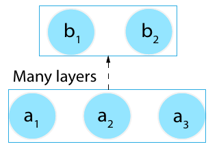
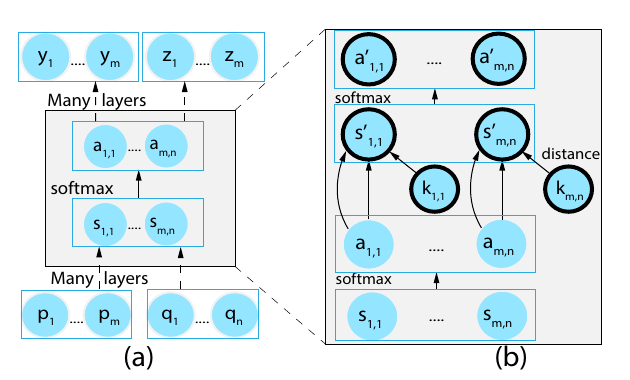
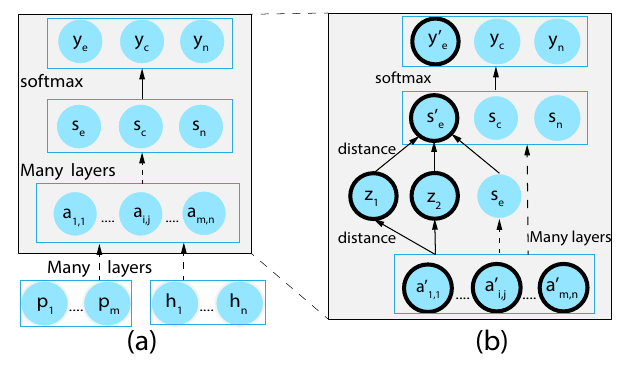

# 논리식을 신경망 층으로 컴파일하기 — Augmenting Neural Networks with First-order Logic

> 코드: [utahnlp/layer_augmentation](https://github.com/utahnlp/layer_augmentation)

---

## 1. 왜 이 논문이 필요한가

### 1) 신경망의 데이터 굶주림

신경망은 학습 데이터를 많이 요구한다. 기계 번역 모델 하나를 제대로 학습시키려면 수백만 쌍의 문장이 필요하다. 대량의 주석 데이터를 만드는 비용은 잘 알려져 있고, 그래서 새로운 태스크·도메인·언어에는 그만한 데이터가 아예 존재하지 않는 경우가 많다.

반면 우리가 태스크에 대해 알고 있는 것 중 상당수는 논리로 간단히 쓸 수 있다. 독해 태스크를 예로 들면, BiDAF 같은 attention 기반 모델은 질문의 단어와 본문의 단어를 정렬(align)하는 법을 데이터에서 배운다. 그런데 "ConceptNet 같은 외부 자원에서 서로 관련된 것으로 표시된 구절끼리는 정렬을 선호하라" 정도의 규칙은 사람이 한 줄로 쓸 수 있다. 이런 선언적 지식을 학습에 주입할 수 있다면, 모델이 데이터에 의존하는 정도를 줄이는 귀납적 편향(inductive bias)이 된다.

### 2) 문제는 "어떻게"다

논문이 세우는 질문은 세 가지다.

1. 선언적 규칙을 end-to-end 신경망 학습과 통합할 수 있는가?
2. 그런 규칙이 데이터 필요량을 줄여주는가?
3. 도메인 지식 주입은 사전학습 표현으로 무장한 대규모 학습 자원과 비교하면 어느 정도인가?

첫 번째가 기술적 난제의 핵심이다. 한쪽에는 **미분 불가능한 논리**로 학습과 예측을 이끌고 싶다는 요구가 있고, 다른 한쪽에는 **학습 방식을 다시 설계하지 않고 gradient 기반 학습의 이점을 그대로 유지**하고 싶다는 요구가 있다. 이 논문은 기존 네트워크 구조를 그대로 두고, 노드에 대한 제약을 결정적으로 미분 가능한 계산 그래프로 변환해 붙이는 프레임워크를 제안한다.

---

## 2. 핵심 아이디어 — 제약 신경층

### 1) named neuron과 진리값

신경망의 모든 뉴런이 해석 가능한 것은 아니지만, 일부는 태스크와 결부된 명확한 의미를 갖는다. attention처럼 **설계 단계에서 의미가 부여**되는 경우도 있고, 사후 분석으로 **우연히 발견**되는 경우도 있다. 논문은 이런 노드를 **named neuron**이라 부르고, 소문자 $a_i, b_j$로 노드를, 대문자 $A_i, B_j$로 대응 술어를 표기한다.

논리의 미분 불가능성을 다루는 출발점은 단순하다. **named neuron의 post-activation 값을 그 술어가 참인 정도로 해석**한다. 그러면 값이 $[0,1]$ 구간에 있는 뉴런은 그대로 soft 진리값이 된다.

### 2) 제약 신경층의 정의

$Y$에 대응하는 원래 뉴런이 $y = g(Wx)$일 때, 이를 다음으로 교체한다.

$$y = g\big(Wx + \rho\, d(z)\big) \qquad (1)$$

- $g$는 활성 함수, $W$는 네트워크 파라미터, $x$는 $y$의 직접 입력
- $z$는 전건 $Z$의 리터럴에 대응하는 **upstream 뉴런 벡터**
- $d$는 **거리 함수(distance function)** — 함의의 전건이 성립하는지를 미분 가능한 방식으로 포착한다
- $\rho \geq 0$은 제약의 중요도를 정하는 실수 하이퍼파라미터

여기서 놓치기 쉬운 점 하나. **$x$와 $z$는 다른 것**이다. $x$는 그 층의 원래 입력이고, $z$는 전건 뉴런이다. 논문이 명시한다 — "While the nodes $z$ need to be named neurons, the immediate input $x$ need not necessarily have symbolic meaning." 즉 전건은 "그 층의 입력"이 아니라, 그래프 어딘가 upstream에서 끌어온 **별도의 side channel**이다. 원래 입력 경로와 제약 경로가 나란히 존재한다.

### 3) 소프트 제약이라는 선택

수식을 보면 알 수 있듯이 이것은 논리식의 결과를 강제하는 장치가 아니다. $d(z)$는 pre-activation에 **더해지는 항**일 뿐이다. 전건이 참이면 $\rho\, d(z)$만큼 로짓을 밀어올리지만, $Wx$가 반대 방향으로 그보다 크면 결과는 뒤집힌다. 논문도 이걸 명시한다 — *"the network parameters might overrule the constraint."*

즉 이건 **추론 시점의 제약 만족(constraint satisfaction)이 아니라 로짓 편향(bias)**이다. ILP나 constrained decoding처럼 실행 가능 집합(feasible set)을 탐색하는 게 아니라서, 학습 후에도 예측이 규칙을 어길 수 있고 그걸 검출·차단하는 장치도 없다.

$\rho = +\infty$면 downstream 뉴런의 pre-activation이 거리 함수에 지배되므로 하드 제약이 된다고 논문은 쓰지만, 엄밀히는 극한에서만 그렇다. 실제 실험에서 쓴 값은 $\rho \in \{1, 2, 4, 8, 16\}$ 정도로 작다. 게다가 하나의 뉴런에 여러 제약이 걸리면 논문은 pre-activation 점수를 그냥 **더하는 휴리스틱**을 쓰고, 조합적 충돌 해소는 "base network에 맡긴다"고 인정한다. 하드 보장과는 거리가 있다.

**그런데 소프트인 것이 이 프레임워크의 강점이다.** 논문의 SNLI 실험에 등장하는 $N_3$가 정확히 이 지점을 보여준다. 저자들이 예비 분석에서 반례를 상당수 발견한 **노이즈 있는 규칙**인데, 하드로 걸었으면 그냥 성능을 깎았을 것이다. 소프트라서 1~10% 데이터 구간에서는 이득을 주고, 데이터가 늘면 모델이 이를 무시하는 쪽으로 학습된다.

규칙이 참임을 **보장**하고 싶다면 이 프레임워크는 맞는 도구가 아니다. 규칙을 귀납적 편향으로 주입해 데이터 의존도를 낮추는 것이 목적이다.

---

## 3. 논리식을 미분 가능한 수식으로 — 변환 절차

이 논문의 **핵심 기여가 바로 이 변환 절차**다. 실험 결과보다 §3이 본체다.

### 1) 전제 조건

변환이 성립하려면 세 가지가 필요하다.

**뉴런-술어 대응.** 계산 그래프의 일부 노드에 기호적 의미가 부여되어 있어야 한다.

**활성값 = 참인 정도.** 뉴런의 post-activation 값을 $[0,1]$ 구간의 진리값으로 해석한다. 그래서 실질적으로 softmax/sigmoid 출력에 적용된다.

**규칙 형태 제한.** $L \to R$에서 $L$은 리터럴의 논리곱/논리합, $R$은 **단일 리터럴**이어야 한다. 논문은 이것이 "Horn clause와 그 일반화"를 포함한다고 덧붙이는데, 이 언급이 나중에 중요한 힌트가 된다.

### 2) 비순환성

계산 그래프는 DAG인데 사용자가 쓴 규칙은 순환을 만들 수 있다. 이를 형식화하기 위해 논문은 upstream 관계를 정의한다 — 노드 $a$에서 $b$로 가는 유향 경로가 있으면 $a$는 $b$의 upstream이다.

> **정의 1 (Cyclic and Acyclic Implications).** 계산 그래프 $G$에 대해, 함의문 $L \to R$이 **순환적**이라는 것은 어떤 리터럴 $R_i \in R$의 노드 $r_i$가 어떤 $L_j \in L$의 노드 $l_j$의 upstream에 있다는 뜻이다. 순환적이지 않으면 **비순환적**이다.



*논문 Figure 2. 이 그래프에서 $A_1 \wedge B_1 \to A_2 \wedge B_2$는 순환적이다 — 후건의 $b_2$가 전건의 $a_1$보다 위에 있기 때문이다. 반면 $A_1 \wedge A_2 \to B_1 \wedge B_2$는 비순환적이다.*

여기서 흥미로운 사실 하나. 순환적인 문장은 **대우를 취해 비순환적으로 바꿀 수 있는 경우가 있다.** $B_1 \to A_1$은 순환적이지만 논리적으로 동치인 $\neg A_1 \to \neg B_1$은 비순환적이다. 논리적으로 동치인 두 식이 서로 **다른 계산 그래프**로 컴파일된다는 뜻이고, 이 자유도를 논문은 순환성을 고치는 도구로 쓴다.

다만 만능은 아니다. 논문 각주가 짚듯이 대우를 취하면 우변이 복잡해져(예: 논리곱이 되어) 컴파일할 수 없는 형태가 되기도 한다. 후건은 단일 리터럴이어야 하기 때문이다.

### 3) 거리 함수 — 이상적인 형태와 그 대리물

우리가 원하는 거리 함수는 사실 전건의 **지시 함수(indicator)**다.

$$d_{ideal}(z) = \begin{cases} 1, & Z\text{가 성립하면} \\ 0, & \text{그렇지 않으면}\end{cases}$$

당연히 미분 불가능하다. 그래서 매끄러운 대리물(smooth surrogate)이 필요하다. 논문은 이 관계를 **0-1 손실에 대한 hinge loss**의 관계에 비유한다 — 정확한 목표는 미분 불가능하니 학습 가능한 근사로 갈아끼우는 것이고, 다른 대리물도 얼마든지 가능하다.

논문이 택한 대리물은 확률적 소프트 논리(probabilistic soft logic)에서 쓰는 **Łukasiewicz T-norm**이다.

$$T(a,b) = \max(0,\, a + b - 1), \qquad S(a,b) = \min(1,\, a + b)$$

$n$개 리터럴로 일반화하면 논문의 Table 1이 나온다.

| 전건 | 거리 함수 $d(z)$ |
|---|---|
| $\bigwedge_i Z_i$ | $\max\left(0,\ \sum_i z_i - \lvert Z\rvert + 1\right)$ |
| $\bigvee_i Z_i$ | $\min\left(1,\ \sum_i z_i\right)$ |
| $\neg\bigvee_i Z_i$ | $\max\left(0,\ 1 - \sum_i z_i\right)$ |
| $\neg\bigwedge_i Z_i$ | $\min\left(1,\ N - \sum_i z_i\right)$ |

3·4행은 De Morgan으로 1·2행에서 유도된다. 개별 리터럴 부정은 $z_i \to 1 - z_i$ 치환이므로:

$$\neg\bigvee_i Z_i = \bigwedge_i \neg Z_i \;\Rightarrow\; \max\Big(0, \textstyle\sum_i (1-z_i) - N + 1\Big) = \max\Big(0,\, 1 - \sum_i z_i\Big)$$

**의미론적 확인** — 논리곱 행은 항이 하나만 거짓이어도 거리가 0이 되어 제약이 비활성화되고, 논리합 행은 모든 항이 거짓일 때만 0이 된다. 논리 연산의 성질이 그대로 보존된다.

**후건 부정**은 $y$의 pre-activation을 낮춰야 하므로 거리 함수 전체에 음수를 붙인다. 즉 $g(Wx - \rho\, d(z))$가 된다.

### 4) 임의의 Boolean 전건 — 보조층

Table 1은 CNF/DNF 한 겹만 처리한다. $(\neg A \vee B) \wedge (C \vee D)$ 같은 중첩 식은 **보조 변수**로 평탄화한다.

$$(\neg A \vee B) \leftrightarrow P, \quad (C \vee D) \leftrightarrow Q \quad\Rightarrow\quad P \wedge Q \to Y$$

문제는 쌍조건문($\leftrightarrow$)이 양방향이라 비순환성을 위반한다는 것이다. 논문의 해법은 — **보조 뉴런은 다른 노드에 의존하지 않으므로, 그 노드를 거리 함수 자체로 정의**해버린다.

$$y = d(z) \qquad (2)$$

활성 함수가 없다. $d$의 치역이 이미 $[0,1]$이라 정규화된 점수로 해석되기 때문이다. 이렇게 하면 비순환 부분 그래프가 만들어지고, Table 1을 그대로 재사용할 수 있다.

### 5) 전체 워크플로

1. 전건을 필요하면 CNF 또는 DNF로 변환 (중첩이면 보조 변수 도입)
2. Table 1로 거리 함수 구성 (부정 보정 포함)
3. 거리 함수로 제약층/보조층을 만들어 **원래 층을 교체**
4. 증강된 네트워크로 end-to-end 학습·추론

이 설계는 기존 네트워크에 학습 파라미터를 하나도 추가하지 않고, 현대 신경망 라이브러리로 효율적으로 구현된다. 후건이 논리곱이면 독립적인 제약 여러 개로 분해되고, 그보다 복잡한 후건은 future work으로 남겨졌다.

---

## 4. 왜 함의 형태인가 — 전건과 후건의 진짜 의미

$L \to R \equiv \neg L \vee R$은 Boolean 논리에서 참이다. 그렇다면 전체를 CNF나 DNF로 평탄화해서 다루면 안 될까? 왜 굳이 전건과 후건을 구분할까?

### 1) 전건과 후건의 두 겹 의미

논리적 의미는 평범하다. 하지만 이 프레임워크에서는 **계산 그래프상의 역할**이 겹쳐 있다.

| | 논리적 의미 | 그래프상 역할 |
|---|---|---|
| **전건** $Z$ | 조건부의 조건 | **upstream** named neuron $z$. forward pass에서 **이미 계산된** 값. 읽기만 함 |
| **후건** $Y$ | 조건이 참일 때의 귀결 | **downstream** 뉴런 $y$. pre-activation에 $\rho\,d(z)$가 **더해지는** 대상. 쓰기 |

즉 전건/후건 구분은 논리 구분이 아니라 **읽는 노드와 쓰는 노드의 구분**이다.

### 2) 평탄화하면 안 되는 이유

**첫째, 평탄화하면 "어느 뉴런에 더할지"를 잃는다.** $\neg K \vee \neg A \vee A'$라는 절을 받았다고 하자. 이 절은 세 변수에 대해 **대칭**이다. 어느 뉴런의 pre-activation을 건드려야 하는지 아무 정보도 주지 않는다. 그걸 정하려면 리터럴 하나를 head로 다시 지목해야 하는데, 그게 정확히 함의 형태로 되돌리는 일이다.

**둘째, 비순환성 판정 자체가 이 분할 위에 정의되어 있다.** 정의 1은 후건 노드가 전건 노드의 upstream인지를 묻는다. head가 지정되지 않으면 "순환적"이라는 말이 정의되지 않는다.

**셋째, 대칭 처리는 물리적으로 불가능하다.** 기계독해의 $R_2: K_{i,j} \wedge \overleftarrow{A_{i,j}} \to \overleftarrow{A'_{i,j}}$를 평탄화해서 모든 리터럴을 동등하게 취급한다고 해보자. 절을 만족시키려면 $\neg K$를 올리거나, $\neg A$를 올리거나, $A'$를 올려야 한다. 그런데 $k_{i,j}$는 ConceptNet에서 온 **외부 입력 노드**라 값이 주어져 있어 밀어올릴 대상이 아니고, $a_{i,j}$를 올리면 그 downstream인 $a'_{i,j}$가 바뀌고 그게 다시 순환을 만든다. **남는 선택지는 $a'_{i,j}$ 하나뿐**이다. 방향은 논리가 아니라 그래프 구조가 강제한다.

**넷째, 컴파일이 진리값 보존 변환이 아니다.** 이게 결정적이다. 논문은 $L \to R$의 진리값을 계산하지 않는다. $L$의 진리값만 계산해서 $R$의 로짓에 더한다. 이건 논리식의 평가가 아니라 **modus ponens를 메시지 전달로 구현한 것**이다. 앞서 본 대우 이야기가 여기서 다시 걸린다 — 논리적으로 동치인 두 식이 서로 다른 네트워크를 만들고, 하나는 컴파일되는데 다른 하나는 안 되기도 한다. 논리적 동치가 컴파일 결과의 동치를 보장하지 않는다.

**다섯째, 후건이 단일 리터럴인 이유도 여기서 나온다.** $y$는 뉴런 하나다. 후건을 단일 리터럴로 제한한 건 논리적 편의가 아니라 식 (1)의 구조적 귀결이다. 평탄화된 CNF 관점에서 보면 이 제한은 이유 없는 임의의 규칙처럼 보인다.

여기서 "Horn clause와 그 일반화"라는 언급이 이해된다. Horn clause는 **양의 리터럴이 최대 하나인 절**, 즉 함의로 **방향을 붙일 수 있는** 절이다. "$R$은 단일 리터럴"이라는 제한이 바로 그 방향 부여를 정칙적으로 만드는 조건이다.

### 3) 전건 = 입력, 후건 = 출력이 아니다

전건을 네트워크의 입력 변수, 후건을 출력 변수로 이해하면 이 프레임워크가 할 수 있는 일의 상당 부분을 놓친다. 전건과 후건을 묶는 조건은 오직 **비순환성**이고, 이는 네트워크의 절대적 입출력 층과 무관하게 **둘 사이의 상대적 순서**만 문제 삼는다.

논문 §4의 첫 문단이 사실상 이 오해를 미리 반박한다 — "1) **intermediate decisions**(즉 attention), 2) **intermediate states**로 제약된 출력 결정, 3) 라벨 의존성으로 제약된 출력 결정"의 세 유형을 탐색하겠다고 선언한다.

실제 규칙들의 위치를 보면 명확하다.

| 규칙 | 전건 | 후건 |
|---|---|---|
| $R_1$ (독해) | $K_{i,j}$ — 새로 만든 **외부 입력** 노드 | $\overleftarrow{A'_{i,j}}$ — **중간층** attention |
| $R_2$ (독해) | $K_{i,j} \wedge \overleftarrow{A_{i,j}}$ — 외부 입력 + **중간층** | $\overleftarrow{A'_{i,j}}$ — **중간층** |
| $N_3$ (NLI) | $Z_1 \wedge Z_2$ — **보조 뉴런** | $\neg Y'_{\text{Entail}}$ — **출력** |
| $C_1$ (청킹) | $Y_{t,\text{B-VP}}$ — **출력** | $\neg Y'_{t+1,\text{I-NP}}$ — **출력** |
| $C_5$ (청킹) | $N_t$ — 외부 입력(명사 여부) | $\neg Y'_{t,l}$ — **출력** |

$R_1$, $R_2$는 후건이 출력이 아니라 attention이다. 그리고 $C_1$은 **전건도 후건도 출력층 뉴런**이다 — 같은 층의 서로 다른 time step일 뿐이다. "입력 → 출력"으로는 설명이 안 된다.

그래도 "전건은 이미 계산이 끝나 값이 확정된 것, 후건은 지금 값을 정하려는 것"이라는 **시간적 순서** 감각은 정확하다. forward pass의 진행 방향과 modus ponens의 방향이 일치한다는 게 이 프레임워크의 핵심이다. 다만 그 순서는 DAG 위의 **임의의 지점 두 곳** 사이에서 성립하면 된다.

---

## 5. 술어를 어디에 대응시킬 것인가

그렇다면 적용하려는 논리식의 모든 변수가 신경망 안에 뉴런으로 존재해야 할까? 부분적으로 그렇다. 다만 논문은 세 가지 우회로를 제공해서 실제 재설계 부담을 크게 줄인다.

### 1) 세 가지 방법

**첫째, 이미 있는 named neuron을 쓴다.** 이게 논문의 주된 판매 포인트다. attention과 출력 softmax는 거의 모든 모델에 이미 있고, 의미도 명확하고, $[0,1]$로 정규화되어 있다. BiDAF, DAtt, BiLSTM tagger 모두 손대지 않고 그대로 썼다. 논문은 설계 시점에 의미가 부여되는 경우 외에 **사후 분석으로 발견되는 경우**도 언급한다 — 미리 계획하지 않아도 된다는 뜻이다.

**둘째, 없으면 새 입력 노드를 만든다.** $K_{i,j}$(ConceptNet 관련도)가 정확히 이 경우다. 논문의 표현으로 "$K_{i,j}$가 네트워크의 노드에 대응하지 않으므로, ConceptNet으로 값이 결정되는 새 노드 $k_{i,j}$를 만들어야 한다." 청킹의 $N_t$(명사 여부)도 마찬가지다. 외부 자원이나 결정적 함수로 값이 정해지는 노드라 **학습 파라미터가 늘지 않는다**. 계산 그래프에 상수 입력을 하나 더 꽂는 것뿐이다.

**셋째, 복합 술어는 보조 뉴런으로 자동 생성된다.** 앞서 본 $y = d(z)$ 구성이 이 역할을 한다. 설계자가 신경 쓸 일이 없다.

### 2) 실제로 남는 제약

| 술어의 성격 | 처리 | 비용 |
|---|---|---|
| 기존 뉴런이 이미 그 의미를 가짐 | 그대로 사용 | 없음 |
| 외부 자원·결정적 규칙으로 계산 가능 | 새 입력 노드 | 없음 |
| 다른 술어들의 논리적 조합 | 보조층 | 없음 |
| **학습된 새 표현이 필요함** | ← 여기서 막힌다 | 재설계 + 파라미터 증가 |

마지막 행이 진짜 한계다. 논문은 이 문제를 풀지 않고 **가정으로 치운다** — "we will **assume** named neurons are given."

예를 들어 "두 단어가 구문적으로 의존 관계면 …" 같은 규칙을 쓰고 싶은데 모델이 의존 구조를 명시적으로 표현하지 않는다면, 그 술어에 대응할 노드가 없다. 파서를 붙여 외부 입력으로 넣으면 두 번째 방법으로 해결되지만, 모델이 스스로 학습해서 표현해야 하는 개념이라면 아키텍처를 고쳐야 하고 "추가 파라미터 없음"이라는 장점이 깨진다.

**후건 쪽 제약이 더 빡빡하다.** 전건은 새로 만들어 꽂아도 되지만, 후건은 반드시 네트워크에 원래 있던 뉴런이어야 의미가 있다. $y = g(Wx + \rho d(z))$에서 $Wx$가 원래 계산이고 거기에 편향을 더하는 구조이기 때문이다. 존재하지 않던 노드를 후건으로 만들어봤자 downstream에서 아무도 소비하지 않으면 학습에 영향을 주지 못한다.

역으로 말하면, 이 프레임워크는 **해석 가능한 중간 표현을 가진 모델일수록 잘 붙는다**. 논문이 attention 기반 모델 두 개를 고른 것도 우연이 아니다.

---

## 6. 손실항이 아니라 계산 그래프

### 1) 실제로 그래프에 추가되는 것

컴파일 결과는 실제 그래프 구조다. 기계독해의 $R_2$를 컴파일하면 원래 그래프의 일부가 **교체**된다.



*논문 Figure 3. (a)는 BiDAF의 원래 계산 그래프, (b)는 $R_2$로 attention 층을 증강한 그래프다. 굵은 원이 새로 도입된 뉴런이다. 증강 모델에서는 (b)가 (a)의 음영 부분을 대체한다.*

- **새 노드**: $k_{i,j}$ (ConceptNet 값), $s'_{i,j}$ (제약된 점수), $a'_{i,j}$ (제약된 attention)
- **새 엣지**: $k_{i,j}, a_{i,j} \to s'_{i,j}$
- **새 연산**: $s'_{i,j} = s_{i,j} + \rho\max(0,\ k_{i,j}+a_{i,j}-1)$

이후 downstream은 $a_{i,j}$ 대신 $a'_{i,j}$를 소비한다. 워크플로 3단계의 표현이 정확하다 — "replacing the original layer with constrained one."

### 2) 인접 연구와의 대비

논문 §5가 이 구분으로 정리되어 있다.

| 접근 | 논리가 사는 곳 | 추론 시 |
|---|---|---|
| **손실항 계열** (Xu et al. semantic loss, Rocktäschel, Fischer DL2 등) | 손실 함수 | **사라진다.** 네트워크는 그대로 |
| **증류 계열** (Hu et al. 2016) | teacher network → 파라미터로 증류 | **사라진다.** 규칙은 가중치에 흡수 |
| **네트워크 구축 계열** (KBANN, CILP++) | 아키텍처 전체 | 남지만, 새 아키텍처를 **설계**해야 함 |
| **이 논문** | **계산 그래프의 부분 그래프** | **남는다.** forward pass마다 평가됨 |

논문은 KBANN·CILP++과의 차이를 직접 언급한다 — "we use first-order logic to **augment a given architecture** instead of designing a new one."

논리가 그래프에 상주하므로 **학습과 추론 양쪽 모두에서 작동**한다. 초록의 "guide training and prediction"이 그 뜻이다. 손실항 방식은 학습 시점만, 하드 제약 디코딩은 추론 시점만 건드린다.

### 3) "first-order"의 의미 — 예시마다 grounding

다만 정밀화가 하나 필요하다. 추가되는 것은 임의의 학습 가능한 연결이 아니라, Table 1이 지정한 $\max/\min/\text{sum}$ 조합이다. 가중치가 없고 학습되지 않는다. 그래서 "추가 파라미터 0개"가 성립한다.

그리고 이것은 정적 회로가 아니다. 논문의 표현으로 규칙들은 "특정 문단과 질의에 대해 계산 그래프로 **동적으로 grounding되는**" 1차 논리문이다. $\forall i,j \in C$는 문단 길이 $m$, 질의 길이 $n$에 따라 매번 다른 개수의 인스턴스로 펼쳐진다. $m \times n$개의 $k_{i,j}$ 노드가 생기고, 다음 예시에서는 크기가 달라진다. Markov Logic Network에서 1차 논리를 template으로 쓰는 것과 같은 구조인데(논문도 이 유사성을 언급한다), 여기서는 Markov network 대신 **계산 그래프로 grounding**한다.

---

## 7. 배경 — CoNLL 2000 청킹과 BIO 태그

가장 완전하게 따라가볼 사례는 텍스트 청킹 실험이다. attention이 없어서 그래프가 단순하고, 규칙이 직관적이며, CRF와의 비교까지 붙어 있다. 먼저 태스크를 정리한다.

### 1) 청킹이란

**얕은 구문 분석(shallow parsing)**이다. 문장을 겹치지 않고 중첩되지 않는 구(phrase) 단위로 자른다.

```
[NP He] [VP reckons] [NP the current account deficit] [VP will narrow]
[PP to] [NP only # 1.8 billion] [PP in] [NP September] .
```

POS 태깅과 완전 구문 분석의 중간에 있다. 완전 파싱은 재귀적 트리를 만들지만, 청킹은 **평평한 구간 분할**이다. NP 안에 NP가 들어가지 않는다. 그래서 훨씬 빠르고, 정보 추출·개체명 인식 전처리 등에 실용적으로 쓰였다.

### 2) 데이터셋

Tjong Kim Sang & Buchholz (2000)의 shared task. Penn Treebank의 Wall Street Journal 파스 트리에서 청크를 자동 추출했다.

| | 출처 | 문장 | 토큰 |
|---|---|---|---|
| 학습 | WSJ 15–18절 | 8,936 | 약 211,000 |
| 테스트 | WSJ 20절 | 2,012 | 약 47,000 |

3열 포맷 — 단어, POS 태그, 청크 태그:

```
He         PRP   B-NP
reckons    VBZ   B-VP
the        DT    B-NP
current    JJ    I-NP
account    NN    I-NP
deficit    NN    I-NP
will       MD    B-VP
narrow     VB    I-VP
to         TO    B-PP
only       RB    B-NP
#          #     I-NP
1.8        CD    I-NP
billion    CD    I-NP
in         IN    B-PP
September  NNP   B-NP
.          .     O
```

가운데 POS 열이 논문의 $N_t$("$t$번 단어가 명사인가") 출처다. `NN`, `NNS`, `NNP`, `NNPS`면 $n_t = 1$. 데이터에 이미 들어 있으니 새 파라미터 없이 입력 노드로 꽂을 수 있었던 것이다.

청크 유형은 11가지 — NP, VP, PP, ADVP, ADJP, SBAR, PRT, CONJP, INTJ, LST, UCP. 실제로는 NP·VP·PP가 대부분을 차지하고 나머지는 드물다.

### 3) BIO 태그

구간 분할을 **토큰별 분류 문제로 바꾸는** 인코딩이다.

| 태그 | 의미 |
|---|---|
| **B**-X | 유형 X 청크의 **시작**(Beginning) |
| **I**-X | 유형 X 청크의 **내부**(Inside) — 앞 토큰에서 이어짐 |
| **O** | 어떤 청크에도 속하지 않음(Outside) |

`the current account deficit`이 하나의 NP라면 `B-NP I-NP I-NP I-NP`가 된다. 다음 토큰이 `B-NP`면 새 NP가 시작되는 것이고, `I-NP`면 같은 NP가 계속되는 것이다. **B와 I의 구분이 있어야 인접한 두 청크를 붙여 읽지 않는다.**

태그 개수는 $11 \times 2 + 1 = 23$개다. 나중에 CRF의 전이 행렬이 $23^2 \approx 529$개 파라미터라는 계산이 여기서 나온다.

### 4) IOB1 vs IOB2 — 논문 규칙의 타당성이 여기 달려 있다

두 변종이 있다.

- **IOB1** (Ramshaw & Marcus 1995): 청크는 기본적으로 `I-`로 시작한다. `B-`는 같은 유형의 청크가 바로 연달아 나올 때만 경계 표시로 쓴다.
- **IOB2**: 모든 청크가 예외 없이 `B-`로 시작한다.

CoNLL 2000은 **IOB2**다. 위 예시에서 문장 첫 단어 `He`가 `B-NP`인 게 증거다 — IOB1이었으면 `I-NP`였을 것이다.

이 구분이 중요한 이유는, IOB2에서는 다음 문법이 예외 없이 성립하기 때문이다.

> $\text{I-X}$는 오직 $\text{B-X}$ 또는 $\text{I-X}$ 뒤에만 올 수 있다.

논문의 규칙들이 바로 이 문법의 개별 사례들이다. IOB1 데이터였다면 이 규칙들은 **틀린 규칙**이 된다.

---

## 8. 완전한 사례 — 텍스트 청킹

### 1) 베이스라인

$$\mathbf{x} = \mathrm{BiLSTM}(x) \qquad (9)$$
$$\mathbf{y} = \sigma(\mathrm{linear}(\mathbf{x})) \qquad (10)$$

$\sigma$는 softmax, $\mathbf{y}$는 BIO 태그 확률. 방향당 hidden 100, 마지막 linear 앞에 dropout 0.5, Adam lr 0.0001, 100 epoch, GloVe 300차원(840B 토큰).

이 태거는 각 위치의 라벨을 **독립적으로** 결정한다. $t$번 결정과 $t{+}1$번 결정 사이에 아무 연결이 없어서 "B-VP 다음에 I-NP" 같은 불법 시퀀스를 만들 수 있다.

### 2) 술어 → 노드 대응

| 술어 | 노드 | 출처 |
|---|---|---|
| $Y_{t,l}$ | $y_{t,l}$ — 원래 softmax 출력 | **이미 존재** |
| $Y'_{t,l}$ | $y'_{t,l}$ — 제약된 출력 | 교체되어 생성 |
| $N_t$ | $n_t \in \{0,1\}$ | **새 입력 노드** (POS 태그에서 결정적으로) |

$N_t$가 앞서 말한 "없으면 새 입력 노드를 만든다"의 사례다. 학습 파라미터가 아니라 상수 입력이다.

### 3) 규칙

**출력 간 라벨 의존성** — "$t$번 단어가 어떤 라벨의 B/I 태그면, $t{+}1$번은 다른 라벨의 I 태그일 수 없다":

$$C_1: \forall t,\ Y_{t,\text{B-VP}} \to \neg Y'_{t+1,\text{I-NP}}$$
$$C_2: \forall t,\ Y_{t,\text{I-NP}} \to \neg Y'_{t+1,\text{I-VP}}$$
$$C_3: \forall t,\ Y_{t,\text{I-VP}} \to \neg Y'_{t+1,\text{I-NP}}$$
$$C_4: \forall t,\ Y_{t,\text{B-PP}} \to \neg Y'_{t+1,\text{I-VP}}$$

$C_1$의 직관: I-NP는 "이미 시작된 NP의 내부"라는 뜻이므로 동사구 바로 뒤에 올 수 없다. 앞의 예문 *"He **reckons**(B-VP) **the**(?) current account deficit …"* 에서 "the"는 B-NP여야지 I-NP일 수 없다.

**입력 → 출력**:

$$C_5: \forall t,\ N_t \to \bigwedge_{l \in \{\text{B-VP},\text{I-VP},\text{B-PP},\text{I-PP}\}} \neg Y'_{t,l}$$

"명사는 NP가 아닌 라벨을 가질 수 없다."

눈에 띄는 점 하나 — 논문은 §7에서 정리한 IOB2 일반 문법을 하나의 규칙으로 쓰지 않고 **자주 나오는 4개 사례만** 골라 썼다. 원리상으로는 모든 유형 쌍을 커버할 수 있었을 것이다. 프레임워크의 유연성을 보이는 게 목적이었지 최고 성능을 짜내는 게 목적이 아니었던 셈이다.

### 4) 컴파일

$C_1$은 전건이 **단일 리터럴**이므로 $d = y_{t,\text{B-VP}}$. 후건이 부정이므로 거리 함수 전체에 음수를 붙인다.

$$s'_{t+1,\text{I-NP}} = s_{t+1,\text{I-NP}} - \rho\, y_{t,\text{B-VP}}, \qquad \rho = 4$$

$C_5$는 후건이 논리곱이므로 **4개 독립 제약으로 분해**된다.

$$s'_{t,l} = s_{t,l} - 16\, n_t \quad \text{for } l \in \{\text{B-VP},\text{I-VP},\text{B-PP},\text{I-PP}\}$$

$n_t = 1$이면 해당 로짓에서 16을 뺀다. $\rho=16$은 $C_{1:4}$의 4보다 훨씬 큰데, $C_5$가 더 신뢰할 만한 규칙이라는 판단이다.

**여러 제약이 한 뉴런에 걸릴 때** 논문의 합산 휴리스틱이 쓰인다. $t{+}1$번 단어가 명사이고 앞 단어가 I-NP거나 B-PP인 경우:

$$s'_{t+1,\text{I-VP}} = s_{t+1,\text{I-VP}} \underbrace{-\ 4\, y_{t,\text{I-NP}}}_{C_2} \underbrace{-\ 4\, y_{t,\text{B-PP}}}_{C_4} \underbrace{-\ 16\, n_{t+1}}_{C_5}$$

$$y'_{t+1} = \mathrm{softmax}(s'_{t+1})$$

**비순환성 확인.** 전건은 **제약되지 않은** $Y_{t,l}$이고 후건은 **제약된** $Y'_{t+1,l}$이다. BiLSTM 태거는 자기회귀가 아니라 $y_t$와 $y_{t+1}$이 서로 upstream이 아니고, 규칙이 모두 $t \to t{+}1$ 방향이므로 순환이 생기지 않는다. 전건에 $Y$가 아니라 $Y'$를 썼다면 제약이 연쇄되면서 위험해졌을 것이다.

### 5) 학습 — gradient가 어디로 흐르나

학습 절차는 **하나도 바뀌지 않는다**. 손실은 $y'$에 대한 평범한 cross-entropy, 옵티마이저도 그대로다. 정규화항도, teacher network도, 별도 단계도 없다.

핵심은 gradient의 경로다. $y_{t,\text{B-VP}} = \mathrm{softmax}(s_t)_{\text{B-VP}}$는 BiLSTM 파라미터 $\theta$의 함수이므로:

$$\frac{\partial \mathcal{L}}{\partial \theta} = \underbrace{\frac{\partial \mathcal{L}}{\partial s_{t+1}}\frac{\partial s_{t+1}}{\partial \theta}}_{\text{원래 경로}} + \underbrace{\frac{\partial \mathcal{L}}{\partial s'_{t+1,\text{I-NP}}} \cdot (-\rho)\cdot\frac{\partial y_{t,\text{B-VP}}}{\partial \theta}}_{\text{제약이 새로 만든 경로}}$$

**두 시점이 손실을 통해 결합된다.** 이게 추론 시 필터링과 결정적으로 다른 점이다. 작동 방식을 두 경우로 나눠 보면:

- **규칙과 정답이 일치할 때**: $t$에서 B-VP가 확신되면 $t{+}1$의 I-NP 로짓이 자동으로 눌린다. 모델은 이 패턴을 데이터에서 배우는 데 파라미터를 쓸 필요가 없어지고, 그만큼 다른 신호에 용량을 할애한다.
- **규칙이 틀린 예시**: 손실이 반대로 밀어낸다. 이때 gradient는 $s_{t+1,\text{I-NP}}$를 올리거나 $y_{t,\text{B-VP}}$를 **내리는** 두 방향으로 갈라진다. 후자가 앞 시점의 예측까지 바꾼다는 게 흥미로운 부작용이다. 이 경로가 "network parameters might overrule the constraint"의 실체다.

$\rho$는 학습되지 않는다. $\{1,2,4,8,16,32,64\}$에서 grid search로 골랐다. **추가 학습 파라미터는 0개**다.

---

## 9. CRF와의 비교

논문은 이 실험에서 BiLSTM-CRF를 함께 놓고 비교한다. 같은 문제를 전혀 다른 원리로 풀기 때문이다.

### 1) CRF의 원리

Linear-chain CRF는 라벨 시퀀스 $\mathbf{y} = (y_1,\dots,y_T)$ **전체에** 점수를 준다.

$$\mathrm{score}(\mathbf{x}, \mathbf{y}) = \sum_{t=1}^{T} \underbrace{s_{t,y_t}}_{\text{emission}} + \sum_{t=2}^{T} \underbrace{A_{y_{t-1},\, y_t}}_{\text{transition}}$$

- **Emission** $s_{t,l}$: BiLSTM이 내놓는 원래 로짓. "이 단어가 라벨 $l$일 만한가"
- **Transition** $A_{l,l'}$: **새로 학습되는** $L \times L$ 행렬. "라벨 $l$ 다음에 $l'$이 올 만한가"

확률은 모든 가능한 시퀀스에 대해 정규화한다.

$$P(\mathbf{y}\mid\mathbf{x}) = \frac{\exp\big(\mathrm{score}(\mathbf{x},\mathbf{y})\big)}{\sum_{\mathbf{y}'} \exp\big(\mathrm{score}(\mathbf{x},\mathbf{y}')\big)}$$

분모는 $L^T$개 시퀀스의 합이라 순진하게는 계산 불가능하지만, forward 알고리즘으로 $O(TL^2)$에 구한다. 추론은 Viterbi로 최적 시퀀스를 찾는다.

$C_1$의 지식 — "B-VP 다음에 I-NP는 안 된다" — 은 CRF에서 $A_{\text{B-VP},\,\text{I-NP}} \ll 0$으로 표현된다. 학습 데이터에 그 전이가 안 나오면 로그우도 최대화가 이 원소를 알아서 큰 음수로 만든다. **즉 CRF는 같은 지식을 데이터에서 학습한다.** 논문의 프레임워크는 그걸 사람이 써서 주입한다. 목적지가 같고 도달 방법이 다르다.

### 2) 결정적 차이

| | CRF | 논문 프레임워크 |
|---|---|---|
| 지식 출처 | 데이터에서 **추정** | 사람이 **선언** |
| 추가 파라미터 | $L^2$개 (청킹은 약 529개) | **0개** |
| 작동 시점 | 디코딩(추론) | pre-activation → **학습·추론 양쪽** |
| 표현 범위 | 인접 라벨 쌍 **전부** | 명시한 것만, 대신 구조는 자유 |
| 추론 비용 | Viterbi $O(TL^2)$ | 없음 (평범한 forward + 위치별 argmax) |
| 보장 | 전역 최적 시퀀스 | 없음, 편향뿐 |

### 3) 결과

| %Train | BiLSTM | +CRF | +$C_{1:5}$ | +CRF, $C_{1:5}$ |
|---|---|---|---|---|
| 5% | 87.2 | 86.6 | **88.9** | 88.6 |
| 10% | 89.1 | 88.8 | **90.7** | 90.6 |
| 20% | 90.9 | 90.8 | **92.1** | **92.1** |
| 40% | 92.5 | 92.5 | 93.4 | **93.5** |
| 100% | 94.1 | 94.4 | 94.8 | **95.0** |

*논문 Table 4. 테스트셋 정확도, 3회 실행 평균. 높을수록 좋다. $C_{1:4}$는 $\rho=4$, $C_5$는 $\rho=16$.*

읽어야 할 지점이 셋이다.

**CRF가 40% 이하에서 베이스라인보다 나쁘다** (5%: 86.6 vs 87.2). 논문의 진단은 "global inference relies on more training examples to **learn its scoring function**"이다. 전이 행렬 529개 원소를 447문장으로 추정해야 하는데, 대부분의 라벨 쌍은 몇 번 등장하지도 않는다. 추정이 부정확한 전이 점수로 전역 탐색을 하면 오히려 emission의 좋은 판단을 망칠 수 있다. 반면 $\rho\, y_{t,\text{B-VP}}$를 빼는 건 **추정할 게 없다**. 데이터가 447문장이든 8,936문장이든 똑같이 작동한다.

**이득이 데이터가 늘수록 줄어든다** (+1.7 → +0.7).

**둘을 결합하면 전체 데이터에서 최고다** (95.0). 논문은 이를 "orthogonal methods"라 부른다.

### 4) 왜 결합하면 좋은가

두 가지가 겹치지 않기 때문이다.

**CRF만 할 수 있는 것** — 사람이 미처 생각 못 한 전이 패턴을 데이터에서 발견한다. $C_1$~$C_4$는 4개뿐이지만 전이 행렬은 529개 조합을 전부 커버한다. 그래서 데이터가 충분하면 CRF가 이긴다(100%: 94.4 vs 94.1).

**제약만 할 수 있는 것** — 두 가지다. 첫째, $C_5$("명사는 VP/PP 라벨을 가질 수 없다")는 인접 라벨이 아니라 **입력에 의존**한다. CRF의 전이 행렬은 입력과 무관하므로 이 지식을 담을 자리가 없다. 둘째이자 더 중요한 것, CRF는 **디코딩 시점**에만 작동한다. 전이 점수는 Viterbi 경로를 바꿀 뿐 BiLSTM이 배우는 표현을 직접 바꾸지 않는다. 반면 $\rho\,d(z)$는 backprop을 타고 인코더까지 흘러간다.

### 5) 한 가지 덧붙이면

BIO 태그의 불법 전이는 사실 $A_{l,l'} = -\infty$로 **하드코딩**할 수도 있다. 논문이 언급한 "hard constraints in the output space"가 이것이고, 실무에서는 흔히 그렇게 한다.

그런데 그렇게 하면 앞의 논의로 돌아간다 — 추론 시 불법 출력은 막지만, 모델은 여전히 그 규칙을 **모르는 채로** 학습된다. 논문의 선택은 규칙을 학습 신호로 쓰는 쪽이고, 저데이터 구간의 격차가 그 선택의 값어치다. 논문 자신의 표현으로, "our framework provides a **differentiable way to inform the model during training and prediction**."

---

## 10. 나머지 두 실험

### 1) 기계독해 — 중간 결정에 제약 걸기

SQuAD v1.1에서 BiDAF와 그 ELMo 변형을 대상으로, ConceptNet의 단어 관련도로 attention을 유도한다. 술어는 셋이다 — $K_{i,j}$(ConceptNet의 Synonym/DistinctFrom/IsA/Related 엣지로 연결됨), $\overleftarrow{A}_{i,j}$(제약 없는 정렬 결정), $\overleftarrow{A'}_{i,j}$(제약된 정렬 결정).

$$R_1: \forall i,j \in C,\ K_{i,j} \to \overleftarrow{A'_{i,j}}$$
$$R_2: \forall i,j \in C,\ K_{i,j} \wedge \overleftarrow{A_{i,j}} \to \overleftarrow{A'_{i,j}}$$

$R_1$은 "관련된 두 단어는 정렬되어야 한다"이고, $R_2$는 제약 없는 모델 결정에도 의존하는 **보수적** 변형이다. 흥미롭게도 $R_1$을 Table 1로 컴파일하면 $d = k_{i,j}$가 되어 $s' = s + \rho k$가 된다 — 논문의 표현대로 "단어 관련도를 정적 feature로 더하는 것과 본질적으로 같다."

| %Train | BiDAF | +$R_1$ | +$R_2$ | +ELMo | +ELMo, $R_1$ |
|---|---|---|---|---|---|
| 10% | 57.5 | **61.5** | 60.7 | 71.8 | **73.0** |
| 20% | 65.7 | **67.2** | 66.6 | 76.9 | **77.7** |
| 40% | 70.6 | **72.6** | 71.9 | 80.3 | **80.9** |
| 100% | 75.7 | **77.4** | 77.0 | 83.9 | **84.1** |

*논문 Table 2. 테스트셋 span F1, 3회 실행 평균. $\rho=2$.*

여기서 세 번째 연구 질문의 답이 나온다. 사전학습 인코더는 **표현을 개선**하고 이 프레임워크는 **그래프를 증강**한다 — 직교하는 두 방향이다. ELMo 위에 얹어도 일관되게 추가 이득이 있다.

### 2) 자연어추론 — attention과 출력을 잇는 규칙

SNLI에서 Decomposable Attention의 BiLSTM 변형(L-DAtt)을 대상으로 한다. $N_1$, $N_2$는 $R_1$, $R_2$와 같은 형태로 attention을 제약하고, $N_3$가 attention과 출력 라벨을 잇는다.

$$N_3:\ Z_1 \wedge Z_2 \to \neg Y'_{\text{Entail}}$$
$$\Big(\exists j \in C,\ \neg(\exists i \in C,\ \overleftarrow{A'_{i,j}})\Big) \leftrightarrow Z_1, \qquad \Big(\exists j \in C,\ \neg(\exists i \in C,\ \overrightarrow{A'_{i,j}})\Big) \leftrightarrow Z_2$$

"가설의 내용어가 정렬되지 않으면 Entailment가 아니다." 논문에서 가장 복잡한 규칙이라 §3의 4단계가 모두 나온다.



*논문 Figure 4. (a) L-DAtt의 원래 그래프, (b) $N_3$로 Entail 라벨을 증강한 그래프. 굵은 원이 새로 도입된 뉴런이고, $z_1$·$z_2$가 보조 뉴런이다.*

**보조층 구성** — 안쪽 $\exists i$는 $i$에 대한 논리합이고 그 전체가 부정이므로 Table 1의 3행:

$$u_j = \max\Big(0,\ 1 - \sum_{i \in C} \overleftarrow{a'_{i,j}}\Big)$$

바깥 $\exists j$는 다시 논리합이므로 2행:

$$z_1 = \min\Big(1,\ \sum_{j \in C} u_j\Big)$$

$z_2$도 반대 방향 attention으로 동일하게 만든다. 둘 다 활성 함수 없는 보조층이다.

**제약층 구성** — 전건은 논리곱, 후건은 부정:

$$s'_{\text{Entail}} = s_{\text{Entail}} - \rho \cdot \max(0,\ z_1 + z_2 - 1)$$

$$\mathbf{y} = \mathrm{softmax}(s'_{\text{Entail}},\, s_{\text{Contradict}},\, s_{\text{Neutral}})$$

| %Train | L-DAtt | +$N_1$ | +$N_2$ | +$N_3$ | +$N_{2,3}$ |
|---|---|---|---|---|---|
| 1% | 61.2 | **64.9** | 63.9 | 62.5 | 64.3 |
| 2% | 66.5 | **70.5** | 69.8 | 67.9 | 70.2 |
| 5% | 73.4 | 76.2 | **76.6** | 74.0 | 76.4 |
| 10% | 78.9 | 80.1 | **80.4** | 79.3 | 80.3 |
| 100% | **87.1** | 86.9 | **87.1** | 87.0 | 86.9 |

*논문 Table 3. SNLI 테스트셋 정확도, 3회 실행 평균.*

**노이즈 있는 규칙에 대한 관찰이 이 표의 가장 흥미로운 부분이다.** $N_3$는 예비 분석에서 반례가 상당수 발견된 규칙이라 $N_2$보다 성능이 낮고 100%에서는 베이스라인보다도 나쁘다. 그런데 **10% 이하에서는 여전히 도움이 된다.** $N_1$에서도 같은 패턴이 보이고, 논문은 보수적 제약이 노이즈를 다루는 한 방법일 수 있다고 정리한다.

반대 방향의 발견도 있다. $N_2$와 $N_{2,3}$을 비교하면, 좋은 제약 $N_2$가 네트워크를 증강할 뿐 아니라 **$N_3$의 노이즈까지 증폭**한다. 그래서 $N_{2,3}$은 5% 데이터부터 성능이 떨어지기 시작하는데, 이는 $N_3$ 단독보다 훨씬 이른 시점이다.

그리고 전체 데이터를 쓰면 증강 모델이 $\rho$를 낮춰도 베이스라인과 비슷할 뿐이다. 논문의 결론은 담백하다 — **대규모 데이터가 있다면 데이터를 믿는 편이 나을 수 있고, 작은 데이터셋에서는 제약이 유용한 귀납적 편향을 준다.**

---

## 11. 정리와 남는 질문

이 논문의 기여는 "논리 → 미분 가능한 층"이라는 **기계적 변환 절차**다. 새 아키텍처를 설계하는 대신 기존 모델의 특정 층을 제약된 층으로 갈아끼우기만 하면 되고, 학습 파라미터는 하나도 늘지 않으며, 학습 방식도 바뀌지 않는다.

세 태스크의 결과는 일관된 그림을 그린다. **이득은 학습 데이터가 적을수록 크고, 데이터가 충분해지면 사라진다.** 그리고 사전학습 표현과 직교적이라 ELMo 위에 얹어도 추가 이득이 있다.

동시에 명확한 한계도 있다.

**보장이 없다.** 소프트 편향이므로 학습 후에도 예측이 규칙을 어길 수 있다. 이건 노이즈 있는 규칙을 수용하기 위한 의도된 설계지만, 안전성이 필요한 상황에서는 맞는 도구가 아니다.

**named neuron 가정.** 제약을 걸고 싶은 개념이 네트워크 안에 $[0,1]$ 값의 해석 가능한 뉴런으로 존재해야 한다. 논문은 이를 "given"으로 두고 시작한다. 그런 표현이 없는 아키텍처에서는 그 개념을 위해 층을 새로 만들어야 하고, 그러면 이 프레임워크의 장점이 상당 부분 사라진다.

**충돌 처리가 휴리스틱이다.** 여러 제약이 한 뉴런에 걸릴 때 pre-activation을 그냥 더한다. 논문 스스로 조합적 충돌은 base network에 맡긴다고 인정한다.

**후건 형태 제한.** 후건은 단일 리터럴(또는 분해 가능한 논리곱)이어야 한다. 더 복잡한 후건은 future work로 남았다.

**$\rho$를 손으로 찾아야 한다.** 규칙마다, 데이터 크기마다 grid search가 필요하다. 규칙의 신뢰도를 데이터에서 학습하는 방향은 자연스러운 후속 연구 주제로 보인다.

마지막으로, 논문이 남긴 열린 질문 하나를 그대로 옮긴다. 구조를 통해 backprop하는 연구 흐름과 이 프레임워크의 관계다. 여기서는 구조화된 추론이 필수가 아닌데, 청킹 실험에서 CRF와 결합했을 때 최고 성능이 나온 것처럼 두 접근의 상호작용에는 아직 연구할 여지가 있다.

---

### 참고

- Tao Li, Vivek Srikumar. *Augmenting Neural Networks with First-order Logic.* ACL 2019.
- 구현: [github.com/utahnlp/layer_augmentation](https://github.com/utahnlp/layer_augmentation)
- 거리 함수의 근거: Klement, Mesiar, Pap. *Triangular Norms* (2013); Kimmig et al., *Probabilistic Soft Logic* (2012)
