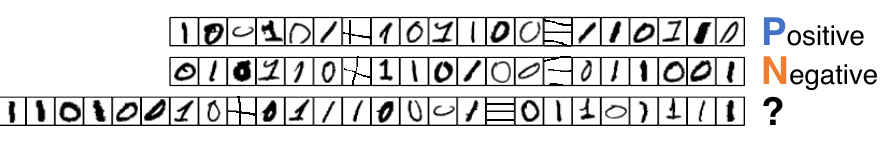
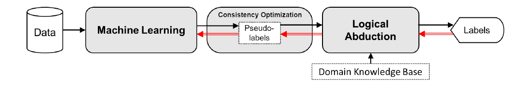

# 지각과 추론을 다리 놓다: Abductive Learning (ABL) 파헤치기

이 글은 저우즈화(Zhi-Hua Zhou) 그룹이 NeurIPS 2019에서 발표한 **Abductive Learning(ABL, 귀추 학습)** 논문을 대화하듯 뜯어본 기록이다. 논문의 큰 그림에서 시작해, 실제로 어떤 데이터를 썼는지, 알고리즘이 한 사이클씩 어떻게 도는지, `Definition 1`의 abducible predicate가 정확히 무엇을 가리키는지, 연산 규칙은 어떤 형태로 표현되는지, 그리고 문제를 십진수·사칙연산으로 키우면 탐색 공간이 어떻게 폭발하는지까지 순서대로 따라간다.

---

## 1. 왜 이 논문인가: 지각과 추론의 분리

AI의 두 축인 **지각(perception)** 과 **추론(reasoning)** 은 인간에게는 자연스럽게 통합되지만, AI에서는 각각 머신러닝(딥러닝)과 논리 프로그래밍으로 따로 발전해 왔다. 딥러닝은 지각은 잘하지만 기호적 도메인 지식을 활용한 논리 추론을 못하고, 반대로 논리 기반 시스템(확률 논리 프로그래밍 등)은 추론은 되지만 **이미 정제된 기호(symbol) 입력을 요구**한다는 한계가 있다.

즉 딥러닝은 픽셀에서 패턴을 뽑아내는 데는 탁월하지만 "이 사실들로부터 무엇이 따라 나오는가"라는 완전한 논리 추론을 하지 못하고, 논리 시스템은 추론은 하지만 애초에 "이 이미지가 숫자 3이다" 같은 기호를 사람이 정제해 넣어줘야 작동한다. 두 능력은 인간에게는 하나로 맞물려 돌아가는데, AI에서는 대부분의 역사 동안 따로 놀았다.

### 1) 실마리: 귀추(abduction)

논문은 인간의 **귀추(abduction)** — 배경지식에 근거해 관찰을 가장 잘 설명하는 가설을 역으로 추론하는 것 — 에서 착안했다. 저자들은 마야 상형문자를 해독한 Charles P. Bowditch의 사례를 예로 든다. 숫자를 눈으로 인식하고(지각), 달력·수학 지식으로 추론하며(추론), **둘의 일관성을 맞춰가며** 정답을 찾은 과정이다. Bowditch는 먼저 아는 숫자 몇 개를 식별한 뒤, 미지의 문자를 시각적으로 비슷한 숫자로 대입해 보고, 마야 달력 지식으로 그 대입이 앞뒤가 맞는지 계산해, 추측과 계산이 일치하는 지점에서 정답을 확정했다. ABL은 바로 이 과정을 하나의 프레임워크로 옮긴다.

---

## 2. 예제 데이터: 손글씨 수식 해독 퍼즐

마야 문자 데이터는 실제로 구하기 어려웠기 때문에, 저자들은 그와 구조적으로 동일한 성격의 인공 과제를 직접 설계했다. 바로 **손글씨 수식 해독(Handwritten Equation Decipherment)** 퍼즐이다.



### 1) 데이터의 생김새

각 예제(instance)는 하나의 수식(equation)이고, 이 수식은 **문자 이미지들이 순서대로 나열된 시퀀스**다. 사용된 기호는 딱 4종류다: `0`, `1`, `+`, `=`. 즉 컴퓨터에 들어가는 입력은 "숫자로 정제된 수식"이 아니라 **날 것의 픽셀 이미지 배열**이다.

여기서 결정적으로 중요한 지점이 있다. 각 수식에는 **그 수식이 맞는지 틀린지를 나타내는 라벨(positive/negative) 하나만** 붙어 있다. 개별 이미지가 "0인지 1인지 +인지 ="인지에 대한 정답(ground truth)은 **전혀 주어지지 않는다.** 오직 수식 전체의 참/거짓만 안다.

### 2) 두 종류의 이미지셋 (DBA / RBA)

데이터는 두 버전으로 만들어졌다.

- **DBA (Digital Binary Additive)**: 벤치마크 손글씨 숫자 데이터셋(MNIST 계열)의 이미지로 수식을 구성. 기호들이 비교적 구분하기 쉽다.
- **RBA (Random Symbol Binary Additive)**: Omniglot 데이터셋에서 **무작위로 고른 문자**를 기호로 사용. DBA와 구조는 완전히 동일(isomorphic)하지만 이미지가 훨씬 낯설고 구분이 어렵다. 지각(perception) 일반화 능력을 더 강하게 시험하기 위한 세팅이다.

수식 길이는 **5부터 26까지** 다양하고, 각 길이마다 300개씩, 총 **6,600개**의 학습 예제로 구성된다. 학습용과 테스트용 이미지는 **서로 겹치지 않게(disjoint)** 분리해서, 본 적 없는 이미지에 대한 일반화를 평가한다.

### 3) 이 데이터로 무엇을 하려 했나

핵심 목표는 **"인간이 마야 문자를 해독하듯이, 기계가 두 가지를 동시에(simultaneously) 스스로 배우게 하는 것"** 이다. 그 두 가지란,

**(1) 지각 — 기호를 인식하기.** CNN이 픽셀 이미지를 보고 그것이 `0`, `1`, `+`, `=` 중 무엇인지 맞추는 것이다. 그런데 개별 기호에 대한 정답 라벨이 없으므로, 보통의 지도학습처럼 훈련할 수가 없다. 초기 CNN은 당연히 엉터리로 인식한다(이를 **pseudo-label**이라 부른다).

**(2) 추론 — 미지의 연산 규칙을 알아내기.** 여기가 특히 흥미로운데, 배경지식 $B$에는 **연산의 구체적 규칙이 일부러 비워져 있다.** $B$가 알려주는 것은 오직 수식의 구조(숫자는 `0`/`1`의 나열, 모든 식은 `X + Y = Z` 형태)와, 비트 단위로 뒤에서부터 자리별로 계산한다는 재귀적 틀뿐이다. 하지만 **"0+0", "0+1", "1+1"의 결과가 실제로 무엇인지는 정의되어 있지 않다.** 결과가 `0`일 수도, `1`일 수도, `00`, `01`, `10`일 수도 있다. 논문의 예시(Figure 4)에서 정답 규칙은 `xnor` 연산이었다. 이 **누락된 계산 규칙이 곧 지식 모델 $\Delta_C$이고, 데이터로부터 학습해내야 하는 대상**이다.

정리하면, 데이터는 **"참/거짓 라벨만 붙은 손글씨 이진수 덧셈식 이미지"** 이고, 이걸로 하려던 것은 **개별 기호의 정답도 연산 규칙도 주어지지 않은 상태에서, 기계가 이미지 인식(지각)과 미지의 연산 규칙 발견(추론)을 한 번에 스스로 학습하도록 만드는 것**이었다.

---

## 3. 핵심 아이디어: 귀추 학습 프레임워크

ABL은 두 개의 모델을 맞물려 돌린다.

- **머신러닝 모델(perception model, $p$)**: 원시 데이터(이미지 등)를 기본 논리 사실(primitive facts)로 해석.
- **논리 모델(knowledge model, $\Delta_C$)**: 배경지식 $B$를 이용해 그 사실들을 추론하여 최종 출력 도출.



### 1) 상호 의존이라는 난제 (닭과 달걀)

두 모델은 **상호 의존적**이다. 논리 모델을 배우려면 지각 결과 $p(x)$가 필요하고, 지각 모델을 훈련하려면 정답 레이블(원시 사실의 ground truth)이 필요한데 그게 없다. 초기 지각 결과는 부정확한 **가짜 레이블(pseudo-label)** 일 수밖에 없다. 즉 둘 다 초기에는 부정확하니 서로가 서로의 발목을 잡는다.

이 상호 의존을 논문은 문제 정의 식으로 못 박는다. 학습이 찾아야 하는 가설 모델 $H = p \cup \Delta_C$는 다음을 만족해야 한다.

$$\forall \langle x, y\rangle \in D \quad (B \cup \Delta_C \cup p(x) \models y)$$

여기서 `⊨`는 논리적 함의(entailment)다. 풀어 읽으면, "배경지식 $B$와 학습된 연산 규칙 $\Delta_C$, 그리고 지각 결과 $p(x)$를 합치면 그 수식의 최종 라벨 $y$가 논리적으로 따라 나와야 한다"는 조건이다. $\Delta_C$를 배우려면 $p(x)$가 있어야 하고, $p$를 훈련하려면 $B \cup \Delta_C$와 $y$로부터 유도한 $p(x)$의 정답이 있어야 한다 — 서로가 서로를 필요로 하는 순환이 이 한 줄에 응축되어 있다.

### 2) 해결책 두 가지

ABL은 이를 두 축으로 푼다.

1. **논리적 귀추(logical abduction)**: 최종 정답과 배경지식을 근거로, 틀렸을 법한 원시 사실을 역추론해 **일관된 증명이 성립하도록 수정**한다.
2. **일관성 최적화(consistency optimization)**: 배경지식과 추론 결과 사이의 일관성을 최대화한다. 어떤 pseudo-label이 틀렸는지 추정하는 휴리스틱 함수 $\delta$를 도입하고, 수정 범위를 제한한 뒤 미분 없는 최적화(derivative-free optimization)로 푼다. 수정된 레이블로 머신러닝 모델을 재훈련하는 과정을 반복한다.

---

## 4. `Definition 1`과 abducible predicates: 무엇을 역추론하는가

논리적 귀추의 형식적 뼈대는 **Abductive Logic Programming(ALP)** 이고, 논문의 `Definition 1`은 이를 삼중항 $(B, A, IC)$로 정의한다. 각 원소의 성격이 다르다.

- **$B$ (background knowledge)**: **고정된** 지식. 추론 중에 바뀌지 않고 항상 참으로 전제되는 규칙.
- **$A$ (abducible predicates)**: 시스템이 **가정(hypothesize)해도 되는 술어들의 집합**. 즉 "관찰을 설명하기 위해 새로 채워 넣어도 되는 미지수 슬롯"의 목록.
- **$IC$ (integrity constraints)**: 가정을 아무렇게나 못 하게 막는 무결성 제약.

관찰된 사실 $O$가 주어지면, 프로그램은 $A$의 ground abducible들로 이루어진 집합 $\Delta$를 출력하되 다음을 만족해야 한다: $B \cup \Delta \models O$, $B \cup \Delta \models IC$, 그리고 $B \cup \Delta$가 무모순일 것.

### 1) abducible predicates의 역할

핵심은 **관찰 $O$는 직접 증명되지 않고, $A$의 인스턴스를 적절히 가정해야만 $B$와 함께 $O$를 함의한다**는 점이다. 귀추의 출력 $\Delta$는 **오직 $A$에 속한 술어들의 ground 인스턴스로만** 구성된다. 다시 말해 $A$는 **귀추의 탐색 공간(가설 공간)을 정의**하는 역할이다. $B$는 "이미 아는 것", $A$는 "설명을 위해 채워 넣어도 되는 빈칸의 종류"인 셈이다. $A$가 없으면 무엇을 가정할 자유가 있는지 알 수 없어 귀추 자체가 성립하지 않는다.

### 2) 이 예제에서 $A$는 무엇에 해당하나

논문은 ABL을 ALP에 이렇게 대응시킨다: 인스턴스 라벨을 **관찰된 사실 $O$** 로 놓고, **가설 모델 $H = \Delta_C \cup p$를 abducible로** 삼는다. 즉,

- **관찰 $O$ = 수식의 참/거짓 라벨 $Y$** (positive/negative). 우리가 직접 아는 유일한 사실.
- **abducible $A$ = 가설 모델의 두 구성 요소**, 즉 채워 넣어야 하는 두 종류:
  1. **지각 결과(primitive facts)** — 각 이미지가 실제로 어떤 기호인가. CNN이 읽은 pseudo-label 중 $\delta$가 빈칸으로 돌린 자리들이 여기에 해당한다.
  2. **지식 모델 $\Delta_C$** — 미지의 연산 규칙. `op(X,Y,Z)` 형태의 연산 결과 사실이 abducible predicate다.

같은 도메인 안에서도 $B$(고정)와 $A$(가정 대상)의 경계는 분명하다. **$B$**: 수식은 `X + Y = Z` 구조라는 문법, 숫자는 `0`/`1`의 나열, 비트 연산은 뒤 자리부터 재귀적으로 계산한다는 골격. **$A$**: 각 이미지의 실제 기호값(빈칸 채우기), 그리고 `op(0,0,·)`, `op(0,1,·)`, `op(1,1,·)`의 구체적 결과값. 이렇게 $A$를 "이미지 기호 + 연산 규칙"으로 한정해 두었기 때문에, 논리 엔진은 그 밖의 것은 건드리지 않고 오직 이 두 종류의 빈칸만 채워 라벨 $Y$와 일관된 설명을 찾는다.

---

## 5. 연산 규칙은 어떤 형태인가

"연산 규칙을 배운다"고 할 때, 그것이 가능한 모든 수식 결과를 나열하는 것인지, 아니면 어떤 규칙 형태인지가 헷갈릴 수 있다. 정답은 **"단일 비트 연산의 결과표(truth table)를 논리 사실로 표현한 것"** 이다. 전체 수식의 모든 결과를 나열하는 게 아니라, **자리 하나짜리 연산의 규칙**만 정의한다.

### 1) `op/3` ground fact 집합

연산 규칙 $\Delta_C$는 `op(X, Y, Z)` 형태의 술어로 표현된다.

- `X`, `Y`: 입력 비트 하나 (`0` 또는 `1`)
- `Z`: 그 결과 (비트의 **리스트**, 즉 한 자리일 수도 두 자리일 수도 있음)

논문의 예 `op(1,1,[1])`가 바로 이것이다 — "1과 1을 이 연산으로 처리하면 결과는 `[1]`"이라는 뜻이다. 결과가 리스트인 이유는 자리올림(carry)을 허용하기 위해서다. 그래서 `1+1`의 결과가 `0`, `1`처럼 한 자리일 수도, `10`처럼 두 자리(올림 발생)일 수도 있다.

### 2) "모든 결과"가 아니라 "각 입력쌍당 하나의 규칙"

$\Delta_C$는 **입력 비트쌍 각각에 대해 결과를 하나씩 지정하는 작은 사실 집합**이지, 완성된 수식 하나하나의 정답을 통째로 외우는 게 아니다. 교환법칙을 고려하면 서로 다른 입력쌍은 3종류뿐이다: `0+0`, `0+1`(=`1+0`), `1+1`. 각각이 취할 수 있는 결과가 4가지이므로, 전체 연산 규칙 집합의 후보는 **$4^3 = 64$가지**다(논문이 명시한 탐색 공간). 완성된 하나의 $\Delta_C$는 대략 이런 모습이다.

```prolog
op(0,0,[0]).
op(0,1,[1]).
op(1,1,[1]).
```

이 세 줄이 곧 "이 과제의 미지 연산"을 정의한다. 귀추가 데이터와 일관되도록 이 세 사실의 우변 `Z`를 채워 넣는 것이 학습의 실체다.

### 3) B와 Δ_C의 분업이 일반화를 만든다

여기서 배경지식 $B$와의 역할 분담이 결정적이다. **$B$(고정)** 는 "여러 자리 수는 맨 뒷자리부터 앞으로, 자리별로 `op`을 적용하고 올림을 다음 자리로 넘긴다"는 재귀적 계산 골격, 즉 임의 길이의 숫자를 처리하는 기계 장치다. **$\Delta_C$(학습)** 는 그 골격이 각 자리에서 호출하는 한 자리짜리 규칙 `op/3` 세 개다.

따라서 ABL이 배우는 것은 "5자리 덧셈의 답"이 아니라 **자리 하나짜리 원자적 규칙**이다. 이 규칙을 $B$의 재귀가 임의 길이에 반복 적용하기 때문에, 길이 5~8 수식만으로 학습해도(ABL-short) 길이 26까지 외삽(extrapolate)이 된다. 만약 규칙을 "전체 결과 나열" 형태로 표현했다면 이런 길이 일반화는 불가능했을 것이다.

---

## 6. 알고리즘은 실제로 어떻게 도는가

ABL 구현은 세 부품으로 이루어진다: **지각 모델(2-layer CNN + MLP)**, **논리적 귀추(Prolog로 구현한 ALP)**, **일관성 최적화(derivative-free optimizer RACOS)**. 이 셋이 반복(epoch)을 돌며 서로를 고쳐 준다.


### 0) 사전 준비 — 배경지식 B 주입

훈련 시작 전에 도메인 지식을 Prolog 논리 프로그램으로 ALP에 넣는다. 들어있는 것($B$)은 수식 구조 문법(DCG)과 비트 연산의 재귀 틀이고, 비어 있는 것(→ 학습 대상 $\Delta_C$)은 `0+0`, `0+1`, `1+1`의 실제 결과값이다.

### 1) CNN이 pseudo-label 생성 (지각)

현재 epoch $t$의 CNN $p^t$가 각 수식 이미지를 읽어 기호 시퀀스, 즉 **pseudo-label** $p^t(X)$를 뱉는다. 초기 CNN은 학습이 안 됐으므로 대부분 틀린다. 논문의 구체적 예: 어떤 수식을 CNN이 `eq₀ = [1,1,1,1,1]`로 읽었다고 하자. 연산자(`+`, `=`)가 하나도 없으니 **어떤 이진 연산으로도 설명 불가능**하다.

### 2) 귀추 시도 → 일관성(Consistency) 측정

ALP가 이 pseudo-label들을 관찰된 사실로 놓고, 라벨 $Y$와 배경지식 $B$에 부합하는 $\Delta_C$를 귀추하려 시도한다. 일관성 지표는 **몇 개의 예제가 이 가설과 모순 없이 설명되는가**의 크기다. CNN이 엉터리면 어떤 $\Delta_C$도 데이터와 일관되지 못해 **$\text{Con} = 0$**, 즉 귀추 실패로 종료되고, 이때 다음 단계(일관성 최적화)가 호출된다.

### 3) 일관성 최적화 — δ 함수 탐색 (핵심)

여기가 ABL의 심장부다. $\Delta_C$를 직접 최적화하는 대신, **"CNN이 어느 pseudo-label을 틀렸는가"를 표시하는 휴리스틱 함수 $\delta$** 를 최적화한다.

$$\max_{\delta} \; \text{Con}(H_\delta \cup D), \quad \text{s.t. } |\delta[p^t(X)]| \le M$$

이 식을 단계별로 풀면 다음과 같다.

**(a) 틀린 후보 표시.** $\delta$가 pseudo-label 중 일부를 "틀렸을 것"으로 마킹한다. 위 예 `eq₀=[1,1,1,1,1]`의 의심 위치를 `eq₁ = [1, _, 1, _, 1]`처럼 빈칸(Prolog 변수)으로 바꾼다.

**(b) 수정 폭 제한.** $\delta$가 고칠 수 있는 개수를 **$|\delta| \le M$** 으로 제약한다. 이 제약이 결정적으로 중요하다. 이론상 $\delta$가 "전부 틀렸다"고 하면 ALP가 항상 일관된 해를 만들 수 있지만, 그러면 논리가 CNN·원시 데이터와의 연결을 끊은 채 혼자 규칙을 지어내고, 탐색 공간이 지수적으로 폭발한다. 그래서 **"현재 인식 결과에서 너무 멀리 벗어나지 않게"** 수정을 소수(작은 $M$)로 묶어, 논리 추론이 실제 데이터에 계속 묶여 있도록 한다.

**(c) 비볼록 탐색.** $\delta$는 미분 불가능한 조합 최적화 대상이므로, **미분 없는 최적화기 RACOS**로 여러 $\delta$ 후보를 시험한다. 각 후보마다 ALP를 돌려 일관성을 평가하고, 가장 큰 $\delta$를 채택한다. 어느 예제 부분집합이 서로 일관되는지 고르는 subset selection은 greedy 알고리즘으로 푼다.

**(d) 귀추 완성.** 채택된 $\delta$로 빈칸을 만든 뒤 ALP가 그 빈칸을 채워, 일관된 해석과 연산 규칙을 동시에 역추론한다. 예: `eq₁'=[1,+,1,=,1]`이라는 수정 라벨과 `op(1,1,[1])`이라는 연산 규칙을 함께 얻는다.

### 4) 수정된 라벨로 CNN 재훈련 (추론 → 지각 피드백)

귀추로 얻은 **수정 pseudo-label** $r(X)$를 정답처럼 써서 CNN을 다시 학습한다.

$$p^{t+1} = \arg\min_{p} \sum_{i} \text{Loss}(p(x_i), r(x_i))$$

위 예에서 `[1,+,1,=,1]`로 고쳐 재훈련하면, CNN이 비로소 `+`와 `=` 이미지를 다른 기호와 구별하기 시작한다. **논리 추론이 만들어준 라벨이 지각 모델의 교사 역할**을 하는 셈이다. 개별 이미지의 진짜 정답이 하나도 없는데도 CNN 인식 정확도가 반복과 함께 실제로 올라간다.

### 5) 반복·서브샘플링, 그리고 노이즈에 강한 결정 모델

최적화 목적함수의 계산량이 매우 커서 매번 전체 데이터 $D$를 평가하기 어렵다. 그래서 **$T$번 반복하며 매번 부분표본 $D_t \subseteq D$만** 써서 귀추·최적화를 수행하고, 각 반복에서 얻은 국소적으로 일관된 규칙 집합 $\Delta_C^t$를 **relational feature로 보관**한다(구현은 50개 유지).

마지막에는 **명제화(propositionalisation)** 를 한다. 모든 예제 $\langle x_i, y_i\rangle$에 대해, 보관해둔 $T$개의 relational feature 각각이 그 예제를 맞게 설명하는지 검사해 이진 벡터 $u_i = [u_{i1}, \dots, u_{iT}]$로 바꾼다.

$$u_{ij} = \begin{cases} 1 & B \cup \Delta_C^j \cup p(x_i) \models y_i \\ 0 & B \cup \Delta_C^j \cup p(x_i) \not\models y_i \end{cases}$$

이렇게 원 데이터 $D$를 새 데이터 $D' = \{\langle u_i, y_i\rangle\}$로 변환한 뒤, 그 위에서 **결정 모델(2-layer MLP)** 을 학습시켜 서브샘플링이 만든 노이즈를 흡수한다. 이것이 새 수식을 참/거짓 판정하는 최종 분류기다.

한마디로 동작 원리는 이렇다: **CNN이 대충 읽고 → 논리가 "이건 말이 안 된다"며 소수의 글자를 빈칸으로 돌려 규칙과 함께 역추론하고 → 그 수정본으로 CNN을 다시 가르치는" 순환**을, 미분 없이 derivative-free 탐색으로 일관성이 최대가 될 때까지 반복하는 것이다.

---

## 7. 결과

수식 해독 과제(DBA/RBA)에서 ABL 계열은 DNC, Transformer, BiLSTM 같은 최신 딥러닝 모델을 크게 앞섰다. 특히 비교 모델들은 테스트 수식이 길어질수록 정확도가 랜덤 추측 수준으로 무너진 반면, ABL은 잘 버텼다. ABL-all(전체 데이터)과 ABL-short(길이 5~8만 사용) 사이에 유의미한 차이가 없었다는 점도 인상적이다 — 짧은 예제로 배운 원자 규칙이 긴 수식으로 그대로 외삽되기 때문이다. 심지어 40명이 참여한 인간 실험보다도 ABL이 더 정확했는데, 사람은 기호 구분은 잘하지만 논리적 일관성 검증에서 실수를 많이 했기 때문이다. 학습 과정 내부를 보면, 이미지 기호에 대한 정답 라벨이 하나도 없는데도 CNN의 인식 정확도가 학습이 진행되며 실제로 상승했고, CNN 훈련과 연산 규칙의 논리 학습이 서로 이득을 주며 함께 발전했다.

프레임워크의 유연성을 보이기 위해 저자들은 **확장된 n-queens 과제**($n \in \{2..10\}$)로도 실험했다. 입력은 무작위로 배치된 체스말(MNIST 이미지로 표현)로 이루어진 보드이고, 라벨은 그 배치가 유효한지 여부다. 여기서 논리적 귀추를 Prolog 기반 ALP뿐 아니라 두 가지 제약 논리 프로그래밍 시스템(**CLP(FD)**, **Constraint Handling Rules**)으로 갈아끼워도 잘 작동함을 보였다.

| 방법 | 정확도 (Accuracy) |
|---|---|
| ABL-ALP | 0.976 ± 0.008 |
| **ABL-CLP(FD)** | **0.981 ± 0.006** |
| ABL-CHR | 0.979 ± 0.007 |
| CNN | 0.736 ± 0.016 |
| Bi-LSTM | 0.513 ± 0.013 |

*확장 n-queens 과제 결과(높을수록 좋음). 세 가지 ABL 변형(ALP / CLP(FD) / CHR)이 모두 0.97 이상으로, 순수 딥러닝인 CNN(0.736)과 Bi-LSTM(0.513)을 큰 폭으로 앞선다. 특히 ABL이 논리 엔진을 통째로 교체할 수 있다는 점 — 기존 기호 AI 시스템을 수정 없이 끼워 쓸 수 있다는 점 — 이 이 표의 핵심 메시지다.*

---

## 8. 문제를 키우면? 탐색 공간 폭발에 대하여

여기서 자연스러운 의문이 생긴다. 이진수·단일 연산이 아니라 **십진수·사칙연산**으로 문제를 키우면 탐색 공간이 폭발하지 않을까? 답은 "그렇다"이다. 다만 **어느 축에서 폭발하는지**를 나눠 보면 ABL이 이 문제를 어떻게 감당하는지가 보인다.

### 1) 폭발이 어디서 일어나는가

숫자로 대비해 보자. 이진수 + 단일 연산일 때는 지각 매핑(CNN 출력→기호)이 기호 4개라 $4! = 24$가지, 연산 규칙이 $4^3 = 64$가지, 합쳐서 $\Delta_C$ 후보 약 1,536개다. 그런데 십진수 + 사칙연산으로 바꾸면,

- **지각 매핑**: 기호가 숫자 10개 + 연산자 4개 + `=` → 15개. 매핑이 $15! \approx 1.3 \times 10^{12}$. 벌써 조 단위다.
- **연산 규칙**: 한 자리 연산표 하나가 입력쌍 최대 100종(뺄셈·나눗셈은 교환법칙이 없어 순서까지 구분), 각 칸의 결과가 0~9 + 올림/빌림. 연산자 하나당 후보가 대략 $10^{\text{수십}}$ 규모, 그게 연산자 4개분. 사실상 무한대에 가깝게 커진다.

즉 폭발은 두 축에서 동시에 온다: **기호 알파벳이 커지는 데서(지각 매핑)**, 그리고 **연산표 자체가 커지는 데서(규칙).** 순진한 귀추(brute-force abduction)로는 감당 불가다.

### 2) 폭발하지 *않는* 축 하나 — ABL의 구제책

다행히 한 축은 안 터진다. 앞서 본 대로 ABL이 배우는 건 **한 자리짜리 원자 규칙**이고, 여러 자리로의 확장은 배경지식 $B$의 재귀가 담당한다. 그래서 **수식이 길어지는 것(길이 26, 100자리…)은 규칙 탐색 공간을 전혀 키우지 않는다.** 폭발하는 건 오직 "알파벳 크기"와 "연산 종류 수"이지, "문제 인스턴스의 길이"가 아니다. 이게 순수 딥러닝과 결정적으로 다른 지점이다.

### 3) 실제로 기대는 완충 장치들

알파벳·연산자 축의 폭발을 감당하는 지렛대는 대략 이렇다.

**① 배경지식 $B$를 더 넣어 학습 대상을 줄인다.** ABL의 철학은 "임의의 1차 논리 지식을 그대로 주입할 수 있다"는 것이다. 십진 덧셈이라면 자릿수 올림 메커니즘·항등원·자리값 구조를 $B$에 더 넣어 버리면, 정말 미지인 부분만 $\Delta_C$로 남아 탐색 공간이 급격히 줄어든다. **사람이 더 많이 알려줄수록 배울 게 줄고 탐색이 작아진다**는 트레이드오프가 명확하다.

**② 지각 매핑의 $15!$은 소량의 라벨/사전학습으로 붕괴시킨다.** 논문도 결론에서 명시한다 — 지각 모델은 처음부터 배우지 않고 **사전학습된 모델**을 써도 되고, 완전 무라벨이 아니라 **준지도(semi-supervised)** 로 몇 개 라벨만 줘도 된다고. 숫자 몇 개만 라벨링하면 $15!$ 매핑 모호성이 거의 사라진다.

**③ 제약 논리(IC / 함수 제약)로 가지치기한다.** 연산은 함수라는 제약(같은 입력 → 항상 같은 출력, 결정성)만 걸어도 후보가 무더기로 잘려나간다. 논문은 n-queens 실험에서 ALP를 CLP(FD), CHR로 갈아끼워 제약 전파(constraint propagation)로 공간을 대폭 줄이는 걸 보였다.

**④ 탐색 자체가 전수조사가 아니다.** $\delta$의 $|\delta| \le M$ 제약, derivative-free 최적화(RACOS), greedy subset selection, 서브샘플링 — 이 모든 게 "매 스텝 국소적으로, 데이터에 앵커링된 채로" 탐색하도록 만든다.

### 4) 솔직한 한계

정직하게 말하면, **논문은 십진·사칙연산 규모를 실증하지 않았다.** 이진 단일연산과 n-queens까지다. 알파벳과 연산자를 키우면 위 완충 장치들 없이는 귀추가 실질적으로 다루기 어려워지고, 결국 "**얼마나 많은 배경지식·제약·사전학습을 투입하느냐**"에 성패가 걸린다. 이건 근본적으로 **기울기 없이 정확한 1차 논리 추론을 고집한 대가**이기도 하다. 반대편의 DeepProbLog류는 연속·미분가능하게 완화해서 스케일 특성은 다르지만, 그 대신 완전한 1차 논리 추론력을 일부 포기한다. 여기엔 진짜 트레이드오프가 있다.

---

## 9. 정리

ABL은 **머신러닝이 데이터에서 원시 논리 사실을 지각하고, 논리 추론이 그 사실을 도메인 지식으로 검증·수정해 서로를 향상시키는, 지각과 추론을 상호 이득 방식으로 통합한 프레임워크**다. 핵심 장치는 세 가지로 압축된다: (1) 최종 라벨과 배경지식으로부터 틀린 지각을 역추론하는 **논리적 귀추**, (2) 어느 pseudo-label을 고칠지 정하고 수정 폭을 제한하는 **일관성 최적화($\delta$, $|\delta| \le M$)**, (3) 그 수정본으로 지각 모델을 다시 가르치는 **재훈련 순환**.

가장 매력적인 점은 미분에 의존하지 않는다는 것이다. 그 덕분에 재귀를 포함한 완전한 1차 논리 추론 능력을 그대로 물려받고, Prolog·제약논리프로그래밍 같은 **기존 기호 AI 시스템을 수정 없이 그대로 끼워** 쓸 수 있다. 대가로, "규칙이 놓일 판(배경지식 $B$)"은 반드시 사람이 깔아줘야 하며, 알파벳·연산 종류가 커지면 탐색 공간이 폭발한다. 정답 라벨 없이도 지각과 추론을 함께 학습할 수 있다는 가능성을 열었다는 점에서, 이 논문은 학습과 추론을 통합하는 프레임워크로 가는 하나의 이정표다.
