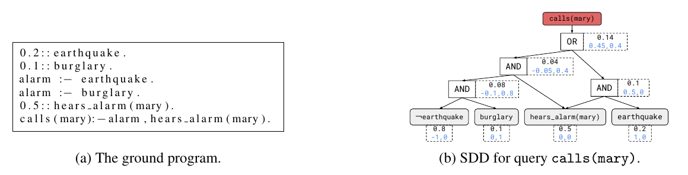
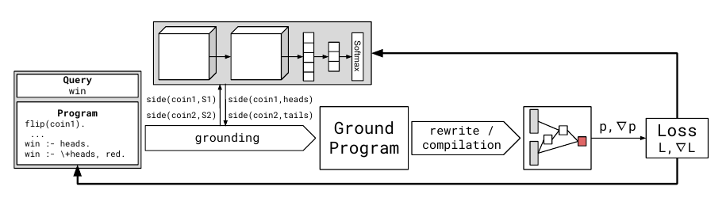
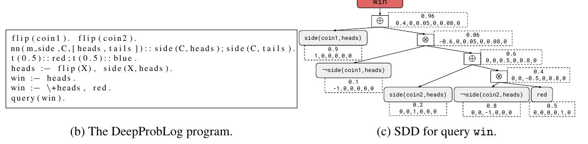
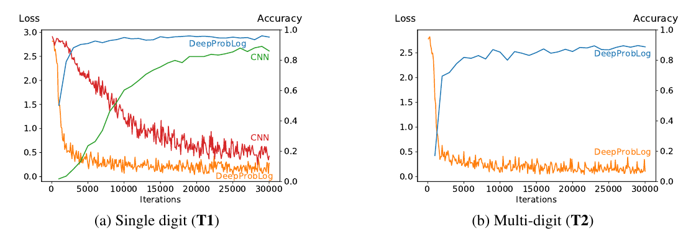

# 신경망을 확률 논리 프로그램의 술어로 집어넣기 — DeepProbLog: Neural Probabilistic Logic Programming

#### Abstract

본 논문에서는 신경 술어(neural predicate)를 통해 심층학습을 통합하는 확률 논리 프로그래밍 언어인 DeepProbLog를 소개한다. 기존의 추론 및 학습 기법을 이 새로운 언어에 맞게 어떻게 적용할 수 있는지를 보인다. 실험을 통해 DeepProbLog가 (i) 기호적 표현과 하위기호적(sub-symbolic) 표현 및 그에 대한 추론, (ii) 프로그램 귀납(program induction), (iii) 확률 (논리) 프로그래밍, (iv) 예제로부터의 (심층) 학습을 모두 지원함을 입증한다. 저자들이 아는 한, 범용 신경망과 표현력 있는 확률 논리 모델링 및 추론을 양쪽 세계의 표현력과 강점을 온전히 활용하는 방식으로 통합하면서 예제에 기반해 종단간(end-to-end)으로 학습할 수 있는 프레임워크를 제안한 것은 이 연구가 처음이다.

#### 요약

신경망은 이미지를 보고 무엇인지 알아맞히는 데 강하고, 논리 프로그램은 규칙을 따라 결론을 도출하는 데 강하다. 이 둘을 붙이려는 시도는 오래되었지만 대부분 논리를 신경망 안으로 밀어 넣는 방향이었다. 이 논문은 방향을 반대로 잡는다. 이미 잘 정의된 확률 논리 언어 ProbLog를 그대로 두고, 그 안의 술어 하나를 신경망이 담당하게 만든다. 신경망의 softmax 출력이 결국 확률 분포이므로 확률 논리의 문법에 그대로 들어맞는다는 단순한 관찰이 출발점이다. 이 글에서는 숫자 이미지 두 장과 그 합만 보고 숫자 분류기를 학습하는 MNIST 덧셈 예제를 따라가면서, 논리 프로그램이 어떻게 미분 가능해지는지, 그리고 논리를 제약으로 쓰는 Logic Tensor Networks와 무엇이 다른지를 살펴본다.

---

## 1. 왜 이 논문이 나왔나

### 1) 지각과 추론의 오래된 간극

저수준 지각(low-level perception)과 고수준 추론(high-level reasoning)을 통합하는 문제는 인공지능 분야에서 가장 오래되었으면서도 여전히 열려 있는 과제에 속한다. 여기서 저수준 지각이란 이미지나 소리 같은 원시 신호에서 의미를 읽어내는 일을 말하고, 고수준 추론이란 이미 얻은 사실들로부터 규칙을 따라 새로운 결론을 도출하는 일을 말한다. 오늘날 전자는 신경망과 심층학습이 담당하고, 후자는 논리적 표현과 확률적 표현 및 그에 대한 추론이 담당한다.

두 진영은 각자 발전해 왔다. 심층학습 쪽의 성과는 널리 알려져 있고, 고수준 추론 쪽에서도 논리적 추론과 확률적 추론을 통계적 학습과 긴밀히 결합하는 연구가 축적되었다. 통계적 관계 인공지능(statistical relational AI)과 확률 논리 프로그래밍(probabilistic logic programming)이 그런 영역이다. 문제는 둘을 어떻게 잇느냐이다.

### 2) 방향을 뒤집는 선택

기존의 신경-기호 통합(neuro-symbolic integration) 연구는 대체로 추론 능력을 복잡한 신경망 구조 안으로 집어넣는 방향을 택했다. 고전적 추론 도구의 기호적 연산을 미분 가능한 형태로 근사하는 신경망 구조를 설계하는 식이다. 이 논문은 반대 방향에서 문제에 접근한다. 추론을 신경망 안으로 넣는 대신, 이미 존재하는 확률 논리 프로그래밍 언어 ProbLog에서 출발해 여기에 신경망을 처리할 능력을 덧붙인다.

핵심 착상은 단순하다. 확률 논리 프로그램에서 $q(t_1, ..., t_n)$ 형태의 원자적 표현은 확률 $p$를 가진다. 그렇다면 신경망 구성요소의 출력도, 원자적 표현에 대한 신경망의 출력을 확률로 해석할 수 있는 한, 신경 술어라는 형태로 캡슐화할 수 있다. 이 착상이 매력적인 이유는 ProbLog 언어의 본질적인 구성요소, 즉 의미론과 추론 메커니즘 및 구현체를 모두 그대로 유지할 수 있기 때문이다.

남는 난관은 학습이다. 입력 데이터는 신경망 구성요소의 입력단에 있는 특징 벡터(예를 들어 이미지)와 논리 프로그램의 다른 확률적 사실 및 절들인 반면, 목표값은 확률 추론기의 출력단에만 주어진다. 이 간극을 잇는 것이 aProbLog의 대수적 확장이다. 이를 이용하면 출력단의 손실에서 신경 술어를 거쳐 신경망까지 경사(gradient)를 역전파할 수 있고, 따라서 모델 전체를 경사하강 기반 최적화로 학습할 수 있다.

논문이 정리하는 DeepProbLog의 특징은 네 가지다. 첫째, 신경망과 기계학습을 지원하면서 Prolog의 확장으로서 튜링 완전성을 가지는 잘 정의된 의미론의 프로그래밍 언어다. 둘째, 논리적 추론과 신경망을 통합하므로 기호적 표현과 하위기호적 표현 및 추론을 모두 다룬다. 셋째, 확률 모델링 및 프로그래밍을 신경망과 통합한다. 넷째, 귀납 논리 프로그래밍을 포함해 다양한 확률 논리 신경 모델을 예제로부터 학습할 수 있다.

## 2. 배경: ProbLog의 기초

### 1) 논리 프로그래밍 용어

본격적인 설명에 앞서 최소한의 용어를 정리한다. 원자(atom)는 $q(t_1, ..., t_n)$ 형태의 표현으로, $q$는 술어(predicate)이고 $n$은 그 인자의 개수이며 $t_i$는 항(term)이다. 리터럴(literal)은 원자이거나 원자의 부정이다. 항은 상수 $c$이거나 변수 $V$이거나 함수 기호를 포함한 구조적 항이다. Prolog 관례를 따라 상수는 소문자로, 변수는 대문자로 시작한다.

대입(substitution) $\theta = \{V_1 = t_1, ..., V_n = t_n\}$은 변수에 항을 배정하는 것이다. 표현 $e$에 $\theta$를 적용하면 $e$ 안의 모든 $V_i$가 $t_i$로 바뀌며 그 결과를 $e\theta$로 쓴다. 변수를 포함하지 않는 표현을 ground라고 부른다. 규칙(rule)은 $h \mathbin{{:}-} b_1, ..., b_n$ 형태로, $h$는 원자이고 $b_i$는 리터럴이다. 이 규칙의 의미는 $b_i$들의 논리곱이 성립할 때 $h$가 성립한다는 것이다. 즉 $\mathbin{{:}-}$는 논리적 함의($\leftarrow$)를 나타내고 쉼표는 논리곱($\wedge$)을 나타낸다. 몸체가 비어 있는 규칙, 즉 $n = 0$인 규칙을 사실(fact)이라고 한다.

### 2) ProbLog 프로그램의 구성

ProbLog 프로그램은 두 종류의 요소로 이루어진다. 첫째는 확률적 사실(probabilistic facts)의 집합 $\mathcal{F}$로, $p :: f$ 형태다. $p$는 확률, $f$는 변수가 없는 ground 원자다. 둘째는 규칙의 집합 $\mathcal{R}$로, 일반 Prolog 규칙과 같다. 논문의 예시는 잘 알려진 도둑과 지진 알람 베이지안 네트워크를 변형한 것이다.

```prolog
0.1::burglary.      0.5::hears_alarm(mary).
0.2::earthquake.    0.4::hears_alarm(john).
alarm :- earthquake.
alarm :- burglary.
calls(X) :- alarm, hears_alarm(X).
```

도둑이 들 확률 0.1, 지진 확률 0.2, mary가 알람을 들을 확률 0.5, john이 들을 확률 0.4가 확률적 사실이다. 그리고 지진이나 도둑 중 하나라도 있으면 알람이 울리며, 알람이 울리고 그 사람이 알람을 들으면 전화를 한다는 것이 규칙이다.

### 3) 가능 세계 의미론

각 확률적 사실은 서로 독립인 불리언 확률변수로 해석된다. 확률 $p$로 참이고 $1-p$로 거짓이다. 확률적 사실의 임의의 부분집합 $F \subseteq \mathcal{F}$를 하나 고르면, 다시 말해 어떤 사실들을 참으로 선택하면, 그 부분집합과 규칙 $\mathcal{R}$로부터 논리적으로 도출되는 모든 ground 원자를 합친 것이 하나의 가능 세계(possible world) $w_F$가 된다.

예를 들어 burglary와 hears_alarm(mary)만 참으로 골랐다면, 규칙에 의해 alarm이 도출되고 다시 calls(mary)가 도출되므로 가능 세계는 $\{\texttt{burglary}, \texttt{hears\_alarm(mary)}, \texttt{alarm}, \texttt{calls(mary)}\}$가 된다.

가능 세계의 확률은 각 사실이 참이거나 거짓일 확률의 곱이다.

$$P(w_F) = \prod_{f_i \in F} p_i \prod_{f_i \in \mathcal{F} \setminus F} (1 - p_i)$$

여기서 $F$는 참으로 선택된 사실들의 집합이고 $\mathcal{F} \setminus F$는 나머지, 즉 거짓으로 둔 사실들이다. 참으로 선택된 사실에는 그 확률 $p_i$를 곱하고, 선택되지 않은 사실에는 $1-p_i$를 곱한다. 위 세계의 경우 다음과 같이 계산된다.

$$0.1 \times 0.5 \times (1-0.2) \times (1-0.4) = 0.024$$

어떤 ground 사실 $q$의 확률, 즉 성공 확률(success probability)은 $q$를 포함하는 모든 가능 세계의 확률을 합한 것으로 정의된다.

$$P(q) = \sum_{F \subseteq \mathcal{F}\,:\, q \in w_F} P(w_F)$$

확률적 사실이 $n$개면 가능 세계는 $2^n$개이므로 이를 직접 열거하는 것은 비현실적이다. 그래서 4장에서 다룰 지식 컴파일(knowledge compilation) 기반 추론이 필요해진다. 3장까지는 의미론만 정의하고 계산 방법은 그다음으로 넘긴다.

### 4) 주석 달린 분리

ProbLog의 기본 확률적 사실은 각각 독립인 이진 변수다. 그러므로 여러 값 중 정확히 하나가 선택되는 범주형 선택을 표현하려면 별도의 문법이 편리하다. 주석 달린 분리(annotated disjunction, AD)가 그것으로, 다음 형태를 가진다.

$$p_1 :: h_1 ; \ ... \ ; p_n :: h_n \mathbin{{:}-} b_1, ..., b_m$$

확률의 합 $\sum p_i$가 1이고, 몸체 $b_i$가 모두 성립할 때 머리 $h_j$ 중 하나가 확률 $p_j$로 참이 되며 나머지는 프로그램의 다른 부분이 참으로 만들지 않는 한 거짓이 된다. 지진의 심각도를 모델링하는 예시가 이에 해당한다.

```prolog
0.4::earthquake(none); 0.4::earthquake(mild); 0.2::earthquake(severe).
```

AD는 표현력을 늘리는 것이 아니라 문법적 편의(syntactic sugar)일 뿐이며, AD가 있는 프로그램은 AD가 없는 동등한 ProbLog 프로그램으로 변환할 수 있다. 이 점이 중요한 이유는, 뒤에 나올 신경 AD가 결국 일반 AD의 특수한 경우이므로 ProbLog의 의미론과 추론 기계를 그대로 물려받는다는 논리의 근거가 되기 때문이다.

## 3. DeepProbLog: 신경 술어와 신경 AD

### 1) 신경 AD의 정의

DeepProbLog 프로그램은 ProbLog 프로그램에 세 번째 요소, 즉 ground 신경 AD(neural AD, nAD)의 집합을 추가한 것이다. 형식은 다음과 같다.

$$nn(m_q, \vec{t}, \vec{u}) :: q(\vec{t}, u_1) ; \ ... \ ; q(\vec{t}, u_n) \mathbin{{:}-} b_1, ..., b_m$$

여기서 $nn$은 이것이 신경망 AD임을 표시하는 표기이고, $m_q$는 술어 $q$에 대응하는 신경망 모델의 식별자다. $\vec{t} = t_1, ..., t_k$는 신경망의 입력이 되는 ground 항의 벡터이고, $u_1, ..., u_n$은 신경망이 낼 수 있는 출력값들이다. 즉 $m_q$는 입력 $\vec{t}$가 주어졌을 때 출력값 $\vec{u}$에 대한 확률 분포를 정의하는 신경망이다.

확률 논리 프로그램의 관점에서 보면 nAD는 확률 $p_i$가 상수가 아니라 신경망이 계산한 값인 일반 AD에 지나지 않는다. 다시 말해 nAD는 다음 AD를 실현한다.

$$p_1 :: q(\vec{t}, u_1) ; \ ... \ ; p_n :: q(\vec{t}, u_n) \mathbin{{:}-} b_1, ..., b_m$$

따라서 DeepProbLog는 의미론을 ProbLog로부터 직접 상속하고, 추론도 상당 부분 그대로 물려받는다.

### 2) MNIST 덧셈 예시

이 논문에서 반복적으로 등장하는 예시는 MNIST 덧셈이다. 숫자 이미지 두 장과 그 합계만 주어진 상황에서, 프로그램에는 다음과 같은 배경지식을 적어둔다.

```prolog
nn(m_digit, [X], [0,...,9]) :: digit(X,0); ... ; digit(X,9).
addition(X,Y,Z) :- digit(X,NX), digit(Y,NY), Z is NX+NY.
```

여기서 `is`는 산술식을 평가하는 표준 연산자다. $m_\text{digit}$은 MNIST 숫자 이미지를 확률적으로 분류하는 신경망이고, 그 출력 10개가 digit 술어의 열 가지 머리에 대한 확률이 된다. 학습해야 할 것은 이미지 $I_D$를 대응하는 자연수 $N_D$로 보내는 신경 술어 digit 하나뿐이다.

이런 술어를 표준 신경 분류기로 직접 학습시킬 수도 있다. 그러나 그 경우 분류기는 두 자연수의 덧셈이라는 배경지식을 고려하기 어렵다. DeepProbLog에서는 그 지식이 규칙 한 줄로 쉽게 부호화된다. 개별 숫자 라벨은 전혀 주지 않아도 합계 정답만으로 숫자 분류기가 학습되며, 학습된 분류기는 숫자가 관여하는 임의의 과제에 재사용할 수 있다. 실험 결과는 이 방식이 새로운 능력만이 아니라 성능 향상까지 가져옴을 보인다. 표준적인 이미지 분류 설정과 비교했을 때의 중요한 장점은, 추가 학습 없이 여러 자릿수로 확장할 수 있다는 점이다. 단일 숫자 분류기, 즉 신경 술어는 명시적으로 학습되는 것이 아니라는 점도 눈여겨볼 만하다. 학습 데이터로는 숫자 쌍의 합만 사용하므로, 그 출력은 잠재 표현(latent representation)으로 간주할 수 있다.

### 3) 신경망 구조에 대한 제약

신경망의 구조에는 제약이 없다. 이미지라면 합성곱 신경망, 시퀀스라면 순환 신경망 등 어떤 것이든 가능하다. 유일한 요구사항은 신경 술어에 공급되는 출력층이 정규화되어 있어야 한다는 것, 즉 출력이 합이 1인 확률 분포여야 한다는 점이다. 다중 분류 신경망에서는 실수 점수에 softmax를 적용하는 것이 표준이므로 논문도 이를 채택한다. 이 정규화 조건은 5장에서 다시 중요해지는데, 일반 AD는 경사하강 갱신 후 확률 합이 1이 되도록 재정규화가 필요하지만 신경 AD는 softmax가 이를 자동으로 보장하므로 별도 처리가 필요 없기 때문이다.

정리하면 3장의 핵심 논리는 이렇다. 신경망의 softmax 출력은 범주형 분포이고 ProbLog의 AD도 범주형 분포이므로, 신경망을 확률값이 동적으로 계산되는 AD로 취급하면 언어를 새로 설계할 필요 없이 ProbLog 위에 얹을 수 있다. 이 단순한 대응 덕분에 신경망 출력이 논리 추론의 입력으로 자연스럽게 들어가고, 반대로 논리 추론의 결과로부터 계산된 경사가 신경망으로 흘러 들어가는 양방향 인터페이스가 성립한다.

## 4. 추론: 질의 하나가 계산되는 네 단계

4장은 학습된 DeepProbLog 모델이 질의를 받았을 때 그 확률을 어떻게 계산하는지를 설명한다. ProbLog의 네 단계 추론을 먼저 보고, DeepProbLog가 여기에 무엇을 추가하는지를 확인한다.



위 그림의 왼쪽은 질의 calls(mary)에 대해 구체화된 ground 프로그램이고, 오른쪽은 그 질의를 컴파일한 SDD다. SDD 그림에서 둥근 회색 사각형은 확률적 사실에 대응하는 변수이고, 둥근 빨간 사각형은 수식이 정의하는 질의 원자다. 흰 사각형은 자식들에 적용되는 논리 연산자다. 각 노드 옆의 위쪽 검은 숫자가 확률이고, 아래쪽 파란 숫자는 5장에서 다룰 경사이므로 지금은 무시하고 읽으면 된다. 읽는 순서는 아래에서 위로, 즉 잎의 확률에서 시작해 루트의 0.14에 도달하는 방향이다.

### 1) 네 단계

예시는 2장의 알람 프로그램이고, 질의는 calls(mary), 즉 mary가 전화할 확률은 얼마인가이다.

첫 번째 단계는 grounding이다. 논리 프로그램에는 변수가 있는 규칙 `calls(X) :- alarm, hears_alarm(X)`이 있으므로, 질의에 관련된 절들만 골라 변수를 구체적인 상수로 채운 ground 프로그램을 만든다. 그림의 (a)가 그 결과다. calls(mary)에 필요한 것은 X=mary인 절 하나와 alarm의 두 정의, 그리고 관련 확률적 사실 earthquake, burglary, hears_alarm(mary)이다. hears_alarm(john)은 질의와 무관하므로 빠진다. 이 단계가 중요한 이유는 프로그램 전체가 아니라 질의가 의존하는 부분만 다루므로 이후 계산 규모가 질의 관련 부분에 비례하기 때문이다.

두 번째 단계는 ground 프로그램을 명제논리식으로 변환하는 것이다. 규칙들을 따라가면 질의의 진리값이 확률적 사실들의 진리값으로 표현된다. 예시에서는 다음과 같이 된다.

$$\texttt{calls(mary)} \leftrightarrow \texttt{hears\_alarm(mary)} \wedge (\texttt{burglary} \vee \texttt{earthquake})$$

alarm은 중간 원자이므로 그 정의로 치환되어 사라지고, 최종적으로 질의는 확률적 사실들만의 불리언 함수가 된다.

세 번째 단계는 지식 컴파일이다. 명제논리식의 확률을 그대로 계산하려면 burglary $\vee$ earthquake처럼 두 사실이 겹치는 경우 포함배제 원리가 필요하고, 일반적으로 이 문제는 #P-hard다. 그래서 논리식을 Sentential Decision Diagram(SDD)이라는 표현으로 컴파일한다. SDD는 결정적이고 분해 가능한 형태로, 같은 노드 아래의 OR 가지들이 서로 배타적이고 AND 가지들이 서로 다른 변수를 다루도록 구성되어 있다. 이 성질 덕분에 컴파일이 끝난 뒤에는 확률 계산이 그래프 크기에 선형인 시간에 끝난다. 어려움은 컴파일 단계에 한 번 몰아넣고 평가는 저렴하게 하는 구조다. 위 그림의 (b)를 보면 burglary $\vee$ earthquake가 $(\neg\texttt{earthquake} \wedge \texttt{burglary}) \vee \texttt{earthquake}$처럼 배타적인 가지로 재구성되어 있는데, 이것이 SDD가 겹침 문제를 해결하는 방식이다.

네 번째 단계는 SDD의 상향식 평가다. 잎에 각 사실의 확률을 놓고, 부정 잎에는 $1-p$를 놓은 뒤, OR 노드에서는 자식 값을 더하고 AND 노드에서는 곱하면서 위로 올라간다. 예시에서 $\neg\texttt{earthquake} \wedge \texttt{burglary} = 0.8 \times 0.1 = 0.08$이고, 여기에 earthquake의 0.2를 더해 alarm 부분이 0.28이 되며, 마지막으로 hears_alarm(mary)의 0.5를 곱해 calls(mary)의 확률 0.14가 나온다. OR에서 단순 덧셈이 허용되는 것은 가지들이 배타적이기 때문이고, AND에서 단순 곱셈이 허용되는 것은 가지들이 독립인 변수를 다루기 때문이다. 2장의 가능 세계 정의에 따르면 이 값은 calls(mary)를 포함하는 모든 가능 세계의 확률 합과 같은데, $2^n$개의 세계를 열거하지 않고 SDD로 그 합을 구한 것이다.

### 2) DeepProbLog가 추가하는 한 가지

DeepProbLog의 추론은 위 과정과 정확히 같고, 단 하나가 추가된다. 첫 번째 grounding 단계에서 신경 술어를 만날 때마다 신경망 순방향 계산(forward pass)을 수행하는 것이다. 예를 들어 addition(img1, img2, 8)을 grounding하다가 digit(img1, N)을 만나면, img1을 $m_\text{digit}$ 신경망에 넣어 softmax 출력 10개를 얻고, 이 값들을 nAD digit(img1,0); ... ; digit(img1,9)의 확률로 채운다. 그 뒤로는 이 nAD가 일반 AD와 똑같이 취급되므로 두 번째 단계 이후는 ProbLog와 동일하게 진행된다. 신경망은 grounding 시점에 확률값을 공급하는 역할만 하고, SDD 컴파일과 평가는 그 값이 신경망에서 왔는지 프로그램에 적혀 있는지 구별하지 않는다.

### 3) 설계상의 함의

이 구조에서 몇 가지가 따라 나온다. 신경망 호출은 질의당 grounding 단계에서 한 번씩 이루어지므로, 같은 이미지가 여러 절에 등장해도 한 번만 계산하면 된다. SDD의 구조는 논리 프로그램과 질의에 의해 결정되고 신경망 출력값과는 무관하므로, 같은 형태의 질의라면 SDD를 재사용하고 잎의 값만 바꿔 넣을 수 있다. 반면 grounding이 커지면, 예컨대 리스트가 길어지거나 가능한 조합이 많아지면 명제논리식과 SDD가 급격히 커지므로, 이 정확 추론이 DeepProbLog의 확장성 병목이 된다. 이후의 근사 추론 연구들은 대부분 세 번째와 네 번째 단계를 표본추출이나 상위 $k$개 증명으로 대체하는 방향으로 진행되었다.

## 5. 학습: 논리 프로그램을 미분하기

5장은 DeepProbLog 프로그램의 확률 파라미터와 신경망 가중치를 함께 학습하는 방법을 설명하며, 이 논문의 핵심 기여에 해당한다.

### 1) 학습 설정과 목적함수

learning from entailment 설정을 따른다. 파라미터 집합 $\mathcal{X}$를 가진 DeepProbLog 프로그램과, 질의 $q$와 그 목표 성공 확률 $p$로 이루어진 쌍 $(q, p)$의 집합 $\mathcal{Q}$, 그리고 손실함수 $L$이 주어졌을 때 다음을 계산한다.

$$\arg\min_{\vec{x}} \frac{1}{|\mathcal{Q}|} \sum_{(q,p) \in \mathcal{Q}} L\big(P_{\mathcal{X} = \vec{x}}(q),\, p\big)$$

여기서 $P_{\mathcal{X}=\vec{x}}(q)$는 파라미터를 $\vec{x}$로 놓았을 때 프로그램이 계산한 질의 $q$의 성공 확률이고, $p$는 그 질의에 대해 데이터가 지시하는 목표 확률이다. 즉 프로그램이 계산한 질의 확률이 목표 확률에 가까워지도록 파라미터를 조정한다. 실험에서는 $L$로 교차 엔트로피를 쓴다.

여기서 중요한 점은 감독 신호가 질의 수준에만 주어진다는 것이다. MNIST 덧셈에서 addition(img1, img2, 8)에 목표 확률 1을 주면, 개별 digit 술어에 대한 감독은 전혀 없고 신경망 출력은 잠재 변수로 남는다.

ProbLog의 기존 파라미터 학습은 EM 기반이었는데, 논문은 경사하강법을 택한다. 이유는 명시적이다. 신경망 학습과 매끄럽게 통합하려면 양쪽이 같은 최적화 방식을 써야 하기 때문이다.



위 그림은 학습 파이프라인 전체를 보여준다. 왼쪽에서 프로그램과 질의가 주어지면 grounding을 거쳐 ground 프로그램이 만들어지는데, 이때 위쪽의 신경망이 side(coin1,S1) 같은 신경 술어에 대해 순방향 계산을 수행해 softmax 확률을 공급한다. 이어서 rewrite 및 compilation 단계가 SDD를 만들고, 그것을 평가해 확률 $p$와 경사 $\nabla p$를 함께 얻은 뒤 손실 $L$과 $\nabla L$을 계산한다. 아래쪽과 위쪽의 화살표는 그 경사가 각각 논리 프로그램과 신경망으로 되돌아가 파라미터를 갱신하는 경로다.

### 2) aProbLog와 경사 반환

문제는 SDD 위에서 확률만이 아니라 경사도 계산해야 한다는 것이다. 여기서 aProbLog(Algebraic ProbLog)를 활용한다. aProbLog는 ProbLog를 임의의 가환 반환(commutative semiring)으로 일반화한 것이다. 반환이란 덧셈과 곱셈에 해당하는 두 연산이 정의되고 각각의 항등원이 존재하는 대수 구조를 말한다. ProbLog에서는 각 사실 $f$에 확률 $p$를 붙이고 그 부정에는 $1-p$가 암묵적으로 정해지며, SDD 위에서 일반 덧셈과 곱셈으로 질의 확률을 계산한다. aProbLog는 이를 일반화해서, 사실과 그 부정 모두에 명시적으로 반환의 값을 할당하는 라벨링 함수를 두고, SDD 위에서 반환 덧셈 $\oplus$와 반환 곱셈 $\otimes$으로 결합한다.

논문이 사용하는 반환은 경사 반환(gradient semiring)으로, 원소가 $(p, \frac{\partial p}{\partial x})$ 형태의 튜플이다. 첫 성분은 ProbLog에서와 같은 확률이고, 둘째 성분은 그 확률을 파라미터 $x$로 편미분한 값이다. 파라미터가 $N$개면 둘째 성분은 길이 $N$의 벡터가 되며, 전체 파라미터 벡터를 $\vec{x} = [x_1, ..., x_N]^\top$로 쓴다. 연산은 다음과 같이 정의된다.

$$(a_1, \vec{a_2}) \oplus (b_1, \vec{b_2}) = (a_1 + b_1,\ \vec{a_2} + \vec{b_2})$$

$$(a_1, \vec{a_2}) \otimes (b_1, \vec{b_2}) = (a_1 b_1,\ b_1 \vec{a_2} + a_1 \vec{b_2})$$

항등원은 $e^{\oplus} = (0, \vec{0})$과 $e^{\otimes} = (1, \vec{0})$이다. 각 튜플의 첫 성분만 보면 ProbLog의 확률 계산을 그대로 따라 하고, 둘째 성분은 덧셈의 미분 규칙과 곱의 미분 규칙을 그대로 구현한 것이다. 곱셈 쪽 $b_1\vec{a_2} + a_1\vec{b_2}$가 고등학교에서 배우는 곱의 미분 $(fg)' = f'g + fg'$와 같은 형태임을 확인하면 이해하기 쉽다.

따라서 SDD를 잎에서 루트까지 한 번 상향식으로 훑으면 질의 확률과 그 경사가 동시에 나온다. 4장의 평가 과정과 구조가 완전히 같고, 잎에 놓는 값과 노드에서 쓰는 연산만 바뀐 셈이다.

### 3) 라벨링 함수

이 반환을 쓰려면 각 사실에 튜플 라벨을 붙여야 한다. 논문은 세 가지 경우를 정의한다.

$$L(f) = (p, \vec{0}) \qquad \text{확률 } p \text{가 고정된 사실 } p :: f$$

$$L(f_i) = (p_i, \mathbf{e}_i) \qquad \text{학습 가능한 확률을 가진 사실 } t(p_i) :: f_i$$

$$L(\neg f) = (1 - p, -\nabla p) \qquad L(f) = (p, \nabla p) \text{일 때}$$

여기서 $\mathbf{e}_i$는 $i$번째 위치만 1이고 나머지가 0인 단위벡터다. 고정 확률의 사실은 어떤 파라미터에도 의존하지 않으므로 경사가 영벡터다. 학습 가능한 사실은 자기 자신이 $i$번째 파라미터이므로 단위벡터를 갖는다. 부정은 $1-p$의 미분이 $-\nabla p$이므로 부호가 뒤집힌다.

앞의 그림에서 earthquake와 burglary의 확률을 학습하고 나머지는 고정한다고 하면, SDD의 각 노드마다 파란 숫자로 경사가 함께 표시된다. 결과를 보면 질의 확률의 편미분이 earthquake에 대해 0.45, burglary에 대해 0.4다. 직접 확인해 보면 calls(mary)의 확률이 $0.5 \times (1 - (1-b)(1-e))$이므로, earthquake로 미분하면 $0.5 \times (1 - 0.1) = 0.45$이고 burglary로 미분하면 $0.5 \times (1 - 0.2) = 0.4$가 되어 일치한다.

AD가 포함된 경우에는 한 가지 처리가 더 필요하다. AD는 같은 AD에 속한 확률들의 합이 1이어야 잘 정의되는데, 경사하강 갱신은 이 제약을 지켜주지 않는다. 그래서 매 갱신 후에 해당 AD의 확률들을 재정규화한다.

### 4) 신경 술어로의 확장

여기서 논리 쪽과 신경망 쪽의 역할이 갈린다. 확률적 사실과 일반 AD의 파라미터는 aProbLog가 계산한 경사로 직접 갱신되지만, 신경 술어의 확률은 그 자체가 파라미터가 아니라 신경망 가중치의 함수다. 논문은 신경 술어를 두 세계의 인터페이스로 규정하고, 양쪽이 서로를 블랙박스로 취급한다고 설명한다. 논리 쪽은 손실을 신경망 출력으로 미분한 값까지는 계산할 수 있지만 신경망 내부 파라미터는 모른다. 그런데 역전파를 시작하는 데는 출력에 대한 경사만 있으면 충분하므로, 그 지점부터는 표준 역전파가 내부 파라미터의 경사를 계산하고 SGD나 Adam 같은 일반적인 최적화 기법이 갱신한다.

이를 위한 라벨링 함수는 다음과 같다.

$$L(f_j) = \big(m_q(\vec{t})_j,\ \mathbf{e}_j\big) \qquad nn(m_q, \vec{t}, \vec{u}) :: f_1 ; \ ... \ ; f_k \text{가 nAD일 때}$$

즉 확률값으로는 신경망의 $j$번째 출력을 넣고, 경사 벡터로는 그 출력에 해당하는 위치의 단위벡터를 넣는다. 이렇게 하면 SDD를 평가해 얻은 경사 벡터의 해당 성분이 곧 질의 확률을 신경망의 $j$번째 출력으로 미분한 값이 되고, 손실 미분과 합쳐져 신경망으로 넘겨진다. 학습 가능한 확률적 사실을 다루는 방식과 형식적으로 동일한데, 다만 갱신은 논리 쪽이 하지 않고 신경망 쪽이 한다. aProbLog의 경사 계산 중에는 신경 AD의 확률값이 상수로 고정된다.

또 하나의 차이는 정규화다. 일반 AD는 갱신 후 재정규화가 필요하지만, 신경 AD의 갱신은 신경망 쪽에서 오고 출력층에 softmax가 있으므로 항상 정규화된 분포가 보장된다. 따라서 별도의 재정규화가 필요 없다.

이 설계에는 계산상의 이유도 있다. 경사 반환은 각 노드가 길이 $N$의 벡터를 들고 다니는 전방향 자동 미분(forward-mode automatic differentiation)이므로 파라미터 수에 비례해 비용이 늘어난다. 질의에 관련된 ground 확률적 사실과 신경망 출력은 수십 개 수준이라 감당할 수 있지만, 신경망 가중치 수만 개까지 이 벡터에 넣는 것은 비현실적이다. 신경망 내부를 역방향 역전파에 맡기고 경계에서만 값을 주고받는 구조가 자연스러운 선택인 이유가 여기에 있다.

### 5) coin-ball 예시



왼쪽은 DeepProbLog 프로그램이고, 오른쪽은 질의 win에 대한 SDD다. SDD에서 AND와 OR가 각각 $\otimes$와 $\oplus$로 바뀌어 있고, 각 노드에 위쪽 숫자로 확률이, 아래쪽에 여섯 개 성분의 경사 벡터가 붙어 있다. 벡터의 여섯 자리는 순서대로 첫 동전의 앞면, 첫 동전의 뒷면, 둘째 동전의 앞면, 둘째 동전의 뒷면, 빨강, 파랑에 대응한다. 예컨대 side(coin1,heads)는 확률 0.9에 경사 $[1,0,0,0,0,0]$을 달고 있는데, 자기 자신이 첫 번째 파라미터이므로 단위벡터가 된 것이다.

게임의 규칙은 이렇다. 동전 두 개와 빨간 공 및 파란 공이 든 항아리가 있고, 동전 두 개를 던지고 공 하나를 꺼낸다. 공이 빨간색이거나 동전 중 적어도 하나가 앞면이면 이긴다. 학습해야 할 것은 동전 이미지에서 앞뒤를 인식하는 신경망과 항아리의 빨강 및 파랑 비율인데, 관찰되는 것은 승패뿐이다. 프로그램에는 파라미터가 여섯 개 있다. 신경 술어에서 오는 넷과 논리 파라미터 둘이다.

grounding 중 신경망이 coin1과 coin2를 분류해서 첫 동전은 앞면일 확률 0.9, 둘째 동전은 뒷면 쪽이 우세해 앞면일 확률 0.2가 나온다. 루트에서 이길 확률 0.96이 나오고, 경사는 첫 동전의 앞면 확률에 대해 0.4, 둘째 동전에 대해 0.05, 공이 빨강일 확률에 대해 0.08이다. 직접 계산해 보면 다음과 같이 맞아떨어진다.

$$P(\text{win}) = 1 - (1-h_1)(1-h_2)(1-r) = 1 - 0.1 \times 0.8 \times 0.5 = 0.96$$

$$\frac{\partial P}{\partial h_1} = (1-h_2)(1-r) = 0.4, \quad \frac{\partial P}{\partial h_2} = 0.05, \quad \frac{\partial P}{\partial r} = 0.08$$

이 여섯 개 중 앞의 넷은 신경망으로 넘어가 역전파의 출발점이 되고, 뒤의 둘은 논리 파라미터에 직접 적용된다.

### 6) 전체를 하나의 계산 그래프로 보기

정리하면 DeepProbLog의 학습은 한 질의에 대해 신경망 순방향 계산, grounding과 SDD 컴파일, SDD 상향 평가를 통한 확률과 경사의 동시 계산, 신경망 출력 경사의 전달, 양쪽 파라미터 갱신의 순서로 진행되며, 전체가 하나의 미분 가능한 파이프라인이다.

다만 일반적인 심층학습 모델과 다른 점이 셋 있다. 첫째, 그래프의 상단부는 학습되는 것이 아니라 논리 프로그램에서 컴파일된 고정 구조이며 파라미터는 잎에만 있다. 둘째, 그 구조는 입력 질의마다 다르게 생성된다. 셋째, 상단부의 미분은 자동 미분 라이브러리가 아니라 반환 연산으로 계산되고 신경망 경계에서만 역전파로 넘어간다. 신경망의 관점에서 보면, 논리 프로그램은 질의에 따라 동적으로 생성되는 파라미터 없는 미분 가능한 출력층이라고 볼 수 있다.

## 6. 실험

논문은 DeepProbLog가 기호적 추론과 하위기호적 추론을 함께 지원하는지, 프로그램 귀납이 가능한지, 확률 논리 프로그래밍과 심층학습을 함께 다룰 수 있는지를 여섯 개 과제로 검증한다.

### 1) MNIST 덧셈



위 그림은 MNIST 덧셈 문제의 학습 곡선이다. 왼쪽이 한 자릿수 과제(T1), 오른쪽이 여러 자릿수 과제(T2)다. 빨간 선은 CNN의 학습 손실, 주황 선은 DeepProbLog의 학습 손실이며 왼쪽 축에 대응한다. 초록 선은 CNN의 테스트 F1 점수, 파란 선은 DeepProbLog의 테스트 F1 점수이며 오른쪽 축에 대응한다. 가로축은 학습 반복 횟수다.

T1은 개별 라벨 대신 두 이미지의 합을 라벨로 주는 과제다. 프로그램은 `addition(X,Y,Z) :- digit(X,X2), digit(Y,Y2), Z is X2+Y2.` 한 줄과 digit 술어에 대한 신경 AD로 이루어진다. 비교 대상은 두 이미지를 이어 붙여 19가지 가능한 합 중 하나로 분류하는 CNN이다. 곡선을 보면 기호적 추론과 하위기호적 추론을 결합한 이점이 분명히 나타난다. DeepProbLog 모델은 부호화된 지식을 활용해 CNN보다 높은 F1 점수에 도달하며, 그것도 수천 번의 반복 만에 도달하는 반면 CNN은 훨씬 느리게 수렴한다. 신경망 기준 모델의 대안으로 두 이미지에 각각 가중치를 공유하는 합성곱 층을 적용하는 방식도 시험했는데, 이쪽이 더 빨리 수렴하고 최종 정확도도 높지만 여전히 DeepProbLog보다 느리고 부정확하다.

T2는 입력이 각각 숫자인 이미지 두 리스트로 주어지는 과제다. 이 과제는 DeepProbLog가 학습 데이터를 넘어 잘 일반화함을 보인다. 새 술어를 학습하는 데 필요한 것은 논리 프로그램의 작은 변경뿐이다. 한 자릿수 수로 학습한 뒤 세 자릿수 수로 평가한다. 오차가 누적되는 효과 때문에 한 자릿수 모델보다 정확도가 다소 낮지만 모델은 잘 일반화한다. CNN은 이런 가변 길이 문제 설정 자체에 일반화하지 못한다.

### 2) 프로그램 귀납

두 번째 실험군은 DeepProbLog가 프로그램 귀납을 수행할 수 있음을 보인다. 미분 가능한 Forth의 프로그램 스케치 설정을 따르는데, 주어진 프로그램의 빈 구멍(hole)을 프로그램 전체의 입출력 예제로부터 신경망이 채워야 하는 방식이다. 세 과제를 다룬다. T3은 두 수와 자리올림을 입력받아 합과 새 자리올림을 출력하는 덧셈으로, 구멍은 두 숫자와 이전 자리올림이 주어졌을 때 결과 숫자와 자리올림을 계산하는 부분이다. T4는 수의 리스트를 정렬하는 과제로, 프로그램은 버블 정렬을 구현하되 각 단계에서 교환할지 여부를 비워둔다. T5는 세 수를 포함한 자연어 문장형 산술 문제로, 순열, 연산 적용, 교환, 마지막 연산의 네 단계 각각에서 어떤 선택을 할지가 구멍이다.

| 방법 | 테스트 길이 | 정렬(T4) 학습길이 2 | 3 | 4 | 5 | 6 | 덧셈(T3) 학습길이 2 | 4 | 8 |
|---|---|---|---|---|---|---|---|---|---|
| ∂4 (Bošnjak et al., 2017) | 8 | 100.0 | 100.0 | 49.22 | – | – | 100.0 | 100.0 | 100.0 |
| ∂4 (Bošnjak et al., 2017) | 64 | 100.0 | 100.0 | 20.65 | – | – | 100.0 | 100.0 | 100.0 |
| DeepProbLog | 8 | 100.0 | 100.0 | **100.0** | **100.0** | **100.0** | 100.0 | 100.0 | 100.0 |
| DeepProbLog | 64 | 100.0 | 100.0 | **100.0** | **100.0** | **100.0** | 100.0 | 100.0 | 100.0 |

표의 수치는 정확도(%)이며 높을수록 좋다. 학습길이는 학습에 사용한 리스트나 수의 길이이고, 테스트 길이는 평가에 사용한 길이다. 대시는 해당 설정에서 결과가 보고되지 않았음을 뜻한다. 비교 대상인 ∂4는 미분 가능한 Forth 인터프리터로, 바로 이 프로그램 스케치 과제를 위해 설계된 방법이므로 임의로 고른 약한 기준 모델이 아니다. 덧셈 과제에서는 두 방법 모두 완벽하지만, 정렬 과제에서 ∂4는 학습길이 4에서 급격히 무너지고 그 이상은 결과조차 보고되지 않은 반면 DeepProbLog는 모든 길이에서 100%를 유지한다.

속도 차이도 크다. 테스트 길이 8에서 100% 정확도에 도달하기까지 걸린 시간은 다음과 같다.

| 방법 | 학습길이 2 | 3 | 4 | 5 | 6 |
|---|---|---|---|---|---|
| ∂4 on GPU | 42초 | 160초 | – | – | – |
| ∂4 on CPU | 61초 | 390초 | – | – | – |
| DeepProbLog on CPU | **11초** | **14초** | 32초 | 114초 | 245초 |

여기서는 낮을수록 좋다. DeepProbLog는 CPU만 사용하고도 GPU를 쓰는 ∂4보다 빠르며, 학습 길이가 늘어날 때의 증가도 완만하다. ∂4는 길이가 늘면 계산 복잡도 문제로 어려움을 겪는다고 원 논문이 밝히고 있다. 문장형 산술 문제(T5)에서 DeepProbLog는 96%에서 97% 사이의 정확도에 도달해 기존 연구의 96%와 비슷한 수준을 보인다.

### 3) 확률 프로그래밍과 심층학습

coin-ball 문제는 확률 프로그래밍 공동체의 표준 예제다. 5장에서 본 게임을 확장해, 동전 하나와 항아리 두 개를 쓰고 첫 항아리에는 빨강과 파랑, 둘째 항아리에는 빨강과 파랑 및 초록 공이 섞여 있는 설정이다. 두 항아리에서 공을 하나씩 꺼내고, 두 공의 색이 같거나 동전이 앞면이고 빨간 공이 하나 이상이면 이긴다. 동전의 편향과 각 항아리의 색 비율을 학습하는 동시에, 동전 이미지를 앞뒤로 분류하는 신경망과 공의 색을 RGB 삼중항으로부터 빨강, 파랑, 초록으로 분류하는 신경망을 함께 학습한다. 입력은 이미지 하나와 RGB 쌍 두 개이고 출력은 게임의 승패다. 256개 사례로 학습하면 5 epoch 만에 수렴해 64개 테스트 사례에서 100% 정확도에 도달하며, 이 시점에 두 신경망 모두 색과 동전을 올바르게 분류하고 확률 파라미터도 학습 데이터의 분포를 반영한다.

### 4) 구현 세부

모든 실험에서 예측 확률과 목표 확률 사이의 교차 엔트로피를 최소화한다. MNIST 이미지 분류에 쓰인 신경망은 PyTorch 튜토리얼에 기반한 기본 구조로, 커널 크기 5의 합성곱 층 두 개에 각각 필터 6개와 16개를 두고 각 층 뒤에 크기 2, 보폭 2의 맥스풀 층을 붙인 뒤, 크기 120, 84, 10의 완전연결 층 세 개를 이어 붙인 형태다. CNN 기준 모델에서는 마지막 층이 19가 된다. 전체 파라미터는 약 4만 4천 개다. 마지막 층 뒤에는 softmax가, 나머지 층 뒤에는 ReLU가 붙는다. 색 분류 신경망은 크기 3의 완전연결 층 하나다.

신경망에는 Adam을, 논리 파라미터에는 SGD를 사용한다. 학습률은 MNIST 신경망에 0.001, 색 신경망에 1이다. 최적화의 안정성을 위해 coin-ball 실험에서는 논리 파라미터의 학습률을 0.0001에서 시작해 네 epoch에 걸쳐 0.01까지 선형으로 올리는 준비 구간을 둔다. 구현은 ProbLog2를 PyTorch와 통합한 것이고, 실제 미니배치 대신 경사 누적을 사용한다.

## 7. 다른 접근과의 비교: Logic Tensor Networks

Logic Tensor Networks(LTN)는 DeepProbLog 논문의 관련 연구 절에서 배경지식을 정규화 항으로 쓰는 계열로 짧게 언급된다. 두 접근은 신경망과 논리를 결합한다는 점은 같지만 결합의 방향과 의미론이 근본적으로 다르며, 이 대비를 따라가면 DeepProbLog의 설계 선택이 더 선명해진다.

### 1) 논리 기호의 해석 방식

LTN의 핵심은 Real Logic이라는 의미론이다. 상수는 실수 벡터로, 술어는 벡터를 입력받아 0과 1 사이의 실수를 내는 신경망으로, 함수 기호는 벡터에서 벡터로 가는 변환으로 해석된다. 즉 일차논리의 모든 기호가 유클리드 공간 위의 미분 가능한 연산으로 바뀐다. 논리 결합자와 한정자는 퍼지 논리의 t-norm과 그 일반화로 실수값 위에서 계산된다. 따라서 LTN에서 논리식의 참은 0과 1 사이의 만족도(satisfaction degree)이고, 이것은 확률이 아니라 퍼지 진리값이다.

DeepProbLog는 반대로 논리 쪽을 그대로 두고 신경망을 그 안에 끼워 넣는다. 상수는 벡터가 아니라 기호 그 자체이거나 이미지 같은 데이터 객체이고, 규칙은 Prolog 절이며, 술어의 의미는 가능 세계 위의 확률 분포로 정의된다. 신경망은 digit 같은 특정 술어의 범주형 분포를 제공하는 역할에 한정되고, 그 외의 추론은 모두 정확한 확률 논리 추론이다.

결합자의 의미도 다르다. DeepProbLog에서 $A \wedge B$의 확률은 두 사실이 독립일 때 곱이지만 같은 확률변수에 의존하면 SDD가 그 의존성을 정확히 반영한다. 반면 LTN에서 $A \wedge B$는 t-norm으로 기계적으로 계산되어 변수 간 의존 구조를 추적하지 않는다.

### 2) 논리의 역할

LTN에서 배경지식은 공리의 집합이고, 학습 목표는 모든 공리의 만족도를 최대화하는 해석을 찾는 것이다. 예를 들어 "모든 $x, y$에 대해 friend($x,y$)이고 smokes($x$)이면 smokes($y$)이다"라는 규칙은 신경망 출력이 이 식을 얼마나 위반하는지 측정하는 미분 가능한 항이 되어 손실에 더해진다. DeepProbLog 논문이 LTN을 정규화기로서의 배경지식으로 분류한 이유가 여기에 있다. 논리는 신경망 출력을 제약하는 방향 지시일 뿐이며, 학습이 끝나면 추론 시점에 논리가 반드시 존재해야 하는 것은 아니다. LTN에서 논리는 훈련 신호이고 예측은 여전히 신경망이 한다.

DeepProbLog에서 논리는 프로그램이다. MNIST 덧셈에서 `Z is NX+NY`는 손실에 더해지는 제약이 아니라 실제로 실행되는 계산이며, 추론 시점에도 그대로 실행된다. 신경망은 단독으로는 덧셈을 하지 못하고 프로그램 안에서만 의미를 가진다.

한 가지 표현을 다듬어 둘 필요가 있다. LTN이 논리 추론을 신경망으로 구현해 근사 추론을 한다는 설명은 절반만 맞다. LTN이 신경망으로 구현하는 것은 추론 절차가 아니라 논리식의 평가다. 술어를 신경망으로, 결합자를 t-norm으로 바꾸면 임의의 일차논리식이 미분 가능한 계산 그래프가 되므로 그 식이 현재 얼마나 만족되는지 실수값으로 계산할 수 있다. 그러나 이것은 주어진 식의 진리값 평가이지, 전제들로부터 새로운 결론을 도출하는 추론(deduction)이 아니다. LTN에는 증명 탐색이나 가능 세계 열거에 해당하는 과정이 없다. 이 점에서 근사 추론보다는 논리를 미분 가능한 제약으로 완화(relaxation)한 것이라는 표현이 더 정확하다.

반면 DeepProbLog는 실제로 추론을 수행한다. 질의에 대해 프로그램을 grounding하고, 명제논리식으로 바꾸고, SDD로 컴파일해 확률을 정확히 계산한다. 규칙의 재귀적 적용이나 다단계 도출이 실제로 일어나므로, 학습 데이터에 없던 세 자릿수 덧셈 같은 구조적 일반화가 가능하다.

### 3) 논리식 평가만으로 할 수 있는 일

추론을 하지 않는다고 해서 쓸모가 적다는 뜻은 아니다. 논리식 평가만으로도 상당히 많은 일이 가능하다.

가장 큰 쓰임새는 라벨 대신 규칙으로 신경망을 가르치는 것이다. "모든 $x$에 대해 고양이($x$)이면 동물($x$)이다"처럼 도메인 지식을 공리로 적어두면, 라벨이 없는 데이터에서도 신경망 출력이 규칙을 위반할 때 손실이 발생하므로 학습 신호가 생긴다. 라벨이 적거나 불균형할 때 특히 효과가 크다. 다음으로는 여러 신경망 출력이 서로 논리적으로 맞물려야 할 때의 구조적 일관성 강제다. LTN의 대표 사례인 이미지 의미 해석이 이런 경우인데, 객체 검출기가 부분 관계와 타입을 함께 예측할 때 "바퀴는 자동차의 부분일 수 있지만 사람의 부분일 수는 없다"나 "부분 관계는 비대칭이다" 같은 제약을 걸면 개별 검출 결과들이 서로 모순되지 않는 방향으로 학습된다. 계층적 분류, 상호 배타적 라벨, 관계의 대칭성이나 전이성이 모두 논리식 평가로 표현된다.

관계 예측과 지식 그래프 완성도 여기에 속한다. 관계 규칙과 관찰된 사실들을 함께 만족시키는 해석을 학습하면, 관찰되지 않은 관계의 진리값을 술어 신경망이 직접 내놓는다. 학습이 끝난 뒤 새 논리식을 평가하면 이 모델이 이 명제를 얼마나 만족하는가를 묻는 질의가 되므로, 학습에 쓰지 않은 규칙을 평가해 모델이 그 규칙을 암묵적으로 학습했는지 확인하거나 안전 제약이 얼마나 지켜지는지 검증하는 데 쓸 수 있다. 논리식이 미분 가능하므로 입력 쪽으로 경사를 흘려 제약을 위반하는 입력을 찾거나 반대로 제약을 만족하는 입력을 생성하는 것도 가능하다.

할 수 없는 것도 명확하다. 다단계 도출이 필요한 문제, 즉 전제에서 중간 결론을 거쳐 최종 결론에 이르는 연쇄 추론은 논리식 평가로 되지 않는다. 재귀적 정의, 리스트나 수 같은 구조를 다루는 알고리즘, 증명 탐색이 필요한 계획 문제, 정확한 확률 계산이 필요한 문제가 여기에 속한다. 규칙이 학습 시점에 신경망 가중치로 흡수되므로 학습 후에 규칙을 추가하거나 바꾸려면 다시 학습해야 한다는 것도 제약이며, 프로그램만 고치면 되는 DeepProbLog와 대조된다.

요컨대 논리식 평가는 신경망이 이미 답을 낼 수 있는 문제에서 그 답들이 지식과 정합하도록 만드는 일에 강하고, 논리 자체가 답을 계산해야 하는 문제에는 쓸 수 없다.

### 4) MNIST 덧셈으로 본 구체적 대비

두 접근의 차이는 같은 과제를 나란히 놓으면 수식 수준에서 드러난다. LTN 쪽도 실제로 MNIST 덧셈을 다룬다. Badreddine 외의 LTN 논문에 한 자릿수와 여러 자릿수 덧셈 실험이 모두 들어 있고 DeepProbLog와 직접 비교한 표까지 제시한다.

과제 설정은 동일하다. 두 경우 모두 학습 데이터는 이미지 $x$, 이미지 $y$, 합 $n$의 삼중항이고 개별 숫자 라벨은 주어지지 않는다. LTN 논문도 이를 최종 라벨에 대한 정답만 주어지는 분류 과제로 규정하며 약지도 학습의 사례로 제시한다. 학습해야 할 신경망도 사실상 같다. 양쪽 모두 이미지를 받아 10개 출력에 softmax를 씌운 CNN이다. LTN에서는 이를 술어의 해석으로 정의해 다음과 같이 쓴다.

$$\mathcal{G}(\text{digit} \mid \theta): x, d \mapsto \text{onehot}(d)^\top \cdot \text{softmax}(\text{CNN}_\theta(x))$$

즉 digit($x,d$)의 진리값은 CNN softmax의 $d$번째 성분이다. DeepProbLog에서는 같은 CNN이 nAD의 확률을 공급한다. 출발점이 같으니 차이는 전적으로 그 위에 무엇을 얹느냐에서 나온다.

지식을 적는 방식이 다르다. DeepProbLog는 앞서 본 프로그램을 쓰고, LTN은 다음 공리를 쓴다.

$$\forall_{\mathrm{Diag}}(x,y,n)\ \Big( \exists\, d_1, d_2 : d_1 + d_2 = n\ .\ \big(\text{digit}(x,d_1) \wedge \text{digit}(y,d_2)\big) \Big)$$

여기서 두 가지 장치가 눈에 띈다. Diag는 $x$, $y$, $n$을 각각의 도메인에서 독립적으로 뽑는 데카르트 곱이 아니라 데이터셋의 같은 인덱스끼리 짝지으라는 지시다. DeepProbLog에서는 질의 하나가 곧 학습 사례 하나이므로 이런 장치가 필요 없지만, LTN은 한정자가 도메인 전체를 훑는 구조라 명시해야 한다. 더 흥미로운 것은 존재 한정자에 붙은 제한이다. $d_1 + d_2 = n$을 만족하는 쌍만 훑으라는 제약인데, 이것은 사실 DeepProbLog가 `Z is NX+NY`를 실행하면서 자동으로 찾아내는 증명들의 집합을 사람이 미리 계산해 수식에 넣은 것이다. 프로그램이 실행된다는 것과 수식이 평가된다는 것의 차이가 여기서 그대로 나타난다.

학습 시 계산을 비교해 본다. 질의가 addition($i_1, i_2, 8$)이고 두 CNN 출력을 $p_1, p_2$라고 하자. DeepProbLog는 grounding 단계에서 합이 8이 되는 아홉 개의 증명 $(0,8), (1,7), ..., (8,0)$을 찾아내고 질의를 다음 명제식으로 바꾼다.

$$\text{addition}(i_1,i_2,8) \leftrightarrow \bigvee_{a+b=8} \big( \text{digit}(i_1,a) \wedge \text{digit}(i_2,b) \big)$$

digit($i_1, \cdot$)가 AD이므로 서로 다른 $a$에 대한 가지들은 배타적이고, SDD는 이 구조를 반영한다. 따라서 평가 결과는 다음과 같다.

$$P(\text{addition}(i_1,i_2,8)) = \sum_{a=0}^{8} p_1[a] \cdot p_2[8-a]$$

이것은 두 softmax 벡터의 합성곱(convolution)의 8번째 성분이며, 두 숫자가 독립일 때 합이 8일 정확한 확률이다. 손실은 이 값과 목표 확률 1 사이의 교차 엔트로피이고, 경사 반환이 $\partial P / \partial p_1[a] = p_2[8-a]$를 정확히 계산해 CNN으로 넘긴다.

LTN은 같은 아홉 쌍을 존재 한정자의 도메인으로 삼되, 합 대신 집계 연산자를 쓴다. 논문은 곱 t-norm을 쓰므로 논리곱은 $p_1[d_1] \cdot p_2[d_2]$가 되고, 존재 한정자는 $p$-평균으로 집계된다.

$$\mathrm{Sat} = \Big( \frac{1}{9} \sum_{a+b=8} \big( p_1[a] \cdot p_2[b] \big)^{p} \Big)^{1/p}$$

곱셈 부분까지는 DeepProbLog와 완전히 같고, 그것들을 어떻게 모으느냐만 다르다. $p=1$이면 산술평균이 되어 DeepProbLog의 합을 9로 나눈 값과 정확히 비례한다. $p$를 키우면 최댓값에 가까워져 가장 그럴듯한 증명 하나만 남는다. LTN 논문이 $p=1$과 $p=2$ 및 $p$를 1에서 6으로 점진적으로 올리는 설정을 실험한 것은 이 스펙트럼을 탐색한 것으로, $p$를 높이는 것은 사실상 Viterbi 방식이나 hard-EM에 가까운 학습이 된다. DeepProbLog에는 이 선택지가 없다. 정확한 주변확률 계산이 정의상 모든 증명의 합이기 때문이다.

데이터셋 전체에 대한 집계도 다르다. LTN은 전칭 한정자를 $p$-평균 오차로 집계해 하나의 만족도를 얻고 1에서 뺀 값을 손실로 삼는다. 사례별 손실을 단순 평균하는 대신 만족도가 낮은 사례에 더 큰 비중을 두는 효과가 있다. DeepProbLog는 사례별 교차 엔트로피의 단순 평균이다.

공통점도 하나 짚어둘 만하다. 양쪽 모두 자명한 해, 즉 모든 술어를 1로 만드는 해로 붕괴하지 않는 이유는 digit의 출력이 softmax로 정규화되어 있기 때문이다. 한 쌍의 값을 올리면 다른 값이 내려간다. 만약 술어를 독립적인 시그모이드로 두었다면 LTN 쪽은 붕괴할 수 있고, DeepProbLog는 애초에 nAD의 정의상 그럴 수 없다.

### 5) 추론 시점의 차이

여기서 차이가 가장 커진다. LTN에서 학습이 끝나면 공리는 역할을 마친다. 테스트 시점에 숫자를 분류하려면 CNN을 쓰면 되고, 합을 예측하려면 두 CNN 출력의 최댓값 위치를 더하거나 별도로 계산한다. 논리는 학습 신호로 소비되어 가중치 안에 흡수되었다.

DeepProbLog에서는 추론 시점에도 프로그램이 실행된다. addition($i_1,i_2,Z$)를 질의하면 grounding과 컴파일 및 평가가 다시 일어나 $Z$에 대한 확률 분포가 나온다. 이 분포는 $\sum_Z P(\text{addition}(i_1,i_2,Z)) = 1$을 만족하는 제대로 된 확률 분포다. LTN의 만족도는 $n$에 대해 합이 1이 되지 않으므로 합이 8일 확률로 읽을 수 없다. 불확실성을 정량적으로 다뤄야 하는 후속 처리가 있다면 이 차이가 실질적이다.

더 눈에 띄는 것은 일반화다. DeepProbLog는 한 자릿수로 학습한 뒤 논리 프로그램만 리스트 버전으로 조금 고쳐서 세 자릿수 덧셈을 평가한다. 신경망은 그대로이고 재학습이 없다. LTN의 여러 자릿수 실험은 성격이 다르다. 네 개의 숫자 변수를 쓰는 새 공리를 작성하고 여러 자릿수 데이터로 학습한다. 즉 새 과제마다 공리를 다시 쓰고 다시 학습하는 구조다. 프로그램이 실행 엔진으로 남아 있느냐 학습 신호로 소비되었느냐의 차이가 여기서 눈에 보이는 형태로 나타난다.

### 6) 성능과 비용

정확도만 놓고 보면 두 접근이 비슷하다. LTN 논문은 3만 개 학습 사례 기준으로 한 자릿수 덧셈에서 LTN 98.04%, DeepProbLog 97.20%를 보고한다. 이 과제에서 정확 확률 추론의 우위는 정확도로 나타나지 않는다는 뜻이다. 차이는 비용과 확장성 쪽에 있다.

DeepProbLog는 질의마다 grounding과 SDD 컴파일을 수행한다. 한 자릿수 덧셈에서는 가지가 아홉 개뿐이라 부담이 없지만, 자릿수가 늘면 증명 수가 조합적으로 늘어 컴파일이 병목이 된다. LTN은 제한된 도메인 위의 밀집 텐서 연산이므로 GPU에서 균일하게 처리되고 컴파일 단계가 없다. 대신 얻는 값은 근사이거나 정규화되지 않은 만족도다. 정확성을 비용으로 사느냐 확장성을 근사로 사느냐의 교환이고, 이후 DeepProbLog 계열이 근사 추론으로 이동한 이유이기도 하다.

### 7) 스펙트럼 위의 위치

정리하면 가장 깊은 차이는 불확실성을 무엇으로 보느냐다. LTN의 0과 1 사이 값은 퍼지 진리값이며 얼마나 참에 가까운가를 뜻하고, 확률 이론의 공리를 반드시 따르지는 않는다. DeepProbLog의 값은 가능 세계 분포에서 유도된 확률이며, 신경망의 softmax 출력을 확률로 해석하는 것이 정합적이다. DeepProbLog 논문이 Xu 외의 semantic loss를 LTN보다 자신에 가깝다고 평가한 것도 semantic loss가 퍼지 논리 대신 확률 논리를 쓰기 때문이고, 그럼에도 차이는 그것이 여전히 제약이지 프로그램이 아니라는 점에 있다. 관련 연구 절의 분류를 따르면 LTN에서 semantic loss를 거쳐 DeepProbLog에 이르는 순서로, 퍼지에서 확률로 그리고 정규화 항에서 프로그램으로 이동하는 스펙트럼 위에 놓인다고 볼 수 있다.

뉴로심볼릭 분류 틀로 보면 LTN은 논리가 신경망 학습을 제약하는 유형에, DeepProbLog는 신경망이 기호 시스템의 구성요소로 포함되는 유형에 해당하며, 이 대비가 두 접근의 차이를 가장 압축적으로 보여준다.

## 8. 한계와 남는 질문

논문 자체에서 크게 다루지는 않지만 몇 가지 한계가 분명하다.

첫째는 확장성이다. 정확 추론인 SDD 컴파일에 기반하기 때문에 grounding이 커지면 계산이 급격히 무거워진다. 4장에서 본 네 단계 중 세 번째와 네 번째가 병목이고, 학습 단계에서는 이것이 매 사례마다 반복된다. 이후의 근사 추론 버전과 Scallop 및 A-NeSI 같은 후속 연구들이 겨냥한 지점이 바로 여기다.

둘째는 프로그램을 사람이 써야 한다는 점이다. MNIST 덧셈의 배경지식은 한 줄이지만, 실제 문제에서 적절한 논리 프로그램을 작성하는 일은 그 자체로 어려운 지식공학 과제다. 프로그램 귀납 실험이 이 부담을 일부 덜어주지만, 구멍의 위치와 프로그램의 골격은 여전히 사람이 제공한다.

셋째는 약지도 학습에서 공통으로 나타나는 문제다. 합만 관찰해서 숫자 라벨을 복원하는 과정에서 의도하지 않은 대응 관계로 수렴할 가능성이 원리적으로 존재한다. 이후 연구에서 reasoning shortcut으로 불리는 문제인데, 제약을 만족하면서도 개별 개념의 의미는 틀린 해가 존재할 수 있다는 지적이다. 이 문제는 논리를 제약으로 쓰든 프로그램으로 쓰든 공통으로 나타난다.

## 9. 정리

DeepProbLog는 신경망과 확률 논리 프로그래밍을 양쪽의 표현력과 강점을 모두 살리는 방식으로 통합하고 예제에 기반해 종단간 학습할 수 있는 프레임워크다. 이것은 기존의 확률 논리 프로그래밍 언어 ProbLog를 신경 술어로 확장함으로써 달성되었다. 학습은 aProbLog를 이용해 손실의 경사를 계산하고, 이것을 표준 경사하강 기반 방법에 넘겨 확률 논리 프로그램과 신경망 양쪽의 파라미터를 최적화하는 방식으로 이루어진다.

이 논문의 위치를 한 문장으로 요약하면, 논리 프로그래밍을 호스트로 삼고 신경망을 확률적 사실로 통합하는 계열의 대표 사례다. ProbLog가 기본 골격이자 추론 엔진이고, 신경망은 특정 술어의 확률 분포를 내주는 부품으로 들어간다. 신경망을 빼면 일반 ProbLog 프로그램이 남고, 논리 부분을 빼면 신경망은 아무 과제도 수행하지 못한다. 이 비대칭이 DeepProbLog가 무엇을 얻고 무엇을 포기했는지를 동시에 설명한다.
