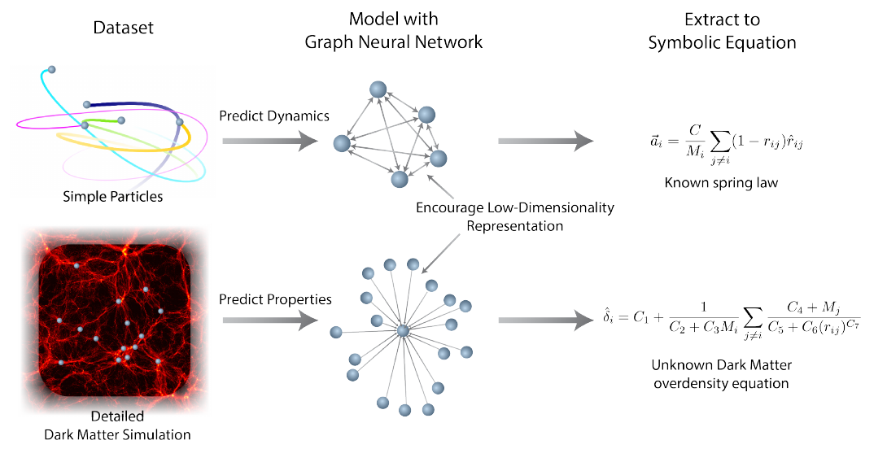
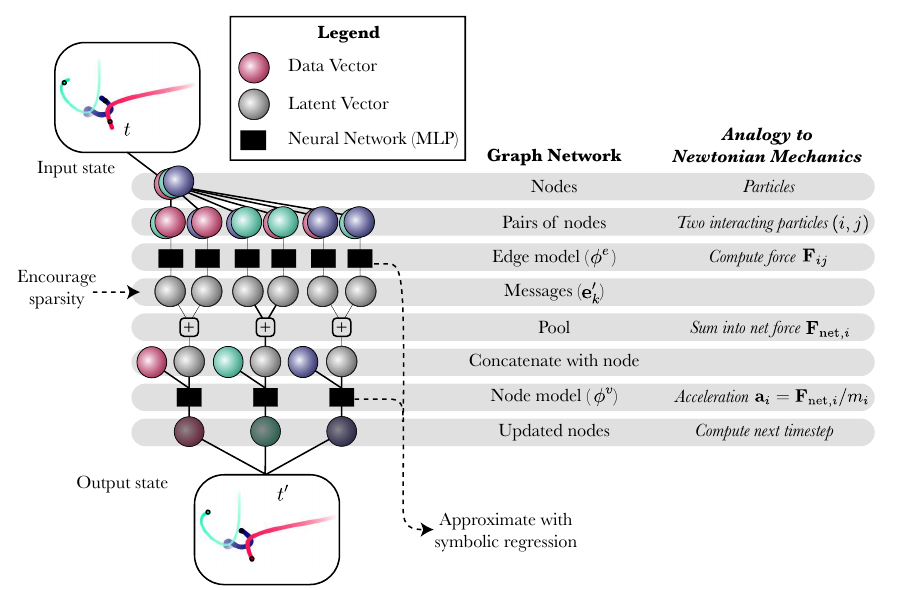
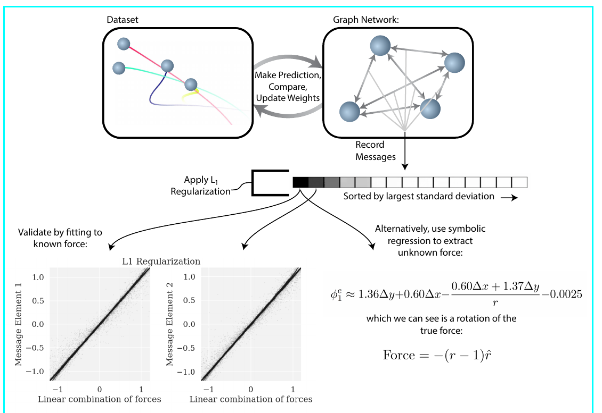

# 신경망이 주고받는 메시지에서 물리 법칙을 꺼내기 — Discovering Symbolic Models from Deep Learning with Inductive Biases

#### Abstract

본 논문에서는 강한 귀납 편향(inductive bias)을 도입하여 학습된 심층 모델로부터 기호적 표현(symbolic representation)을 증류해 내는 일반적 접근법을 개발한다. 특히 그래프 신경망(Graph Neural Networks, GNNs)에 초점을 맞춘다. 기법은 다음과 같이 작동한다. 먼저 지도 학습 환경에서 GNN을 학습시킬 때 희소한 잠재 표현(sparse latent representation)을 갖도록 유도하고, 그다음 학습된 모델의 구성 요소에 기호회귀(symbolic regression)를 적용하여 명시적인 물리적 관계를 추출한다. 힘 법칙과 해밀토니안(Hamiltonian)을 포함하여 이미 알려진 올바른 방정식들이 신경망으로부터 추출될 수 있음을 확인한다. 이어서 이 방법을 자명하지 않은 우주론 사례, 곧 상세한 암흑물질 시뮬레이션에 적용하여, 주변 우주 구조의 질량 분포로부터 암흑물질의 밀집도를 예측할 수 있는 새로운 해석적 공식을 발견한다. 본 기법으로 GNN에서 추출한 기호적 표현은 분포 밖 데이터(out-of-distribution data)에 대해서도 GNN 자체보다 더 잘 일반화되었다. 이 접근법은 신경망을 해석하고 신경망이 학습한 표현으로부터 새로운 물리 원리를 발견하는 대안적 방향을 제시한다.

#### 요약

기호회귀는 데이터에서 닫힌 형태의 수식을 찾아 주지만 변수가 조금만 늘어도 탐색 공간이 터져 버리고, 딥러닝은 고차원을 잘 다루지만 무엇을 배웠는지 말해 주지 않는다. 이 논문은 둘을 잇는 다리를 놓는데, 그 다리가 꽤 물리적이다. 그래프 네트워크의 메시지 벡터를 압축하도록 강제해 두면, 아무도 힘의 정답을 알려 주지 않았는데도 메시지가 입자 사이에 작용하는 힘 벡터의 회전으로 수렴한다. 그렇게 의미를 갖게 된 내부 함수 하나하나에 기호회귀를 따로 걸면 스프링 법칙도, 역제곱 법칙도, 해밀토니안도 그대로 되살아난다. 그리고 정답이 알려지지 않은 암흑물질 문제에 같은 절차를 돌려 물리학자들이 손으로 설계한 공식보다 잘 맞는 새 공식을 찾아낸다. 더 흥미로운 것은 마지막 한 줄이다. 뽑아낸 수식이 그것을 뽑아낸 신경망보다 분포 밖에서 더 잘 맞는다.

---

## 1. 왜 이 논문이 필요했나

수천 년 동안 과학은 닫힌 형태의 기호적 표현으로 만들어진 모델에 기대어 왔다. 대수식은 대체로 간결하고, 명시적인 해석을 제공하며, 일반화가 잘 된다. 문제는 그 대수식을 찾는 일이 어렵다는 데 있다.

기호회귀는 그 일을 자동화하려는 시도다. 해석적 함수들을 조합해 데이터를 설명하는 식을 조립하는 지도 학습 기법인데, 보통은 유전 알고리즘을 쓰고 본질적으로는 무차별 탐색이다. 그래서 입력 변수와 연산자의 수에 대해 지수적으로 커진다. 많은 기계학습 문제가 전통적인 기호회귀에 손댈 수 없는 이유가 여기 있다.

반대편에 딥러닝이 있다. 고차원 데이터셋에서도 복잡한 모델을 효율적으로 학습시킬 수 있지만, 학습된 모델은 블랙박스이고 해석하기 어렵다. 게다가 데이터에 대한 사전 지식을 모델에 직접 부과하지 않으면 일반화도 쉽지 않다. 강한 귀납 편향을 걸어 일반화를 개선한다 해도, 신경망의 학습된 부분은 대개 조각별 선형 근사라서 ReLU를 활성함수로 쓰는 한 외삽도 선형적으로 이루어진다.

한쪽은 해석되지만 규모를 감당하지 못하고, 다른 쪽은 규모를 감당하지만 해석되지 않는다. 이 논문은 두 방법의 장점을 결합하는 일반적 프레임워크를 제안한다.

*Figure 1. 데이터셋에서 물리 방정식을 뽑아내는 과정. 위쪽은 정답이 알려진 단순 입자계, 아래쪽은 정답이 알려지지 않은 암흑물질 시뮬레이션이다. 두 경우 모두 그래프 신경망으로 예측 모델을 학습시키되 저차원 표현을 갖도록 유도하고, 그 표현에서 기호식을 추출한다.*

## 2. 핵심 아이디어는 인수분해다

프레임워크 자체는 네 단계로 요약된다.

1. 데이터의 성질에 잘 맞는 귀납 편향을 제공하는, 분리 가능한 내부 구조의 딥러닝 모델을 설계한다. 상호작용하는 입자계의 경우 그래프 네트워크를 핵심 귀납 편향으로 쓴다.
2. 가용한 데이터로 모델을 end-to-end 학습시킨다.
3. 모델이 내부적으로 학습한 각각의 함수에 기호식을 맞춘다.
4. 심층 모델의 그 함수들을 기호식으로 교체한다.

여기서 3번이 왜 이득인지가 이 논문의 출발점이다. 논문이 드는 예를 그대로 옮기면 이렇다. 스칼라 $z_i \in \mathbb{R}$와 시계열 $\{\mathbf{x}_{i,1}, \dots, \mathbf{x}_{i,100}\}$, $\mathbf{x}_{i,j} \in \mathbb{R}^5$ 사이의 관계를 찾고 싶고, 참 관계는

$$z_i = y_i^2, \quad y_i = \sum_{j=1}^{100} y_{i,j}, \quad y_{i,j} = \exp(x_{i,j,3}) + \cos(2x_{i,j,1})$$

라고 하자. 학습 가능한 모델에 $z_i = f\left(\sum_{j=1}^{100} g(\mathbf{x}_{i,j})\right)$라는 귀납 편향을 걸어 둔다. $f$와 $g$ 각각에 대해 $10^9$개의 식을 고려해야 한다면, 표준적인 기호회귀는 그 조합을 봐야 하므로 총 $(10^9)^2 = 10^{18}$개를 탐색해야 한다. 그런데 신경망을 먼저 $f$와 $g$에 맞춰 학습시키고, 학습이 끝난 뒤 $f$와 $g$에 각각 따로 식을 맞추면 $2 \times 10^9$개만 보면 된다.

즉 고차원 데이터셋을 기호회귀가 감당할 만한 작은 하위 문제들로 인수분해하는 것이다. 논문이 스스로 강조하듯, 이것은 새로운 기호회귀 기법이 아니다. 기존의 어떤 기호회귀 기법이든 잘 동기화된 귀납 편향을 가진 신경망을 앞에 세워 고차원 문제로 확장하는 방법이다. 실험에서는 효율성과 사용 편의성 때문에 eureqa를 골랐지만, PySR을 비롯한 다른 패키지로 그대로 갈아 끼울 수 있다.

## 3. 그래프 네트워크의 내부 구조

### 1) 세 개의 내부 함수

그래프 네트워크는 내부적으로 세 개의 구별되는 구성 요소로 이루어진다. 엣지 모델, 노드 모델, 전역 모델이고, 회귀 문제 안에서 서로 다른 명시적 역할을 맡는다.

메시지 함수라고도 불리는 엣지 모델 $\phi^e$는 그래프에서 엣지로 연결된 노드 쌍 $(\mathbf{v}_i, \mathbf{v}_j \in \mathbb{R}^{L_v})$과 그 엣지에 대한 어떤 벡터 정보를 받아 메시지 벡터를 낸다. 이 메시지 벡터들은 받는 노드마다 자신에게 보내는 모든 노드에 대해 원소별로 합산되고, 합산된 벡터가 노드 모델로 전달된다. 노드 모델 $\phi^v$는 받는 노드와 합산된 메시지 벡터를 받아 갱신된 노드를 계산하는데, 이때 갱신된 노드란 어떤 속성이거나 동역학적 변화량을 나타내는 벡터다. 마지막으로 전역 모델 $\phi^u$는 모든 메시지와 모든 갱신된 노드를 모아 전역 속성을 계산한다. 세 함수 모두 보통 다층 퍼셉트론으로 근사되고, 그래서 전체가 end-to-end로 미분 가능하다.

$$\mathbf{e}'_{ij} = \phi^e(\mathbf{v}_i, \mathbf{v}_j), \qquad \bar{\mathbf{e}}_i = \sum_{j \in \mathcal{N}(i)} \mathbf{e}'_{ij}, \qquad \mathbf{a}_i = \phi^v(\mathbf{v}_i, \bar{\mathbf{e}}_i)$$

논문이 그래프 네트워크를 고른 이유는 세 가지다. 입자 치환에 대해 등변(equivariant)이고, end-to-end로 미분 가능해 경사하강법으로 효율적으로 학습되며, 세 개의 분리되고 해석 가능한 내부 함수를 갖는다. 세 번째가 곧 기호회귀의 표적이다.

*Figure 2. 그래프 네트워크의 내부 구조. 오른쪽 열은 각 단계를 뉴턴역학에 대응시킨 것으로, 엣지 모델은 힘 $\mathbf{F}_{ij}$의 계산, 풀링은 알짜힘 $\mathbf{F}_{\text{net},i}$로의 합산, 노드 모델은 $\mathbf{a}_i = \mathbf{F}_{\text{net},i}/m_i$에 해당한다. 점선 화살표가 가리키듯 기호회귀의 표적은 엣지 모델과 노드 모델이다.*

### 2) 노드는 변수가 아니라 개체다

이 구조를 읽을 때 흔히 미끄러지는 지점이 하나 있다. 그래프의 노드는 변수가 아니라 개체다.

노드 하나는 입자 하나, 헤일로 하나처럼 같은 종류의 개체이고, 변수들은 그 노드에 붙는 특징 벡터다. 질량, 위치, 속도, 전하가 노드의 속성으로 들어가는 것이지 각각이 노드가 되지 않는다. 엣지도 어떤 변수와 어떤 변수가 관계있다는 뜻이 아니라 어떤 개체와 어떤 개체가 상호작용한다는 뜻이다. 그래서 그래프가 encode하는 것은 변수 간 관계 구조가 아니라 개체 간 상호작용 구조다.

이 구분이 중요한 이유는 방법이 이득을 보는 지점이 바로 거기이기 때문이다. $\phi^e$ 하나가 모든 엣지에 공유되고 $\phi^v$ 하나가 모든 노드에 공유된다. 뒤에 나올 암흑물질 사례에서 헤일로 215,854개, 엣지 3,043만 개를 다루면서도 결국 맞춰야 할 함수는 두 개뿐이고 각 함수의 입력은 예닐곱 개 수준이다. 반복되는 동일한 상호작용이 대량으로 있다는 것이 전제이고, 그 반복 덕분에 기호회귀가 감당할 크기로 문제가 쪼개진다.

뒤집어 말하면, 변수 열 개짜리 현상 하나가 있고 반복 구조가 없다면 그래프를 만들 대상이 없다. 그런 경우는 애초에 기호회귀를 그냥 직접 돌리면 되고 이 논문의 방법이 필요하지 않다.

### 3) 뉴턴역학과의 대응은 비유일 뿐이다

Figure 2의 오른쪽 열이 워낙 깔끔해서 이 논문 전체가 힘과 질량이라는 가정 위에 서 있는 것처럼 읽히기 쉽지만, 저자들은 그 점을 꽤 의식적으로 못박아 둔다. 뉴턴역학과의 비교는 순전히 설명을 위한 것이고 명시적으로 부과된 것이 아니라고 캡션에 적혀 있다. 실제로 다른 점이 네 가지 나열된다. 메시지는 대개 고차원이라 힘 벡터가 아니고, 노드는 물리적 입자일 필요가 없고, $\phi^e$와 $\phi^v$는 임의의 학습된 함수이며, 출력이 갱신된 상태일 필요도 없다.

논문 안에서도 그 가정은 이미 깨진다. 해밀토니안 사례에서는 전역 모델이 스칼라 에너지 하나를 출력하고 메시지 차원이 1이라서 메시지가 곧 힘 벡터라는 대응이 성립하지 않는다. 암흑물질 사례는 더 멀리 간다. 정답 해석식이 알려져 있지 않고, 동역학이 아니라 정적 데이터에 대한 회귀 문제이며, 입자계가 아니라 격자 밀도를 사람이 만든 특징으로 뭉뚱그린 헤일로 집합이고, 잠재 공간의 적정 차원조차 미리 모른다. 그런데도 작동한다.

프레임워크 자체의 기술도 입자와 무관하게 쓰여 있다. 데이터의 성질에 잘 맞는 귀납 편향을 주는 분리 가능한 구조를 설계하라가 1단계이고, 그래프 네트워크는 그 예시로 도입된다. Broader impact 절에서는 범위를 가장 넓게 잡아, 이 기법은 해석 가능하고 모듈화된 하위 구성요소를 가진 어떤 학습된 신경망에도 적용할 수 있다고 말한다.

그러니까 실제 요구 조건은 힘과 입자가 아니라 세 가지다. 데이터를 개체와 관계로 표현할 수 있을 것, 모델 내부가 분리 가능한 함수들로 쪼개질 것, 그리고 그 함수의 입출력이 기호회귀가 감당할 만큼 저차원으로 압축될 것. 세 번째가 사실상 이 논문의 핵심 기여다.

## 4. 뉴턴역학 사례에서 실제로 오가는 것

### 1) 입력과 라벨

원 데이터는 2차원과 3차원의 N-body 시뮬레이션이고 입자 4개 또는 8개짜리 계다. 시뮬레이션이 담고 있는 것은 시간에 따른 질량, 전하, 위치, 속도, 가속도다. 힘 법칙은 여섯 가지를 쓰는데 각각 별개의 데이터셋이다.

| | 힘 법칙 |
|---|---|
| (a) | $1/r$ 궤도력 $-m_1 m_2 \hat{r}/r$ |
| (b) | $1/r^2$ 궤도력 $-m_1 m_2 \hat{r}/r^2$ |
| (c) | 전하 간 힘 $q_1 q_2 \hat{r}/r^2$ |
| (d) | $\lvert r-1 \rvert^2$ 퍼텐셜에 속도 반대 방향 감쇠가 붙은 스프링 |
| (e) | 불연속 힘 $-\{0, r^2\}\hat{r}$, $r<2$에서 0으로 전환 |
| (f) | 모든 입자 사이의 스프링, $(r-1)^2$ 퍼텐셜 |

노드 하나가 입자 하나이고 노드 특징으로 위치, 속도, 질량, 전하가 들어간다. 별도의 임베딩 층 없이 물리량을 그대로 이어붙인 것이라 2차원이면 $L_v = 6$, 3차원이면 8이다. 메시지 패싱이 한 번뿐이라 인코더를 따로 둘 이유가 없다. 입자 수가 적어서 엣지는 상호작용하는 모든 쌍을 잇는다.

가속도는 여기 들어가지 않는다. 데이터에는 있지만 입력이 아니라 라벨이다. 학습 목표는 계의 현재 상태를 보고 각 입자의 순간 가속도를 맞추는 것이고, 손실은 예측 가속도와 참 가속도 사이의 평균절대오차 하나뿐이다.

여기가 이 설계에서 가장 중요한 지점이다. 엣지 모델에는 라벨이 없다. 힘의 참값을 알려 주지 않는다. 전체가 하나의 손실로 end-to-end 학습되고, 그 손실의 기울기가 노드 모델을 거쳐 합산 연산을 통과해 엣지 모델까지 역전파될 뿐이다. 메시지가 무엇을 의미해야 하는지는 아무도 지정하지 않는다.

### 2) 세 개의 차원을 구분하기

논의에서 자주 뒤섞이는 세 차원을 갈라 두면 구조가 선명해진다.

| | 2차원 | 3차원 | 정체 |
|---|---|---|---|
| 노드 입력 $\mathbf{v}_i$ | 6 | 8 | 위치, 속도, 질량, 전하 |
| 메시지 | 100 (Bottleneck만 2) | 100 (Bottleneck만 3) | 학습된 잠재 표현 |
| 노드 출력 | 2 | 3 | 예측 가속도, 손실이 걸리는 곳 |

입력 벡터와 출력 벡터는 같은 노드에 붙어 있지만 서로 다른 물건이다. 입력은 그 순간의 상태이고 출력은 그 상태에서 나오는 가속도다.

### 3) 출력은 상태가 아니라 가속도다

Figure 2를 처음 보면 노드 모델이 입력 노드와 같은 형태의 갱신된 노드를 만들어 내는 것처럼 읽히지만, 그림 안을 조금 더 들여다보면 그림도 같은 말을 하고 있다. 오른쪽 대응 열에서 Node model 행에는 $\mathbf{a}_i = \mathbf{F}_{\text{net},i}/m_i$가, 그다음 Updated nodes 행에는 Compute next timestep이 달려 있다. 노드 모델의 출력은 가속도이고, 갱신된 노드는 그 가속도를 받아 다음 시점을 계산하는 단계다. 그 적분은 학습되는 함수가 아니라 그래프 네트워크 바깥의 연산이고, 그래서 그 행에는 MLP를 뜻하는 검은 사각형이 없다.

일반적인 GN 형식에서 갱신된 노드라는 이름은 그저 노드 모델의 출력을 부르는 관례일 뿐이고 그 차원은 자유로운 설계 선택이다. 같은 자리에 원이 그려져 있으니 같은 모양처럼 보이지만, 원은 노드마다 벡터가 하나 있다는 뜻이지 그 벡터의 크기가 같다는 뜻이 아니다. 이 논문 안에서 바로 확인된다. 세 사례의 출력 차원이 뉴턴역학은 $D$차원 가속도, 해밀토니안은 스칼라 에너지 하나, 암흑물질은 헤일로당 스칼라 과밀도 하나로 전부 다르다.

학습 방식도 여기에 맞춰 단순하다. 한 스텝짜리 지도 학습이다. 학습 표본 하나가 시점 $t$의 참 상태와 시점 $t$의 참 가속도의 짝이고, 다음 표본은 시점 $t+1$의 참 상태에서 다시 시작한다. 모델이 예측한 가속도를 적분해서 만든 상태를 다시 입력으로 넣는 자기회귀 롤아웃은 학습 중에 일어나지 않는다. 그래서 각 시뮬레이션의 각 시점이 사실상 독립적인 학습 표본이 된다. Figure 2의 Compute next timestep 화살표는 학습 절차가 아니라 사용 방식을 그린 것이다.

## 5. 압축이 해석을 만든다

### 1) 네 가지 학습 전략

메시지 표현의 크기가 메시지를 힘으로 해석하는 데 얼마나 중요한지 보기 위해, 논문은 네 가지 전략으로 같은 그래프 네트워크를 학습시킨다.

| 전략 | 내용 |
|---|---|
| Standard | 메시지 성분 100개, 정규화 없음 |
| Bottleneck | 메시지 성분 수를 문제의 차원(2 또는 3)에 맞춤 |
| $\text{L}_1$ | Standard와 같되 메시지에 가중치 $10^{-2}$의 $\text{L}_1$ 정규화 항 |
| KL | Standard와 같되 가우시안 사전분포 기준 KL 발산으로 정규화 |

$\text{L}_1$과 KL 모두 서로 다른 정규화로 네트워크가 메시지 벡터의 압축된 표현을 찾도록 유도한다. 이것은 라벨이 아니라 벌점이다. 메시지가 힘이 되어라가 아니라 메시지를 최대한 적은 성분으로 표현해라라고만 말하는 셈이다.

이렇게 하는 동기를 논문은 두 가지로 든다. 하나는 오컴의 면도날로, 비슷한 정확도를 주는 두 모델이 있으면 과학은 늘 단순한 쪽을 선호한다. 다른 하나가 더 실질적이다. 합산된 메시지 벡터로 어떤 계를 완벽히 기술하는 법칙이 압축된 공간에 존재한다면, 그 잠재 공간과 같은 차원의 메시지를 갖도록 학습된 그래프 네트워크의 메시지 벡터는 참 벡터의 수학적 회전이 되리라 기대할 수 있다.

### 2) 왜 살아남는 차원이 $D$인가

여기서 흔한 오해 하나를 짚어 둘 만하다. 살아남는 차원 수는 시뮬레이션에 쓰인 힘의 종류 수가 아니라 공간 차원 $D$다. 애초에 여섯 힘 법칙은 각각 별개의 데이터셋이고, 설령 섞는다 해도 차원은 늘지 않는다. 중력과 스프링을 동시에 걸면 두 $D$차원 벡터가 더해져 여전히 $D$차원 벡터 하나이기 때문이다.

근거는 집계가 단순한 원소별 합이라는 데서 나온다.

첫째, $D$차원이면 충분하다. 노드 모델이 올바른 가속도를 내려면 알아야 할 것은 알짜힘 $\mathbf{F}_{\text{net},i} = \sum_j \mathbf{F}_{ij}$ 하나뿐이고 그건 숫자 $D$개다. 개별 이웃이 누구였는지, 거리가 얼마였는지는 알짜힘에 흡수되고 나면 더 필요하지 않다. 메시지가 참 힘의 어떤 고정된 선형변환 $R\mathbf{F}_{ij}$라면 합은 $R\mathbf{F}_{\text{net},i}$가 되고, $\phi^v$가 $R^{-1}$을 적용한 뒤 질량으로 나누면 정답이 나온다.

둘째, 그 관계가 선형일 수밖에 없다. 메시지가 힘의 비선형 부호화 $g(\mathbf{F})$라면 $\phi^v$가 보는 것은 $\sum_j g(\mathbf{F}_{ij})$인데, 일반적으로 이 값으로부터 $\sum_j \mathbf{F}_{ij}$를 복원할 수 없다. 이웃 수와 배치가 계속 달라지는데도 항상 옳으려면 부호화가 덧셈을 보존해야 하고, 그러면 선형이다. 회전이라는 말이 나오는 이유가 이것이다.

셋째, $D$보다 적어도 안 된다. 중심력이라 힘이 항상 $\hat{r}$ 방향이니 스칼라 $f(r)$ 하나면 될 것 같지만, 스칼라를 더하면 방향 정보가 사라져 알짜힘을 복원할 수 없다. 방향까지 살리려면 결국 $D$개 숫자가 필요하다.

넷째, $\text{L}_1$이 그 최소해를 고른다. 손실을 낮추는 해는 여러 개 있고 100차원을 헐겁게 다 쓰는 해도 그중 하나지만, $\text{L}_1$은 메시지 성분의 크기에 벌점을 매기니 쓸모없는 성분을 0으로 눌러 버린다. $\text{L}_1$ 벌점이 좌표계에 의존한다는 점도 여기서 일한다. 같은 크기의 벡터라도 몇 개 좌표에 몰려 있는 쪽이 여러 좌표에 퍼져 있는 쪽보다 $\text{L}_1$ 노름이 작다. 그래서 활성 부분공간의 방향은 자유롭게 두면서도 그 부분공간을 표현하는 좌표는 축에 정렬되도록 밀어붙인다.

*Figure 3. 귀납 편향을 구현하고 활용하는 절차. 학습이 끝난 뒤 데이터를 흘려보내며 메시지를 기록하고, 성분별 표준편차 순으로 정렬한다. 앞쪽 소수의 성분만 짙게 남고 나머지는 눌린다. 왼쪽 두 산점도는 살아남은 성분이 참 힘 성분들의 선형결합과 이루는 관계이고, 오른쪽은 같은 성분에 기호회귀를 걸어 얻은 식이다.*

### 3) 메시지는 힘의 회전이다

기대가 맞았는지는 두 단계로 확인한다. 먼저 가중치를 고정한 뒤 시뮬레이션 데이터를 훑으면서 각 시점의 각 입자 쌍에 대해 $\phi^e$를 평가하고, 나온 메시지 벡터들을 모은다. 기록 단위 하나가 엣지 하나다. 그러면 100개 성분 각각에 표본이 쌓이고 성분별 표준편차를 낼 수 있다.

이 표준편차가 재는 것은 입력이 바뀔 때 이 성분이 반응하는가다. 쓰이지 않는 성분은 벌점 때문에 어떤 쌍을 넣든 거의 0에 붙어 있으니 표준편차가 작고, 힘 정보를 나르는 성분은 두 입자의 거리와 방향이 달라질 때마다 값이 크게 흔들린다. 그러니 표준편차 순 정렬이 곧 정보를 담은 성분 순 정렬이 된다. 여기서 상위 $D$개를 고른 뒤 각각을 참 힘 성분들의 선형결합에 회귀시키고, 그 결정계수를 표로 정리한 것이 Table 1이다.

| 시뮬레이션 | Standard | Bottleneck | $\text{L}_1$ | KL |
|---|---|---|---|---|
| Charge-2 | 0.016 | **0.947** | 0.004 | 0.185 |
| Charge-3 | 0.013 | **0.980** | 0.002 | 0.425 |
| $r^{-1}$-2 | 0.000 | **1.000** | **1.000** | 0.796 |
| $r^{-1}$-3 | 0.000 | **1.000** | **1.000** | 0.332 |
| $r^{-2}$-2 | 0.004 | **0.993** | 0.990 | 0.770 |
| $r^{-2}$-3 | 0.002 | **0.994** | 0.977 | 0.214 |
| Spring-2 | 0.032 | **1.000** | **1.000** | 0.883 |
| Spring-3 | 0.036 | 0.995 | **1.000** | 0.214 |

*참 힘 성분들의 선형결합을 메시지 성분에 맞춘 회귀의 $R^2$. 1에 가까울수록 메시지와 참 힘의 상관이 강하다. 굵게 표시한 것이 행별 최고값이다.*

정규화 없는 Standard 모델은 전 행에서 0.00 수준이다. 100차원 안에 힘 정보가 흩어져 있어 어떤 저차원 회전으로도 잡히지 않는다. 반면 메시지 크기가 명시적으로(Bottleneck) 또는 암묵적으로(KL, $\text{L}_1$) 저차원으로 제약된 모델들은 참 힘과 강하게 상관된 메시지를 낸다. 그래프 네트워크의 메시지가 힘을 학습한다는 것을 명시적으로 보인 연구는 이전에 없었다고 논문은 적는다.

여기서 일치의 형태를 정확히 볼 필요가 있다. 첫 번째 메시지 성분이 $F_x$와 같다는 뜻이 아니라, 첫 번째 메시지 성분 $\approx a F_x + b F_y + c$라는 뜻이다. 네트워크가 물리학자와 같은 좌표축을 고를 이유가 없으니 힘 벡터가 어떤 회전된 기저로 표현되어 있는 것이다. 조금 더 정확히 말하면, 100차원 메시지 공간 안에서 실제로 활성인 부분은 $D$차원 부분공간이고 그 부분공간이 참 힘 공간의 선형상이다. 살아남은 $D$개 성분은 그 부분공간의 기저 하나일 뿐이다. 기저가 정해지지 않는 이유는 손실이 그것을 신경 쓰지 않기 때문이다. 어떤 회전 $R$을 쓰든 $\phi^v$가 $R^{-1}$을 안에서 흡수해 버리면 가속도는 똑같이 나온다.

Table 1을 볼 때 한 가지 덧붙일 것이 있다. 논문 본문은 $\text{L}_1$ 모델이 가장 높은 상관을 보인다고 요약하지만, 전하 힘 두 행에서는 $\text{L}_1$이 0.004와 0.002로 Standard보다도 낮다. 그 두 행은 Bottleneck만 성공한다. 압축을 걸었다고 항상 힘이 복원되는 것은 아니라는 뜻이고, 논문도 재구성이 늘 성공하지는 않으며 특히 올바른 차원의 압축 표현을 찾지 못하는 전략에서 실패한다고 적어 둔다.

### 4) 기호회귀에 넘기는 것

여기서 입력의 두 번째 층위가 등장한다. 기호회귀는 원 데이터에 직접 걸리지 않고 학습된 신경망의 내부 함수를 표본화한 자료에 걸린다. 학습이 끝난 신경망이 이 시점부터 데이터 생성기 역할을 하는 셈이다. 원 시뮬레이션이 상태와 가속도를 주었듯이, 학습된 $\phi^e$가 이제 이 두 입자를 넣으면 이 값이 나온다는 새로운 데이터셋을 만들어 준다.

구체적으로는 가장 유의미한 메시지 성분 $\phi^e_1$을 학습 데이터셋의 무작위 표본에 대해 기록한다. 회귀에 주는 입력은 $m_1, m_2, q_1, q_2, x_1, x_2, \dots$ 곧 받는 노드와 보내는 노드의 질량, 전하, 위치이고, 여기에 기호회귀를 돕기 위한 단순화된 변수로 변위 $\Delta x$와 거리 $r$을 함께 넣는다. 이 파생 변수는 eureqa에게 주는 편의 변수이지 신경망에게 주는 입력이 아니다. 신경망은 원 좌표만 받고 차이를 만드는 일까지 학습으로 해결한다.

eureqa가 쓰는 연산자는 $+, -, \times, /, >, <, \wedge, \exp, \log, \text{IF}(\cdot,\cdot,\cdot)$와 실수 상수다. 여러 복잡도 수준에서 후보식을 받은 뒤, 복잡도 증가 대비 평균절대오차의 비례적 감소가 가장 큰 것을 고른다.

$$-\Delta \log(\text{MAE}_c) / \Delta c$$

이렇게 얻은 식을 신경망 자리에 끼워 넣어 대안적 해석 모델을 만들고, 여러 단계의 함수 근사에서 누적된 오차를 없애기 위해 계수를 데이터에 대고 한 번 더 다시 맞춘다.

$\phi^v$에 대해서도 같은 방식으로 따로 수집한다. 무작위로 고른 받는 노드와 그 노드에 합산된 메시지를 입력으로, 그 노드에 대한 $\phi^v$ 출력을 목표로 하는 짝을 모은다.

결과를 하나만 보면 회전이라는 말의 뜻이 분명해진다. 2차원 스프링, $\text{L}_1$ 모델에서 뽑힌 식은

$$\phi^e_1 \approx 1.36\Delta y + 0.60\Delta x - \frac{0.60\Delta x + 1.37\Delta y}{r} - 0.0025$$

이고, 참 힘은 $\text{Force} = -(r-1)\hat{r}$이다. 정리하면 $0.60(\Delta x - \Delta x/r) + 1.37(\Delta y - \Delta y/r)$ 꼴인데, $\Delta x - \Delta x/r$가 곧 $-F_x$이고 $\Delta y - \Delta y/r$가 $-F_y$다. 이 하나의 메시지 성분 안에 $F_x$와 $F_y$가 0.60 대 1.37의 비율로 섞여 있다. 나머지 한 성분이 이와 독립인 다른 조합을 담고 있어서 둘을 합치면 힘 벡터 전체가 복원된다.

3차원 $1/r^2$ Bottleneck 모델과 2차원 불연속 힘 $\text{L}_1$ 모델에서도 각각 다음이 나온다.

$$\phi^e_1 \approx \frac{0.021\Delta x\, m_2 - 0.077\Delta y\, m_2}{r^3}, \qquad \phi^e_1 \approx \text{IF}(r>2,\ 0.15r\Delta y + 0.19r\Delta x,\ 0) - 0.038$$

불연속 힘의 경우 조건 분기까지 그대로 살아난다는 점이 눈에 띈다.

## 6. 힘 대신 에너지를 뽑기

전역 모델 $\phi^u$는 뉴턴역학 사례에서는 쓰이지 않는다. 가속도는 입자별 양이라 노드 모델까지로 끝나기 때문이다. $\phi^u$가 주역이 되는 것은 해밀토니안 사례다.

해밀토니안 역학은 계의 총 에너지 $\mathcal{H}(\mathbf{q}, \mathbf{p})$를 정준 좌표와 운동량의 함수로 기술한다. 계의 동역학은 $\mathcal{H}$의 기울기에 수직으로 변한다.

$$\frac{d\mathbf{q}}{dt} = \frac{\partial \mathcal{H}}{\partial \mathbf{p}}, \qquad \frac{d\mathbf{p}}{dt} = -\frac{\partial \mathcal{H}}{\partial \mathbf{q}}$$

여기서 $\phi^u$가 계 전체의 총 에너지라는 스칼라 하나를 출력하게 하면, 그래프 네트워크 전체가 해밀토니안과 같은 함수 형태를 갖게 된다. 그리고 저자들이 해석 가능성을 위해 여기에 손을 대는데, 그것이 FlatHGN의 flattened다. 보통이라면 $\phi^u$가 풀링된 고차원 인코딩을 받는 MLP겠지만 그러면 안에서 무슨 일이 일어나는지 알 수가 없다. 그래서 $\phi^u$를 쌍별 상호작용 항과 입자별 항의 합으로 고정한다.

$$\mathcal{H} = \sum_{\text{pairs}} \mathcal{H}_{\text{pair}} + \sum_i \mathcal{H}_{\text{self}}$$

이렇게 하면 $\phi^u$가 학습할 것이 없어지고 대신 $\mathcal{H}_{\text{pair}}$와 $\mathcal{H}_{\text{self}}$가 해석 가능한 대상이 된다. 거의 모든 물리계가 이런 합의 꼴로 정확히 기술되므로 표현력을 크게 잃지도 않는다.

라벨 구조는 여기서도 같다. 에너지의 참값을 주지 않는다. 예측된 $\mathcal{H}$를 $\mathbf{q}$와 $\mathbf{p}$로 편미분해서 동역학을 계산하고, 그 동역학에 대해서만 손실을 건다. 뉴턴 사례에서 힘이 감독 없이 메시지에 나타난 것처럼 여기서는 에너지가 감독 없이 $\phi^u$의 중간값으로 나타난다. 전하 입자의 경우 기대되는 퍼텐셜이 $\mathcal{H}_{\text{pair}} \approx a q_1 q_2 / r$인데, 학습된 메시지 함수에 기호회귀를 적용하면

$$\mathcal{H}_{\text{pair}} \approx \frac{0.0019\, q_1 q_2}{r}$$

가 나온다. 이 경우 설계상 메시지 함수의 차원이 1로 고정되어 있어 정규화가 필요 없다. 해밀토니안 함수의 출력이 스칼라이니 메시지 크기가 이미 올바른 차원으로 직접 제약되어 있기 때문이다.

## 7. 정답이 없는 문제로

이제 이 전략이 일반적인 회귀 문제, 자명하지 않은 데이터셋, 복잡한 상호작용, 알려지지 않은 법칙에도 통하는가를 묻는다. 논문은 네 조건을 모두 만족하는 예로 우주의 중력 시뮬레이션 데이터를 가져온다.

암흑물질은 우주 전체 물질의 약 85%를 차지하고, 뭉쳐서 헤일로라 불리는 중력 웅덩이를 이루며 보통의 바리온 물질을 끌어당겨 별을 만든다. 어떤 헤일로의 성질을 그 환경, 곧 주변의 다른 헤일로들로부터 예측하는 것은 우주론의 중요한 문제다. 여기서 다루는 것은 헤일로 $i$ 주변의 과잉 물질량

$$\delta = \frac{\rho - \langle \rho \rangle}{\langle \rho \rangle}$$

를 그 헤일로 자신과 이웃 헤일로들의 성질로부터 예측하는 문제다.

### 1) 데이터와 그래프 구성

Quijote 시뮬레이션의 0번 시뮬레이션에서 현재 우주에 해당하는 마지막 시점을 가져오고, 여기에 헤일로 215,854개가 들어 있다. 각 헤일로는 질량 $M_i$, 위치 $\mathbf{r}_i$, 속도 $\mathbf{v}_i$를 갖고, 헤일로 중심 위치에서의 평활화된 과밀도 $\delta_i$를 따로 계산해 둔다.

여기서는 입자가 몇 개 안 되는 상황이 아니라서 엣지를 만드는 규칙이 필요하다. 거리 50단위 안에 있는 헤일로끼리 연결하는데 1단위가 대략 300만 광년이다. 그 결과 방향성 엣지 30,437,218개가 생기고 헤일로당 이웃이 평균 71개다. 이 엣지 규칙은 데이터가 정해 주는 것이 아니라 사람이 고른 설계 선택이다. 학습 설정은 뉴턴역학과 같고 은닉 유닛만 500개로 바꾼다.

$\text{L}_1$으로 학습한 그래프 네트워크의 메시지에는 정보를 담은 성분이 하나만 남는다. 그러니까 여기서 $D$는 결과이지 규칙이 아니다. 실제 규칙은 합산되어 노드 모델로 넘어가는 충분통계량의 차원이고, 뉴턴역학에서 그게 마침 힘 벡터라 $D$가 된 것이다. 저자들이 차원을 미리 모른다고 명시하면서도 귀납 편향에 기대어 문제의 최적 차원을 찾는다고 표현하는 지점이 여기다.

### 2) 발견된 수식

| | 공식 | 합산 성분 | $\langle \lvert \delta_i - \hat{\delta}_i \rvert \rangle$ |
|---|---|---|---|
| 상수 | $\hat{\delta}_i = C_1$ | 없음 | 0.421 |
| 기존 (손설계) | $\hat{\delta}_i = C_1 + (C_2 + M_i C_3)e_i$ | $e_i = \sum_{j \neq i,\ \lvert \mathbf{r}_i - \mathbf{r}_j \rvert < 20} M_j$ | 0.121 |
| 신규 (질량 없이) | $\hat{\delta}_i = C_1 + \dfrac{e_i}{C_2 + C_3 e_i \lvert \mathbf{v}_i \rvert}$ | $e_i = \sum_{j \neq i} \dfrac{C_4 + \lvert \mathbf{v}_i - \mathbf{v}_j \rvert}{C_5 + (C_6 \lvert \mathbf{r}_i - \mathbf{r}_j \rvert)^{C_7}}$ | 0.120 |
| 신규 (질량 포함) | $\hat{\delta}_i = C_1 + \dfrac{e_i}{C_2 + C_3 M_i}$ | $e_i = \sum_{j \neq i} \dfrac{C_4 + M_j}{C_5 + (C_6 \lvert \mathbf{r}_i - \mathbf{r}_j \rvert)^{C_7}}$ | **0.0882** |

*암흑물질 과밀도에 대한 기존 공식과 발견된 공식의 비교. 값이 작을수록 좋다. $C_i$는 데이터에 맞춘 계수다.*

물리학자들이 손으로 설계한 공식이 0.121을 내는 자리에서 이 방법이 뽑아낸 공식이 0.0882를 낸다. 정답이 알려지지 않은 실제 문제에서 사람보다 잘 맞는 공식을 찾은 셈이다.

수식은 물리적으로도 말이 된다. 관심 있는 헤일로에 가까운 헤일로일수록 그 성질에 더 영향을 주어야 하고, 실제로 합산 함수가 거리에 반비례하는 꼴로 나온다. 손설계 공식과 마찬가지로 과밀도는 주변 총 물질 밀도에 따라 커져야 하고, 이웃의 질량에 대해 합산하고 있다는 점에서 그것도 확인된다. 다만 나머지 차이들에 대해서는 저자들 스스로 매우 흥미롭지만 덜 분명하다고 적고, 해석은 후속 천체물리 연구로 미룬다.

후속으로 질량 정보 없이 속도와 위치만으로 같은 분석을 한 결과도 있다. 가장 직접적인 관측 정보가 헤일로 속도이기 때문인데, 놀랍도록 비슷한 형태의 공식이 나오고 오차도 0.120으로 손설계 공식과 맞먹는다. 두 이웃 사이의 상대 속도가 질량의 대리 변수로 작동한 것인데, 더 무거운 물체가 더 강한 중력으로 주변 입자를 더 빠르게 가속시킨다는 점을 생각하면 자연스럽다.

### 3) 수식이 신경망을 이긴다

우리 물리 세계가 수학으로 잘 기술된다는 것을 안다면, 신경망을 단순한 대수식으로 증류했을 때 그 대수식이 보지 못한 데이터에 더 잘 일반화되지 않겠는가. 논문은 이 질문을 우주론 사례에서 직접 시험한다.

$\delta_i > 1$인 헤일로 20%를 가리고 나머지로 같은 학습 절차를 밟는다. 그런 다음 그 부분집합에서 추출한 식이 앞서와 기능적으로 동일한 표현으로 나온다는 것을 확인하고, 계수를 같은 가려진 데이터에 맞춘다.

| | 학습 데이터 | 분포 밖 데이터 |
|---|---|---|
| 그래프 네트워크 | **0.0634** | 0.142 |
| 추출된 기호식 | 0.0811 | **0.0892** |

*평균 오차 $\langle \lvert \delta_i - \hat{\delta}_i \rvert \rangle$. 값이 작을수록 좋다.*

학습 데이터에서는 그래프 네트워크가 더 낫지만, 분포 밖에서는 순서가 뒤집힌다. 신경망은 0.0634에서 0.142로 두 배 넘게 나빠지는 반면 기호식은 0.0811에서 0.0892로 거의 그대로다. 이 문제에서는 기호식이 그것이 추출되어 나온 바로 그 그래프 신경망보다 훨씬 잘 일반화되는 것으로 보인다고 논문은 적고, 서두에 인용한 위그너의 글로 돌아간다. 단순한 기호적 모델의 언어는 우주를 기술하는 데 놀랍도록 효과적이다.

## 8. 무엇이 남아 있나

이 방법을 다른 문제에 가져다 쓰려 할 때 걸리는 조건들을 정리하면 이렇다.

집계가 합으로 이루어져야 한다. 메시지를 더해서 노드로 넘기는 구조이므로 상호작용이 덧셈으로 분해되는 현상에 맞는다. 압축 정규화를 정당화하는 논리 자체가 합쳐진 메시지 벡터로 완벽히 기술되는 법칙이 존재한다는 전제 위에 서 있다.

저차원 잠재 표현이 실제로 존재해야 한다. 참된 상호작용이 본질적으로 고차원이면 압축을 걸어도 메시지가 힘에 대응하지 않는다. Table 1의 Standard 행이 그 실패의 모습이고, 전하 힘에서 $\text{L}_1$이 실패한 것도 압축을 건다고 늘 되는 것은 아님을 보여준다.

찾으려는 관계가 eureqa의 연산자 집합 안에서 표현 가능해야 한다. 실수 상수와 열 개 남짓의 연산자 조합으로 쓰이지 않는 관계는 나오지 않는다.

그래프를 어떻게 만들 것인가는 사람이 정한다. 암흑물질에서는 거리 50단위 안의 헤일로를 연결했는데, 이 값이 바뀌면 결과도 바뀔 것이다. 신경망의 어느 부품에 의미 있는 법칙이 들어 있는지 판단하는 것도 사람 몫이다.

격자 위의 장이나 편미분방정식 형태의 데이터라면 이 방법이 아니라 다른 계열이 맞다. 저자들도 격자 데이터에 대한 기호회귀 패키지들을 언급하면서 자기들 사례에는 적용되지 않으며 격자 PDE 데이터로의 확장은 향후 과제라고 적는다.

마지막으로, 나온 수식이 곧 법칙인지는 별개의 문제다. 데이터에 더 잘 맞고 외삽도 더 잘 되는 간결한 경험식을 얻은 것이지, 그 자체로 해석이 완결된 법칙을 얻은 것은 아니다.

## 9. 정리

이 논문이 실제로 한 일은 신경망을 해석하는 새로운 도구를 만든 것이 아니라, 해석 가능해지도록 신경망을 설계하는 방법을 보인 것에 가깝다. 그래프 네트워크는 원래 세 개의 분리된 내부 함수를 갖고 있었고, 거기에 메시지를 압축하라는 압력 하나를 더 걸었을 뿐이다. 그랬더니 아무도 감독하지 않은 중간 표현이 힘 벡터의 회전으로, 퍼텐셜 에너지로 수렴했다.

그다음은 인수분해의 이득이다. 통째로는 $10^{18}$개를 봐야 할 탐색이 $2 \times 10^9$개로 줄어들고, 그제서야 기호회귀가 손을 댈 수 있게 된다. 그리고 그렇게 뽑힌 식은 원본 신경망보다 분포 밖에서 잘 버틴다.

그래프 네트워크가 MLP나 합성곱 신경망 같은 더 균질한 친척들보다 명시적인 하위 구조를 갖고 있기에 학습된 표현과 계산에 대해 더 세밀한 해석을 끌어낼 수 있다는 것이 결론부의 요지다. 해석 가능성을 사후에 덧붙이는 것이 아니라 구조에 미리 심어 두는 접근이고, 그 심는 방법이 이 논문의 실질적 기여다.

---

**논문**: Cranmer, M., Sanchez-Gonzalez, A., Battaglia, P., Xu, R., Cranmer, K., Spergel, D., & Ho, S. (2020). Discovering Symbolic Models from Deep Learning with Inductive Biases. *NeurIPS 2020*.

**코드**: https://github.com/MilesCranmer/symbolic_deep_learning
