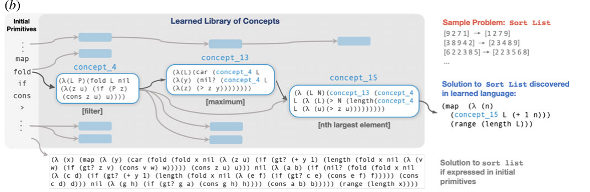
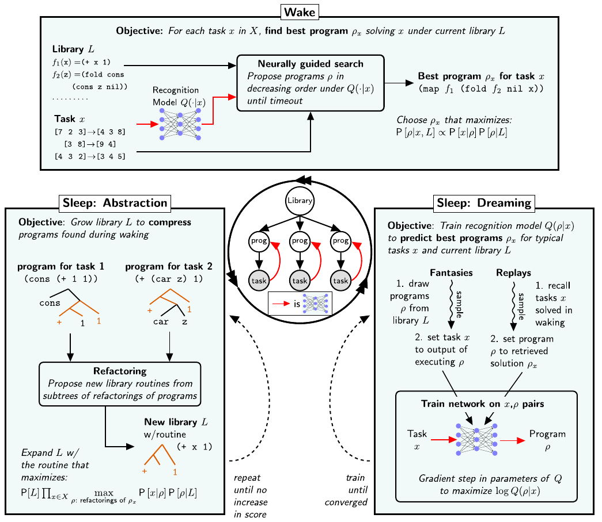
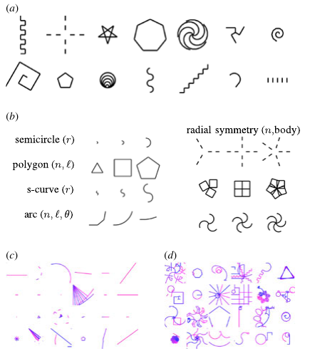
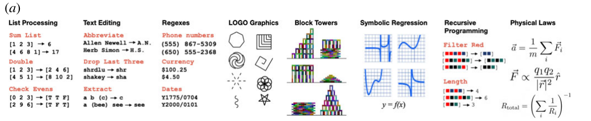
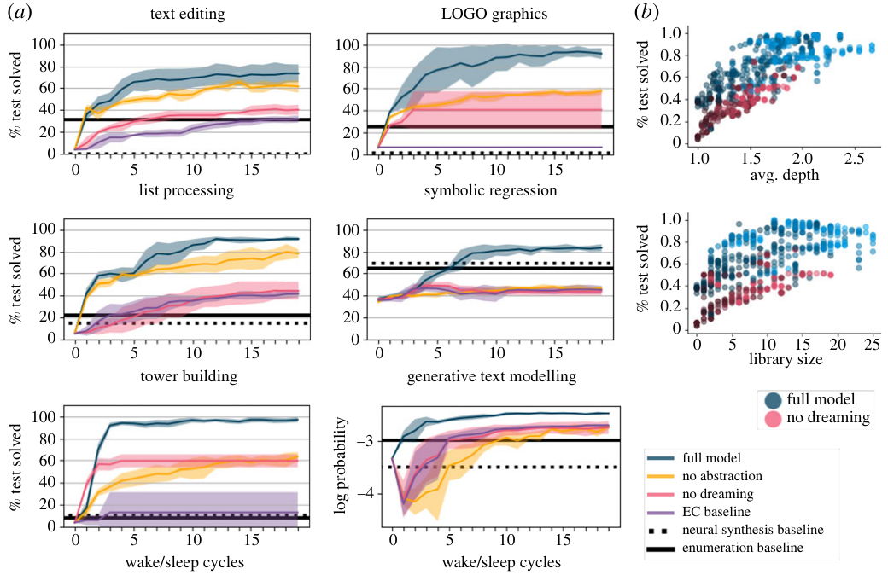

# 깨어서 풀고 잠들어 추상화하며 꿈꾸어 익히는 프로그램 학습기 — DreamCoder: growing generalizable, interpretable knowledge with wake–sleep Bayesian program learning

#### Abstract

전문가의 문제 해결은 문제와 그 해법을 사고하기 위한 강력한 언어에 의해 이루어진다. 전문성을 습득한다는 것은 이러한 언어, 즉 개념 체계와 그것을 활용하는 기술을 함께 학습하는 것을 의미한다. 본 논문에서는 프로그램을 작성함으로써 문제를 해결하도록 학습하는 시스템인 DreamCoder를 제시한다. DreamCoder는 도메인 개념을 표현하기 위한 도메인 특화 프로그래밍 언어(domain-specific programming language)를 생성하고, 이와 함께 해당 언어 안에서 프로그램 탐색을 안내하는 신경망을 학습함으로써 전문성을 구축한다. '깨어남과 수면(wake–sleep)' 학습 알고리즘은 새로운 기호적 추상화(symbolic abstraction)로 언어를 확장하는 과정과, 상상된 문제 및 재생된 문제로 신경망을 훈련하는 과정을 번갈아 수행한다. DreamCoder는 고전적인 귀납적 프로그래밍(inductive programming) 과제뿐 아니라 그림 그리기와 장면 구성 같은 창의적 과제도 해결한다. 이 시스템은 현대 함수형 프로그래밍(functional programming), 벡터 대수, 그리고 뉴턴 법칙과 쿨롱 법칙을 포함한 고전 물리학의 기초를 재발견한다. 개념은 이전에 학습된 개념으로부터 조합적으로 구축되며, 그 결과 해석 가능하고 새로운 과제로 전이 가능한 다층적 기호 표현이 형성되는 동시에, 경험에 따라 확장 가능하고 유연하게 성장한다.

#### 요약

사람은 산수를 배운 뒤 대수를, 대수를 배운 뒤 미적분을 배운다. 앞서 익힌 개념이 다음 개념을 표현하는 어휘가 되기 때문이다. DreamCoder는 이 과정을 기계에서 재현하려 한다. 문제를 푸는 프로그램을 찾고(깨어남), 찾은 프로그램들에서 반복되는 구조를 새 함수로 추출해 언어를 확장하며(추상화 수면), 확장된 언어로 가상의 문제를 만들어 탐색을 안내하는 신경망을 훈련한다(꿈 수면). 이 순환이 반복되면서 처음에는 손댈 수 없던 문제가 점차 풀 수 있는 문제로 바뀐다.

---

## 1. 연구 배경과 문제의식

### 1) 아이처럼 배우는 기계라는 오랜 꿈

이 논문은 Ellis, Tenenbaum 등 MIT 연구진이 2023년 Philosophical Transactions of the Royal Society A의 '인지적 인공지능(Cognitive artificial intelligence)' 특집호에 발표한 것이다. 알고리즘의 세부 구현은 2021년 PLDI 논문에서 이미 발표되었고, 이 논문은 시스템의 개념적 개요와 인지과학 및 인공지능에 대한 함의를 정리하는 데 중점을 둔다. 따라서 처음 DreamCoder를 접하는 독자에게는 PLDI 논문보다 이 논문이 더 좋은 입문서가 된다.

논문은 튜링(Turing)이 1950년 논문에서 제시한 "아이처럼 배우는 기계"라는 오랜 목표에서 출발한다. 기계학습 모델은 대개 한 종류의 과제만을 위해 설계되고 많은 데이터를 요구하며 일반화가 약한 반면, 사람은 요리에서 미적분까지 끝없이 다양한 문제를 배우고, 적은 경험으로도 강하게 일반화한다. 무엇보다 사람은 전문성(expertise)을 쌓는다. 즉 전달하고 확장할 수 있는 지식을 획득하며, 이전에 쌓은 개념 위에 새 개념을 키워 한 분야에 숙달할수록 더 빠르고 더 나은 학습자가 된다.

저자들은 이러한 인간 전문성의 핵심을 문제를 생각하는 데 쓰이는 "언어", 즉 개념 체계와 그 개념을 활용하는 기술로 본다. 물리학자가 "벡터", "내적", "역제곱 법칙" 같은 개념어로 문제를 사고하고, 화가가 "호", "대칭", "원근" 같은 개념으로 그림을 구상하는 것과 같다. 전문가가 된다는 것은 이런 개념 어휘를 갖추고, 새 문제를 보았을 때 어떤 개념이 쓸모 있을지 직관적으로 알아보는 능력을 갖추는 것이다.

### 2) 학습을 프로그램 귀납으로 본다는 것

DreamCoder는 학습을 프로그램 귀납(program induction), 다시 말해 몇 개의 입출력 예시를 설명하는 프로그램을 찾는 과정으로 본다. 예를 들어 `[9 2 7 1] → [1 2 7 9]`, `[3 8 9 4 2] → [2 3 4 8 9]` 같은 예시가 주어지면, 이 변환을 수행하는 프로그램, 즉 정렬 함수를 찾아내는 것이 학습이다. 이런 관점은 인공지능 초창기 Solomonoff(1964)의 귀납 추론 이론까지 거슬러 올라간다.

학습을 프로그램 찾기로 보면 장점이 크다. 첫째, 소수의 예시만으로도 강한 일반화가 가능하다. 통계 모델이 관찰한 데이터 사이를 보간(interpolation)하는 경향이 있는 반면, 기호 프로그램은 관찰 범위 밖으로 외삽(extrapolation)한다. 정렬 프로그램을 찾았다면 길이가 100인 리스트도 정확히 정렬한다. 둘째, 결과물을 사람이 해석할 수 있다. 프로그램은 과학과 공학에서 쓰는 모형화 언어를 포괄하며, 그 안의 지식을 사람이 읽고 검토할 수 있다. 셋째, 재사용과 조합이 쉽다. 한 번 찾은 함수를 다른 프로그램의 부품으로 쓸 수 있다. 넷째, 튜링 완전한(Turing-complete) 언어라면 원리적으로 계산 가능한 모든 문제의 해를 표현할 수 있다는 보편성을 가진다.

### 3) 기존 프로그램 귀납의 두 병목

이런 장점에도 프로그램 귀납은 인공지능에서 제한적인 영향력만 가졌다. 베이지안 관점에서 보면 이유가 분명해진다. 탐색에 쓰는 프로그래밍 언어가 곧 가설 공간이자 사전분포(prior)를 정한다. 그 언어에서 프로그램이 짧을수록 사전확률이 높다. 범용 언어로 시작하면 찾아야 할 프로그램이 너무 길어지고(사전확률이 매우 낮아지고), 합리적인 시간 안에 찾을 수 없다.

그래서 기존 시스템에는 두 가지 병목이 있었다. 하나는 사람이 정교하게 설계한 도메인 특화 언어(DSL)가 필요하다는 점이다. DSL이란 특정 분야의 문제를 짧게 표현하도록 만든 전용 언어로, 예컨대 문자열 편집 분야라면 "첫 글자 추출", "구분자로 나누기" 같은 연산을 기본으로 제공하는 언어다. 다른 하나는 DSL을 갖추더라도 탐색 공간이 조합적으로 폭발하므로, 그 DSL에 맞춘 탐색 알고리즘도 사람이 직접 설계해야 한다는 점이다. 두 요구 모두 프로그램 귀납의 확장성과 범용성을 제약한다. DreamCoder는 이 두 가지를 모두 학습으로 해결하려 한다.

## 2. 핵심 아이디어: 두 종류의 지식을 함께 학습

### 1) 선언적 지식과 절차적 지식

DreamCoder는 도메인 전문성을 두 층위로 나눈다.

첫째는 명시적 선언적 지식(explicit declarative knowledge)으로, 도메인의 공통 개념을 담은 학습된 함수 라이브러리, 즉 학습된 DSL이다. "필터", "최댓값", "n번째로 큰 원소" 같은 개념이 함수 형태로 저장된다. 사람이 말로 설명할 수 있는 지식에 해당한다.

둘째는 암묵적 절차적 지식(implicit procedural knowledge)으로, 새 과제가 주어졌을 때 어떤 함수를 쓸지 예측해 탐색을 안내하는 신경망이다. 논문은 이를 인식 모델(recognition model)이라 부른다. 숙련된 전문가가 문제를 보자마자 "이건 역제곱 법칙 문제다"라고 직관적으로 알아보는 능력에 해당한다. 말로 설명하기 어렵지만 문제 해결 속도를 결정하는 지식이다.

이 구분은 인지과학의 이중 과정 모형(dual-process model)과 전문성 연구에서 느슨하게 영감을 받았다. 저자들은 생물학적 학습 시스템이든 인공 학습 시스템이든 두 종류의 전문성이 모두 필요하며, 신경망 접근과 기호 접근이 여기서 상보적 역할을 한다고 본다.

### 2) 베이지안 관점의 해석

베이지안 관점에서 보면 라이브러리는 프로그램에 대한 사전분포 $P[\rho \mid L]$이고, 신경망은 사후분포를 근사하는 추론기 $Q(\rho \mid x)$이다. 여기서 $\rho$(로)는 프로그램, $L$은 라이브러리, $x$는 과제(입출력 예시 묶음)를 뜻한다. 쉽게 말해 라이브러리는 "이 분야에서는 어떤 프로그램이 그럴듯한가"에 대한 믿음이고, 신경망은 "이 과제를 보니 어떤 프로그램이 답일 것 같다"는 빠른 짐작이다. 시스템은 이 두 가지, 즉 프로그램에 대한 사전분포와 그 사후분포를 효율적으로 근사하는 추론 알고리즘을 함께 학습한다.

이 구조는 Hinton 등(1995)의 Helmholtz machine과 그 학습법인 wake-sleep 알고리즘을 프로그램 학습으로 확장한 것이다. 원래의 wake-sleep 학습은 학습자의 사전분포를 정의하는 확률적 생성 모델(generative model)과, 새 데이터가 주어졌을 때 그 생성 모델을 거꾸로 추론하도록 학습하는 신경망 인식 모델을 번갈아 훈련한다. 깨어 있는 동안에는 인식 모델의 안내를 받아 생성 모델로 새 데이터를 해석하고, 잠자는 동안에는 생성 모델에서 샘플링한 가상 데이터, 즉 "꿈"으로 인식 모델을 오프라인 학습한다.

### 3) 학습된 언어의 계층 구조



그림 1(b)는 리스트 처리 도메인에서 DreamCoder가 학습한 라이브러리의 계층 구조를 보여준다. 왼쪽 세로줄은 처음에 주어진 기본 함수(map, fold, if, cons, > 등)이고, 가운데 회색 영역이 학습된 개념 라이브러리다. 화살표는 "이 함수가 저 함수를 호출한다"는 관계를 나타낸다. 왼쪽에서 오른쪽으로 읽으면 개념이 쌓여 가는 순서가 된다. 기본 함수 fold로부터 concept_4(filter)가 만들어지고, filter를 이용해 concept_13(maximum, 최댓값)이, 다시 이 둘을 이용해 concept_15(n번째로 큰 원소)가 만들어진다. 오른쪽 위는 예제 과제인 리스트 정렬과, 학습된 언어로 표현한 해다. 맨 아래 긴 코드는 같은 해를 초기 기본 함수만으로 풀어 쓴 것이다.

DreamCoder가 학습한 언어는 이처럼 다층적인 추상화 계층을 이룬다. 이 계층은 심층 신경망의 내부 표현을 연상시키지만, 각 층이 앞선 층으로 정의된 기호 코드로 이루어져 있어 사람이 자연스럽게 해석하고 설명할 수 있다는 점이 다르다. 사람이 산수 다음에 대수를, 대수 다음에 미적분을 배우듯, 추상화의 연결망은 이전에 획득한 개념 위에 새 개념을 쌓으며 점진적으로 자란다.

같은 프로그램을 원리적으로는 처음 언어로도 쓸 수 있지만, 학습된 언어로 쓴 프로그램이 훨씬 짧고 해석하기 쉽다. 초기 기본 함수만으로 쓰면 이 프로그램들은 너무 복잡해서 합리적인 탐색 범위 안에서는 결코 발견되지 않는다. 도메인 특화 전문성을 획득한 뒤에야 대부분의 문제가 실제로 풀 수 있는 문제가 되는 것이다.

## 3. Wake-Sleep 학습 알고리즘

### 1) 전체 구조

논문의 그림 2가 전체 아키텍처에 해당한다. 다만 신경망 구조도 같은 형태는 아니고, 알고리즘의 순환 구조를 보여주는 그림이다.



그림은 가운데에 그래픽 모델을 두고 세 단계를 배치한다. 가운데 원 안의 그래픽 모델은 라이브러리(Library)가 각 과제의 프로그램(prog)을 생성하고, 프로그램이 관찰된 과제(task)를 생성하는 구조이며, 인식 모델은 과제에서 프로그램을 역추론하는 빨간 화살표로 표시된다. 위쪽 Wake 단계에서는 라이브러리와 인식 모델을 고정한 채 과제를 푸는 프로그램을 찾는데, 예시로 '리스트를 1씩 증가시키고 뒤집기' 과제가 나온다. 왼쪽 Abstraction 단계에서는 Wake에서 찾은 프로그램들을 리팩터링해 공통 부분(주황색 강조)을 새 함수로 추출한다. 오른쪽 Dreaming 단계에서는 Fantasy(라이브러리에서 샘플링한 프로그램)와 Replay(실제 해결한 프로그램)로 인식 모델을 훈련한다. 점선 화살표는 각 수면 단계가 "점수가 더 오르지 않을 때까지" 또는 "수렴할 때까지" 반복된 뒤 다시 Wake로 돌아간다는 뜻이다. 이 그림은 원래 2021년 PLDI 논문에서 가져온 것이다.

반면 인식 모델의 신경망 구조 자체는 그림으로 제시되지 않는다. 본문에서 도메인에 맞게 구조를 달리한다는 정도만 언급하는데, 예컨대 이미지에서 그래픽 프로그램을 추론할 때는 이미지 특징 추출에 유리한 합성곱 신경망(convolutional neural network)을 쓴다고 설명한다. 이렇게 신경망 구조를 통해 도메인 지식을 주입하는 방식이다. 세부 구조는 PLDI 2021 논문을 참고해야 한다.

학습은 이 세 단계를 반복한다. 확률적 추론 문제로 보면 DreamCoder는 단일 문제 도메인에서 온 훈련 과제 집합 $X$를 관찰하고, 각 과제 $x \in X$를 푸는 프로그램 $\rho_x$와, 그 도메인 과제를 풀 가능성이 높은 프로그램들에 대한 사전분포(라이브러리 $L$)를 함께 추론한다. 아래에서 각 단계를 수식과 함께 살펴본다.

### 2) Wake 단계: 현재 능력으로 문제 풀기

$$
\rho_x = \underset{\rho:\ Q(\rho \mid x)\ \text{is large}}{\arg\max}\ P[\rho \mid x, L] \;\propto\; P[x \mid \rho]\, P[\rho \mid L], \quad \text{for each task } x \in X
$$

Wake 단계에서는 라이브러리와 신경망을 고정한 채, 신경망의 안내를 받아 각 훈련 과제를 풀 프로그램을 탐색한다.

수식의 기호를 하나씩 풀면 다음과 같다. $P[\rho \mid x, L]$은 과제 $x$와 라이브러리 $L$이 주어졌을 때 프로그램 $\rho$가 정답일 사후확률이다. 베이즈 정리에 따라 이는 두 항의 곱에 비례한다. $P[x \mid \rho]$는 우도(likelihood), 즉 프로그램 $\rho$가 과제 $x$를 얼마나 잘 설명하는가이다. 입출력 예시로 주어진 과제라면 이 값은 0 또는 1이다. 프로그램을 실행해 모든 예시의 출력이 맞으면 1, 하나라도 틀리면 0이다. 확률적 프로그램을 학습하는 경우에는 그 프로그램이 관찰된 데이터를 생성할 확률이 된다. $P[\rho \mid L]$은 사전확률로, 현재 라이브러리로 표현했을 때 프로그램이 짧을수록 높다. 결국 이 수식은 "예시를 모두 맞히는 프로그램 중에서 현재 언어로 가장 짧게 쓰이는 것을 고르라"는 뜻이다. 이는 오컴의 면도날(Occam's razor), 즉 같은 현상을 설명한다면 단순한 설명을 택하라는 원리를 확률로 표현한 것이기도 하다.

argmax 아래의 조건 "$Q(\rho \mid x)$ is large"가 신경망의 역할이다. 가능한 모든 프로그램을 다 시도할 수는 없으므로, 인식 모델이 높은 확률을 준 프로그램부터 순서대로 제안하고 시간 제한까지 탐색한다. 그림 2 위쪽에서 "Propose programs ρ in decreasing order under Q(·|x) until timeout"이라고 적힌 부분이 이것이다.

그림 2의 예제를 보면, 과제 `[7 2 3] → [4 3 8]`은 각 원소에 1을 더한 뒤 리스트를 뒤집는 변환이다. 라이브러리에는 이미 $f_1(x) = (+\ x\ 1)$(1 더하기)과 $f_2$(fold를 이용한 뒤집기 부품)가 있고, Wake 단계는 이를 조합한 `(map f1 (fold f2 nil x))`를 찾아낸다.

### 3) Abstraction 수면 단계: 공통 개념을 뽑아 언어 확장하기

$$
L = \underset{L}{\arg\max}\ P[L] \prod_{x \in X}\ \max_{\rho \text{ a refactoring of } \rho_x} P[x \mid \rho]\, P[\rho \mid L]
$$

Abstraction 수면 단계에서는 깨어 있는 동안 찾은 프로그램들을 리팩터링(refactoring)해 반복되는 구조를 새로운 함수로 추출하고 라이브러리에 추가한다. 리팩터링이란 프로그램의 동작은 그대로 두고 표현 방식만 바꾸는 것이다.

수식에서 $P[L]$은 라이브러리 자체에 대한 사전확률로, 기술 길이(description length) 사전분포이다. 라이브러리가 클수록, 즉 함수를 많이 추가할수록 이 값은 작아진다. 곱셈 기호 $\prod$ 뒤쪽은 각 과제의 해를 새 라이브러리로 다시 썼을 때 얼마나 짧아지는가를 나타낸다. 따라서 이 목적함수는 두 힘 사이의 균형이다. 함수를 추가하면 라이브러리가 커져 $P[L]$이 손해를 보지만, 그 함수 덕분에 여러 해가 짧아지면 뒤쪽 항에서 더 큰 이득을 얻는다. 여러 과제에 두루 쓰이는 함수만 살아남는 이유가 여기에 있다. 직관적으로 이는 깨어 있는 동안 찾은 프로그램들을 가장 잘 압축(compression)하는 라이브러리를 고르는 것과 같다.

그림 2 왼쪽의 예시가 이를 잘 보여준다. 과제 1의 해 `(cons (+ 1 1))`과 과제 2의 해 `(+ (car z) 1)`은 겉보기에는 다르지만, 둘 다 "무엇인가에 1을 더한다"는 부분 구조 `(+ ? 1)`을 공유한다(그림에서 주황색). 이 공통 부분을 `(+ x 1)`이라는 새 함수로 추출하면 두 프로그램이 모두 짧아진다.

중요한 점은 단순한 구문 반복이 아니라 의미적 패턴을 찾는다는 것이다. 겉모양이 다르더라도 같은 의미를 갖도록 다시 쓸 수 있는 프로그램들에서 공통 구조를 찾아야 한다. 가능한 리팩터링의 수는 프로그램 크기에 따라 조합적으로 늘어나므로, 저자들은 버전 공간 대수(version space algebra)와 동치 그래프(e-graph)의 아이디어를 결합한 새 자료구조를 설계했다. 이후 연구들은 이 리팩터링 알고리즘을 더 표현력 있게 만들거나(babble), 수 자릿수 빠르게 만들었다(Stitch).

### 4) Dreaming 수면 단계: 꿈으로 직관 훈련하기

$$
\text{Train } Q(\rho \mid x) \approx P[\rho \mid x, L], \quad \text{where } x \sim X\ (\text{replay}) \text{ or } x \sim L\ (\text{fantasy})
$$

Dreaming 단계에서는 인식 신경망을 훈련한다. 목표는 신경망 $Q(\rho \mid x)$가 현재 라이브러리 아래의 실제 사후분포 $P[\rho \mid x, L]$을 흉내 내도록 하는 것이다. 그림 2 오른쪽 아래에 적힌 대로, 구체적으로는 (과제, 프로그램) 쌍에 대해 $\log Q(\rho \mid x)$를 최대화하도록 경사 하강법(gradient step)으로 신경망 매개변수를 갱신한다. 과제를 입력받아 그 과제를 푸는 프로그램을 높은 확률로 예측하도록 학습시키는 지도학습이라고 보면 된다.

훈련 데이터는 두 출처에서 온다. 먼저 replay(재생)로 실제 해결한 과제와 찾은 해를 짝지어 학습한다. 수식의 $x \sim X$가 이것이다. 재생은 인식 모델이 실제로 풀어야 하는 과제로 훈련되도록 보장하고, 이미 풀었던 과제를 잊지 않게 한다. 다음으로 fantasy(환상)로 현재 라이브러리에서 프로그램을 무작위로 생성하고, 이를 임의의 입력에 실행해 가상의 입출력 쌍을 만들어 학습한다. 수식의 $x \sim L$이 이것이다. 이 경우 정답 프로그램은 처음부터 알고 있으므로 완벽한 학습 데이터가 된다.

환상이 중요한 이유는 데이터 효율성 때문이다. 논문은 도메인 전문가가 되는 것이 소수 샷 학습(few-shot learning) 문제도 아니고 빅데이터 문제도 아니라고 표현한다. 보통 훈련 과제가 100~200개에 불과해 고용량 신경망을 학습시키기에는 부족한데, 라이브러리를 학습한 뒤에는 무한한 꿈을 샘플링할 수 있으므로 이 문제가 해결된다.



꿈의 질은 학습이 진행됨에 따라 크게 달라진다. 위 그림은 LOGO 그래픽 도메인의 사례다. (a)는 160개 과제 중 30개로, 시스템이 펜을 움직이는 프로그램을 작성해 재현해야 하는 목표 그림이다. (b)는 학습된 라이브러리 함수의 예로, 왼쪽은 반원, 다각형, S자 곡선, 호처럼 매개변수(괄호 안의 r, n, ℓ, θ 등)에 따라 크기와 모양이 달라지는 그리기 함수이고, 오른쪽의 방사 대칭(radial symmetry)은 다른 그리기 프로그램 전체를 인자(body)로 받아 n번 회전 복제하는 고차 함수다. (c)는 학습 전의 꿈, (d)는 20회 학습 뒤의 꿈이며, 색은 그리는 궤적의 시작(파랑)에서 끝(분홍)까지를 나타낸다. 학습 전의 꿈은 몇 가지 단순한 그리기 루틴만 쓸 수 있어 대부분 구조 없는 선분이지만, 학습 뒤의 꿈은 학습된 개념을 재조합해 훈련 과제에서 본 적 없는 복잡한 그림이 된다. 라이브러리가 풍부해질수록 신경망이 더 풍부하고 다양한 훈련 데이터를 받게 되는 것이다.

### 5) 두 겹의 부트스트래핑

이 세 단계 추론 절차는 두 종류의 부트스트래핑(bootstrapping), 즉 스스로를 끌어올리는 과정을 거친다.

첫째, 각 수면 주기마다 다음 라이브러리가 이전 주기에서 학습한 개념을 바탕으로 만들어져 라이브러리가 점점 깊어진다. 둘째, 생성 모델과 인식 모델이 서로를 끌어올린다. 라이브러리가 풍부해지면 꿈의 품질이 좋아지고, 신경망이 정확해지면 Wake에서 더 많은 과제가 풀려 다음 라이브러리의 재료가 된다.

두 수면 단계는 프로그램 합성에 따르는 조합적 폭발을 완화하는 역할도 한다. 탐색 공간을 나무에 비유하면, 깊이는 프로그램에 필요한 함수 호출 수이고 폭은 각 위치에서 고를 수 있는 함수의 수이다. 상위 라이브러리 함수는 더 적은 함수 호출로 과제를 풀게 하므로 탐색 깊이를 줄인다. 신경망 인식 모델은 가능성이 낮은 함수 호출의 가중치를 낮추므로, 라이브러리 함수가 늘어나더라도 실질적인 탐색 폭을 줄인다.

## 4. 예제로 따라가는 학습 과정

이제 논문 그림 1(b)와 본문에 나오는 리스트 처리 사례를 따라가며 세 단계를 구체적으로 설명한다. 코드는 논문 표기를 바탕으로 이해하기 쉽게 단순화했다.

코드를 읽기 위한 약속을 먼저 정리한다. DreamCoder는 Lisp 계열의 표기법을 쓰는데, 함수 이름을 괄호 안 맨 앞에 쓰고 인자를 뒤에 나열한다. 즉 `(+ 1 2)`는 1 + 2를 뜻한다. `λ`(람다)는 이름 없는 함수를 만드는 기호로, `(λ (x) (+ x 1))`은 "x를 받아 x + 1을 돌려주는 함수"이다. `car`는 리스트의 첫 원소를, `cons`는 원소를 리스트 앞에 붙이는 연산을, `nil`은 빈 리스트를 뜻한다. `fold`는 리스트의 원소를 하나씩 훑으면서 결과를 누적하는 고차 함수로, `(fold L nil (λ (z u) ...))`는 빈 리스트에서 시작해 원소 z를 만날 때마다 지금까지의 누적 결과 u를 갱신한다.

### 1) 출발점

시스템은 map, fold, cons, car, if, >, + 같은 범용 기본 함수만 가지고 시작한다. 훈련 과제는 입출력 예시 묶음으로 주어진다.

```
과제 A (짝수만 남기기):  [1 2 3 4] → [2 4]
과제 B (양수만 남기기):  [-1 3 -2 5] → [3 5]
과제 C (정렬):          [9 2 7 1] → [1 2 7 9]
```

### 2) 1회차

Wake 단계에서 시스템은 각 과제를 풀 프로그램을 탐색한다. 과제 A와 B는 비교적 짧은 프로그램으로 풀린다.

```
A: (fold L nil (λ (z u) (if (even? z) (cons z u) u)))
B: (fold L nil (λ (z u) (if (> z 0) (cons z u) u)))
```

과제 A의 해를 말로 풀면 "리스트를 훑으면서, 원소 z가 짝수이면 결과 앞에 붙이고 아니면 그냥 넘어간다"이다. 과제 C(정렬)는 기본 함수만으로 쓰면 함수 호출이 32개나 필요해 탐색 시간 안에 찾지 못하고 미해결로 남는다.

Abstraction 단계에서는 찾은 프로그램들을 비교한다. A와 B는 조건만 다르고 구조가 같으므로, 이 구조를 조건 P를 인자로 받는 새 함수로 추출한다. 논문의 concept_4, 즉 filter가 이렇게 생긴다.

```
concept_4 = (λ (L P) (fold L nil (λ (z u) (if (P z) (cons z u) u))))
```

이제 A는 `(concept_4 L even?)`, B는 `(concept_4 L (λ z (> z 0)))`로 다시 쓸 수 있다. 라이브러리에 함수 하나를 추가하는 비용보다 여러 프로그램이 짧아져 얻는 이득이 크기 때문에, 앞 절에서 본 압축 목적함수가 이 추상화를 채택한다. 이 과정에서 시스템은 누구도 filter라는 개념을 가르쳐 주지 않았는데도 스스로 그 개념을 발명한 셈이다.

Dreaming 단계에서는 인식 신경망을 훈련한다. 먼저 replay로 실제 과제 A, B와 찾은 해를 짝지어 학습한다. 다음으로 fantasy로 새 라이브러리에서 프로그램을 무작위로 생성하고(예: `(concept_4 (map L double) positive?)`), 이를 임의의 입력에 실행해 가상의 입출력 쌍을 만들어 학습한다. 이를 통해 신경망은 "출력이 입력의 부분집합이면 concept_4가 쓰일 가능성이 높다" 같은 경향을 익힌다.

### 3) 이후 회차

다음 Wake에서는 concept_4를 쓸 수 있으므로 이전에는 너무 길었던 프로그램이 짧아진다. 예를 들어 최댓값 과제는 "자신보다 큰 원소가 하나도 없는 원소를 고른다"로 표현되어 탐색 범위 안에 들어온다. 다음 Abstraction에서 이것이 concept_13(최댓값)으로 추출된다.

```
concept_13 = (λ (L) (car (concept_4 L (λ (y) (nil? (concept_4 L (λ (z) (> z y))))))))
```

이 코드를 안쪽부터 읽으면, `(concept_4 L (λ (z) (> z y)))`는 "y보다 큰 원소들만 남긴 리스트"이고, `nil?`은 그 리스트가 비어 있는지 검사한다. 따라서 바깥쪽 concept_4는 "자신보다 큰 원소가 없는 원소들"만 남기고, `car`가 그중 첫 번째를 꺼낸다. 그것이 곧 최댓값이다.

같은 과정이 반복되면서 concept_13과 concept_4를 이용한 concept_15(n번째로 큰 원소)가 만들어진다. 그 사이 Dreaming에서 생성되는 꿈도 점점 이런 상위 개념을 조합한 복잡한 프로그램이 되어, 신경망이 "출력이 입력의 순열이면서 정렬되어 있으면 concept_15가 유력하다"는 식의 예측을 하게 된다.

### 4) 정렬 과제의 해결

6회차 무렵, 처음에 풀지 못했던 정렬이 다음처럼 풀린다.

```
(map (λ (n) (concept_15 L (+ 1 n)))
     (range (length L)))
```

`(range (length L))`은 0부터 리스트 길이 직전까지의 수열을 만들고, map은 각 n에 대해 "(n+1)번째로 큰 원소"를 꺼낸다. 즉 "1번째로 큰 것, 2번째로 큰 것, ...을 차례로 꺼낸다"로 읽히는 함수 호출 5개짜리 프로그램이며, 10분 이내에 발견된다. 같은 해를 초기 기본 함수로만 풀어 쓰면 32개 호출이 되고 무차별 탐색으로는 10^72년 이상 걸리는 규모다. 이 정렬 과제는 시스템이 순환하며 학습하는 109개 과제 중 하나이며, 이 과정에서 시스템은 숫자 리스트에 대한 약 20개의 기본 연산 라이브러리를 구축한다.

### 5) 정리

이 예제에서 세 단계의 역할이 분명히 드러난다. Wake는 현재 능력의 경계까지 문제를 풀고, Abstraction은 풀린 해에서 공통 개념을 뽑아 언어를 확장해 탐색 깊이를 줄이며, Dreaming은 확장된 언어로 무한한 연습 문제를 만들어 신경망이 어떤 개념을 써야 할지 빠르게 짐작하도록 해 탐색 폭을 줄인다. 이 순환이 반복되면서 처음에는 손댈 수 없던 문제가 점차 풀 수 있는 문제로 바뀌는 것이 DreamCoder의 핵심이다.

저자들은 이것이 사람이 지시한 순서대로 점점 어려운 과제를 푸는 커리큘럼 학습(curriculum learning)과도 다르다고 강조한다. DreamCoder는 무작위로 뽑은 과제를 풀려고 시도하면서 깨어 있는 동안 자기 능력의 경계까지 탐색하고, 잠자는 동안 그 경계를 바깥으로 밀어낸다. 쉬운 과제에서 익힌 개념으로 어려운 과제의 해를 끌어올리는, 자연스러운 비지도 탐색에 더 가까운 방식이다.

## 5. 실험 결과

### 1) 여덟 개 도메인



그림 1(a)는 DreamCoder를 적용한 여덟 개 도메인의 과제 예시다. 왼쪽부터 리스트 처리(숫자 리스트의 합, 두 배, 짝수 판별 등), 텍스트 편집(이름 약어 만들기, 뒤 세 글자 지우기 등), 정규표현식(전화번호, 통화 금액, 날짜 패턴), LOGO 그래픽(펜으로 도형 그리기), 블록 탑 쌓기, 기호 회귀(곡선에 맞는 수식 찾기), 재귀 프로그래밍, 물리 법칙이다. 어떤 도메인이든 소수의 입출력 예시를 설명하는 프로그램, 또는 관찰된 이미지나 장면을 생성하는 프로그램을 찾는 문제로 정식화된다는 점이 공통이다. 모든 과제는 새 개념당 5~10개의 예시나 한 장의 이미지처럼 매우 적은 데이터에서 프로그램을 귀납해야 한다.

### 2) 고전 벤치마크: 리스트 처리와 텍스트 편집

리스트 처리에서는 map, fold, cons, car, cdr 같은 범용 함수형 프로그래밍 기본 함수로 시작해 218개 문제(학습과 시험에 절반씩, 문제당 입출력 예시 15개)를 풀었다. 이 과정에서 약 20개의 새 라이브러리 함수를 구성했고, filter 같은 고차 함수를 재발견했다. 앞 장의 예제에서 본 filter, 최댓값, n번째로 큰 원소, 정렬로 이어지는 연쇄가 바로 이 실험의 결과다.

텍스트 편집은 'Alan Turing' → 'A.T.' 같은 예시를 보고 'Grace Hopper' → 'G.H.'로 바꾸는 프로그램을 추론하는 고전적 문제로, 관련 알고리즘이 Microsoft Excel의 기능으로 탑재되어 있을 만큼 실용적인 과제다. 기존 텍스트 편집 합성기들은 사람이 설계한 기본 함수 라이브러리와 탐색 전략에 의존했다. DreamCoder는 자동 생성한 128개 과제로 훈련한 뒤, 2017년 SyGuS 프로그램 합성 대회의 108개 문제로 시험했다.

| 설정 | 학습 전 | 학습 후 |
|---|---|---|
| SyGuS 2017 텍스트 편집 문제 해결률 (10분 제한) | 3.7% | **79.6%** |
| SyGuS 2017 텍스트 편집 평균 탐색 시간 | 235초 | **40초** |
| 물리 법칙 및 수학 항등식 학습률 (60개, 8회 순환 후) | (벡터 개념 없이 시작) | **93%** |
| 1959년 Lisp 기본 함수로 시작한 기초 프로그래밍 과제 (20개) | (재귀 함수 없이 시작) | **20개 전부 해결** |

표는 논문 본문에 보고된 수치를 정리한 것이다. 해결률은 시간 제한 안에 정답 프로그램을 찾은 시험 문제의 비율로 높을수록 좋고, 탐색 시간은 낮을수록 좋다. 텍스트 편집의 경우 학습 전후의 차이는 같은 시스템이 학습된 라이브러리와 인식 모델을 갖추었는지 여부에서만 온다. 즉 해결률이 3.7%에서 79.6%로 오른 것은 순전히 wake-sleep 학습으로 획득한 전문성의 효과다. 문제를 더 많이 풀 뿐 아니라 훨씬 빠르게 푼다는 점도 중요하다. 아래 두 행은 5장 5)절에서 다룬다.

### 3) 창의적 과제: 그림, 탑, 텍스트 패턴, 수식

LOGO 그래픽에서는 시스템에게 '펜'을 조작하는 명령과 제어 흐름, 각도와 거리에 대한 산술 연산을 주고 160개 이미지(학습과 시험에 절반씩)를 그리게 했다. 20회의 wake-sleep 순환 뒤 학습된 라이브러리를 살펴보니 다각형, 원, 나선처럼 훈련 데이터에 나타난 시각 객체 계열에 대응하는 해석 가능한 매개변수화된 그리기 함수가 있었다. 감독 없이 자신의 시각 세계를 이루는 기본 객체 유형을 학습한 것이다. 나아가 방사 대칭(radial symmetry) 같은 더 추상적인 시각 관계를, 다른 프로그램을 인자로 받는 새 고차 함수로 추상화해 라이브러리에 추가했다.

블록 탑 쌓기에서는 블록으로 만든 탑을 보고 그대로 재현하는 고전 AI의 '복사 시연(copy demo)'에서 착안해, 탑 이미지와 블록 위치를 보고 가상의 손이 탑을 쌓는 계획을 프로그램으로 작성하게 했다(107개 과제). 학습된 라이브러리에는 아치, 계단, 다리 같은 매개변수화된 계획 단위가 나타났다.

정규표현식 과제에서는 웹에서 수집한 256개 CSV 열의 문자열 다섯 개씩을 보고 그 텍스트 개념을 설명하는 확률적 정규표현식을 추론했다. 예를 들어 `$5.70, $2.80, $7.60` 같은 예시에서 달러 금액이라는 추상 패턴을 추론하고, 이를 생성 모델로 써서 `$2.40`, `$3.30` 같은 새 예시를 상상해 낸다. 기호 회귀에서는 덧셈, 곱셈, 나눗셈과 임의의 실수 매개변수로 시작해 곡선 데이터를 설명하는 수식을 찾는데, 베이지안 틀이 불필요한 연속 매개변수 사용에 벌점을 주므로 데이터가 1.7x² − 2.1x + 1.8에서 생성되었으면 매개변수 3개짜리, 2.3/(x − 2.8)에서 생성되었으면 매개변수 2개짜리 프로그램을 찾는다.

### 4) 절제 실험: 각 구성 요소가 정말 필요한가



그림 5(a)는 다섯 번 실행한 평균으로 wake-sleep 순환 횟수(가로축)에 따른 시험 문제 해결률(세로축)을 보여준다. 각 작은 그래프의 도메인 이름은 그 그래프 위에 적혀 있다. 첫 줄은 텍스트 편집과 LOGO 그래픽, 둘째 줄은 리스트 처리와 기호 회귀, 셋째 줄은 탑 쌓기와 생성적 텍스트 모델링(정규표현식 과제로, 해결률 대신 시험 문자열의 로그 확률로 평가)이다. 진한 파란 선이 전체 모델, 노란 선이 추상화를 뺀 모델(no abstraction, 꿈만 사용), 분홍 선이 꿈을 뺀 모델(no dreaming, 추상화만 사용)이다. 보라 선은 Dechter 등(2013)의 탐색-압축(Exploration–Compression) 기준선, 점선은 초기 라이브러리 샘플로 훈련한 신경망 프로그램 합성(RobustFill) 기준선, 굵은 검은 선은 과제당 24시간 동안 최대 4억 개 프로그램을 생성하고 검사하는 열거(enumeration) 기준선이다. 그림 5(b)는 순환마다 라이브러리의 평균 깊이와 크기(가로축)가 해결률(세로축)과 어떤 관계인지를 점으로 찍은 것으로, 어두운 점이 초기 순환, 밝은 점이 후기 순환이다.

모든 도메인에서 전체 모델이 가장 많은 시험 과제를 풀었고, 대체로 가장 짧은 시간에 풀었다(평균 54.1초, 중앙값 15.0초). 이는 수면 추상화 단계의 리팩터링과 압축을 통한 라이브러리 학습, 그리고 수면 꿈 단계의 인식 모델 학습이 각각 실질적으로 성능에 기여한다는 것을 보여준다. 두 구성 요소의 상승효과는 LOGO 그래픽과 탑 쌓기처럼 창의적이고 생성적인 구조 구축 도메인에서 특히 분명하다. 다른 어떤 모델도 시험 과제의 60%를 넘지 못한 반면 DreamCoder는 거의 100%에 도달했다.

라이브러리 구조를 보면, 도메인 전반에서 라이브러리 깊이와 성능의 상관은 r = 0.79였으며, 학습된 인식 모델이 있을 때 모든 깊이에서 성능이 더 높았다. 인식 모델은 학습이 끝날 무렵 더 깊은 라이브러리로 이어져 더 높은 최종 성능을 낳는다. 즉 인식 모델이 "더 나은" 라이브러리 형성을 이끄는 것으로 나타났다.

인식 모델의 내부 표현도 흥미롭게 변한다. 학습 초기에 신경망이 과제를 "한눈에" 보고 묶는 방식은 표면적 유사성에 머물지만, 학습이 진행되면서 실제로 과제를 푸는 프로그램 구조와 점점 일치해 간다. 저자들은 이를 인간 전문가가 문제를 겉모습이 아니라 해법을 지배하는 근본 원리에 따라 분류하게 되는 현상과 유사할 수 있다고 해석한다.

### 5) 라이브러리 학습에서 언어 학습으로

지금까지의 실험은 기본적인 도메인 함수를 갖춘 "초보자" 상태에서 "전문가" 상태로 성장하는 과정이었다. 저자들은 더 나아가, 기본적인 도메인 지식조차 없이 범용 프로그래밍과 산술 기본 함수만으로 시작해 그 도메인의 DSL 전체를 키울 수 있는지 묻는다.

가장 인상적인 실험은 이렇게 최소한의 출발점에서 언어 전체를 학습하는 경우다. map, fold와 산술만으로 시작해 AP 및 MCAT 물리 요약 자료에서 가져온 물리 법칙과 수학 항등식 60개를 학습시키자, 8회 반복 후 93%를 학습했다. 내적, 벡터 합, 노름 같은 벡터 대수 개념을 먼저 만들고, 이를 바탕으로 역제곱 법칙 스키마를 구성해 뉴턴의 중력 법칙과 쿨롱 법칙을 표현했다. 논문은 이를 초기의 재귀적 수열 처리 언어에서 물리학 스타일의 기저로 사실상 "기저 변환(change of basis)"을 겪은 것으로 묘사한다.

또 1959년 Lisp 수준의 기본 함수(car, cdr, cons 등)와 Y 조합자만으로 시작했을 때는(64 CPU로 약 5일) 입문 프로그래밍 수업 수준의 기초 과제 20개를 모두 풀었다. Y 조합자는 원리적으로 어떤 재귀 함수든 표현할 수 있게 해 주는 장치지만, 그 외의 재귀 함수는 하나도 주지 않은 상태였다. 그런데도 시스템은 fold와 unfold를 기반으로 map, zip, length 등을 재발견했는데, 이는 함수형 프로그래밍의 '종이접기(origami) 프로그래밍' 이론과 일치하는 구조다. 이 이론에 따르면 fold(리스트를 하나의 값으로 접기)와 그 쌍대인 unfold(하나의 값에서 리스트를 펼치기)가 재귀 자료에 대한 가장 기본적인 두 연산이며, 다른 재귀 함수는 모두 이 둘로 정의할 수 있다. DreamCoder는 fold를 먼저 재발명하고, 다음으로 unfold를 재발명한 뒤, 나머지 재귀 함수들을 접기와 펼치기로 정의하는 순서로 이 발견의 역사를 되밟았다.

## 6. Kautz 분류체계에서의 위치

### 1) Kautz의 뉴로심볼릭 분류체계

DreamCoder는 신경망과 기호 추론을 결합한 뉴로심볼릭(neuro-symbolic) 시스템의 대표 사례로 자주 언급된다. 뉴로심볼릭 시스템을 분류할 때 널리 쓰이는 틀이 Henry Kautz가 2020년 AAAI 로버트 엥겔모어 기념 강연("The Third AI Summer")에서 제시한 여섯 유형이다. 처음 접하는 독자를 위해 간단히 정리하면 다음과 같다.

유형 1(Symbolic Neuro Symbolic)은 입력과 출력이 단어 같은 기호이고 내부는 신경망인 표준적인 딥러닝이다. 유형 2(Symbolic[Neuro])는 기호적 문제 해결기가 전체를 주도하고 신경망을 서브루틴으로 호출하는 구조다. 유형 3(Neuro | Symbolic)은 신경망이 지각 입력을 기호로 변환하고 기호 추론기가 이를 받아 처리하는 파이프라인이다. 유형 4(Neuro:Symbolic → Neuro)는 기호 시스템이 생성하거나 레이블링한 데이터로 신경망을 훈련하는 구조다. 유형 5(Neuro_Symbolic)는 기호 규칙을 신경망의 구조나 손실함수에 직접 녹이는 방식이고, 유형 6(Neuro[Symbolic])은 신경망 내부에 기호 추론 엔진이 내장되는 방식이다.

DreamCoder는 이 여섯 유형 중 하나로 깔끔하게 떨어지지는 않지만, 주된 유형은 Symbolic[Neuro](유형 2)이고 Neuro:Symbolic→Neuro(유형 4)의 성격이 함께 들어 있다고 보는 것이 가장 타당하다.

### 2) 주 유형: Symbolic[Neuro]

유형 2는 기호적 문제 해결기가 전체 과정을 주도하고, 신경망은 그 안에서 서브루틴으로 호출되는 구조다. Kautz가 든 대표 사례는 AlphaGo로, 몬테카를로 트리 탐색이라는 기호적 탐색을 신경망이 정책과 가치 추정으로 안내한다. 신경망이 "어느 수가 좋아 보이는가"를 짐작해 주면, 실제 수읽기는 탐색 알고리즘이 수행하는 구조다.

DreamCoder의 Wake 단계가 정확히 이 구조다. 해를 찾는 주체는 DSL 위에서 타입이 맞는 프로그램을 열거하는 기호적 탐색이며, 인식 모델은 과제를 보고 어떤 라이브러리 함수가 쓰일 가능성이 높은지 확률을 예측해 탐색 순서를 정해 줄 뿐이다. 최종 산출물도 실행 가능한 기호 프로그램이고, 해의 정답 여부는 프로그램 실행으로 검증된다. 논문이 신경망이 탐색 폭을 줄이고 라이브러리가 탐색 깊이를 줄인다고 설명하는 것도, 신경망이 기호적 탐색의 휴리스틱으로 기능한다는 점을 보여준다.

### 3) 부 유형: Neuro:Symbolic→Neuro

유형 4는 기호 시스템이 생성하거나 레이블링한 데이터로 신경망을 훈련하는 구조로, Lample과 Charton이 기호 수학 시스템으로 적분 문제와 해를 대량 생성해 트랜스포머를 학습시킨 사례가 대표적이다.

DreamCoder의 Dreaming 단계, 특히 fantasy가 이에 해당한다. 학습된 라이브러리라는 기호적 생성 모델에서 프로그램을 샘플링하고 실행해 (과제, 프로그램) 쌍을 만들고, 이를 인식 신경망의 훈련 데이터로 쓴다. 훈련 과제가 100~200개에 불과한 상황을 기호 시스템의 데이터 생성으로 보완한다는 점에서 유형 4의 논리와 같다.

### 4) 다른 유형과의 구분

Neuro|Symbolic(유형 3)은 신경망이 지각 입력을 기호로 변환하고 이를 기호 추론기가 받아 처리하는 파이프라인이다(예: Neuro-Symbolic Concept Learner). DreamCoder의 신경망은 과제를 기호 표현으로 바꾸는 것이 아니라 탐색 분포를 출력하므로 이와 다르다. 또 기호 지식이 신경망 구조나 손실함수에 직접 녹아드는 유형 5(예: Logic Tensor Networks)나, 신경망 내부에 기호 추론 엔진이 내장되는 유형 6과도 거리가 있다.

### 5) 분류체계로 포착되지 않는 부분

Kautz의 분류는 신경 요소와 기호 요소가 어떻게 연결되는가, 즉 상호작용 구조를 기준으로 한다. 그런데 DreamCoder의 가장 독창적인 부분은 Abstraction 단계에서 기호 표현 자체, 즉 DSL을 학습한다는 점이다. 기존 Symbolic[Neuro] 시스템에서는 기호 공간(바둑 규칙, 고정된 DSL)이 주어지는 반면, DreamCoder는 기호 공간을 계속 확장하고 그 확장이 다시 신경망 훈련 데이터를 바꾸는 양방향 부트스트래핑 구조를 가진다. 따라서 DreamCoder를 분류할 때는 "유형 2를 기본 골격으로 하고 유형 4의 데이터 생성 메커니즘을 결합하되, 기호 지식 자체를 학습한다는 점에서 Kautz 분류의 고정된 기호 구성 요소 가정을 넘어서는 사례"로 서술하는 것이 정확하다.

## 7. 수면 가설과의 관계 및 관련 연구

### 1) 수면에서 착안한 연구인가

DreamCoder라는 이름과 wake-sleep이라는 용어 때문에, 사람이 잠을 자거나 무의식 상태에서 지식을 정리하고 추상화한다는 점에 착안한 연구로 읽히기 쉽다. 이 해석은 절반은 맞다. 수면 중 기억 공고화가 영감을 준 것은 사실이지만, 논문 스스로 그 연결을 "느슨한" 수준으로 한정하고 있어 출발점을 정확히 짚을 필요가 있다.

DreamCoder의 직접적인 계보는 생물학이 아니라 Hinton 등(1995)의 wake-sleep 알고리즘과 Helmholtz machine이다. 이 알고리즘 자체가 생성 모델과 인식 모델을 번갈아 학습시키는 기계학습 기법으로, 수면이라는 이름은 비유에 가깝다. DreamCoder의 일차적 동기도 계산적인 것으로, 사람이 설계한 DSL과 탐색 알고리즘이 필요하다는 프로그램 귀납의 두 병목을 해결하는 데 있었다.

수면과의 구체적 대응은 논의(Discussion) 절에서 사후적으로 제시된다. 생물학적 수면도 여러 단계로 이루어진다. 서파 수면(slow-wave sleep)이 새로운 선언적 추상화의 형성과 공고화에 관여하므로 Abstraction 단계에, 빠른 안구 운동(REM) 수면, 즉 꿈 수면이 암묵적 절차 기술의 학습과 일화 재생 및 꿈에 관여하므로 Dreaming 단계에 대응한다는 것이다. Helmholtz machine이 수면 단계를 하나만 가졌던 것과 달리 DreamCoder는 서로 교차하는 두 수면 단계를 가지며, 이 점이 생물학적 수면의 다단계 구조와 흥미롭게 겹친다. 그러나 저자들은 DreamCoder가 생물학적 모델을 의도한 것은 아니며, 이 대응은 추측(speculate) 수준이라고 명시한다. 따라서 "수면에 착안한 연구"라기보다 "계산적 문제를 풀기 위해 설계한 구조가 결과적으로 인간 수면의 이중 단계와 흥미롭게 닮았다"고 보는 편이 정확하다.

비슷한 문제의식을 가진 연구는 관심의 초점에 따라 네 갈래로 나눌 수 있다.

### 2) 수면과 재생을 기계학습에 도입한 연구

출발점은 McClelland, McNaughton, O'Reilly(1995)의 상보적 학습 시스템(complementary learning systems, CLS) 이론으로, 해마가 경험을 빠르게 저장하고 수면 중 재생을 통해 신피질로 천천히 통합한다는 설명이다. Kumaran, Hassabis, McClelland(2016)는 이 이론을 인공지능 관점에서 갱신했고, 심층 강화학습 DQN의 경험 재생(experience replay)도 이 아이디어와 연결된다.

연속 학습(continual learning) 분야에서는 새 과제를 배우면서 이전 과제를 잊어버리는 파국적 망각(catastrophic forgetting)이 핵심 문제인데, 여기서도 수면 비유가 활용되었다. Shin 등(2017)의 deep generative replay는 생성 모델로 과거 데이터를 "꿈꾸게" 해 망각을 줄였고, Tadros 등(2022, Nature Communications)은 수면과 유사한 비지도 재생 단계로 신경망의 파국적 망각을 완화했다. Hoel(2021)의 과적합된 뇌 가설(overfitted brain hypothesis)은 꿈이 일종의 잡음 주입으로 과적합을 막는다는 이론으로, DreamCoder의 fantasy가 일반화를 돕는 이유와도 맞닿아 있다.

### 3) 꿈 속에서 학습하는 세계 모델 연구

Ha와 Schmidhuber(2018)의 World Models는 학습한 환경 모델 안에서 가상으로 정책을 훈련했고, Hafner 등의 Dreamer 계열(DreamerV3는 2025년 Nature 게재)은 이를 상상 속 궤적으로 강화학습을 수행하는 방식으로 발전시켰다. 실제 환경과 상호작용하는 대신 학습된 모형 안에서 미래를 상상해 행동을 연습하는 것이다. 생성 모델로 만든 가상 경험으로 다른 모델을 훈련한다는 점에서 DreamCoder의 Dreaming 단계와 같은 발상이다.

### 4) 라이브러리 학습을 계승한 연구

DreamCoder의 Abstraction 단계, 즉 라이브러리 학습을 계승한 연구는 뉴로심볼릭 관점에서 가장 직접적인 후속 흐름이다. 논문이 인용한 Stitch(Bowers 등, 2023)와 babble(Cao 등, 2023)은 추상화 알고리즘을 크게 개선했고, LAPS(Wong 등, 2021)는 개념을 설명하는 자연어를 프로그램 학습과 함께 활용했다.

대규모 언어모델(LLM) 시대로 오면서 LILO(Grand 등, ICLR 2024)는 LLM의 프로그램 생성과 Stitch의 압축을 결합하고 추출된 함수에 자동으로 이름과 설명을 붙였다. DreamCoder가 만든 함수가 concept_4, concept_13처럼 이름 없이 남는 한계를 언어모델로 보완한 것이다. Voyager(Wang 등, 2023)는 마인크래프트 에이전트가 성공한 행동을 코드 형태의 기술 라이브러리로 축적하며 성장하는 구조를 보였다. 이 흐름은 DreamCoder에서 LILO와 Voyager로 이어지는 "기호 지식을 학습으로 성장시키는 시스템"이라는 하나의 계보로 정리할 수 있다.

### 5) LLM 에이전트에서 다시 등장한 수면 비유

최근에는 LLM 에이전트에서 수면 비유가 다시 등장하고 있다. Generative Agents(Park 등, 2023)의 성찰(reflection)은 축적된 기억을 상위 수준의 통찰로 종합하는 단계이고, sleep-time compute(Lin 등, 2025)는 사용자 질의가 없는 유휴 시간에 문맥을 미리 정리하고 추론해 두는 방식을 제안했다. 경험이 쌓이는 시간과 그것을 정리하는 시간을 분리한다는 점에서 DreamCoder의 wake-sleep 구조와 같은 문제의식을 공유한다.

## 8. 한계와 전망

저자들은 한계도 분명히 밝힌다. 첫째, 이 연구는 해 공간이 깔끔한 기호 형태로 잘 포착되는 문제에 초점을 맞추었다. 픽셀 이미지 입력, 생성적 텍스트 패턴의 예외와 불규칙성, 기호 회귀의 연속 매개변수 같은 복잡성은 다루었지만, 실제 세계의 데이터는 훨씬 지저분하다. 앞으로 프로그램 귀납은 확률적 접근과 신경망 접근에 더 기대어 광범위한 잡음과 불확실성을 다루어야 하며, 다양한 하이브리드 뉴로심볼릭 표현에 라이브러리 학습과 부트스트래핑 능력을 결합하는 것이 특히 가치 있을 것이라고 전망한다.

둘째, 완전히 백지에서 학습하는 것은 원리적으로 가능하더라도 비용이 너무 크다. 함수형 프로그래밍 기초를 재발견하는 데만 총 약 1년의 CPU 시간이 들었다. 백지 상태 학습은 신경망처럼 막대한 데이터를 요구하거나, 데이터가 아니면 막대한 계산을 요구한다. 그래서 저자들은 프로그램 합성의 스케칭(sketching) 접근에서 영감을 얻어, 비교적 간소하지만 범용적으로 강력한 제어 흐름 연산자, 고차 함수, 타입을 기본으로 내장하고 그 위에 학습으로 특화된 언어를 키우는 방식을 택했다. 미래의 프로그램 합성 학습은 시뮬레이션 엔진이나 현대 프로그래밍 언어의 표준 라이브러리처럼 더 풍부하면서 폭넓게 적용 가능한 자원으로 초기화된 시스템에 있을 수 있다고 본다.

셋째, 사람은 훨씬 능동적으로 배운다. 어떤 과제를 풀지 스스로 고르고, 더 어려운 미해결 문제로 가는 디딤돌로서, 또는 호기심이나 미적 동기로 자신만의 과제를 만들어 낸다. 이처럼 스스로 문제를 생성하는 시스템이 다음 단계의 중요한 과제다.

저자들은 이러한 관점에서, 백지 상태 학습이 아니라 인간 아동의 '핵심 지식(core knowledge)', 즉 사물, 행위자, 공간 같은 상식 개념을 표상하고 추론하는 선천적 개념 체계처럼 적절한 기초 지식을 내장한 위에서 학습을 쌓아 올리는 방향이 인간과 공존하는 인공지능으로 가는 현실적인 길이라고 결론 짓는다.

## 9. 맺음말

DreamCoder가 보여준 것은 하나의 범용 프로그램 귀납 시스템이 질적으로 서로 다른 여러 도메인에서 새 과제를 표현하고 해결하는 데 필요한 전문성을 학습할 수 있으며, 경험이 쌓일수록 그 전문성이 향상된다는 것이다. 그 핵심은 명시적 선언적 지식과 그것을 활용하는 암묵적 절차 기술을 함께 학습하는 데 있다. 이는 기호적, 확률적, 신경망적 학습 접근을 결합하는 힘을 보여준다. 기존 딥러닝과 달리 사람이 이해할 수 있는 지식을 만들어 내고, 기존 전문가 시스템과 달리 경험에 따라 유연하게 적응하고 성장하는 기호 표현을 얻는다.

저자들이 마지막으로 강조하는 것은 프로그램이 사람과 기계가 서로 이해할 수 있는 방식으로 지식을 표현한다는 점이다. 이제 개별 프로그램이 아니라 프로그래밍을 위한 DSL 전체를 학습할 수 있게 되었으므로, 이 성질의 중요성은 더 커진다. 모든 인공지능 시스템이 실제로는 인간 지능과 기계 지능의 공동 산물이라는 점을 고려하면, DreamCoder는 사람과 기계가 함께 만들어 가는 인공지능을 향한 확장 경로의 토대를 놓는 작업으로 이해할 수 있다.
