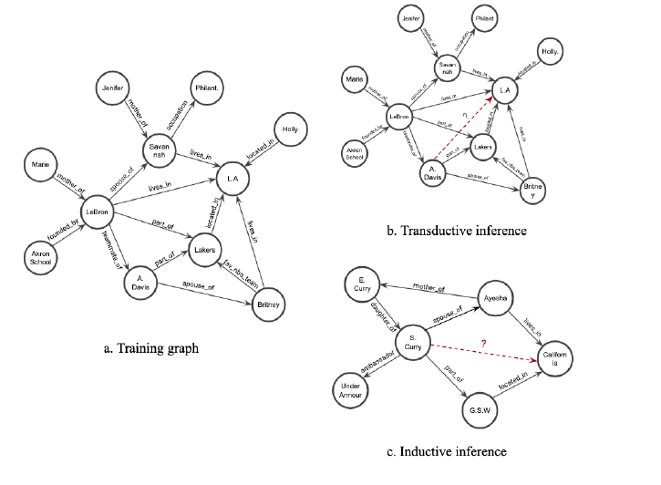
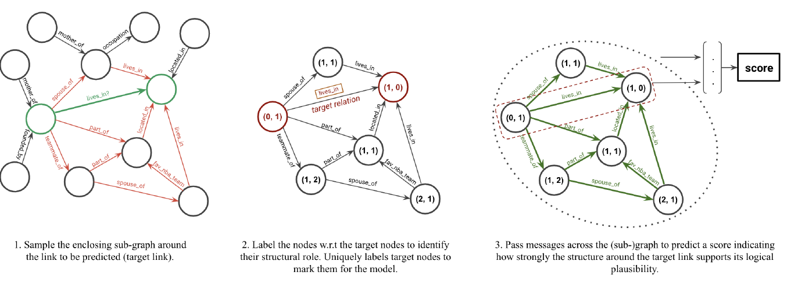

# 서브그래프 추론으로 관계를 예측하다 — GraIL 논문 읽기

지식그래프(KG)에서 빠진 관계를 예측하는 문제를, "두 노드 주변의 국소 구조"만 보고 푸는 GNN 프레임워크 **GraIL(Graph Inductive Learning)** 을 소개한다. 이 글은 논문을 하나하나 따라 읽으면서, "그래서 이게 논리적 추론을 보장하는가?", "규칙을 배우려면 전체 그래프를 봐야 하는 것 아닌가?" 같은 물음을 함께 던지고 답을 찾아가는 방식으로 정리했다.

---

## 1. 왜 이 논문이 필요한가

지식그래프는 엔티티(노드)들 사이의 관계(엣지)로 이루어진 사실의 집합이고, 여기서 빠진 사실을 채우는 일을 보통 두 엔티티 사이의 **관계 예측(relation prediction)** 으로 다룬다.

이 문제의 주류 방식은 각 엔티티·관계를 **임베딩(embedding)** 으로 학습하는 것이다(TransE, RotatE, ComplEx, ConvE 등). 각 엔티티의 이웃 연결 패턴을 저차원 벡터로 압축해 두고, 나중에 그 벡터로 관계를 복원한다. 그런데 이 방식에는 두 가지 한계가 있다.

첫째, KG에 내재한 **구성적 논리 규칙(compositional logical rules)** 을 명시적으로 포착하지 못한다. 예를 들어

$$\exists Y.\,(X, \text{spouse\_of}, Y) \wedge (Y, \text{lives\_in}, Z) \rightarrow (X, \text{lives\_in}, Z) \tag{1}$$

같은 규칙은 "누구든" 배우자가 사는 곳에 산다는, **엔티티와 무관한 관계적 의미(entity-independent relational semantics)** 다. 임베딩은 엔티티별 이웃 정보를 벡터에 눌러 담을 뿐, 이런 규칙을 직접 배우지는 못한다.

둘째, 임베딩 방식은 **transductive 설정**에 갇혀 있다. 즉 학습 시점에 모든 엔티티를 알고 있어야 한다. 하지만 현실의 KG는 계속 자라난다 — 이커머스의 신규 사용자·상품, 생의학 KG의 새 분자처럼. 새 엔티티가 추가될 때마다 값비싼 재학습이 필요하다면 실용적이지 않다.

그래서 논문은 임베딩 대신, 후보 관계 **주변의 국소 서브그래프 구조**로부터 관계를 예측하는 GNN 프레임워크 GraIL을 제안한다. 노드의 고유 정체성이 아니라 구조만 보고 추론하므로 **자연스럽게 inductive**하다 — 학습에 없던 새 엔티티나 완전히 새로운 그래프에도 재학습 없이 일반화된다.

*그림 1. transductive와 inductive 설정. (a) 학습 그래프에서 (b) transductive 추론은 학습에 등장한 엔티티 사이의 빠진 관계를 예측하지만, (c) inductive 추론은 학습에 전혀 없던 엔티티들로 이루어진 새 그래프에서 관계를 예측한다. 식 (1)의 규칙은 (c)의 새 그래프로도 그대로 옮겨가 (S. Curry, lives\_in, California)를 예측할 수 있다.*

---

## 2. 배경: Description Logic 관점과 기존 접근의 스펙트럼

이 규칙 이야기를 조금 더 밀고 나가 보자. 만약 T-box(스키마 수준 공리)와 A-box(인스턴스 사실)로 이루어진 온톨로지가 있다면, description logic(DL)으로 이런 관계를 추론할 수 있다.

### 1) 식 (1)은 사실상 T-box 공리다

식 (1)의 규칙은 **role chain axiom**(예: `spouse_of ∘ lives_in ⊑ lives_in`)으로, OWL 2 RL/SROIQ 수준의 T-box 공리에 해당한다. 그런 공리가 T-box에 명시되어 있고 A-box에 인스턴스 사실이 있다면, DL reasoner가 **연역적으로(deductively)** (A.Davis, lives\_in, L.A)를 entail한다. 이건 건전하고(sound) 완전한(complete), 보장된 추론이다.

### 2) 그런데 GraIL은 "그 추론을 임베딩으로 푸는 것"이 아니다

두 가지를 구분해야 한다.

첫째, 실제 지식그래프(Freebase, WordNet 등)에는 대부분 **A-box(인스턴스 삼중항)만 있고 T-box 공리는 명시되어 있지 않다.** 규칙이 데이터 속에 암묵적으로 잠재해 있을 뿐이라, DL reasoner에 넣을 공리 자체가 없다. GraIL이 하는 일은 주어진 공리로 연역하는 게 아니라, 데이터의 구조적 규칙성을 보고 규칙을 **귀납적·확률적으로(inductively)** 학습한 뒤 적용하는 것이다.

둘째, 더 중요한 점인데 **GraIL은 임베딩 기반 방법이 아니다.** 오히려 임베딩 패러다임에 대한 반작용으로 제안됐다. 임베딩 방법은 엔티티별 잠재 벡터를 학습해 통계적으로 관계를 복원하고 이게 어떤 의미에서 DL식 추론을 근사한다고 볼 수 있지만, 엔티티 정체성에 묶여 있어 새 엔티티에 일반화가 안 된다. GraIL은 임베딩 대신 **서브그래프 구조 + 거리 라벨링 + GNN**으로 노드 정체성과 무관한 관계 의미를 학습한다. 그래서 정신적으로는 임베딩보다 **rule-induction(NeuralLP, DRUM) 계열에 훨씬 가깝다.**

세 접근을 표로 대비하면 이렇다.

| | DL 추론 | 임베딩(TransE 등) | GraIL |
|---|---|---|---|
| 방식 | 상징적·연역적 | 하위상징·통계적 | 구조적·귀납적 |
| 규칙 | 명시적 공리 필요 | 벡터에 암묵 인코딩 | 서브그래프에서 학습 |
| 보장 | sound/complete | 근사, 보장 없음 | 근사, 보장 없음 |
| 새 엔티티 | 처리 가능 | 재학습 필요 | 자연스럽게 일반화 |

DL과 결정적으로 다른 지점은 **open-world / 불완전성 처리**다. DL은 명시된 공리만 연역하고 없는 사실은 미확정으로 두지만, GraIL은 노이즈가 있고 불완전한 그래프에서도 확률적 점수를 내도록 설계돼 있어 실제 KG 보완 과제에 더 실용적이다. 굳이 자리매김하자면 GraIL은 **"신경-상징(neuro-symbolic)적으로 T-box 규칙을 데이터에서 학습해 적용하는 접근"** 에 가깝다.

---

## 3. 핵심 아이디어: 서브그래프 추론 세 단계

GraIL의 핵심 아이디어는 두 노드 사이의 관계를 그 **주변 서브그래프 구조**로부터 예측하는 것이다. 목표 삼중항 (u, r_t, v)의 점수를 매기는 과정은 세 단계로 나뉜다: (i) 대상 노드 주변의 enclosing 서브그래프 추출, (ii) 서브그래프의 노드 라벨링, (iii) GNN으로 라벨링된 서브그래프 채점.

*그림 2. GraIL의 세 단계. 왼쪽부터 서브그래프 추출 → 노드 라벨링 → 메시지 전달로 점수 산출.*

이해를 돕기 위해 작은 예를 하나 놓고 따라가 보자.

**작은 지식그래프(사실들, A-box):**

- (Anna, spouse\_of, Bob) — 애나는 밥의 배우자
- (Bob, lives\_in, Seoul) — 밥은 서울에 산다
- (Anna, friend\_of, Carol) — 애나는 캐롤의 친구
- (Carol, lives\_in, Daegu) — 캐롤은 대구에 산다

**풀고 싶은 질문:** (Anna, **lives\_in**, Seoul)이 참일까? → 목표 삼중항 (u=Anna, r_t=lives\_in, v=Seoul)에 점수를 매긴다. 배경 규칙은 식 (1)의 `spouse_of ∘ lives_in → lives_in`인데, 이 규칙은 **어디에도 적혀 있지 않고** 모델이 구조에서 배워야 한다.

### 1) 서브그래프 추출

Anna와 Seoul을 **잇는 경로 위의 노드**만 뽑는다. 핵심 가정은 "두 노드를 잇는 경로들 안에 목표 관계를 함의하는 논리적 증거가 들어 있다"는 것이다. 구체적으로는 u의 k-hop 이웃 집합 $\mathcal{N}_k(u)$와 v의 이웃 집합 $\mathcal{N}_k(v)$의 **교집합** $\mathcal{N}_k(u) \cap \mathcal{N}_k(v)$을 취한 뒤, 고립되었거나 두 대상에서 거리가 k보다 큰 노드를 **가지치기(pruning)** 한다.

우리 예에서는:

- Anna–Seoul을 잇는 경로: Anna → Bob → Seoul → **{Anna, Bob, Seoul}이 남는다.**
- Carol, Daegu는 Anna 쪽에 매달려 있지만 Seoul로 이어지지 않는 막다른 길이라 제거된다.

이 절차의 근거가 논문의 **Observation 1**이다: 두 노드 사이 길이 λ 경로 위의 어떤 노드도 양 끝점으로부터의 거리가 최대 λ−1이라는 사실. 덕분에 위 방식으로 뽑으면 u, v 사이 길이 최대 k+1의 경로에 놓인 노드를 모두 포함하게 된다. 추출 시에는 엣지 **방향을 무시**하지만 이후 메시지 전달 때는 방향을 보존하며, 목표 엣지 (u, r_t, v) 자체도 서브그래프에 추가해 두 대상 노드 간 메시지 전달이 가능하게 한다.

### 2) 노드 라벨링

GNN은 노드 특징 행렬을 입력으로 요구하는데, GraIL은 **어떤 노드 속성도 쓰지 않는다**(순수 구조만으로 일반화 능력을 시험하기 위함). 대신 각 노드에 (Anna까지 거리, Seoul까지 거리) 쌍, 즉 **(d(i,u), d(i,v))** 를 붙인다. 여기서 d(i,u)는 v를 거치지 않는 i–u 최단거리, d(i,v)는 u를 거치지 않는 i–v 최단거리다. **이름은 안 쓰고 위치만** 쓴다.

- Anna = (0, 1) ← 대상 노드, 고유 라벨
- Seoul = (1, 0) ← 대상 노드, 고유 라벨
- Bob = (1, 1) ← 두 대상 사이 딱 중간에 놓인 다리 역할

Bob의 (1,1)이라는 라벨이 "두 대상 노드를 잇는 중간 다리"라는 구조적 역할을 말해준다. Anna든 홍길동이든 이름과 무관하게 이 위치에 있으면 똑같이 (1,1)이 된다. 그래서 학습에 없던 새 인물에도 그대로 적용된다(inductive의 핵심). 최종 노드 특징은 두 거리의 원-핫을 이어붙인 [one-hot(d(i,u)) ⊕ one-hot(d(i,v))]이며, Observation 1 덕분에 그 차원은 추출 시 사용한 hop 수 k로 자연스럽게 한정된다.

### 3) GNN 채점 (개요)

라벨링된 서브그래프에서 메시지 전달을 돌린다. 이때 어텐션이 **목표 관계 lives\_in에 맞춰** 조정되어, `spouse_of → lives_in`으로 이어지는 Anna→Bob→Seoul 경로에 높은 가중치를 준다. 노드 표현들을 평균 내 서브그래프 표현을 만들고, [서브그래프 표현 ⊕ Anna 표현 ⊕ Seoul 표현 ⊕ lives\_in 임베딩]을 선형층에 넣어 **높은 점수**를 산출한다.

**대조:** 만약 (Anna, lives\_in, **Daegu**)를 물으면 Anna–Daegu를 잇는 경로는 `friend_of → lives_in`뿐이다. "친구가 사는 곳에 내가 산다"는 규칙은 데이터에서 잘 지지되지 않으므로 어텐션이 약하게 걸리고 **낮은 점수**가 나온다. 학습은 바로 이렇게 참인 삼중항(Anna–Seoul)이 거짓 삼중항(Anna–Daegu)보다 높은 점수를 받도록 조정하는 과정이다.

핵심을 한 줄로 요약하면: **"두 노드 사이에 어떤 관계들로 엮인 경로가 있는지"라는 구조 패턴만 보고 관계를 판단하기 때문에, 노드 이름을 몰라도 되고 새 노드에도 일반화된다**는 것이다.

---

## 4. 메시지 전달을 조금 더 깊이

### 1) 메시지 전달(message passing)이란?

GNN의 핵심 아이디어다. **각 노드가 자기 이웃들의 정보를 받아서 자기 표현(벡터)을 갱신하는 것**을 한 번의 메시지 전달이라고 부른다. 이걸 여러 층 반복하면 정보가 그래프를 따라 점점 멀리 퍼진다.

비유하면 소문이 퍼지는 것과 같다. 처음에 각 노드는 자기 정보만 안다. 1라운드가 지나면 **직접 이웃**의 정보를 알게 되고, 2라운드가 지나면 이웃의 이웃(2-hop)까지 알게 된다. k라운드 뒤에는 각 노드의 벡터가 "반경 k 안의 구조 전체"를 요약하게 된다. 한 번의 메시지 전달은 두 함수로 이뤄진다 — 이웃들이 보내온 메시지를 하나로 합치는 **AGGREGATE**, 합쳐진 메시지를 자기 이전 표현과 섞는 **COMBINE**:

$$a_t^k = \text{AGGREGATE}^k\big(\{ h_s^{k-1} : s \in \mathcal{N}(t) \},\, h_t^{k-1}\big) \tag{2}$$

$$h_t^k = \text{COMBINE}^k\big(h_t^{k-1},\, a_t^k\big) \tag{3}$$

여기서 $h_t^k$는 k번째 층에서 노드 t의 벡터이고, 처음 $h_t^0$는 앞 단계에서 만든 거리 라벨로 초기화된다.

예시로 따라가면, 우리 서브그래프 {Anna(0,1), Bob(1,1), Seoul(1,0)}에서 **초기**에는 세 노드가 자기 거리 라벨만 담고 있다. **1층 후** Bob은 이웃인 Anna와 Seoul의 정보를 받아, "나는 spouse\_of로 Anna와, lives\_in으로 Seoul과 연결돼 있다"는 흔적을 담는다. **2층 후** Anna는 (Bob을 거쳐) Seoul의 정보까지 간접적으로 받아, "나 → spouse\_of → (누군가) → lives\_in → Seoul"이라는 **경로 패턴**을 벡터에 인코딩한다. 이게 바로 규칙 `spouse_of ∘ lives_in → lives_in`의 증거다.

### 2) GraIL의 메시지 전달은 두 가지가 특별하다

**(1) 관계별 변환 + 목표 관계에 맞춘 어텐션.** 일반 GNN은 이웃을 뭉뚱그려 합치지만, 지식그래프는 엣지마다 관계가 다르다. 그래서 GraIL은 R-GCN처럼 관계 r마다 별도 변환행렬 $W_r^k$를 쓰고, 각 이웃 엣지에 **어텐션 가중치 α**를 곱해 정보를 얼마나 받을지 조절한다:

$$a_t^k = \sum_{r=1}^{R} \sum_{s \in \mathcal{N}_r(t)} \alpha_{rr_t st}^{k}\, W_r^k\, h_s^{k-1}$$

결정적으로 이 어텐션 α는 **지금 예측하려는 목표 관계 $r_t$에 의존**한다. 즉 lives\_in을 물을 때는 spouse\_of·lives\_in으로 이어지는 경로에 높은 가중치를 주고, friend\_of 경로엔 낮게 준다. 이 가중치는 정규화 대신 **시그모이드 게이트**로 나와서, 관련 없는 이웃은 사실상 차단하는 문(gate) 역할을 한다.

**(2) COMBINE는 self-loop 형태:**

$$h_t^k = \text{ReLU}\big(W_{\text{self}}^k\, h_t^{k-1} + a_t^k\big) \tag{4}$$

자기 이전 정보를 유지하면서 이웃 메시지를 더한다. 부가적으로 basis sharing으로 관계별 행렬 수를 줄이고, edge dropout·JK-connection으로 과적합을 막고 층 수에 강건하게 만든다.

### 3) 노드 벡터에서 최종 점수까지

L층의 메시지 전달이 끝나면 각 노드가 주변 구조를 요약한 벡터 $h_i^L$을 갖는다. 삼중항 점수로 가는 데 세 조각을 결합한다: (i) 모든 노드 벡터의 **평균 풀링**으로 얻는 서브그래프 전체 표현 $h_{\mathcal{G}}^L = \frac{1}{|\mathcal{V}|}\sum_i h_i^L$, (ii) 두 대상 노드 표현 $h_u^L$·$h_v^L$, (iii) 목표 관계 임베딩 $e_{r_t}$. 이 넷을 이어붙여 선형층에 통과시키면 스칼라 점수가 나온다:

$$\text{score}(u, r_t, v) = W^\top \big[\, h_{\mathcal{G}(u,v,r_t)}^L \oplus h_u^L \oplus h_v^L \oplus e_{r_t} \,\big] \tag{6}$$

(Anna, lives\_in, Seoul)은 지지 경로가 있어 어텐션이 강하게 걸리고 $h_{\mathcal{G}}$가 "규칙 충족" 신호를 담아 높은 점수가 나온다. (Anna, lives\_in, Daegu)는 friend\_of 경로뿐이라 신호가 약해 낮은 점수가 나온다. 정리하면, 메시지 전달은 **"이웃 정보를 층층이 받아 각 노드에 주변 경로 구조를 새겨 넣는 과정"** 이고, GraIL은 여기에 목표 관계에 맞춘 어텐션을 얹어 "예측하려는 관계를 지지하는 경로만 골라 보는" GNN을 만든 것이다.

---

## 5. 학습은 어떻게 이뤄지는가 (3.2절)

### 1) 왜 "분류"가 아니라 "순위 매기기"인가

지식그래프에는 **참인 사실(관찰된 엣지)만** 있고, "거짓"이라고 명시된 사실은 없다. 그래서 "이 삼중항이 참/거짓" 이진 분류로 학습할 수 없다. 대신 표준 관행(Bordes et al., 2013)을 따라 **"참인 삼중항이 (인위적으로 만든) 거짓 삼중항보다 높은 점수를 받게 하라"** 는 **대조적 순위(contrastive ranking)** 문제로 바꾼다.

### 2) 음성 샘플링(negative sampling)

훈련 그래프에 실제로 존재하는 **모든 엣지** (u, r_t, v)가 각각 양성 예제 p가 된다. 각 양성마다 짝이 되는 음성 n을 하나 만드는데, 양성 삼중항의 **머리(u) 또는 꼬리(v)를 무작위로 뽑은 엔티티로 바꾼다.** 예를 들어 (Anna, lives\_in, Seoul)의 꼬리를 바꿔 (Anna, lives\_in, Daegu)를 만든다. 전제는 "관찰되지 않은 삼중항은 아마도 거짓"이라는 local closed-world 가정이다. 그리고 이 음성은 대개 목표 관계를 지지하는 경로가 **없기** 때문에, 모델에게 "경로가 있을 때만 점수를 높여라"는 판별 신호를 준다. 주의할 점은 음성도 그냥 점수를 매기는 게 아니라, **바뀐 삼중항을 중심으로 다시 서브그래프를 추출·라벨링·GNN 채점**하는 전 과정을 거친다는 것이다.

### 3) 마진 힌지 손실(margin hinge loss)

$$\mathcal{L} = \sum_{i=1}^{|\mathcal{E}|} \max\big(0,\; \text{score}(n_i) - \text{score}(p_i) + \gamma\big) \tag{7}$$

한 쌍(양성 $p_i$, 음성 $n_i$)에 대해 이게 무슨 일을 하는지 보면: **양성 점수가 음성보다 마진 γ 이상 높으면** 괄호 안이 음수가 되어 벌점이 0 — 이미 잘 구분한 쌍은 더 건드리지 않는다. **그렇지 않으면** 양수 벌점이 선형으로 발생해, 그래디언트가 양성 점수는 올리고 음성 점수는 내리는 방향으로 파라미터를 민다. γ(마진)는 "얼마나 확실하게 벌려야 만족할지"를 정하는 하이퍼파라미터다. 이 힌지 형태 덕분에 **이미 잘 맞춘 예제에 낭비 없이, 헷갈리는 예제에 학습을 집중**하게 된다.

### 4) 무엇이 학습되는가 — 그리고 전역 통계는 어떻게 스며드는가

여기서 자연스러운 의문이 하나 든다. `spouse_of ∘ lives_in → lives_in`이 성립하는지 보려면, 원래는 **전체 그래프에서 그 경로로 연결된 X–Z 쌍 중 실제 lives\_in이 얼마나 관찰되는지**를 세어봐야 하는 것 아닌가? 그렇다면 전체 그래프를 대상으로 학습해야 할 텐데, GraIL은 삼중항마다 국소 서브그래프만 보는데 어떻게 규칙을 배우는가?

말한 그 방식 — 전역 카운팅 — 은 정확히 RuleN, AMIE 같은 **고전적 규칙 채굴**이 하는 일이다. 이들은 명시적으로 confidence = support(body ∧ head) / support(body)를 **전체 그래프를 스캔해서** 계산하고, 신뢰도 높은 규칙을 표로 저장한다.

GraIL은 이 카운팅을 명시적으로 하지 않는다. 대신 같은 효과를 **파라미터 공유 + SGD**로 달성한다. 학습 시 각 예제마다 국소 서브그래프를 뽑아 GNN을 돌려 점수를 내는데, 결정적인 점은 관계별 변환행렬 $W_r$, 어텐션 파라미터, 관계 임베딩 $e_r$이 **모든 예제·모든 삼중항에 걸쳐 공유된다**는 것이다. 그래서 "spouse\_of 다음 lives\_in" 패턴이 참인 lives\_in 엣지들과 **여러 훈련 예제에 걸쳐 반복적으로 함께 나타나면**, 경사하강이 그 경로에 반응하도록 공유 가중치를 조금씩 밀어낸다. 그렇게 하는 것이 데이터셋 **전체 평균 손실**을 낮추기 때문이다. 반대로 목표 관계와 상관없는 경로 패턴은 일관된 그래디언트 신호가 없어 특화되지 않는다.

즉 직관한 "전역 통계"는 실제로 반영된다 — 단, **명시적인 카운트 표가 아니라, 훈련 루프 전체에 걸친 그래디언트의 합으로 공유 가중치 안에 분산 저장**되는 형태로. 개별 forward는 국소적이지만, 파라미터 갱신은 전체 훈련 그래프를 집계한 결과다. 그리고 앞서 본 음성 대조가 "경로 존재 여부"를 "규칙 성립 여부"의 판별 신호로 바꿔준다.

학습이 끝나면 규칙은 **가중치 안에** 들어 있다. 그래서 테스트할 때는 전체 그래프를 다시 스캔하지 않고, 후보 삼중항의 국소 서브그래프 하나만 보고 점수를 낸다. 규칙이 노드 정체성이 아니라 공유 가중치에 담겨 있기 때문에 완전히 새로운 그래프에도 그대로 옮겨 적용된다 — 이것이 이 방식이 inductive한 근본 이유다. 요컨대 논문은 전역 통계 추정을 **명시적 카운팅에서 암묵적 가중치 학습으로 옮겨** 놓았다.

---

## 6. 그래서 이게 논리적 추론을 보장하는가?

이 논문의 가장 예리한 급소를 찌르는 물음이다. 결론부터 말하면 **직관은 맞고(경로 증거가 많으면 점수가 오른다), 그것이 논리적 추론을 "보장"해주지는 않는다.**

### 1) 논문이 실제로 증명한 것: 표현력

**Theorem 1**은 지식그래프의 경로에 대응하는 임의의 논리 규칙

$$r_t(X, Y) \leftarrow r_1(X, Z_1) \wedge r_2(Z_1, Z_2) \wedge \cdots \wedge r_k(Z_{k-1}, Y)$$

에 대해, k층 GNN·잠재차원 d=1인 GraIL의 어떤 파라미터 설정이 존재해서 **규칙의 body가 참일 때만 $\text{score}(u, r_t, v) \neq 0$** 이 되도록 만들 수 있음을 보인다. 핵심 아이디어는 엣지 어텐션 게이트를 이용해 "해당 관계 r로 연결된 이웃이 하나라도 있을 때만" 노드 임베딩이 비영(non-zero)이 되게 설정할 수 있다는 것이다.

**Corollary 1**은 여기서 한 걸음 더 나아가, 같은 head $r_t$를 갖는 규칙이 여러 개 있을 때 GraIL은 그중 **몇 개가 충족되는지 셀 수 있고** 점수가 그 개수 β에 비례하게 만들 수 있음을 보인다:

$$\text{score}(u, r_t, v) \propto \beta, \quad \beta = |\{R_i : \exists Z_1,\dots,Z_k \text{ where } R_i = \text{true with } X{=}u,\, Y{=}v\}|$$

즉 RuleN 같은 규칙 귀납 모델처럼 여러 규칙의 증거를 결합해 예측한다. 그러니 "지지 경로(규칙)가 많으면 점수가 오르고 없으면 떨어진다"는 직관은 정확하다.

### 2) 표현력은 보장이 아니다

그런데 Theorem 1이 증명하는 것은 "이런 경로 규칙을 인코딩할 수 있는 파라미터 설정이 **존재한다**"는 표현력(expressiveness)뿐이다. "학습하면 반드시 올바른 규칙을 찾는다"거나 "그 추론이 건전(sound)하다"는 게 아니다. 표현할 수 있다는 건 필요조건일 뿐, 논리적 추론의 충분조건이 아니다. DL의 연역 추론과 비교하면 아래가 무너진다.

**(1) 통계적 증거 합산이지 연역이 아니다.** DL에서 공리가 있으면 결론은 확실하게 entail되지만, GraIL의 점수는 부드러운(soft) 확신도다. 경로가 많으면 "그럴 확률이 높다"일 뿐 참이 보장되지 않는다. 반대로 경로가 없어도 관계가 참일 수 있는데(엣지가 빠진 open-world 상황), 이 경우 GraIL은 증거를 못 찾아 틀린다.

**(2) 상관을 규칙으로 착각할 수 있다.** 모델은 "논리적으로 타당한" 규칙이 아니라 학습 데이터에서 목표 관계와 통계적으로 같이 나타나는 경로 패턴이면 무엇이든 학습한다. `공저자 ∘ 소속 → 소속`처럼 자주 맞지만 논리적으로 필연은 아닌 규칙도 높은 가중치를 받을 수 있다.

**(3) 단조(monotone)라서 예외를 못 다룬다.** 증거가 늘면 점수가 오르기만 한다. 하지만 진짜 논리에는 부정과 예외가 있다 — "새는 난다, 단 펭귄은 예외". Theorem 1이 다루는 규칙은 **부정 없는 연언형 경로 절(Horn clause 계열)** 로 한정된다.

**(4) 표현 가능한 규칙 클래스 자체가 좁다.** 논문도 "1차 논리의 **유용한 부분집합**"이라고만 말한다. 임의의 FOL이 아니라 사슬형 경로 규칙에 국한된다.

### 3) 이 한계는 결함이라기보다 설계 선택이다

흥미롭게도 이는 의도된 설계에 가깝다. 실제 지식그래프는 노이즈가 많고 불완전하다. 이런 데이터에서 엄밀한 상징적 연역은 오히려 취약하다 — 엣지 하나만 빠져도 아무것도 못 내놓는다. 반대로 "여러 경로에서 증거를 모아 점수로 종합하는" 방식은 불완전·노이즈에 강건하다. 그래서 논문은 자기 방식을 연역이 아니라 **"규칙 귀납(rule induction)을 연역·추론과 함께 암묵적으로 수행"** 한다고 표현한다.

한 문장으로 답하면: **본질적으로 경로 증거를 세는 것이 맞고, 바로 그렇기 때문에 논리적 추론을 보장하지는 못한다. 논문의 "증명"은 추론의 건전성이 아니라 표현력에 관한 것이다.** DL(보장 있음·취약함)과 순수 임베딩(구조 규칙 불투명) 사이에서 **"구조 기반으로 규칙을 학습하되 보장 대신 강건함을 택한"** 중간 지점이 GraIL이다.

---

## 7. 실험 결과

논문은 WN18RR, FB15k-237, NELL-995 세 벤치마크에서, 서로소인 엔티티 집합을 갖는 **완전 inductive 벤치마크**를 새로 만들어(각 데이터셋마다 v1–v4 네 개 분할) 평가한다. 비교 대상은 inductive 관계 예측이 가능한 미분 가능 방법 Neural-LP·DRUM과, 당시 inductive SOTA인 통계적 규칙 채굴 RuleN이다.

아래는 AUC-PR 지표를 네 분할(v1–v4) 평균으로 요약한 것이다(높을수록 좋음, 굵게가 최고).

| 방법 | WN18RR | FB15k-237 | NELL-995 |
|---|---|---|---|
| Neural-LP | 78.7 | 74.0 | 80.4 |
| DRUM | 78.8 | 74.1 | 79.4 |
| RuleN | 85.4 | 86.7 | 85.3 |
| **GraIL** | **91.8** | **90.3** | **89.9** |

GraIL은 세 데이터셋 모두에서, 그리고 실제로는 12개 분할 전부에서 baseline을 앞선다. 특히 미분 가능 방법(Neural-LP·DRUM)을 큰 차이로 이기고, 강력한 통계적 규칙 채굴 RuleN도 일관되게 능가한다 — 이는 GraIL이 단순 경로 규칙을 넘어 더 복잡한 구조 패턴을 활용하고 여러 규칙을 조합(Corollary 1)한다는 뜻이다. Hits@10 지표에서도 결과는 같은 방향이며, 논문은 가장 강한 baseline 대비 AUC-PR 평균 5.25%, Hits@10 6.75% 향상을 보고한다. 덧붙여 GraIL은 강한 구조적 귀납 편향 덕분에 **파라미터 수가 수십~수백 배 적으면서도** 이 성능을 낸다.

transductive 설정에서는 GraIL이 임베딩 방법과 **상보적인 귀납 편향**을 가진다는 가설 아래, GraIL을 TransE·DistMult·ComplEx·RotatE와 late-fusion으로 앙상블하면 성능이 유의미하게 오른다는 것도 함께 보인다.

---

## 8. 정리

GraIL은 지식그래프 관계 예측을 **임베딩 문제가 아니라 서브그래프 추론 문제로 재정의**한 연구다. 두 대상 노드 사이의 enclosing 서브그래프를 뽑고(추출), 노드에 이름 대신 거리 라벨을 붙이고(라벨링), 목표 관계에 맞춘 어텐션 GNN으로 채점한다(스코어링). 노드 정체성이 아니라 구조에서 규칙을 학습하기 때문에 학습에 없던 엔티티·그래프에도 재학습 없이 일반화된다.

큰 그림에서 보면 GraIL은 **description logic의 연역(보장은 있으나 취약)과 순수 임베딩(강력하나 규칙이 불투명) 사이에서, 구조 기반으로 규칙을 귀납 학습하되 논리적 보장 대신 노이즈·불완전성에 대한 강건함을 택한** 신경-상징적 절충이다. 그 "규칙"은 명시적 표가 아니라 전체 훈련 그래프를 집계한 공유 가중치 안에 담기고, 바로 그 점이 이 방법을 inductive하게 만드는 동시에 — 연역이 아닌 확률적 증거 합산이라는 — 근본적 한계도 함께 규정한다.

> 코드·데이터: https://github.com/kkteru/grail
