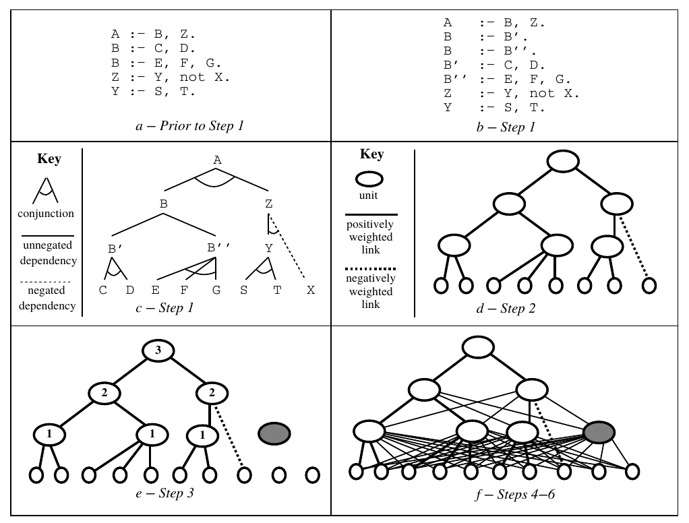
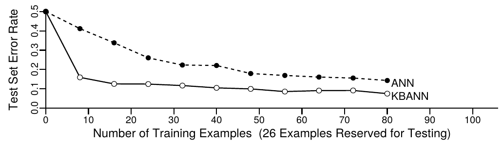
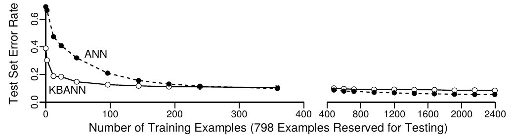
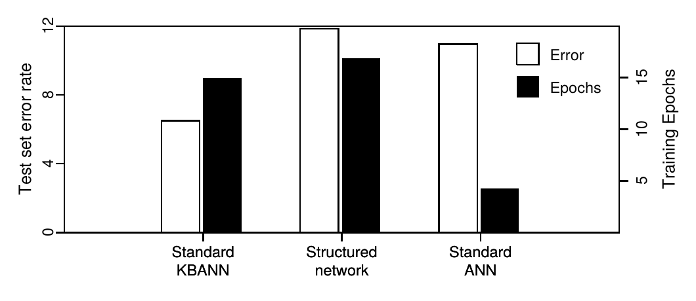

# 논리 규칙을 신경망의 구조와 초기 가중치로 컴파일하기 — Knowledge-Based Artificial Neural Networks
#### Abstract
하이브리드 학습 방법은 도메인에 대한 이론적 지식과 분류된 예제 집합을 함께 사용해, 학습 중에 보지 못한 예제를 정확하게 분류하는 방법을 만들어 낸다. 하이브리드 학습 시스템의 과제는 한 정보원이 제공하는 정보로 다른 정보원에 빠져 있는 정보를 보완하는 것이다. 이렇게 함으로써 하이브리드 학습 시스템은 두 정보원 중 하나만 사용하는 시스템보다 더 효과적으로 학습할 수 있어야 한다. KBANN(지식 기반 인공 신경망, Knowledge-Based Artificial Neural Networks)은 연결주의(connectionist) 학습 기법 위에 구축된 하이브리드 학습 시스템이다. KBANN은 명제 논리로 표현된 문제 특화 "도메인 이론(domain theory)"을 신경망으로 사상(mapping)한 뒤, 이렇게 재구성된 지식을 역전파(backpropagation)로 정제한다. KBANN은 분자생물학의 두 문제에 대한 광범위한 실험으로 평가된다. 여러 결과 가운데 특히, 이 실험들은 KBANN이 만든 네트워크가 다양한 학습 시스템은 물론 생물학자들이 제안한 여러 기법보다 더 잘 일반화함을 보여 준다.
#### 요약
사람이 작성한 규칙은 틀리거나 빠진 곳이 있고, 신경망은 데이터가 많아야 하며 무엇을 배웠는지 알기 어렵다. 이 논문은 두 약점이 서로 보완적이라는 데 착안해, 규칙을 신경망의 구조와 초기 가중치로 그대로 옮긴 다음 데이터로 고쳐 쓰게 하는 방법을 제안한다. 규칙이 혼자서는 단 하나의 예제도 맞히지 못하는 경우에도 이렇게 만든 네트워크는 적은 데이터로 빠르게 정확해진다. 오늘날 뉴로심볼릭(neurosymbolic) AI에서 기호 지식을 신경망으로 컴파일하는 계열의 원형으로 꼽히는 연구이다.

---

## 1. 왜 하이브리드 학습인가

### 1) 두 가지 가르치는 방식

한 번도 본 적 없는 물건의 범주를 누군가에게 가르친다고 해 보자. 한 가지 방법은 범주를 정의해 주는 것이다. 어떤 특징이 중요하고 그 특징들이 어떻게 어우러져야 그 범주에 속하는지를 설명하는 "도메인 이론"을 알려 주면, 학생은 그것만으로 구성원과 비구성원을 가려낼 수 있다. 다른 방법은 예제를 많이 보여 주는 것이다. 예제를 하나 보여 줄 때마다 그것이 범주에 속하는지 아닌지만 알려 주면, 학생은 충분히 본 뒤에 새 예제를 이미 본 것과 비교해 분류할 수 있다.

이 두 방식은 컴퓨터에 문제 특화 전문성을 부여하는 두 접근에 대응한다. 전자는 전문가 시스템 같은 수작업 분류기(hand-built classifier)로, 저자들은 이를 "들어서 배우기(learning by being told)"라 부른다. 후자는 예제로부터 일반화하는 경험적 학습(empirical learning)이다. 여기서 도메인 이론이란 주어진 사실로부터 어떤 추론을 끌어낼 수 있는지를 기술한 규칙의 모음을 말하며, 분류 문제에서는 어떤 대상이 특정 클래스에 속하는지 증명하는 데 쓰인다.

### 2) 각 방식의 약점

수작업 분류기는 도메인 이론이 완전하고 정확하다고 가정하지만, 실제 문제에서 그런 이론은 거의 얻을 수 없다. 완전성을 높이려고 규칙을 수천 개 쌓으면 사용 속도가 감당하기 어려울 만큼 느려지고, 규칙 사이의 상호작용이 복잡해져 규칙 하나를 고쳤을 때 무엇이 바뀔지 예측하기 어려워진다.

경험적 학습은 이론 지식이 거의 필요 없는 대신 많은 예제가 필요하고, 다음과 같은 문제에 취약하다. 어떤 대상을 기술하는 특징은 무한히 많을 수 있어서, 특징을 어떻게 고르느냐에 따라 컴퓨터와 쿠키가 아주 닮아 보이기도 하고 전혀 달라 보이기도 한다. 어떤 특징이 중요한지는 맥락에 따라 달라서, 지폐가 불에 탄다는 사실은 은행에 불이 났을 때에나 의미가 있다. 원래 특징을 조합한 복합 특징을 만들면 학습이 쉬워지지만 그런 특징을 만드는 일 자체가 어렵고 오류가 잦다. 예제가 많아도 드문 예외 사례는 거의 나타나지 않아 제대로 처리하기 어렵다.

인공 신경망(artificial neural network, ANN)은 경험적 학습 가운데 일반화 성능이 좋은 편이지만, 고유한 문제를 추가로 안고 있다. 학습 시간이 길고, 초기 매개변수가 학습 결과에 크게 영향을 주며, 문제와 무관하게 좋은 네트워크 구조(토폴로지)를 고르는 방법이 아직 없고, 학습 후에는 무엇을 배웠는지 해석하기 어렵다.

### 3) 상호보완성에서 출발하기

논문의 출발점은 이 두 방식의 약점이 대체로 상호보완적이라는 관찰이다. 이론과 예제를 함께 받은 학생이 두 정보원을 엮어 지식의 빈틈을 메우듯, 수작업 분류기와 경험적 학습을 효과적으로 결합한 하이브리드 시스템은 어느 한쪽만 쓸 때보다 나은 시너지를 낼 수 있다는 것이다. 저자들은 이 방향을 뒷받침하는 근거로, 지식 집약적 학습과 지식 없는 학습이 하나의 스펙트럼의 양 끝이라는 인식의 확산, 사람이 이론이나 예제 한쪽만으로 배우는 일은 거의 없다는 심리학적 증거, 그리고 하이브리드 시스템이 실제 문제에서 효과를 보였다는 실용적 근거를 든다.

## 2. KBANN의 전체 구조

### 1) 두 개의 알고리즘

KBANN은 서로 거의 독립적인 두 알고리즘으로 이루어진다. 첫째는 대략적으로 정확한(approximately-correct) 기호 규칙을 신경망으로 번역하는 rules-to-network 번역기이고, 둘째는 이 네트워크를 분류된 예제로 다듬는 정제기(refiner), 즉 신경망 학습 알고리즘이다. 정제에는 표준 역전파를 쓴다. 역전파는 네트워크의 출력과 정답의 차이(오차)를 출력층에서 입력층 방향으로 거꾸로 전파하면서 각 연결 가중치를 오차가 줄어드는 방향으로 조금씩 조정하는 학습법이다. 학습 메커니즘 자체는 평범한 역전파이지만, 학습되는 네트워크가 평범하지 않다는 데 KBANN의 핵심이 있다. 네트워크를 첫 번째 알고리즘이 규칙으로부터 구성하고 초기화하기 때문이다. 정제가 끝나면 학습된 네트워크를 높은 정확도의 분류기로 쓸 수 있고, 선택적으로 다듬어진 규칙을 다시 추출할 수도 있지만 추출은 이 논문의 범위 밖이다.

번역의 기준은 지식베이스와 신경망 사이의 다음 대응 관계이다.

| 지식베이스 | 신경망 |
|---|---|
| 최종 결론 | 출력 유닛 |
| 근거 사실 | 입력 유닛 |
| 중간 결론 | 은닉 유닛 |
| 규칙 간 의존 관계 | 가중 연결 |

이 대응 덕분에 규칙의 계층 구조가 그대로 네트워크의 토폴로지가 된다. 그리고 규칙이 무엇이 중요한 특징인지를 미리 지정해 주므로, 앞에서 본 경험적 학습의 문제들, 즉 허위 상관, 무관한 특징, 특징 집합의 무한성 같은 문제가 완화된다. 규칙은 중요한 "파생 특징(derived feature)"을 지정해 학습을 단순하게 만들고, 특징 공간의 아주 작은 영역도 가리킬 수 있어 드문 사례를 학습하는 부담도 줄여 준다.

### 2) 전부 기호적인 하이브리드와의 차이

같은 시기의 다른 하이브리드 시스템인 EITHER와 Labyrinth-k는 하나의 알고리즘으로 규칙을 직접 고친다. 이들은 기호적 학습 알고리즘(각각 ID3 결정 트리와 Cobweb 개념 군집)을 바탕으로 하므로 규칙을 신경망으로 바꾸는 번역 과정이 필요 없고, 학습이 끝나면 수정된 규칙을 바로 읽을 수 있다. KBANN은 번역과 정제라는 두 알고리즘이 필요해 손이 더 가지만, 저자들은 그 추가 비용이 일반화 성능으로 충분히 보상된다는 것을 실험으로 보인다.

### 3) 사용하는 신경망

KBANN의 네트워크는 순방향(feedforward) 신경망이며, 각 유닛은 로지스틱 활성 함수를 쓴다.

$$
\mathrm{NetInput}_i = \sum_{j \in \text{Connected Units}} \mathrm{Weight}_{ji} \times \mathrm{Activation}_j
$$

$$
\mathrm{Activation}_i = \frac{1}{1 + e^{-(\mathrm{NetInput}_i - \mathrm{Bias}_i)}}
$$

첫 식에서 $\mathrm{NetInput}_i$는 유닛 $i$로 들어오는 순입력, $\mathrm{Weight}_{ji}$는 유닛 $j$에서 $i$로 가는 연결의 가중치, $\mathrm{Activation}_j$는 유닛 $j$의 출력값이다. 즉 연결된 유닛들의 출력에 가중치를 곱해 모두 더한 값이다. 둘째 식은 이 순입력에서 편향 $\mathrm{Bias}_i$를 뺀 값을 시그모이드(sigmoid) 함수에 넣어 0과 1 사이의 출력으로 바꾼다. 대략적으로 말하면 순입력이 편향보다 크면 출력이 1에 가깝고, 작으면 0에 가깝다. 이 식이 중요한 이유는, 편향이 일종의 문턱값 역할을 하므로 가중치와 편향을 잘 고르면 하나의 유닛이 AND나 OR 같은 논리 연산을 흉내 낼 수 있기 때문이다. 다음 절의 번역 알고리즘은 정확히 이 성질을 이용한다.

## 3. 규칙을 네트워크로: rules-to-network 번역

### 1) 입력 규칙의 조건

번역할 규칙은 Horn 절(Horn clause) 형태로 쓴다. Horn 절은 "결론 :- 조건1, 조건2, …"처럼 여러 조건이 모두 참이면 결론이 참이라는 형태의 규칙이다(Prolog 표기와 같다). 규칙에는 두 가지 제약이 있다. 첫째, 명제적(propositional)이어야 한다. 즉 "모든 x에 대해" 같은 변수를 쓸 수 없는데, 당시 신경망 학습 알고리즘이 술어 논리의 변수를 다룰 수 없었기 때문이다. 둘째, 순환이 없어야 한다. 이는 학습을 단순하게 하려는 선택이지 근본적인 한계는 아니며, 실제로 이후 연구에서 순환 규칙으로 확장되었다.

번역 알고리즘은 일곱 단계로 이루어진다. 규칙을 재작성하고(1단계), 규칙 구조를 네트워크로 사상하고(2단계), 유닛에 수준 번호를 매기고(3단계), 선택적으로 은닉 유닛을 추가하고(4단계), 규칙에 없는 입력 특징을 추가하고(5단계), 인접 수준 사이에 연결을 추가하고(6단계), 모든 가중치에 미세한 난수를 더한다(7단계). 1~3단계가 규칙을 충실히 옮기는 단계라면, 4~7단계는 규칙이 놓친 것을 학습할 여지를 만드는 단계이다.

Rules-to-network 단계는 논문 Figure 4의 예제 규칙으로 따라가 보는 것이 가장 이해하기 쉽다. 이 예제에는 계층 구조가 생기는 두 가지 원인이 모두 들어 있다.

### 2) 출발점: 원래 규칙

```
A :- B, Z.
B :- C, D.
B :- E, F, G.
Z :- Y, not X.
Y :- S, T.
```

여기서 C, D, E, F, G, S, T, X는 입력 특징(관측 가능한 사실)이고, A는 최종 결론이다. B, Z, Y는 어떤 규칙에서는 결론으로, 다른 규칙에서는 조건으로 쓰이는 중간 결론이다. 계층 구조는 바로 이 중간 결론에서 생긴다. 중간 결론이 하나도 없이 모든 규칙이 입력에서 출력으로 곧장 이어진다면 은닉층이 없는 네트워크가 만들어지고, 논문이 지적하듯 퍼셉트론(perceptron, 은닉층 없이 입력을 출력에 직접 연결한 가장 단순한 신경망) 수준의 학습만 가능하다. 즉 KBANN이 계층을 새로 만들어 내는 것이 아니라, 도메인 이론에 이미 들어 있는 추론의 단계 구조가 네트워크의 깊이로 옮겨지는 것이다.



그림 1. 논문 Figure 4의 번역 예시. 왼쪽 위(a)는 원래 규칙, 오른쪽 위(b)는 1단계 재작성 후의 규칙이다. 가운데 왼쪽(c)은 재작성된 규칙을 AND/OR 트리로 그린 것으로, 호(arc)로 묶인 선은 연언(AND) 조건, 점선은 부정 조건(not)을 뜻한다. 가운데 오른쪽(d)은 2단계에서 만들어진 네트워크인데, 실선은 양의 가중치, 점선은 음의 가중치 연결이며 (c)의 트리와 모양이 거의 같다는 점이 핵심이다. 아래 왼쪽(e)은 3단계에서 각 유닛에 수준 번호를 매긴 결과이고, 회색으로 칠해진 유닛은 4단계에서 수준 1에 추가한 은닉 유닛이다. 아래 오른쪽(f)은 5~6단계 후의 모습으로, 인접한 수준 사이에 가는 선으로 표시된 낮은 가중치 연결이 빽빽하게 추가되어 있다.

### 3) 1단계: 재작성이 층을 하나 더 만드는 이유

B를 결론으로 갖는 규칙이 두 개이므로 B는 선언(OR) 개념이다. KBANN이 허용하는 선언의 형태는 결론이 같은 규칙을 여러 개 두는 것뿐이다. KBANN은 결론이 같은 규칙이 여러 개일 때, 조건이 둘 이상인 규칙마다 새로운 중간 항을 만들어 분리한다.

```
B   :- B'.
B   :- B''.
B'  :- C, D.
B'' :- E, F, G.
```

이 재작성이 필요한 이유는 숫자로 확인하면 분명해진다. 재작성하지 않고 C, D, E, F, G를 모두 B에 가중치 ω = 4로 직접 연결했다고 가정해 보자. {C, D}가 참일 때 B가 켜지려면 순입력 8이 편향을 넘어야 하므로 편향은 8보다 작아야 한다. 그런데 그러면 규칙에 없는 조합인 {C, E}도 순입력이 8이 되어 B를 켜게 된다. 단일 유닛의 편향 하나로는 "C와 D 둘 다" 또는 "E, F, G 셋 다"라는 구분을 표현할 수 없는 것이다. 논문도 같은 논리를 일곱 개 조건을 가진 예로 설명한다. 결론 Y를 증명하는 두 규칙의 조건이 각각 [1 2 3]과 [4 5 6 7]일 때, 이를 모두 Y에 직접 연결하면 [1 3 4 7] 같은 엉뚱한 조합이 Y를 켜는 것을 막을 편향 값이 존재하지 않는다. 그래서 각 연언 규칙을 B'과 B''이라는 별도 유닛이 먼저 판정하고, B는 그 결과를 OR로 묶기만 하도록 층을 하나 더 두는 것이다. 결과적으로 재작성은 원래 규칙에 없던 은닉 유닛과 층을 추가한다.

### 4) 2단계: 가중치와 편향 설정

각 결론은 하나의 유닛이 되고, 각 조건은 그 유닛으로 들어오는 연결이 된다. 가중치와 편향은 네트워크가 규칙과 정확히 같은 방식으로 반응하도록 설정한다. 즉 규칙으로 결론을 도출할 수 있을 때만 해당 유닛이 1 근처로 활성화되고, 도출할 수 없으면 0 근처에 머물게 한다.

연언 규칙의 경우, 긍정 조건(부정이 붙지 않은 조건)의 연결에는 가중치 ω를, 부정 조건의 연결에는 −ω를 주고, 결론 유닛의 편향은 다음과 같이 둔다.

$$
\theta_{\text{AND}} = \left(P - \tfrac{1}{2}\right)\omega
$$

여기서 $\theta$는 결론 유닛의 편향, $P$는 그 규칙의 긍정 조건 개수, $\omega$는 기준 가중치이다. 저자들은 경험적으로 잘 작동한 ω = 4를 주로 쓴다. 이 편향은 긍정 조건이 모두 참일 때의 순입력 $P\omega$보다 ω/2 작고, 하나라도 빠졌을 때의 $(P-1)\omega$보다 ω/2 크다. 따라서 규칙이 성립하면 순입력에서 편향을 뺀 값이 +ω/2 = +2, 성립하지 않으면 −2 이하가 되어 시그모이드 출력이 각각 약 0.88과 0.12 이하로 갈린다. 부정 조건이 참이면 −ω가 더해지므로 다른 조건이 모두 참이어도 문턱을 넘지 못한다. 논문 Figure 5의 예인 `A :- B, C, D, not(E).`는 P = 3이므로 편향이 5ω/2이고, B, C, D가 1이고 E가 0이면 순입력이 3ω가 되어 5ω/2를 넘는다.

선언 규칙(재작성 후의 B :- B'. B :- B''. 처럼 조건이 하나인 규칙 여러 개)의 경우 가중치는 똑같이 ω로 두고 편향은 항상 다음과 같이 둔다.

$$
\theta_{\text{OR}} = \tfrac{\omega}{2}
$$

조건 중 하나만 참이어도 순입력 ω가 ω/2를 넘으므로 유닛이 켜진다. 직관적으로 OR는 "문턱을 낮게", AND는 "문턱을 조건 개수만큼 높게" 두는 것이다.

ω = 4로 두면 예제의 설정은 다음과 같다.

| 유닛 | 규칙 유형 | 들어오는 연결 가중치 | 편향 |
|---|---|---|---|
| B' | 연언, P = 2 | C: 4, D: 4 | 1.5ω = 6 |
| B'' | 연언, P = 3 | E, F, G: 각 4 | 2.5ω = 10 |
| Y | 연언, P = 2 | S: 4, T: 4 | 1.5ω = 6 |
| Z | 연언, P = 1 (부정 1개) | Y: 4, X: −4 | 0.5ω = 2 |
| B | 선언 | B': 4, B'': 4 | ω/2 = 2 |
| A | 연언, P = 2 | B: 4, Z: 4 | 1.5ω = 6 |

Z의 경우 Y가 참이고 X가 거짓이면 4 − 2 = 2로 켜지고, X가 참이면 4 − 4 − 2 = −2로 꺼진다. 부정 조건이 음의 가중치로 구현되는 방식이다.

덧붙여, 저자들은 각주에서 규칙을 이런 식의 신경 구조로 바꾸는 것 자체는 McCulloch와 Pitts(1943), Kleene(1956)가 이미 문턱 함수 유닛으로 보인 것이라고 밝힌다. 이 연구의 고유한 기여는 그렇게 구성된 네트워크를 학습시킨다는 발상에 있다.

### 5) 3단계: 수준 번호 매기기

각 유닛의 수준은 입력 유닛까지의 가장 긴 경로 길이로 정해진다. 입력은 수준 0이고, B', B'', Y는 입력만 받으므로 수준 1이다. Z는 X(수준 0)와 Y(수준 1)를 모두 받는데 더 긴 경로를 따르므로 수준 2가 되고, B도 수준 2, A는 수준 3이 된다. 원래 규칙만 보면 깊이가 2처럼 보이지만 재작성 덕분에 B 쪽 경로가 한 단계 깊어진 것이다. Z는 입력 X를 직접 받으면서도 수준 2에 놓인다는 점도 눈여겨볼 만하다. 규칙이 명시한 연결은 수준을 건너뛸 수 있고, 수준 번호는 이후 단계에서 연결을 추가할 기준으로만 쓰인다. 논문도 이 번호가 그 자체로는 쓸모가 없지만 이후 단계의 필수 전제라고 설명한다.

### 6) 실제로 규칙처럼 동작하는지 확인

C와 D가 참이고 S, T가 참, E, F, G와 X가 거짓인 입력을 넣어 보자. B'은 순입력 8에서 편향 6을 빼 2가 되므로 출력은 약 0.88이다. 같은 방식으로 Y도 약 0.88이 된다. 그런데 이 값들이 상위 층으로 올라가면 정확히 1이 아니므로 순입력이 조금씩 줄어든다. E, F, G가 거짓이라 B''이 꺼져 있으므로 B는 4 × 0.88 − 2 ≈ 1.5로 약 0.82, Z도 같은 계산으로 약 0.82가 되고, 최종 A는 4 × 0.82 × 2 − 6 ≈ 0.56으로 출력이 약 0.64에 그친다. 반대로 X가 참이면 Z는 약 0.08로 떨어지고 A도 약 0.08이 되어 올바르게 거짓으로 판정된다.

이 계산은 논문에서 명시적으로 다루지는 않지만 흥미로운 함의를 보여 준다. 0.5 기준으로는 규칙과 같은 판정을 내리지만, 계층이 깊어질수록 참과 거짓 사이의 여유가 줄어든다. ω를 4로 둔 것은 이 여유와 학습 가능성(시그모이드가 지나치게 포화되지 않는 것) 사이의 절충으로 볼 수 있다. ω를 크게 하면 깊은 층에서도 0과 1이 또렷하게 갈리지만, 뒤의 5절에서 보듯 출력이 포화될수록 역전파로 고치기가 어려워진다.

### 7) 실제 과제에서의 계층

뒤에서 다룰 프로모터 규칙도 같은 원리로 계층이 만들어진다. promoter는 contact와 conformation을, contact는 minus-35와 minus-10을 조건으로 가지므로 규칙 자체가 이미 세 단계이다. 여기에 minus-35, minus-10, conformation은 각각 네 개의 대안 규칙을 가진 선언 개념이므로 재작성 과정에서 규칙마다 중간 유닛이 생겨 한 층이 더해진다. 논문 Figure 8에서 Minus 35 아래에 매달린 네 개의 유닛이 바로 그것이다. 요컨대 KBANN 네트워크의 깊이는 도메인 이론의 추론 단계 수와 선언 규칙 재작성으로 결정되며, 이 계층이 곧 논문이 강조하는 파생 특징을 제공하는 구조이다.

## 4. 규칙 바깥의 여지를 열어 두기: 4~7단계

앞 예제를 그대로 이어서, 1~3단계로 만든 네트워크에 4~7단계가 무엇을 덧붙이는지 살펴본다. 이 네 단계의 공통 목적은 규칙을 그대로 옮긴 초기 네트워크의 판정은 전혀 바꾸지 않으면서, 규칙이 틀렸거나 빠뜨린 부분을 학습으로 메울 수 있는 통로를 미리 열어 두는 것이다.

### 1) 출발 상태 정리

3단계까지 마친 네트워크는 수준 0에 입력 C, D, E, F, G, S, T, X, 수준 1에 B', B'', Y, 수준 2에 B, Z, 수준 3에 A가 있고, 연결은 규칙이 명시한 것뿐이다. 이 상태의 네트워크는 규칙과 똑같이 동작하지만, 규칙에 없는 특징이나 관계를 표현할 연결이 아예 없으므로 역전파로 기존 가중치의 크기만 조정할 수 있다. 예를 들어 실제로는 B'이 C, D뿐 아니라 S에도 의존해야 한다면, 이 네트워크는 그 사실을 배울 방법이 없다.

### 2) 4단계: 은닉 유닛 추가 (선택)

규칙이 정의한 중간 결론 외에 새로운 파생 특징을 학습할 수 있도록 은닉 유닛을 추가하는 단계이다. 사용자가 몇 개의 유닛을 어느 수준에 넣을지 직접 지정해야 하며, 지정하지 않으면 생략된다. 저자들이 이 단계를 선택 사항으로 둔 이유는 초기 규칙이 이미 충분한 어휘(중간 개념)를 제공하는 경우가 많기 때문이다.

예제에서 수준 1에 은닉 유닛 H를 하나 추가했다고 하자(그림 1의 회색 유닛). 이 시점의 H는 어떤 규칙과도 대응하지 않으며, 아직 다른 유닛과 연결도 없다. 연결은 6단계에서 수준 번호에 따라 일괄 부여된다. 즉 H가 수준 1에 놓였다는 것은 입력(수준 0)을 받아 수준 2 유닛(B, Z)에 신호를 보내는 자리라는 뜻이다.

추가된 은닉 유닛이 학습 초기에 어떻게 깨어나는지는 역전파 식으로 보면 분명하다. 역전파에서 각 유닛은 "자신이 최종 오차에 얼마나 책임이 있는지"를 나타내는 오차 신호(델타, δ)를 받는데, 은닉 유닛의 델타는 위층으로 나가는 가중치에 위층 유닛들의 델타를 곱해 모은 값에 비례한다. H에서 위로 나가는 가중치가 처음에 0 근처이므로, H 자신의 델타도 0 근처가 되어 H로 들어오는 가중치는 처음에는 거의 변하지 않는다. 반면 H에서 나가는 가중치의 기울기는 상위 유닛의 델타에 H의 활성값을 곱한 값이므로 0이 아니다. 따라서 먼저 나가는 가중치가 자라고, 그 뒤에 들어오는 가중치가 학습되는 순서로 H가 점차 의미 있는 특징을 맡게 된다. 논문은 은닉 유닛 추가 방법이 아직 부분적으로만 탐구되었다고 인정하며, 체계적인 방법은 Towell의 학위논문과 Opitz와 Shavlik의 후속 연구로 넘긴다.

### 3) 5단계: 규칙에 없는 입력 특징 추가

규칙이 언급하지 않았지만 전문가가 관련 있다고 판단하는 입력 특징을 네트워크에 추가한다. 근거는 단순하다. 규칙이 완전히 정확하지 않다면, 개념 학습에 필요한 입력 특징을 모두 식별했다고 보장할 수 없기 때문이다.

DNA 과제에서는 이 단계의 의미가 뚜렷하다. 프로모터 규칙은 서열의 일부 위치만 언급하지만(예: @-37 'CTTGAC'), 네트워크는 57개 위치 전체를 입력으로 가진다. 각 위치는 A, G, C, T 네 값에 대응하는 네 개의 입력 유닛으로 표현되므로, 규칙이 건드리지 않은 위치까지 포함해 총 228개의 입력 유닛이 생긴다. 규칙에 쓰이지 않은 위치의 정보가 실제로 유용하다면 학습 과정에서 그 연결이 강해질 수 있다.

### 4) 6단계: 인접 수준 간 0 가중치 연결 추가

3단계에서 매긴 수준 번호를 기준으로, 수준 n − 1의 모든 유닛을 수준 n의 모든 유닛에 가중치 0으로 연결한다(논문 본문에는 "step 4에서 매긴 번호"라고 적혀 있지만 번호 매기기는 3단계이므로 오기로 보인다). 예제에 적용하면 다음과 같다.

| 연결 구간 | 가능한 전체 연결 | 규칙이 준 연결 | 새로 추가되는 0 가중치 연결 |
|---|---|---|---|
| 수준 0 → 수준 1 (입력 8개 → B', B'', Y, H) | 32 | 7 | 25 (예: S→B', C→Y, 모든 입력→H) |
| 수준 1 → 수준 2 (B', B'', Y, H → B, Z) | 8 | 3 | 5 (B'→Z, B''→Z, Y→B, H→B, H→Z) |
| 수준 2 → 수준 3 (B, Z → A) | 2 | 2 | 0 |

가중치가 0이므로 연결을 아무리 많이 추가해도 학습 전 네트워크의 출력은 규칙과 동일하다. 그러나 각 0 가중치의 기울기는 상위 유닛의 델타와 하위 유닛의 활성값의 곱이므로 학습이 시작되면 곧바로 갱신될 수 있다. 앞에서 든 "B'이 실제로는 S에도 의존한다"는 상황이라면 S→B' 연결이 학습 중에 커지면서 규칙에 빠진 선행조건이 사실상 보충되는 것이다. 뒤의 7절에서 보게 될 잡음 실험에서 KBANN이 일부 결함이 있는 이론에도 상당히 견디는 이유가 여기에 있다.

이 방식에는 몇 가지 눈여겨볼 성질이 있다. 첫째, 연결은 인접 수준 사이에만 추가된다. 규칙이 직접 준 X→Z처럼 수준을 건너뛰는 연결은 유지되지만, 새로 추가되는 연결은 건너뛰지 않는다. 따라서 예제에서 입력 C가 Z에 직접 영향을 줘야 하는 상황이라면 이를 직접 학습할 수 없고, 수준 1 유닛(예: H)을 경유해야 한다. 둘째, 저자들은 이 방식이 자신들이 시험한 다른 연결 추가 방식들보다 약간 낫다고만 밝히고 상세 비교는 학위논문으로 넘긴다. 셋째, 추론 사슬이 불완전한 경우를 위한 보완 규칙이 각주에 있다. 입력과 이어지지 않는 선행조건은 모든 입력 유닛에, 출력과 이어지지 않는 결론은 모든 출력 유닛에 낮은 가중치로 연결한다.

예외도 있다. 부록 A에 따르면 규칙은 정의적(definitional) 규칙과 가변(variable) 규칙으로 나뉘는데, 정의적 규칙의 결론 유닛은 규칙에 명시된 선행조건과만 연결되고 그 가중치도 학습 중에 고정된다. 스플라이스 접합부 네트워크(논문 Figure 9)에서 음영 처리된 유닛이 이에 해당하며, 'Y'(C 또는 T)처럼 의미가 확정된 정의를 학습이 훼손하지 않도록 보호하는 장치이다.

### 5) 7단계: 미세 난수 섭동

마지막으로 모든 가중치와 편향에 0에 가까운 작은 난수를 더한다. 섭동이 매우 작아 학습 전 판정에는 영향을 주지 않지만, 대칭성(symmetry) 문제를 피하기에는 충분하다는 것이 논문의 설명이다.

대칭성 문제는 4단계와 연결해 보면 구체적으로 이해된다. 수준 1에 은닉 유닛 H1, H2 두 개를 추가했다고 하면, 6단계 이후 두 유닛은 들어오는 가중치, 나가는 가중치, 편향이 모두 동일하다. 그러면 어떤 입력에 대해서도 두 유닛의 활성값이 같고, 역전파로 계산되는 기울기도 같으므로 갱신 후에도 계속 같은 값을 유지한다. 결국 두 유닛이 영원히 같은 특징만 학습해 하나를 추가한 것과 다를 바가 없어진다. 작은 난수로 출발점을 조금씩 다르게 해 두면 학습이 진행되면서 두 유닛이 서로 다른 방향으로 분화할 수 있다. 논문은 섭동의 구체적인 크기를 밝히지 않으며, Figure 4에서도 변화가 미미해 따로 그리지 않았다고 설명한다.

### 6) 4~7단계의 의미와 한계

정리하면 4단계는 새로운 중간 개념, 5단계는 새로운 입력, 6단계는 새로운 의존 관계를 표현할 자리를 만들고, 7단계는 그 자리가 실제로 학습될 수 있게 한다. 이 설계 덕분에 KBANN은 초기에는 규칙과 똑같이 동작하면서도 학습을 통해 규칙을 수정하는 이론 정제(theory refinement)가 가능해진다.

다만 이 모든 확장은 학습 전에 한 번 정해지고 학습 중에는 토폴로지가 바뀌지 않는다. 논문 7장이 한계로 지적하듯, 규칙 하나가 통째로 빠진 경우 KBANN은 기존 규칙을 변형해 그 역할까지 떠맡게 할 수밖에 없고, 이는 해석을 어렵게 하고 원래 맞던 규칙까지 흔들 수 있다. 은닉 유닛을 몇 개, 어느 수준에 넣을지를 사용자가 정해야 한다는 점도 같은 맥락의 한계이며, 이를 학습 과정에서 자동으로 결정하려는 시도가 TopGen 계열의 후속 연구로 이어졌다.

## 5. 확장된 규칙 언어 (부록 A)

본문은 이진 특징과 단순 연언 및 선언 규칙만으로 설명하지만, 부록 A는 KBANN이 받아들이는 언어를 더 넓게 정의한다.

### 1) 다섯 가지 특징 유형

특징 유형은 명목형, 이진형, 계층형(ISA 계층), 선형(연속 수치), 순서형의 다섯 가지이며, 각각 고유한 부호화 방식을 가진다. 명목형은 값마다 입력 유닛을 하나씩 두어, 예컨대 color가 red, blue, green 중 하나라면 color-is-red, color-is-blue, color-is-green 세 유닛으로 나타낸다(이를 원-핫 부호화라고 부르기도 한다). 이진형은 유닛 하나로 표현한다. 선형 특징은 사용자가 정한 구간마다 입력 유닛을 두고 값이 구간 중심에 가까울수록 높게 활성화한다. 순서형 특징은 주어진 값에서 거리가 d인 값을 (1/2)^d로 활성화해, "medium"이 "small"이나 "large"와도 부분적으로 닮았음을 표현한다.

결측값은 해당 특징의 모든 유닛에 같은 활성값을 주되 총합이 값을 알 때와 같도록 맞춰, 네트워크가 총 활성량만으로 결측 여부를 구분하지 못하게 한다. 이진형만은 예외로 0.5를 준다. 다만 저자들은 실험이 주로 명목형과 이진형에 집중되었다고 밝힌다.

### 2) 특수 선행조건

규칙의 선행조건으로는 Not, Greater-than, Less-than, N-true가 허용되며 서로 중첩할 수 있다. 논문 Figure 25에 부호화 예시가 있는데, 예컨대 "B, C, D, E 중 2개 이상이 참"인 N-true 규칙은 가중치를 모두 ω로, 편향을 (N − 1/2)ω = 1.5ω로 두어 구현한다. 연언 규칙의 편향 공식에서 P 자리에 N을 넣은 것으로 보면 된다. 네 조건 중 두 개가 참이면 순입력 2ω가 1.5ω를 넘고, 하나만 참이면 ω로 못 넘는다. Less-than은 기준보다 작은 값의 유닛에 가중치 0, 기준 이상인 값에 −ω를 주고 편향을 −ω/2로 두는 방식이다. 이 경우 작은 값이 켜져 있으면 순입력 0이 −ω/2를 넘어 참이 되고, 기준 이상의 값이 켜져 있으면 −ω가 −ω/2에 못 미쳐 거짓이 된다. 스플라이스 접합부 규칙의 "6 of (…)" 조건이 이 N-true에 해당한다.

## 6. 네트워크 정제: 오차 함수와 정규화

### 1) 확신에 찬 오답이라는 문제

KBANN 네트워크는 역전파에 특유의 문제를 일으킨다. 처음부터 규칙에 따라 확신에 찬 답(출력이 0 또는 1 근처)을 내기 때문이다. 그 답이 맞든 틀리든 그렇다. 표준 역전파에서는 출력이 확신에 차 있으면 정답 여부와 상관없이 네트워크가 거의 바뀌지 않는다. 시그모이드는 0이나 1 근처에서 거의 평평해 기울기가 아주 작기 때문이다. Rumelhart 등은 이 성질이 잡음에 강하다는 점에서 일반 신경망에 바람직하다고 보았지만, 출력이 완전히 틀린 경우에는 오류의 원인을 고치기가 매우 어려워진다.

### 2) 제곱 오차 대신 교차 엔트로피

그래서 KBANN은 표준 오차 함수(식 3) 대신 Hinton이 제안한 교차 엔트로피(cross-entropy) 오차 함수(식 4)를 쓴다.

$$
\mathrm{Error} = \frac{1}{2}\sum_{i=1}^{n}(d_i - a_i)^2
$$

$$
\mathrm{Error} = -\sum_{i=1}^{n}\left[(1-d_i)\log_2(1-a_i) + d_i \log_2(a_i)\right]
$$

$a_i$는 출력 유닛 $i$의 활성값, $d_i$는 그 유닛의 정답(원하는 활성값), $n$은 출력 유닛의 수이다. 첫 식은 정답과 출력의 차이를 제곱해 더한 것이고, 둘째 식은 출력과 정답을 확률로 보고 둘 사이의 차이를 재는 것이다. 교차 엔트로피는 확신에 찬 오답에 매우 큰 벌점을 준다. 예를 들어 정답이 1인데 출력이 0.01이면 제곱 오차는 약 0.49에 불과하지만, 교차 엔트로피는 $-\log_2 0.01 \approx 6.6$으로 커진다. 더 중요한 점은, 시그모이드 출력과 교차 엔트로피를 함께 쓰면 출력 유닛의 기울기에서 시그모이드의 평평한 기울기 항이 상쇄되어, 오차의 크기에 비례하는 기울기가 그대로 전달된다는 것이다. 덕분에 규칙이 확신을 가지고 틀린 지점부터 빠르게 수정된다. 저자들은 교차 엔트로피가 KBANN 네트워크의 학습 시간과 일반화를 모두 개선했다고 보고한다.

### 3) 원래 이론에서 멀어지는 것을 억제하는 정규화 항

저자들은 원래 도메인 이론을 바꾸는 데 벌점을 주는 항을 교차 엔트로피에 더하는 실험도 했다.

$$
\mathrm{regularizer} = \lambda \sum_{i \in \omega} \frac{(\omega_i - \omega_{\mathrm{init}_i})^2}{1 + (\omega_i - \omega_{\mathrm{init}_i})^2}
$$

$\omega_i$는 현재 가중치, $\omega_{\mathrm{init}_i}$는 규칙으로부터 정해진 초기 가중치, $\lambda$는 학습 데이터에 맞추는 것과 초기 규칙에 가깝게 머무는 것 사이의 균형을 조절하는 계수이다. 분모의 $1 + (\cdot)^2$ 때문에 벌점은 초기값에서 조금 멀어질 때는 거의 제곱으로 커지지만 아주 멀어지면 1에 수렴한다. 즉 작은 변화는 억제하되, 데이터가 강하게 요구하는 큰 변화까지 막지는 않는다. 이 항의 주된 효과는 네트워크가 원래 가중치를 유지하도록 유도해 학습 후 해석 가능성을 높이는 것이다. 다만 해석이 이 논문의 범위 밖이어서 본 실험에는 쓰지 않았고, 다른 연구에서 유익했다고만 밝힌다.

## 7. 실험 데이터

학습에는 분자생물학의 DNA 서열 분석 과제 두 가지가 쓰였다. 분자생물학, 특히 DNA 서열 분석은 인간 게놈 프로젝트 덕분에 분석된 서열 데이터가 많고, 생물학 실험실에서 연구할 수 있는 속도보다 서열이 쌓이는 속도가 빨라 계산적 분석이 필요한 분야라는 것이 선택의 이유이다. 이 논문에서는 DNA를 A, G, C, T 네 글자(뉴클레오타이드)로 이루어진 문자열로 보면 충분하다.

KBANN은 예제와 도메인 이론을 함께 입력으로 받으므로, 각 과제마다 분류된 서열 예제와 생물학 문헌에서 추출한 초기 규칙 집합이 짝을 이룬다. 두 데이터는 모두 M. Noordewier가 구축했고, 감사의 글에 따르면 UC Irvine의 기계학습 데이터 저장소(현재의 UCI Machine Learning Repository)에 공개되어 있다.

| 항목 | 프로모터 인식 | 스플라이스 접합부 판별 |
|---|---|---|
| 생물 | 원핵생물(대장균 등) | 진핵생물 |
| 예제 수 | 106개 | 3,190개(대부분 실험은 무작위 1,000개 사용) |
| 범주 | 프로모터 53 / 비프로모터 53 | I/E 약 25%, E/I 약 25%, 해당 없음 약 50% |
| 서열 길이 | 57 뉴클레오타이드(−50 ~ +7) | 60 뉴클레오타이드(−30 ~ +30) |
| 기준점 | 전사 시작 위치 | 서열 중앙(경계 위치) |
| 초기 규칙 | 14개(O'Neill 문헌 기반) | 23개 + Y 정의용 반복 구문(Watson 외 교재 기반) |
| 초기 규칙 성능 | 106개 중 프로모터로 분류한 예제 없음 | 정확도 61%(I/E 40%, E/I 3%) |

### 1) 프로모터 데이터

프로모터(promoter)는 유전자 시작 직전에 놓여 RNA 중합효소(RNA polymerase)라는 단백질이 결합하는 짧은 DNA 서열이다. 프로모터를 알고리즘으로 찾을 수 있으면 아직 분석되지 않은 긴 서열에서 유전자의 시작 위치를 더 잘 찾을 수 있다. 각 예제는 연속된 57개 뉴클레오타이드이며, 기준점(전사 시작점)이 오른쪽 끝에서 7번째에 있으므로 양성 예제에는 전사되는 유전자의 첫 7개 염기가 포함된다. 위치 번호는 기준점 앞을 음수, 뒤를 양수로 매기고 0은 쓰지 않는다. 규칙의 `@-37 'CTTGAC'`은 기준점에서 37칸 앞부터 C, T, T, G, A, C가 차례로 나와야 한다는 뜻이고, '*'는 아무 염기나 괜찮다는 뜻이다.

```
promoter     :- contact, conformation.
contact      :- minus-35, minus-10.
minus-35     :- @-37 'CTTGAC'.     (외 3개의 대안 규칙)
minus-10     :- @-13 'TA*A*T'.     (외 3개의 대안 규칙)
conformation :- @-45 'AA**A'.      (외 3개의 대안 규칙)
```

초기 규칙은 promoter가 contact와 conformation으로, contact가 minus-35와 minus-10 영역으로 이루어진다는 계층 구조를 가지며, 각 영역은 여러 대안 패턴으로 정의된다. 두 영역의 이름은 기준점으로부터의 거리에서 왔다. 흥미로운 점은 이 규칙이 그 자체로는 106개 예제 중 하나도 프로모터로 판정하지 못한다는 것이다. 분류기로서는 쓸모가 없지만, 어떤 위치와 패턴이 중요한지에 대한 정보는 담고 있어서 KBANN의 출발점으로는 유용하다는 것이 논문의 해석이다. 저자들은 이 규칙이 지나치게 구체적인(overly specific) 성격을 가지며, 잡음 실험 결과 KBANN이 바로 이런 이론에서 가장 효과적이라는 점이 우연히 맞아떨어졌다고 밝힌다. 규칙을 추출한 사람은 이 성질을 몰랐고 저자들도 당시에는 몰랐으므로, 결과가 의도적으로 KBANN에 유리하게 짜인 것은 아니라는 설명이다.

예제 수가 적기 때문에 알고리즘 비교에는 leave-one-out 교차검증을 썼다. 교차검증(cross-validation)은 데이터를 여러 몫으로 나눠 한 몫으로 평가하고 나머지로 학습하는 것을 몫마다 반복하는 평가 방법인데, leave-one-out은 그 극단으로 105개로 학습하고 1개로 평가하는 일을 106번 반복한다. 학습 곡선과 다른 하이브리드 시스템과의 비교에서는 26개를 평가용으로 떼어 두고 나머지 80개를 10개, 20개, … 80개로 늘려 가며 학습했다. 구조와 가중치의 기여를 분리한 실험과 도메인 이론 잡음 실험도 모두 이 프로모터 데이터로 수행되었다.

### 2) 스플라이스 접합부 데이터

스플라이싱(splicing)은 진핵세포가 단백질을 만드는 과정에서 유전 정보의 불필요한 부분을 잘라 내는 과정이다. 남는 부분을 엑손(exon), 잘려 나가는 부분을 인트론(intron)이라 한다. 과제는 서열 중앙이 엑손에서 인트론으로 넘어가는 경계(E/I, 생물학 용어로 donor), 인트론에서 엑손으로 넘어가는 경계(I/E, acceptor), 또는 둘 다 아닌지를 판별하는 3범주 분류이다. UCI 저장소에는 영장류 스플라이스 접합부 데이터로 등록되어 있다.

네트워크의 출력 유닛은 E/I와 I/E 두 개이며, 둘 다 임곗값 0.5를 넘지 못하면 "해당 없음"으로 판정한다. 초기 규칙에는 E/I 경계의 합의 서열(MAGGTRAGT)과 경계 뒤에 종결 코돈(TAA, TAG, TGA)이 오면 안 된다는 조건, I/E 경계 앞쪽의 피리미딘(C 또는 T) 풍부 영역 조건 등이 들어 있다. 여기에는 M(A 또는 C), R(A 또는 G), Y(C 또는 T) 같은 IUB 모호 코드와 "10개 중 6개 이상 참" 형태의 N-true 조건, 그리고 정의적 규칙이 쓰인다. 초기 정확도 61%는 주로 "아니다"라고 답하는 경향에서 나온 수치로, 실제 경계는 거의 잡아내지 못한다. 저자들은 이 규칙이 프로모터 규칙보다 빈약해 퍼셉트론 수준의 학습만 가능하게 한다고 보고, 이 과제에서 KBANN의 우위가 작았던 원인으로 지목한다.

전체 3,190개 중 연산 부담 때문에 대부분의 실험은 무작위로 뽑은 1,000개를 썼고, 10겹 교차검증을 예제 순서를 바꿔 11번 반복했다. 학습 곡선 실험에서만 전체 데이터를 사용해 798개를 평가용으로 떼어 두고 나머지를 학습에 썼다.

### 3) 입력 부호화

두 과제 모두 각 서열 위치를 A, G, C, T 네 값을 가진 명목형 특징으로 보고, 위치마다 네 개의 이진 입력 유닛으로 부호화한다. 따라서 프로모터 네트워크는 57 × 4 = 228개, 스플라이스 접합부 네트워크는 60 × 4 = 240개의 입력 유닛을 가진다. 규칙이 일부 위치만 언급하더라도 모든 위치가 입력으로 들어가는 것은 앞서 설명한 5단계에 해당한다.

오늘날 기준으로 보면 두 데이터 모두 매우 작은 규모이지만, 바로 그 점이 이 논문의 실험 설계에서 중요하다. 데이터가 부족한 상황에서 사전 지식이 얼마나 학습을 돕는지를 보이는 것이 핵심 주장이었고, 실제로 학습 예제가 적을수록 KBANN과 표준 역전파의 격차가 크게 나타났다.

## 8. 실험 결과

논문 5장은 세 질문을 던진다. KBANN은 순수 귀납 학습기, 다른 하이브리드 시스템, 생물학 문헌의 해법과 비교해 어떤가. KBANN의 성능은 유용한 입력 특징의 식별과 유용한 파생 특징의 식별에 각각 얼마나 의존하는가. KBANN의 상대적 성능은 학습 예제의 수와 도메인 이론의 품질에 따라 어떻게 달라지는가.

### 1) 순수 경험적 학습기와의 비교

KBANN은 역전파, ID3(결정 트리), 최근접 이웃, PEBLS(가중 최근접 이웃), 퍼셉트론, Cobweb(점진적 개념 군집)보다 두 과제 모두에서 일반화 성능이 우수했고, 대부분의 차이가 단측 t-검정 기준 99.5% 신뢰수준에서 유의했다. 프로모터 과제에서는 생물학자들이 제안한 두 방법, 즉 위치별 염기 빈도로 점수 행렬을 만드는 Stormo의 방법과 사람이 손으로 다듬은 필터인 O'Neill의 방법보다도 나았다. 다만 스플라이스 접합부 과제에서는 역전파와 PEBLS 대비 우위가 미미했는데, 저자들은 그 원인을 초기 도메인 이론의 빈약함에서 찾는다. 비교 대상인 표준 역전파는 은닉층 하나를 완전 연결한 네트워크(프로모터 23개, 스플라이스 24개 은닉 유닛)이며, 이는 대략적인 구조 탐색에서 가장 좋았던 설정이다.

### 2) 적은 예제로 배우기: 학습 곡선

하이브리드 시스템에 대한 중요한 가설 하나는 데이터만으로 배우는 시스템보다 적은 예제로 배운다는 것이다. 예제는 구하기 어렵거나 비싼 경우가 많으므로, 많은 예제가 있을 때의 성능만큼 적은 예제로 쓸 만한 일반화를 끌어내는 능력이 중요하다. 이를 보기 위해 저자들은 데이터의 약 25%를 평가용으로 떼어 두고, 나머지 75%를 점점 커지는 부분집합(작은 집합이 항상 큰 집합에 포함되도록)으로 나눠 각각 학습한 뒤 같은 평가 데이터로 오류율을 쟀다. 이것이 학습 곡선(learning curve)이다.



그림 2. 프로모터 과제의 학습 곡선(논문 Figure 13). 가로축은 학습에 쓴 예제 수, 세로축은 평가 데이터에 대한 오류율(낮을수록 좋음)이다. 실선과 흰 원이 KBANN, 점선과 검은 원이 표준 신경망(ANN, 즉 표준 역전파)이다. 학습 예제가 0개일 때 KBANN의 값은 초기 규칙의 성능이고, ANN의 값은 무작위 추측이다. 두 곡선 모두 0.5에서 출발하지만, KBANN은 예제 10개 남짓에서 이미 0.15 근처로 떨어지는 반면 ANN은 80개를 다 써도 KBANN의 수준에 이르지 못한다.



그림 3. 스플라이스 접합부 과제의 학습 곡선(논문 Figure 14). 읽는 방법은 그림 2와 같으며, 가로축이 400에서 끊긴 뒤 오른쪽 구간은 400~2,400개를 압축해 보여 준다. 예제가 적은 왼쪽 구간에서는 KBANN이 크게 앞서지만, 예제가 수백 개를 넘어가는 오른쪽 구간에서는 두 곡선이 겹치다가 ANN이 근소하게 앞선다.

두 데이터 모두에서 학습 예제가 적을 때 KBANN의 테스트 오류율은 표준 역전파보다 약 20%p 낮았고, 이 차이는 예제가 늘어날수록 줄어들었다. 프로모터 과제에서 KBANN은 약 15개 예제만으로 전체 80개 예제 사용 시 성능의 5%p 이내에 도달한 반면, 역전파는 50개 이상이 필요했다. 스플라이스 접합부에서도 KBANN은 역전파의 약 3분의 1의 예제로 각자의 점근 수준에 가까워졌다. 반면 스플라이스 접합부 과제에서 가장 큰 학습 집합을 쓰면 KBANN이 오히려 역전파보다 약 2%p 낮은 성능을 보였는데, 데이터가 충분하면 도메인 이론이 이론과 크게 다른 해를 찾는 것을 제약할 수 있다는 해석이 제시된다. 저자들은 큰 데이터에서의 점근 성능 비교만큼, 데이터가 적을 때의 학습 곡선이 적어도 그만큼 중요하다고 강조한다.

### 3) 다른 하이브리드 시스템과의 비교

다른 하이브리드 시스템인 EITHER(ID3로 도메인 이론을 최소한으로 수정)와 Labyrinth-k(Cobweb에 도메인 지식을 넣을 수 있게 확장)와 비교했을 때, KBANN은 프로모터 과제의 모든 학습 집합 크기에서 일관되게 5%p 이상 우수했다. 스플라이스 접합부에서는 비교하지 못했는데, EITHER가 부정 조건을 다룰 수 없기 때문이다.

그렇다면 이 우위는 단지 KBANN의 바탕인 역전파가 ID3나 Cobweb보다 좋아서일까. 저자들은 이 가설을 직접 검증한다. 우선 역전파가 ID3와 Cobweb보다 이 데이터에서 일반화가 낫다는 점은 사실이므로, KBANN의 힘 일부는 기반 알고리즘에서 온다. 그러나 각 하이브리드가 자신의 기반 알고리즘을 얼마나 개선했는지를 다음과 같은 비율로 비교하면 이야기가 달라진다.

$$
\mathrm{improvement} = 100 \times \frac{e_{\text{base}} - e_{\text{hybrid}}}{e_{\text{base}}}
$$

$e_{\text{base}}$는 기반 경험적 알고리즘(KBANN이면 역전파, EITHER면 ID3, Labyrinth-k면 Labyrinth)의 오류율, $e_{\text{hybrid}}$는 하이브리드 시스템의 오류율이다. 이 값은 기반 알고리즘의 오류 중 몇 퍼센트를 지식 덕분에 없앴는지를 뜻한다. 예컨대 기반 오류율이 20%이고 하이브리드가 10%면 개선율은 50이다. 이 지표를 쓰면 기반 알고리즘 자체의 성능 차이가 걸러지므로 "지식을 얼마나 잘 활용했는가"만 비교할 수 있다. 결과적으로 KBANN의 개선율이 EITHER와 Labyrinth-k보다 일관되게 높았다. 즉 KBANN은 도메인 지식을 더 효과적으로 활용하며, 우위가 전적으로 기반 알고리즘 덕분이라는 가설은 기각된다.

### 4) KBANN의 강점은 어디서 오는가: 구조인가 가중치인가

KBANN이 표준 역전파보다 나은 이유에 대해 저자들은 두 가설을 세운다. 하나는 구조 가설로, 규칙에서 얻은 토폴로지 자체가 그 도메인 학습에 더 적합하다는 것이다. 다른 하나는 가중치 가설로, 초기 가중치가 중요한 특징을 골라 줘 학습을 단순하게 하고 허위 상관을 줄인다는 것이다.

구조 가설을 시험하기 위해 KBANN 네트워크를 복제한 뒤 규칙이 정한 가중치와 편향만 0 근처(±0.5 이내)의 난수로 바꾼 "구조만 있는(structure-only)" 네트워크를 만들어 비교했다.



그림 4. 표준 KBANN, 구조만 있는 네트워크, 표준 신경망의 비교(논문 Figure 19, 프로모터 과제). 흰 막대는 왼쪽 축의 테스트 오류율(%)로 낮을수록 좋고, 검은 막대는 오른쪽 축의 학습 에포크 수(전체 학습 데이터를 몇 번 돌았는지)로 적을수록 빨리 학습한 것이다. 구조만 가져온 네트워크(가운데)는 오류율이 가장 높고 학습도 KBANN보다 느리다. 표준 신경망(오른쪽)은 학습은 가장 빠르지만 오류율이 KBANN의 두 배에 가깝다.

구조만 있는 네트워크는 KBANN보다 일반화가 나쁘고 학습도 느렸으며, 차이는 유의했다. 구조만으로는 KBANN의 힘을 설명할 수 없다는 뜻이다.

가중치 가설은 직접 시험하기 어려워 다음과 같이 바꿔 시험했다. 특징 식별이 강점의 원천이라면, 도메인 이론이 지목한 입력 특징에만 우선 연결한 신경망도 KBANN만큼 좋아야 한다. 그래서 표준 신경망의 은닉층을 처음에는 규칙이 언급한 입력에만 연결하고(완전 연결의 약 4분의 1), 빠진 연결을 5%씩 무작위로 추가해 가며 성능을 쟀다. 결과는 규칙이 지목한 연결만 있을 때는 KBANN과 표준 신경망보다 모두 나빴고, 빠진 연결을 5% 추가하자 표준 신경망을 앞섰으며, 15%를 추가했을 때 가장 좋았지만 그 최고 성능도 KBANN보다 유의하게 나빴다. 따라서 특징 식별은 개선의 일부만 설명한다.

결론은 둘의 결합이다. 구조만으로는 파생 특징이 생길 잠재력만 주어지고, 가중치만으로는 중요한 입력만 주어진다. 구조와 가중치가 함께 있어야 실제로 유용한 파생 특징이 처음부터 주어지며, 이것이 KBANN의 힘이라는 것이 저자들의 해석이다.

### 5) 도메인 이론의 잡음에 대한 강건성

KBANN에 주는 도메인 이론이 대략적으로만 맞으면 되는지 보기 위해, 저자들은 프로모터 이론에 체계적으로 잡음을 넣었다. 잡음은 규칙 수준과 선행조건 수준으로 나뉜다. 규칙 수준에는 필요한 규칙이 빠지는 경우(양성 클래스를 과소 예측하게 됨)와 불필요한 규칙이 더해지는 경우(과대 예측)가 있다. 선행조건 수준에는 불필요한 조건이 더해지는 경우(규칙 적용이 과도하게 제약되어 과소 예측), 필요한 조건이 빠지는 경우(제약이 느슨해져 과대 예측), 조건의 부정 여부가 뒤집히는 경우(규칙이 엉뚱한 상황에 적용됨)가 있다.

결과적으로 잡음 유형별로 영향이 크게 달랐다. 선행조건을 반전시키는 잡음이 가장 해로웠고, 30% 수준에서 표준 신경망보다 나빠졌다. 불필요한 선행조건을 추가하는 잡음은 거의 영향이 없어서, 50%(원래 중요하다고 지정된 조건 두 개마다 엉뚱한 조건 하나를 추가)에서도 KBANN이 표준 신경망보다 나았다. 규칙 삭제는 10% 정도까지 견딜 수 있었고, 무작위 규칙 추가는 거의 영향이 없었다. 무작위 규칙이 영향이 없는 이유도 설명된다. 평균 네 개의 무작위 조건을 가진 규칙은 각 위치가 네 값을 가지는 DNA에서 256개 패턴 중 하나꼴로만 들어맞으므로 실제 데이터와 거의 맞지 않는다. 전체적으로 프로모터 이론은 원래보다 30% 더 틀려도 표준 신경망보다 이득을 주었다. 저자들은 이를 "유용할 가능성이 있으면 이론에 포함하라. 너무 적게 말하는 것보다 너무 많이 말하는 편이 낫다. 다만 명백히 틀린 것을 말하느니 아무 말도 하지 않는 편이 낫다"라는 교훈으로 정리한다. 앞에서 본 6단계의 0 가중치 연결과 함께 생각하면, 쓸데없는 조건은 학습이 가중치를 줄여 무력화할 수 있지만, 뒤집힌 조건은 반대 방향으로 강하게 밀고 있어서 되돌리기 어렵다고 이해할 수 있다.

### 6) 주요 결과 요약표

이 논문은 대부분의 결과를 그래프로 제시하므로, 아래 표는 본문에 수치로 명시된 결과만 모은 것이다. 오류율과 오류율 차이는 낮을수록 좋고, 필요한 예제 수도 적을수록 좋다. 각 행에서 더 나은 쪽을 굵게 표시했다.

| 실험 (과제) | 측정 | KBANN | 비교 대상 |
|---|---|---|---|
| FOCL과 비교, 80개 학습 (프로모터) | 테스트 오류율 | **7.5%** | FOCL 14.2% |
| 소규모 학습 (프로모터, 스플라이스 모두) | 테스트 오류율 | **역전파보다 약 20%p 낮음** | 표준 역전파 |
| 최대 학습 집합 80개 (프로모터) | 테스트 오류율 | **역전파보다 약 4%p 낮음** | 표준 역전파 |
| 최대 학습 집합 (스플라이스) | 테스트 오류율 | 역전파보다 약 2%p 높음 | **표준 역전파** |
| 최종 성능의 5%p 이내 도달 (프로모터) | 필요한 예제 수 | **약 15개** | 역전파 50개 초과 |
| 하이브리드 시스템 비교 (프로모터) | 테스트 오류율 | **모든 크기에서 5%p 이상 낮음** | EITHER, Labyrinth-k |
| 잡음 허용 범위 (프로모터) | 표준 신경망보다 나은 한계 | 선행조건 반전 30% 미만, 규칙 삭제 10%까지, 조건 추가 50%에서도 우위 | 표준 신경망 |

FOCL 행은 1차 논리 규칙을 다룰 수 있는 귀납 논리 프로그래밍 시스템과의 비교로, FOCL은 프로모터 이론이 모든 예제를 같은 클래스로 분류하는 탓에 그대로는 적용할 수 없어 약간 수정한 뒤에 비교했다. 스플라이스 최대 학습 집합 행은 KBANN이 진 유일한 주요 결과로, 데이터가 충분하면 빈약한 이론이 오히려 짐이 될 수 있음을 보여 준다.

## 9. 추론 방향으로 본 KBANN: 전방 연쇄와 후방 연쇄

규칙 기반 추론은 흔히 두 방향으로 나뉜다. 전방 연쇄(forward chaining)는 주어진 사실에서 출발해 규칙을 적용하며 도출할 수 있는 결론을 계속 쌓아 가는 데이터 주도형 추론이다. 후방 연쇄(backward chaining)는 증명하고 싶은 목표에서 출발해 그 목표를 성립시키는 하위 목표를 거꾸로 찾아가는 목표 주도형 추론으로, Prolog의 질의 방식이 대표적이다. KBANN의 학습 데이터와 과제를 보면, 규칙으로 새로운 사실을 발견하기보다는 어떤 목표 사실이 있고 주어진 데이터로 그 참 거짓을 판별하는 후방 연쇄형 문제에 가까워 보인다. 이 직관은 절반은 맞고 절반은 보완이 필요하다. 과제의 성격과 지식의 조직 방식은 목표 지향적이지만, 네트워크가 실제로 수행하는 계산은 오히려 전방 연쇄에 가깝다.

### 1) 과제 설정은 목표 지향적임

KBANN이 다루는 문제는 미리 정해진 목표 명제(promoter, E/I, I/E)가 있고, 주어진 서열이 그 목표를 만족하는지 참 거짓을 판별하는 분류 문제이다. 논문 각주 1도 도메인 이론을 "어떤 대상이 특정 클래스의 구성원인지 증명하는 데 쓰이는 규칙 집합"으로 정의하는데, 이는 설명 기반 학습(explanation-based learning, EBL)의 전통에서 목표를 놓고 증명을 구성하는 후방 연쇄식 사고방식이다. 규칙이 Prolog 표기로 쓰여 있다는 점, KBANN이 EBL-ANN의 후속이라는 점도 같은 계보를 보여 준다.

더 근본적으로는 지도학습이라는 조건이 이를 강제한다. 역전파로 정제하려면 정답 레이블이 필요한데, 레이블은 출력 유닛, 즉 미리 정한 목표 명제에만 주어진다. contact나 minus-35 같은 중간 결론에는 레이블이 없으므로 학습은 오직 목표의 정답률을 높이는 방향으로만 이루어진다.

### 2) 계산 방향은 전방 연쇄에 가까움

학습된 네트워크가 실제로 판정하는 방식을 보면 입력 사실(각 위치의 염기)에서 출발해 수준 1, 수준 2를 거쳐 출력으로 활성값이 올라간다. 이 과정에서 목표와 관련 있는 하위 목표만 골라 탐색하는 일은 없고, 모든 중간 결론 유닛이 모든 예제에 대해 동시에 계산된다. 이는 사실에서 출발해 도출 가능한 결론을 모두 계산하는 데이터 주도형 전방 연쇄의 특징이다.

사실 KBANN이 다루는 규칙처럼 명제적이고 순환이 없는 Horn 절이라면, 전방 연쇄와 후방 연쇄는 목표 명제에 대해 같은 진릿값을 낸다. 두 방식의 차이는 결과가 아니라 탐색 순서와 효율이라는 추론 제어(control) 전략에 있다. KBANN은 규칙 집합 전체를 네트워크로 미리 컴파일해 한 번의 순전파로 평가하므로, 어느 방향으로 탐색할지라는 질문 자체가 사라진다고 보는 편이 정확하다.

### 3) 지식은 위에서 아래로, 계산은 아래에서 위로

그래서 KBANN은 다음과 같이 특징짓는 것이 적절하다. 도메인 이론은 목표를 하위 목표로 분해하는 하향식 구조로 작성된다. 프로모터 규칙이 promoter를 contact와 conformation으로, contact를 다시 두 결합 영역으로 쪼개는 방식이 전형적인 목표 분해이며, 이 부분은 후방 연쇄의 사고방식과 닮았다. 반면 그 분해 구조를 평가하는 계산은 상향식이다.

이렇게 보면 KBANN이 적합한 문제의 조건은 추론 방향이라기보다 다음 두 가지로 요약된다. 하나는 판별할 목표 명제의 집합이 미리 고정되어 있다는 것이고, 다른 하나는 그 목표들에 대해 레이블이 붙은 예제가 있다는 것이다. 출력 유닛을 여러 개 두면 여러 결론을 동시에 판정할 수 있으므로(스플라이스 접합부 네트워크가 E/I와 I/E 두 출력을 갖듯이), 목표가 하나일 필요는 없지만 열린 집합이어서는 안 된다.

### 4) 새로운 사실 발견에 맞지 않는 이유

규칙에 의해 새로운 사실을 계속 추가해 가는 전방 연쇄형 활용, 예컨대 생산 시스템(production system)처럼 사실 기반에 결론을 쌓아 가는 방식에 KBANN이 맞지 않는 이유는 세 가지로 정리할 수 있다. 첫째, 네트워크가 표현할 수 있는 명제의 어휘가 번역 시점에 고정되며, 4단계에서 추가한 은닉 유닛도 이름 없는 특징일 뿐 새로운 명명된 사실이 되지는 않는다. 둘째, 중간 결론 유닛은 레이블 없이 학습되므로 학습 후에는 원래 규칙의 의미(예: "minus-35 영역이 존재함")에서 벗어날 수 있고, 그 값을 독립적인 사실로 신뢰하기 어렵다. 논문이 한계로 든 해석 가능성 문제가 바로 이것이며, 원래 가중치에서 멀어지는 것을 억제하는 정규화 항도 이를 완화하려는 장치이다. 셋째, 변수를 쓸 수 없으므로 관계적 사실을 새로 생성하는 일반적인 전방 연쇄의 표현력을 갖추지 못한다.

참고로 논문이 수정하기 어려운 도메인 이론의 예로 인용한 R1(XCON)은 대표적인 전방 연쇄형 설정(configuration) 시스템인데, 이런 합성형 과제는 KBANN의 문제 설정 바깥에 있다. 요약하면, 후방 연쇄에 가깝다는 직관은 과제 설정과 지식 구조에 대해서는 정확하고, 다만 계산 방식까지 후방 연쇄라고 보기보다는 목표 지향적으로 설계된 규칙을 상향식으로 컴파일해 평가하는 구조라고 이해하는 것이 더 정확하다.

## 10. 비판적으로 읽을 지점

이 논문의 실험 절차는 결과 해석에 영향을 주는 독특한 설계를 포함하고 있다.

### 1) 앙상블 효과와 오류 집계 방식

신경망 계열(KBANN과 표준 역전파)은 예제 순서 11가지마다 초기 가중치를 10가지로 바꿔 학습한 뒤, 10개 네트워크의 출력 활성값을 평균해 분류한다. 이는 사실상 10개 모델의 앙상블(ensemble)이므로 단일 모델 성능보다 유리하게 나온다. 이 때문에 leave-one-out을 쓴 프로모터 실험에서는 11,660개의 네트워크를 학습해야 했다. 또한 Figure 10과 11의 비교에서는 오분류를 단순 평균하지 않고, 11번의 시행 중 과반수에서 틀린 예제만 오류로 센다. 저자들도 이 방식이 각 알고리즘의 최선 결과를 포착하며 오류 수를 항상 줄인다고 인정하고, 순서에 민감한 Cobweb은 단순 평균 오류율이 보고치의 두 배 이상이라고 밝힌다.

이 차이가 실제로 결론을 바꾸는 사례도 논문 안에 있다. 각주 11에 따르면 스플라이스 접합부 900개 학습 시 7자 비교(Figure 11)에서는 KBANN이 역전파보다 약간 낫지만, 단순 평균을 쓴 학습 곡선(Figure 14)에서는 1.2%p 뒤처진다. 따라서 스플라이스 접합부 과제에서 KBANN의 우위는 집계 방식에 따라 뒤집힐 정도로 미미하다고 읽는 것이 공정하다.

### 2) 그 밖의 유의점

EITHER와 Labyrinth-k의 결과는 직접 실행한 것이 아니라 각 저자가 제공한 수치이며, 절차가 "거의 동일"하다고만 되어 있다. 통계 검정은 교차검증 결과에 단측 t-검정을 적용했는데, 폴드 간 학습 데이터가 겹쳐 독립성 가정이 성립하지 않는다는 점은 이후 Dietterich(1998) 등에서 체계적으로 지적된 문제이다. 검증 데이터(tuning set) 없이 세 가지 정지 기준(학습 예제의 99%에서 출력이 정답의 0.25 이내, 100 에포크 도달, 학습 정확도 90% 이상에서 5 에포크 동안 개선 없음)만 사용했고, 저자들은 별도 실험에서 과적합의 뚜렷한 징후를 찾지 못했다고 보고한다. ω = 4나 표준 역전파의 은닉 유닛 수도 경험적 탐색으로 정했다. 마지막으로 실험 도메인이 두 개뿐이고 두 이론 모두 같은 연구자가 만들었다는 점을 저자들도 한계로 언급하며, 이론과 관련 특징을 정확히 아는 인공 도메인에서 재검증해야 한다고 7장에서 제안한다.

## 11. 관련 연구와 후속 계보

### 1) 같은 시기의 하이브리드 시스템

6장은 간략하지만 비교의 요지가 분명하다. 귀납 논리 프로그래밍(inductive logic programming) 계열의 FOCL은 변수를 다룰 수 있다는 표현력의 장점이 있지만, 앞서 본 것처럼 프로모터 과제에서 KBANN보다 오류율이 높았다. 신경망 기반 하이브리드 중 Fu의 시스템은 KBANN과 거의 같은 발상이지만 미분 불가능한 활성 함수를 써서 층마다 다른 학습 메커니즘이 필요했고, 따라서 신경망 학습법의 발전을 그대로 활용할 수 없다는 점이 대비된다. Katz의 시스템은 일반화가 아니라 분류 속도 향상이 목적이어서 중간 단계를 우회하는 연결을 만들고, 그 결과 학습 후 지식베이스와의 대응이 빠르게 사라진다. KBANN이 표준 역전파를 그대로 쓰고 기존 구조를 유지하려 한 설계 선택의 의미가 이 비교에서 잘 드러난다.

또 6.4절은 하이브리드 연구의 흐름을, 이론과 데이터에 대한 품질 요구가 점차 완화되었으나(정확한 이론 요구에서 과도한 일반성만 허용하는 단계를 거쳐 임의의 결함 허용으로) 그 대가로 더 많은 예제가 필요해졌다고 정리한다. 또 최근 하이브리드 시스템들이 전용 학습 요소를 따로 설계하기보다 검증된 경험적 학습 시스템 위에 구축되는 경향이 있다고 지적한다.

### 2) 후속 연구

이 논문은 저자들이 구상한 삽입, 정제, 추출로 이어지는 연구 프로그램의 중간 단계이다. 학습된 네트워크에서 M-of-N 형태의 규칙을 추출하는 연구(Towell & Shavlik, 1993)가 마지막 단계를 맡고, 토폴로지를 학습 중에 확장하는 TopGen(Opitz & Shavlik, 1993)과 이를 유전 알고리즘으로 확장한 REGENT가 4~6단계의 한계를 다룬다. 순환 규칙으로의 확장은 단백질 이차구조 예측에 적용된 Maclin과 Shavlik의 연구로 이어졌다. 이후 d'Avila Garcez와 Zaverucha의 CILP(1999)가 비단조 논리 프로그램과 순환 네트워크로 이 발상을 확장했고, 오늘날 뉴로심볼릭 서베이에서 KBANN은 규칙을 신경망 구조로 컴파일하는 계열의 원형으로 자주 인용된다.

계보를 정리할 때 유용한 관점 하나를 덧붙이면, KBANN은 지식을 네트워크의 구조와 초기값에 넣는 방식이다. 반면 이후 많은 연구(예: 논리 규칙을 손실 함수의 제약으로 넣는 semantic loss 계열)는 지식을 학습 목표에 넣는 방식을 택한다. 흥미롭게도 KBANN 논문의 식 5 정규화 항은 초기 가중치로부터의 거리를 벌점으로 주는 것이어서, 두 방식의 접점에 있는 아이디어로 볼 수 있다.

## 12. Logic Tensor Network와의 비교

KBANN 이후의 연구 가운데 Logic Tensor Network(LTN)처럼 지식을 텐서 기반으로 변환하고 술어나 함수를 연산으로 정의해 구현하는 연구들이 있다. 두 접근은 모두 논리식을 미분 가능한 계산 그래프로 바꾼다는 점에서 같은 계보에 있지만, 지식을 네트워크의 어디에 넣는지와 학습이 무엇을 바꾸는지에서 거의 정반대의 설계 선택을 한다. 한 문장으로 요약하면, KBANN은 규칙을 네트워크 그 자체로 만들어 학습이 규칙을 고치게 하고, LTN은 규칙을 학습이 만족시켜야 할 제약으로 두어 학습이 기호의 의미(grounding)를 맞추게 한다.

### 1) LTN의 구조 요약

LTN(Serafini & d'Avila Garcez, 2016; Badreddine 외, 2022)은 Real Logic이라는 1차 논리 언어를 쓰며, 상수(개체)는 벡터로, 함수 기호는 벡터를 벡터로 보내는 신경망으로, 술어는 벡터를 [0, 1]의 진리도로 보내는 신경망으로 접지(grounding)한다. 접지란 기호에 구체적인 수치 표현을 대응시키는 것이다. 논리 연결사는 곱 t-노름(t-norm, 퍼지 논리에서 AND를 [0, 1] 실수 연산으로 일반화한 것, 예: 두 진리도의 곱)이나 Łukasiewicz 연산 같은 퍼지 논리 연산자로, 전칭 및 존재 양화사는 일반화 평균(p-mean) 같은 집계 연산으로 구현한다. 학습은 지식베이스에 있는 공리 전체의 만족도를 최대화하는 방향으로 술어와 함수 네트워크의 매개변수를 조정하는 것이며, 레이블이 있는 예제도 P(a)와 같은 원자 사실 공리로 같은 지식베이스에 들어간다.

### 2) 주요 비교

| 비교 기준 | KBANN | LTN |
|---|---|---|
| 논리 언어 | 명제 논리, 비순환 Horn 절 | 1차 논리(변수, 양화사, 함수) |
| 지식이 들어가는 곳 | 네트워크 구조와 초기 가중치 | 손실 함수(공리 만족도) |
| 규칙과 네트워크의 관계 | 규칙 하나가 유닛과 연결로 직접 대응 | 술어는 일반적인 신경망, 규칙은 그 출력을 묶는 연산 |
| 학습이 바꾸는 것 | 규칙 자체(연결 가중치, 새 선행조건) | 기호의 접지(술어 및 함수 네트워크 매개변수) |
| 연결사의 의미 | 시그모이드 임계값 근사, 학습 후 의미 보장 없음 | 퍼지 연산자로 고정, 학습 후에도 의미 유지 |
| 데이터의 위치 | 규칙과 별도의 레이블 예제 | 데이터도 공리로 통합 |
| 질의 | 미리 정한 출력 유닛만 | 학습 후 임의의 논리식 진리도 계산 가능 |
| 잘못된 지식에 대한 태도 | 이론 정제: 규칙을 수정 | 연성 제약: 데이터와 절충하며 만족도를 낮춤 |

### 3) 표현력: 변수 문제의 해결 방식

KBANN 논문이 7장에서 가까운 미래에도 해결하기 어렵다고 본 한계가 바로 변수였다. LTN은 이 문제를 텐서 차원으로 우회한다. 변수 x는 개체 집합의 임베딩을 쌓은 텐서로 접지되고, ∀x는 그 텐서의 배치 차원을 따라 진리도를 집계하는 연산이 된다. 결과적으로 변수 바인딩을 기호적으로 처리하지 않고, 모든 개체에 대해 술어 네트워크를 병렬로 평가한 뒤 집계하는 방식으로 1차 논리를 근사한다. 이것이 텐서 기반 접근이 KBANN 이후 가장 크게 진전시킨 부분이다.

### 4) 지식의 위치: 구조로서의 지식 대 제약으로서의 지식

가장 근본적인 차이이다. 프로모터 예를 LTN 식으로 쓰면 Contact(x), Conformation(x), Promoter(x)를 각각 서열 표현을 입력으로 받는 술어 네트워크로 두고, ∀x (Contact(x) ∧ Conformation(x) → Promoter(x)) 같은 공리와 Promoter(s₁), ¬Promoter(s₂) 같은 사실 공리를 함께 만족시키도록 학습한다. 이때 각 술어 네트워크의 내부 구조는 규칙과 무관한 일반적인 다층 퍼셉트론이다.

KBANN에서는 contact 유닛이 minus-35와 minus-10 유닛에서만 입력을 받도록 구조가 짜이고, 그 가중치가 처음부터 AND를 구현하도록 설정된다. 앞의 8절 실험이 보여 주듯 KBANN의 성능은 바로 이 구조와 초기 가중치의 결합에서 나왔다. 반면 LTN에서 지식은 출발점이 아니라 학습 목표의 일부이므로, 지식이 학습을 돕는 경로가 다르다. KBANN은 탐색 공간의 출발점과 형태를 정해 주고, LTN은 손실 지형을 바꿔 준다.

### 5) 학습이 바꾸는 것: 이론 정제 대 접지 학습

이 차이는 잘못된 지식을 다루는 방식에서 분명해진다. KBANN은 이론 정제 시스템이어서, 규칙이 틀렸으면 연결 가중치가 변하고 0 가중치 연결이 자라나 빠진 선행조건이 보충된다. 즉 지식 자체가 수정된다. LTN에서 공리의 논리 구조는 학습 중에 바뀌지 않는다. 공리가 데이터와 충돌하면 그 공리의 만족도가 낮게 유지되는 선에서 절충될 뿐, 공리에 새 조건이 추가되거나 연결사가 바뀌지는 않는다. 그래서 LTN은 지식이 대체로 옳다고 믿고 그 지식과 일관된 표현을 배우는 데 강하고, KBANN은 지식이 부분적으로 틀렸다고 가정하고 그것을 고치는 데 초점을 둔다. 규칙 구조 자체를 1차 논리 수준에서 학습하려는 문제는 LTN보다는 ∂ILP나 Neural Theorem Prover 같은 미분 가능한 귀납 논리 프로그래밍 계열이 다룬다.

### 6) 의미의 안정성: 해석 문제에 대한 반대 방향의 해법

KBANN의 시그모이드 유닛은 초기에는 AND나 OR처럼 동작하지만, 학습 후에는 가중치와 편향이 자유롭게 변해 더 이상 어떤 논리 연산인지 보장되지 않는다. 논문이 가장 큰 한계로 꼽은 해석 불가능성이 여기서 나온다. LTN은 연결사를 학습 대상에서 빼고 고정된 퍼지 연산자로 둠으로써, 학습 후에도 ∧는 여전히 t-노름이고 →는 여전히 함의이다. 따라서 학습에 쓰지 않은 새로운 논리식에 대해서도 진리도를 계산하는 질의가 가능하다. 9절의 전방 및 후방 연쇄 관점으로 보면, KBANN은 미리 정한 목표 명제만 판정할 수 있었던 반면 LTN은 학습 후 열린 질의를 던질 수 있다는 점에서 표현의 폭이 넓다. 다만 LTN도 새로운 기호나 사실을 스스로 생성하는 것은 아니고, 이미 정의된 기호로 구성한 식을 평가하는 것이다.

이 대비를 연결해 주는 중간 지점으로 IBM의 Logical Neural Networks(Riegel 외, 2020)를 함께 보면 좋다. LNN은 KBANN처럼 논리식의 각 연결사를 뉴런 하나로 대응시키고 그 가중치를 학습하지만, 가중치에 제약을 걸어 학습 후에도 각 뉴런이 가중 실수 논리의 AND나 OR로 해석되도록 강제한다. KBANN 방식의 구조적 대응을 유지하면서 의미 표류 문제를 제약으로 막은 설계라고 볼 수 있다.

### 7) 공통 난제: 논리에서 유도된 계산의 기울기

흥미로운 공통점도 있다. KBANN은 규칙에서 유도된 네트워크가 확신에 찬 출력에서 출발해 기울기가 작아지는 문제를 겪었고, 이를 교차 엔트로피로 해결했다. LTN 계열도 퍼지 연산자의 기울기 문제를 안고 있다. 곱 t-노름은 많은 항을 곱하면 기울기가 소실되고, min이나 max는 하나의 항에만 기울기를 전달하며, Łukasiewicz 연산은 특정 구간에서 기울기가 0이 된다. van Krieken 외(2022)가 이 문제를 체계적으로 분석했고, LTN은 안정화한 곱 연산과 p-mean 집계로 대응한다. 두 접근 모두 논리를 미분 가능하게 만드는 것만으로는 충분하지 않고, 그 계산이 학습 가능한 기울기를 내도록 별도로 설계해야 했다는 점에서 같은 문제를 다른 시대에 다시 만난 셈이다.

### 8) 정리

KBANN과 LTN은 경쟁 관계라기보다 서로 다른 질문에 답하는 접근으로 보는 것이 적절하다. 지식이 불완전하거나 틀렸을 가능성이 크고 그것을 데이터로 고치는 것이 목적이라면 KBANN 계열의 이론 정제 관점이 맞고, 지식은 신뢰할 수 있지만 관계적이고 1차 논리 수준의 표현이 필요하며 학습 후 다양한 질의를 하고 싶다면 LTN 계열이 맞다. 역사적으로 보면 KBANN이 남긴 두 개의 미해결 과제, 즉 변수를 다룰 수 없다는 점과 학습 후 의미가 사라진다는 점에 대해 LTN은 텐서 접지와 고정된 연산자 의미론으로 답했고, 그 대가로 KBANN이 가졌던 규칙 자체를 고치는 능력은 내려놓았다고 정리할 수 있다.

## 13. 한계와 맺음말

### 1) 저자들이 밝힌 한계

저자들은 7장에서 다섯 가지 한계를 제시한다. 첫째, KBANN이 학습한 개념은 사람이 이해하기 어렵다. 신경망 표현이므로 분류의 근거를 알기 어렵고, 전문가에게 신뢰성을 설득하기 어려우며, 관련 문제로 학습 내용을 옮기기도 어렵다. 둘째, 규칙 문법이 제한적이어서 순환과 변수를 다룰 수 없다. 셋째, 규칙의 불확실성을 다룰 장치가 없다. 조건마다 다른 중요도를 주거나 결론의 부분적 참을 표현할 수 없으며, 저자들은 Mycin 식의 확신도(certainty factor)를 링크 가중치에 반영하는 방식을 제안한다. 넷째, 신경 학습이 초기 네트워크의 기호적 의미를 무시하므로 학습이 불필요하게 어려울 수 있다. 다섯째, 학습 중 네트워크 토폴로지를 바꿀 장치가 없다. 이 가운데 해석 문제는 규칙 추출 연구로, 토폴로지 문제는 TopGen 계열로, 변수와 의미 보존 문제는 앞에서 본 LTN과 LNN 같은 후속 접근으로 이어졌다고 볼 수 있다.

### 2) 맺음말

이 논문은 규칙을 신경망에 삽입하고, 데이터로 정제한 뒤, 다시 규칙으로 추출하는 흐름을 정식화하고 실증한 초기 대표 연구이다. 특히 지식이 데이터 효율성을 높인다는 점, 그리고 구조와 가중치의 결합이 성능의 원천이라는 점을 통제 실험으로 분리해 보였다는 점이 방법론적으로 높이 평가받는 부분이다. 혼자서는 단 하나의 예제도 맞히지 못하던 규칙이 신경망의 출발점이 되자 열다섯 개 남짓의 예제로 높은 정확도에 이른다는 결과는, 불완전한 지식도 올바른 형태로 넣으면 학습에 큰 도움이 된다는 것을 인상적으로 보여 준다. 저자들의 마지막 문장대로, 이 논문은 기호적 접근과 연결주의 접근을 이득이 되게 결합할 수 있음을 보였다.

인용할 때는 첨부된 출판 전 원고가 아니라 게재본(Artificial Intelligence 70권, 1994, 119–165쪽)을 기준으로 하는 것이 좋다. 원고에는 Table 1의 "kmowledge", 6단계 설명에서 3단계를 "step 4"로 지칭한 부분, 7단계와 3.5절에서 rules-to-network를 "network-to-rules"로 쓴 부분, 실험 장을 "Chapter 5"로 지칭한 부분 같은 오탈자가 남아 있다. 또 PEBLS 결과는 원 저자들의 보고치를 재현하지 못했다고 각주 10에서 밝히고 있으므로, 개별 기준선 수치를 인용할 때는 이 단서를 함께 적는 것이 안전하다.
