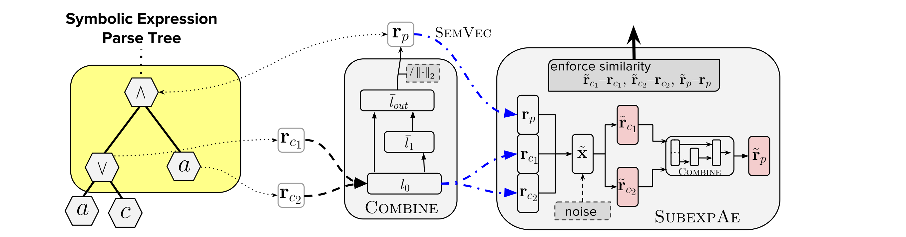
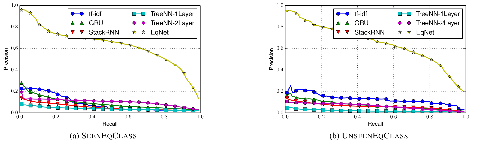
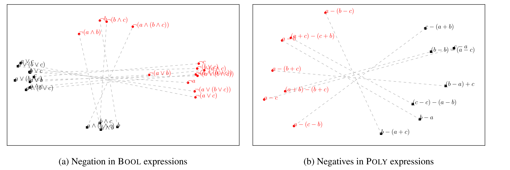

# 기호 수식에 좌표를 찍는 법 — Learning Continuous Semantic Representations of Symbolic Expressions

> 코드·데이터: `groups.inf.ed.ac.uk/cup/semvec`

기호 추론과 연속적 신경 추론을 결합하는 것은 표현 학습의 큰 숙제 중 하나다. 이 논문은 그 방향으로 한 걸음을 내딛는다. 목표는 명료하다 — **같은 뜻이면 같은 벡터, 다른 뜻이면 다른 벡터.** 겉모습이 아무리 달라도.

말은 간단하지만 예를 보면 왜 어려운지 바로 드러난다.

---

## 1. 이 논문이 풀려는 문제

### 1) 모습은 딴판인데 뜻은 같다

논문 Table 2에 나오는 세 불리언 수식이다.

| 수식 | 단순화 |
|---|---|
| `a ∧ (a ∧ (a ∧ ¬c))` | `a ∧ ¬c` |
| `a ∧ (a ∧ (c ⇒ ¬c))` | `a ∧ ¬c` |
| `(a ∧ a) ∧ (c ⇒ ¬c)` | `a ∧ ¬c` |

셋 다 **같은 등가 클래스**다. 하지만 겉모습은 제각각이다. 첫 번째는 `a`가 세 번 반복되고, 두 번째는 `c ⇒ ¬c`라는 (사실 `¬c`와 같은) 우회 표현을 쓰고, 세 번째는 괄호 묶음이 아예 다르다. 특히 `c ⇒ ¬c ≡ ¬c`를 알아채려면 함의 연산자의 의미를 이해해야 한다 — 토큰만 봐서는 절대 나오지 않는다.

요구사항은 이 셋의 벡터가 거의 일치해야 한다는 것이다.

다항식 쪽도 마찬가지다.

| 수식 | 전개 |
|---|---|
| `a + (c·(a+c))` | `a + ac + c²` |
| `((a+c)·c) + a` | `a + ac + c²` |

분배법칙 한 번 적용하면 같아지지만, 파스 트리 구조는 전혀 다르다. 루트 연산자만 같고 그 아래는 완전히 다른 모양이다.

### 2) 모습은 거의 같은데 뜻이 다르다

반대 방향이 더 까다롭다.

| 수식 | 단순화 |
|---|---|
| `a ∧ (a ∧ (a ∧ ¬c))` | `a ∧ ¬c` |
| `a ∧ (a ∧ (a ∧ ¬b))` | `a ∧ ¬b` ← **다른 클래스** |

문자 하나 차이다. 트리로 보면 가장 깊은 리프 노드 하나만 다르다. 그런데 진리표는 완전히 다르다.

이게 1층 TreeNN이 실제로 틀린 사례다. 두 번째를 첫 번째의 최근접 이웃으로 뽑았다. 트리를 따라 올라가며 표현을 합성하는데, 깊은 곳의 작은 차이는 위로 올라가면서 희석되기 때문이다. 다항식에서도 똑같이 `a+(c·(a+c))`의 이웃으로 `a+(c·(b+c))`를 뽑았다 — 역시 변수 하나 차이.

더 극단적인 예를 만들면:

```
a ∧ b ∧ c          →  꽤 까다로운 조건
a ∧ b ∧ c ∧ FALSE  →  항상 거짓 (모든 모순식과 같은 클래스)
```

토큰 두 개 붙였을 뿐인데 의미 공간에서는 완전히 다른 곳으로 순간이동해야 한다. 논문이 "small changes in syntax can lead to very large changes in semantics"라고 한 게 이 얘기다.

역방향도 있다. `¬¬A`는 `A`와 **정확히 같은** 벡터여야 한다. 구문 연산 두 번이 표현 공간에서는 항등 변환이 되어야 한다는 뜻이다.

### 3) 변수 이름은 유지된다

논문이 명시적으로 짚는 미묘한 지점이다.

```
c · (a·a + b)     vs     f · (d·d + e)
```

구조는 완전히 동일하다. 변수만 일대일로 바꿨을 뿐이다. 그런데 논문은 이 둘을 **등가로 보지 않는다.**

> "we interpret distinct variables as referring to different entities in the domain"

`a`와 `d`는 서로 다른 대상이므로 두 식은 다른 것을 계산한다. 즉 과제는 "구조적 동형"을 찾는 게 아니라 **변수 정체성까지 고려한 진짜 의미 등가**를 찾는 것이다. 이 때문에 문제가 한 단계 더 어려워진다 — 변수 이름은 무시하면 안 되고, 반복·괄호·우회 표현만 걷어내야 한다.

### 4) 왜 어려운가 — 공간의 크기

불리언 변수 n개면 가능한 진리표는 2^(2ⁿ)개다.

- n=3 → 256개 클래스
- n=5 → 약 43억 개
- n=10 → 2^1024 (관측 가능한 우주의 원자 수보다 많다)

게다가 임의의 두 불리언 식이 등가인지 판정하는 건 NP-hard다. 어떤 식이 `FALSE` 클래스에 속하는지 확인하는 것은 충족 불가능성 증명과 같다.

그래서 논문은 애초에 일반 해법을 노리지 않는다고 선을 긋는다.

> "we do not expect to circumvent an NP-complete problem with neural networks... Instead, our goal is to develop architectures that efficiently learn to solve the equivalence problems for expressions that are similar to a smaller number of expressions in a given training set."

**목표는 판정기가 아니라 일반화 가능한 표현 학습이다.**

### 5) 과제 설정과 동기

구체적으로 무엇을 주고 무엇을 요구하는지 정리하면:

**입력** — 등가 클래스로 묶인 수식 집합. 예를 들어 SimpBool8 데이터셋은 39,048개 수식이 120개 클래스로 묶여 있다.

**출력** — 각 수식마다 고정 길이 벡터 하나. 논문은 이를 SemVec이라 부른다.

**평가** — 테스트 수식 q를 던지고, 코사인 유사도로 가장 가까운 k개 이웃을 뽑아 그중 몇 개가 q와 같은 등가 클래스인지 센다.

$$\text{score}_k(q) = \frac{|N_k(q) \cap c|}{\min(k, |c|)}$$

여기서 `N_k(q)`는 q의 k-최근접 이웃 집합, `c`는 q가 속한 등가 클래스다. 위 예시로 치면, `a ∧ (a ∧ (a ∧ ¬c))`를 질의했을 때 이웃으로 `(a ∧ a) ∧ (c ⇒ ¬c)`가 나와야 하고 `a ∧ (a ∧ (a ∧ ¬b))`는 나오면 안 된다.

**핵심 조건** — 테스트셋이 둘로 나뉜다.

- **SeenEqClass**: 훈련 때 본 클래스의 새 수식
- **UnseenEqClass**: 훈련 때 한 번도 안 본 클래스 (전체 클래스의 20%를 통째로 빼놓음)

두 번째가 진짜 시험대다. 클래스 레이블을 외운 게 아니라 **연산자의 의미를 배웠는지**를 묻는다. 논문의 메인 결과표가 UnseenEqClass 기준인 이유다.

그래서 왜 이걸 하려는가. 논문 서론의 동기는 **기호 추론에 연속 휴리스틱을 주입하는 것**이다.

> "to allow a new class of symbolic reasoning methods based on heuristics that depend on the continuous representations, for example, by guiding a search procedure in a symbolic solver based on a distance metric in the continuous space."

정리 증명기나 수식 단순화기는 거대한 탐색 공간을 헤맨다. 만약 "지금 식"과 "목표 식"의 벡터 거리를 잴 수 있다면, 그 거리를 줄이는 방향으로 재작성 규칙을 고를 수 있다. 기호 세계에는 없던 **거리 개념**을 도입하는 셈이다.

---

## 2. 선행 연구와 그 한계

### 1) Socher의 TreeNN은 무엇을 했나 — 평가 vs 표현

재귀 신경망(TreeNN)을 명제 논리에 적용한 선행 연구로 Socher et al. (2012)가 있다. 각 노드에 벡터와 행렬을 함께 두고, 행렬이 이웃 노드의 의미를 변형하는 구조다. 명제 논리 실험에서 진리값을 입력으로 받아 연산자 행렬을 학습한다.

이 논문은 관련 연구에서 그 차이에 선을 긋는다.

> "we do not aim to learn how to **evaluate** expressions or execute programs with neural network architectures but to learn continuous semantic **representations** (SemVecs) of expression semantics **irrespectively of how they are syntactically expressed or evaluated**."

그리고 Socher et al. (2012)에 대해서는 "TreeNNs can learn to compute **the values of** some simple propositional statements"라고만 언급한다. 평가기라는 것이다.

가장 결정적인 차이는 **리프에 무엇이 들어가는가**다.

| | Socher 2012 | 이 논문 (EqNet) |
|---|---|---|
| 리프 노드 | 진리값 `TRUE` / `FALSE` | **변수** `a`, `b`, `c` |
| 트리를 타고 올라가는 것 | 값 (value) | 함수 (function) |
| 출력 | 진리값 1개 | 의미 전체를 담은 벡터 |

Socher의 네트워크는 `TRUE ∧ FALSE`를 받아 `FALSE`를 계산한다. 변수 대입이 이미 끝난 상태에서 bottom-up 계산을 하는 것이다. 반면 EqNet은 `a ∧ ¬c`를 받는데, **a와 c에 아무 값도 주어지지 않는다.** 그러니 트리를 타고 올라가는 것은 값이 아니라 "아직 인자를 받지 않은 함수"다.

이 차이가 난이도를 결정한다. Socher의 과제는 출력이 1비트지만, 이 논문의 벡터는 **진리표 전체**를 담아야 한다. 등가성의 정의가 곧 진리표 일치이기 때문이다. 논문이 명시하듯 "with n boolean variables, there are 2^(2ⁿ) equivalence classes (i.e. **one for each possible truth table**)".

즉 EqNet의 SemVec은 "이 수식이 참인가"가 아니라 **"이 수식이 어떤 부울 함수인가"** 를 인코딩해야 한다. 한 줄로 하면 — Socher는 **"이 식을 계산하면 얼마인가"** 를 배우고, 이 논문은 **"이 식이 무엇인가"** 를 배운다. 전자는 의미 공간의 한 점을 찍는 일이고, 후자는 의미 공간 자체에 좌표계를 놓는 일이다.

### 2) TreeNN의 세 가지 문제

논문은 TreeNN의 한계를 표현력, 최적화, 귀납 편향 세 층위에서 지적한다. 순서대로 보면 EqNet의 세 가지 수정이 각각 어느 문제에 대응하는지 정확히 맞아떨어진다.

**근본 문제: "구문을 따르되, 너무 따르지는 않아야 한다"**

저자들이 개념적 난점을 요약한 문장이 핵심이다.

> "how to develop a continuous representation that follows syntax but not too much, that respects compositionality while also representing the fact that a small syntactic change can be a large semantic one."

의미는 합성적이므로 표현은 구문 트리를 따라 계산될 수밖에 없다(그래서 TreeNN 프레임워크 자체는 유지한다). 그런데 TreeNN을 그대로 쓰면 **구문 거리가 곧 표현 거리**가 되어버린다. 논문이 초기 실험에서 관찰한 내용:

> "the networks were primarily focusing on syntax instead of semantics, i.e., expressions that were nearby in the continuous space were primarily ones that were syntactically similar."

동시에 반대 방향의 실패도 같이 일어난다:

> "the networks did not learn to unify representations of the same equivalence class, observing multiple syntactically distinct but semantically equivalent expressions to have distant SemVecs."

즉 **거짓 양성(구문이 비슷해서 가까움)과 거짓 음성(구문이 달라서 멂)이 동시에** 발생한다. 이건 파라미터 부족 문제가 아니라 아키텍처의 귀납 편향 문제다.

**표현력 문제: 단층 COMBINE으로는 부족하다**

전통적 TreeNN은 각 트리 노드에서 단층 신경망을 합성 함수로 쓴다. 논문은 이게 의미 보존 변환을 표현하기에 불충분하다고 본다.

*고곡률(high-curvature) 연산이 필요하다.* SemVec의 유클리드 공간 안에서 일부 연산은 본질적으로 비선형이다. 논문이 든 예가 XOR이다.

> "a simple XOR boolean operator requires high-curvature operations in the continuous semantic representation space."

단층 네트워크가 XOR을 표현 못 한다는 고전적 사실을 표현 공간 차원으로 옮겨온 논증이다. 실제로 정성 분석에서 EqNet조차 남은 오류의 대부분이 XOR(⊕)과 함의(⇒)에서 나온다고 보고한다 — 이 연산들이 표현 공간에서 가장 험한 변환이라는 방증이다.

*가역성이 필요하다.* 어떤 구문 연산은 의미적으로 되돌릴 수 있어야 한다. `¬¬A`와 `A`가 동일한 SemVec을 가져야 한다는 것. 단층 변환을 두 번 적용해서 항등 함수로 돌아오게 만드는 건 표현력상 매우 제약적이다.

여기에 더해 리프 임베딩 조회도 지적 대상이다. 전통적 TreeNN은 이걸 단순 임베딩 행렬 조회로 정의하는데, 논문은 합성 함수와 함께 "these will both prove to be serious limitations in our setting"이라고 명시한다.

**최적화 문제: 재귀가 만드는 불안정한 피드백 루프**

층을 늘리면 표현력은 해결되지만 새 문제가 생긴다. 논문의 진단이 흥미로운 지점이다.

> "as TreeNNs become deeper, they suffer from optimization issues, such as diminishing and exploding gradients. This is essentially because of the highly compositional nature of tree structures, where the same network (i.e. the COMBINE non-linear function) is used recursively, causing it to **'echo' its own errors** and producing unstable feedback loops."

여기서 "deep"의 의미가 중요하다. 트리의 **각 노드마다** 2층 MLP가 들어가므로, 트리 깊이 d짜리 수식이면 전체 네트워크는 사실상 2d층이 된다. 게다가 층마다 **같은 가중치**가 재사용되므로 오차가 증폭되며 되울린다. RNN의 기울기 문제와 같은 원인이지만, 트리 구조라 분기까지 있어 더 나쁘다.

### 3) 경험적 실패 양상

Table 1을 보면 1층과 2층 TreeNN의 성능은 데이터셋에 따라 들쭉날쭉하다. 특히 눈에 띄는 붕괴는 변수가 많은 데이터셋이다. BoolL5(변수 10개, 등가 클래스 7,312개)에서 1층 TreeNN의 score₅는 **0.1%**, 2층은 **0.5%** — 사실상 완전 실패다. 같은 조건에서 tf-idf가 31.1%를 낸다는 점이 뼈아프다. 단순한 어휘 기반 베이스라인만도 못한 것이다.

또 하나. Zaremba et al. (2014)는 TreeNN으로 수학적 항등식 탐색을 유도했고 인상적인 결과를 냈지만, 대상이 **동차(homogeneous) 단일변수 다항식**으로 한정돼 있었다.

> "While they present impressive results, we find that the TreeNN model fails when applied to more complex symbolic polynomial and boolean expressions."

이 주장을 검증하려고 일부러 OneV-Poly 데이터셋(단일변수 다항식, Zaremba의 설정과 유사하되 동차 제약은 없음)을 따로 만들었다. 결과는 OneV-Poly13에서 1층 TreeNN 10.0% vs EqNet 90.4%. 즉 **선행 연구가 성공한 영역에서조차** 문제를 조금만 일반화하면 TreeNN이 무너진다는 것을 보인 셈이다.

---

## 3. EqNet의 구조

### 1) 전체 흐름



*논문 Figure 1(a). 예시 수식은 `(a ∨ c) ∧ a`. 왼쪽이 파스 트리, 가운데가 COMBINE, 오른쪽이 SubexpAE다.*

읽는 법은 이렇다.

**리프에서 시작한다.** 변수 `a`, `c` 각각이 타입별 임베딩 `C_τ`를 조회하고 곧바로 정규화된다.

$$r_n \leftarrow C_{\tau_n} / \|C_{\tau_n}\|_2$$

여기 들어오는 건 **진리값이 아니라 변수 기호**다. 전통적 TreeNN은 조회만 하고 끝인데, 여기서 정규화가 들어가는 게 첫 번째 차이다.

**COMBINE이 재귀적으로 올라간다.** `∨` 노드가 두 자식을 합성하고, 그 결과가 `∧` 노드의 자식이 되어 다시 합성된다. 중요한 건 **가중치가 연산자 타입별로 분리**되어 있다는 점 — `∨`용 파라미터와 `∧`용 파라미터가 다르다. 반면 같은 타입끼리는 트리 어디에 나오든 **같은 가중치를 공유**한다.

**루트의 출력이 SemVec.** 이 벡터 하나가 수식 전체의 의미를 담는다.

**학습 신호는 두 갈래로 들어온다.** 루트에만 걸리는 분류 손실과, **모든 내부 노드마다** 걸리는 SubexpAE다. 그리고 이 두 갈래는 **학습이 끝나면 버려진다** — 테스트 때는 리프 임베딩과 COMBINE만 돌려서 SemVec을 뽑고 코사인 k-NN으로 판정한다.

### 2) COMBINE 내부

```
COMBINE(r_c0, …, r_ck, τp):
    l̄₀    ← [r_c0, …, r_ck]                          # 자식 SemVec 이어붙이기
    l̄₁    ← σ(W_{i,τp} · l̄₀)                         # 비선형 경로
    l̄_out ← W_{o0,τp} · l̄₀  +  W_{o1,τp} · l̄₁        # 선형 스킵 + 비선형
    return  l̄_out / ‖l̄_out‖₂                         # 단위 노름
```

핵심은 **두 갈래로 갈라졌다가 다시 합쳐진다**는 것이다.

$$\bar{l}_{out} \leftarrow W_{o0,\tau_p} \cdot \bar{l}_0 \;+\; W_{o1,\tau_p} \cdot \bar{l}_1$$

위쪽 경로는 `σ(W_{i,τ} · l̄₀)` — 비선형 은닉층이다. 이게 있어야 XOR 같은 고곡률 변환을 표현 공간에서 만들 수 있다. 아래쪽은 자식 표현이 **σ를 건너뛰고** 곧장 출력으로 가는 선형 통로다.

**여기서 놓치기 쉬운 지점: 항등 스킵이 아니다.** ResNet의 잔차는 `x + F(x)` — 스킵 경로에 파라미터가 없다. 그런데 여기는 스킵 경로에도 `W_o0`가 붙어 있다. 논문이 "residual connection"이 아니라 **"residual-like"** 라고 쓴 이유다.

왜 항등으로 둘 수 없냐면 **차원이 안 맞기 때문**이다. SemVec 차원을 D라 하면:

| 텐서 | 차원 |
|---|---|
| `l̄₀` = [r_c0, …, r_ck] | (k+1)·D — 이항 연산자면 **2D** |
| `l̄₁` = σ(W_i · l̄₀) | H (은닉 차원) |
| `l̄_out` | **D** |

이항 연산자에서 입력은 2D인데 출력은 D여야 한다. 그냥 더할 수가 없다. 따라서 `W_o0`는 D × 2D 행렬로, **차원 축소와 두 자식의 혼합을 동시에** 담당한다.

덧붙이면, 이게 가중치를 타입별로 나눠야 하는 또 하나의 이유이기도 하다. `¬`는 자식이 1개(입력 D)고 `∧`는 2개(입력 2D)라 **행렬 모양 자체가 다르다.**

**해석: 선형 기준선 + 비선형 보정.** 이렇게 읽으면 구조가 선명해진다.

```
l̄_out  =  W_o0 · l̄₀            ← 자식들의 선형 합성 (기준선)
        +  W_o1 · σ(W_i · l̄₀)   ← 그 위에 얹는 비선형 보정
```

두 번째 항의 `σ(W_i · l̄₀)` 부분이 사실상 전통적 1층 TreeNN이 하던 계산 그 자체다. EqNet은 그걸 **버리지 않고 선형 경로에 더하는** 구조다.

기울기로 보면 더 분명하다.

$$\frac{\partial \bar{l}_{out}}{\partial \bar{l}_0} = W_{o0} + W_{o1} \cdot \text{diag}(\sigma') \cdot W_i$$

첫 항에는 `σ'`가 곱해져 있지 않다. σ가 포화되어 `σ' → 0`이 되어도 `W_o0` 경로로는 기울기가 그대로 흐른다. 트리 깊이만큼 같은 함수가 겹쳐 적용되는 상황에서 이 무손실 통로가 있느냐 없느냐가 결정적이다.

마지막 `/ ‖l̄_out‖₂`가 두 번째 안전장치다. 매 노드마다 크기를 1로 되돌려 스케일 폭주를 원천 차단하고, 동시에 **의미와 무관한 자유도**(벡터 길이)를 제거한다.

> "As simple as this modification may seem, we found it vital for obtaining good performance, and **all of our multi-layer TreeNNs converged to low-performing settings without it**."

그리고 Ablation이 이 구조가 왜 이 모양이어야 하는지 못 박는다.

> "only the combination of the residual connections and the output normalization improve the performance, whereas when used separately, there are no significant improvements over the two-layer TreeNNs."

**잔차와 정규화는 따로 쓰면 효과가 없고, 둘을 함께 써야만 효과가 난다.**

사소하지만 정확히 해둘 것 몇 가지. 편향(bias) 항이 없다. `l̄_out`에는 활성화가 없어서 두 선형 항을 더한 뒤 곧바로 정규화로 간다. 즉 비선형성은 오직 `l̄₁` 안의 σ 하나뿐이고, "2층 MLP"라고 부르지만 정확히는 **은닉층 1개 + 선형 출력층**이며 출력층이 입력을 직접 본다. 논문이 더 깊은 네트워크도 실험했지만 개선이 없었다고 밝힌 것도 이 맥락에서 이해된다 — 깊이를 늘리면 재귀와 곱해져 최적화 부담만 커진다.

### 3) 동적 계산 그래프와 가중치 결속

구조를 보면 알 수 있듯, 학습하려는 논리식에 따라 **신경망을 매번 동적으로 생성**해야 한다. `a∧(a∧(a∧¬c))`는 깊이 4짜리 그래프를, `(a∨c)∧a`는 깊이 2짜리 그래프를 만든다. 표준적인 동적 계산 그래프(dynamic computation graph) 방식이다.

그런데 실제로 갱신되는 파라미터는 동일한 유한 집합이다. 가중치가 **노드 타입에 묶여** 있기 때문이다.

| | 수식마다 달라지는 것 | 고정된 것 |
|---|---|---|
| 그래프 | 위상, 깊이, 노드 수 | — |
| 파라미터 | — | `C_τ`, `W_{i,τ}`, `W_{o0,τ}`, `W_{o1,τ}`, `W_{e,τ}`, `W_d` |
| 차원 | — | SemVec 차원 D, 은닉 차원 H |

연산자 종류가 5개면 COMBINE 파라미터 세트도 5벌뿐이다. 아리티가 자동으로 맞아떨어지는 것도 여기 얹힌다 — `¬`는 항상 단항, `∧`는 항상 이항이므로 타입이 정해지면 행렬 모양도 정해진다.

**다만 여기에 단서를 하나 달아야 한다.** 파라미터 정합성 측면에서는 아무 문제가 없지만, **최적화 측면에서는 바로 그 공유가 이 논문의 주적이다.**

같은 `W_{i,∧}`가 트리에서 `∧`가 나올 때마다 반복 적용되고, 역전파 때 그 모든 위치의 기울기가 **한 행렬에 누적**된다. 깊이 d짜리 경로에서는 야코비안이 d번 곱해진다. 앞서 인용한 "echo its own errors"가 정확히 이 얘기고, 그래서 선형 스킵과 단위 노름 정규화가 **선택이 아니라 필수**가 된다.

즉 **가중치 공유는 일반화를 가능하게 하는 자산이자 최적화를 망가뜨리는 부채**다. EqNet 아키텍처의 상당 부분이 그 부채를 갚는 데 쓰인다.

---

## 4. SubexpAE — 이 논문의 핵심 기여

### 1) 왜 필요했나

잔차 + 정규화만으로 학습이 안정된 뒤에도 두 가지 병리가 남았다. 앞서 인용한 두 문장 — 네트워크가 의미가 아니라 구문에 집중하고, 같은 등가 클래스를 하나로 모으지 못한다는 것.

분류 손실만으로는 이게 안 잡힌다. 루트 레벨에서만 신호가 들어오고, 중간 노드들의 표현이 어떤 모양이든 최종 분류만 맞으면 그만이기 때문이다.

그래서 논문은 SemVec에 정규화 항을 하나 추가한다. **부분식 오토인코더(subexpression autoencoder, SubexpAE)** 다. 목적은 한 줄로 요약된다 — SemVec에서 **구문 정보를 걸러내고 의미만 남기도록** 압박하는 것. 추론에는 전혀 관여하지 않고, 오직 학습 중 표현 공간의 기하를 다듬는다.

```
SUBEXPAE(r_c0, …, r_ck, r_p, τp):
    x   ← [r_c0, …, r_ck]                                  # 자식들만
    x̃   ← tanh( W_d · tanh( W_{e,τp} · [r_p, x] · n ) )    # 부모+자식 → 병목 → 자식 복원
    x̃   ← x̃ · ‖x‖₂ / ‖x̃‖₂                                # 노름 맞추기
    r̃_p ← COMBINE(x̃, τp)                                  # 복원된 자식으로 부모 재계산
    return −( x̃ᵀx  +  r̃_pᵀ r_p )                          # 음의 내적 → 최소화 = 유사도 최대화
```

논문은 이 정규화가 SemVec에 두 성질을 부여하도록 설계했다고 말한다 — **abstraction(추상화)** 과 **reversibility(가역성)**.

### 2) 추상화 = 병목

> "Because abstraction arguably means removing irrelevant information, a network with a bottleneck layer seems natural"

인코더 `W_{e,τ}`가 저차원으로 압축한다. 부모-자식 튜플이 원래 차원보다 좁은 공간에 놓이도록 강제하니 **무언가는 반드시 버려진다.**

문제는 여기서 끝나지 않는다는 것이다. 논문이 곧바로 단서를 단다.

> "but we want the training objective to encourage the bottleneck to **discard syntactic information rather than semantic information**."

병목은 "버려라"라고만 말할 뿐 **"무엇을 버려라"** 는 말하지 않는다. 그냥 오토인코더를 붙이면 재구성에 편한 것 — 즉 표면적 패턴 — 을 남길 수도 있다. 이 지점을 해결하는 게 두 번째 원리다.

### 3) 가역성 = 부모와 자식을 함께 인코딩

논문의 예시가 명료하다. `F(a,b) = F₁(a,b) ∨ F₂(a,b)`를 생각하자.

> "if we know that F implies that a is true but F₁ does not, then F₂ must imply that a is true."

일반화하면, 부모·왼자식·오른자식 **셋 중 둘의 의미를 알면 나머지 하나의 의미에 강한 제약이 걸린다.** 그래서 인코더 입력을 자식만이 아니라 `[r_p, x]` — 부모까지 포함한 튜플 — 로 잡는다.

**그래서 병목이 구문을 버리게 되는 논리**를 정보이론적으로 읽으면 이렇다.

1. 재구성 목표는 "부모와 형제로부터 자식을 복원하라"이다
2. 병목을 통과하려면 정보를 버려야 하는데, **복원에 도움 안 되는 것부터 버리는 게 최적**이다
3. 자식의 *의미*는 부모·형제로부터 상당 부분 예측된다 (위 F₁/F₂ 예시)
4. 자식의 *구문적 실현*은 예측 불가능하다 — F와 F₁을 알아도 F₂가 `¬a ∨ b`로 쓰였는지 `a ⇒ b`로 쓰였는지는 알 길이 없다
5. 따라서 최적 압축은 **의미를 남기고 구문을 버린다**

논문이 이 가정을 명시적으로 진술한다.

> "the information discarded by the autoencoder bottleneck will be more syntactic than semantic, **assuming that the semantics of child node is more predictable from its parent and sibling than its syntactic realization**."

한 가지 더. 디코더는 자식만 복원하고, 부모는 복원된 자식에 **COMBINE을 다시 태워서** 얻는다. 부모를 직접 복원하게 두면 항등 사상을 배우면 그만이지만, 이 우회를 강제하면 "복원된 자식들이 원래 부모를 재생산해야 한다"는 일관성 제약이 걸린다.

손실이 제곱오차가 아니라 음의 내적이라는 점도 짚어둘 만하다. 자식들이 각각 단위 노름이라 `‖x‖₂`가 고정이고, `x̃`를 같은 노름으로 재조정하면 내적이 코사인 유사도처럼 동작한다. 앞의 정규화 설계와 일관된 선택이다.

### 4) 병합 메커니즘 — 노이즈가 하는 일

세 번째 효과는 두 번째 병리(같은 클래스인데 멂)를 직접 겨냥한다.

의미적으로 등가인 두 자식 `r_c0′`, `r_c0″`가 있고, 아직 SemVec은 멀리 떨어져 있다. 다만 상위에서 합성하면 결과는 거의 같다.

> "due to the autoencoder noise, the differences between the input tuple x′, x″ that contain r_c0′ and r_c0″ will be non-existent and the decoder will predict a single location r̃_c0... Then, when minimizing the reconstruction error, **both r_c0′ and r_c0″ will be attracted to r̃_c0 and eventually should merge.**"

노이즈 `n`(원소의 κ%를 0으로)이 두 입력의 차이를 지워버리면, 디코더는 구분할 수단이 없으니 **하나의 위치**만 내놓는다. 그러면 재구성 손실을 줄이는 유일한 길은 양쪽 원본이 그 지점으로 이동하는 것이다. 이게 반복되며 같은 등가 클래스가 서서히 한 점으로 수렴한다.

denoising이 단순한 과적합 방지가 아니라 **병합의 엔진**으로 쓰이는 게 이 설계의 재미있는 지점이다.

### 5) Socher et al. (2011)의 recursive autoencoder와 무엇이 다른가

논문이 두 가지를 명시한다.

| | Socher 2011 | SubexpAE |
|---|---|---|
| 인코딩 대상 | 자식 표현만 | **부모 + 자식 튜플 전체** |
| 인코딩 결과의 용도 | 그것이 곧 부모 표현 | **정규화항으로만** 사용 |

두 번째가 특히 중요하다. Socher에서는 오토인코더가 계산 경로 위에 있어서 추론 때도 반드시 통과해야 한다. EqNet에서는 완전히 옆으로 빠져 있다 — **추론 시에는 `W_e`, `W_d`가 아예 쓰이지 않는다.** SemVec은 오직 COMBINE만으로 계산된다.

첫 번째 차이도 앞의 논증과 직결된다. 자식만 인코딩하면 "부모·형제로부터의 예측 가능성"이라는 축 자체가 생기지 않으므로, 병목이 구문을 버리도록 유도할 방법이 없다.

### 6) 그런데 이건 마스킹이 아니다

여기서 논문의 산문적 설명과 실제 수식 사이에 간극이 하나 있다.

인코더 입력은 `[r_p, x]`이고 여기서 `x = [r_c0, …, r_ck]`, 즉 **복원 대상인 자식들이 입력에 그대로 들어 있다.** BERT처럼 자식 하나를 가리고 나머지로 맞히는 구조가 아니다. 순수한 오토인코더 — 입력에 정답이 포함되어 있다. 게다가 `r̃_p ← COMBINE(x̃, τ_p)`가 **모든** 자식을 요구하기 때문에, leave-one-out 방식으로 하나만 비워두는 설계는 애초에 불가능하다.

논문의 문장을 다시 보면 표현이 조심스럽다. "**encourages** child representations to be predictable from parents and siblings" — 강제한다가 아니라 유도한다이고, 그 뒤에도 "**assuming that** the semantics of child node is more predictable…"라며 가정임을 명시한다. 아키텍처가 보장하는 게 아니다.

**그럼 압력은 어디서 오나.** 마스킹 대신 두 가지가 대신 일한다.

*병목 = 용량 제약 하의 중복 제거.* 인코딩 차원이 튜플 차원보다 작으므로 `[r_p, x]` 전체를 통과시킬 수 없다. 이때 최적 전략은 **중복된 정보를 버리는 것**이다. 자식 c0의 의미가 `r_p`와 `c1`로부터 재도출 가능하다면, c0의 의미를 병목에 따로 실어 나르는 건 용량 낭비다. 반면 재도출 불가능한 정보(구문적 실현)는 담지 않으면 영영 잃는다. 압력의 정체는 "정답을 가렸다"가 아니라 **"제한된 대역폭에서 중복을 실어 나르면 손해"** 다.

*노이즈 = 확률적·부분적 마스킹.* `n`이 원소의 κ%를 0으로 만드니 매 forward마다 자식 표현의 일부 차원은 실제로 가려진다. 그 차원들은 살아남은 나머지로부터 채워야 한다. 다만 이건 무작위이고 부분적이다. κ가 작으면 자식 자신의 표현이 대부분 살아남아 복사가 쉬워진다. 그래서 κ가 튜닝 대상 하이퍼파라미터인 것이고, "predictable from parents and siblings"는 **보장이 아니라 통계적 경향**으로 읽는 게 맞다.

**더 정확한 읽기: `r̃_pᵀ r_p` 항이 진짜 하는 일.** (이건 논문에 명시되지 않은 해석이지만, 수식을 보면 이렇게 읽는 게 자연스럽다.)

먼저 관찰 하나. 오토인코더가 완벽히 복사하면(`x̃ = x`) `r̃_p = COMBINE(x) = r_p`가 되어 **두 항 모두 자명하게 최대화된다.** 즉 COMBINE 항 자체는 복사를 막지 못한다. 복사를 막는 건 오직 병목이다.

그렇다면 COMBINE 항의 역할은 뭔가. 병목 때문에 `x̃ = x + δ` (δ ≠ 0)일 수밖에 없는 상황에서:

$$\tilde{r}_p = \text{COMBINE}(x + \delta) \approx r_p + J\delta$$

`r̃_pᵀ r_p`를 최대화한다는 건 `Jδ ≈ 0`, 즉 **δ가 COMBINE 야코비안의 커널에 놓이도록** 미는 것이다. 그럼 COMBINE의 커널에는 뭐가 있나. **자식을 흔들어도 부모의 SemVec이 안 변하는 방향들** — 다시 말해 합성 결과의 의미에 영향을 주지 않는 방향들이다. 그게 바로 구문적 자유도다.

정리하면 두 항의 분업이 이렇게 읽힌다.

| 항 | 역할 |
|---|---|
| `x̃ᵀx` | 정보를 **최대한 적게** 잃어라 |
| `r̃_pᵀ r_p` | 잃되, **부모의 의미가 안 변하는 방향으로** 잃어라 |

병목이 "버려라", 첫 항이 "조금만", 둘째 항이 **"어느 방향으로"** 를 지정한다. 앞서 "병목은 무엇을 버릴지 모른다"고 했던 문제를, 부모·형제 예측 가능성이 아니라 **COMBINE 불변 방향**이 해결하고 있는 셈이다.

참고로 병합 메커니즘은 이 비판과 무관하게 그대로 유효하다. 두 등가 자식이 노이즈 때문에 구분 불가능해지고 디코더가 단일 지점을 내놓는다는 논리는 "부모·형제로부터의 예측 가능성"을 전혀 전제하지 않는다. **노이즈 + 공유 디코더**만 있으면 성립한다.

종합하면, 논문의 "부모와 형제로부터 자식을 복원" 서술은 **설계 동기를 설명하는 직관적 이야기**이고, 아키텍처가 실제로 강제하는 바를 정확히 기술한 것은 아니다. 실제 강제력은 병목(중복을 실어 나르면 손해) + 노이즈(확률적 부분 마스킹, 병합 유도) + COMBINE 항(손실의 방향 지정) 세 요소의 조합에서 나온다. 논문이 "encourages", "nudge", "assuming"이라는 단어를 반복해서 쓴 게 이 느슨함을 스스로 인정하는 대목으로 읽힌다.

---

## 5. 학습

### 1) 데이터 구성

훈련 집합은 파스 트리 집합 𝒯 = {T₁ … T_N}이고, 이게 등가 클래스로 분할되어 있다 ℰ = {e₁ … e_J}.

만드는 방식은 이렇다. 최대 트리 크기까지 수식을 **전수 생성** → 기호적으로 정규형(canonical form)으로 단순화 → 정규형이 같은 것끼리 묶기.

중요한 제약 하나: **부분식의 등가 클래스 정보는 쓰지 않는다.** 전체 수식 T의 클래스 레이블만 지도 신호로 쓴다. 논문은 이게 일반성을 잃지 않는다고 말한다 — 부분식의 클래스를 안다면 그 부분식을 그냥 훈련셋에 별도 항목으로 넣으면 되기 때문이다.

### 2) 등가 클래스 max-margin 목적함수

루트에서 나온 SemVec을 클래스에 매칭한다. 훈련셋에 등장하는 각 등가 클래스 e마다 **학습 가능한 벡터 q_e와 스칼라 편향 b**를 둔다.

$$P(e_i \mid T) = \frac{\exp\left(\text{TreeNN}(T)^\top q_{e_i} + b_i\right)}{\sum_j \exp\left(\text{TreeNN}(T)^\top q_{e_j} + b_j\right)} \tag{1}$$

`q_e`는 "그 등가 클래스의 원형(prototype) 위치"로 읽으면 된다. 손실은 소프트맥스 교차엔트로피가 아니라 max-margin이다.

$$\mathcal{L}_{\text{ACC}}(T, e_i) = \max\left(0,\ \max_{e_j \neq e_i,\, e_j \in \mathcal{E}} \log \frac{P(e_j\mid T)}{P(e_i\mid T)} + m\right) \tag{2}$$

작동 방식은 이렇다. 정답 아닌 클래스 중 **가장 점수가 높은 것 하나**(hardest negative)만 골라서, 정답과의 로그 확률 차이가 마진 m 이상 벌어져 있으면 손실 0. 아니면 그만큼 벌린다. 모든 오답을 균등하게 밀어내지 않고 경계선만 다듬는 구조다.

**왜 쌍(pairwise)이 아니라 클래스 단위인가.** 등가성은 **추이적**이다. A≡B, B≡C면 A≡C여야 한다. Siamese 손실은 쌍만 보므로 이걸 보장할 수 없고, 논문은 실제로 시도했다가 이렇게 보고한다.

> "we found the optimization to be very unstable, yielding suboptimal performance... equivalence is a stronger property than similarity."

반면 클래스 중심 `q_e`를 두면 같은 클래스의 모든 멤버가 **같은 한 점**을 향해 당겨지므로 추이성이 구조적으로 강제된다.

표준 분류와 다른 점도 있다. 클래스 레이블 집합이 고정되어 있지 않다.

> "in our setting the number of equivalence classes in the training set will vary with N."

Table 1 기준 클래스 수는 47개에서 7,312개까지 데이터셋마다 다르다.

### 3) 총 손실과 µ 스케줄

$$\mathcal{L}(T, e_i) = \mathcal{L}_{\text{ACC}}(T, e_i) + \frac{\mu}{|Q|} \sum_{n \in Q} \text{SubexpAE}(\text{ch}(n), n) \tag{3}$$

`Q = {n ∈ T : |ch(n)| > 0}` — 트리의 **모든 비리프 노드**. 즉 SubexpAE는 루트에서 한 번이 아니라 부분식마다 걸린다. `|Q|`로 나누므로 트리 크기가 달라도 두 손실의 비중이 일정하게 유지된다.

µ의 스케줄이 흥미롭다. 에폭 t에 대해:

$$\mu = 1 - 10^{-\nu t}, \qquad \nu \geq 0$$

t=0에서 µ=0 → 학습 초기에는 SubexpAE가 **완전히 꺼져 있다.** 에폭이 진행되며 지수적으로 1에 접근한다.

> "subexpression autoencoding is counterproductive early in training, before the SemVecs begin to represent aspects of semantics."

닭과 달걀 문제다. 병합 압력은 "가까운 것들을 뭉쳐라"라고 말하는데, 초기 표현은 난수에 가까워서 **가까운 것들이 의미적으로 아무 관계가 없다.** 그 상태에서 뭉치면 잘못된 병합이 굳어버린다. 먼저 분류 손실로 대략적인 의미 지형이 잡힌 뒤에 SubexpAE가 들어와 클러스터를 조이는 순서여야 한다.

하이퍼파라미터는 **베이지안 최적화**(Snoek et al., 2012)로 튜닝했다. 튜닝용 데이터는 불리언 5변수·최대 트리 크기 7짜리 별도 데이터셋이고, 튜닝 지표는 평균 k-NN score (k=1…15)다. 검증 지표가 손실값이 아니라 **최종 평가 지표와 동일한 k-NN score**라는 점이 눈에 띈다. 분류 정확도로 튜닝하면 `q_e`에 과적합된 모델이 뽑힐 수 있는데, 실제로 원하는 건 벡터 공간의 이웃 구조이기 때문이다.

### 4) 테스트 시점 — 발판을 버린다

| | 학습 | 테스트 |
|---|---|---|
| 사용 | 리프 임베딩 + COMBINE + `q_e`, `b` + SubexpAE | **리프 임베딩 + COMBINE만** |
| 판정 | max-margin 분류 | 코사인 유사도 **k-NN** |

`q_e`와 `b_i`는 훈련셋에 등장한 클래스에 대해서만 존재한다. **UnseenEqClass에는 대응하는 `q_e`가 아예 없다.** 따라서 평가는 오직 SemVec 간 코사인 거리로만 이뤄진다.

파라미터를 묶임 단위로 정리하면 이 구조의 성격이 드러난다.

| 파라미터 | 묶임 단위 | 역할 | 추론 시 사용 |
|---|---|---|---|
| `C_τ` | 리프 타입별 (`a`, `b`, `c` …) | 변수 임베딩 | ✓ |
| `W_{i,τ}`, `W_{o0,τ}`, `W_{o1,τ}` | 연산자 타입별 | COMBINE | ✓ |
| `W_{e,τ}` | 연산자 타입별 | SubexpAE 인코더 | ✗ |
| `W_d` | **전역 공유** | SubexpAE 디코더 | ✗ |
| `q_e`, `b_e` | 등가 클래스별 | 분류 헤드 | ✗ |

다섯 종류 파라미터 중 **둘만 살아남는다.** 나머지 셋은 좋은 벡터 공간을 빚어내기 위한 **거푸집**이고, 학습이 끝나면 떨어져 나간다. 최종 산출물은 리프 임베딩 테이블과 COMBINE 재귀 함수 — 그 둘만으로 처음 보는 등가 클래스의 수식에도 올바른 좌표를 찍어야 한다.

---

## 6. 결과

### 1) 주요 수치

UnseenEqClass에서의 score₅ (%). 높을수록 좋다. 논문 Table 1에서 대표 데이터셋을 추린 것이다.

| 데이터셋 | #클래스 | tf-idf | GRU | 1L-TreeNN | 2L-TreeNN | **EqNet** |
|---|---:|---:|---:|---:|---:|---:|
| SimpBool8 | 120 | 17.4 | 30.9 | 27.4 | 25.5 | **97.4** |
| Bool5 | 95 | 34.9 | 35.8 | 16.4 | 26.0 | **65.8** |
| Bool8 | 232 | 10.7 | 17.2 | 15.7 | 15.4 | **58.1** |
| BoolL5 | 7,312 | 31.1 | 20.7 | 0.1 | 0.5 | **75.2** |
| SimpPoly10 | 195 | 25.9 | 11.0 | 19.9 | 7.1 | **99.3** |
| OneV-Poly13 | 677 | 3.2 | 4.7 | 10.0 | 56.2 | **90.4** |
| Poly5 | 150 | 37.8 | 34.1 | 46.8 | **59.1** | 55.3 |
| Poly8 | 1,102 | 13.9 | 5.7 | 10.4 | 14.8 | **86.2** |

14개 데이터셋 중 13개에서 EqNet이 1위다. 유일한 예외인 Poly5는 논문이 성능이 아니라 **데이터 크기 아티팩트**로 해석한다 — 표현이 516개뿐이다.

BoolL5 행이 특히 눈에 띈다. 변수 10개·클래스 7,312개라는 가장 어려운 조건에서 TreeNN 계열은 0.1%와 0.5%로 완전히 무너지는데, EqNet은 75.2%를 낸다. 그리고 tf-idf가 31.1%로 TreeNN을 크게 앞선다는 점 — 단순 어휘 기반 베이스라인만도 못한 상황이 실제로 벌어진다.



*논문 Figure 2. 데이터셋 전체를 평균낸 정밀도-재현율 곡선. 왼쪽이 SeenEqClass, 오른쪽이 UnseenEqClass. EqNet(노란 별)만 다른 궤적에 있다.*

### 2) Ablation — 무엇이 얼마나 기여했나

| 제거한 요소 | 성능 하락 |
|---|---|
| 출력 정규화 (2층 TreeNN과 비교) | AUC 평균 **60.9%** 감소 |
| SubexpAE — UnseenEqClass | AUC **19.7%** 감소 |
| SubexpAE — SeenEqClass | AUC **16.8%** 감소 |
| SubexpAE — 전이 설정 | AUC **8.8%** 감소 |

정규화가 학습을 **가능하게** 만들고, SubexpAE는 그 위에서 표현을 **다듬는다**고 읽으면 맞다.

SubexpAE 쪽에서 UnseenEqClass의 감소폭이 더 크다는 게 의미심장하다. 훈련 때 본 클래스는 `q_e`가 직접 잡아주지만, **못 본 클래스는 순수하게 표현 공간의 기하에 의존**하므로 SubexpAE의 기여가 더 드러난다. 전이 설정에서 감소폭이 작은 건 그 자체로는 기여가 작다는 뜻이지만, 논문은 단서를 단다 — "even in this setting we observe that SubexpAE helps more in **large and diverse datasets**."

### 3) 합성성 — 작은 수식으로 배워 큰 수식에 쓰기

가중치가 위치나 깊이가 아니라 **타입에** 묶여 있으므로, 원리적으로는 훈련 때 본 적 없는 깊이의 트리도 처리할 수 있어야 한다. 논문은 이걸 실제로 시험한다.

BOOL5(최대 트리 크기 5)로 훈련 → BOOL8(최대 트리 크기 8)로 테스트. 이런 쌍 11개를 평균낸 결과가 Figure 3인데:

> "performance is only a bit worse than in the non-transfer setting."

훈련 중 한 번도 안 본 깊이에서도 성능이 유지된다. 동적 그래프 + 타입별 결속이라는 설계가 **실제로 합성 규칙을 학습했음**을 보여주는 대목이다. 반대로 GRU나 StackRNN 같은 시퀀스 모델은 이 설정에서 크게 무너진다.

### 4) 정성 분석 — 틀리는 방식이 다르다

EqNet도 완벽하진 않은데, **틀리는 방식**이 이 문제의 성격을 잘 보여준다.

`(a∧a)∧(c⇒¬c)` (≡ `a∧¬c`) 의 최근접 이웃으로 EqNet이 뽑은 것은 `(¬(b⇒(b∨c)))∧a` 였다. 이 식을 풀어보면 `b ⇒ (b∨c)`는 항상 참이므로 전체는 `FALSE`다. 틀린 답이지만 — **구문적으로는 전혀 안 닮았다.**

TreeNN의 오류(`¬c` → `¬b`, 문자 하나 차이)와 비교하면 차이가 선명하다. 전자는 의미 공간에서 헤맨 것이고, 후자는 애초에 구문 공간에 머물러 있던 것이다. 논문의 표현으로 EqNet의 혼동은 "more syntactically diverse and semantically related"다.

또한 EqNet의 오류는 **XOR(⊕)이나 함의(⇒)가 낀 수식에 집중**된다. 논문은 BOOL5 전체와 BOOL10 상위 100개 표현에서 이 연산자들이 관여하지 않은 혼동 사례를 하나도 찾지 못했다고 보고한다.



*논문 Figure 5. 단순한 비등가 수식(검은 사각형)과 그 부정/음수(빨간 원)의 PCA 투영. 선이 짝을 연결한다.*

오른쪽 POLY 패널이 특히 명료하다. 좌우가 `-1`과 `a`를, 상하가 `-b`와 `b`를, `y = -x`에 평행한 대각선이 `c`와 `-c`를 구분한다. 부정이라는 의미 연산이 표현 공간의 **일관된 방향**으로 나타난다는 뜻이다. 왼쪽 BOOL 패널에서도 비슷한 거동이 보인다.

---

## 7. 한계와 남는 질문

**고정 크기 벡터의 용량 한계.** 저자들 스스로 결론에서 지적하는 가장 큰 제약이다.

> "even for relatively small symbolic expressions, we have an exponential explosion of the semantic space to be represented. **Fixed-sized SemVecs, like the ones used in EqNet, eventually limit the capacity** that is available to represent procedural knowledge. In the future, to represent more complex procedures, variable-sized representations would seem to be required."

EqNet이 하는 일은 결국 지수 크기의 진리표를 고정 길이 벡터로 압축한 근사 대리물을 학습하는 것이다. 변수가 늘어날수록 이 압축은 무리해진다. Table 1에서 변수 3개 데이터셋과 10개 데이터셋의 성능 격차가 이를 반영한다.

**SubexpAE의 핵심 가정이 항상 성립하진 않는다.** "자식의 의미는 부모와 형제로부터 예측 가능하다"는 가정에 반례가 쉽게 나온다. `F = F₁ ∨ F₂`에서 F₁이 이미 항진식이면 F도 항진식이고, **F₂는 아무 제약도 받지 않는다.** 이런 경우 SubexpAE가 주는 신호는 무의미하거나 오히려 해로울 수 있다. 논문 자신도 "it is **often** possible to completely determine **or at least place strong constraints** on"이라며 신중하게 표현한다.

XOR·함의가 낀 수식에서 EqNet의 오류가 집중된다는 정성 분석 결과도 이와 무관하지 않아 보인다 — 이 연산자들은 부모·형제로부터 자식을 역추론하기가 가장 어려운 축에 속한다.

**여전히 남은 최적화 부담.** 논문은 "further improvements are needed, especially for more robust training of compositional models"라고 마무리한다. 잔차와 정규화로 급한 불은 껐지만, 재귀적 가중치 공유가 만드는 근본적 불안정성이 해결된 것은 아니다.

---

## 8. 마무리

이 논문의 기여를 한 문장으로 줄이면 — **기호 수식의 공간에 거리 개념을 도입했다.**

기존 연구가 "이 식을 계산하면 얼마인가"를 물었다면, 여기서는 "이 식이 무엇인가"를 묻는다. 전자는 의미 공간의 한 점을 찍는 일이고, 후자는 의미 공간 자체에 좌표계를 놓는 일이다. 그래서 최종 산출물이 분류기가 아니라 **코사인 거리를 잴 수 있는 벡터 공간**이고, 기호 솔버의 탐색을 유도하겠다는 응용 동기도 거기서 나온다.

아키텍처 자체는 의외로 검소하다. TreeNN이라는 골격은 그대로 두고, 세 군데를 손봤을 뿐이다.

| TreeNN의 문제 | EqNet의 처방 |
|---|---|
| 단층 COMBINE의 표현력 부족 (XOR, `¬¬A=A`) | 노드 타입별 **2층 MLP + 잔차 스킵** |
| 재귀 적용에 의한 기울기 소실/폭발 | **SemVec 단위 노름 정규화** |
| 구문에 과적합, 같은 클래스가 흩어짐 | **SubexpAE** 정규화 |
| 유사성 학습으로는 추이적 등가성을 못 잡음 | **등가 클래스 단위 max-margin 목적함수** |

흥미로운 건 이 처방들이 모두 "TreeNN을 버리자"가 아니라 "TreeNN의 재귀 골격은 유지하되 각 지점을 보강하자"라는 방향이라는 점이다. 합성성을 포기하면 애초에 구조를 일반화할 수 없기 때문이다 — 작은 수식으로 훈련해 큰 수식으로 테스트하는 전이 실험에서 성능이 유지된 것이 그 선택의 근거가 된다.

동시에 이 논문은 자기 한계에 대해 솔직하다. "encourages", "nudge", "assuming" 같은 단어가 반복해서 등장하는데, 이는 SubexpAE가 원하는 성질을 **보장**하는 게 아니라 **유도**할 뿐임을 저자들이 알고 있다는 신호로 읽힌다. 고정 크기 벡터로 지수적 의미 공간을 담겠다는 시도 자체가 결국 무리라는 것도 결론에서 먼저 인정한다.

그럼에도 "SemVec"이라는 개념 — 기호 표현과 연속 표현을 잇는 다리 — 은 충분히 매력적이다. 논문이 스스로를 "a first essential step"이라 부르는 게 과장이 아니다.
