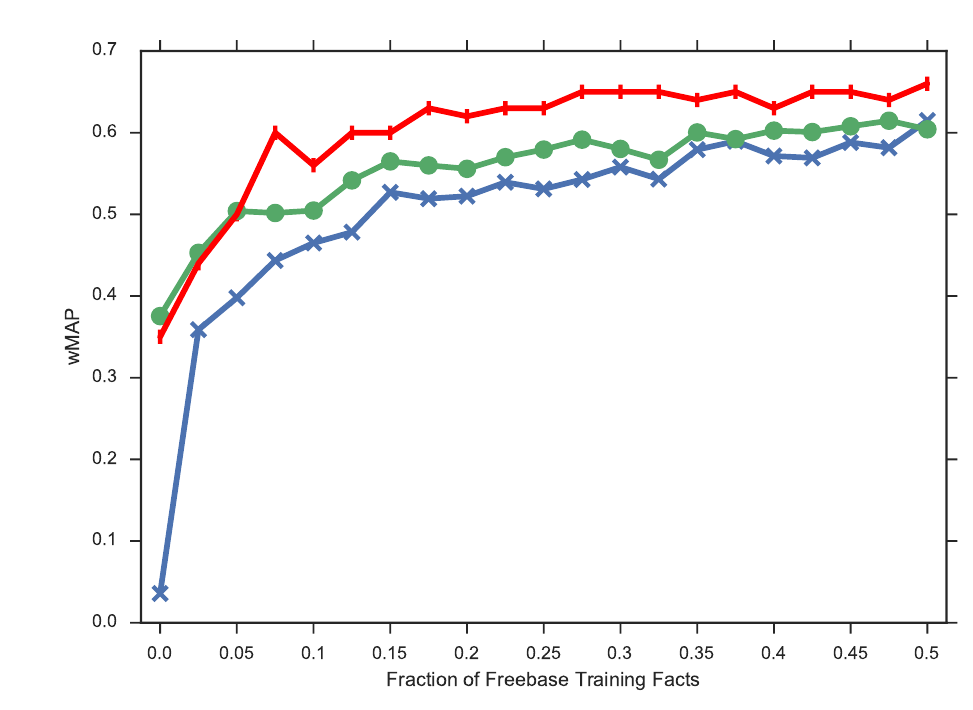
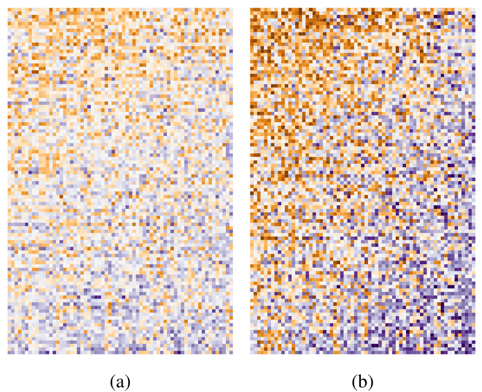

# 논리 규칙을 벡터 공간의 부등식으로 바꾸기 — Lifted Rule Injection for Relation Embeddings
#### Abstract
현재 표현 학습(representation learning) 기반의 방법론들은 다수의 자연어 처리 및 지식 베이스 추론 과제에서 최첨단(state-of-the-art) 성능을 보이고 있다. 그러나 이러한 모델에 상식적 지식(commonsense knowledge)을 효율적으로 통합하는 것은 여전히 중요한 과제다. 최근 한 접근 방식은 1차 논리(first-order logic) 규칙을 명제화(propositionalization)하여 관계 및 개체 표현을 정규화하는 방법을 취하고 있다. 하지만 명제화 방식은 개체와 규칙의 수가 적은 도메인을 벗어나면 확장성(scalability) 문제를 겪게 된다. 본 논문에서는 자동 지식 베이스 구축을 위해 함의 규칙(implication rules)을 분산 표현(distributed representation)에 통합하는 매우 효율적인 방법을 제시한다. 우리는 개체-튜플 임베딩을 근사적 불리언 공간(approximately Boolean space)으로 매핑하고, WordNet에서 추출한 함의 규칙을 바탕으로 관계 임베딩 간의 부분 순서(partial ordering)를 유도한다. 놀랍게도, 개체-튜플 임베딩 공간에 가해진 이러한 강력한 제약은 모델의 표현력을 저하시키지 않을 뿐만 아니라, 오히려 일반화 성능을 향상시키는 정규화(regularizer) 역할을 한다는 사실을 확인했다. 소수의 상식적 규칙을 통합함으로써, 우리는 행렬 분해(matrix factorization) 기반의 베이스라인 대비 평균 정밀도(MAP)를 2% 포인트 향상시켰으며, 이때 실행 시간의 증가는 미미한 수준에 그쳤다.
#### 요약
지식베이스를 자동으로 채우는 모델에 "교수는 피고용인이다" 같은 상식을 어떻게 넣을 것인가. 이 논문은 그 질문에 대해, 규칙을 데이터로 번역해 손실 항을 늘리는 대신 임베딩 공간의 기하 구조로 못박는 답을 내놓는다. 그 결과 규칙 주입 비용이 엔티티 수와 완전히 무관해진다.

---

## 1. 이 논문이 풀려는 문제

표현 학습 기반 모델은 대량의 데이터로부터 견고한 표현을 배우지만 상식적 지식이 부족하다. 그런 지식은 텍스트에 명시적으로 진술되는 일이 드물고, 대신 PPDB나 WordNet 같은 자원에 정리되어 있다.

이를 보완하려고 1차 논리 규칙을 주입하는 기존 접근(Rocktäschel et al., 2015)은 규칙을 명제화(propositionalization)해서 쓴다. 즉 ∀x: isMan(x) ⇒ isMortal(x) 같은 규칙 하나를 데이터셋의 모든 엔티티에 대해 전개해 손실 항을 만드는 방식이라, 엔티티 수가 많아지면 손실 항이 폭발적으로 늘어나 확장이 안 된다.

이 논문의 제안은 규칙을 개별 엔티티에 접지(grounding)하지 않고 관계 임베딩 수준에서 직접 부과하는 lifted 방식이다. 논문의 표현을 빌리면, 이 접근의 장점은 계산 시간이 극적으로 줄어든다는 것 외에도, 제약이 만족되기만 하면 주입된 규칙이 학습에서 본 적 없는 추론된 사실에 대해서도 항상 성립한다는 데 있다.

---

## 2. 배경: universal schema와 행렬 분해

### 1) 벡터화와 내적

출발점은 Riedel et al.(2013)의 행렬 분해 모델(model F)이다. 행렬의 열마다 관계 벡터 $\boldsymbol{r} \in \mathbb{R}^k$가 하나씩, 행마다 튜플 벡터 $\boldsymbol{t} \in \mathbb{R}^k$가 하나씩 배정되고, 사실 $\langle r, t \rangle$의 점수는 두 벡터의 내적 $\boldsymbol{r}^\top \boldsymbol{t}$로 계산한다.

이 모델에서 특징적인 건 엔티티를 개별적으로 벡터화하지 않고 쌍(tuple) 전체를 하나의 단위로 벡터화한다는 점이다. 예를 들어 ⟨오바마, 미국⟩이라는 튜플에 벡터 $\boldsymbol{t}$ 하나가 배정되고, presidentOf라는 관계에 벡터 $\boldsymbol{r}$ 하나가 배정된다. 그러니까 학습 데이터는 결국 (관계 × 엔티티쌍) 행렬이고, 관측된 사실이 채워진 희소 행렬을 저차원 분해하는 셈이다.

중요한 것은 열에 무엇이 들어가느냐다. Freebase 관계만 있는 게 아니라 텍스트에서 뽑은 표층 패턴이 함께 들어간다. 논문 표 2에 나오는 `nsubj<-die->dobj` 같은 것들이 뉴스 문장에서 두 개체 사이를 잇는 의존 구문 경로다. 하나의 행렬에 "X가 Y의 대사로 부임했다"는 텍스트 패턴과 `person/nationality`라는 구조화된 관계가 같은 자격으로 나란히 놓인다. 이 행렬을 분해하면 텍스트 패턴과 지식베이스 스키마 사이의 대응이 저절로 학습된다. 별도의 정답 레이블이나 미리 정의된 매핑 규칙 없이, 같은 엔티티쌍에 어떤 패턴과 어떤 관계가 함께 나타났는가라는 공기 통계만으로 말이다.

일반화가 생기는 지점은 $k = 100$이라는 병목이다. 관계가 수천 개인데 차원이 100뿐이니 서로 다른 관계가 독립적인 방향을 차지할 수 없다. 겹치는 튜플 집합을 가진 관계들은 어쩔 수 없이 비슷한 방향으로 몰리고, 그 결과 한쪽 관계로만 관측된 튜플이 다른 쪽 관계에서도 높은 점수를 받는다. 저차원 분해가 곧 미관측 사실의 예측이다.

### 2) BPR — 음성 예시가 없는 상황에서의 학습

학습 데이터 $\mathcal{O}$에는 참인 사실만 있다. 관측되지 않은 것이 거짓이라는 보장이 없으니 이진 분류로 풀 수 없다. 그래서 BPR(Bayesian Personalized Ranking, Rendle et al., 2009)을 쓴다.

BPR은 원래 추천 시스템을 위해 제안된 목적함수다. 상황은 이렇다. 사용자가 별점을 매겨준 데이터가 있으면 회귀로 풀면 되는데, 현실에서 쌓이는 건 클릭, 구매, 조회 같은 흔적뿐이다. 이런 암묵적 피드백에는 양성만 있고 음성이 없다. 사용자가 어떤 상품을 클릭하지 않았다는 사실이 그 상품을 싫어한다는 뜻인지, 아직 발견하지 못했다는 뜻인지 구분할 방법이 없다.

가장 소박한 접근은 관측된 것을 1, 나머지를 0으로 놓고 맞추는 것이다. 그런데 이건 논리적으로 자기모순이다. 우리가 예측하고 싶은 대상은 아직 관측되지 않은 항목 중 사용자가 좋아할 것들인데, 학습에서는 그것들을 전부 0으로 맞추라고 가르치고 있다. 목적함수를 완벽하게 최소화한 모델은 미관측 항목 전부에 0을 출력하고, 추천할 것이 하나도 남지 않는다. 반대로 미관측을 아예 무시하면 모델을 아래로 누르는 힘이 사라져 모든 점수를 무한정 올리는 자명한 해로 간다.

BPR의 해법은 어떤 항목에도 절대 목표값을 주지 않는 것이다. 대신 사용자 $u$마다 관측된 항목 $i$와 미관측 항목 $j$를 짝지어 "$u$는 $j$보다 $i$를 선호한다"는 순서 정보만 학습 신호로 쓴다. 미관측 항목에 음성 레이블을 붙이지 않았다는 데 핵심이 있다. $j$는 그저 $i$보다 아래일 뿐이고, 미관측 항목들끼리의 상대 순서는 아무 제약 없이 자유롭게 남는다. 그 자유로운 부분이 바로 추천에 쓰이는 예측이다.

이름에 베이지안이 붙은 것은 MAP 추정으로 유도되기 때문이다. 두 항목의 점수 차이를 $\hat{x}_{uij} := \hat{x}_{ui} - \hat{x}_{uj}$로 두고 선호 확률을 $p(i >_u j) = \sigma(\hat{x}_{uij})$로 놓은 뒤, 삼중항들이 독립이라 보고 우도를 곱하고 정규 사전분포를 두면 사후분포 최대화가 $\max \sum \ln \sigma(\hat{x}_{uij}) - \lambda \|\Theta\|^2$가 된다. 사전분포가 L2 정규화 항으로 떨어지는 흔한 구조다.

논문에 적용하면 사용자가 관계 $r$, 항목이 엔티티 튜플 $t$, 점수가 내적 $\boldsymbol{r}^\top\boldsymbol{t}$다. 관측된 사실 $\langle r, t_q \rangle$ 하나마다 같은 관계에 대해 관측되지 않은 튜플 $t_p$를 무작위로 하나 뽑고 다음을 요구한다.

$$\boldsymbol{r}_{\boldsymbol{p}}^\top \boldsymbol{t}_{\boldsymbol{p}} \le \boldsymbol{r}_{\boldsymbol{q}}^\top \boldsymbol{t}_{\boldsymbol{q}} \tag{1}$$

이걸 어길 때 벌점을 주는 손실이 식 2의 재구성 손실이다.

$$\mathcal{L}_R = \sum_{\substack{\langle r,t_q\rangle \in \mathcal{O} \\ t_p \in \mathcal{T},\ \langle r,t_p\rangle \notin \mathcal{O}}} \ell_R\big(\boldsymbol{r}^\top [\boldsymbol{t_p} - \boldsymbol{t_q}]\big), \qquad \ell_R(s) := -\log \sigma(-s) \tag{2}$$

$s$가 충분히 음수면 손실이 0에 수렴하고, 양수면 선형에 가깝게 커진다. $-s = \boldsymbol{r}^\top\boldsymbol{t}_q - \boldsymbol{r}^\top\boldsymbol{t}_p$이므로 이 식은 BPR 손실 $-\log\sigma(\hat{x}_{uij})$와 정확히 같다.

경사를 따라가 보면 동작이 직관적이다. $\boldsymbol{r}$에 대한 경사가 $(\boldsymbol{t}_p - \boldsymbol{t}_q)$에 비례하므로 관계 벡터는 참인 튜플 쪽으로 끌리고 표본 튜플에서 밀려난다. 동시에 $\boldsymbol{t}_q$는 $\boldsymbol{r}$ 쪽으로 당겨지고 $\boldsymbol{t}_p$는 밀려난다. 대조 학습의 전형적인 밀당 구조다. 로지스틱 손실의 경사에는 $(1 - \sigma(\hat{x}))$라는 인자가 붙는데, 이미 잘 정렬된 쌍은 인자가 0에 가까워 업데이트가 거의 없고 순서가 뒤집힌 쌍에는 온전한 힘이 들어간다.

여기서 뒤에 계속 따라붙을 성질이 하나 파생된다. 비교가 항상 같은 관계 안에서 튜플끼리만 이뤄지므로, 학습이 만드는 것은 열 단위의 순위일 뿐 관계 사이에 비교 가능한 절대 점수가 아니다. $\sigma(\boldsymbol{r}^\top\boldsymbol{t})$를 확률처럼 읽는 관행이 엄밀하지 않고, 논문도 5.6절에서 BPR 학습 때문에 점수 차이만 의미가 있다고 명시한다.

---

## 3. 핵심 아이디어: 함의를 부등식으로

### 1) 왜 부등식인가

함의 규칙 $r_p \Rightarrow r_q$는 모든 튜플 $t$에 대해 다음을 요구하는 것과 같다.

$$\forall t \in \mathcal{T}: \ \boldsymbol{r_p}^\top \boldsymbol{t} \le \boldsymbol{r_q}^\top \boldsymbol{t} \tag{5}$$

함의가 거짓이 되는 유일한 경우가 전건 참, 후건 거짓이므로 그 조합만 막으면 된다. 그런데 이 모델에는 참과 거짓을 가르는 명시적 임계값이 없으니, 임계값을 특정하지 않고 그 조건을 표현할 방법이 필요하다. 그게 이 부등식이다.

이 부등식이 모든 $t$에 대해 성립하면, 임계값을 어디에 긋든 $r_p$가 그 선을 넘는 순간 $r_q$는 이미 넘어 있다. 하나의 부등식이 모든 가능한 임계값에 대해 동시에 참 ⇒ 거짓 조합을 배제한다. 논문 3.1절의 표현을 빌리면, $\langle r_p, t\rangle$가 높은 점수의 참인 사실이면 그보다 더 높은 점수의 $\langle r_q, t\rangle$도 참이어야 하고, 그 역은 아니라는 것이다.

등호가 아니라 부등호인 것이 함의의 비대칭성을 그대로 담는다. 부등식의 방향에 주목하면, 더 일반적인 관계(피고용인)의 벡터가 더 구체적인 관계(교수)의 벡터보다 커진다. 더 많은 튜플에 대해 참이어야 하니 자연스러운 배치다.

한 가지 덧붙이면, 이 제약이 BPR과 잘 맞는다. 제약 자체가 확률 연산이 아니라 부등식이기 때문이다. 서수만 다루는 모델에 순서 제약을 얹는 것이라 아귀가 맞는다. 반면 Rocktäschel et al.(2015)은 규칙을 명제의 확률로 번역하면서 두 원자의 독립성을 가정해야 했고, 그 때문에 로지스틱 손실에 묶여 BPR을 쓸 수 없었다.

### 2) Jensen 부등식으로 튜플 지우기

식 5를 그대로 손실로 만들면 여전히 모든 $t$에 대한 합이라 명제화와 다를 바 없다. 여기서 논문의 핵심 조작이 들어간다.

튜플 임베딩을 $\ell_1$ 노름으로 정규화한 $\tilde{\boldsymbol{t}} := \boldsymbol{t} / \|\boldsymbol{t}\|_1$을 쓰고 모든 성분을 비음수로 제약하면, $\{\tilde{t}_i\}$가 볼록 계수를 이룬다($\tilde{t}_i > 0$, $\sum_i \tilde{t}_i = 1$). 손실 $\ell_I$가 볼록 함수라면 Jensen 부등식을 적용할 수 있다.

$$\mathcal{L}_I = \sum_{\forall t \in \mathcal{T}} \ell_I \Big( \sum_{i=1}^{k} \tilde{t}_i \, [\boldsymbol{r_p} - \boldsymbol{r_q}]^\top \mathbf{1}_i \Big) \ \le \ \sum_{i=1}^{k} \ell_I \big( [\boldsymbol{r_p} - \boldsymbol{r_q}]^\top \mathbf{1}_i \big) \sum_{\forall t \in \mathcal{T}} \tilde{t}_i \tag{7,8}$$

우변의 앞부분만 떼어낸 것이 lifted 손실이다.

$$\mathcal{L}_I^U := \sum_{i=1}^{k} \ell_I \big( [\boldsymbol{r_p} - \boldsymbol{r_q}]^\top \mathbf{1}_i \big) \tag{9}$$

$\mathbf{1}_i$는 $i$번째 차원의 단위 벡터다. 즉 손실이 실제 튜플이 아니라 단위 튜플 위에서만 평가되고, 엔티티 튜플에 대한 의존성이 완전히 사라진다. 이것이 lifted라는 이름의 실체다. 규칙 하나당 손실 항 하나면 충분하고, 비용은 엔티티 수와 무관하다.

식 5가 성립하기 위한 충분조건은 결국 다음 두 가지로 정리된다.

$$\boldsymbol{r_p} \le \boldsymbol{r_q} \quad \text{그리고} \quad \forall t \in \mathcal{T}: \boldsymbol{t} \ge \mathbf{0} \tag{11}$$

여기서 $\le$는 성분별 비교다. 규칙 하나가 관계 벡터 사이의 성분별 부분 순서 하나로 환원된다. 그리고 $\boldsymbol{t} \ge \mathbf{0}$이 왜 필요한지도 여기서 분명해진다. $\boldsymbol{t}$에 음수 성분이 있으면 성분별 대소가 내적의 대소를 보장하지 못하기 때문이다.

### 3) 근사 불리언 튜플 공간

논문은 필요한 것보다 더 강하게 제약을 걸어 튜플을 하이퍼큐브 $[0,1]^k$에 넣는다. 실제로 학습되는 것은 실수 벡터 $\boldsymbol{e}$이고, 튜플 벡터는 성분별 시그모이드를 통과시켜 얻는다.

$$\boldsymbol{t} = \sigma(\boldsymbol{e}), \quad \boldsymbol{e} \in \mathbb{R}^k \tag{12}$$

이렇게 하면 $\boldsymbol{t} \in [0,1]^k$가 구조적으로 보장되므로 별도의 사영이나 제약 손실이 필요 없다. 경사는 $\boldsymbol{e}$에 대해 계산하고 L2 정규화도 $\boldsymbol{t}$가 아니라 $\boldsymbol{e}$의 성분에 건다. 공간 제약은 구조가 담당하고 순서 제약은 손실이 담당하는, 역할이 깔끔하게 나뉜 설계다.

규칙 없이 이 제약만 적용한 모델을 FS, 제약과 규칙을 함께 쓰는 모델을 FSL이라 부른다. 최종 목적함수는 다음과 같다.

$$\mathcal{L}_{FSL} = \mathcal{L}_{FS} + \tilde{\beta} \sum_{I \in \mathcal{I}} \mathcal{L}_I^U \tag{14}$$

$\tilde{\beta}$는 원래 Jensen 부등식에서 나온 상계 계수 $\beta$를 재조정한 것이다. 이론적으로 유효한 값은 $|\mathcal{T}|$ 같은 큰 수지만, 그대로 쓰면 규칙이 재구성 손실을 압도하므로 하이퍼파라미터로 돌려 0.1을 쓴다. 상계 유도는 손실의 형태를 정당화하는 데 쓰이고 크기는 실험으로 정한 셈이다.

### 4) 왜 힌지 손실인가

$$\ell_I(s) = \max(0, s + \delta), \qquad \delta = 0.01 \tag{15}$$

로지스틱 대신 힌지를 쓴 이유가 3.4절에 나온다. 로지스틱은 경사가 완전히 사라지지 않아 조건이 충족된 뒤에도 두 벡터를 계속 벌린다. 재구성 손실에서는 양성과 음성을 더 벌려주니 오히려 좋지만, 거의 동치인 두 관계 사이에 함의를 걸 때는 적당한 지점에서 멈추고 근사적으로 같은 벡터를 찾아야 한다. $\delta$는 조건이 실제로 충족되기 직전에 경사가 죽어버리지 않도록 두는 작은 여유다.

이 손실의 경사는 활성화된 차원에서 $\boldsymbol{r}_p$를 내리고 $\boldsymbol{r}_q$를 올린다. 구체적인 관계는 아래로, 일반적인 관계는 위로 밀리는 셈이다.

---

## 4. 학습 과정을 장난감 예시로

말로만 하면 감이 안 오니, 차원 $k = 3$짜리 장난감 지식베이스로 한 스텝을 손으로 계산해 본다.

### 1) 설정

관계 두 개, 엔티티쌍 네 개다. 관계 벡터와 튜플의 사전활성값을 $U[-0.1, 0.1]$ 근처 값으로 초기화한다.

```
r_professorAt = ( 0.10, -0.05,  0.02)
r_employeeAt  = ( 0.04,  0.06, -0.03)

e_t1 = ( 0.05, 0.10, -0.02)   t1 = <Kim, Ajou>
e_t2 = (-0.08, 0.03,  0.09)   t2 = <Lee, Samsung>
e_t3 = ( 0.06, 0.08, -0.01)   t3 = <Park, Ajou>
e_t4 = (-0.07, 0.02,  0.10)   t4 = <Choi, Hyundai>
```

관측된 사실은 professorAt(t1), professorAt(t3), employeeAt(t2), employeeAt(t4) 네 개다. 주목할 점은 두 관계의 관측 튜플 집합이 완전히 분리되어 있다는 것이다. 공기 통계로는 두 관계를 이어줄 근거가 하나도 없다. 여기에 규칙 professorAt ⇒ employeeAt를 주입하고, employeeAt(t1)과 employeeAt(t3)를 평가용으로 남겨둔다.

### 2) 재구성 손실 한 스텝

양성 사실 ⟨professorAt, t1⟩을 잡고 같은 관계에 대해 관측되지 않은 t2를 음성으로 뽑는다. 먼저 시그모이드를 통과시킨다.

```
t1 = σ(e_t1) = (0.5125, 0.5250, 0.4950)
t2 = σ(e_t2) = (0.4800, 0.5075, 0.5225)
```

초기값이 0 근처라 모든 성분이 0.5 언저리다. 모든 튜플이 사실상 구별되지 않는 상태에서 출발한다. 점수를 계산한다.

```
r_p·t1 = 0.05125 - 0.02625 + 0.00990 = 0.03490
r_p·t2 = 0.04800 - 0.02538 + 0.01045 = 0.03308
x̂ = 0.03490 - 0.03308 = 0.00183
```

손실은 $-\ln \sigma(0.00183) = 0.6922$로, $\ln 2 = 0.6931$에 거의 붙어 있다. 두 점수가 사실상 동점이니 모델이 아무것도 모른다는 뜻이다. 경사의 앞 계수는 $-(1 - \sigma(\hat{x})) = -0.4995$로 최댓값 0.5에 가깝다. 순서가 안 잡힌 쌍에 힘이 집중되는 성질이다.

관계 벡터부터 보면 $\partial \hat{x} / \partial \boldsymbol{r}_p = \boldsymbol{t}_1 - \boldsymbol{t}_2 = (0.0325, 0.0175, -0.0275)$이므로

```
r_p ← (0.10, -0.05, 0.02) - 0.1 × (-0.4995) × (0.0325, 0.0175, -0.0275)
    = (0.1016, -0.0491, 0.0186)
```

t1이 t2보다 큰 1, 2번 차원에서는 커지고, 작은 3번 차원에서는 줄었다. 관계 벡터가 참인 튜플 쪽으로 회전한 것이다.

튜플 쪽은 시그모이드 미분이 한 번 더 곱해진다. $\boldsymbol{t}_1 \odot (1 - \boldsymbol{t}_1) \approx (0.2498, 0.2494, 0.2500)$이므로

```
∂L/∂e_t1 = -0.4995 × r_p ⊙ t1(1-t1) = (-0.0125, 0.0062, -0.0025)
e_t1 ← (0.0512, 0.0994, -0.0198)
```

$\boldsymbol{r}_p$가 양수인 차원에서 t1이 올라가고 음수인 차원에서 내려간다. t2는 정확히 반대 방향으로 밀린다.

### 3) 함의 손실 한 스텝

방금 갱신된 $\boldsymbol{r}_p$와 아직 그대로인 $\boldsymbol{r}_q$로 차원별 힌지를 계산한다.

```
1번:  0.1016 - 0.04  + 0.01 = +0.0716   활성
2번: -0.0491 - 0.06  + 0.01 = -0.0991   비활성
3번:  0.0186 + 0.03  + 0.01 = +0.0586   활성
```

2번 차원은 이미 $r_{p,i} + \delta \le r_{q,i}$를 만족하므로 손도 대지 않는다. 활성화된 두 차원에서만 경사가 $\pm 1$로 흐르고, 가중치와 학습률을 곱해 적용한다.

```
r_p ← (0.0516, -0.0491, -0.0314)   내려감
r_q ← (0.0900,  0.0600,  0.0200)   올라감
```

구체적인 관계는 아래로, 일반적인 관계는 위로, 그것도 위반된 차원에서만 움직인다. 튜플 벡터는 이 손실에 전혀 등장하지 않는다.

### 4) 3000 스텝 후

같은 설정으로 끝까지 돌린 결과다.

규칙 없이 학습한 경우:

```
r_professorAt ( 2.44, -1.86, -2.36)
r_employeeAt  (-2.44,  1.86,  2.36)
r_p ≤ r_q 성립 여부: [거짓, 참, 참]

employeeAt 점수
  t1 <Kim, Ajou>       -1.08   σ = 0.25   평가용
  t2 <Lee, Samsung>    +2.87   σ = 0.95   관측됨
  t3 <Park, Ajou>      -1.08   σ = 0.25   평가용
  t4 <Choi, Hyundai>   +2.87   σ = 0.95   관측됨
```

규칙을 주입한 경우:

```
r_professorAt (-1.53, -2.41, -2.66)
r_employeeAt  ( 1.53,  2.41,  2.66)
r_p ≤ r_q 성립 여부: [참, 참, 참]

employeeAt 점수
  t1 <Kim, Ajou>       +1.34   σ = 0.79   평가용
  t2 <Lee, Samsung>    +5.27   σ = 0.99   관측됨
  t3 <Park, Ajou>      +1.34   σ = 0.79   평가용
  t4 <Choi, Hyundai>   +5.27   σ = 0.99   관측됨
```

규칙이 없을 때 t1과 t3의 점수가 0.25까지 내려간 것이 핵심이다. 이 튜플들은 employeeAt에 대해 관측된 적이 없으니 BPR의 음성 표본으로 계속 뽑혔고, 모델은 성실하게 "김 교수는 아주대 피고용인이 아니다"를 학습했다. 통계만 보면 이게 데이터에 충실한 결론이다. 미관측을 음성처럼 다루는 학습이 어디서 틀리는지가 그대로 드러난다.

규칙을 넣으면 함의 손실이 매 스텝 $\boldsymbol{r}_{employeeAt}$를 위로 밀어올려, 음성 표집이 아래로 당기는 힘을 이긴다. 결과는 0.79로 뒤집히고, 동시에 세 차원 모두에서 $\boldsymbol{r}_p \le \boldsymbol{r}_q$가 성립한다. 부등식이 만족되었으므로 이제 $\boldsymbol{t} \ge \mathbf{0}$인 어떤 튜플에 대해서도 professorAt 점수는 employeeAt 점수를 넘지 못한다. 학습에서 본 적 없는 엔티티쌍에도 자동으로 적용된다. 논문이 말하는 일반화 보장이 이것이다.

두 관계 벡터가 거의 정확히 부호만 반대로 끝난 것은 관계가 둘뿐이고 튜플 집합이 완전히 갈라진 장난감의 인공물이다. 실제 데이터에서는 수천 개 관계가 100차원을 나눠 쓰면서 훨씬 완만한 구조가 나온다.

---

## 5. 실험 결과

실험은 Riedel et al.(2013)이 도입한 New York Times 데이터셋에서 진행된다. 하이퍼파라미터는 $k = 100$, L2 가중치 $\alpha = 0.01$, ADAM에 초기 학습률 0.005, 미니배치 8192, 초기화는 $U[-0.1, 0.1]$, $\tilde{\beta} = 0.1$이다.

### 1) 제약이 표현력을 해치는가

주요 결과는 표 1이다. 등장 빈도가 높은 관계 위주로 추렸다(값이 클수록 좋음, 각 행의 최고값을 굵게 표시).

| 테스트 관계 | # | R13-F | F | FS | FSL |
|---|---|---|---|---|---|
| person/company | 106 | 0.75 | 0.73 | 0.74 | **0.77** |
| location/containedby | 73 | 0.69 | 0.62 | 0.70 | **0.71** |
| person/nationality | 28 | 0.19 | 0.20 | 0.20 | **0.21** |
| author/works_written | 27 | 0.65 | **0.71** | 0.69 | 0.65 |
| person/place_of_birth | 21 | **0.72** | 0.69 | **0.72** | 0.70 |
| parent/child | 19 | 0.76 | 0.77 | 0.81 | **0.85** |
| person/place_of_death | 19 | 0.83 | **0.85** | 0.83 | **0.85** |
| neighborhood/neighborhood_of | 11 | **0.70** | 0.67 | 0.63 | 0.62 |
| **Weighted MAP** | | 0.67 | 0.65 | 0.67 | **0.69** |

R13-F는 Riedel et al.(2013)의 원 결과, F는 저자들의 재구현, FS는 튜플 공간을 근사 불리언으로 제약한 것, FSL은 여기에 WordNet 규칙을 주입한 것이다.

기대와 달리 튜플 공간을 강하게 제약해도 표현력이 떨어지지 않는다. 오히려 F의 0.65에서 FS의 0.67로 조금 올라간다. 논문은 이 제약이 정규화 효과를 내어 일반화를 개선한 것으로 해석한다. 자유도를 줄이는 것이 손해가 아니었다는 점이 이 논문에서 가장 반직관적인 결과다.

### 2) 규칙 주입과 zero-shot

WordNet 상위어로부터 규칙을 자동 생성하는 방식은 이렇다. 데이터셋의 모든 표층 패턴을 훑으면서 패턴 안의 단어를 상위어로 바꿔보고, 그렇게 만든 패턴이 데이터셋에 존재하면 규칙으로 채택한다. 예를 들어 `appos->diplomat->amod` ⇒ `appos->official->amod`는 두 패턴이 모두 NYT 데이터셋에 있고 WordNet이 외교관은 공직자라고 알려주기 때문에 생성된다. 이렇게 427개를 얻은 뒤 수작업으로 걸러 36개의 고품질 규칙을 남긴다.

이걸 주입한 것이 표 1의 FSL 열이고, weighted MAP이 0.69로 FS 대비 2%p, F 대비 4%p 오른다.

주목할 점은 주입한 규칙이 모두 표층 패턴끼리의 규칙이고 평가 대상인 Freebase 관계를 직접 함의하지 않는데도 성능이 올랐다는 것이다. 규칙이 임베딩 공간의 기하 구조를 바꾸고, 그 변화가 규칙에 언급되지 않은 관계까지 전파된다는 뜻이다. 논문이 드는 예가 `appos<-father->appos` ⇒ `poss<-parent->appos`라는 규칙이 `parent/child` 예측을 개선한 사례다.



*그림 1: Freebase 학습 사실의 비율에 따른 weighted MAP. 아래 파란색이 model F, 가운데 초록색이 명제화 기반 R15-Joint, 위 빨간색이 FSL.*

zero-shot 설정, 즉 Freebase 학습 사실이 하나도 없는 왼쪽 끝에서 FSL은 0.35로 R15-Joint의 0.38보다 조금 낮다. 그런데 학습 사실이 7.5%를 넘어가면 FSL이 R15-Joint와 순수 행렬 분해를 상당한 차이로 앞선다. 논문은 이를 BPR 덕으로 돌린다. 순위 기반 손실은 이 논문의 규칙 주입 방식과는 호환되지만 명제 규칙의 기댓값을 최대화하는 R15-Joint의 접근과는 호환되지 않는다.

zero-shot 실험에는 흥미로운 세부가 하나 있다. 규칙의 후건에 해당하는 Freebase 관계에 학습 사실이 하나도 없으면, 그 관계 벡터에 작용하는 힘이 함의 손실뿐인데 후건은 위로만 밀린다. 내려주는 힘이 없으니 값이 한없이 올라간다. 그래서 이런 관계들만 $U[-7.9, -8.1]$이라는 매우 음수인 값으로 초기화한다. 제약이 부등식이라 한쪽 방향으로만 작용한다는 점이 만드는 부작용이고, 다소 임시방편적인 대처이기도 하다.

### 3) 효율

단일 2.4GHz CPU 코어 기준으로 epoch당 평균 시간을 재면, 규칙 없이 6.33초, 36개 규칙에 6.76초, 427개 규칙에 6.97초다. 규칙을 열 배 넘게 늘려도 3%만 증가한다. 모든 규칙 손실을 매 배치마다 계산하는 설정인데도 그렇다. 규칙 427개에 100차원이면 힌지 항이 4만여 개인데, 배치 하나가 8192개 사실의 내적을 다루니 상대적으로 미미하다.

### 4) 함의의 비대칭성이 보존되는가

논문은 주입된 함의가 방향성을 유지하는지를 직접 확인한다. 규칙 $r_p \Rightarrow r_q$를 주입한 뒤 학습 사실 $\langle r_p, t_p\rangle$에서 튜플을 모아 $r_q$와 매칭한 점수 $\sigma(\boldsymbol{r}_q^\top \boldsymbol{t}_p)$는 높아야 하고, 반대 방향인 $\sigma(\boldsymbol{r}_p^\top \boldsymbol{t}_q)$는 낮아야 한다.

36개 고품질 WordNet 규칙 전체 평균을 보면 FSL은 정방향 0.95, 역방향 0.28이다. 규칙을 넣지 않은 FS는 0.74와 0.70으로 두 방향이 거의 구분되지 않는다. FS는 관계 사이의 유사성은 잡아내지만 함의의 비대칭성은 잡지 못한다는 뜻이다. 논문이 드는 예로, 순전히 학습 데이터만 놓고 보면 `parent` 관계가 `father`를 함의할 가능성이 그 역보다 높아 보이는데, 이건 상식과 반대다. 외부 규칙 주입의 가치가 여기서 드러난다.

### 5) 임베딩 공간의 변화



*그림 2: 고품질 WordNet 규칙에 등장하는 관계들의 임베딩을 열로 모아 $\ell_1$ 노름 순으로 정렬한 것. (a) 규칙 없음, (b) 규칙 주입. 값의 범위는 -1(주황)에서 0(흰색)을 거쳐 1(보라).*

규칙을 주입한 (b)에서 값이 더 극단으로 몰리고, 왼쪽의 음수 위주 영역과 오른쪽의 양수 위주 영역이 뚜렷하게 갈라진다. 왼쪽이 더 구체적인 관계, 오른쪽이 더 일반적인 관계다. 앞서 계산한 함의 손실의 경사가 구체적인 관계를 아래로, 일반적인 관계를 위로 민다고 했는데, 그 경사가 100차원에 걸쳐 누적된 결과가 이 그림이다.

---

## 6. 표현력의 한계를 따져보면

이 정도면 규칙 주입이 잘 되는 것 같지만, 다룰 수 있는 규칙이 함의 하나뿐이라는 점은 짚어야 한다. 다른 연결사는 어떻게 될까.

먼저 절반은 공짜다. 전건의 선언($p \lor q \Rightarrow s$)은 규칙 두 개로 쪼개면 되고, 후건의 연언($p \Rightarrow q \land s$)도 마찬가지다. 확장이라기보다 표기의 문제다.

어려운 쪽은 전건의 연언과 후건의 선언인데, 논문이 쓴 볼록성 논법을 그대로 밀면 여기까지는 갈 수 있어 보인다. $p \land q \Rightarrow s$가 요구하는 것은 $\min(\boldsymbol{r}_p^\top\boldsymbol{t}, \boldsymbol{r}_q^\top\boldsymbol{t}) \le \boldsymbol{r}_s^\top\boldsymbol{t}$인데, 볼록 결합은 항상 최솟값 이상이므로 어떤 $\lambda \in [0,1]$에 대해 $\lambda \boldsymbol{r}_p + (1-\lambda)\boldsymbol{r}_q \le \boldsymbol{r}_s$면 충분하다. 여전히 성분별 비교이고 튜플과 무관하다. 후건의 선언도 max가 볼록 결합 이상이라는 대칭적인 사실로 $\boldsymbol{r}_p \le \lambda \boldsymbol{r}_q + (1-\lambda)\boldsymbol{r}_s$를 얻는다. $\lambda$를 하나 더 학습해야 하지만 lifted 성질은 깨지지 않는다. 다만 이건 논문이 한 이야기가 아니라 논문의 기법을 밀어본 추론이니 참고만 하면 된다.

부정에서 구조가 무너진다. $p \Rightarrow \lnot q$는 순서 관계가 아니라 "p가 참인 곳에서 q는 거짓"이라는 조건인데, 이걸 성분별로 풀면 $\boldsymbol{r}_p$가 양수인 모든 차원에서 $\boldsymbol{r}_q$가 음수여야 한다는 지지집합 분리 조건이 나온다. 표현은 되지만 조건문 형태라 볼록 손실로 안 떨어지고, 논문의 상계 유도가 통째로 볼록성에 기대고 있으니 그 기법을 못 쓴다. 더 근본적인 문제는 BPR이다. 학습이 순위만 맞추므로 거짓에 해당하는 절대 영역이 없고, 애초에 학습 데이터에 음성 증거가 없다는 개방세계 가정 위에서 돌아간다.

존재 양화사가 진짜 벽이다. $\exists y\, q(x,y) \Rightarrow p(x)$는 $y$에 대한 최댓값을 취하는 연산인데, 그 최댓값은 데이터에 어떤 $y$가 있느냐에 달려 있다. 인스턴스 의존성을 없애는 것이 lifted의 전부인데 존재 양화는 인스턴스 의존성 그 자체다. 여기에 항수 불일치 문제까지 겹친다. 이 모델은 항수가 다르면 서로 다른 튜플 공간을 쓰므로, 단항 술어의 벡터와 이항 술어의 벡터는 애초에 비교 대상이 아니다. 같은 이유로 $p(x,y) \land q(y,z) \Rightarrow r(x,z)$ 같은 변수 연쇄 규칙도 사정권 밖이다.

그런데 연결사를 다 넣는다 해도 완전한 추론이 되지는 않는다. 이 제약들은 하드 제약이 아니라 마진 $\delta$를 둔 손실 항이라, 학습이 끝난 시점에 모든 제약이 만족된다는 보장이 없다. 논문이 "제약이 만족되면 규칙은 항상 성립한다"고 조건절을 붙여 말한 것도 그래서다.

그리고 완전한 논리 추론이 목적이라면 정리 증명기를 쓰면 된다. 임베딩을 쓰는 이유는 지식베이스가 불완전하고 노이즈가 많으며 대부분의 사실이 아예 관측되지 않은 상황에서 일반화를 하려는 것이지, 주어진 전제로부터 결론을 빠짐없이 도출하려는 게 아니다.

균형을 맞추자면, 이 방식이 공짜로 얻는 추론 능력도 있다. 부분 순서는 추이적이므로 $\boldsymbol{r}_p \le \boldsymbol{r}_q \le \boldsymbol{r}_s$면 $\boldsymbol{r}_p \le \boldsymbol{r}_s$가 자동으로 성립한다. 함의의 연쇄가 손실 항 하나 추가 없이 전파된다. 그리고 이 성립이 모든 튜플에 대해 보장된다. 명제화 방식은 학습에 등장한 사실에 대해서만 규칙을 강제하므로 처음 보는 조합에서 규칙이 깨질 수 있는데, 여기서는 제약이 관계 벡터에 걸려 있으니 튜플이 무엇이든 무관하다. 표현력 대신 보장의 범위를 얻은 거래다.

---

## 7. 그래서 어디에 쓰나

추론기가 목적이 아니라면 이 벡터화의 쓸모는 어디에 있을까. 답은 앞서 본 universal schema의 구조에 있다. 뉴스 아카이브를 훑어서 지식베이스를 자동으로 채우는 일이다. 어떤 엔티티쌍에 대해 특정 관계가 성립하는지 점수를 매겨 순위를 세우고, 상위를 취해 지식베이스에 넣는다. 표 1의 관계별 MAP이 바로 그 성능이다. 추론기를 만드는 게 아니라 정보 추출기를 만드는 것이다.

행렬 분해는 통계에만 의존하므로 드물게 등장하는 패턴은 임베딩이 엉망이다. `appos->diplomat->amod`라는 패턴이 데이터에 몇 번 안 나와도, WordNet이 diplomat은 official의 하위어라고 알려주니 규칙을 넣을 수 있고, 그러면 흔한 패턴이 쌓아둔 통계적 힘이 드문 패턴으로 전이된다. 롱테일 문제에 외부 지식을 주입하는 통로인 셈이다.

그림 1이 이 효과를 그대로 보여준다. 학습 사실이 적을수록 격차가 크고, 아예 없는 zero-shot 상황에서도 예측이 나온다. 논문 결론이 주석 비용이 비싸고 학습 사실이 적은 도메인을 겨냥한다고 밝힌 것도 이 맥락이다. 의료나 법률처럼 온톨로지는 잘 갖춰져 있는데 레이블된 데이터는 부족한 영역을 생각하면 된다. UMLS 같은 데는 상하위 관계가 수만 개인데, 이걸 명제화해서 넣는 건 불가능하고 lifted 방식은 규칙 수백 개를 넣어도 학습 시간이 3% 늘 뿐이다.

---

## 8. 마무리

이 논문 자체는 행렬 분해 시대의 산물이라 지금 그대로 쓸 일은 많지 않다. 다만 이어지는 계보가 있다. 논리적 관계를 데이터로 번역해 손실에 더하는 대신 벡터 공간의 기하 구조로 못박는다는 발상이 그것이다. 논문이 인용한 order embedding이 같은 시기의 사촌이고, 이후 포함 관계를 표현하려고 점 대신 상자를 쓰는 box embedding이나 계층 구조를 담으려고 쌍곡 공간을 쓰는 Poincaré embedding, entailment cone 같은 연구가 같은 문제의식에서 나왔다.

표현 학습에 제약을 넣는 방식이 데이터 증강이냐 공간의 구조냐라는 선택지에서, 후자가 갖는 확장성과 보장의 이점을 깔끔하게 보여준 사례로 읽는 게 이 논문의 자리인 것 같다. 저자들도 결론에서 연언과 선언, 부정을 포함한 일반 1차 논리 규칙으로의 확장과 행렬 분해 외 신경망 모델로의 이식을 후속 과제로 남겼다.

---

## 부록: 장난감 예시 재현 코드

```python
import numpy as np

k = 3
delta, alpha, beta_t = 0.01, 0.01, 0.5
lr, EPOCHS = 0.1, 3000

R = {"professorAt": np.array([0.10, -0.05, 0.02]),
     "employeeAt":  np.array([0.04,  0.06, -0.03])}
E = {"t1<Kim,Ajou>":     np.array([ 0.05, 0.10, -0.02]),
     "t2<Lee,Samsung>":  np.array([-0.08, 0.03,  0.09]),
     "t3<Park,Ajou>":    np.array([ 0.06, 0.08, -0.01]),
     "t4<Choi,Hyundai>": np.array([-0.07, 0.02,  0.10])}
OBS = {"professorAt": ["t1<Kim,Ajou>", "t3<Park,Ajou>"],
       "employeeAt":  ["t2<Lee,Samsung>", "t4<Choi,Hyundai>"]}
TUPLES = list(E)
sig = lambda x: 1 / (1 + np.exp(-x))

def train(use_rule):
    r = {a: v.copy() for a, v in R.items()}
    e = {a: v.copy() for a, v in E.items()}
    for _ in range(EPOCHS):
        gr = {a: np.zeros(k) for a in r}
        ge = {a: np.zeros(k) for a in e}
        # BPR 재구성 손실: 관계 안에서 (양성, 음성) 쌍 전부
        for rel, pos_list in OBS.items():
            negs = [t for t in TUPLES if t not in pos_list]
            for tq in pos_list:
                for tp in negs:
                    Tq, Tp = sig(e[tq]), sig(e[tp])
                    xhat = r[rel] @ (Tq - Tp)
                    c = -(1 - sig(xhat))
                    gr[rel] += c * (Tq - Tp)
                    ge[tq]  += c * r[rel] * Tq * (1 - Tq)
                    ge[tp]  -= c * r[rel] * Tp * (1 - Tp)
        # lifted 함의 손실: professorAt => employeeAt
        if use_rule:
            act = (r["professorAt"] - r["employeeAt"] + delta) > 0
            gr["professorAt"] += beta_t * act
            gr["employeeAt"]  -= beta_t * act
        for a in r: r[a] -= lr * (gr[a] + 2 * alpha * r[a])
        for a in e: e[a] -= lr * (ge[a] + 2 * alpha * e[a])
    return r, e

for name, flag in [("FS  (규칙 없음)", False), ("FSL (규칙 주입)", True)]:
    r, e = train(flag)
    print(f"\n=== {name} ===")
    print("  r_p <= r_q ?", r["professorAt"] <= r["employeeAt"])
    for t in TUPLES:
        s = r["employeeAt"] @ sig(e[t])
        tag = "관측됨" if t in OBS["employeeAt"] else "평가용"
        print(f"    {t:20s} {s:+.4f}  sigma={sig(s):.4f}  [{tag}]")
```

$\tilde{\beta}$는 논문의 0.1 대신 0.5를 썼다. 상계 계수가 원래 튜플 수에 따라 커지는 값이라 튜플이 넷뿐인 예시에서는 조금 올려야 균형이 맞는다.
