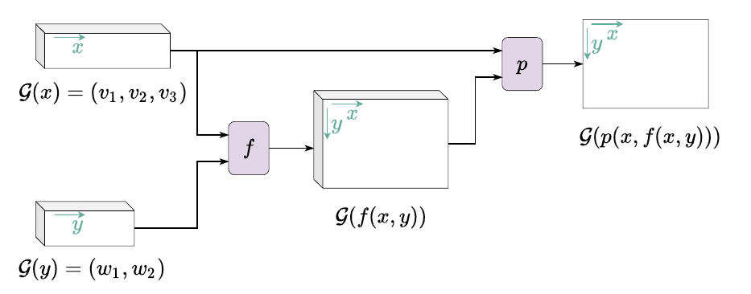
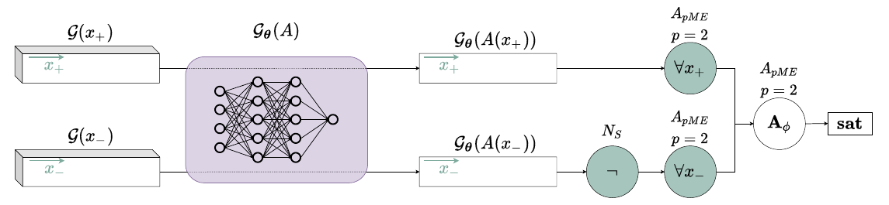
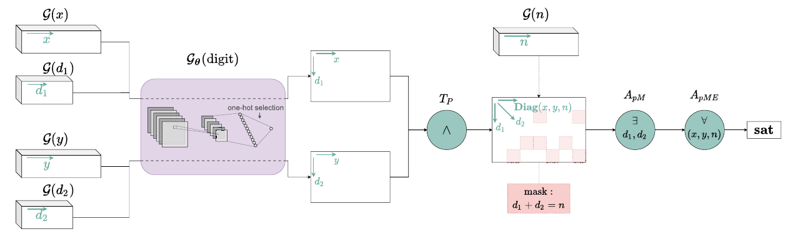

# 1차 논리를 미분 가능한 계산 그래프로 바꾸기 — Logic Tensor Networks

#### Abstract

논리와 신경망을 뉴로심볼릭(neurosymbolic) 접근으로 결합하려는 시도가 최근 몇 년 사이 늘어나고 있다. 뉴로심볼릭 시스템에서는 심볼릭 지식이, 통상 하위기호적(sub-symbolic) 분산 표현을 사용하는 딥러닝을 도와 더 높은 추상 수준에서 학습하고 추론하도록 한다. 본 논문에서는 풍부한 데이터와 세계에 대한 추상적 지식 양쪽을 가지고 질의(querying)·학습·추론을 지원하는 뉴로심볼릭 프레임워크인 Logic Tensor Networks(LTN)를 제시한다. LTN은 완전히 미분 가능한 논리 언어인 Real Logic을 도입하는데, 여기서 1차 논리 시그니처(first-order logic signature)의 요소들은 신경망 계산 그래프와 1차 퍼지 논리 의미론을 사용해 데이터에 접지(grounded)된다. 우리는 LTN이 다중 레이블 분류, 관계 학습(relational learning), 데이터 군집화, 준지도 학습, 회귀, 임베딩 학습, 질의 응답 등 가장 중요한 AI 과제 다수를 표현하고 효율적으로 계산하는 하나의 통일된 언어를 제공한다는 점을 보인다. 위의 각 과제를 TensorFlow 2를 사용한 여러 간단한 설명용 예제로 구현하고 예시한다. 그 결과는 LTN이 뉴로심볼릭 AI를 위한 일반적이고 강력한 프레임워크가 될 수 있음을 시사한다.

#### 요약

"이 이미지 두 장을 더하면 11이다"라는 레이블만 주고 개별 숫자 분류기를 학습시킬 수 있을까. 덧셈이라는 지식은 이미 우리가 알고 있는데, 신경망은 그걸 데이터에서 다시 배워야 한다. LTN은 이 낭비를 없애기 위해 1차 논리 전체를 텐서 연산으로 번역한다. 논리식이 곧 계산 그래프가 되고, 지식베이스의 만족도를 최대화하는 것이 곧 손실함수가 된다. 이 글은 기호가 어떻게 텐서로 바뀌는지, 그렇게 만들어진 그래프에서 왜 기울기가 흐르는지를 처음부터 끝까지 따라간다.

---

## 1. 왜 이 논문인가

인공지능 에이전트는 주변에서 학습하고, 학습한 내용에 대해 추론하며, 세계 안에서 행동해야 한다. 최근의 기계학습은 거의 순수한 하위기호적 학습 접근을 택해 왔다. 개체의 분산 표현을 사용해 세계에 대한 이해 가능한 모형을 구축하지 않고도 빠른 의사결정을 내린다. 컴퓨터 비전, 자연어, 게임 플레이에서 인상적인 성능을 내지만 데이터 효율이 낮고 분포 밖 일반화에 취약하다는 것이 알려져 있다. 적절한 귀납 편향으로 이런 결점을 완화할 수는 있어도, 일반적으로 하위기호 모델은 이해 가능성이 떨어진다.

반대편의 심볼릭 AI는 사람이 읽을 수 있는 기호를 사용하는 풍부하고 고수준의 세계 표현에 기반한다. 명제 논리나 명제 확률 접근보다 표현력이 높고, 변수에 대한 전칭·존재 한정사, 임의의 n항 관계, 그리고 fatherOf(x)나 x+y 같은 함수 기호를 사용해 지식을 표현할 수 있다. 정리 증명과 검증에서 성공을 거두었지만 불완전한 지식을 다룰 때 약하고, 부정확한 데이터가 많거나 이상치가 있을 때 견고하지 못하다.

뉴로심볼릭 AI는 이 둘의 강점을 결합하려는 시도다. 그리고 그 핵심 난제는 상수·함수·관계 기호를 포함한 기호를 실제 데이터에 접지하는 일, 즉 오래된 심볼 그라운딩 문제다. LTN은 이 문제에 대해 "논리식을 통째로 미분 가능한 계산 그래프로 만든다"는 답을 내놓는다.

한 줄로 요약하면 이렇다. 1차 논리를 완전히 미분 가능한 형태로 만들어서, 신경망 학습과 논리 추론을 하나의 언어이자 하나의 계산 그래프 안에서 처리하는 프레임워크다.

---

## 2. Real Logic — FOL을 실수 위로 옮기기

논문의 토대는 Real Logic이라는 언어다. FOL의 상수·변수·함수·술어에 grounding 𝒢를 부여해서 기호를 실수 텐서에 대응시킨다. 상수는 텐서, 함수는 텐서 연산, 술어는 [0,1] 값을 내는 함수가 된다. 논리식의 참값은 0/1이 아니라 [0,1] 구간의 퍼지 값이고, 연결사와 한정사는 t-norm 계열 퍼지 연산자와 집계 연산자로 근사된다. 결과적으로 논리식 전체가 하나의 TensorFlow 계산 그래프가 되어 역전파가 통한다.

### 1) FOL에 함수 기호는 원래 있다

여기서 자주 생기는 오해를 하나 정리하고 넘어갈 필요가 있다. "FOL에는 함수 정의가 없지 않나, Real Logic이 함수를 추가한 것 아닌가" 하는 의문이다.

정확히 말하면 FOL 시그니처는 상수, 함수 기호, 술어 기호로 이루어진다. fatherOf(x)나 x+y 같은 표현은 표준 FOL 문법에 이미 들어 있고, 논문 서론에서도 심볼릭 AI를 설명하며 함수 기호를 명시한다.

다만 "정의가 없다"는 감각은 절반쯤 맞다. FOL에는 함수 기호는 있어도 그 함수를 계산하는 방법은 없다. f는 그냥 기호이고, 의미는 모델 ℳ이 부여하는 해석 함수 f^ℳ : D^n → D 에서 나온다. 그런데 그 해석은 추상적인 집합 위의 임의의 사상이라 실제로 값을 구하는 절차가 아니다. FOL은 f(a)가 무엇인지를 계산하지 않고, 모든 가능한 해석에 대해 논증이 성립하는지만 따진다.

Real Logic이 바꾼 건 함수의 존재가 아니라 해석의 성격이다. 논문이 interpretation 대신 grounding이라는 용어를 쓰는 이유가 여기 있다. 도메인을 실수 텐서 공간으로 못 박고, 함수 기호를 실제 텐서 연산에 대응시킨다. f(v) = A_f·v + b_f 처럼. 그러니까 추가된 건 함수가 아니라 계산 가능한 의미론이다.

결론 절에 Real Logic과 Fuzzy FOL의 차이 세 가지가 정리되어 있는데 방향이 전부 이쪽이다. 도메인이 타입을 갖고 실수 텐서로 제한된다는 것, 변수가 도메인의 임의의 개체를 가리키는 자리표시자가 아니라 고정 길이의 시퀀스라는 것, 관계가 퍼지 소속 함수가 아니라 수학적 함수로 해석된다는 것이다.

### 2) Prolog와는 무엇이 다른가

겉모습은 비슷해 보이지만 작동 원리가 거의 반대편이다.

문법 범위부터 다르다. Prolog는 혼 절(Horn clause)이라는 FOL의 제한된 조각만 쓴다. Real Logic은 ∧, ∨, →, ↔, ¬와 ∀, ∃를 제약 없이 쓰는 완전한 FOL 문법이다.

항의 취급이 결정적으로 다르다. Prolog에서 함수 기호는 계산되지 않는 항 구성자다. s(s(0))이나 cons(X, Y)는 평가되는 게 아니라 그냥 그 모양 그대로 존재하는 심볼 구조이고, 의미는 Herbrand 우주 안에서 자기 자신이다. 그래서 Prolog에서 실제 산술을 하려면 is/2 같은 언어 밖 장치를 끌어와야 한다. Real Logic에서 f(x)는 항상 구체적인 텐서 연산으로 평가된다.

추론 기제가 다르다. Prolog는 단일화(unification)와 SLD 해석을 통한 증명 탐색이고, 백트래킹이 있고, 닫힌 세계 가정과 실패로서의 부정을 쓴다. LTN에는 단일화도 증명 탐색도 없다. 원자식의 참값에서 시작해 논리식의 참값을 계산 그래프로 순전파할 뿐이다. 논문은 자기 추론 방식을 의미론적(semantically)이라고 못 박고, 증명 시스템과의 결합은 향후 과제로 남겨 둔다.

변수의 의미도 다르다. Prolog 변수는 한 번에 하나의 항과 묶이고, 여러 해는 백트래킹으로 하나씩 꺼낸다. Real Logic 변수는 k개 인스턴스의 시퀀스에 통째로 grounding되고, 한정사는 그 텐서 축을 집계 연산으로 축소하는 일이다. 미니배치가 논리 의미론 안에 내장되어 있는 셈이다.

그리고 기호 접지의 유무가 있다. Prolog의 cat은 다른 심볼과 구별된다는 것 말고는 아무 내용이 없는 토큰이다. Real Logic에서 cat은 실제 이미지 텐서를 입력받는 신경망에 묶여 있다. 서론이 뉴로심볼릭 AI의 핵심 과제로 지목한 symbol grounding problem이 바로 이 차이다.

함수가 없는 논리 언어라는 감각은 아마 Datalog 쪽에서 오는 것 같은데, 그렇다면 방향은 맞다. 함수 기호를 빼는 건 판정 가능성과 종료성을 확보하려는 의도적 제한이고, FOL 자체의 성질은 아니다.

### 3) 이번 판본에서 확장된 것

LTN과 Real Logic은 이전에도 발표된 바 있고, 이 논문은 형식론 전체를 정리하면서 세 가지를 확장한다.

도메인 타입 명시. 상수와 변수에 타입이 부여된다. 상수 John과 Paris는 각각 person과 city 도메인에서 온다. 두 사람 도메인의 데카르트 곱으로 couple 같은 구조화된 도메인도 정의할 수 있다.

Guarded quantifier. 어떤 불리언 조건을 만족하는 원소로만 한정을 제한한다. ∀x : age(x) < 10 (playsPiano(x) → enfantProdige(x)) 처럼 나이가 10 미만인 경우로 한정을 좁힌다.

Diagonal quantification. n개 변수에서 뽑은 특정 튜플에 대한 진술을 쓰게 해 준다. 변수 capital과 country가 각각 k개 인스턴스를 담고 있고 i번째 수도가 i번째 나라에 대응할 때 ∀Diag(capital, country) capitalOf(capital, country)로 쓸 수 있다.

---

## 3. 기호를 텐서로 바꾸기

grounding 𝒢는 논리 기호를 실수 텐서 세계로 옮기는 함수다. 핵심 원리는 하나다. 자유변수 하나가 텐서의 축 하나를 만들고, 그 축의 길이는 그 변수에 담긴 인스턴스 개수다. 나머지는 전부 이 원리의 전개다.

### 1) 도메인

Definition 1이 도메인을 텐서 집합에 대응시킨다.

$$\mathcal{G}(D) \subseteq \bigcup_{n_1 \ldots n_d \in \mathbb{N}^*} \mathbb{R}^{n_1 \times \cdots \times n_d}$$

랭크 d와 각 차원은 자유롭다. 논문 예제들을 모아 보면 이렇다.

```
𝒢(points)  = [0,1]²              벡터
𝒢(images)  = [0,1]^{28×28×1}     MNIST 이미지 한 장
𝒢(samples) = ℝ⁶                  부동산 특징 6개
𝒢(prices)  = ℝ                   스칼라
𝒢(labels)  = ℕ³                  원-핫
𝒢(people)  = ℝ⁵                  학습될 임베딩의 형태
```

곱 도메인은 데카르트 곱이다. 𝒢(D₁...D_n) = 𝒢(D₁) ⨉ ... ⨉ 𝒢(D_n). People ⨉ Town 같은 구조화된 도메인이 여기서 나온다.

### 2) 상수

상수는 도메인에서 텐서 하나를 고른다. 𝒢(c) ∈ 𝒢(D(c)).

축이 없다. 개체 하나이므로 인스턴스 축이 붙을 이유가 없고, 텐서의 모양은 순수하게 도메인이 정한 특징 모양이다. 𝒢(l_A) = [1,0,0]처럼 고정되거나, 𝒢(a|θ) = v_θ(a) ∈ ℝ⁵처럼 학습된다.

### 3) 변수는 시퀀스다

여기가 FOL과 가장 크게 갈라지는 지점이다. Definition 2의 첫 조건이다.

$$\mathcal{G}(x) = \langle d_1, \ldots, d_k \rangle, \quad d_i \in \mathcal{G}(D(x))$$

변수는 도메인의 한 원소를 가리키는 자리표시자가 아니라 k개 인스턴스의 시퀀스다. 집합이 아니라 시퀀스인 이유를 논문이 명시하는데, 같은 값이 여러 번 나올 수 있어야 하기 때문이다. 실제 데이터셋에는 동일한 특징 벡터가 중복될 수 있다.

그래서 변수 x의 grounding은 특징 모양 앞에 길이 k의 축이 하나 붙은 텐서다.

```
𝒢(x) ∈ [0,1]^{m × 28 × 28 × 1}
        └┬┘   └─────┬─────┘
     인스턴스 축     특징 축
```

이 인스턴스 축이 미니배치 축과 같은 역할을 한다. LTN에서 배치 처리가 별도 장치가 아니라 논리 의미론 안에 내장되어 있는 이유다.

### 4) 함수와 술어

둘 다 grounding은 사상(mapping)이다.

```
𝒢(f) : 𝒢(D_in(f)) → 𝒢(D_out(f))     출력이 임의의 실수 텐서
𝒢(p) : 𝒢(D_in(p)) → [0,1]           출력이 반드시 [0,1] 스칼라
```

주의할 점은 이 사상이 개체 하나를 받아 개체 하나를 내놓는다는 것이다. 인스턴스 축을 다루는 건 함수 자신이 아니라 다음 절의 합성 규칙이다.

함수의 출력 도메인은 [0,1]이 아니라 임의의 실수 텐서다. 그래서 시그모이드를 쓰지 않는다. 회귀 예제의 f\*는 출력층이 선형(활성화 없음)인 MLP다. 논문은 더 단순한 형태도 예로 든다. 선형 함수 f(v) = A_f·v + b_f는 θ_f = {A_f, b_f}만 학습하면 되고, transpose(img) 같은 함수는 아예 파라미터가 없다.

술어는 [0,1]을 내야 한다는 제약만 있다. 출력층 선택은 논리적 요구사항이 결정한다. 다중 레이블 문제(Crabs 데이터셋)에서는 레이블이 동시에 참일 수 있어야 하므로 시그모이드를 쓰고, 다중클래스 단일 레이블 문제(Iris)에서는 소프트맥스에 원-핫 벡터를 내적한다. 학습하지 않는 술어도 있다. 회귀 예제의 eq(u,v) = exp(−α√Σ(u_j−v_j)²)는 파라미터가 없는 부드러운 등호일 뿐이고, 코사인 유사도 술어도 마찬가지다.

즉 "함수 = MLP, 술어 = 시그모이드 신경망"은 전형적인 사례이지 정의는 아니다.

### 5) 항의 합성 — 축이 늘어나는 방식

Definition 3이 규칙이다. 항 t가 서로 다른 변수 x₁,...,x_n을 포함하면 𝒢(t)는 (|𝒢(x₁)|, ..., |𝒢(x_n)|) 모양의 텐서이고, 함수와 술어는 원소별로 적용된다.

$$\mathcal{G}(f(\mathbf{t}))_{i_1 \ldots i_n} = \mathcal{G}(f)\big(\mathcal{G}(\mathbf{t})_{i_1 \ldots i_n}\big)$$

$$\mathcal{G}(p(\mathbf{t}))_{i_1 \ldots i_n} = \mathcal{G}(p)\big(\mathcal{G}(\mathbf{t})_{i_1 \ldots i_n}\big)$$

논문 Example 3으로 전개해 본다.

```
𝒢(x) = ⟨v₁, v₂, v₃⟩        (3개)
𝒢(y) = ⟨w₁, w₂⟩            (2개)
𝒢(f) : x, y ↦ x · y
𝒢(p) : x, y ↦ σ(x + y)
```

𝒢(f(x,y))는 x축과 y축을 둘 다 갖게 되므로 3×2 행렬이다.

```
        y₁      y₂
x₁ [ v₁·w₁   v₁·w₂ ]
x₂ [ v₂·w₁   v₂·w₂ ]
x₃ [ v₃·w₁   v₃·w₂ ]
```

여기에 술어를 씌운 𝒢(p(x, f(x,y)))도 같은 3×2다. 항 안에 x가 두 번 등장하지만 같은 변수이므로 축은 하나만 생긴다.

```
        y₁                y₂
x₁ [ σ(v₁+v₁·w₁)   σ(v₁+v₁·w₂) ]
x₂ [ σ(v₂+v₂·w₁)   σ(v₂+v₂·w₂) ]
x₃ [ σ(v₃+v₃·w₁)   σ(v₃+v₃·w₂) ]
```

즉 서로 다른 변수가 만나면 가능한 모든 조합이 만들어진다. 데카르트 곱이 텐서 축으로 실현되는 셈이다. 논문의 Fig. 1이 이 예제를 그림으로 옮긴 것이다.



*Fig. 1. 자유변수 x와 y가 각각 하나의 축을 만든다. x축을 인덱싱하면 v₁, v₂, v₃ 중 하나를 써서 계산한 결과를 얻는다. 상자의 깊이는 특징 차원을 나타내며, 술어의 출력 상자에는 깊이가 없다.*

### 6) 변수 축과 특징 축

같은 텐서 안에 성격이 다른 두 종류의 축이 섞여 있다.

변수 축은 어느 개체인지를 지시한다. 길이가 |𝒢(x)|이고, 한정사가 나중에 없앨 대상이다.

특징 축은 그 개체의 내용이다. 위 예에서 𝒢(D_out(f)) = ℝ^m이었다면 𝒢(f(x,y))는 3 × 2 × m이 되고, 뒤의 m이 특징 축이다. Fig. 1에서 상자의 깊이로 그린 부분이 이것이다.

술어는 항상 [0,1] 스칼라를 내므로 특징 축의 길이가 1이고, 논문은 이걸 squeeze해서 없앤다. 그래서 술어 출력 상자에는 깊이가 없다. 결과적으로 원자식의 grounding은 변수 축만 남은 순수한 참값 텐서가 된다.

### 7) 연결사 — 원소별 연산과 브로드캐스팅

식 (1), (2)가 규칙이다. 두 논리식 φ와 ψ가 앞의 k개 변수를 공유한다고 할 때 다음과 같다.

$$\mathcal{G}(\phi \circ \psi)_{i_1,\ldots,i_{m+n-k}} = \text{FuzzyOp}(\circ)\big(\mathcal{G}(\phi)_{i_1 \ldots i_m},\ \mathcal{G}(\psi)_{i_1 \ldots i_k, i_{m+1} \ldots i_{m+n-k}}\big)$$

읽기 어렵지만 의미는 단순하다. 공유하는 변수는 축을 맞춰 정렬하고, 공유하지 않는 변수는 각자 새 축을 만들어 모든 조합으로 퍼뜨린다. 넘파이 브로드캐스팅과 같은 동작이다.

Fig. 2가 이 경우다. p(x) ∧ q(y)에서 x와 y가 다른 변수이므로, 각각 1차원이던 두 참값 벡터가 2차원 격자가 된다. 𝒢(x)의 모든 개체와 𝒢(y)의 모든 개체 조합마다 값 하나씩이다.

반면 p(x) ∧ q(x)라면 같은 x이므로 축이 하나로 정렬되어 원소별 곱이 되고 모양이 그대로 유지된다.

### 8) 한정사 — 축의 소거

식 (3)이다.

$$\mathcal{G}(Q\,x_1,\ldots,x_h(\phi))_{i_{h+1},\ldots,i_n} = \underset{\substack{i_1 = 1,\ldots,|\mathcal{G}(x_1)| \\ \vdots \\ i_h = 1,\ldots,|\mathcal{G}(x_h)|}}{\text{Agg}(Q)} \mathcal{G}(\phi)_{i_1,\ldots,i_n}$$

한정된 변수의 축이 집계 연산으로 사라진다. h개 변수를 한정하면 h개 축이 줄고, 모든 자유변수를 한정하면 스칼라가 된다. ∀는 A_pME, ∃는 A_pM이 담당한다.

Fig. 3이 좋은 예다. p(x,y)가 만든 2차원 참값 격자에서 ∃x가 x축을 없애 1차원으로 만들고, 이어 ∀y가 y축을 없애 스칼라 하나를 낸다.

여기서 주의할 성질이 하나 있다. 논문이 지적하듯 ∀x∀y φ, ∀y∀x φ, ∀x,y φ가 서로 다른 값을 낼 수 있다. 집계자가 bi-symmetric일 때만 일치한다. 축을 어느 순서로 접느냐가 결과에 영향을 주는 것이다. 고전 논리에는 없는 현상이다.

### 9) Diag — 대각선만 만들기

식 (4)다. 지도학습에서 없으면 곤란한 장치다.

$$\mathcal{G}(Q\ \text{Diag}(x_1,\ldots,x_h)(\phi))_{i_{h+1},\ldots,i_n} = \underset{i=1,\ldots,\min_{1 \leqslant j \leqslant h}|\mathcal{G}(x_j)|}{\text{Agg}(Q)} \mathcal{G}(\phi)_{i,\ldots,i,i_{h+1},\ldots,i_n}$$

샘플 x와 레이블 y가 각각 10개 있을 때, 기본 규칙대로 하면 10×10 = 100개 조합이 만들어진다. 하지만 우리가 원하는 건 i번째 샘플과 i번째 레이블의 짝 10개뿐이다. Diag(x,y)는 이 대각선만 평가한다.

논문이 강조하는 건 실제로 대각선만 만든다는 점이다. 전체 텐서를 만든 뒤 대각 성분을 뽑는 게 아니다. 그리고 이걸 단순한 문법 설탕으로 보면 안 된다고 각주로 못 박는다. x가 이미지이고 y가 레이블이면 랭크가 달라서 둘을 하나의 pairs_xy 텐서로 쌓는 것 자체가 자명하지 않기 때문이다.

### 10) Guarded — 마스크로 걸러내기

식 (6)이다. 집계 전에 조건을 만족하는 인덱스만 남긴다.

∀y (∃x : age(x) > age(y)) parent(x,y)

이 조건 판정은 순수하게 심볼릭이고 미분되지 않는다. 그래서 걸러진 인스턴스에는 기울기가 붙지 않는다.

논문은 이게 함의로 쓴 것과 다르다는 점을 수치로 보여준다. 𝒢(m(x)) = (0, 1, 1), 𝒢(x) = (0.2, 0.7, 0.8)일 때 ∀x(m(x) → φ(x))는 0.833인 반면 ∀x : m(x) (φ(x))는 0.75다. 전자는 마스크에 걸린 첫 인스턴스가 함의에 의해 참값 1로 계산되어 평균을 올리지만, 후자는 아예 집계에서 빠진다.

### 11) 무엇이 학습되고 무엇이 고정되는가

grounding이 전부 학습되는 건 아니다. 논문 3.1.1절이 세 종류로 나눈다.

도메인 경계 지정은 학습과 무관하다. 𝒢(points) = [0,1]², 𝒢(images) = [0,1]^(28×28×1) 같은 제약이다.

명시적 정의(explicit definition)는 값을 고정해 버리는 경우다. Iris 예제의 레이블 상수 l_A = [1,0,0], l_B = [0,1,0], l_C = [0,0,1]은 원-핫 벡터로 못 박혀 있고 학습되지 않는다. MNIST 덧셈에서 d₁, d₂도 0~9로 고정된 변수다. 이미지 데이터 자체도 마찬가지로 고정된 텐서로 들어간다.

파라메트릭 정의(parametric definition)만 실제로 학습된다. 상수의 임베딩 학습이 필요한 건 그 개체의 특징 벡터를 모를 때다. smokers-friends-cancer 예제가 정확히 그 경우로, 14명 a~n에게 ℝ⁵ 벡터를 무작위 초기화한 뒤 학습한다. 반대로 이미지처럼 특징이 이미 주어진 개체는 임베딩을 학습할 이유가 없다.

```
고정                              파라메트릭
─────────────────────────────    ─────────────────────────────
𝒢(l_A) = [1,0,0]                 𝒢(a|θ) = v_θ(a) ∈ ℝ⁵
𝒢(transp(img)) = 전치 연산       𝒢(f|θ) = A_f·v + b_f
𝒢(sim) = 코사인 유사도           𝒢(A|θ) = sigmoid(MLP_θ(x))
𝒢(eq) = exp(−α‖u−v‖)             𝒢(digit|θ) = onehot(d)ᵀ·softmax(CNN_θ(x))
𝒢(d₁) = ⟨0,...,9⟩
```

오른쪽 열만 기울기를 받는다. 한 가지 덧붙이면, 데이터는 보통 상수가 아니라 변수를 통해 들어온다. 상수는 이름 붙은 개별 개체용이고, 학습 배치는 변수 x에 시퀀스로 grounding된다.

---

## 4. Stable Product Real Logic

### 1) 연산자 선택이 학습을 좌우한다

퍼지 연산자 선택이 경사하강에 직접 영향을 준다는 점이 이 논문의 실용적으로 중요한 기여다. 모든 1차 퍼지 논리 의미론이 경사하강 최적화에 똑같이 적합한 것은 아니다. 소실 기울기, 폭발 기울기, 그리고 한 번에 한 입력으로만 기울기를 전파하는 single-passing 문제가 흔하게 생긴다.

일반적으로 가장 성능이 좋은 대칭 설정은 곱 t-norm 계열이다.

$$\neg: N_S(a) = 1-a, \quad \wedge: T_P(a,b) = ab, \quad \vee: S_P(a,b) = a+b-ab, \quad \rightarrow: I_R(a,b) = 1-a+ab$$

그런데 여기에도 문제가 남는다. T_P는 a=b=0에서, S_P는 a=b=1에서, I_R은 a=0, b=1에서 기울기가 소실된다.

### 2) 안정화된 곱 설정

논문의 해법은 단순하다. 입력을 경계에서 살짝 밀어내는 사영을 씌운다.

$$\pi_0(a) = (1-\epsilon)a + \epsilon, \qquad \pi_1(a) = (1-\epsilon)a$$

이걸 각 연산자 앞에 붙여 만든 것이 Stable Product Real Logic이다. T'_P(a,b) = T_P(π₀(a), π₀(b)) 같은 식이다.

논문은 이 설정에서 곱 연결사가 엄밀히는 t-norm이 아니라는 점도 정직하게 적어 둔다. T'_P(a,1) = (1−ε)a + ε ≠ a 이므로 항등원 조건을 만족하지 않는다. ε를 임의로 작게 잡을 수 있을 뿐이다. 실험적으로는 안정적 곱 의미론의 채택이 학습 시스템의 수치적 안정성을 개선하는 중요한 실용적 단계라고 보고한다.

### 3) p라는 하이퍼파라미터의 의미

한정사는 일반화 평균으로 근사한다.

$$\exists:\ A_{pM}(a_1,\ldots,a_n) = \left(\frac{1}{n}\sum_{i=1}^{n} a_i^p\right)^{\frac{1}{p}}, \qquad p \geqslant 1$$

$$\forall:\ A_{pME}(a_1,\ldots,a_n) = 1 - \left(\frac{1}{n}\sum_{i=1}^{n}(1-a_i)^p\right)^{\frac{1}{p}}, \qquad p \geqslant 1$$

A_pME는 각 값이 참값 1에서 벗어난 정도를 재는 것이고, p=2일 때 1 − RMSE(a, 1)과 같다. p가 커질수록 A_pM은 max로, A_pME는 min으로 수렴한다.

여기서 흥미로운 결과가 나온다. p가 단순한 근사 정밀도 조절 손잡이가 아니라 의미를 바꾸는 장치라는 것이다. 논문 3.1.3절이 명시한다. ∀x P(x)를 낮은 p로 쓰면 사실상 "어떤 x에 대해 P가 성립한다"에 가깝고, ∀x Q(x)를 높은 p로 쓰면 "대부분의 x에 대해 Q가 성립한다"를 뜻한다. 그래서 연산자와 하이퍼파라미터가 지식베이스의 정식 구성요소로 취급된다.

실제로 smokers-friends-cancer 예제에서는 대칭성·반사성 규칙만 p=6으로 엄격하게, 나머지는 p=2로 느슨하게 다르게 설정한다.

Appendix C의 편미분이 p의 작동 방식을 정확하게 보여준다.

$$\frac{\partial A_{pM}(x_1,\ldots,x_n)}{\partial x_i} = \frac{1}{n}^{\frac{1}{p}}\left(\sum_{j=1}^{n} x_j^p\right)^{\frac{1}{p}-1} x_i^{p-1}$$

기울기가 xᵢ^{p−1}에 비례한다. p > 1이면 참값이 높은 입력에 더 큰 가중을 두므로 존재 한정에 적합하고, p < 1이면 참값이 낮은 입력에 가중을 두므로 전칭 한정에 적합하다. 이 식이 뒤의 MNIST 덧셈 실험에서 왜 p 스케줄이 필요한지를 설명하는 열쇠가 된다.

---

## 5. 지식베이스와 학습

### 1) 지식베이스의 세 성분

Definition 4에서 이론(theory)은 세 요소의 삼중항 𝒯 = ⟨𝒦, 𝒢(·|θ), Θ⟩이다. 𝒦는 닫힌 1차 논리식의 집합일 뿐이고, grounding 𝒢는 𝒦 안에 있는 게 아니라 이론의 별개 구성요소다.

3.1.4절이 이걸 Real Logic 지식베이스의 세 성분으로 정리한다. 첫째가 기호의 grounding에 대한 지식(도메인, 상수, 변수, 함수, 술어), 둘째가 논리식 집합 𝒦, 셋째가 각 논리식을 평가할 때 쓰는 연산자와 하이퍼파라미터다.

𝒦 안의 논리식은 두 종류로 나뉜다. 사실 명제는 nine(img₁), ¬eight(img₁), F(u,v) 처럼 특정 개체에 대한 것이고, 일반화 명제는 ∀x,y ((F(x,y) ∧ S(x)) → S(y)) 처럼 한정사가 붙은 것이다. 지도학습의 레이블도 여기서는 그냥 사실 명제다.

규칙 안에 함수 기호가 들어갈 수 있다는 점도 짚어 둘 만하다. 회귀 예제의 유일한 공리가 정확히 그 형태다.

$$\forall \text{Diag}(x,y)\ \text{eq}(f^*(x), y)$$

학습 대상인 함수 f\*가 규칙 내부에 들어가 있고, 이 식 하나의 만족도를 최대화하는 게 곧 회귀 학습이다. LTN이 손실함수를 논리식으로 쓴다는 게 이런 의미다.

### 2) 타깃 레이블이 없는 손실

학습은 지식베이스의 만족도를 최대화하는 파라미터를 찾는 일이다.

$$\theta^* = \underset{\theta \in \Theta}{\text{argmax}}\ \underset{\phi \in \mathcal{K}}{\text{SatAgg}}\ \mathcal{G}_\theta(\phi)$$

여기서 중요한 것은 비교 대상이 되는 정답이 따로 없다는 점이다. 𝒦에 들어 있는 논리식은 전부 참이었으면 하는 것이고, 목표값은 언제나 1이다. 손실함수가 이걸 그대로 보여준다.

$$L = 1 - \underset{\phi \in \mathcal{K}}{\text{SatAgg}}\ \mathcal{G}_{\theta, x \leftarrow B}(\phi)$$

지도학습 정보는 타깃 벡터가 아니라 논리식의 구조 안에 들어간다. 이진 분류 예제에서 공리는 두 개뿐이다.

$$\forall x_+\ A(x_+), \qquad \forall x_-\ \neg A(x_-)$$

레이블은 "이 데이터 포인트를 x₊에 grounding할 것인가 x₋에 grounding할 것인가"로 표현된다. 음성 예제에 대해서도 목표는 여전히 1인데, 다만 ¬A(x₋)의 참값이 1이 되도록 미는 것이라 결과적으로 A(x₋)가 0으로 간다. 그래서 회귀든 분류든 군집화든 목적함수의 형태가 항상 같다. 바뀌는 건 𝒦의 내용뿐이다.

이게 익숙한 손실과 무관하지도 않다. A_pME는 p=2일 때 1 − RMSE(a, 1)과 같으므로, 위 식에 대입하면 이진 분류 목적함수가 사실상 예측값과 1 사이의 RMSE가 된다.

### 3) 모든 규칙이 하나의 목적함수로

𝒦의 모든 논리식은 하나의 스칼라로 집계되어 단일 목적함수를 이룬다. 논리식 하나하나가 자기 계산 그래프를 거쳐 [0,1] 스칼라를 내고, 그 스칼라들을 formula aggregator(보통 p=2인 A_pME)가 다시 하나로 묶는다. 역전파는 이 최종 스칼라 하나에서 시작해서 전체 DAG로 퍼진다. 규칙 A로 한참 학습하고 규칙 B로 넘어가는 식이 아니라, 매 스텝마다 모든 규칙이 동시에 기울기를 기여한다.

순차적으로 하면 안 되는 이유가 있다. 제약들끼리 충돌할 때 어디서 양보할지가 이 공동 최적화에서 결정되기 때문이다. smokers-friends-cancer 예제가 좋은 사례다. f는 흡연자인데 암이 없다고 주어져 있어서 ∀x(S(x) → C(x))와 모순된다. 논문은 이 지식베이스가 엄밀한 논리적 의미에서는 만족 불가능하다고 인정하고, 학습 결과 흡연이 우정을 타고 전파된다는 규칙이 LTN에 의해 부분적으로 무시된다고 설명한다. 그 규칙의 만족도를 올리면 전체 만족도가 떨어지기 때문이다. 이런 절충은 모든 논리식이 한 목적함수 안에 있을 때만 가능하다.

### 4) 하나의 계산 그래프, 두 개의 층

"모든 규칙을 하나의 신경망으로 통합한다"는 표현은 절반만 맞다. 정확히는 하나의 계산 그래프이자 하나의 손실이다.

그래프는 두 층으로 나뉜다. 아래쪽은 grounding이다. 상수 임베딩, 함수 MLP, 술어 신경망이 여기 있고, θ는 전부 여기에만 존재한다. 위쪽은 논리 구조다. 연결사, 한정사, 집계자가 여기 해당하는데 파라미터가 하나도 없다. ab, 1−a+ab, 일반화 평균 같은 고정된 산술 연산일 뿐이다. 미분은 되지만 학습되지는 않는다.

그래서 정확한 그림은 "신경망 모듈 몇 개 + 문법이 결정한 미분 가능한 배선"이다. 배선은 사람이 논리식으로 지정하고, 학습되는 건 모듈뿐이다.

논리식마다 그래프의 모양이 다르다는 점도 중요하다. 원자식은 grounding된 술어를 항에 원소별로 적용하고, 연결사는 원소별 퍼지 연산이며, 한정사는 자유변수에 대응하는 축을 집계로 없앤다. 그래서 ∀x P(x)와 ∀x,y (F(x,y) ∧ S(x) → S(y))는 완전히 다른 모양의 그래프가 된다. 후자는 x축과 y축을 가진 2차원 텐서를 만들었다가 둘 다 집계로 축소한다.

반면 술어와 함수의 신경망은 모든 논리식이 같은 객체를 참조한다. 술어 S의 MLP는 𝒦 안의 여러 논리식에 등장하고, 심지어 한 논리식 안에서도 여러 번 나온다. ∀x,y ((F(x,y) ∧ S(x)) → S(y))에서 S는 두 번, F는 한 번 호출된다. 이 호출들은 전부 같은 가중치를 참조하므로, 역전파할 때 모든 호출 지점의 기울기가 그 파라미터에서 합산된다. 샴 네트워크나 펼친 RNN과 같은 방식의 가중치 공유다.

결국 전체 구조는 잎(leaf)을 공유하는 여러 서브그래프의 합집합이고, 그 위에 집계자 하나가 얹힌 형태다. 논문 Fig. 7이 가장 단순한 사례를 그린 것이다.



*Fig. 7. 이진 분류 예제의 계산 그래프. 양성 예제 𝒢(x₊)와 음성 예제 𝒢(x₋)가 같은 신경망 𝒢_θ(A)를 통과한 뒤 갈라져 각자의 한정사를 거치고, 마지막에 A_φ 하나로 합쳐져 스칼라 sat이 나온다.*

입력과 출력 관점으로 보면 통상적인 신경망과 다르다는 점도 있다. 입력이 하나가 아니다. 논리식마다 소비하는 변수가 다르고, 그 변수들은 서로 다른 데이터 부분집합에 grounding된다. 아예 데이터를 안 쓰는 논리식도 있다. smokers 예제의 ∀x ¬F(x,x)는 학습된 임베딩 위에서만 돌아가고 배치와 무관하다. 반면 출력은 하나다. 최종 산출은 [0,1] 스칼라 sat 하나뿐이고, 손실은 1 − sat이다.

비유하자면 공유 인코더를 둔 멀티태스크 학습에 가깝다. 다만 각 태스크 헤드가 학습되는 레이어가 아니라, 논리식이 지정한 파라미터 없는 고정 연산이라는 점이 다르다.

### 5) 미니배치는 되는가

변수가 모든 인스턴스의 시퀀스라면 계산 그래프에 항상 전체 데이터가 들어가는 것 아닌가 하는 의문이 생긴다. 그렇지 않다.

핵심은 grounding이 고정된 대응이 아니라 매 스텝 다시 묶는 바인딩이라는 점이다. Definition 2는 𝒢(x)가 k개 인스턴스의 시퀀스라고만 말할 뿐, k가 데이터셋 전체 크기여야 한다고 하지 않는다. k는 그 시점에 무엇을 묶었느냐로 정해진다.

손실 식의 표기 𝒢_{θ, x←B}가 이걸 드러낸다. 변수 x를 미니배치 B로 grounding한다는 뜻이다. 각주 18이 명시적으로 적어 둔다. 전체 데이터셋에 대해 손실과 기울기를 계산할 수도 있지만, 통상의 ML처럼 미니배치를 쓰는 편이 낫다고. 실제 실험의 배치 크기는 이진·다중클래스·회귀가 64, MNIST 덧셈이 32다.

계산 그래프 입장에서는 위상이 그대로이고 축의 길이만 바뀐다. ∀x A(x)의 그래프는 x축을 A_pME로 접는 구조인데, 그 축이 50이든 64이든 연산은 동일하다.

다만 ∀의 미니배치는 평균의 미니배치와 성격이 다르다는 점은 짚어 둘 만하다. 논문이 명시적으로 논의하지는 않는 부분이다. 보통의 지도학습에서 손실은 예제별 손실의 평균이므로 미니배치 평균은 전체 평균의 불편추정량이다. 그런데 LTN의 ∀는 A_pME, 즉 오차의 일반화 평균이고 p가 클수록 min에 가까워진다. 부분표본에 대한 soft-min은 전체에 대한 soft-min의 불편추정량이 아니다. 배치 안에 전역 최악 사례가 없으면 만족도가 실제보다 높게 나오고, 이 편향은 p가 클수록 커진다. p=1이면 단순 평균이라 편향이 사라진다.

논문이 직접 다루는 인접한 이야기가 각주 22에 있다. 학습 때는 이상치에 집중하면 최적화가 일반화에 어려움을 겪고 국소최적에 갇히기 쉬우므로 p를 낮게 쓰고, 질의할 때는 해석을 신중히 하려고 p를 높게 쓴다는 것이다. 결과적으로 학습에서 p를 낮게 잡는 관행이 배치 편향 문제도 함께 눌러 준다고 볼 수 있다.

배치할 수 없는 것도 있다. 상수는 잘라낼 대상이 아니다. smokers-friends-cancer 예제에서 14명은 전부 상수이고 각자 학습되는 ℝ⁵ 임베딩을 갖는다. 여기서는 개체 집합 자체가 곧 모델이라 배치라는 개념이 성립하지 않는다.

배치를 자를 때 지켜야 할 제약도 있다. Diag가 걸린 변수들은 독립적으로 샘플링하면 안 된다. MNIST 덧셈에서 x, y, n을 각각 따로 뽑으면 짝이 어긋난다. 정렬된 삼중항을 함께 뽑아야 하고, 그래서 배치가 "이미지 쌍 32개"다. 그리고 역할이 나뉜 변수는 각 배치에 모두 들어가야 한다. 배치에 양성 예제가 하나도 없으면 ∀x₊ A(x₊)의 축 길이가 0이 되어 집계가 정의되지 않는다.

함수가 모든 인스턴스에 대한 값을 한 번에 계산하느냐는 질문의 답은 그렇다이지만, 이게 특별한 일은 아니다. Definition 3의 원소별 적용은 구현 수준에서는 선두 축을 배치 축으로 둔 텐서를 MLP에 한 번 통과시키는 것이다. 일반적인 신경망의 배치 추론과 동일한 연산이고, 실제로 LTN 라이브러리가 TensorFlow 위에서 하는 일이 그것이다. "모든 인스턴스를 한 번에 계산한다"는 표현은 의미론적 요구가 아니라 벡터화다. 원리상으로는 인스턴스를 하나씩 돌려도 같은 결과가 나오고, 다만 느릴 뿐이다.

### 6) 진짜 조심할 폭발

메모리 문제는 배치 크기가 아니라 서로 다른 변수의 개수에서 생긴다.

```
∀x p(x)              → k개 평가
∀x,y p(x,y)          → k² 개 평가
∀x,y,z p(x,y,z)      → k³ 개 평가
∀Diag(x,y) p(x,y)    → k개 평가
```

배치 64로 이항 술어를 쓰면 4096개라 괜찮지만, 변수가 셋이 되면 26만 개가 된다. Diag가 단순한 문법 설탕이 아닌 이유가 여기 있다. 지도학습 짝을 k²이 아니라 k로 유지해 주기 때문이다. guarded quantifier도 마스크로 걸러낸 인스턴스를 계산과 기울기에서 빼기 때문에 같은 역할을 한다.

정리하면, 배치는 자유롭게 자를 수 있고 함수 계산도 통상의 배치 순전파와 다르지 않다. LTN 고유의 제약은 배치 축이 아니라 변수 축이 몇 개 곱해지느냐다.

---

## 6. MNIST 덧셈 — 처음부터 끝까지

논문 4장은 이진 분류, 다중클래스 단일/다중 레이블 분류, 회귀, 군집화, 임베딩 학습까지 다양한 과제를 같은 언어로 처리하는 예제 모음이다. 그중 정량적으로 가장 의미 있고 LTN의 장치들이 모두 등장하는 것이 준지도 패턴인식, 즉 MNIST 덧셈 과제다.

### 1) 과제 설정

두 가지 변형이 있다.

단일 자릿수 덧셈은 술어 addition(X, Y, N)을 다룬다. X와 Y는 MNIST 숫자 이미지이고 N은 두 숫자의 합인 자연수다. addition(이미지3, 이미지8, 11)은 타당하고 addition(이미지3, 이미지8, 5)는 아니다.

다중 자릿수 덧셈은 addition([X₁,X₂], [Y₁,Y₂], N)으로 확장된다. 이미지 리스트가 두 자리 수를 나타내고 N은 두 수의 합이다.

핵심은 학습 데이터에 개별 숫자 레이블이 없다는 것이다. 이미지 쌍과 합계만 주어진다. DeepProbLog 논문에서 제안한 벤치마크인데, 개별 숫자 분류기가 직접 학습되지 않고 그 출력이 잠재 정보로만 존재한다는 점 때문에 난이도가 생긴다.

### 2) 표준 딥러닝이 어려운 이유

논문의 베이스라인은 이렇게 구성된다. 사전학습되지 않은 CNN이 각 이미지의 임베딩을 뽑고(샴 네트워크), 두 임베딩을 dense 레이어에 넣어 덧셈 결과를 분류한다. 단일 자릿수면 0부터 18까지 19개 클래스, 다중 자릿수면 0부터 198까지 199개 클래스다. 교차 엔트로피로 학습한다.

문제는 이 구조가 "합이 11"이라는 레이블을 하나의 원자적 클래스로 취급한다는 것이다. 11이라는 클래스와 12라는 클래스 사이에 아무 구조적 관계가 없고, 3+8과 4+7이 같은 답이라는 사실도 모델이 데이터에서 통째로 외워야 한다. 논문 표현대로 문제의 중간 부분에 대한 심볼릭 의미가 제공되지 않으면 표준 딥러닝은 이 과제에서 고전한다.

### 3) LTN의 접근

발상은 단순하다. 개별 숫자 분류기 digit(x, d)를 두고, 덧셈의 성질이라는 이미 아는 지식을 논리로 붙인다. "이 두 이미지의 합이 11이다"는 곧 "합이 11이 되는 어떤 숫자 쌍 (d₁, d₂)가 존재해서, 첫 이미지가 d₁이고 둘째 이미지가 d₂다"와 같다.

이렇게 쓰면 19개 클래스 분류 문제가 10개 클래스 분류 문제 + 산술 지식으로 분해된다.

### 4) 이론 명세

```
Domains:
  images   MNIST 숫자 이미지
  results  덧셈 결과를 나타내는 정수
  digits   0부터 9까지의 숫자

Variables:
  x, y     데이터의 MNIST 이미지
  n        각 덧셈의 결과 레이블
  d₁, d₂   숫자
  D(x) = D(y) = images,  D(n) = results,  D(d₁) = D(d₂) = digits

Predicates:
  digit(x, d)   단일 숫자 분류기. 이미지 x가 숫자 d일 확률
  D_in(digit) = images, digits
```

공리는 단 하나다. 식 (39)다.

$$\forall \text{Diag}(x,y,n)\ \big(\exists d_1, d_2 : d_1 + d_2 = n\ (\text{digit}(x,d_1) \wedge \text{digit}(y,d_2))\big)$$

### 5) 공리 해부

이 한 줄에 세 가지 장치가 겹쳐 있다.

Diag(x, y, n)은 세 변수의 i번째 인스턴스끼리만 짝짓는다. (𝒢(x)ᵢ, 𝒢(y)ᵢ, 𝒢(n)ᵢ)가 데이터셋의 한 덧셈 사례다. 이게 없으면 배치 안의 모든 이미지 조합과 모든 결과 레이블의 조합이 만들어져서, 3번 이미지와 8번 이미지의 합이 7이라는 무의미한 항까지 평가된다.

guarded quantification d₁+d₂=n이 심볼릭 지식이 주입되는 지점이다. 논문의 설명 그대로, 결과 레이블 n으로 더해질 수 있는 잠재 숫자 레이블에 대해서만 한정함으로써 심볼릭 정보를 시스템에 통합한다. n=3이면 유효한 튜플은 (0,3), (3,0), (1,2), (2,1) 넷뿐이고, 기울기는 오직 이 값들로만 역전파된다. 100개 조합 중 4개만 살아남는 셈이다.

∃는 "여러 설명 중 하나만 맞으면 된다"를 표현한다. n=3인 사례에서 네 후보가 모두 참일 필요는 없고, 그중 하나가 강하게 참이면 충분하다. A_pM이 부드러운 max로 이를 근사한다.

### 6) Grounding

```
𝒢(images)  = [0,1]^{28×28×1}    28×28 흑백, 0~255를 [0,1]로 변환
𝒢(results) = ℕ
𝒢(digits)  = {0, 1, ..., 9}

𝒢(x), 𝒢(y) ∈ [0,1]^{m×28×28×1}
𝒢(n) ∈ ℕ^m
𝒢(d₁) = 𝒢(d₂) = ⟨0, 1, ..., 9⟩        고정, 학습 안 됨

𝒢(digit|θ) : x, d ↦ onehot(d)ᵀ · softmax(CNN_θ(x))
```

여기서 눈여겨볼 점이 있다. d가 이전 예제들과 달리 정수 레이블이라, onehot(d)로 변환한 뒤 소프트맥스 출력과 내적해서 해당 클래스의 확률을 뽑아낸다. 소프트맥스이므로 한 이미지에 대한 10개 숫자의 참값 합이 1로 묶인다. 배타성이 grounding 수준에서 강제되는 것이고, 이게 뒤에서 학습을 굴러가게 하는 장치가 된다.

Table A.3에 따르면 CNN 구조는 MNISTConv에 Dense(84)와 Dense(10)을 얹은 형태이고, MNISTConv는 Conv(6,5) → MaxPool(2,2) → Conv(16,5) → MaxPool(2,2) → Dense(100)이다. LeNet 계열의 평범한 소형 CNN이고 활성화는 elu다.

### 7) 계산 그래프 추적

논문 Fig. 13이 이 과제의 계산 그래프를 그린 것이다.



*Fig. 13. 단일 자릿수 덧셈 과제의 심볼릭 텐서 계산 그래프. 그림은 텐서의 정확한 차원을 나타내지는 않는다. 𝒢(x)와 𝒢(y)는 실제로는 m × 28 × 28 × 1 크기의 4차원 텐서이고, 변수 d₁이나 d₂로 계산한 결과는 차원 10의 축이 추가된 것에 해당한다.*

배치 크기 32으로 n=3인 사례 하나를 따라가 본다.

```
1. digit(x, d₁)
   축: (배치 32) × (d₁ 10)
   i번째 행 = softmax(CNN(xᵢ)) = (a₀, a₁, ..., a₉)

2. digit(y, d₂)
   축: (배치 32) × (d₂ 10)
   i번째 행 = (b₀, b₁, ..., b₉)

3. ∧ (곱 t-norm)
   Diag로 x, y가 배치 축을 공유하므로
   축: 32 × 10 × 10
   i번째 슬라이스의 (d₁,d₂) 성분 = a_{d₁} · b_{d₂}

4. 마스크 d₁+d₂=n
   nᵢ=3 이면 남는 성분은 네 개
   a₀b₃,  a₁b₂,  a₂b₁,  a₃b₀

5. ∃d₁,d₂ (A_pM)
   숫자 축 두 개를 소거
   축: 32
   네 후보의 부드러운 max

6. ∀x,y,n (A_pME)
   대각 배치 축 소거
   축: 스칼라

7. L = 1 − sat
```

Diag가 없었다면 3단계에서 32 × 10 × 32 × 10 = 102,400개 항이 생겼을 것을 3,200개로 줄인 것이고, 마스크가 다시 이를 사례당 4개로 좁힌다.

### 8) 왜 학습이 되는가

이 부분이 가장 흥미롭다. 사례 하나만 보면 정보가 부족하다. 합이 3이라는 사실만으로는 첫 이미지가 0인지 1인지 2인지 3인지 알 수 없고, 네 가설 모두 데이터와 일관된다.

학습을 굴러가게 하는 건 두 가지다.

하나는 소프트맥스의 정규화다. a₁b₂를 올리려면 a₁이 커져야 하고, 소프트맥스 제약 때문에 같은 이미지의 다른 숫자 확률은 내려간다. 즉 어떤 가설을 지지하는 것이 자동으로 나머지 가설을 억제한다.

다른 하나는 사례 간 일관성이다. 같은 이미지가 데이터셋에서 여러 파트너와 여러 합계로 등장한다. 개별 사례는 애매하지만, 전체 제약을 동시에 만족시키는 숫자 배정은 사실상 하나뿐이다. 이건 일종의 제약 충족 문제이고, 경사하강이 그 해를 찾아간다.

물론 공짜는 아니다. 논문은 초기화 지점에서 약 5회 중 1회 꼴로 최적화가 국소최적에 갇힌다고 보고하고, 그래서 각 알고리즘을 15회 실행해 상위 10회의 평균을 보고한다. 베이스라인에도 같은 절차를 적용했다.

### 9) p_∃ 문제와 스케줄

이 예제에서 논문이 가장 공들여 설명하는 하이퍼파라미터다. Fig. 15가 세 시나리오를 비교한다. p_∃를 1로 고정, 2로 고정, 그리고 학습 에포크에 따라 1에서 6까지 점진적으로 올리는 스케줄이다.

앞서 본 Appendix C의 편미분이 원인을 설명한다. 기울기가 xᵢ^{p−1}에 비례한다.

p=2로 시작하면 xᵢ에 비례하므로, 초기화 시점에 우연히 참값이 높았던 후보가 가장 큰 기울기를 받는다. 무작위 초기화 상태에서 아무 근거 없는 선호가 스스로를 강화하는 구조가 되고, 결과는 파국적이다. Fig. 15에서 p_∃=2 곡선은 정확도가 바닥에 붙어 거의 움직이지 않는다.

p=1이면 지수가 0이라 기울기가 후보와 무관하게 균등해진다. 네 가설을 동등하게 밀어 올리고, 어느 것이 옳은지는 다른 사례들과의 일관성이 결정하게 둔다. 학습만 놓고 보면 잘 된다.

다만 p=1은 단순 평균이라 ∃의 의미를 담지 못한다. 논문 표현대로 그 만족도 값은 추론 관점에서 의미가 없다. "존재한다"가 "평균적으로 그렇다"로 읽히기 때문이다.

그래서 스케줄이 답이 된다. 초반에는 모든 설명을 공평하게 다루어 증거가 쌓이게 하고, 후반에는 최선의 설명에 집중하는 제대로 된 ∃ 의미론으로 옮겨 간다. Fig. 14, 15의 Sat 곡선이 계단 모양인 이유가 이것이다. p가 바뀔 때마다 만족도 값의 기준 자체가 바뀐다.

∀에는 A_pME를 p=2로 쓴다.

### 10) 결과

Table 2, 테스트셋 정확도(%)다. 높을수록 좋다.

| Model | 단일 30,000 | 단일 3,000 | 다중 15,000 | 다중 1,500 |
|---|---|---|---|---|
| baseline (CNN) | 95.95 ± 0.27 | 70.59 ± 1.45 | 47.19 ± 0.69 | 2.07 ± 0.12 |
| DeepProbLog | 97.20 ± 0.45 | 92.18 ± 1.57 | 95.16 ± 1.70 | 87.21 ± 1.92 |
| **LTN** | **98.04 ± 0.13** | **93.49 ± 0.28** | **95.37 ± 0.29** | **88.21 ± 0.63** |

읽는 법이 중요하다. 데이터가 충분할 때는 격차가 크지 않다. 단일 자릿수 30,000개에서 95.95 대 98.04다. 데이터가 줄어들수록 벌어지고, 다중 자릿수 1,500개에서는 2.07 대 88.21로 비교가 무의미해진다. 배경지식이 데이터를 대체한다는 뉴로심볼릭의 주장을 가장 선명하게 보여주는 수치다.

DeepProbLog는 이 벤치마크를 위해 만들어진 확률적 논리 프로그래밍 시스템인데, LTN이 정확도에서 이를 근소하게 앞서면서 표준편차는 눈에 띄게 작다.

계산 시간은 Table 1이다. Nvidia Tesla V100 한 장에서 배치 32에 대해 1000 스텝을 평균한 값이다.

| Model | 단일 학습 | 단일 테스트 | 다중 학습 | 다중 테스트 |
|---|---|---|---|---|
| baseline | 2.72 ± 0.23 ms | 1.45 ± 0.21 ms | 3.87 ± 0.24 ms | 2.10 ± 0.30 ms |
| LTN | 5.36 ± 0.25 ms | 3.44 ± 0.39 ms | 8.51 ± 0.72 ms | 5.72 ± 0.57 ms |

논문 표현대로 같은 자릿수를 유지한다. 논리 구조를 얹었어도 계산 자체는 평범한 배치 연산이라는 뜻이다.

### 11) 다중 자릿수 확장

공리만 늘어난다. 식 (40)이다.

$$\forall \text{Diag}(x_1,x_2,y_1,y_2,n)\ \big(\exists d_1,d_2,d_3,d_4 : 10d_1+d_2+10d_3+d_4 = n$$
$$(\text{digit}(x_1,d_1) \wedge \text{digit}(x_2,d_2) \wedge \text{digit}(y_1,d_3) \wedge \text{digit}(y_2,d_4))\big)$$

10d₁+d₂가 첫 번째 두 자리 수, 10d₃+d₄가 두 번째다. 자릿값이라는 산술 지식이 마스크 조건에 그대로 들어갔다.

규모를 보면 후보 튜플이 10⁴ = 10,000개이고, n=130이면 마스크를 통과하는 조합이 69개다. 단일 자릿수의 4개보다 훨씬 애매한 문제인데, 그럼에도 정확도가 95%를 넘는다.

주목할 점은 학습되는 신경망이 그대로라는 것이다. 여전히 digit 술어 하나이고 CNN 구조도 동일하다. 바뀐 건 논리식 한 줄뿐이다. 반면 베이스라인은 구조를 바꿔야 한다. Table A.3을 보면 단일 자릿수 베이스라인이 MNISTConv 2개에 Dense(19)인데, 다중 자릿수는 MNISTConv 4개에 Dense(128), Dense(199)로 커진다. 과제가 복잡해질 때 어느 쪽을 손대야 하는지가 두 접근의 차이를 보여준다.

---

## 7. 추론 — 학습 후 질의와 반박에 의한 추론

학습·질의·추론이 같은 틀 안에 들어간다는 것이 Real Logic의 설계다. 학습은 만족도를 최대화하는 θ를 찾는 일이고, 질의는 학습된 이론에 대해 임의 논리식의 참값을 물어보는 일이며, 추론은 φ가 𝒦의 논리적 귀결인지 확인하는 일이다.

추론에서 흥미로운 지점은 두 방식의 비교다. 첫 번째는 학습 후 질의(querying after learning)다. 𝒦를 최대로 만족시키는 그라운딩들에 대해 φ의 참값이 임계값 q를 넘는지 확인한다. 무한한 그라운딩을 다 볼 수 없으니 최적화를 여러 번 돌려 근사한다.

논문은 이 방식이 순진하다는 것을 아주 단순한 예로 보인다. (A ∨ B) ⊨ A 인지 묻는 문제다. 𝒢(A) = a, 𝒢(B) = b이고 확률적 합으로 ∨를 근사하면 만족도는 a + b − ab가 된다. 만족도를 1로 만드는 최적해는 무한히 많은데, 그중 𝒢₃(A)=0, 𝒢₃(B)=1인 그라운딩이 반례다.

문제는 통상의 목적함수로 최적화하면 모든 실행이 같은 곳으로 간다는 것이다. ∂𝒢(𝒦)/∂a = 1 − b, ∂𝒢(𝒦)/∂b = 1 − a 이므로 a와 b가 동시에 증가해서 a = b = 1로 수렴한다. 반례를 영영 못 찾고 논리적 귀결이 성립한다고 잘못 결론짓는다.

두 번째 방식이 반박에 의한 추론(reasoning by refutation)이다. 𝒦는 만족하되 φ는 만족하지 않는 그라운딩을 직접 찾아 나선다. 목적함수를 이렇게 바꾼다.

$$\mathcal{G}^* = \underset{\mathcal{G}_\theta}{\text{argmin}}\big(\mathcal{G}_\theta(\phi) + \text{elu}(\alpha, \beta(q - \mathcal{G}_\theta(\mathcal{K})))\big)$$

φ의 참값을 낮추되, 𝒦의 만족도가 q 아래로 떨어지면 페널티를 문다. 페널티를 계단 함수로 두면 기울기가 없으므로 elu로 부드럽게 근사한 것이다. β를 크게 잡으면 지식베이스가 만족되지 않을 때 기울기가 크고, α를 작지만 0이 아니게 잡으면 페널티가 적용되지 않아야 할 때 기울기가 소실되지 않는다.

같은 A ∨ B 예제에서 이 목적함수는 초반에 지식베이스 만족을 우선하다가, 이후 𝒢(φ) 최소화가 비중을 갖게 되면서 반례 탐색으로 넘어가고, 결국 𝒢₃로 수렴해서 논리적 귀결을 반박한다.

---

## 8. 관련 연구 속 위치와 한계

논문 5장은 뉴로심볼릭 접근을 세 갈래로 나눈다. 논리적 추론을 위한 신경망 구조, 신경망 구조의 논리적 명세, 그리고 귀납 학습과 연역 추론을 통합하는 구조다. LTN은 세 번째에 속하고, 그 안에서도 논리적 지식을 손실함수의 제약으로 통합하는 하위 부류에 놓인다.

가장 직접적인 비교 대상은 DeepProbLog다. 두 시스템의 가장 중요한 차이는 기반이 되는 논리다. DeepProbLog는 확률적 논리 프로그래밍을 채택해 기저 신경망의 출력을 특정 원자가 참일 확률로 해석한다. LTN은 다치논리에 기반해 신경망의 예측을 퍼지 참값으로 해석한다.

이 차이가 추론 기제의 차이로 이어진다. DeepProbLog는 model counting에 기반한 확률적 추론을 수행하고, LTN의 추론은 원자식의 참값에서 논리식의 참값을 계산하는 것으로 이루어진다. 두 종류의 추론은 직접 비교할 수 없지만, 논문은 퍼지 참값 계산이 더 효율적이며 함수 기호를 포함한 완전한 1차 논리를 쓸 수 있는 더 확장 가능한 추론 과제로 이어진다고 주장한다. DeepProbLog는 확률적 추론을 위해 닫힌 세계 가정을 두고 함수가 없는 언어를 쓰며, 절들을 SDD 회로로 컴파일하는 비용이 크다.

한계도 정직하게 명시되어 있다.

Stable product 설정의 곱 연결사는 엄밀히는 t-norm이 아니다. 항등원 조건을 만족하지 않는다.

반박 추론에서 어떤 φ를 검증할지는 사람이 지정해야 한다. 논문은 증명하거나 반증할 φ가 주어진다고 가정한다고 적고, 어떤 진술을 고려할지 자동으로 귀납하는 것, 그리고 그 과정에서 구문론적 추론을 함께 쓰는 것을 향후 과제로 남긴다.

MNIST 덧셈에서 5회 중 1회꼴로 국소최적에 갇힌다는 사실도 그대로 보고된다. 상위 10회 평균이라는 실험 절차 자체가 이 불안정성의 존재를 인정하는 셈이다.

대규모 실사용 사례에서의 검증은 아직 남아 있다. 결론 절은 LTN을 뉴로심볼릭 개념 학습기나 고수준 캡슐 같은 최신 접근과 대규모로 비교해야 하고, Tensor Product Representation과도 비교해야 하며, 전이 학습 영역에서의 체계성 모델링도 벤치마크로 고려할 만하다고 적는다.

마지막으로 논문이 던지는 큰 그림의 질문 하나. 통합적 뉴로심볼릭 접근은 신경망을 심볼릭 시스템으로 가져오거나(neurons into symbols) 기호를 신경망 안으로 가져오는(symbols into neurons) 두 방향으로 나뉜다. LTN은 후자를 택하되 기호와 그 신경망 안 접지 사이의 긴밀한 연결을 유지한다. 이 둘 중 무엇이 나은가 하는 논의가 다음 10년의 뉴로심볼릭 AI 논쟁에서 중심을 차지할 것이라는 게 저자들의 전망이다.
