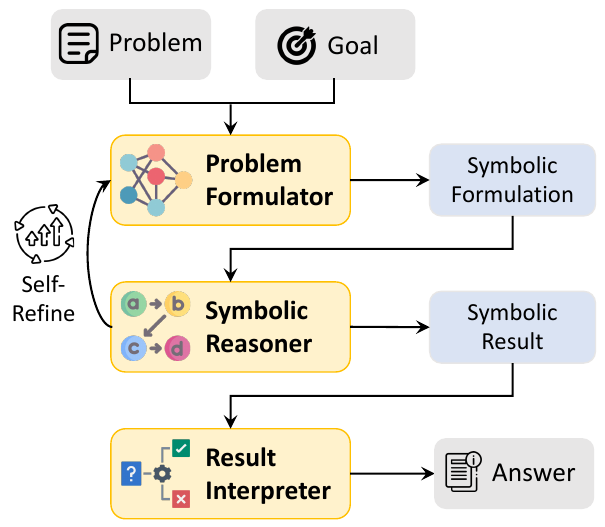
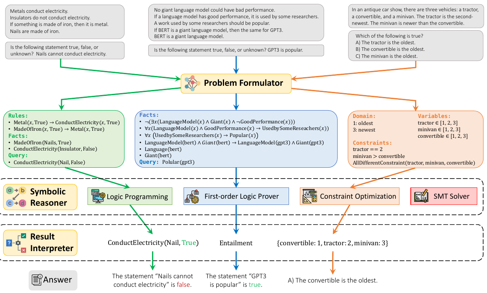
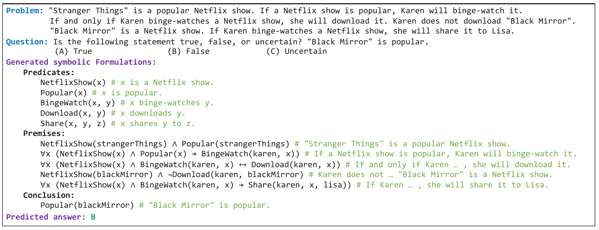

# 논리 추론을 LLM이 아닌 기호 솔버에 맡기기 — Logic-LM: Empowering Large Language Models with Symbolic Solvers for Faithful Logical Reasoning
#### Abstract
대규모 언어 모델(Large Language Model, LLM)은 인간과 유사한 추론 능력을 보여 왔으나, 복잡한 논리 문제에서는 여전히 어려움을 겪는다. 본 논문은 LLM과 기호 솔버(symbolic solver)를 통합하여 논리 문제 해결 능력을 향상시키는 새로운 프레임워크인 Logic-LM을 제시한다. 본 방법은 먼저 LLM을 이용해 자연어 문제를 기호 형식화(symbolic formulation)로 번역한다. 이후 결정론적(deterministic) 기호 솔버가 형식화된 문제에 대해 추론을 수행한다. 또한 기호 솔버의 오류 메시지를 이용해 기호 형식화를 수정하는 자기 정제(self-refinement) 모듈을 도입한다. ProofWriter, PrOntoQA, FOLIO, LogicalDeduction, AR-LSAT의 다섯 가지 논리 추론 데이터셋에서 Logic-LM의 효과를 입증한다. Logic-LM은 표준 프롬프팅으로 LLM만 사용하는 경우보다 평균 39.2%, 사고 사슬(chain-of-thought) 프롬프팅을 사용한 LLM보다 평균 18.4%의 유의미한 성능 향상을 달성한다. 이러한 결과는 LLM과 기호 논리를 결합한 Logic-LM이 충실한(faithful) 논리 추론을 위한 유망한 방향을 제시함을 시사한다.
#### 요약
LLM은 그럴듯한 추론 과정을 써 내려가지만, 그 과정과 최종 결론이 실제로 일치한다는 보장은 없다. 이 논문은 LLM에게 문제를 푸는 일 대신 문제를 기호 언어로 옮겨 적는 일만 맡기고, 실제 추론은 Prolog 엔진, 정리 증명기, 제약 솔버, SMT 솔버 같은 결정론적 도구에 넘기는 방식으로 이 문제에 답한다. 결과는 인상적이지만, 표를 꼼꼼히 들여다보면 "모든 데이터셋에서 우수하다"는 주장 뒤에 몇 가지 단서가 숨어 있다. 이 글은 그 구조와 성과, 그리고 단서를 함께 읽어 본다.

---

## 1. 문제의식: 왜 LLM의 추론을 믿기 어려운가

1) 사고 사슬 프롬프팅과 그 한계

LLM에 "단계적으로 생각해 보자(Let's think step by step)" 같은 지시를 주거나 풀이 예시를 함께 보여 주면, 모델은 중간 추론 단계를 명시적으로 써 가며 답을 낸다. 이를 사고 사슬(chain-of-thought, 이하 CoT) 프롬프팅이라 부른다. CoT는 많은 추론 과제에서 성능을 크게 끌어올렸지만 근본적인 약점이 있다.

LLM은 확률적 블랙박스 모델이다. 다음에 올 단어를 확률적으로 생성할 뿐, 자신이 써 놓은 추론 단계를 논리 규칙에 따라 검증하는 장치를 내부에 갖고 있지 않다. 그래서 생성된 추론 사슬과 최종 결론이 서로 맞지 않는 경우가 생긴다. 예를 들어 "A이면 B이고, B가 아니다"까지 올바르게 써 놓고는 결론에서 "따라서 A이다"라고 말하는 식이다. 저자들은 이를 불충실한(unfaithful) 추론이라고 부른다. 여기서 충실성(faithfulness)이란 결론이 앞서 제시한 추론 과정으로부터 실제로 도출되는가를 뜻한다.

2) 기호 추론 엔진의 장점과 약점

반대편에는 전문가 시스템(expert system)으로 대표되는 기호 추론 엔진이 있다. 이들은 지식을 기호로 표현하고, 잘 정의된 추론 규칙(예: "A이면 B이고 A이면 B이다"라는 전건 긍정)을 기계적으로 적용한다. 그래서 결론이 언제나 전제로부터 정확히 도출되며, 추론 과정 전체를 사람이 검토할 수 있다. 충실하고 투명하다는 것이다.

문제는 입력이다. 기호 엔진은 정해진 형식 언어로 적힌 문제만 다룰 수 있다. 사람이 쓴 자연어 문장은 모호하고 표현이 다양해서, 이를 정확한 기호 표현으로 옮기는 작업이 기호 AI의 오랜 병목이었다.

3) 두 접근의 결합이라는 착안

저자들은 바로 이 번역 작업이 LLM의 강점이라는 점에 주목한다. LLM은 자연어를 이해하고 수식이나 코드 같은 형식 언어로 바꾸는 데 능숙하다. 그렇다면 LLM에게는 번역만 맡기고, 추론은 충실성이 보장된 기호 엔진에 맡기면 두 접근의 약점을 서로 메울 수 있다. 이것이 Logic-LM의 출발점이다.

## 2. 선행 연구와 그 한계

1) LLM 기반 논리 추론

LLM을 논리 추론에 적용하는 기존 연구는 크게 두 갈래다. 하나는 파인튜닝(fine-tuning) 접근으로, 추론 데이터로 모델을 추가 학습시키거나 추론 전용 모듈을 훈련한다. 다른 하나는 문맥 내 학습(in-context learning) 접근으로, 모델을 다시 학습시키지 않고 프롬프트 설계만으로 단계적 추론을 끌어낸다. CoT, 그리고 문제를 쉬운 하위 문제로 쪼개 차례로 푸는 least-to-most 프롬프팅이 대표적이다. 두 갈래 모두 자연어 위에서 직접 추론하기 때문에 유연하지만, 앞서 말한 불충실한 추론과 환각(hallucination)에서 자유롭지 않다.

2) 도구 증강 언어 모델

최신 정보 검색, 정밀한 계산 같은 LLM의 약점을 보완하기 위해 검색기, 계산기, 코드 해석기 같은 외부 도구를 붙이는 연구도 활발하다. 특히 PAL(Program-Aided Language models)처럼 풀이 절차를 파이썬 프로그램으로 생성해 실행하는 방식은 산술 추론에서 좋은 성과를 냈다. 그러나 이 아이디어는 논리 추론으로 확장되지 못했다. 논리 문제의 풀이는 가설 세우기, 경우 나누기, 소거법처럼 "비선형적"이어서 위에서 아래로 실행되는 절차적 프로그램으로 적기 어렵기 때문이다. Logic-LM은 풀이 절차를 프로그램으로 적는 대신 문제 자체만 기호 언어로 기술하고, 어떻게 풀지는 솔버에 맡기는 방식으로 이 장벽을 우회한다.

3) 자동 형식화

자연어를 기호 표현으로 바꾸는 작업을 자동 형식화(auto-formalization)라 하며, 수학 분야에서는 LLM이 문제를 SymPy, Isabelle/HOL, Lean 같은 형식 체계로 옮기는 연구가 이미 많다. 수학 문제는 수치적 성격이 강해 비교적 기호화하기 쉽다. 반면 논리 추론 문제는 유형이 더 다양하고 상식과 세계 지식을 요구하는 경우가 많다. 저자들은 자동 형식화의 개념을 수학 바깥의 넓은 논리 추론 과제로 확장한 데 자신들의 기여가 있다고 말한다.

4) 기존 신경-기호 방법

신경망과 기호 추론을 결합하는 시도 자체는 새롭지 않다. Neuro-Symbolic Concept Learner(Mao et al., 2019), DeepProbLog(Manhaeve et al., 2021) 등이 있다. 하지만 이들은 문제마다 손으로 설계한 특화 모듈이 필요해 일반화가 어렵거나, 최적화가 까다로워 불안정하다는 한계가 있었다. Logic-LM은 별도의 학습이나 문제별 모듈 설계 없이 범용 LLM과 기성 솔버를 연결하는 일반적 프레임워크를 지향한다.

## 3. Logic-LM의 구조

1) Figure 1: 전체 흐름



*Figure 1. Logic-LM의 전체 흐름. 노란색 상자는 처리를 수행하는 모듈이고, 파란색 상자는 모듈 사이를 오가는 중간 산출물이다. 위에서 아래로 형식화, 추론, 해석의 세 단계가 직렬로 이어지며, 왼쪽의 Self-Refine 화살표만이 거꾸로 올라가는 경로다.*

Figure 1은 Logic-LM 전체 흐름을 한눈에 보여 주는 개념도다. 맨 위의 Problem(문제)과 Goal(질문) 두 상자가 합쳐져 노란색 Problem Formulator로 들어간다. 이 모듈의 출력은 오른쪽 파란 상자인 Symbolic Formulation(기호 형식화)이다. 이 표현이 아래쪽 Symbolic Reasoner로 전달되고, 그 출력인 Symbolic Result가 다시 Result Interpreter로 넘어가 최종 Answer가 된다. 즉 노란 상자는 처리 모듈, 파란 상자는 모듈 사이를 오가는 중간 산출물을 나타내며, 형식화, 추론, 해석의 세 단계가 위에서 아래로 직렬 연결된 구조다.

왼쪽에는 Symbolic Reasoner에서 Problem Formulator로 거슬러 올라가는 Self-Refine 화살표가 있다. 자기 정제 루프로, 솔버가 실행 오류를 내면 형식화 단계로 되돌아가 표현을 수정한다는 뜻이다. 그림에서 피드백 경로가 이 화살표 하나뿐이라는 점은 9절에서 다룰 신경-기호 분류상의 위치와도 연결된다.

2) 세 모듈과 하나의 보조 모듈

각 모듈의 역할은 다음과 같다.

첫째, 문제 형식화기(Problem Formulator)다. LLM이 few-shot 문맥 내 학습으로 자연어 문제와 질문을 과제별 기호 언어로 변환한다. few-shot이란 프롬프트 안에 기호 언어의 문법 설명과 함께 두세 개의 풀이 예시를 보여 주고, 모델이 그 형식을 흉내 내게 하는 방식이다. 이 과정에서 LLM은 문제에 등장하는 핵심 개체, 사실, 규칙을 식별하여 술어, 사실, 규칙, 질의로 정리한다.

둘째, 기호 추론기(Symbolic Reasoner)다. 문제 유형에 맞는 외부 솔버가 형식화된 문제에 대해 추론을 수행한다. 이 단계에는 LLM이 전혀 관여하지 않는다.

셋째, 결과 해석기(Result Interpreter)다. 솔버의 출력을 자연어 정답으로 되돌린다. 예를 들어 정리 증명기가 Entailment(전제로부터 결론이 함의됨)를 반환하면 이를 True로 매핑한다. 단순한 매핑 규칙으로 충분한 경우는 규칙 기반 해석기를, 변수 할당 결과를 선택지와 대조해야 하는 복잡한 경우는 LLM 기반 해석기를 사용한다.

넷째, 자기 정제기(Self-Refiner)다. 솔버가 문법 오류를 반환하면 그 오류 메시지를 피드백으로 삼아 LLM이 기호 표현을 반복 수정한다. 자세한 내용은 6절에서 다룬다.

3) 핵심 주장: 문제를 푸는 일에서 표현하는 일로

이 설계의 핵심 주장은 형식화만 정확하다면 추론의 충실성이 보장된다는 것이다. 답은 전방 연쇄(forward chaining)나 후방 연쇄(backward chaining) 같은 결정론적 알고리즘을 실행한 결과이므로, 같은 입력에 대해 늘 같은 답이 나오고 그 답은 전제로부터 엄밀히 도출된다. 따라서 LLM의 부담이 문제를 단계적으로 추론해 푸는 일에서 문제를 기호 언어로 표현하는 일로 이동한다. 뒤집어 말하면, Logic-LM의 성능은 전적으로 번역의 정확도에 달려 있다. 이 점은 이후 결과를 해석할 때 계속 중요하게 등장한다.

## 4. 네 가지 기호 형식화와 솔버

1) 문제 유형별 대응 관계

Logic-LM은 논리 추론 문제를 네 유형으로 나누고, 각 유형에 맞는 기호 언어와 솔버를 짝지었다.

| 문제 유형 | 기호 형식화 | 솔버 | 데이터셋 |
|---|---|---|---|
| 연역 추론 | 논리 프로그래밍(Prolog식) | Pyke | PrOntoQA, ProofWriter |
| 1차 논리 | FOL | Prover9 | FOLIO |
| 제약 충족 | CSP | python-constraint | LogicalDeduction |
| 분석 추론 | SAT/SMT | Z3 | AR-LSAT |

2) 논리 프로그래밍 언어와 Pyke

연역 추론은 알려진 사실과 규칙에서 출발해 새로운 사실을 반복적으로 도출하여 목표 명제를 증명하거나 반증하는 과정이다. 이를 표현하는 대표적 언어가 Prolog이며, Logic-LM은 그 문법을 차용해 문제를 사실(Facts), 규칙(Rules), 질의(Query)로 나타낸다. 사실은 $P(a_1, \dots, a_n)$ 꼴로, 술어 $P$에 인자 $a_i$를 붙인 단순 진술이다. 예컨대 `MadeOfIron(Nails, True)`는 "못은 철로 되어 있다"를 뜻한다. 규칙은 다음과 같은 절(clause) 형태로 쓴다.

$$
F_1 \wedge \cdots \wedge F_m \rightarrow F_{m+1} \wedge \cdots \wedge F_n
$$

여기서 각 $F_i$는 사실이고, $\wedge$는 "그리고"(연언), $\rightarrow$는 "이면"(함축)을 뜻한다. 이 식은 "사실 $F_1$부터 $F_m$이 모두 참이면, 사실 $F_{m+1}$부터 $F_n$도 참이다"라고 읽는다. 예를 들어 `Metal(x, True) → ConductElectricity(x, True)`는 "어떤 것이 금속이면 전기가 통한다"는 규칙이다. 질의는 증명하고 싶은 또 하나의 사실이다.

솔버로는 파이썬 기반 전문가 시스템인 Pyke를 쓴다. Pyke는 사실과 규칙으로 지식 베이스를 구성한 뒤, 사실에서 출발해 규칙을 적용해 나가는 전방 연쇄와 목표에서 출발해 이를 뒷받침할 사실을 찾아 거슬러 가는 후방 연쇄를 사용해 질의를 판정한다.

3) 1차 논리와 Prover9

논리 프로그래밍 언어는 흔한 연역 문제를 효율적으로 표현하지만, "어떤 ~가 존재한다"나 "~인 것은 하나도 없다" 같은 복잡한 양화 표현은 담기 어렵다. 이를 위해 1차 논리(First-Order Logic, FOL)를 함께 사용한다. FOL은 술어와 상수에 더해 전칭 양화사 $\forall$("모든 x에 대해"), 존재 양화사 $\exists$("어떤 x가 존재하여"), 부정 $\neg$, 쌍조건 $\leftrightarrow$("~일 때, 그리고 그때에만") 등을 쓸 수 있다. 문제는 전제(Premises) 목록과 증명할 결론(Conclusion)으로 나뉜다. 예를 들어 "1946년에 체코인이 쓴 책이 있다"는 다음과 같이 쓴다.

$$
\exists x_2 \exists x_1 \big(\mathrm{Czech}(x_1) \wedge \mathrm{Author}(x_2, x_1) \wedge \mathrm{Book}(x_2) \wedge \mathrm{Publish}(x_2, 1946)\big)
$$

"어떤 사람 $x_1$과 어떤 대상 $x_2$가 존재하여, $x_1$은 체코인이고, $x_2$의 저자는 $x_1$이며, $x_2$는 책이고, $x_2$는 1946년에 출판되었다"라고 읽는다. 자연어 한 문장이 양화사 두 개와 술어 네 개의 연언으로 풀어진다는 점에서, 형식화가 왜 어려운지 짐작할 수 있다.

솔버로는 자동 정리 증명기 Prover9를 쓴다. Prover9는 FOL 문장을 연언 표준형(Conjunctive Normal Form, CNF), 즉 "(A 또는 B) 그리고 (C 또는 D)" 같은 절들의 연언으로 바꾼 뒤, 융해(resolution)라는 추론 규칙을 반복 적용해 결론이 참인지, 거짓인지, 알 수 없는지를 판정한다.

4) 제약 충족 문제와 python-constraint

제약 충족 문제(Constraint Satisfaction Problem, CSP)는 여러 대상에 값을 배정하되 주어진 제약을 모두 만족하도록 하는 문제다. 형식적으로는 다음 삼중쌍으로 정의된다.

$$
(X, D, C), \quad X = \{x_1, \dots, x_n\},\ D = \{D_1, \dots, D_n\},\ C = \{C_1, \dots, C_m\}
$$

$X$는 변수의 집합, $D$는 각 변수가 가질 수 있는 값의 범위(정의역), $C$는 제약의 집합이다. 각 제약 $C_j = \langle t_j, R_j \rangle$는 변수 일부 $t_j$와 그 변수들 사이에 성립해야 하는 관계 $R_j$의 쌍이다. 예를 들어 "책 다섯 권이 꽂힌 선반에서 파란 책은 노란 책의 오른쪽에 있다"는 `blue_book ∈ {1,2,3,4,5}`, `yellow_book ∈ {1,2,3,4,5}`, `blue_book > yellow_book`으로 표현된다. 위치를 숫자로 두고, "오른쪽"이라는 자연어 관계를 부등호로 바꾼 것이다. 솔버로는 유한 정의역 CSP를 푸는 python-constraint 패키지를 쓰며, 이 패키지는 백트래킹과 제약 전파 같은 알고리즘으로 가능한 배정을 찾는다.

5) 불리언 충족 가능성과 Z3

불리언 충족 가능성(Boolean Satisfiability, SAT) 문제는 논리식을 참으로 만드는 변수 배정이 존재하는지 묻는 문제다. Logic-LM은 Ye et al.(2023)의 문법을 따라 SAT 문제를 $(\Phi, \mathcal{T}, \mathcal{Q})$로 표현한다. $\Phi$는 이론 $\mathcal{T}$ 아래에서 정의된 제약의 집합이고, $\mathcal{Q}$는 관심 질의다. 솔버로는 Microsoft가 개발한 SMT(Satisfiability Modulo Theories) 솔버 Z3를 쓴다. SMT는 SAT를 정수, 실수, 배열, 문자열 등이 섞인 더 복잡한 식으로 일반화한 것이다. LSAT(미국 로스쿨 입학시험)의 분석 추론 문제처럼 "Xena와 정확히 세 명의 다른 기술자가 라디오를 수리한다" 같은 개수 조건이 붙은 문제는 Z3의 `Count` 표현으로 기술된다. AR-LSAT에서는 각 선택지를 하나씩 제약으로 추가해 충족 불가능(unsat)한지 검사하는 방식으로 정답을 찾는다.

6) Figure 2: 세 예제가 파이프라인을 통과하는 모습



*Figure 2. 세 가지 예제가 Logic-LM을 통과하는 과정. 초록색은 연역 추론(논리 프로그래밍), 파란색은 1차 논리, 주황색은 제약 충족 문제의 경로다. 맨 위는 자연어 문제, 그 아래는 형식화기가 만든 기호 표현, 점선 상자 두 개는 각각 솔버와 해석기 단계, 맨 아래는 최종 답이다. 그림은 위에서 아래로, 같은 색 화살표를 따라 읽으면 된다.*

Figure 2는 Figure 1의 흐름에 실제 예제 세 개를 태워 보여 주는 그림이다. 색으로 경로를 구분하며, 초록은 연역 추론, 파랑은 1차 논리, 주황은 제약 충족 문제다.

맨 위에는 자연어 문제 세 개가 있다. 초록 문제는 금속은 전기가 통하고, 철로 된 것은 금속이며, 못은 철로 되어 있다는 전제에서 "못은 전기가 통하지 않는다"의 참거짓을 묻는다. 파랑 문제는 거대 언어 모델은 성능이 나쁠 수 없고, 성능이 좋으면 연구자들이 쓰며, 연구자들이 쓰면 인기가 있고, BERT가 거대 언어 모델이면 GPT3도 그렇다는 전제에서 "GPT3는 인기가 있다"를 판정한다. 주황 문제는 트랙터, 컨버터블, 미니밴 세 차량에 대해 트랙터가 두 번째로 새것이고 미니밴이 컨버터블보다 새것일 때 가장 오래된 차량을 고르는 문제다.

세 문제는 모두 하나의 Problem Formulator를 거쳐 서로 다른 형식의 기호 표현으로 바뀐다. 같은 LLM이 문제 유형에 따라 다른 프롬프트를 받아 다른 언어로 번역한다는 뜻이다. 초록은 Prolog식 Rules, Facts, Query로 변환된다. 예를 들어 `Metal(x, True) → ConductElectricity(x, True)` 같은 규칙과 질의 `ConductElectricity(Nail, False)`가 만들어진다. 파랑은 $\neg\exists x(\mathrm{LanguageModel}(x) \wedge \mathrm{Giant}(x) \wedge \neg\mathrm{GoodPerformance}(x))$처럼 양화사가 포함된 FOL 전제와 결론 `Popular(gpt3)`로 변환된다. 첫 전제는 "거대 언어 모델이면서 성능이 좋지 않은 것은 존재하지 않는다"로 읽으며, 원문의 "어떤 거대 언어 모델도 성능이 나쁠 수 없다"를 옮긴 것이다. 주황은 Domain(1이 가장 오래됨, 3이 가장 새것), 각 차량의 값 범위를 정한 Variables, 그리고 `tractor == 2`, `minivan > convertible`, `AllDifferentConstraint`로 이루어진 Constraints로 변환된다. 마지막 제약은 세 차량이 서로 다른 순위를 가져야 한다는 뜻으로, 자연어 문제에는 명시되지 않았지만 상식적으로 전제된 조건을 형식화기가 채워 넣은 것이다.

그 아래 점선 상자인 Symbolic Reasoner에는 솔버 네 개가 나란히 놓여 있다. 초록 경로는 Logic Programming, 파랑 경로는 First-order Logic Prover, 주황 경로는 Constraint Optimization으로 연결된다. 네 번째인 SMT Solver는 AR-LSAT용인데, 이 그림에는 해당 예제가 없어 연결된 화살표가 없다.

Result Interpreter 줄에는 각 솔버의 원시 출력이 표시된다. 초록은 `ConductElectricity(Nail, True)`, 파랑은 Entailment, 주황은 `{convertible: 1, tractor: 2, minivan: 3}`이다. 맨 아래 Answer 줄에서 이것이 자연어 답으로 바뀐다. 초록은 질의가 False였는데 추론 결과가 True이므로 "못은 전기가 통하지 않는다"는 거짓이 된다. 파랑은 Entailment가 참으로 매핑된다. 주황은 컨버터블이 1이므로 가장 오래된 차량이 된다. 이 줄은 해석기의 난이도가 문제 유형마다 다르다는 점, 즉 단순 매핑으로 충분한 경우와 할당 결과를 선택지에 대조해야 하는 경우가 있다는 점을 보여 준다.

그림을 인용할 때 주의할 오류가 몇 군데 있다. 주황 예제의 최종 답이 "A) The convertible is the oldest"로 적혀 있지만, 문제의 선택지에서 컨버터블이 가장 오래되었다는 보기는 B다. 파랑 예제에서는 `Language(bert)`가 `LanguageModel(bert)`이어야 하고, `Polular`, `UsedbySomeReseachers` 같은 오탈자가 있다. 초록 예제에서는 Nails와 Nail이 섞여 쓰였다. 기호 솔버에서 상수 이름이 다르면 서로 다른 대상으로 취급되므로, 실제 시스템이었다면 이 불일치만으로 추론이 실패할 수 있다. 또한 "절연체는 전기가 통하지 않는다"는 일반 진술이 `ConductElectricity(Insulator, False)`라는 개별 사실로 인코딩되어 있는데, 이 사실은 추론에 쓰이지 않으며 형식화 방식으로서도 엄밀하지 않다. "모든 절연체는"이라는 일반 진술이라면 규칙으로 표현되어야 하기 때문이다. 개념도라서 결론에는 영향이 없지만, 그림을 재구성해 쓴다면 수정하는 편이 안전하다.

## 5. 사례 연구: Figure 5 자세히 읽기



*Figure 5. GPT-4가 FOLIO 유형의 문제를 1차 논리로 형식화한 실제 출력. 위에서부터 자연어 문제(Problem), 질문(Question), GPT-4가 생성한 술어 정의(Predicates), 전제(Premises), 결론(Conclusion), 그리고 솔버를 거쳐 나온 예측 답(Predicted answer)이 차례로 나온다. 초록색 글씨는 각 기호식 옆에 붙은 원문 주석이다.*

Figure 2의 예제들이 파이프라인을 설명하기 위한 예시라면, Figure 5는 GPT-4가 실제로 생성한 출력이다. 4.5절 사례 연구에서 소개된다. 문제, 생성된 기호 표현, 솔버의 추론 과정 순서로 살펴본다.

1) 문제

자연어 전제는 다섯 문장이다. Stranger Things는 인기 있는 넷플릭스 쇼다. 넷플릭스 쇼가 인기가 있으면 Karen은 그 쇼를 몰아서 본다. Karen은 넷플릭스 쇼를 몰아서 볼 때, 그리고 그때에만 다운로드한다. Karen은 Black Mirror를 다운로드하지 않으며, Black Mirror는 넷플릭스 쇼다. Karen이 넷플릭스 쇼를 몰아서 보면 Lisa에게 공유한다. 질문은 "Black Mirror는 인기가 있다"가 참(A), 거짓(B), 불확실(C) 중 무엇인지다.

2) 생성된 기호 표현

GPT-4의 출력은 술어 정의, 전제, 결론의 세 부분으로 구성된다.

```
Predicates:
  NetflixShow(x)    # x는 넷플릭스 쇼
  Popular(x)        # x는 인기가 있음
  BingeWatch(x, y)  # x가 y를 몰아서 봄
  Download(x, y)    # x가 y를 다운로드함
  Share(x, y, z)    # x가 y를 z에게 공유함

Premises:
  P1  NetflixShow(strangerThings) ∧ Popular(strangerThings)
  P2  ∀x (NetflixShow(x) ∧ Popular(x) → BingeWatch(karen, x))
  P3  ∀x (NetflixShow(x) ∧ BingeWatch(karen, x) ↔ Download(karen, x))
  P4  NetflixShow(blackMirror) ∧ ¬Download(karen, blackMirror)
  P5  ∀x (NetflixShow(x) ∧ BingeWatch(karen, x) → Share(karen, x, lisa))

Conclusion:
  Popular(blackMirror)
```

몇 가지 특징을 짚어 본다. 먼저 사람과 작품은 `karen`, `blackMirror`처럼 소문자로 시작하는 상수로 표현되었다. 이는 논문 부록 A의 FOL 문법을 따른 것이다. 술어는 대문자로 시작하고 인자를 받아 참이나 거짓을 돌려주는 함수처럼 생각하면 된다. 다음으로 "인기 있는 넷플릭스 쇼"처럼 조건이 붙은 일반 진술은 전칭 양화사와 함축($\rightarrow$)으로, "~할 때, 그리고 그때에만"은 쌍조건($\leftrightarrow$)으로 옮겨졌다. 또한 P4는 원문의 두 문장("다운로드하지 않는다"와 "넷플릭스 쇼이다")을 연언 하나로 합친 것이다. 마지막으로 각 식 옆의 `#` 주석에 원문 문장을 붙였는데, 이것이 논문 3.1절에서 설명한 `SYMBOLIC_FORMULA ::: NL_STATEMENT` 형식이다. 기호식과 원문을 줄 단위로 정렬해 번역 오류를 줄이려는 장치다. LLM은 원문 문장을 하나씩 옆에 적으면서 번역하므로 문장을 빠뜨리거나 뒤섞을 가능성이 줄어든다.

3) 솔버의 추론 과정

이 표현을 Prover9에 넣으면 다음과 같은 연쇄가 도출된다. 이해를 돕기 위해 사람이 손으로 따라가는 순서로 적는다.

첫째, P4에서 $\mathrm{NetflixShow}(bm)$과 $\neg\mathrm{Download}(karen, bm)$을 얻는다. 여기서 $bm$은 blackMirror의 줄임이다.

둘째, P3의 전칭 양화사 $\forall x$에 $bm$을 대입한다(이를 전칭 예화라 한다).

$$
\big(\mathrm{NetflixShow}(bm) \wedge \mathrm{BingeWatch}(karen, bm)\big) \leftrightarrow \mathrm{Download}(karen, bm)
$$

쌍조건 $\leftrightarrow$는 양변의 참거짓이 같아야 한다는 뜻이다. 우변이 거짓이므로 좌변도 거짓이어야 한다. 그런데 $\mathrm{NetflixShow}(bm)$은 참이므로, 연언이 거짓이 되려면 $\neg\mathrm{BingeWatch}(karen, bm)$이어야 한다.

셋째, P2에 $bm$을 대입한다.

$$
\mathrm{NetflixShow}(bm) \wedge \mathrm{Popular}(bm) \rightarrow \mathrm{BingeWatch}(karen, bm)
$$

후건(화살표 오른쪽)이 거짓이므로, 대우에 의한 추론(modus tollens, "A이면 B이고 B가 아니면 A도 아니다")에 따라 전건(화살표 왼쪽)도 거짓이다. $\mathrm{NetflixShow}(bm)$이 참이므로 $\neg\mathrm{Popular}(bm)$이 도출된다.

결론 `Popular(blackMirror)`의 부정이 전제로부터 증명되므로 Prover9는 CONTRADICTION을 반환한다. 실제로 Prover9는 이 과정을 위와 같은 순방향 연쇄가 아니라 귀류법에 가까운 방식으로 수행한다. 즉 전제와 목표의 부정을 연언 표준형으로 바꾼 뒤, 융해를 반복해 모순(빈 절)을 찾는다. 결론을 가정했을 때 모순이 나오면 결론의 부정이 증명되고, 결론의 부정을 가정했을 때 모순이 나오면 결론이 증명되며, 어느 쪽도 아니면 판정 불가가 된다. 이 세 경우가 각각 CONTRADICTION, ENTAILMENT, CONTINGENT이며, 결과 해석기는 이를 False, True, Unknown으로 매핑한다. 따라서 최종 예측은 B이고, 이 문제의 정답도 B다.

4) 이 예제에서 읽어낼 점

첫째, 방해 전제가 섞여 있다. P1(Stranger Things)과 P5(Lisa에게 공유)는 결론과 무관하다. 솔버는 관련 없는 전제가 있어도 증명 탐색에 영향을 받지 않는다. 반면 자연어로 단계적 추론을 하는 CoT는 이런 정보에 끌려갈 여지가 있다. 다만 논문은 이 문제에서 CoT가 실제로 어떤 답을 냈는지는 보고하지 않으므로, 비교 우위의 근거로 쓰기는 어렵다.

둘째, 대우 추론이 핵심이다. 이 문제는 쌍조건에서 한 방향을 부정하고, 함축의 대우를 적용하는 두 단계 역방향 추론을 요구한다. 논문 4.1절에서 저자들은 CoT가 순방향 연쇄에는 강하지만 이런 비선형적 추론에는 약하고, 솔버가 이를 잘 보완한다고 주장하는데, 이 예제가 바로 그런 유형을 보여 준다.

셋째, P3의 연산자 우선순위가 모호하다. 표준 우선순위에서는 $\wedge$가 $\leftrightarrow$보다 강하게 결합하므로 $(\mathrm{NetflixShow}(x) \wedge \mathrm{BingeWatch}(karen, x)) \leftrightarrow \mathrm{Download}(karen, x)$로 읽힌다. 곱셈이 덧셈보다 먼저 계산되는 것과 같은 원리다. 하지만 괄호가 없어서 $\mathrm{NetflixShow}(x) \wedge (\mathrm{BingeWatch}(karen, x) \leftrightarrow \mathrm{Download}(karen, x))$로 해석될 여지도 있다. 후자로 읽으면 $\forall x$가 앞에 붙어 있으므로 "모든 대상이 넷플릭스 쇼다"라는 과도한 주장이 포함되어 버린다. 이 문제에서는 어느 쪽으로 읽어도 결론이 같지만, 솔버 구현이 우선순위를 어떻게 처리하느냐에 따라 다른 문제에서는 의미 오류로 이어질 수 있다.

넷째, 원문 "넷플릭스 쇼를 몰아서 볼 때, 그리고 그때에만 다운로드한다"에서 넷플릭스 쇼라는 조건이 쌍조건의 어느 쪽에 걸리는지도 자연어로는 다소 모호하다. GPT-4는 이를 좌변에 넣는 합리적인 해석을 택했다. 부록 E의 Figure 6에 실린 오류 사례들과 비교하면, 이 예제는 형식화가 잘 된 경우를 보여 주고 Figure 6은 형식화가 실패하는 지점을 보여 준다는 점에서 짝을 이룬다.

5) 오류 사례 몇 가지

참고로 Figure 6의 오류 사례도 간단히 정리해 둔다. 틀린 부분은 원 논문에서 빨간색, 수정본은 초록색으로 표시되어 있다. Example 1(야생 칠면조)은 `EasternWildTurkey` 같은 술어를 만들어야 할 곳에서 `WildTurkey(eastern)`처럼 상수로 처리해 이후 표현과 맞물리지 않은 경우로, 수정하면 예측이 C에서 정답 A로 바뀐다. Example 3(골프 순위)은 "Dan이 Eve보다 위"를 `Dan > Eve`로 잘못 써서 순위 방향을 뒤집은 경우다. 도메인에서 1이 1등이므로 "위"는 숫자가 작아야 하는데 이를 반대로 쓴 것이며, 수정하면 E에서 B로 바뀐다. Example 4(Yelp와 Subway)는 `Rating(subway, y) ∧ y > 9`처럼 FOL 문법에 맞지 않는 수치 비교를 쓴 경우로, `GreaterThanNine` 술어로 고치면 C에서 A로 바뀐다. Example 2(젤다의 전설)는 빨간 표시 없이 정답 A를 맞힌 사례이고 본문에서도 따로 논의하지 않는다. 다만 첫 전제가 "일본 게임 회사가 젤다를 만들었다"를 `JapaneseGameCompany(legend_of_zelda)`, 즉 "젤다가 일본 게임 회사다"로 옮기고 있어 엄밀히는 의미가 틀렸지만 정답에는 영향을 주지 않은 경우다. 문법적으로 유효하지만 의미는 틀린 표현의 좋은 예이기도 하다.

## 6. 자기 정제기

1) 작동 방식

자기 정제기(Self-Refiner)는 LLM이 만든 기호 표현을 솔버가 실행하지 못할 때, 솔버의 오류 메시지를 근거로 LLM이 그 표현을 스스로 고치게 하는 모듈이다(논문 3.3절). 코드 생성 분야의 Self-Debug(Chen et al., 2023)와 Self-Refine(Madaan et al., 2023)에서 쓰던 아이디어를 논리 표현 생성에 옮겨 온 것이다. 프로그래머가 컴파일 오류 메시지를 보고 코드를 고치듯, LLM이 솔버의 오류 메시지를 보고 논리식을 고친다고 생각하면 된다.

문제 형식화기가 만든 표현을 솔버에 넣었는데 구문 오류로 실행이 실패하면, LLM에 세 가지를 함께 제공한다. 오류가 난 기호 표현, 솔버가 반환한 오류 메시지, 그리고 자주 발생하는 오류 유형과 그 수정 방법을 보여 주는 예시다. 오류 유형의 예로는 FOL에서 양화사에 묶이지 않은 자유 변수가 있다. 예컨대 $\forall x$ 없이 $\mathrm{Rating}(x, 9)$처럼 $x$를 쓰면 $x$가 무엇을 가리키는지 정해지지 않아 솔버가 처리하지 못한다. LLM은 이를 보고 수정된 표현을 다시 생성한다. 이 과정을 오류가 사라지거나 최대 수정 횟수에 도달할 때까지 반복한다. 논문에는 "learns to modify"라는 표현이 쓰였지만, 실제로 파라미터를 학습하는 것은 아니고 프롬프트만으로 수정하는 방식이다.

2) 효과: 실행 가능률은 오르지만 정확도는 정체

효과는 FOLIO에서 정제 횟수를 0회부터 3회까지 바꿔 가며 측정했다(논문 Figure 4). 여기서 실행 가능률(Exe_Rate)은 생성된 기호 표현 중 솔버가 오류 없이 실행할 수 있었던 비율이다.

| 정제 횟수 | 0 | 1 | 2 | 3 |
|---|---|---|---|---|
| GPT-3.5 실행 가능률 | 66.7% | 79.4% | 82.4% | 84.3% |
| GPT-3.5 정확도 | 61.27 | 62.25 | **64.56** | 63.84 |
| GPT-4 실행 가능률 | 79.9% | 85.3% | 85.3% | 85.8% |
| GPT-4 정확도 | 78.92 | 78.43 | **79.90** | 79.41 |

실행 가능률은 꾸준히 올랐지만, 정확도는 GPT-3.5가 61.27에서 64.56까지 오른 뒤 63.84로 내려갔고, GPT-4는 78.92에서 79.9 사이를 오가며 사실상 정체되었다. 다섯 데이터셋 전체로 보면 실행 가능률은 평균 5.01%p 올랐지만, GPT-4의 FOLIO와 AR-LSAT에서는 실행된 표현의 정확도가 오히려 소폭 떨어졌다(논문 Table 3).

3) 정체의 원인: 구문적 피드백의 한계

이런 결과가 나온 이유는 피드백의 성격에 있다. 솔버의 오류 메시지는 표현이 문법적으로 유효한지만 알려 줄 뿐, 그 표현이 원래 문제를 올바르게 담고 있는지는 알려 주지 않는다. 예를 들어 앞서 본 Figure 6의 Example 3처럼 "below"와 "above"를 뒤바꿔 `Dan > Eve`로 잘못 쓴 제약은 문법상 문제가 없다. 솔버는 이를 그대로 실행해 오답을 내고, 자기 정제는 아예 작동하지 않는다. 저자들도 이 한계를 인정하며, 향후 과제로 생성된 표현의 의미적 정확성을 평가하는 별도 모듈의 보상 신호를 피드백에 추가하는 방안을 제시한다.

정리하면 자기 정제기는 실행 가능성을 높이는 구문 수준의 수리 장치이고, 의미 수준의 오류를 바로잡는 장치는 아니다.

## 7. 실험 결과

1) 실험 설정

Logic-LM은 다섯 데이터셋에서 평가되었다. PrOntoQA는 가상의 개념("jompus", "yumpus" 같은 무의미 단어)으로 만든 합성 연역 추론 데이터로, 가장 어려운 5단계 추론 부분을 썼다. ProofWriter는 좀 더 자연스러운 문장으로 된 연역 추론 데이터로, 결론이 증명됨, 반증됨, 알 수 없음 중 하나로 판정된다. FOLIO는 전문가가 작성한 실세계 지식 기반 1차 논리 데이터다. LogicalDeduction은 BigBench에 포함된, 몇 가지 조건으로 대상의 순서를 추론하는 과제다. AR-LSAT는 1991년부터 2016년까지 LSAT의 분석 추론 문제를 모은 것으로, 당시 최고 수준 모델도 무작위 추측보다 조금 나은 정도에 그쳤던 어려운 데이터다.

비교 대상은 두 가지다. Standard는 예시만 보여 주고 바로 답을 고르게 하는 방식이고, CoT는 추론 과정을 쓴 뒤 답을 고르게 하는 방식이다. 기반 LLM으로 ChatGPT(gpt-3.5-turbo), GPT-3.5(text-davinci-003), GPT-4를 각각 사용했다. 모든 문제는 객관식이므로 평가 지표는 정답을 고른 비율, 즉 정확도(%)다. 중요한 설정이 하나 있다. 본 실험(Table 2)은 자기 정제를 끈 상태의 결과이며, 솔버가 문법 오류로 답을 내지 못한 경우에는 CoT로 대체(fallback)하여 답을 예측했다.

2) 주요 결과

GPT-4 기준 결과를 옮기면 다음과 같다(논문 Table 2에서 발췌).

| 데이터셋 | Standard | CoT | Logic-LM |
|---|---|---|---|
| PrOntoQA | 77.40 | **98.79** | 83.20 |
| ProofWriter | 52.67 | 68.11 | **79.66** |
| FOLIO | 69.11 | 70.58 | **78.92** |
| LogicalDeduction | 71.33 | 75.25 | **87.63** |
| AR-LSAT | 33.33 | 35.06 | **43.04** |

*표 읽는 법: 숫자는 정확도(%)이며 높을수록 좋다. 각 행에서 가장 높은 값을 굵게 표시했다. 선택지 수가 데이터셋마다 다르므로(PrOntoQA는 2개, AR-LSAT는 5개) 무작위로 찍었을 때의 기준선도 각각 50%, 20%로 다르다. 행끼리 절대값을 비교하기보다 같은 행 안에서 세 방법을 비교해야 한다.*

GPT-3.5(text-davinci-003) 기준으로 Logic-LM은 Standard 대비 평균 39.2%, CoT 대비 평균 18.4% 향상되었다. 이 수치는 퍼센트포인트 차이가 아니라 상대 향상률이다. GPT-4에서는 LogicalDeduction(87.63 대 CoT 75.25)과 AR-LSAT(43.04 대 35.06)처럼 비선형적 추론, 즉 가설 설정, 경우 분석, 소거법이 필요한 과제에서 개선 폭이 컸다.

3) CoT가 잘 듣는 과제와 듣지 않는 과제

흥미로운 관찰은 CoT의 효과가 과제마다 크게 갈린다는 점이다. CoT는 순방향 연쇄 추론에 가까운 PrOntoQA나 ProofWriter에서는 효과적이었지만 FOLIO, LogicalDeduction, AR-LSAT에서는 이득이 작거나 오히려 음수였다. 저자들의 설명은 이렇다. CoT는 사람이 아는 사실에서 출발해 차례로 결론을 쌓아 가는 방식을 흉내 낸다. 이는 "A는 B다, B는 C다, 따라서 A는 C다"를 반복하는 PrOntoQA나 ProofWriter 문제와 잘 맞는다. 반면 1차 논리 문제나 제약 충족 문제는 "만약 X가 1번이라면" 하고 가정을 세웠다가 모순이 나오면 버리는 식의 비선형적 추론을 요구하고, 이런 탐색은 솔버가 훨씬 잘한다.

4) 형식화기는 얼마나 정확한가

논문 Table 3은 형식화 단계만 따로 떼어 평가한다. 실행 가능률(Exe_Rate)은 문법적 정확성을, 실행 정확도(Exe_Acc)는 실행 가능한 표현만 놓고 본 정답률로서 의미적 정확성을 나타낸다.

| 데이터셋 | GPT-3.5 실행 가능률 | GPT-3.5 실행 정확도 | GPT-4 실행 가능률 | GPT-4 실행 정확도 |
|---|---|---|---|---|
| PrOntoQA | 99.4% | 84.9 | 100.0% | 83.2 |
| ProofWriter | 87.3% | 73.6 | 99.0% | 79.6 |
| FOLIO | 66.7% | 61.8 | 79.9% | 80.4 |
| LogicalDeduction | 100.0% | 62.0 | 100.0% | 87.6 |
| AR-LSAT | 11.3% | 57.7 | 32.6% | 60.0 |

*자기 정제 적용 전 수치. 실행 가능률은 생성된 기호 표현 중 솔버가 오류 없이 실행한 비율, 실행 정확도는 그렇게 실행된 문제만 놓고 계산한 정답률이다.*

합성 데이터셋에서는 실행 가능률이 거의 100%였으나, 실제 전문가가 작성한 FOLIO와 AR-LSAT에서는 GPT-4도 각각 79.9%, 32.6%에 그쳤다. 합성 데이터는 문장 표현이 단조로워 번역이 쉽지만, 실세계 문장은 그렇지 않다는 뜻이다. 반면 일단 실행에 성공한 표현의 정확도는 AR-LSAT에서도 60.0으로, 전체 정확도 43.04보다 훨씬 높다. 번역만 성공하면 솔버는 제 역할을 한다는 것이다.

5) 추론 깊이에 대한 강건성

ProofWriter에서 필요한 추론 단계 수(깊이)를 0부터 5까지 늘려 가며 비교한 결과(논문 Figure 3), Standard는 57.7에서 33.5로, CoT는 76.3에서 51로 급락했지만 Logic-LM은 81.7에서 71.1로 완만하게 하락했다. 깊이 5에서 Logic-LM은 CoT보다 39.4% 높았다. 이는 저자들의 가설, 즉 문제를 기호로 표현하는 복잡도는 추론 깊이와 무관하게 비교적 일정하다는 가정을 뒷받침한다. 다섯 단계를 추론해야 하는 문제든 한 단계면 되는 문제든, 번역해야 할 문장의 수와 형태는 크게 다르지 않다. 깊어진 추론의 부담은 솔버가 진다.

## 8. 비판적으로 읽을 지점

1) "모든 데이터셋에서 우수하다"는 주장의 예외

논문은 Logic-LM이 모든 데이터셋에서 표준 LLM과 CoT를 크게 능가한다고 서술한다. 그러나 Table 2를 보면 PrOntoQA에서는 ChatGPT(CoT 67.80 대 Logic-LM 61.00)와 GPT-4(CoT 98.79 대 Logic-LM 83.20) 모두 CoT가 Logic-LM보다 높다. 특히 GPT-4에서는 15%p 넘는 차이다. 문장이 단순하고 추론이 순방향인 과제에서는 강력한 LLM의 CoT만으로도 충분하며, 굳이 솔버를 거칠 이유가 크지 않다는 뜻으로 읽을 수 있다.

2) CoT 대체가 결과 해석에 미치는 영향

앞서 말했듯 솔버가 실행되지 않는 경우에는 CoT로 대체하여 답을 예측한다. 따라서 GPT-4의 AR-LSAT처럼 실행 가능률이 32.6%인 경우, 보고된 정확도 43.04의 상당 부분은 사실상 CoT의 성능이다. 문제의 3분의 2 이상이 솔버를 거치지 않고 CoT로 풀렸기 때문이다. 순수한 기호 추론의 기여분은 Table 3의 실행 정확도와 함께 해석해야 정확하다. 이 설계는 실용적 시스템으로서는 합리적이지만, 기호 추론 그 자체의 효과를 평가하려는 독자에게는 혼선을 준다.

3) 자기 정제의 제한된 효과

6절에서 보았듯 자기 정제는 실행 가능률을 높였지만 정확도는 정체되었고, GPT-4의 FOLIO와 AR-LSAT에서는 실행 정확도가 오히려 소폭 떨어졌다. 구문 오류만 잡아내는 피드백으로는 의미 오류를 고칠 수 없다는 구조적 한계 때문이다.

4) 저자들이 밝힌 한계

저자들이 밝힌 한계는 두 가지다. 하나는 적용 범위가 솔버의 표현력에 묶인다는 점이다. 모든 문제가 1차 논리로 쉽게 인코딩되는 것은 아니며, 표현할 수 없는 문제는 솔버로도 풀 수 없다. 다른 하나는 확률적 소프트 논리(probabilistic soft logic)처럼 문법이 복잡한 표현은 소수의 예시만으로 LLM에 전달하기 어렵다는 점이다. 향후 과제로는 마르코프 논리 네트워크(Markov logic network) 같은 통계적 관계 학습과의 통합, 그리고 상식 추론으로의 확장을 제시한다. 앞의 것은 "대체로 그렇다" 같은 불확실한 규칙을 다루기 위한 것이고, 뒤의 것은 문제에 명시되지 않은 상식을 어떻게 기호로 채워 넣을지에 관한 것이다.

## 9. 신경-기호 분류에서의 위치

1) Kautz의 분류 체계

신경-기호(neuro-symbolic) AI 연구를 정리할 때 자주 쓰이는 틀이 Henry Kautz가 제안한 분류다. Kautz는 신경망과 기호 시스템이 결합되는 방식을 여러 유형으로 나누었는데, 그중 Type 3(Neuro | Symbolic)은 신경망이 이미지나 자연어 같은 비기호적 입력을 기호 표현으로 바꾸고, 별도의 기호 추론기가 그 표현 위에서 추론하는 파이프라인 또는 코루틴 구조를 가리킨다. 두 시스템이 각자의 일을 하고 결과를 주고받는 분업 구조라고 이해하면 된다.

2) Logic-LM은 Type 3에 해당한다

Logic-LM은 Kautz의 Type 3으로 분류하는 것이 타당하다. LLM이 자연어를 Prolog, FOL, CSP, SMT 표현으로 변환하고 Pyke, Prover9, Z3가 추론하므로 이 정의에 그대로 들어맞는다. Kautz가 Type 3의 대표 예로 든 Neuro-Symbolic Concept Learner(Mao et al., 2019)를 이 논문도 관련 연구로 인용하고 있어 계보상으로도 자연스럽다.

3) 피드백의 성격

다만 Logic-LM을 피드백이 없는 단방향 파이프라인으로만 보는 것은 정확하지 않다. 자기 정제 모듈이 있어서, 솔버가 반환한 오류 메시지를 LLM에 다시 넣어 기호 표현을 수정하므로 기호 쪽에서 신경 쪽으로 향하는 경로는 존재한다. 정확히는 다음과 같이 구분하는 편이 좋다.

첫째, 학습 신호로서의 피드백은 없다. NS-CL은 기호 실행 결과를 보상으로 삼아 강화학습 알고리즘(REINFORCE)으로 지각 모듈을 학습시킨다. 즉 기호 추론의 결과가 신경망의 가중치를 바꾼다. 반면 Logic-LM은 few-shot 문맥 내 학습만 사용하므로 솔버 결과가 LLM 파라미터에 영향을 주지 않는다.

둘째, 추론 시점의 피드백은 있으나 범위가 좁다. 자기 정제는 문법 오류, 즉 실행 불가능한 표현만 대상으로 한다. 솔버가 정상적으로 실행되었지만 의미상 틀린 답을 낸 경우에는 피드백이 발생하지 않는다.

셋째, 본 실험(Table 2)은 자기 정제를 끈 상태의 결과다. 따라서 주요 성능 수치만 놓고 보면 단방향 파이프라인이라는 해석도 틀리지 않는다.

요약하면 Logic-LM은 Kautz의 Type 3에 해당하며, 기호 추론기의 실행 오류를 LLM에 되돌리는 추론 시점의 구문적 피드백만 존재하고 학습 신호는 신경 모듈로 전달되지 않는 구조다. 이렇게 정리하면 NS-CL처럼 학습 신호가 역전파되는 Type 3 사례와도 구분된다. 일반적인 분류에서 Logic-LM은 신경망이 기호 시스템을 도구처럼 호출하는 도구 증강형 계열의 대표 사례로 자주 인용된다.

## 10. 맺음말

Logic-LM의 핵심 아이디어는 단순하다. LLM에게 논리 문제를 풀라고 하지 말고, 문제를 정확히 받아 적으라고 하자는 것이다. 이렇게 역할을 나누면 추론의 충실성은 솔버가 보장하고, 자연어의 모호함은 LLM이 처리한다. 실험은 이 분업이 특히 비선형적이고 깊은 추론이 필요한 과제에서 효과적임을 보여 준다.

동시에 이 논문은 병목이 어디로 옮겨 갔는지도 분명히 보여 준다. 문제는 더 이상 추론이 아니라 번역이다. 실세계 문장으로 된 FOLIO와 AR-LSAT에서 실행 가능률이 낮았던 점, 자기 정제가 문법 오류는 고쳐도 의미 오류는 고치지 못한 점, Figure 6의 오류들이 대부분 "위"와 "아래"를 뒤바꾸거나 술어와 상수를 혼동하는 번역 실수였던 점이 모두 같은 방향을 가리킨다. 따라서 다음 과제는 형식화 단계의 의미적 검증, 그리고 솔버의 판정 결과를 번역 모델의 학습 신호로 되돌리는 방법에 놓인다. 저자들이 제안한 의미 평가 모듈의 보상 신호나 솔버가 생성한 합성 데이터를 이용한 파인튜닝도 같은 문제의식에서 나온 것이다. 그런 의미에서 Logic-LM은 하나의 완성된 해법이라기보다, LLM과 기호 추론을 결합할 때 어디가 어려운지를 명확히 드러낸 출발점으로 읽는 편이 적절하다.
