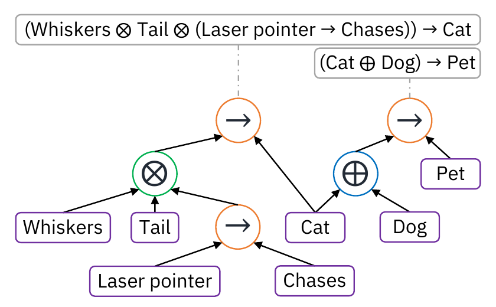
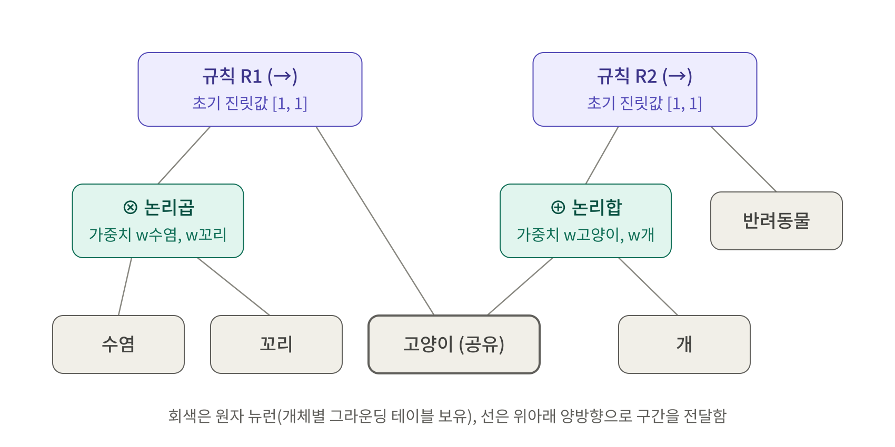
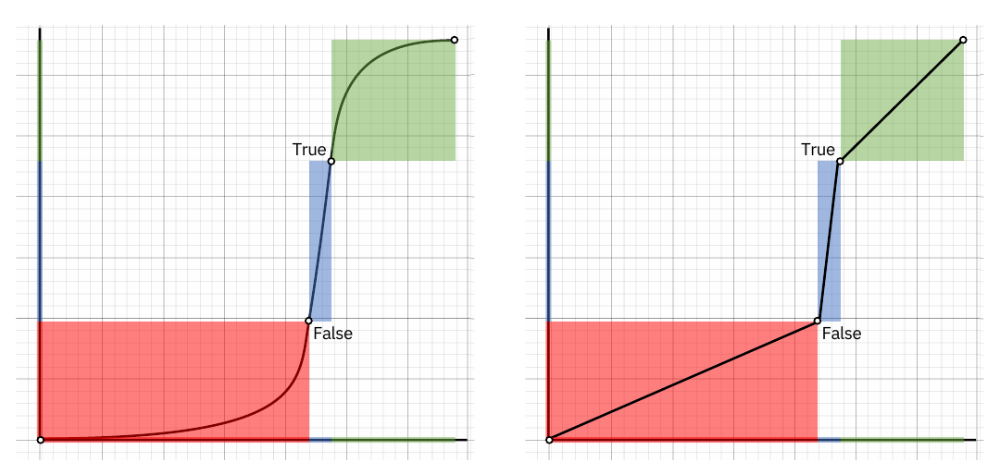

# 논리식의 구문 트리를 그대로 신경망으로 만들기 — Logical Neural Networks
#### Abstract
본 논문에서는 신경망의 핵심 성질인 학습과 기호 논리의 핵심 성질인 지식 및 추론을 매끄럽게 함께 제공하는 새로운 프레임워크를 제안한다. 모든 뉴런은 가중 실숫값 논리(weighted real-valued logic)에서 하나의 논리식을 구성하는 요소로서 의미를 가지며, 이로써 해석 가능성이 매우 높은 분리된 표현(disentangled representation)을 얻는다. 추론은 미리 정해진 목표 변수에 집중하는 대신 전방위적(omnidirectional)으로 이루어지며 논리적 추론에 대응하는데, 고전적 1차 논리 정리 증명(theorem proving)을 특수한 경우로 포함한다. 모델은 종단간(end-to-end) 미분 가능하며, 학습은 논리적 모순을 포착하는 새로운 손실 함수를 최소화하는 방식으로 이루어져 비일관적인 지식에 대한 강건성을 갖는다. 또한 확률적 의미를 가질 수 있는 진릿값의 경계(bounds)를 유지함으로써 개방 세계 가정(open-world assumption)을 가능하게 하여, 불완전한 지식에 대한 강건성도 함께 갖는다.
#### 요약
신경망은 데이터로부터 학습하지만 그 안에 무엇이 들어 있는지 읽어 내기 어렵고, 기호 논리는 지식을 명확하게 표현하고 추론하지만 데이터로부터 배우지 못한다. 이 논문은 논리식의 구문 트리 자체를 신경망으로 삼아, 뉴런 하나하나가 명제나 논리 연결사의 의미를 학습이 끝난 뒤에도 그대로 유지하도록 만든다. 진릿값을 하나의 숫자가 아닌 하한과 상한의 구간으로 다루어 "모른다"와 "모순이다"를 구별할 수 있게 했고, 학습은 주어진 지식 체계를 데이터 및 내적 일관성에 맞도록 보정하는 일로 재정의된다.

---

## 1. 이 논문이 다루는 문제

이 논문은 IBM Research가 2020년 arXiv에 공개한 Logical Neural Networks(LNN, Riegel 외)로, 신경망의 학습 능력과 기호 논리의 지식 표현 및 추론 능력을 하나의 구조 안에서 동시에 확보하려는 뉴로심볼릭(neuro-symbolic) 프레임워크를 제안한다. 뉴로심볼릭이란 신경망(neural network)과 기호적 추론(symbolic reasoning)을 결합하려는 인공지능 연구 흐름을 가리킨다.

두 접근의 장단점은 서로 정반대에 가깝다. 신경망은 대량의 데이터에서 패턴을 학습하는 데 뛰어나지만, 학습된 가중치가 무엇을 의미하는지 사람이 읽어 내기 어렵고, 사람이 이미 알고 있는 지식("고양이는 동물이다" 같은 규칙)을 직접 집어넣기도 어렵다. 반대로 Prolog나 OWL 추론기 같은 기호 논리 시스템은 규칙을 명시적으로 표현하고 엄밀하게 추론하지만, 규칙이 조금만 틀려도 결론 전체가 무너지고, 데이터를 보고 스스로 규칙을 고치지 못한다.

LNN의 출발점은 뉴런과 논리식의 구성 요소를 1:1로 대응시키는 것이다. 각 뉴런은 "cat" 같은 명제(또는 술어)이거나 AND, OR, → 같은 논리 연결사이며, 네트워크 구조는 주어진 논리식들의 구문 트리(syntax tree)를 그대로 연결한 형태가 된다. 구문 트리란 논리식을 연산자를 마디로, 피연산자를 가지로 하여 나무 모양으로 펼친 것으로, 예를 들어 (A ∧ B) → C는 맨 위에 →가 있고, 그 아래 왼쪽에 ∧(다시 그 아래 A와 B), 오른쪽에 C가 달린 나무가 된다.

저자들은 기존 접근과 비교해 세 가지 차별점을 내세운다.

첫째, 뉴런 단위의 해석 가능성이다. Markov Logic Network나 PSL은 절(clause) 전체에 가중치를 하나 부여하고 내부 논리 구조는 드러내지 않으며, LTN 같은 임베딩 기반 방법은 벡터 표현을 쓰기 때문에 해석성이 떨어진다. LNN은 함수 기호가 없는 1차 논리 전체를 [0, 1] 실숫값으로 표현하며, 고전 0/1 논리를 특수한 경우로 포함한다.

둘째, 진릿값을 단일 값이 아닌 하한과 상한 [L, U]의 구간으로 유지한다. 이를 통해 지식베이스에 없는 명제를 거짓으로 간주하는 폐쇄 세계 가정(closed-world assumption) 대신 개방 세계 가정을 취할 수 있으며, 임계값 α를 기준으로 미지(Unknown), 참(True), 거짓(False), 모순(Contradiction, L > U)의 네 가지 상태를 구분한다.

셋째, 추론이 특정 출력 변수 방향으로 고정되지 않고 모든 방향으로 이루어진다. x → y에서 x가 참이면 y를 도출하는 것(modus ponens, 전건 긍정)뿐 아니라, y가 거짓이면 x가 거짓임을 도출하는 것(modus tollens, 후건 부정)도 같은 네트워크 안에서 수행되므로 정리 증명기로도 기능할 수 있다.

## 2. 기존 접근과 그 한계

### 1) 대표적인 선행 연구와의 비교

LNN의 위치를 이해하려면 먼저 비슷한 목표를 가진 다른 접근들과 나란히 놓고 보는 것이 좋다. 아래 표에 등장하는 방법들을 간단히 소개하면 다음과 같다. MLN(Markov Logic Network, 2006)은 1차 논리 규칙에 가중치를 붙여 확률 모델로 해석하는 방법이다. PSL(Probabilistic Soft Logic, 2017)은 규칙을 0과 1 사이의 연속값으로 완화하여 볼록 최적화로 추론하는 방법이다. LTN(Logic Tensor Networks, 2016)은 각 술어를 작은 신경망으로 구현하고 논리식이 얼마나 충족되는지를 학습 목표로 삼는다. NTP(Neural Theorem Prover, 2017)는 Prolog식 역방향 추론을 미분 가능하게 바꾸고, 기호가 같은지 판단하는 대신 기호 임베딩 사이의 유사도를 사용한다.

| 구분 | MLN (2006) | PSL (2017) | LTN (2016) | NTP (2017) | LNN (2020) |
|---|---|---|---|---|---|
| 결합 방식 | 1차 논리 절에 가중치를 붙여 마르코프 확률장으로 해석 | 규칙을 Łukasiewicz 방식으로 연속 완화한 힌지 손실 확률장 | 술어를 신경망으로 구현하고 논리식을 미분 가능한 충족도 목적함수로 사용 | 역방향 연쇄(backward chaining)를 미분 가능하게 재구성, 기호 일치를 임베딩 유사도로 대체 | 논리식 구문 트리와 뉴런을 1:1 대응 |
| 논리 표현력 | 1차 논리(절 단위) | 가중 1차 논리 규칙 | 함수 기호를 포함한 1차 논리(Real Logic) | 함수 없는 혼 절 | 함수 및 등호를 제외한 1차 논리 전체 |
| 진릿값 | 가능 세계의 확률 | [0, 1] 연속값 | [0, 1] 연속값 | 증명 점수 [0, 1] | 하한과 상한 구간 [L, U] |
| 미지 상태 표현 | 폐쇄 세계 가정 | 폐쇄 세계 가정 | 단일값이라 미지와 중간값 구분 불가 | 폐쇄 세계 가정 | 개방 세계 가정, 미지와 모순 상태 구분 |
| 추론 방식 | MCMC 등 근사 확률 추론 | 볼록 최적화 기반 MAP 추론 | 순전파 평가(질의 방향 고정) | 질의로부터의 미분 가능 증명 탐색 | 상향-하향 양방향 추론, 명제 논리에서 유한 수렴 보장 |
| 학습 대상 | 절 가중치, 구조 학습 가능 | 규칙 가중치 | 술어 네트워크 파라미터 및 임베딩 | 기호 임베딩, 규칙 템플릿을 통한 규칙 유도 | 연결사 가중치, 사실 및 공리의 진릿값 구간 |
| 해석 단위 | 절 | 규칙 | 낮음(임베딩 공간) | 유도 규칙은 해석 가능, 근거는 임베딩 | 개별 뉴런 |
| 비일관 지식 처리 | 확률로 흡수, 모순이 남을 수 있음 | 규칙 위반 거리로 완화 | 충족도를 최대화하는 선에서 타협 | 명시적 처리 없음 | 모순 손실로 탐지하고 제거 |
| 주요 한계 | 그라운딩 폭발, 추론 비용 | 연속 완화로 고전 논리 결론과 어긋날 수 있음 | 정밀한 연역이 보장되지 않음 | 증명 경로 탐색의 확장성, 혼 절 한정 | 구조가 사전 지식에 의존, 규칙 유도 미해결, 대규모 검증 부족 |

표에서 쓰인 몇 가지 용어를 풀어 둔다. 혼 절(Horn clause)은 "A이고 B이면 C이다"처럼 결론이 하나뿐인 단순한 형태의 규칙을 말한다. 그라운딩(grounding)은 변수가 들어 있는 규칙에 실제 개체를 대입하는 것으로, "모든 x에 대해 흡연(x)이면 암(x)"에 개체 a를 넣으면 "흡연(a)이면 암(a)"이라는 그라운딩이 생긴다. 개체 수가 많아지면 그라운딩 수가 기하급수적으로 늘어나는데, 이를 그라운딩 폭발이라 부른다.

표에서 드러나듯 LNN의 고유한 위치는 진릿값 구간과 양방향 추론의 조합에 있다. MLN과 PSL은 논리를 확률 모델의 틀로 옮겼고, LTN과 NTP는 논리를 임베딩 공간에 녹여 학습 친화성을 얻는 대신 정밀한 연역을 일부 포기한 반면, LNN은 논리 구조를 그대로 신경망으로 삼아 정리 증명 수준의 건전성을 유지하려 했다는 점이 대비된다.

### 2) 구조적으로 가장 가까운 선행 연구: KBANN

계보상으로는 KBANN(Knowledge-Based Artificial Neural Networks)이 가장 가까운 선행 연구라고 보는 것이 타당하다. 논문 서론에서도 저자들이 논리식을 신경망 형태로 변환하는 연구 흐름으로 Pinkas, CILP(Garcez & Zaverucha)와 함께 KBANN을 직접 언급하고, 이를 LNN과 구분되는 대표 사례로 지목한다.

KBANN(Towell & Shavlik, 1994)은 명제 논리 혼 절로 된 도메인 이론을 받아, 규칙의 결론을 은닉 유닛으로, 전제를 그 유닛으로 들어가는 연결로 대응시킨다. 연결 가중치와 편향을 조정해 시그모이드 유닛이 AND나 OR처럼 작동하도록 초기화한 뒤, 레이블된 데이터로 역전파 학습을 수행한다. 사전 지식이 네트워크 구조와 초기 가중치를 결정하고, 학습이 그 지식을 데이터에 맞게 다듬는다는 점에서 LNN과 같은 문제의식을 공유한다.

LNN 저자들이 KBANN과 선을 긋는 지점은 학습 이후다. KBANN은 규칙을 초기값으로만 쓰고 이후에는 일반 다층 퍼셉트론으로 학습하므로, 학습이 끝나면 뉴런이 더 이상 논리 게이트로 작동한다는 보장이 없다. 그래서 학습된 지식을 다시 읽어 내려면 NofM 같은 별도의 규칙 추출 과정이 필요하고, 추출된 규칙은 네트워크의 근사에 그친다. 반면 LNN은 가중치 제약이나 맞춤형 활성화 함수를 통해 학습 중에도 각 뉴런이 해당 연결사의 진리함수를 유지하도록 강제하므로, 학습된 네트워크가 그 자체로 가중 논리식으로 읽힌다. 논문이 "변환이 필요 없다, 둘은 동일하기 때문"이라고 표현한 것이 바로 이 차이다.

| 구분 | KBANN | LNN |
|---|---|---|
| 논리 표현력 | 명제 논리 혼 절 | 함수 없는 1차 논리 전체(양화사 포함) |
| 학습 후 의미 보존 | 보장되지 않음, 규칙 추출 필요 | 연결사의 진리함수 유지 |
| 추론 방향 | 입력에서 출력으로 고정(분류) | 양방향, 수렴까지 반복 |
| 진릿값 | 단일 활성값 | 하한과 상한 구간 |
| 학습 신호 | 레이블 데이터 | 레이블 데이터 및 모순 손실(자기지도) |
| 구조 변경 | 저가중치 연결과 은닉 유닛을 추가해 새 전제 발견 가능 | 구조 고정, 가중치 0으로 피연산자 제거만 가능 |

흥미롭게도 학습의 자유도 측면에서는 KBANN이 더 유연하다. KBANN은 처음부터 모든 인접 유닛 사이에 작은 가중치의 연결을 추가해 두기 때문에, 원래 도메인 이론에 없던 전제가 학습 과정에서 의미 있는 가중치를 얻을 수 있다. 대신 그 결과가 논리식으로 깔끔하게 읽힌다는 보장을 잃는다. 결국 두 모델은 학습의 자유도와 의미 보존 사이에서 정반대 선택을 한 셈이다. McCulloch-Pitts의 논리 게이트로서의 뉴런에서 KBANN과 CILP를 거쳐 LNN으로 이어지는 흐름을 하나의 계보로 묶고, 각 단계가 의미 보존과 학습 자유도 사이에서 어떤 선택을 했는지를 축으로 삼으면 이 분야의 발전 과정을 정리할 수 있다.

## 3. 모델 구조: 뉴런과 논리식의 1:1 대응

### 1) 네트워크는 논리식의 구문 트리를 이어 붙인 것

그림 1(a)는 두 개의 논리식이 하나의 LNN으로 구현된 모습이다. 위쪽 회색 상자가 표현하려는 논리식이고, 그 아래가 이를 구현한 뉴런 그래프다. 첫 번째 식은 "수염이 있고, 꼬리가 있고, 레이저 포인터가 있으면 쫓아간다는 성질을 가지면 고양이다"이고, 두 번째 식은 "고양이이거나 개이면 반려동물이다"이다. 주황색 원(→)은 함의, 초록색 원(⊗)은 논리곱, 파란색 원(⊕)은 논리합 연결사 뉴런이고, 보라색 상자는 명제(원자) 뉴런이다. 화살표는 피연산자에서 연결사로 값이 올라가는 방향을 나타내지만, 뒤에서 설명하듯 실제 추론에서는 정보가 반대 방향으로도 흐른다. 가장 눈여겨볼 곳은 가운데의 Cat 뉴런이다. Cat은 첫 번째 식의 결론이면서 두 번째 식의 전제이므로 두 식이 하나의 뉴런을 공유하고, 이 공유 덕분에 두 개의 식이 하나의 그래프로 연결된다.

논문의 설명대로 정리하면, LNN은 표현하려는 모든 논리식의 구문 트리로 이루어진 그래프이며, 각 논리식에 등장하는 논리 연산마다 뉴런이 하나씩 있고, 어느 식에서든 등장하는 서로 다른 명제마다 뉴런이 하나씩 추가된다. 여기서 중요한 점은 논리식마다 별도의 신경망이 만들어지는 것이 아니라, 지식베이스 전체에 대해 하나의 신경망이 만들어진다는 것이다. 같은 명제나 술어는 지식베이스 전체에서 단 하나의 뉴런으로 표현되므로 여러 논리식이 이 공유 뉴런을 통해 연결되며, 이렇게 연결되어 있어야 한 규칙에서 도출된 결론이 다른 규칙의 전제로 전달되는 연쇄 추론이 가능해진다.

### 2) 진릿값은 하나의 숫자가 아니라 구간

모든 뉴런은 [0, 1] 범위의 값 두 개, 즉 해당 명제나 부분식의 진릿값에 대한 하한 L과 상한 U를 출력한다. 진릿값을 이렇게 구간으로 다루는 이유는 "얼마나 참인가"와 "얼마나 알고 있는가"를 분리하기 위해서다. 예를 들어 [0.9, 1]은 "적어도 0.9만큼 참이라는 증거가 있다"는 뜻이고, [0, 1]은 "아무것도 모른다"는 뜻이며, [0.5, 0.5]는 "정확히 반쯤 참이라는 것을 안다"는 뜻이다. 단일 값만 쓰는 모델에서는 0.5가 "모른다"인지 "반쯤 참"인지 구별할 수 없다.

해석을 돕기 위해 논문은 진리 임계값 α(1/2 < α ≤ 1)를 도입하고, 연속 진릿값이 α보다 크면 참, 1 − α보다 작으면 거짓으로 본다. 이 기준으로 뉴런의 상태는 다음 네 가지로 나뉜다.

| 상태 | 하한 L | 상한 U | 의미 |
|---|---|---|---|
| 미지(Unknown) | [0, 1 − α] | [α, 1] | 참일 수도 거짓일 수도 있음 |
| 참(True) | [α, 1] | [α, 1] | 하한까지 참의 영역 |
| 거짓(False) | [0, 1 − α] | [0, 1 − α] | 상한까지 거짓의 영역 |
| 모순(Contradiction) | L > U | | 서로 양립할 수 없는 증거가 충돌 |

예를 들어 α = 0.7이라면 [0.9, 1]은 참, [0, 0.2]는 거짓, [0, 1]은 미지다. 모순 상태는 하한이 상한보다 커진 경우로, 서로 다른 추론 경로가 같은 명제에 대해 양립할 수 없는 결론을 냈다는 신호다. 이 모순이 뒤에서 설명할 학습의 핵심 신호가 된다.

### 3) 연결사 뉴런의 활성화 함수: 가중 비선형 논리

각 연결사 뉴런은 해당 연결사의 진리함수(truth function)에 맞도록 설정된 활성화 함수를 가진다. 진리함수란 입력의 진릿값이 주어졌을 때 연결사의 진릿값을 정하는 함수다. 고전 논리에서는 입력이 0과 1뿐이므로 AND의 진리함수는 "둘 다 1일 때만 1"로 정해지지만, 입력이 0과 1 사이의 실수가 될 수 있으면 선택지가 여러 개가 된다. 예를 들어 실숫값 논리곱으로는 min{x, y}, x × y, max{0, x + y − 1}이 모두 가능하며, 각각 Gödel 논리, 곱 논리, Łukasiewicz 논리에 해당한다. 셋 모두 x와 y가 0 또는 1일 때는 고전 AND와 같은 값을 낸다.

LNN은 여기에 학습 가능한 가중치를 더한 가중 비선형 논리(weighted nonlinear logic)를 도입한다. n개 입력에 대한 가중 논리곱은 다음과 같다.

$$
{}^{\beta}\Big(\bigotimes_{i\in I} x_i^{\otimes w_i}\Big) = f\Big(\beta - \sum_{i\in I} w_i (1 - x_i)\Big)
$$

여기서 xᵢ는 i번째 입력의 진릿값, wᵢ ≥ 0은 그 입력의 중요도를 나타내는 가중치, β ≥ 0은 편향, f는 결과를 [0, 1]로 보내는 함수다. 식을 말로 풀면 "출발점 β에서 각 입력이 1(완전한 참)에서 떨어진 거리 (1 − xᵢ)에 가중치를 곱한 만큼 깎아 낸다"는 뜻이다. 모든 입력이 1이면 아무것도 깎이지 않으므로 출력이 크고, 어느 하나라도 0에 가까우면 많이 깎여 출력이 작아진다. 바로 AND의 성질이다. 가중치 wᵢ가 크면 그 입력이 조금만 참에서 벗어나도 출력이 크게 떨어지고, wᵢ가 0이면 그 입력은 결과에 아무 영향도 주지 않는다. 즉 가중치는 "이 전제가 얼마나 중요한가"를 나타낸다.

가중 논리합은 대칭적으로 정의된다.

$$
{}^{\beta}\Big(\bigoplus_{i\in I} x_i^{\oplus w_i}\Big) = f\Big(1 - \beta + \sum_{i\in I} w_i x_i\Big)
$$

이번에는 각 입력이 0(완전한 거짓)에서 떨어진 거리 xᵢ를 더해 나가므로, 하나라도 충분히 참이면 출력이 커진다. OR의 성질이다. f(x) = max{0, min{1, x}}로 두면, 즉 결과를 0과 1 사이로 잘라 내기만 하면, 신경망에서 익숙한 ReLU와 비슷한 모양이 되면서 Łukasiewicz 논리의 t-norm, t-conorm과 일치한다. 결국 가중치 wᵢ와 편향 β는 입력에 대한 초평면을 정의하는 일반 뉴런의 파라미터와 같은 역할을 하되, 그 결과가 [0, 1]로 잘린다는 점만 다르다.

함의는 다음과 같이 정의된다.

$$
{}^{\beta}\big(x^{\otimes w_x} \rightarrow y^{\oplus w_y}\big) = f\big(1 - \beta + w_x (1 - x) + w_y y\big)
$$

고전 논리에서 x → y는 ¬x ∨ y와 같으므로, 함의는 "전제가 거짓이거나 결론이 참이면 참"이다. 위 식도 마찬가지로 (1 − x), 즉 전제의 거짓 정도와 y, 즉 결론의 참 정도를 더한다. 전제에는 AND식 가중(1에서의 거리를 조절), 결론에는 OR식 가중(0에서의 거리를 조절)이 붙는다는 점을 표기로 구분한 것이다. 부정은 파라미터 없이 ¬x = 1 − x로 처리한다.

이 함수들이 반드시 지켜야 하는 성질은 단조성(monotonicity)이다. 논리곱과 논리합은 각 입력에 대해 증가해야 하고, 함의는 전제에 대해 감소하고 결론에 대해 증가해야 한다. 이 단조성이 뒤에서 설명할 추론의 수렴을 보장하는 근거가 된다.

### 4) 1차 논리로의 확장: 술어 뉴런과 그라운딩 테이블

명제 논리에서는 "Cat"이 하나의 명제이지만, 1차 논리에서는 "Cat(x)"처럼 변수를 가진 술어가 되고, 여러 개체 a, b, c에 대해 각각 참거짓이 정해진다. LNN은 이를 위해 각 술어 뉴런이 개체(그라운딩)별 진릿값 구간을 담은 테이블을 보유하도록 하고, 전칭 양화사 ∀와 존재 양화사 ∃는 각각 min과 max로 집계한다.

여기서 흔히 생기는 오해가 하나 있다. 개체가 늘어난다고 뉴런이 늘어나지 않는다. 사실은 술어 뉴런이 보유한 그라운딩 테이블의 행으로 저장되며, 술어 하나가 뉴런 하나이고 각 뉴런은 그 술어에 대한 개체별 값만 테이블로 보관한다. 일반적인 자료 행렬에서 행이 개체, 열이 변수라면, LNN은 그 행렬을 열 단위로 쪼개어 각 열을 해당 술어 뉴런에 보관하는 구조다. 그래서 네트워크 크기는 논리식과 술어의 수에 비례하고, 데이터 양은 각 뉴런 테이블의 크기에 반영된다. 뒤에서 볼 LUBM 실험에서 10만 개가 넘는 사실을 다루면서도 네트워크 노드가 257개에 그친 이유가 여기에 있다.

또한 개체 간에 공유되는 것과 공유되지 않는 것을 구분해야 한다. 진릿값은 개체마다 따로 저장되고 따로 계산된다. 반면 규칙의 가중치와 규칙 자체의 신뢰도는 모든 개체가 공유한다. 회귀분석에서 회귀계수는 모든 관측치에 동일하게 적용되지만 예측값은 관측치마다 다른 것과 같은 관계다.

## 4. 예제로 보는 네트워크 구성

추상적인 설명을 구체적으로 이해하기 위해, 그림 1(a)를 조금 단순화한 지식베이스 하나를 놓고 구성, 추론, 학습 순서로 따라가 본다.

### 1) 지식베이스

규칙 두 개와 사실 몇 개로 이루어진 지식베이스를 생각해 본다.

- 규칙 R1: 수염(x) ⊗ 꼬리(x) → 고양이(x)
- 규칙 R2: 고양이(x) ⊕ 개(x) → 반려동물(x)

개체는 a, b, c 세 마리이며, 알려진 사실은 다음과 같다. 물음표는 정보가 없다는 뜻이며, LNN에서는 구간 [0, 1], 즉 미지 상태로 입력된다.

| 개체 | 수염 | 꼬리 | 고양이 | 개 | 반려동물 |
|---|---|---|---|---|---|
| a | 1 | 0.9 | ? | ? | ? |
| b | 1 | ? | ? | ? | 0 |
| c (물범) | 1 | 1 | 0 | ? | ? |

### 2) 네트워크로 옮기기

위 그림은 이 지식베이스를 LNN으로 옮긴 결과다. 맨 위 보라색 상자가 두 규칙의 루트인 함의 뉴런이며, 규칙은 공리로 선언되었으므로 초기 진릿값이 참 [1, 1]이다. 가운데 초록색 상자는 규칙 안의 논리곱과 논리합 연결사 뉴런으로, 학습 가능한 가중치를 가진다. 맨 아래와 오른쪽의 회색 상자는 술어(원자) 뉴런이다. 테두리가 굵은 고양이 뉴런은 R1의 함의에 직접 연결되면서 동시에 R2의 논리합에도 연결되어 있는데, 이것이 두 규칙을 하나의 네트워크로 묶어 주는 공유 뉴런이다. 선에 화살표가 없는 것은 추론 과정에서 정보가 위아래 양방향으로 흐르기 때문이다.

이 지식베이스는 뉴런 9개짜리 네트워크 하나가 된다. 규칙마다 함의 뉴런 1개, 그 안의 논리곱과 논리합 뉴런이 각 1개, 그리고 서로 다른 술어 5개(수염, 꼬리, 고양이, 개, 반려동물)가 각 1개씩이다. 고양이 뉴런은 R1의 결론이자 R2의 전제이므로 두 규칙이 공유하며, 이 연결 덕분에 한 규칙의 결론이 다른 규칙으로 전달된다.

개체 a, b, c는 뉴런을 늘리지 않고, 각 원자 뉴런이 가진 테이블의 행으로 저장된다. 다섯 개 원자 뉴런의 초기 테이블을 나란히 놓으면 다음과 같다.

| 개체 | 수염 뉴런 | 꼬리 뉴런 | 고양이 뉴런 | 개 뉴런 | 반려동물 뉴런 |
|---|---|---|---|---|---|
| a | [1, 1] | [0.9, 0.9] | [0, 1] | [0, 1] | [0, 1] |
| b | [1, 1] | [0, 1] | [0, 1] | [0, 1] | [0, 0] |
| c | [1, 1] | [1, 1] | [0, 0] | [0, 1] | [0, 1] |

이 표의 각 열이 뉴런 하나의 테이블이고, 각 행이 개체 하나에 대해 알려진 전부다. 수염 열만 보면 세 개체가 같아 보이지만, 그것은 "수염이 있다"는 한 가지 성질에서만 같다는 뜻이다. 꼬리 열에서 a는 0.9, b는 미지, c는 1이고, 고양이 열에서는 c만 거짓이며, 반려동물 열에서는 b만 거짓이다. 설문 자료에 비유하면, 응답자 세 명이 1번 문항에 모두 "예"라고 답했다고 해서 세 사람이 같은 응답자가 되지는 않는 것과 같다.

## 5. 추론: 상향-하향 알고리즘

LNN의 추론은 한마디로 "모든 뉴런의 진릿값 구간을 더 이상 좁혀지지 않을 때까지 반복해서 좁혀 가는 과정"이다. 아래에서는 이해를 돕기 위해 가중치와 편향이 모두 1인 Łukasiewicz 논리를 기준으로 설명한다. 이때 논리곱은 max(0, x + y − 1), 논리합은 min(1, x + y), 함의 x → y의 진릿값은 min(1, 1 − x + y)다.

### 1) 초기화

추론을 시작하기 전에 모든 뉴런에 초기 구간이 주어진다. 사실이 있는 원자 뉴런은 그 값으로(예: 수염(a) = [1, 1]), 지식베이스에 공리로 선언된 논리식의 루트 뉴런은 보통 참 [1, 1]로, 나머지는 모두 미지 상태 [0, 1]로 시작한다. 규칙의 루트를 참으로 고정해 두는 것이 중요한데, 이것이 하향 추론의 출발점이 되기 때문이다.

### 2) 상향 패스: 부분식에서 전체 식으로

상향 패스는 구문 트리의 잎에서 루트 방향으로 진행하며, 각 연결사 뉴런이 피연산자의 구간으로부터 자기 구간을 계산한다. 이는 일반 신경망의 순전파와 같은 방향이다. 구간 계산의 원리는 단순하다. 논리곱과 논리합은 입력이 커질수록 출력도 커지는 단조 함수이므로, 출력의 하한은 입력의 하한들로, 출력의 상한은 입력의 상한들로 계산하면 된다. 예를 들어 논리곱의 하한은 max(0, L_x + L_y − 1)이고 상한은 max(0, U_x + U_y − 1)이다. 함의 x → y는 전제 x에 대해서는 감소하고 결론 y에 대해서는 증가하므로, 함의의 하한은 전제의 상한과 결론의 하한으로, 상한은 전제의 하한과 결론의 상한으로 계산한다. 부정은 하한과 상한을 뒤집어 [1 − U, 1 − L]이 된다.

### 3) 하향 패스: 전체 식에서 부분식으로

하향 패스가 LNN을 일반 신경망과 구별 짓는 부분이다. 루트에서 잎 방향으로 내려가며, 어떤 연결사의 출력 구간과 나머지 피연산자들의 구간을 알 때 남은 피연산자 하나의 구간을 역으로 계산한다. 연결사 함수의 역함수를 푸는 셈이다.

논리곱 x₁ ⊗ … ⊗ xₙ을 예로 들면 다음과 같다.

$$
L_{x_j} \ge L_{\otimes} + \sum_{i \ne j} (1 - U_{x_i}) \quad (L_{\otimes} > 0 \text{ 일 때}), \qquad
U_{x_j} \le U_{\otimes} + \sum_{i \ne j} (1 - L_{x_i}) \quad (U_{\otimes} < 1 \text{ 일 때})
$$

L_⊗와 U_⊗는 논리곱 전체의 하한과 상한이고, L_{xᵢ}와 U_{xᵢ}는 각 입력의 하한과 상한이다. 첫 번째 식은, 출력의 하한이 0보다 크다는 것은 모든 입력이 충분히 참이어야 한다는 뜻이므로 각 입력 xⱼ의 하한이 끌어올려진다는 의미다. 다른 입력들이 덜 참일수록(상한이 낮을수록) xⱼ가 그만큼 더 참이어야 하므로 Σ(1 − U)가 더해진다. 두 번째 식은, 출력의 상한이 1보다 작으면 다른 입력들이 참일수록 xⱼ는 거짓이어야 하므로 xⱼ의 상한이 내려온다는 의미다. 이 식은 Łukasiewicz 논리곱의 정의 1 − Σ(1 − xᵢ)를 xⱼ에 대해 정리하면 바로 얻어진다.

여기서 조건이 붙는 이유가 있다. 논리곱의 출력이 0으로 잘려(clamp) 있으면 어떤 입력 조합이 0을 만들었는지 알 수 없어 하한 정보를 낼 수 없고, 논리합의 출력이 1로 잘려 있을 때도 마찬가지다. 예를 들어 x ⊕ y = 1이라는 정보만으로는 x = 1인지, x = 0.5이고 y = 0.5인지, x = 0이고 y = 1인지 알 수 없다. 그래서 알고리즘은 출력이 경계값에 닿지 않았을 때만 역계산을 수행하고, 그렇지 않으면 [0, 1], 즉 아무 정보도 주지 않는다. 이 장치가 "정보가 없는 곳에서 결론을 만들어 내지 않는" 성질을 보장한다.

이 역계산들은 고전 논리의 추론 규칙에 대응한다.

| 하향 계산 | 대응하는 추론 규칙 |
|---|---|
| x와 x → y가 참이면 y의 하한 상승 | modus ponens(전건 긍정) |
| y가 거짓이고 x → y가 참이면 x의 상한 하락 | modus tollens(후건 부정) |
| x가 참이고 x ⊗ y가 거짓이면 y의 상한 하락 | 연언 삼단논법 |
| x가 거짓이고 x ⊕ y가 참이면 y의 하한 상승 | 선언 삼단논법 |

고전 추론기에서는 이 규칙들이 별도의 메타 규칙으로 존재하지만, LNN에서는 연결사 함수의 역계산이라는 하나의 연산으로 통합되어 있으며, 진릿값이 0과 1이면 고전 규칙과 같은 결과를, 연속값이면 그 일반화된 결과를 낸다. 부록의 저자들은 하향 추론이 결국 특정 항진식(tautology)에 대한 상향 추론으로 다시 쓸 수 있다는 점을 들어, modus ponens 같은 메타 규칙이 LNN의 구조 안에 자연스럽게 담겨 있다고 해석한다.

### 4) 집계: 여러 증명 중 가장 좁은 것 선택

하나의 뉴런은 여러 경로로부터 구간을 받는다. 앞의 예에서 고양이 뉴런은 R1의 하향 패스(전제가 참이므로 고양이도 참)에서도, R2의 하향 패스(반려동물이 아니므로 고양이도 아님)에서도, 그리고 직접 주어진 사실에서도 구간을 받는다. 논문은 각각을 그 원자에 대한 증명(proof)이라고 부르며, 뉴런은 받은 증명들 가운데 가장 큰 하한과 가장 작은 상한을 택한다.

$$
(L_z, U_z) \leftarrow \big(\max\{L_z, L'_z\},\ \min\{U_z, U'_z\}\big)
$$

(L_z, U_z)는 뉴런 z의 기존 구간, (L'_z, U'_z)는 새로 들어온 증명이다. 이 연산 때문에 구간은 좁아지기만 하고 넓어지지 않는다. 서로 다른 증명이 양립할 수 없으면 하한이 상한을 넘어서고, 이것이 모순 상태로 기록된다.

### 5) 반복과 수렴

전체 절차는 다음 루프다. 모든 규칙의 루트에 대해 상향 패스와 하향 패스를 차례로 수행하고, 모든 뉴런의 구간 변화량 합이 정해진 허용치 ε보다 작아질 때까지 반복한다. 한 규칙에서 좁혀진 구간이 공유 뉴런을 통해 다른 규칙으로 전달되므로, 반복할수록 추론 사슬이 길게 이어진다.

구간이 단조적으로만 좁아지고 0과 1이라는 한계가 있으므로, 명제 논리에서는 진동 없이 유한 단계 안에 수렴한다(정리 1). 하한은 올라가기만 하는데 1을 넘을 수 없고, 상한은 내려가기만 하는데 0 아래로 갈 수 없으니, 무한히 일정 크기 이상씩 변할 수는 없다는 논리다. 같은 이유로 계산 순서가 최종 결과를 바꾸지 않기 때문에, 질의와 가까운 규칙이나 최근 값이 바뀐 규칙을 먼저 계산하는 식으로 순서를 조정해 속도를 높일 수 있다. 또한 추론은 결정론적이어서, MLN처럼 표본 추출(MCMC)에 의존하는 방식과 달리 같은 입력이면 항상 같은 결과를 낸다.

### 6) 예제 a: 사실에서 결론으로 (modus ponens)

개체 a에 대해 "아는 것"은 수염과 꼬리 두 사실만이 아니라 R1과 R2 두 규칙이 참이라는 것까지 포함된다. 사실만 있고 규칙이 없으면 아무것도 전파되지 않으므로, 추론은 주어진 사실과 참으로 고정된 규칙이 만나는 지점에서 시작된다. 개체 a에서 정보가 흐르는 순서는 다음과 같다.

1. R1의 상향 패스에서 논리곱 뉴런이 수염 1과 꼬리 0.9를 받아 a 행의 값을 1 + 0.9 − 1 = 0.9, 즉 [0.9, 0.9]로 계산한다.
2. R1의 하향 패스에서 함의 뉴런이 "R1은 참이고 전제가 0.9"라는 정보로부터 결론 쪽으로 역계산을 하여, 고양이(a)의 하한을 0.9로 끌어올린다. 함의 min(1, 1 − 0.9 + y)가 1이 되려면 y가 적어도 0.9여야 하기 때문이다. modus ponens가 실제로 일어나는 곳은 이 하향 단계다.
3. 고양이 뉴런은 R2와 공유되므로, R2의 상향 패스에서 논리합 뉴런이 고양이(a)의 하한 0.9를 받아 자신의 하한을 0.9로 계산한다.
4. R2의 하향 패스에서 같은 방식으로 반려동물(a)의 하한이 0.9로 올라간다.

결과적으로 고양이(a)와 반려동물(a)는 [0.9, 1]이 되는데, 하한만 올라가고 상한은 1 그대로라는 점에 주목할 만하다. "적어도 0.9만큼 참"이라는 증거는 생겼지만, 더 참일 수 없다고 막는 증거는 없기 때문이다. 임계값 α를 0.7로 두면 두 노드 모두 참으로 판정된다.

반면 개(a)는 끝까지 [0, 1]로 남는다. R2에서 반려동물이 참이라는 사실은 고양이와 개 중 적어도 하나가 참이라는 것만 말해 주는데, 이미 고양이(a)가 그 역할을 하므로 개(a)에 대해서는 아무 제약도 생기지 않는다. 폐쇄 세계 가정을 따르는 추론기라면 개(a)를 거짓으로 처리했을 것이다. 같은 이유로 고양이(a)의 상한이 1이기 때문에 R1을 거꾸로 내려가 수염이나 꼬리에 새로운 정보를 주는 일도 없다.

알고리즘은 실제로는 특정 지점에서 출발하는 것이 아니라 매 반복마다 모든 규칙을 한 번씩 방문한다. 따라서 "수염과 꼬리에서 시작된다"는 것은 계산 순서라기보다 정보가 그곳에 있기 때문에 결과적으로 그곳에서 퍼져 나간다는 의미다. 만약 한 반복 안에서 R2를 R1보다 먼저 방문하면, 첫 반복에서는 고양이(a)가 아직 미지 상태라 R2에서 아무 변화가 없고, 두 번째 반복에서야 반려동물(a)가 갱신된다. 방문 순서가 수렴 속도에는 영향을 주지만 최종 결과는 바꾸지 않는다는 것이 이런 의미다.

### 7) 예제 b: 결론에서 전제로 (modus tollens)

개체 a가 사실에서 결론 방향으로 흘러갔다면, 개체 b는 결론 쪽의 사실에서 출발해 전제 방향으로 거슬러 올라가는 경우다. b는 수염이 있지만 반려동물은 아니라는 사실만 알려져 있다.

1. R2의 하향 패스에서, R2가 참이고 결론인 반려동물(b)가 거짓이므로 전제인 고양이(b) ⊕ 개(b)의 상한이 0으로 내려간다. 이것이 modus tollens다.
2. 이어서 논리합 뉴런의 하향 계산이 일어난다. 두 항의 합이 0 이하여야 하므로 고양이(b)와 개(b)의 상한이 모두 0이 되고, 하한은 원래 0이었으므로 둘 다 [0, 0], 즉 거짓으로 확정된다.
3. 고양이 뉴런은 R1과 공유되므로, R1의 하향 패스에서 결론인 고양이(b)가 거짓이라는 정보로부터 전제인 수염(b) ⊗ 꼬리(b)의 상한이 0으로 내려간다. 두 번째 modus tollens다.
4. 마지막으로 논리곱 뉴런의 하향 계산에서, 수염(b)이 1로 알려져 있으므로 꼬리(b)의 상한은 0 + (1 − 1) = 0이 되어 꼬리(b)도 거짓으로 확정된다. 이 단계는 앞의 표에서 연언 삼단논법에 해당한다.

꼬리에 대한 정보가 전혀 없었는데, 두 규칙을 거꾸로 거슬러 올라가 "b는 꼬리가 없다"는 결론을 얻은 것이다. 여기서 수염(b) = 1이라는 사실이 결정적인 역할을 한다. 수염에 대한 정보가 없었다면 3단계까지는 똑같이 진행되지만, "수염과 꼬리가 둘 다 있지는 않다"는 것만 알 수 있을 뿐 어느 쪽이 없는지는 결정할 수 없어서 꼬리(b)는 [0, 1]로 남았을 것이다.

또 하나, b의 결론이 이렇게 확정적으로 나온 것은 반려동물(b)가 정확히 0이었기 때문이다. 만약 반려동물(b)가 [0, 0.3] 정도로 "대체로 아님"이었다면, 고양이(b)와 개(b)의 상한은 0.3으로, 꼬리(b)의 상한도 그에 맞게 일부만 내려가는 식으로 결론의 확신도도 함께 약해진다.

추론 후 a와 b의 테이블은 다음과 같이 채워진다. 수염이 같았던 개체들이 다른 사실의 차이 때문에 서로 전혀 다른 결론에 도달한 것을 볼 수 있다. 개체 c는 다음 절의 학습 예제에서 다룬다.

| 개체 | 꼬리 | 고양이 | 개 | 반려동물 |
|---|---|---|---|---|
| a | [0.9, 0.9] | [0.9, 1] | [0, 1] | [0.9, 1] |
| b | [0, 0] | [0, 0] | [0, 0] | [0, 0] |

### 8) 1차 논리에서의 추가 처리와 질의

1차 논리에서는 각 뉴런이 그라운딩별 구간 테이블을 가지므로, 위의 계산이 테이블 단위로 이루어진다. 연결사 뉴런은 공유 변수를 기준으로 피연산자 테이블을 조인(join)한 뒤 행마다 계산하며, 데이터베이스의 조인 연산과 같은 구조다. 양화사는 그라운딩 차원을 집계한다. 전칭 ∀는 상향에서 모든 그라운딩의 최솟값을 취하고, 하향에서는 ∀가 참이면 모든 그라운딩의 하한을 그만큼 끌어올린다. 앞의 예에서 R1이 개체 a, b, c 모두에 적용된 것이 이 하향 전파다. 존재 ∃는 상향에서 최댓값을 취하고, 하향에서는 상한만 전파한다.

개방 세계 가정에 따라, 어떤 그라운딩이 테이블에 없으면 미지 상태 [0, 1]로 추가된다. 그런데 모든 상수를 모든 뉴런에 전파하면 계산량이 폭증하므로, 실제로는 질의와 관련된 그라운딩만 선별한다. 부록에서는 이를 역방향 연쇄처럼 질의에서 출발해 필요한 그라운딩을 찾아 내려가고, 순방향 연쇄처럼 찾은 값을 올려 결론을 계산하는 양방향 방식으로 설명한다. 1차 논리에서는 새 그라운딩이 계속 생길 수 있으므로 정리 1의 수렴 보장이 적용되지 않는다. 예를 들어 후속자 함수(successor function)는 1, 2, 3, …처럼 그라운딩을 무한히 만들어 낼 수 있으며, 저자들은 이것이 1차 논리의 결정 불가능성(undecidability)에서 오는 당연한 결과라고 설명한다.

질의를 할 때는 질의에 해당하는 논리식을 작은 하위 네트워크로 기존 네트워크에 붙이고 추론을 돌린 뒤 해당 뉴런의 구간을 읽는다. 최종 구간은 임계값 α를 기준으로 해석되어, 하한이 α 이상이면 참, 상한이 1 − α 이하이면 거짓, 그 사이에 걸쳐 있으면 미지, 하한이 상한보다 크면 모순으로 판정된다.

정리하면, LNN의 추론은 순방향 연쇄(사실에서 결론으로)와 역방향 연쇄(결론에서 전제로)를 상향과 하향 패스라는 하나의 반복 절차로 통합한 고정점(fixed point) 계산이며, 구간의 단조적 축소가 그 수렴성과 건전성을 동시에 떠받치고 있다.

### 9) 구간의 확률적 의미

논문 5절은 하한과 상한에 서로 다른 함수를 적용하는 변형을 사용하면, 계산된 구간이 해당 식이 참일 확률의 건전한(sound) 하한과 상한이 된다는 것을 보인다(정리 2).

$$
L_\sigma \le \inf_{p \in P_{\Gamma_0}} p(S_\sigma), \qquad U_\sigma \ge \sup_{p \in P_{\Gamma_0}} p(S_\sigma)
$$

σ는 임의의 논리식, S_σ는 σ가 참이 되는 해석(interpretation)들의 집합, p는 해석들 위의 확률분포, P_{Γ₀}는 초기 지식(각 식에 대해 주어진 구간)과 모순되지 않는 모든 확률분포의 집합이다. 말로 풀면, 초기 지식과 양립 가능한 어떤 확률분포를 택하더라도 σ가 참일 확률은 LNN이 계산한 구간 [L_σ, U_σ] 안에 들어간다는 뜻이다. 즉 LNN의 구간은 "가능한 모든 세계에 대해 안전한" 확률 범위이며, 구간이 넓다는 것은 그만큼 주어진 지식으로는 확률을 좁힐 수 없다는 뜻이다. 이 성질 덕분에 LNN의 진릿값은 퍼지(fuzzy)한 정도뿐 아니라 확률에 대한 경계로도 해석될 수 있다.

## 6. 학습

### 1) 학습 후에도 유지되는 것과 바뀌는 것

LNN이 "학습 후에도 논리지식을 유지한다"고 할 때, 그 범위를 정확히 해야 한다. 학습 중에 고정되는 것은 논리식의 형태, 즉 어떤 명제들이 어떤 연결사로 묶여 있는가 하는 구조와, 각 뉴런이 AND나 OR 같은 연결사로 작동한다는 성질이다. 반면 그 구조 안의 수치, 즉 각 피연산자의 가중치와 사실 및 공리의 진릿값 구간은 학습으로 바뀐다.

비유하자면 구조방정식모형에서 이론에 근거해 경로 구조를 먼저 설정하고 경로계수를 데이터로 추정하는 것과 비슷하다. 모형의 형태는 연구자가 정하고, 그 형태가 데이터와 얼마나 맞는지에 따라 모수가 조정된다.

또한 LNN에서 각 노드의 진릿값은 기본적으로 학습이 아니라 추론의 결과라는 점을 구분해야 한다. 데이터, 즉 지식베이스의 사실들은 학습 표본이라기보다 술어 뉴런에 들어가는 초기 진릿값으로 투입되고, 상향-하향 추론을 거쳐 각 논리식 노드의 구간이 계산된다. 정리 증명처럼 학습 없이 추론만 수행하는 경우도 있으며, 이때 LNN은 사실상 구간 기반 추론기로만 작동한다. 정리하면, 구조는 규칙의 틀을 고정하고, 학습은 그 틀 안의 가중치와 사실 및 공리의 신뢰도를 조정하며, 개별 논리식의 진릿값은 이 모수와 사실로부터 추론을 통해 계산된다.

### 2) 학습의 목표

이 틀에서 학습의 목표는 크게 세 가지로 나눌 수 있다.

첫째는 지도 학습으로서의 예측 정확도다. 특정 노드(예: 어떤 사람이 암에 걸리는가)에 대한 정답 진릿값이 있으면, 추론 결과가 정답에 가까워지도록 가중치를 조정한다. 이 경우 LNN은 일반 분류기와 같은 역할을 하되 학습된 모형이 가중 논리식으로 읽힌다는 점이 다르며, 저자들도 설명 가능성이 요구되는 상황에서 의사결정나무나 로지스틱 회귀의 대안이 될 수 있다고 주장한다.

둘째는 논리적 일관성의 회복이며, 이것이 LNN 고유의 학습 목표다. 정답 레이블이 없어도, 서로 다른 추론 경로가 같은 노드에 대해 하한이 상한보다 큰 구간을 만들어 내면 그 자체가 오류 신호가 된다. 논문이 제안하는 최적화 문제의 핵심은 다음과 같다.

$$
\min_{B, W}\ E(B, W) + \sum_{k \in N} \max\{0,\ L_{B,W,k} - U_{B,W,k}\}
$$

B는 각 뉴런의 편향을 모은 벡터, W는 가중치 행렬, N은 뉴런들의 집합, L_{B,W,k}와 U_{B,W,k}는 현재 파라미터로 추론했을 때 뉴런 k에서 얻어지는 하한과 상한이다. E는 평균제곱오차 같은 일반적인 학습 목표이고, 두 번째 항이 모순 손실(contradiction loss)이다. max{0, L − U}는 하한이 상한보다 클 때만 그 차이만큼 양수가 되고, 모순이 없으면 0이다. 따라서 이 항은 네트워크 전체에 남아 있는 모순의 총량이며, 학습은 모순의 원인이 되는 공리의 진릿값을 낮추거나 관련 가중치를 줄이는 방향으로 진행된다. 구조방정식모형으로 치면 적합도를 개선하는 것에 해당하지만, 외부 데이터와의 적합이 아니라 지식 체계 내부의 정합성을 기준으로 삼는다는 점이 다르다. 저자들은 이 모순 손실을 이용하면, 바람직하지 않은 추론이 일어날 때 모순이 생기도록 설계한 논리식을 네트워크에 추가하는 방식으로 임의로 복잡한 논리적 요구 조건을 손실함수로 만들 수 있다고도 설명한다.

셋째는 이 둘 사이의 균형이다. 모순을 없애는 가장 쉬운 방법은 모든 사실과 공리를 [0, 1], 즉 아무것도 모르는 상태로 풀어 버리는 것이므로, 실제 손실함수는 모순을 줄이는 동시에 사실이 초기값에서 너무 멀어지지 않도록 하고, 추론 결과의 구간이 너무 넓어지지 않도록 하는 항을 함께 둔다. 뒤에서 볼 Smokers and Friends 실험의 손실이 이 구성을 따랐으며, 결과적으로 학습은 주어진 지식을 최소한으로 수정하면서 모순 없이 가장 유용한 결론을 내는 상태를 찾는 문제가 된다.

정리하면, LNN의 학습 목표는 새로운 지식을 만드는 것이 아니라 주어진 지식 체계를 데이터와 내적 일관성에 맞도록 보정하는 것이다. 가중치가 0이 되면 그 전제가 규칙에서 빠지는 효과가 있으므로, 결과적으로 규칙이 수정되는 것처럼 보이는 경우는 있다.

### 3) 고전성을 유지하는 장치: 맞춤형 활성화 함수

학습으로 가중치가 바뀌면 뉴런이 더 이상 AND나 OR로 작동하지 않게 될 위험이 있다. 이를 막는 첫 번째 방법은 가중치와 편향에 선형 제약을 거는 것이다. 예를 들어 논리합 뉴런에 대해 "입력 중 하나라도 참이면 나머지가 완전히 거짓이어도 출력이 참이어야 한다", "모든 입력이 거짓이면 출력도 거짓이어야 한다"는 조건을 부등식으로 쓰고, Frank-Wolfe 같은 제약 최적화 방법으로 학습한다. 그런데 이 방식에서는 가중치가 0이 될 수 없고(입력 제거가 불가능하고), 제약을 풀려면 슬랙 변수가 추가로 필요하며, 결과를 잘라 낸 구간에서는 기울기가 사라지는 문제가 있다.

저자들은 이를 우회하기 위해 맞춤형 활성화 함수(tailored activation function)를 제안한다.

그림 1(b)와 1(c)의 가로축은 가중합(입력의 가중 결합), 세로축은 뉴런의 출력 진릿값이다. 빨간 영역은 출력이 확실히 거짓(1 − α 이하)인 구간, 초록 영역은 확실히 참(α 이상)인 구간, 파란 띠는 그 사이의 중간 영역이다. 곡선이 빨간 영역에서 파란 띠를 지나 초록 영역으로 올라가는 모양이 핵심이다. 왼쪽 (b)는 로지스틱(시그모이드) 형태, 오른쪽 (c)는 네 개의 점을 직선으로 이은 구간별 선형 형태다. 두 그림 모두 "False"와 "True"로 표시된 두 경계점을 반드시 지난다.

논리합에 대해 β = 1일 때 구간별 선형 버전은 다음과 같다.

$$
f_w(x) =
\begin{cases}
x \cdot \dfrac{1-\alpha}{x_F} & 0 \le x \le x_F \\[2mm]
(x - x_F) \cdot \dfrac{2\alpha - 1}{x_T - x_F} + 1 - \alpha & x_F < x < x_T \\[2mm]
(x - x_T) \cdot \dfrac{1-\alpha}{x_{max} - x_T} + \alpha & x_T \le x \le x_{max}
\end{cases}
$$

$$
x_F = \sum_{i} w_i (1 - \alpha), \qquad x_T = w_{max} \cdot \alpha, \qquad x_{max} = \sum_i w_i
$$

x는 가중합 Σwᵢxᵢ이고, x_F는 "모든 입력이 거짓 경계(1 − α)에 있을 때의 가중합", x_T는 "가장 중요한 입력 하나만 참 경계(α)에 있을 때의 가중합", x_max는 모든 입력이 완전히 참일 때의 가중합이다. 함수는 (0, 0), (x_F, 1 − α), (x_T, α), (x_max, 1)의 네 점을 직선으로 잇는다. 핵심은 경계점 x_F와 x_T가 가중치에 따라 움직인다는 것이다. 가중치가 바뀌면 활성화 함수 자체가 그에 맞춰 모양을 바꾸므로, 가중치에 아무 제약을 걸지 않아도 "고전적 입력이면 고전적 출력"이라는 성질이 구조적으로 보장된다. 또한 x_T가 가장 큰 가중치 w_max로 정의되기 때문에 다른 가중치가 0으로 떨어져도 함수가 망가지지 않으며, 모든 구간에서 기울기가 존재해 학습이 안정적이다.

여기서 α는 고전성의 정도를 조절하는 하이퍼파라미터가 된다. 부록에 따르면 α = 1에 가까울수록 고전 영역의 기울기가 평평해져 규칙이 사실에 의해 잘 바뀌지 않으므로 규칙을 신뢰하는 설정이 되고, α를 하한 쪽으로 내릴수록 기울기가 커져 사실에 맞추어 규칙 가중치를 빠르게 고치는 설정이 된다. 즉 α는 규칙과 사실 중 어느 쪽을 더 신뢰할지를 설계자가 정하는 손잡이로 해석된다.

### 4) 예제 c: 모순과 신뢰도 조정

개체 c(물범)는 모순을 보여 준다. 수염과 꼬리가 모두 1이므로 R1에 따르면 고양이(c)의 하한은 1인데, 관측된 사실은 고양이(c) = 0이다. 고양이(c) 뉴런의 구간은 [1, 0]이 되어 하한이 상한보다 크고, 모순 손실 max(0, L − U) = 1이 발생한다.

여기서 학습이 할 수 있는 일을 보면 LNN의 학습 목표가 분명해진다. 입력이 고전적인 0과 1이면 연결사는 가중치와 무관하게 고전 논리대로 작동하도록 설계되어 있으므로, 가중치 조정만으로는 이 모순을 풀 수 없다. 남은 선택지는 두 가지다. 하나는 R1의 신뢰도를 낮추는 것이다. R1의 진릿값을 t로 낮추면, 전제가 1일 때 함의 min(1, 1 − 1 + y) ≥ t를 만족하려면 y ≥ t이면 되므로 고양이(c)의 하한은 t가 된다. 다른 하나는 관측 사실 고양이(c) = 0의 상한을 올리는 것이다.

손실함수는 모순을 없애되 사실을 초기값에서 너무 멀리 옮기지 않고 결론의 구간을 너무 넓히지 않도록 균형을 잡으므로, 결과는 예를 들어 R1이 [0.8, 1], 고양이(c)가 [0, 0.8] 정도로 서로 양보하는 지점이 된다(설명을 위한 예시 수치다). 이때 R1은 전칭 규칙이므로 신뢰도 하락이 모든 개체에 영향을 미쳐, 고양이(a)의 하한도 0.9 + 0.8 − 1 = 0.7로 약해진다. 학습은 이처럼 하나의 반례를 수용하기 위해 규칙 전체의 확신을 낮추는 대가를 치르게 된다. "지느러미가 없으면"이라는 전제를 R1에 새로 추가하는 것이 더 나은 해결책이지만, 구조가 고정된 LNN은 그렇게 할 수 없으며, 이것이 규칙 유도(rule induction)의 한계다. 저자들도 규칙 유도를 향후 과제로 남겨 두었다.

### 5) 예제 d: 연속값 입력과 가중치 학습

가중치 학습은 입력이 연속값일 때 의미를 가진다. 수염과 꼬리 값이 이미지 인식 모델의 확신도로 들어온다고 해 보자. 고양이로 레이블된 개체 d의 꼬리가 사진에서 가려져 꼬리 확신도가 0.4로 나왔다면, 가중치가 모두 1일 때 논리곱은 1 − (1 − 1) − (1 − 0.4) = 0.4에 그쳐 고양이(d)를 참으로 판단하지 못한다. 이런 사례가 반복되면 학습은 꼬리의 가중치를 낮춘다. w꼬리 = 0.3이 되면 논리곱은 1 − 0.3 × 0.6 = 0.82로 올라가 고양이(d)를 참으로 판단한다. 학습된 결과는 "고양이를 판단할 때 꼬리 정보는 수염보다 덜 중요하다"로 그대로 읽히며, w꼬리가 0까지 내려가면 꼬리는 규칙에서 사실상 빠진다.

이 예에서 규칙의 형태(어떤 술어가 어떤 연결사로 묶이는가)는 처음부터 끝까지 바뀌지 않았다. 추론은 사실로부터 각 노드의 구간을 양방향으로 계산했고, 학습은 두 종류의 모수, 즉 규칙과 사실의 신뢰도(c의 경우)와 전제의 중요도(d의 경우)를 조정했다. 실제 논문은 맞춤형 활성화 함수와 임계값 α를 사용해 계산 세부가 다르지만, 구조와 학습 대상의 관계는 이 예와 같다.

### 6) 노이즈에 강하다는 말의 정확한 의미

LNN이 신경망 기반이므로 노이즈에 강하다고 이해하기 쉽지만, 이는 수정이 필요하다. 일반 신경망이 노이즈에 어느 정도 강건한 이유는 많은 표본에 걸쳐 통계적으로 평균화하며 학습하기 때문인데, LNN의 노이즈 대응은 그런 성질에서 나오지 않는다. LNN의 강점은 진릿값 구간 구조에서 나온다. 잘못된 공리나 사실이 다른 지식과 충돌하면, 서로 다른 추론 경로가 같은 노드에 대해 양립할 수 없는 구간을 만들어 하한이 상한보다 커지는 모순 상태가 발생한다. 이 모순이 특정 노드에 국소적으로 나타나기 때문에 문제의 원인을 찾아낼 수 있고, 해당 노드의 가중치나 신뢰도를 낮춰 이후 추론에서 배제할 수 있다.

여기에는 분명한 한계가 있다. 첫째, 이 방식은 다른 지식과 충돌하는 노이즈만 탐지한다. 잘못되었지만 다른 지식과 모순되지 않는 사실은 그대로 결론에 반영된다. 둘째, 뒤에서 볼 LUBM 실험에서 사용된 노이즈는 정의역과 치역을 잘못 지정한 공리 하나였고, 저자들도 깊은 추론이 필요하지 않은 단순한 노이즈였다고 밝히고 있다. 셋째, 이 실험에서 모순 노드의 가중치를 낮춘 과정은 기울기 학습이라기보다 모순을 탐지한 뒤 해당 노드를 down-weight하는 절차로 기술되어 있다. 따라서 "노이즈에 강하다"보다는 "지식 간 비일관성을 탐지하고 그 위치를 특정하여 완화할 수 있다"고 표현하는 것이 정확하다.

## 7. 일반적인 규칙 추론과 비교한 장점

Prolog나 OWL 추론기 같은 고전적 규칙 추론 시스템과 비교할 때 LNN의 장점은 지식이 불완전하거나 부정확한 상황에서 드러난다.

가장 분명한 장점은 비일관 지식에 대한 내성이다. 고전 논리에서는 모순이 하나라도 있으면 어떤 결론이든 도출될 수 있어서(폭발 원리), 실제 추론기들은 비일관성을 발견하면 경고를 내고 추론을 멈춘다. LUBM 실험에서 잘못된 공리를 넣었을 때 LNN은 모순이 발생한 노드를 찾아 가중치를 낮추고 나머지 지식으로 질의에 정확히 답했다. 대규모 지식베이스는 여러 출처에서 수집되거나 자동 생성되는 경우가 많아 비일관성을 완전히 없애기 어렵다는 점에서 의미가 크다.

둘째는 불확실성과 미지 상태의 표현이다. 고전 추론기는 참과 거짓만 다루며, Prolog는 증명되지 않은 것을 거짓으로 보는 폐쇄 세계 가정을 따른다. LNN은 진릿값 구간으로 "모른다", "대체로 참이다", "확실히 참이다"를 구분하고, 확률 구간으로도 해석할 수 있어서 불확실한 근거로부터 어디까지 결론을 낼 수 있는지를 함께 제공한다.

셋째는 학습 가능성이다. 전문가가 작성한 규칙이나 기계가 생성한 규칙은 대개 불완전한데, 고전 추론기에서는 이를 사람이 수동으로 고쳐야 한다. LNN은 데이터를 통해 규칙의 가중치와 공리의 신뢰도를 자동으로 조정한다. 또한 미분 가능하기 때문에 앞단에 이미지나 텍스트를 처리하는 신경망을 붙이고, 그 신경망이 내놓는 연속값 사실을 입력으로 받아 전체를 함께 학습시킬 수 있다. 규칙 엔진은 기울기를 전달할 수 없으므로 이런 종단간 결합이 불가능하다.

넷째는 이러한 유연성을 얻으면서도 고전 추론의 정확성을 잃지 않는다는 점이다. 입력이 고전적인 참과 거짓이면 LNN은 고전 논리와 동일하게 작동하도록 설계되었고, LUBM에서 상용 추론기 Stardog과 같은 100% 정밀도와 재현율을 보인 것이 그 근거다.

다만 이 장점은 조건부다. 지식이 완전하고 일관되며 참과 거짓이 명확하고 학습할 데이터도 없는 상황이라면, 고전 추론기가 더 단순하고 빠르며 대규모 지식베이스로의 확장성도 검증되어 있다. 논문의 실험 규모가 LUBM 대학 1개(노드 257개)와 TPTP 25문제 수준이고 함수와 등호를 지원하지 않는다는 점을 고려하면, LNN의 장점은 지식이 불완전하거나 데이터와 함께 다뤄야 하는 상황에서 성립한다고 서술하는 것이 정확하다.

## 8. 실험

논문 본문의 실험은 세 가지이며, 각각 LNN의 다른 성질을 검증하도록 설계되어 있다. Smokers and Friends는 학습과 모순 처리를, LUBM은 추론의 건전성과 완전성을, TPTP는 일반 정리 증명 능력을 보여 주기 위한 것이다.

### 1) Smokers and Friends: 학습을 통한 모순 해소

이 과제는 통계적 관계 학습 분야에서 MLN 이래 널리 쓰여 온 예제로, 논문은 LTN 논문의 실험 설정을 그대로 가져와 비교한다. 개체는 a부터 h까지 여덟 명이고, 술어는 흡연 S(x), 암 C(x), 친구 F(x, y) 세 가지다. 일부 사람의 흡연 및 암 여부와 일부 친구 관계가 사실로 주어지며, 친구 관계는 개방 세계로 취급된다.

공리는 LTN이 사용한 다섯 개에서 시작한다. 누구에게나 친구가 있다, 자기 자신과는 친구가 아니다, 친구 관계는 대칭이다, 친구가 흡연하면 나도 흡연한다, 흡연하면 암에 걸린다는 내용이다. 여기에 MLN의 구조 학습 도구(Alchemy)로 데이터에서 유도한 공리 세 개를 더해 여덟 개 공리 설정도 만들었다. 각 설정에서 연결사 가중치까지 학습하는 경우(P1)와 사실 및 공리의 진릿값 구간만 학습하는 경우(P2)를 비교하여, 총 네 가지 실험(P1⁵, P2⁵, P1⁸, P2⁸)을 수행했다.

손실함수는 (1 + 모순) / (1 + 사실 정합도 + 구간 조밀도) 형태다. 분자는 남은 모순의 총량이고, 분모는 사실이 원래 값에 얼마나 가깝게 유지되는지와 추론 결과의 구간이 얼마나 좁은지(얼마나 유용한 결론을 내는지)를 반영한다. 즉 모순을 없애되 지식을 최소한으로 수정하고 결론을 최대한 명확하게 유지하라는 목표다. 학습은 100 에폭 동안 학습률을 0.1에서 0으로 줄여 가며 수행했고, 매 에폭마다 갱신된 구간으로 추론을 수렴할 때까지 돌린 뒤 역전파했다.

다음은 논문 표 2에서 대표적인 공리를 추린 것이다. LTN 열은 LTN의 충족도(%), LNN 열은 학습 후 공리의 진릿값 구간(%), MLN 열은 MLN이 부여한 로그 확률 가중치, 마지막 열은 각 공리가 원래 데이터와 충돌하여 만드는 모순(L > U)의 수다.

| 공리 | LTN | LNN P1⁵ | LNN P1⁸ | LNN P2⁸ | MLN 가중치 | 초기 모순 수 |
|---|---|---|---|---|---|---|
| ∃y F(x, y) (누구에게나 친구가 있다) | 100 | 100 | 100 | 100 | 6.88 | 0 |
| ¬F(x, y) ∨ F(y, x) (친구 관계는 대칭) | 90 | [96, 97] | [51, 95] | [82, 97] | – | 0 |
| ¬S(x) ∨ ¬F(x, y) ∨ S(y) (친구가 흡연하면 나도 흡연) | 96 | [65, 100] | [65, 100] | [66, 100] | 3.53 | 2 |
| ¬S(x) ∨ C(x) (흡연하면 암) | 77 | [57, 100] | [50, 100] | [60, 100] | −1.35 | 2 |
| ¬F(w, x) ∨ ¬F(w, y) ∨ ¬F(z, x) ∨ C(z) (MLN 유도) | – | – | [73, 100] | [70, 100] | 4.33 | 51 |
| ¬F(w, x) ∨ ¬F(y, w) ∨ ¬F(z, y) ∨ ¬S(y) (MLN 유도) | – | – | [80, 100] | [77, 100] | 9.68 | 66 |
| 남은 모순 | | 0 | 0 | 0 | | 합계 121 |
| 사실 이탈도 (시작 0.64, 낮을수록 원래 사실 유지) | | 0.42 | 0.27 | 0.37 | | |
| 구간 조밀도 (시작 1, 높을수록 좁은 구간) | | 0.88 | 0.9 | 0.97 | | |

표를 읽는 법을 정리해 둔다. 공리는 모두 논리합 형태(절 형태)로 쓰여 있는데, 예를 들어 ¬S(x) ∨ C(x)는 "흡연하지 않거나 암에 걸린다", 즉 "흡연하면 암에 걸린다"와 같다. LNN 구간의 하한이 100에서 내려갈수록 학습이 그 공리를 더 많이 완화했다는 뜻이다. 마지막 열의 121은 공리들이 주어진 데이터와 충돌하는 초기 모순 수의 합계이며, MLN이 학습 후 남긴 모순 수가 아니라는 점에 주의해야 한다.

네 가지 설정 모두에서 학습 후 남은 모순은 0이었다. 논문이 강조하는 해석은 세 가지다. 첫째, MLN은 데이터와 충돌하는 공리에도 높은 가중치를 줄 수 있는데, 가장 많은 모순(66개)을 일으키는 마지막 공리에 MLN은 가장 높은 가중치 9.68을 부여한 반면, LNN은 이 공리를 충돌이 사라질 만큼 완화했다. 둘째, LTN은 "친구가 흡연하면 나도 흡연한다"에 96이라는 높은 충족도를 주었지만, LNN은 데이터에 반례가 있음을 반영해 하한을 65로 낮췄다. 저자들은 그 이유를 LNN이 친구 관계의 대칭성을 실제로 추론해 내고, 그 결과 이 공리의 반례가 드러났기 때문이라고 설명하며, LTN은 대칭성을 완전히 도출하지 못했다고 지적한다. 셋째, 충돌이 없는 공리(누구에게나 친구가 있다)는 완전한 참으로 유지되어, 학습이 문제가 되는 지식만 선택적으로 수정했음을 보여 준다.

가중치 학습의 효과(P1과 P2의 차이)는 크지 않았다. 모순이 많은 마지막 두 공리에서 가중치를 학습한 경우 하한이 3 정도 덜 완화되었는데, 저자들도 "가능성이 있다"는 수준으로만 서술한다.

### 2) LUBM: 추론의 건전성과 완전성

LUBM(Lehigh University Benchmark)은 대학 도메인의 OWL 온톨로지 추론 벤치마크로, 학습 없이 순수 추론 능력을 검증하는 실험이다. OWL은 웹에서 개념 사이의 관계(예: "대학원생은 학생이다", "지도교수 관계의 주어는 교수다")를 정의하는 온톨로지 언어다. 대학 1개 분량인 102,707개 트리플과 온톨로지 공리를 LNN으로 변환하여 노드 257개짜리 네트워크를 만들고, 수렴시킨 뒤 14개 표준 질의에 답했다. 본문은 수렴에 세 번의 양방향 패스가, 부록은 네 번이 걸렸다고 적고 있다.

아래 표는 각 질의에 대해 시스템이 찾은 답의 개수다. 정밀도(precision)는 찾은 답 가운데 맞는 답의 비율, 재현율(recall)은 맞는 답 전체 가운데 찾아낸 비율이며, 둘 다 높을수록 좋다. 모든 시스템이 틀린 답은 내지 않았으므로(정밀도 1.0), 차이는 답을 얼마나 빠짐없이 찾았는가에서 난다.

| 질의 | Virtuoso | Blazegraph | Stardog | LNN |
|---|---|---|---|---|
| Q5 | 146 | 719 | 719 | 719 |
| Q6 | 5,916 | 5,916 | 7,790 | 7,790 |
| Q7 | 59 | 59 | 67 | 67 |
| Q8 | 5,916 | 5,916 | 7,790 | 7,790 |
| Q9 | 103 | 103 | 208 | 208 |
| Q10 | 0 | 0 | 4 | 4 |
| Q12 | 15 | 0 | 15 | 15 |
| 정밀도 | 1.0 | 1.0 | 1.0 | 1.0 |
| 재현율 | 0.72 | 0.78 | 1.0 | 1.0 |

(시스템 간 차이가 나는 질의만 추렸다. 나머지 Q1 등 7개 질의에서는 네 시스템의 결과가 같다.)

LNN은 상용 추론기 Stardog과 같은 결과를 내며 정밀도와 재현율 모두 100%를 달성했다. 차이는 깊은 추론이 필요한 질의에서 나타났는데, 예를 들어 Q6에서 Virtuoso와 Blazegraph는 5,916개를, LNN과 Stardog은 7,790개를 찾았다. 이는 Virtuoso와 Blazegraph가 일부 추론 규칙을 끝까지 적용하지 못해 숨어 있는 답을 놓쳤다는 뜻이다.

이어진 노이즈 실험에서는 degreeFrom 관계(누가 어느 대학에서 학위를 받았는가)의 치역을 University에서 Person으로 잘못 바꾼 공리와, University와 Person이 서로소라는 공리를 추가해 의도적으로 비일관적인 온톨로지를 만들었다. 일반 추론기는 이런 경우 비일관성을 경고하고 추론을 멈추지만, LNN은 잘못된 공리 노드에서 모순을 탐지하고 그 가중치를 낮춘 뒤 14개 질의에 다시 100% 정확도로 답했다.

### 3) TPTP: 일반 정리 증명

TPTP(Thousands of Problems for Theorem Provers)는 2만 2천여 개 문제를 담은 자동 정리 증명 라이브러리다. 논문은 그중 상식 추론(Common Sense Reasoning) 영역에서 1차 논리 형식 문제 937개를 골라, LNN이 지원하지 않는 함수와 등호가 포함된 문제를 제외하니 25개가 남았고, LNN은 이를 모두 몇 초 안에 증명했다. 저자들은 기존 신경 정리 증명기들이 고전적 자동 정리 증명에서 성과를 보이지 못했다는 점과 대비시키지만, 남은 25개가 모두 난이도 1이었다는 점은 부록에서만 밝히고 있다.

### 4) 실험 설계에 대한 평가

실험의 성격을 정확히 짚어 둘 필요가 있다. Smokers and Friends는 여덟 명 규모의 작은 예제이고, 평가 기준이 보지 않은 데이터에 대한 예측 정확도가 아니라 주어진 지식과 사실의 일관성 회복이라는 점에서 일반화 성능을 검증한 실험은 아니다. LUBM은 결정론적으로 생성된 합성 데이터이고 대학 1개 규모에 그치며, 실행 시간 비교가 없다. TPTP는 25개의 쉬운 문제에 한정된다. 따라서 이 논문의 실험은 개념 증명(proof of concept)으로서 LNN이 의도한 성질들, 즉 모순 해소 학습, 완전한 추론, 비일관성 탐지가 실제로 작동함을 보여 주는 데 의의가 있으며, 성능이나 확장성을 입증한 것으로 보기는 어렵다.

## 9. 뉴로심볼릭 분류 체계에서의 위치

### 1) Kautz의 6유형

Henry Kautz는 신경망과 기호 추론의 결합 방식을 여섯 유형으로 분류했다. 그중 LNN은 5유형인 Neuro_{Symbolic}에 해당한다. 이 유형은 기호 규칙이 신경망 구조의 템플릿이 되는 방식으로, 논리식이 곧 네트워크 구조를 결정한다는 LNN의 설계 원리와 정확히 맞아떨어진다. 같은 5유형으로 분류되는 LTN과 비교하면 차이가 분명해지는데, LTN은 술어 자체는 일반 신경망과 임베딩으로 구현하고 논리식은 학습 목표로 작용하는 반면, LNN은 임베딩 없이 논리식의 각 구성 요소가 뉴런이 된다. 따라서 5유형 안에서도 기호 쪽에 가장 가깝게 치우친 사례로 볼 수 있다.

다만 두 가지 경계 지점은 짚어 둘 만하다. 첫째, 네트워크 내부에서 modus ponens와 modus tollens를 포함한 완전한 논리 추론이 이루어진다는 점에서, 신경 엔진 안에 기호 추론이 내장된 6유형 Neuro[Symbolic]의 성격도 일부 지닌다. 다만 Kautz가 6유형으로 상정한 것은 신경망이 필요에 따라 기호 추론을 호출하는 형태이고, LNN은 추론 구조 전체가 사전에 주어진 논리식으로 고정되어 있으므로 6유형으로 보기는 어렵다. 둘째, LNN 단독으로는 이미지나 텍스트 같은 원시 데이터를 다루는 지각 모듈이 없어서, IBM의 후속 응용(예: 지식베이스 질의응답 시스템 NSQA)에서는 의미 파싱 같은 신경 모듈의 출력을 LNN 추론기에 넘기는 파이프라인으로 쓰였다. 이 경우 시스템 전체는 3유형 Neuro|Symbolic에 해당하므로, 모델 자체의 분류와 이를 활용한 시스템의 분류를 구분해 서술하는 것이 정확하다.

### 2) 연구 주제 5영역

Colelough & Regli의 5영역(지식 표현, 학습 및 추론, 설명 가능성 및 신뢰성, 논리 및 추론, 메타인지)을 기준으로 보면, LNN은 논리 및 추론 영역이 중심이고 학습 및 추론 영역에도 강하게 걸쳐 있다. 뉴런 단위 해석성과 추론 경로 추적 가능성을 내세운다는 점에서 설명 가능성 및 신뢰성 영역에도 해당하며, 진릿값 구간을 통한 불확실성 표현은 지식 표현 영역과도 연결된다. 메타인지 영역과는 관련이 거의 없다.

## 10. 의의와 한계

이 논문은 신경망의 학습 가능성과 논리 추론의 건전성을 동시에 갖춘 구조를 제시했다는 점, 그리고 구간 기반 진릿값으로 불완전하고 비일관적인 지식을 다룰 수 있게 했다는 점에서 이후 뉴로심볼릭 연구에서 자주 인용되는 기준점이 되었다. 저자들 스스로 정리한 기여는 세 가지다. 새로운 가중 실숫값 논리와 확률적 의미를 가질 수 있는 진릿값 구간을 포함하는 개념적 프레임워크, 논리적 모순을 최소화하는 손실함수와 제약 최적화를 우회하는 학습 방법, 그리고 유한 단계 수렴이 증명된 상향-하향 추론 알고리즘이다.

반면 한계도 분명하다. 함수 기호와 등호를 지원하지 않고, 정리 증명 실험이 25개 문제로 소규모이며, 규칙 자체를 학습하는 규칙 유도는 향후 과제로 남겨 두었다. 또한 구조가 사전에 주어진 논리식에 의존하므로 지식베이스 없이 원시 데이터만으로 학습하는 상황에서는 적용 범위가 제한된다. 1차 논리에서는 수렴이 보장되지 않으며, 부록에서 저자들은 n항 논리곱을 이항 논리곱으로 분해한 형태와 n항 형태가 서로 동등하지 않다는 점, 하향 추론의 역함수 계산이 고전적으로 틀린 구간을 낼 수 있어 보정이 필요하다는 점 등 설계상의 미해결 쟁점도 함께 밝히고 있다.

결국 LNN은 지식베이스의 모든 논리식을 공유 술어 뉴런으로 연결된 단일 네트워크로 구현하며, 사실은 술어 뉴런의 초기 진릿값 구간으로 입력된다. 각 논리식의 진릿값은 이 입력으로부터 양방향 추론을 통해 계산되고, 학습은 피연산자 가중치와 사실 및 공리의 신뢰도를 조정하는 방식으로 이루어진다. 노이즈에 대해서는 일반적 강건성이 아니라, 지식 간 충돌을 모순 상태로 드러내 그 위치를 특정하고 완화하는 방식으로 대응한다. "LNN은 KBANN 계열의 지식 기반 신경망 발상을 계승하되, 학습 후에도 논리적 의미가 보존되도록 설계함으로써 규칙 추출 문제를 제거하였으며, 학습은 주어진 기호지식의 가중치와 진릿값을 정제하는 방식으로 이루어진다"는 한 문장이 이 논문의 위치를 가장 압축적으로 보여 준다.
