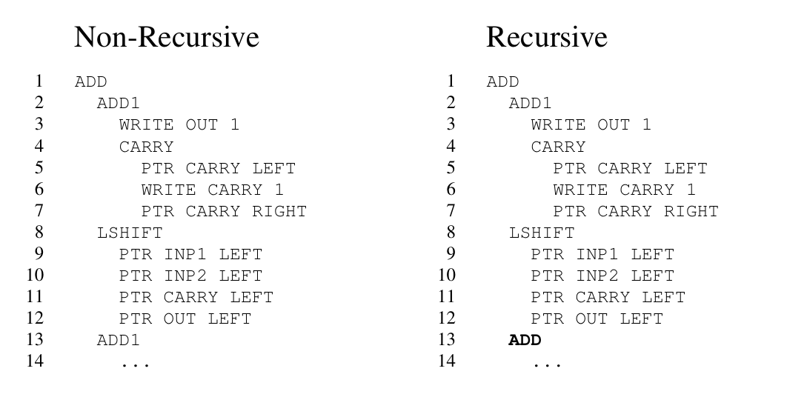

# 재귀(Recursion)로 신경망 프로그램을 완벽하게 일반화시키기

프로그램을 데이터로부터 학습하는 신경망은 오랫동안 **일반화(generalization)에 취약**했다. 이 논문은 그 문제를 아키텍처를 갈아엎지 않고, "재귀"라는 오래된 프로그래밍 개념 하나를 감독 신호에 심는 것만으로 해결한다. 그 결과 몇 개의 짧은 예시만으로 학습한 프로그램이 임의로 긴 입력에서도 100% 정확도로 동작하고, 심지어 그 완벽한 일반화를 **형식적으로 증명**까지 할 수 있게 된다. 이 글은 이 논문을 처음 읽는 사람도 따라올 수 있도록, 문제의식부터 덧셈 예제의 실행 과정까지 차근차근 풀어 쓴 것이다.

## 1. 왜 이 논문이 나왔나: 일반화라는 벽

프로그램을 데이터로부터 학습하는 신경망(neural program)들은 일반화에 취약하다. 예를 들어 덧셈 과제를 짧은 자릿수로 학습시킨 뒤 긴 자릿수로 테스트하면, 일정 복잡도를 넘어서는 순간 성능이 무너진다.

원인은 신경망이 프로그램의 진짜 의미(semantics) 대신, 학습 데이터의 우연한 특성(입력 길이 등)에 스스로 의존하는 표현을 고차원 은닉 상태에 저장하기 때문이다. 이렇게 학습된 의존성은 해석하기 어렵고, 모델이 복잡한 입력에서 무엇을 할지 예측하기 어렵게 만든다.

한 가지 흔한 대응책은 커리큘럼 학습(입력 복잡도를 점진적으로 올리며 학습)이지만, 이것도 근본적인 해결책은 아니다. 입력이 점점 복잡해져도 프로그램의 의미 자체는 짧고 변하지 않는데, 모델은 더 많은 데이터에 노출되면서 오히려 프로그램에 대한 **엉뚱하고 지나치게 복잡한 표현**을 학습해 버릴 수 있다. 즉 진짜 프로그램 의미를 배우지 못한다.

여기에 더해, 기존 접근들은 복잡한 입력에서의 동작을 **증명하거나 보장할 방법이 없다**는 문제도 안고 있었다. 이 신경 프로그램들의 메모리 갱신은 너무 복잡하고 서로 얽혀 있어서, 처음 보는 상황(예: 훨씬 긴 입력)에서 학습된 프로그램이 어떻게 행동할지 추론하기가 어렵다. 모든 가능한 입력에서 올바른 답을 낼 수 있다는 보장은 학습된 프로그램에 가장 중요한 속성 중 하나인데도, 아무도 이를 다루지 못했다.

## 2. 핵심 아이디어: 재귀라는 추상화

저자들의 제안은 단순하고 강력하다. 신경망 아키텍처에 **재귀(recursion)라는 추상화를 명시적으로 도입**하자는 것이다.

여기서 오해를 하나 짚고 넘어가야 한다. "재귀"라는 단어 때문에 Prolog 같은 논리형/함수형 언어를 떠올리기 쉽지만, **이 논문에 Prolog는 전혀 등장하지 않는다.** 출력이 어떤 언어의 프로그램 텍스트인 것도 아니다. 여기서 재귀는 프로그래밍 일반 개념일 뿐이다.

컴퓨터과학에서 재귀는 (반복문과 대비되는 개념으로) 큰 문제를 같은 문제의 더 작은 인스턴스의 해로 조합해 푸는 방식이다. 형식적으로, 어떤 함수가 재귀적이려면 두 가지 성질을 가진다.

1. **기저 사례(base cases)** — 재귀를 쓰지 않고 답을 내는 종료 조건.
2. **환원 규칙(reduction rules)** — 나머지 모든 문제를 기저 사례 쪽으로 줄여 나가는 규칙들.

재귀는 본질적으로 문제의 복잡도를 더 단순한 인스턴스로 줄인다. 그래서 각 신경망 구성요소가 다뤄야 할 입력 영역이 크게 줄고, "지금 관련된 작은 조각"에만 집중하며 다른 맥락은 무시할 수 있게 된다. 그 결과 긴 입력 같은 미지의 상황에서도 동작을 추론하기 쉬워진다.

결정적으로, 재귀로 정의된 프로그램은 위의 두 성질만 확인하면 완벽한 일반화를 증명할 수 있다. **(1) 기저 사례에서 올바르게 동작하고, (2) 환원 규칙을 올바르게 학습했다**는 것만 보이면 되기 때문이다. 많은 문제에서 기저 사례와 환원 규칙은 유한하고 종종 작은 개수의 경우로 이루어진다.

## 3. 어디에 구현했나: NPI와 실행 트레이스

### 1) NPI는 이미 재귀를 지원하고 있었다

저자들은 기존 **NPI(Neural Programmer-Interpreter, Reed & de Freitas 2016)** 프레임워크를 활용한다. NPI는 코어 컨트롤러(LSTM)가 매 스텝 어떤 서브프로그램을 어떤 인자로 호출할지 결정하는 디스패처 구조를 가진다. 프로그램이 호출되면 호출자의 맥락이 **콜 스택**에 저장되고, 반환되면 스택에서 꺼내 이어서 실행한다.

이런 콜 스택 구조 덕분에 NPI는 사실 재귀를 자연스럽게 지원한다 — 프로그램이 자기 자신을 호출하기만 하면 된다. 그런데 NPI 원저자들은 이 점을 명시적으로 활용하지 않았고, 그래서 재귀 프로그램을 학습하지 못했다.

### 2) 진짜 기여는 "재귀적 트레이스를 만든 것"

이 논문의 실제 기여는 아키텍처를 바꾼 것이 아니라 **감독 신호(training trace)의 구조만 바꾼 것**이다.

기존 NPI도 이미 실행 트레이스로 학습했다. 하지만 그 트레이스는 **비재귀적(반복 루프 형태)** 이었다 — ADD1과 LSHIFT를 계속 반복하는 평평한 루프. 저자들은 사람이 손으로 **재귀적으로 문제를 푸는 프로그램**을 정의한 뒤(예: 덧셈에서 ADD가 한 자리를 처리하고 자기 자신 ADD를 다시 호출하도록), 그 프로그램을 실제 문제 인스턴스에 돌려 나오는 실행 트레이스를 학습 데이터로 삼았다.

아래 Figure 1이 이 둘을 나란히 보여준다. 왼쪽(비재귀)은 ADD1과 LSHIFT 사이클을 돌지만(13번째 줄에서 다시 ADD1로 돌아감), 오른쪽(재귀)은 13번째 줄에서 **ADD가 자기 자신을 호출**한다(굵게 표시).



*Figure 1. 같은 문제, 같은 서브프로그램, 같은 NPI 아키텍처인데 트레이스의 형태만 다르다. 비재귀 버전은 ADD1/LSHIFT를 평평한 루프로 반복하고, 재귀 버전은 ADD가 자기 자신을 호출한다.*

같은 문제, 같은 서브프로그램, 같은 아키텍처인데 **트레이스의 형태만 재귀적으로 바꿔줬더니** 완벽한 일반화가 나왔다는 것이 핵심 발견이다.

### 3) 학습 데이터는 어떻게 만드나

각 태스크마다 재귀 알고리즘을 구현해 두고, 거기에 **구체적인 문제 인스턴스**를 넣어 실행시킨다. 그 실행 과정에서 나오는 "스텝 입력 → 스텝 출력" 쌍들의 연속이 하나의 실행 트레이스가 되고, 이걸 서로 다른 문제 인스턴스로 반복 생성해 데이터셋을 만든다.

놀라운 점은, 학습에 쓰는 문제 인스턴스가 아주 적고 대체로 짧고 단순한데도 완벽한 일반화가 나온다는 것이다. 이유는 재귀 구조에 있다. 재귀 알고리즘의 트레이스는 결국 유한한 개수의 기저 사례와 환원 규칙의 조합이므로, 학습 데이터가 이 유한한 패턴들을 한 번씩만 커버하면 신경망은 임의로 긴 입력에서도 같은 규칙을 반복 적용하는 법을 배운다. 실제로 저자들은 덧셈의 경우 **임의로 고른 1자리 덧셈 5개**의 트레이스만으로 학습했는데, 재귀 버전은 "822+233" 같은 긴 문제(그 안의 "8+2", "2+3"이 학습셋에 있는)로도 완벽히 일반화한다.

## 4. 신경망(NPI 컨트롤러)의 구조

이 구조는 흔히 떠올리는 seq2seq(인코더가 입력 전체를 먼저 읽고 → 디코더가 출력 전체를 뱉는) 형태가 **아니다.** 입력이 초기 환경이고 출력이 시퀀스라는 점은 비슷하지만, 결정적으로 다른 점은 **환경을 매 스텝 다시 읽는다**는 것이다. 즉 인코더-디코더가 아니라 환경과 피드백 루프를 이루는 순환 컨트롤러다.

### 1) 세 개의 학습 가능한 구성요소

**(1) 도메인별 인코더 $f_{enc}$ (task-specific).** 환경 전체가 아니라 포인터가 가리키는 슬라이스만 읽어 상태 벡터로 만든다. 덧셈이라면 4개 행에서 각 포인터가 가리키는 값 + 인자를 MLP에 넣는다.

$$s_t = f_{enc}(e_t, a_t)$$

**(2) 태스크 무관 코어 $f_{lstm}$.** 태스크와 무관한 공용 LSTM 컨트롤러로, 매 스텝 인코딩된 상태 $s_t$, 현재 실행 중인 프로그램 임베딩 $p_t$, 이전 은닉 상태 $h_{t-1}$을 받는다.

$$h_t = f_{lstm}(s_t, p_t, h_{t-1})$$

여기서 은닉 상태 $h$는 "지금 이 프로그램 호출 프레임 안에서 어디까지 진행했나"를 담는 작업 기억이다.

**(3) 세 개의 디코더.** 매 스텝 $h_t$로부터 세 가지를 동시에 뽑는다.

$$r_t = f_{end}(h_t), \quad p_{t+1} = f_{prog}(h_t), \quad a_{t+1} = f_{arg}(h_t)$$

- $f_{end}$: **종료 확률** $r$ (시그모이드 스칼라). $r > \alpha(=0.5)$면 이 프레임을 끝낸다.
- $f_{prog}$: **다음에 호출할 프로그램**. 정확히는 프로그램 키 임베딩을 디코딩해 프로그램 메모리에서 조회(lookup)한다.
- $f_{arg}$: **인자** (정수 3-튜플).

정리하면 실제 학습 파라미터는 이 다섯 함수 $f_{enc}, f_{lstm}, f_{end}, f_{prog}, f_{arg}$에 더해, 조회에 쓰이는 **프로그램 임베딩 메모리**까지다. 반면 환경 전이 함수 $f_{env}$(원시 연산이 스크래치패드를 실제로 바꾸는 규칙)는 신경망이 아니라 **고정된 결정론적 시뮬레이터**라 학습 대상이 아니다.

### 2) 실행은 재귀적으로 중첩된 여러 rollout

핵심은 seq2seq의 한 번의 rollout이 아니라, 재귀적으로 중첩된 여러 개의 짧은 LSTM rollout이라는 점이다.

```
RUN(e, p, a):
    h ← 0                      # ← 매 호출마다 은닉 상태 리셋!
    while r < α:
        s = f_enc(e, a)         # 환경 슬라이스를 매 스텝 다시 읽음
        h = f_lstm(s, p, h)     # 컨트롤러 한 스텝 전진
        r, p2, a2 = f_end(h), f_prog(h), f_arg(h)
        if p가 원시연산:
            e = f_env(e, p, a)  # 환경을 실제로 변형 (WRITE 등)
        else:
            RUN(e, p2, a2)       # ← 서브프로그램 호출 = 재귀
```

두 가지가 결정적이다. 첫째, **환경은 매 스텝 다시 읽힌다.** seq2seq처럼 초기 환경을 한 번 인코딩하고 마는 게 아니라, $f_{env}$가 환경을 바꾸면 다음 스텝에서 $f_{enc}$가 바뀐 환경을 다시 관찰한다. 둘째, **매 호출마다 $h \leftarrow 0$으로 리셋된다.** 한 프로그램이 자기 자신(또는 서브프로그램)을 부르면 호출자의 맥락은 콜 스택에 저장되고, 피호출자는 은닉 상태 0에서 새로 시작한다. 이 리셋이 이 논문에서 재귀를 가능하게 하는 결정적 설계다 — 언제나 "현재 관련된 재귀 호출"에만 집중하고 다른 맥락의 세부는 무시할 수 있게 해준다.

### 3) $f_{enc}$는 왜 프로그램 $p$를 입력으로 받지 않는가

수식을 다시 보면 흥미로운 비대칭이 있다. 인코더 $f_{enc}(e_t, a_t)$는 환경 $e$와 인자 $a$만 받고, 프로그램 $p$는 받지 않는다. $p$는 그 다음 단계인 코어 $f_{lstm}(s_t, p_t, h_{t-1})$에서야 등장한다. 왜 이렇게 나눴을까? 핵심은 **역할 분담(separation of concerns)** 이다.

$f_{enc}$가 하는 일은 딱 하나, **지금 환경에서 무엇이 보이는가**를 고정 크기 벡터로 압축하는 것이다. 포인터가 가리키는 칸의 원시 값들(숫자, 토큰 등)이라는 날것의 관찰을 코어가 다룰 수 있는 특징 벡터 $s_t$로 바꾸는 감각기관인 셈이다. 그리고 이 지각은 "지금 어떤 프로그램이 실행 중인지"와 무관하다. 일의 자리에 5와 8이 놓여 있다는 사실은 그걸 보는 프로그램이 ADD1이든 무엇이든 똑같이 5와 8이다. 그래서 환경 관찰을 프로그램과 독립적으로 인코딩하면 같은 환경 상태는 언제나 같은 $s_t$로 표현되어, 표현이 안정적이고 재사용 가능해진다.

$$s_t = f_{enc}(e_t, a_t) \qquad h_t = f_{lstm}(s_t,\, p_t,\, h_{t-1})$$

"이 관찰을 가지고 무엇을 할 것인가"라는 판단은 프로그램 $p$에 달려 있고, 그 결정은 코어 LSTM 안에서 일어난다. 구조가 이렇게 갈린다 — $f_{enc}$(지각)는 환경을 관찰 벡터로 바꾸며 프로그램과 무관하고, $f_{lstm}$(제어)는 (관찰 + 어떤 프로그램인가 + 지금까지의 진행)을 받아 다음 행동을 낸다. 게다가 $p_t$는 이미 학습된 고정 크기 임베딩 벡터라 따로 "인코딩"할 필요가 없다. $f_{enc}$가 존재하는 이유는 태스크마다 제각각인 날것의 환경을 압축하기 위해서인데, $p$는 이미 코어가 이해하는 정규 공간의 벡터이므로 그냥 LSTM에 직접 넣으면 된다.

그렇다면 인자 $a$는 왜 $f_{enc}$에 들어갈까? $a$를 "환경을 구성하는 요소"라고 보기보다, **환경을 지금 어떻게 읽고 다룰지를 지정하는 파라미터**로 보는 게 정확하다. 환경 $Q$는 $a$와 별개로 이미 존재하고, $a$는 그 환경에 대한 조작·해석 방식을 규정하는 인자다(예: PTR에서 "어느 행의 포인터를 어느 방향으로"). 같은 격자라도 인자가 무엇이냐에 따라 지금 무엇에 주목하고 어떻게 변형할지가 달라지므로, 환경 관찰 $s_t$를 만들 때 함께 넣는 것이 자연스럽다. 결정적으로 $a$는 환경 변형 단계에 직접 관여한다 — 원시 연산이 환경을 바꿀 때 $e \sim f_{env}(e, p, a)$처럼 $a$가 들어간다. 즉 $a$는 환경(관찰·행동) 층위에 밀착된 정보다.

이 점이 $p$와의 대비를 만든다. $a$는 "이 환경을 지금 구체적으로 어떻게 읽고 건드릴까"라는 환경 밀착 정보라서 환경 인코더 $f_{enc}$에 함께 들어가고, $p$는 "어떤 서브루틴을 돌릴까"라는 한 단계 위의 디스패치 정보라서 환경 인코더가 아니라 코어 $f_{lstm}$에 직접 들어간다.

### 4) 태스크와 프로그램은 어떻게 다른가

방금의 분리를 제대로 이해하려면 "태스크(task)"와 "프로그램(program)"이 서로 다른 층위에 있다는 점을 짚어야 한다. 한 문장으로 구분하면 이렇다.

- **태스크 = 풀려는 문제 종류 = 환경(environment)의 종류.** 덧셈, 버블 정렬, 위상 정렬, 퀵 정렬 각각이 하나의 태스크다.
- **프로그램 = 그 태스크를 풀기 위해 컨트롤러가 매 스텝 호출하는 서브루틴.** ADD, ADD1, LSHIFT, CARRY, WRITE, PTR 등이 프로그램이다.

즉 태스크는 "무대와 도구가 무엇인가"이고, 프로그램은 "그 무대 위에서 지금 어떤 동작을 부르는가"이다. 덧셈이라는 태스크의 정체성은 곧 환경의 형태다 — 4줄짜리 스크래치패드, $Q \in \mathbb{R}^{4\times N \times K}$. 이 환경을 읽는 감각기관 $f_{enc}$도 이 태스크 전용으로 하나 존재한다. 그 안에서 컨트롤러가 부르는 프로그램들은 이렇게 늘어놓을 수 있다.

```
태스크: 덧셈
   ├─ 프로그램: ADD     (한 열 처리하고 왼쪽으로 옮기고 자기 자신 호출)
   ├─ 프로그램: ADD1    (현재 열의 두 숫자를 더해 출력에 씀)
   ├─ 프로그램: CARRY   (자리올림 1을 왼쪽 칸에 적음)
   ├─ 프로그램: LSHIFT  (포인터 4개를 왼쪽으로 이동)
   ├─ 프로그램: WRITE   (칸에 값 쓰기 — 원시 연산)
   └─ 프로그램: PTR     (포인터 한 칸 이동 — 원시 연산)
```

퀵 정렬이라는 태스크와 비교하면 구분이 선명해진다. 퀵 정렬은 환경 자체가 다르다 — 스크래치패드가 아니라 정렬할 배열이고, 포인터도 덧셈과 다르게 놓인다. 그래서 이 태스크에는 덧셈과 다른 도메인 특화 인코더 $f_{enc}$가 붙고, 그 안에서 호출되는 프로그램도 PARTITION, SWAP 등으로 달라진다. 여기서 핵심 대비가 드러난다 — **태스크가 바뀌면 환경이 바뀌고 $f_{enc}$(도메인 특화)를 갈아 끼우지만, 어떤 태스크든 $f_{lstm}$(코어)과 프로그램 임베딩 공간은 그대로 공유한다.** 프로그램이라는 것은 코어가 이해하는 공유 임베딩 공간의 한 벡터 $p$일 뿐이라, ADD든 PARTITION이든 코어 입장에서는 똑같이 "이번에 디스패치할 프로그램 임베딩 하나"다. 실제로 WRITE나 PTR 같은 원시 연산은 여러 태스크에서 재사용되기도 한다.

이 구분이 바로 "$f_{enc}$가 왜 $p$를 안 받는가"의 답이다. $f_{enc}$는 태스크(환경)에 묶인 모듈이다 — 덧셈 스크래치패드를 읽는 법은 덧셈 전용이다. 반면 $p$(프로그램)는 모든 태스크가 공유하는 정보다. 만약 태스크 전용 인코더 안에 공유 정보인 $p$를 집어넣으면, 프로그램의 의미가 덧셈 인코더·정렬 인코더마다 따로따로 다시 학습되며 뒤엉킨다. 그래서 태스크에 종속된 "환경 지각"은 $f_{enc}$에, 태스크를 가로질러 공유되는 "어떤 프로그램을 부를지"는 코어 $f_{lstm}$에 둔 것이다. 이렇게 두면 프로그램 임베딩 $p$가 어느 태스크에서든 공유 코어에 의해 동일하게 해석된다. 이 원칙은 이 논문 전체를 관통하는 철학 — "각 신경망 구성요소가 다뤄야 할 영역을 최대한 줄인다" — 와도 그대로 이어진다.

## 5. 강화학습과 무엇이 다른가

표면 구조는 강화학습(RL)과 정말 닮았다. 환경 $Q$가 있고, 컨트롤러가 상태를 관찰하고, 매 스텝 행동(어떤 프로그램을 어떤 인자로 호출할지)을 선택하며, 그 행동이 환경을 바꾼다. 콜 스택으로 맥락이 쌓이고 풀리는 것도 순차적 의사결정 그 자체다. RL의 정책 $\pi(\text{action} \mid \text{state})$ 구조와 형태가 똑같다.

하지만 학습 방식은 근본적으로 다르다. RL의 본질은 **보상(reward)** 이다. 에이전트가 스스로 행동을 시도(탐색)하고, 그 결과로 받는 보상을 최대화하도록 정책을 갱신한다. 정답 행동을 아무도 알려주지 않는다.

이 논문은 그게 아니다. 매 스텝의 **정답 행동이 실행 트레이스에 이미 다 적혀 있다.** 신경망은 그저 "이 상태에서는 ADD1을 불러라, 다음엔 LSHIFT를 불러라"를 그대로 **모방(imitate)** 하도록 지도학습된다. 보상도, 탐색도, 시행착오도 없다. 손실 함수는 세 디코더가 예측한 (다음 프로그램/인자/종료확률)과 트레이스에 적힌 정답 사이의 분류 손실(cross-entropy)일 뿐이다. 이 방식은 RL이라기보다 **모방 학습(imitation learning) / 행동 복제(behavioral cloning)** 에 해당한다.

흥미롭게도 저자들 스스로도 전체 트레이스를 다 주는 강한 지도가 부담이라는 걸 알고 있다. 그래서 향후 과제로 "명시적 실행 트레이스 없이, 혹은 부분적/비재귀적 트레이스만으로 재귀 추상화를 스스로 찾아내는 모델"을 언급한다. 이 방향으로 감독을 줄이면 실제로 RL(보상 기반 탐색)에 훨씬 가까워진다.

## 6. 덧셈 예제 실행 과정 상세히 따라가기

구체적인 숫자 하나를 끝까지 따라가 보자. **25 + 48 = 73**을 예로 든다.

### 1) 무대 설정: 스크래치패드(환경 Q)

모델은 종이에 손으로 덧셈하듯 4줄짜리 격자에 작업한다.

```
          (십의자리) (일의자리)
입력1  :      2         5
입력2  :      4         8
자리올림:      _         _
출력   :      _         _
```

1행은 첫 번째 숫자, 2행은 두 번째 숫자, 3행은 자리올림(carry), 4행은 정답이 적힐 곳이다. 각 행에는 포인터(연필 끝)가 하나씩 있고, 처음에는 모두 맨 오른쪽(일의 자리)을 가리킨다. 형식적으로 환경은 $Q \in \mathbb{R}^{4 \times N \times K}$이고, $K=11$은 10개 숫자에 입력의 끝을 알리는 토큰 하나를 더한 값이다. LSTM은 격자 전체가 아니라 네 포인터가 지금 가리키는 4개 칸의 값만 본다 — 딱 사람이 지금 계산 중인 세로줄 하나만 보는 것과 같다. 초등학교 덧셈이 오른쪽부터 왼쪽으로 진행하듯, 이 과정도 일의 자리부터 시작한다.

등장하는 프로그램들의 역할은 이렇다. **ADD**는 최상위 재귀 프로그램으로 "이 열을 처리하고, 한 칸 왼쪽으로 옮긴 뒤, 자기 자신을 다시 호출"한다. **ADD1**은 지금 열의 두 숫자(+이미 있는 자리올림)를 더해 출력 칸에 한 자리 숫자를 쓰고, 10을 넘으면 자리올림 처리를 부른다. **CARRY**는 자리올림 1을 왼쪽 열의 자리올림 칸에 적어둔다. **LSHIFT**는 네 포인터를 모두 한 칸 왼쪽으로 옮긴다. **WRITE / PTR**은 실제로 칸에 쓰거나 포인터를 움직이는 원시 연산이다.

### 2) 1단계: 일의 자리 (5 + 8 = 13)

포인터가 일의 자리를 가리킨 상태에서 ADD가 시작된다.

```
ADD
  ADD1                    → 5 + 8 = 13. 일의 자리 숫자는 3
    WRITE OUT 3           → 출력 칸에 3을 씀
    CARRY                 → 13은 10을 넘으니 자리올림 발생
      PTR CARRY LEFT      → 자리올림 포인터를 왼쪽(십의 자리)으로 이동
      WRITE CARRY 1       → 그 칸에 자리올림 1을 적어둠
      PTR CARRY RIGHT     → 자리올림 포인터를 원위치로 복귀
  LSHIFT                  → 이제 다음 열로 넘어감
    PTR INP1 LEFT
    PTR INP2 LEFT
    PTR CARRY LEFT
    PTR OUT LEFT
  ADD                     ← ★자기 자신을 다시 호출 (재귀!)
```

이 시점의 격자 상태:

```
          (십의자리) (일의자리)
입력1  :      2         5
입력2  :      4         8
자리올림:      1         _      ← 왼쪽 칸에 자리올림 1이 적혀 있음
출력   :      _         3      ← 일의 자리 결과 3
```

### 3) 2단계: 십의 자리 (2 + 4 + 자리올림 1 = 7)

방금 재귀 호출된 ADD가 새로 시작된다. 핵심은 이 ADD가 **은닉 상태 $h=0$에서 완전히 새로 출발**한다는 점이다. "앞에서 무슨 일이 있었는지"는 전혀 기억하지 않고, 오직 지금 포인터가 가리키는 십의 자리 칸들만 본다.

```
ADD
  ADD1                    → 2 + 4 + (자리올림)1 = 7
    WRITE OUT 7           → 출력 칸에 7을 씀
    (7은 10 미만 → CARRY 없음)
  LSHIFT                  → 다음 열로 이동
    PTR INP1 LEFT
    PTR INP2 LEFT
    PTR CARRY LEFT
    PTR OUT LEFT
  ADD                     ← ★또 재귀 호출
```

출력 행에 이제 73이 완성된다.

### 4) 3단계: 기저 사례 (더 이상 숫자가 없음)

또 새로 시작된 ADD가 지금 열을 본다. 그런데 입력1·입력2 칸에 더 이상 숫자가 없다(입력의 끝을 알리는 특수 토큰이 보임). 이때가 기저 사례다.

```
ADD
  (현재 열에 숫자 없음 → 재귀하지 않고 종료 확률을 높여 RETURN)
```

ADD는 자기 자신을 부르지 않고 반환하고, 콜 스택이 차례로 풀리며 전체 실행이 끝난다. 출력 행에 **73**이 남는다.

### 5) 초보자를 위한 핵심 세 가지

**첫째, LSTM이 매번 하는 일은 똑같다.** 일의 자리든 십의 자리든, ADD 한 번이 하는 일은 "이 열을 더하고 → 왼쪽으로 옮기고 → 나를 다시 부른다"로 동일하다. 두 자리든 백 자리든 한 프레임이 배우는 패턴은 완전히 같다.

**둘째, 매 재귀 호출마다 기억을 리셋한다.** 십의 자리를 계산하는 ADD는 일의 자리에서 무슨 일이 있었는지 $h$에 담고 있지 않다. 앞 열이 남긴 정보는 오직 격자의 자리올림 칸(눈에 보이는 환경)에만 적혀 있고, 신경망은 그걸 그 자리에서 새로 읽는다. 그래서 "지금이 몇 번째 열인지", "전체 길이가 얼마인지"에 의존하지 않는다.

**셋째, 이것이 완벽한 일반화의 비결이다.** 신경망이 실제로 배워야 하는 건 딱 두 가지 국소 규칙뿐이다 — "숫자가 남아 있으면 한 열 더하고 왼쪽으로 옮겨 나를 다시 부른다(환원 규칙)", "숫자가 없으면 멈춘다(기저 사례)". 이 둘만 짧은 예시로 배우면 1000자리 덧셈도 같은 규칙을 1000번 재귀 호출하는 것으로 정확히 풀린다.

## 7. 재귀가 일반화를 만드는 진짜 이유

여기서 흔한 오해 하나를 바로잡을 필요가 있다. 재귀의 이득은 "스텝 수가 줄어서"가 아니다. 재귀를 도입해도 **전체 스텝 수(총 연산량)는 별로 줄지 않는다.** 덧셈이든 정렬이든 결국 같은 양의 원시 연산을 수행해야 답이 나오고, 재귀 트레이스와 비재귀 트레이스의 총 길이는 비슷하다. 재귀가 바꾸는 건 총량이 아니라 **그 시퀀스가 어떻게 조각나는가**다.

**비재귀(평평한 루프)의 경우**, 하나의 LSTM rollout이 입력 전체를 처음부터 끝까지 관통한다. 입력이 길수록 rollout도 길어지고, 은닉 상태 $h$에는 지나온 모든 맥락이 계속 누적된다. 그래서 신경망이 "지금까지 몇 번째 열인가", "전체 길이가 얼마인가" 같은 길이 의존적이고 우연한 특성에 의존하게 되고, 학습 때 못 본 긴 길이가 오면 $h$가 훈련 분포를 벗어나 무너진다.

**재귀의 경우**, 전체가 여러 개의 짧은 호출 프레임으로 쪼개지고, 각 프레임은 $h=0$에서 시작하는 독립적이고 길이가 일정한 짧은 rollout이다. 입력이 아무리 길어져도 개별 프레임 하나가 내리는 결정은 항상 동일한 크기다 — "지금이 기저 사례인가?"와 "한 단계 어떻게 환원하는가?" 뿐이다. 즉 신경망이 실제로 학습해야 하는 함수는 입력 길이와 무관한, 유한하고 국소적인 매핑으로 축소된다.

그래서 더 정확한 표현은 이렇다. 재귀의 이득은 "긴 시퀀스를 더 잘 처리하게 됐다"가 아니라, **"긴 시퀀스를 처리하는 문제를 아예 없애버렸다"**는 것이다. 신경망은 이제 긴 시퀀스를 볼 일이 없고, 항상 짧고 고정된 국소 결정만 반복한다. 임의 길이의 입력이 요구하는 것은 이 국소 결정을 더 여러 번 재귀 호출하는 것뿐이고, 그건 신경망 가중치가 아니라 콜 스택이 처리한다.

## 8. 실험 결과: 완벽한 일반화

저자들은 네 가지 과제 — 초등학교식 덧셈, 버블 정렬, 위상 정렬, 퀵 정렬 — 에 이 방법을 적용했다. 결과는 극명하다. 비재귀 버전은 입력이 조금만 길어져도 정확도가 급락하는 반면, 완전 재귀 버전은 **모든 길이에서 100%**를 유지한다.

퀵 정렬 결과(각 길이마다 무작위 배열 30개로 테스트, 값이 높을수록 좋음):

| 배열 길이 | 비재귀(Non-Recursive) | 재귀(Recursive) |
|:---:|:---:|:---:|
| 3 | 100% | **100%** |
| 5 | 100% | **100%** |
| 7 | 100% | **100%** |
| 11 | 73.3% | **100%** |
| 15 | 60% | **100%** |
| 20 | 30% | **100%** |
| 25 | 3.33% | **100%** |
| 30 | 3.33% | **100%** |
| 70 | 0% | **100%** |

비재귀 버전은 길이 11부터 정확도가 무너지기 시작해 길이 70에서는 0%가 되지만, 재귀 버전은 어떤 배열이 주어져도 정렬해 낸다. 버블 정렬(길이 90까지 재귀만 100%), 위상 정렬(정점 70개까지 재귀만 100%)에서도 같은 패턴이 나타난다. 덧셈에서는 재귀·비재귀 모두 최대 5000자리까지 일반화했지만, 비재귀 버전에는 **모든 입력에 대한 보장이 없다**는 점이 결정적으로 다르다.

## 9. 진짜 하이라이트: 증명 가능한 완벽한 일반화

이 논문이 단순한 정확도 향상을 넘어서는 지점이 여기다. 재귀 구조 덕분에 학습된 프로그램이 유한한 종류의 국소 결정(기저 사례 + 환원 규칙)으로 환원되므로, 저자들은 **모든 기저 사례와 환원 규칙을 커버하는 유한한 검증 집합(verification set)** 을 구성할 수 있다. 학습된 모델이 이 검증 집합에서 전부 참 프로그램과 동일한 트레이스를 내는지 확인하면, 재귀 구조상 임의 길이 입력에 대한 완벽한 일반화가 따라온다.

이것이 비재귀 버전으로는 불가능한 이유도 명확하다. 비재귀 버전은 코어 LSTM의 은닉 상태가 계속 전파되어 추론이 어렵고, 결국 무한히 많은 예시를 확인해야 하기 때문이다. 만약 재귀가 단지 "긴 시퀀스를 잘 처리하게 된 것"에 불과했다면, 무한히 긴 입력을 다 검증할 수 없으니 이런 증명은 애초에 불가능했을 것이다.

저자들의 말을 빌리면, 신경 프로그램에 검증(verification)이 적용된 것도, 완벽한 일반화가 증명 가능하게 보장된 것도 이 논문이 처음이다.

## 10. 맺으며

이 논문의 메시지는 한 문장으로 요약된다. **신경망이 프로그램의 의미를 견고하게 학습하려면 재귀 같은 개념을 반드시 내장해야 한다.** 흥미로운 것은 그 처방이 아키텍처를 갈아엎는 것이 아니라, 감독 신호(실행 트레이스)의 구조를 재귀적으로 바꾸는 것만으로 충분했다는 점이다. 재귀는 "무한히 다양할 수 있는 긴 시퀀스 학습 문제"를 "유한한 종류의 고정 길이 국소 결정 학습 문제"로 바꿔놓았고, 그 덕분에 적은 데이터로 완벽히 일반화하며 그 일반화를 형식적으로 증명까지 할 수 있게 되었다.

남은 과제도 분명하다. 지금은 전체 재귀 트레이스를 사람이 다 만들어 줘야 한다. 저자들이 향후 방향으로 꼽은 것은, 명시적 트레이스 없이 혹은 부분적 트레이스만으로 **모델이 스스로 재귀 추상화를 발견**하도록 만드는 것이다. 그 방향은 자연스럽게 보상 기반 탐색, 즉 강화학습과 만나게 될 것이다.
