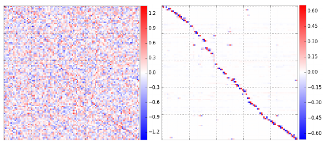
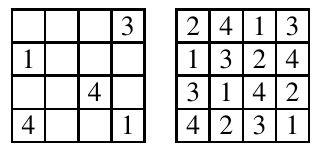
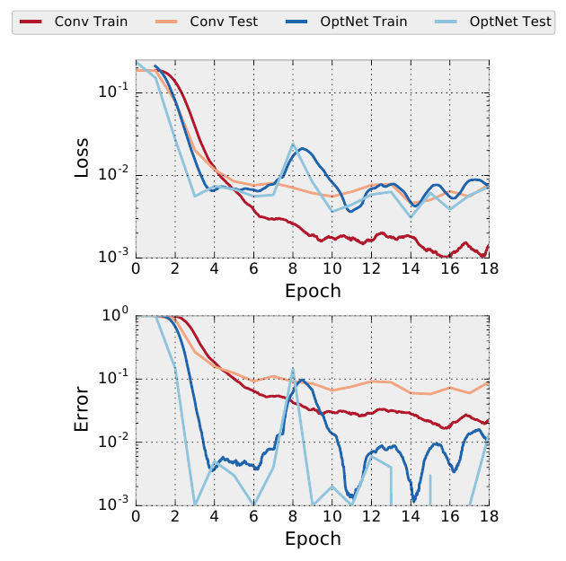

# 제약 최적화 문제를 신경망의 한 층으로 넣고 규칙을 제약으로 학습하기 — OptNet: Differentiable Optimization as a Layer in Neural Networks
#### Abstract
본 논문은 최적화 문제(구체적으로는 이차계획(quadratic program) 형태의 문제)를 종단간(end-to-end) 학습이 가능한 더 큰 심층 신경망 안에 개별 층(layer)으로 통합하는 신경망 구조인 OptNet을 제시한다. 이러한 층은 기존의 합성곱 층과 완전연결 층이 흔히 포착하지 못하는 은닉 상태 사이의 제약과 복잡한 의존 관계를 부호화한다. 본 논문에서는 이러한 구조의 기초를 탐구한다. 즉 민감도 분석(sensitivity analysis), 이층 최적화(bilevel optimization), 암묵적 미분(implicit differentiation)의 기법을 이용하여 이 층을 통과하는 미분과 층 파라미터에 대한 미분을 정확하게 계산할 수 있음을 보인다. 또한 원쌍대 내점법(primal-dual interior point method) 안에서 GPU 기반의 빠른 배치 풀이를 활용하는 매우 효율적인 솔버를 개발하는데, 이 솔버는 풀이 자체에 더해 사실상 추가 비용 없이 역전파 기울기를 제공한다. 그리고 여러 문제에서 이러한 접근법의 적용 사례를 제시한다. 주목할 만한 예로, 이 방법이 게임 규칙에 대한 사전 정보 없이 입력 게임과 출력 게임만 주어진 상태에서 미니 스도쿠(4×4)를 푸는 법을 학습할 수 있음을 보인다. 이는 다른 신경망 구조보다 하드 제약(hard constraint)을 더 잘 학습하는 본 구조의 능력을 부각한다.
#### 요약
신경망은 입력을 출력으로 바꾸는 함수를 잘 근사하지만, "한 행에 같은 숫자가 두 번 나오면 안 된다" 같은 엄격한 제약을 출력에 직접 담기는 어렵다. 이 논문은 이차계획 문제를 풀어 낸 해를 한 층의 출력으로 삼고, 최적성 조건(KKT 조건)을 미분하여 그 층을 다른 층처럼 역전파로 학습시키는 방법을 제시한다. 그 결과 층의 가중치는 "입력을 출력으로 바꾸는 계수"가 아니라 "출력이 머물 수 있는 영역의 경계"가 되고, 규칙은 그 경계의 모양으로 학습된다. 이 글은 논문의 구조와 실험을 따라가면서, 이 발상이 뉴로심볼릭 AI의 분류 체계에서 어디에 놓이는지도 함께 따져 본다.

---

## 1. 문제의식: 최적화 문제의 해를 층의 출력으로 삼기

### 1) 기존 층이 담기 어려운 것

일반적인 순전파 신경망(feedforward network)에서 각 층의 출력은 이전 층 출력의 비교적 단순한 비선형 함수이다. 완전연결 층은 행렬곱에 활성화 함수를 씌우고, 합성곱 층은 국소적인 필터를 적용한다. 이런 연산은 입력과 출력 사이의 통계적 대응을 학습하는 데는 강하지만, 출력 변수들 사이의 엄격한 제약 관계, 예를 들어 "한 행에 같은 숫자가 두 번 나오면 안 된다" 같은 규칙을 직접 표현하기 어렵다. 이런 규칙은 출력의 한 성분만 보고 판단할 수 있는 것이 아니라 여러 성분이 동시에 만족해야 하는 조건이기 때문이다.

Amos와 Kolter가 ICML 2017에 발표한 이 논문의 핵심 질문은 "제약이 있는 최적화 문제를 풀어 낸 해를 신경망 한 층의 출력으로 쓰고, 그 층을 다른 층처럼 역전파로 학습시킬 수 있는가"이다. 저자들은 이 질문을 이차계획(QP, quadratic program)으로 범위를 좁혀 답한다. 이차계획은 목적함수가 이차식이고 제약이 선형 등식과 선형 부등식인 최적화 문제로, 볼록(convex)인 경우 다항 시간에 정확히 풀 수 있고 GPU에서 효율적으로 다룰 수 있다는 장점이 있다.

### 2) OptNet 층의 정의

OptNet은 i+1번째 층의 출력을 다음 이차계획의 해로 정의한다.

$$z_{i+1} = \arg\min_{z} \ \tfrac{1}{2} z^\top Q(z_i)\, z + q(z_i)^\top z \quad \text{subject to} \quad A(z_i)\, z = b(z_i),\ \ G(z_i)\, z \le h(z_i)$$

여기서 $z$는 최적화 변수, 즉 이 층이 찾아내야 하는 출력 벡터이다. $Q$는 이차항의 계수 행렬로 양의 준정부호(positive semidefinite)여야 문제가 볼록이 된다. $q$는 선형항의 계수 벡터, $A$와 $b$는 등식 제약 $Az = b$를, $G$와 $h$는 부등식 제약 $Gz \le h$를 정의한다. 괄호 안의 $z_i$는 이 계수들이 이전 층의 출력에 미분 가능한 방식으로 의존할 수 있다는 뜻이다. 물론 이전 층과 무관한 독립적인 학습 파라미터로 둘 수도 있다.

이 식을 한 문장으로 말하면, "이전 층이 정해 준 목적함수를, 학습된 제약을 지키면서 가장 작게 만드는 점을 찾아 그것을 출력으로 내보낸다"는 것이다. 즉 목적함수와 제약조건 자체를 데이터로부터 학습하는 구조이다. 일반 층에서 가중치가 입력을 출력으로 변환하는 방식을 정한다면, OptNet 층에서 가중치는 어떤 출력이 허용되는지, 그리고 허용된 출력 중 무엇이 가장 좋은지를 정한다. 이 차이가 이 글 전체를 관통하는 요점이다.

순전파(forward pass)는 이 문제를 설정하고 해를 구하는 것으로 끝난다. 그러나 학습에는 역전파(backward pass)가 필요하고, 그러려면 해 $z^\star$가 각 계수에 대해 어떻게 변하는지, 즉 해의 미분을 계산할 수 있어야 한다. 해는 명시적인 공식으로 주어지지 않으므로 이것이 간단하지 않다. 논문의 기술적 기여 대부분이 이 문제를 푸는 데 있다.

## 2. 기존 연구와의 차별점

최적화를 신경망의 추론 과정에 넣으려는 시도는 이전에도 있었다. 논문은 이를 네 갈래로 정리한다.

첫째, 에너지 기반 학습(energy-based learning)은 관측 데이터 근처에서 에너지가 낮고 나머지에서 높아지도록 에너지 함수를 학습하는 방식이다. 조건부 무작위장(CRF, conditional random field)을 심층망의 마지막 층으로 붙이는 연구가 여기에 속한다. 다만 관측 데이터가 필요하고 심층 에너지 구조와 결합하면 학습이 불안정해질 수 있다.

둘째, 해석적 방법은 제약 없는 이차 최소화처럼 argmin의 해석해(closed-form solution)가 존재할 때 그 공식을 직접 미분한다. 제약이 있으면 해석해가 없으므로 이 방법을 쓸 수 없다.

셋째, 펼치기(unrolling)는 argmin을 경사하강법 같은 반복 알고리즘으로 근사하고, 그 반복 과정을 계산 그래프로 펼쳐 자동 미분하는 방식이다. 반복 횟수만큼 망이 커지고 계산량이 늘어나며, 제약이 있으면 매 반복의 사영(projection) 연산 때문에 펼치기 어렵다는 한계가 있다.

넷째, argmin 미분은 최적화 문제의 해를 직접 미분하는 방식으로, 이층 최적화와 민감도 분석에서 쓰여 온 기법이다. OptNet과 가장 가까운 계열이다. 그런데 이 계열의 Gould et al.(2016)은 등식 제약만 정확히 다루고, 부등식 제약은 장벽 함수(barrier function)로 근사해 제약 없는 문제로 바꾸어 처리했다. OptNet은 KKT 조건의 상보 여유성(complementary slackness)까지 직접 미분함으로써 등식과 부등식 제약을 모두 정확하게 다룬다는 점을 차별점으로 내세운다. 상보 여유성이 무엇인지는 다음 절에서 설명한다.

## 3. 역전파 방법: KKT 조건의 암묵적 미분

### 1) 라그랑지안과 KKT 조건

해를 미분하려면 먼저 "해가 만족하는 방정식"이 필요하다. 제약 최적화에서 그 역할을 하는 것이 KKT(Karush-Kuhn-Tucker) 조건이다. 출발점은 라그랑지안(Lagrangian)이다.

$$L(z, \nu, \lambda) = \tfrac{1}{2} z^\top Q z + q^\top z + \nu^\top (Az - b) + \lambda^\top (Gz - h)$$

여기서 $\nu$는 등식 제약에 붙는 쌍대 변수(dual variable), $\lambda \ge 0$은 부등식 제약에 붙는 쌍대 변수이다. 쌍대 변수는 직관적으로 "그 제약이 해를 얼마나 세게 붙잡고 있는가"를 나타내는 값이라고 보면 된다. 제약이 없었다면 해가 더 좋은 쪽으로 움직였을 텐데, 제약 때문에 멈춰 있을 때 그 저항의 크기가 쌍대 변수에 담긴다.

볼록 이차계획에서 최적해 $z^\star$와 최적 쌍대 변수 $\nu^\star, \lambda^\star$는 다음 KKT 조건을 만족하고, 역으로 이 조건을 만족하는 점은 최적해이다(필요충분조건).

$$
\begin{aligned}
Qz^\star + q + A^\top \nu^\star + G^\top \lambda^\star &= 0 \\
Az^\star - b &= 0 \\
D(\lambda^\star)(Gz^\star - h) &= 0
\end{aligned}
$$

$D(\cdot)$는 벡터를 대각 행렬로 바꾸는 연산이다. 첫 줄은 정상성(stationarity) 조건으로, 최적점에서 목적함수의 기울기가 제약들이 미는 힘과 정확히 균형을 이룬다는 뜻이다. 둘째 줄은 원문제 실현 가능성(primal feasibility)으로, 해가 등식 제약을 지킨다는 뜻이다. 셋째 줄이 상보 여유성이다. 각 부등식 제약 $j$에 대해 $\lambda^\star_j (G_j z^\star - h_j) = 0$이므로, 제약이 느슨하면($G_j z^\star < h_j$) 쌍대 변수가 0이고, 쌍대 변수가 양수이면 제약이 경계에 딱 붙어 있다($G_j z^\star = h_j$). 즉 "해를 실제로 붙잡고 있는 벽만 힘을 쓴다"는 조건이다. 부등식 제약을 정확하게 미분하려면 바로 이 조건을 미분해야 하며, 장벽 함수로 근사하는 방법과 OptNet이 갈리는 지점이 여기이다.

### 2) KKT 조건을 미분하여 얻는 선형 연립방정식

KKT 조건은 문제 계수 $(Q, q, A, b, G, h)$가 조금 바뀌면 해 $(z^\star, \lambda^\star, \nu^\star)$도 조금 바뀌어 다시 조건을 만족해야 한다는 관계를 담고 있다. 그래서 세 식 전체에 행렬 미분(matrix differential)을 취하면, 계수의 미소 변화 $dQ, dq, \dots$와 해의 미소 변화 $dz, d\lambda, d\nu$ 사이의 선형 관계가 얻어진다. 이것을 행렬로 정리한 것이 논문의 식 (6)이다.

$$
\begin{bmatrix}
Q & G^\top & A^\top \\
D(\lambda^\star) G & D(Gz^\star - h) & 0 \\
A & 0 & 0
\end{bmatrix}
\begin{bmatrix} dz \\ d\lambda \\ d\nu \end{bmatrix}
=
\begin{bmatrix}
-dQ\, z^\star - dq - dG^\top \lambda^\star - dA^\top \nu^\star \\
-D(\lambda^\star)\, dG\, z^\star + D(\lambda^\star)\, dh \\
-dA\, z^\star + db
\end{bmatrix}
$$

왼쪽 행렬은 해에서 평가한 KKT 조건의 야코비안(Jacobian)이고, 오른쪽은 계수가 바뀐 만큼 KKT 조건이 어긋나는 정도이다. 이 연립방정식을 풀면 "계수를 이만큼 바꾸면 해가 이만큼 움직인다"를 알 수 있다. 예를 들어 해가 $b$에 대해 어떻게 변하는지 알고 싶다면 $db$에 단위 행렬을 넣고 나머지 미분 항을 0으로 둔 뒤 풀면 된다. 이처럼 해를 명시적인 식으로 쓰지 않고도, 해가 만족하는 방정식을 미분해서 해의 미분을 얻는 기법을 암묵적 미분이라고 한다. 고등학교에서 $x^2 + y^2 = 1$을 $y$에 대해 풀지 않고 양변을 미분해 $dy/dx$를 구하던 음함수 미분과 같은 원리이다.

### 3) 역전파: 야코비안을 만들지 않고 한 번만 푼다

실제 역전파에서는 야코비안 행렬 전체가 필요하지 않다. 필요한 것은 상위 층에서 내려온 기울기 벡터 $\partial \ell / \partial z^\star$($\ell$은 손실함수)와 야코비안의 곱뿐이다. 식 (6)의 해는 왼쪽 행렬의 역행렬에 오른쪽 벡터를 곱한 것이므로, 순서를 바꾸어 상위 층 기울기를 전치된 KKT 행렬로 한 번만 풀면 된다(논문의 식 7).

$$
\begin{bmatrix} d_z \\ d_\lambda \\ d_\nu \end{bmatrix}
=
\begin{bmatrix}
Q & G^\top D(\lambda^\star) & A^\top \\
G & D(Gz^\star - h) & 0 \\
A & 0 & 0
\end{bmatrix}^{-1}
\begin{bmatrix} \left(\partial \ell / \partial z^\star\right)^\top \\ 0 \\ 0 \end{bmatrix}
$$

여기서 $d_z, d_\lambda, d_\nu$는 식 (6)의 미소 변화와 기호가 비슷하지만 역할이 다른 보조 변수로, 상위 층 기울기가 KKT 시스템을 거꾸로 통과한 결과이다. 이 세 벡터만 있으면 모든 계수에 대한 기울기가 간단한 외적 형태로 나온다(논문의 식 8).

$$
\frac{\partial \ell}{\partial q} = d_z,\quad
\frac{\partial \ell}{\partial b} = -d_\nu,\quad
\frac{\partial \ell}{\partial h} = -D(\lambda^\star) d_\lambda,
$$
$$
\frac{\partial \ell}{\partial Q} = \tfrac{1}{2}\left(d_z z^{\star\top} + z^\star d_z^\top\right),\quad
\frac{\partial \ell}{\partial A} = d_\nu z^{\star\top} + \nu^\star d_z^\top,\quad
\frac{\partial \ell}{\partial G} = D(\lambda^\star)\left(d_\lambda z^{\star\top} + \lambda^\star d_z^\top\right)
$$

이 식들의 크기는 각 파라미터 행렬의 크기를 넘지 않으므로, 일반 역전파와 같은 규모로 계산된다. 계수들이 이전 층 $z_i$에 의존한다면 연쇄법칙으로 이전 층까지 기울기를 계속 전달하면 된다. 뒤의 7절에서 다시 보겠지만, $\partial \ell / \partial A$의 형태는 "규칙이 어떻게 학습되는가"를 이해하는 열쇠이기도 하다. 해를 실제로 붙잡고 있는 제약일수록 쌍대 변수와 보조 변수가 커서 크게 수정되고, 해에 영향을 주지 않는 제약은 거의 바뀌지 않는다.

## 4. 배치 GPU 솔버 qpth와 "공짜" 역전파

심층망은 미니배치 단위로 학습하므로, OptNet 층은 미니배치 안의 수많은 소규모 이차계획을 한꺼번에 풀어야 한다. 그런데 Gurobi나 CPLEX 같은 상용 솔버는 문제를 하나씩 CPU에서 풀도록 설계되어 GPU 배치 처리를 지원하지 않는다. 이대로라면 OptNet 층은 같은 수의 파라미터를 가진 완전연결 층에 비해 금세 계산 불가능한 수준이 된다.

저자들은 Mattingley & Boyd(2012)의 원쌍대 내점법을 기반으로 PyTorch용 배치 솔버 qpth를 구현해 공개했다. 내점법은 부등식 제약에 여유 변수(slack variable)를 도입하고, KKT 조건의 잔차를 줄이는 방향을 반복적으로 계산하는 방법이다. 매 반복마다 KKT 행렬과 비슷한 선형 시스템을 풀어야 하므로, 이 행렬을 인수분해(factorization)하는 것이 계산의 핵심이다.

여기서 중요한 관찰이 나온다. 내점법은 마지막 반복에서 이미 해 근처의 KKT 행렬을 인수분해해 두므로, 역전파 때 식 (7)을 풀 때는 새로 인수분해할 필요 없이 그 결과를 재사용해 전진 대입과 후진 대입만 하면 된다. 행렬 인수분해는 차원의 세제곱에 비례하는 비용이 들고, 인수분해된 행렬로 연립방정식을 푸는 대입은 제곱에 비례하는 비용이 든다. 따라서 역전파의 추가 비용은 순전파에 비해 사실상 무시할 수 있으며, 저자들은 이를 역전파 기울기를 "공짜로" 얻는다고 표현한다.

## 5. 이론적 성질과 표현력

논문은 세 가지 정리를 제시한다.

첫째, $Q$가 양정치(positive definite)이고 $A$가 행 풀랭크(full row rank)이면, OptNet 층의 출력은 모든 점에서 Clarke 의미의 부분미분(subdifferential)이 존재하고, 측도 0인 집합을 제외하면 미분 가능하다. 쉽게 말해 활성 제약의 집합이 바뀌는 경계에서만 꺾이고 나머지에서는 매끄럽다는 뜻이며, ReLU가 0에서만 꺾이는 것과 비슷한 성질이다. 경사 기반 학습에 쓰기에 문제가 없다는 보증이다.

둘째, 원소별 조각 선형 함수(elementwise piecewise linear function)를 $O(nk)$개 파라미터로 표현할 수 있으므로($k$는 선형 구간의 수), ReLU 층도 OptNet 층으로 나타낼 수 있다. 즉 OptNet 층은 일반적인 선형 층과 ReLU 조합을 특수한 경우로 포함한다.

셋째, 역은 성립하지 않는다. 세 선형 함수의 최댓값 $\max\{a_1^\top z, a_2^\top z, a_3^\top z\}$처럼 OptNet 층으로는 쉽게 표현되지만, 2층 ReLU 망으로는 전체 공간에서 정확히 표현할 수 없고 유한한 영역에서 근사하는 데에도 지수적으로 많은 파라미터가 필요한 함수가 존재한다. 표현력 면에서 OptNet이 일반 층을 포함하면서 그 이상을 담을 수 있다는 논거이다.

## 6. 실험 결과

### 1) 배치 솔버 성능

첫 실험은 계산 효율을 확인한다. 변수 100개, 부등식 제약 100개인 무작위 이차계획을 배치 크기 128로 풀 때, qpth의 배치 버전은 평균 0.18초, Gurobi는 평균 4.7초가 걸렸다. 약 26배 차이로, 미니배치 하나에 이 정도 차이가 나면 학습이 가능한지 불가능한지가 갈린다. 다만 같은 차원의 선형층과 비교하면 OptNet 층은 여전히 몇 자릿수 느리다. 실험에는 Titan X GPU가, Gurobi에는 쿼드코어 Intel Core i7-5960X CPU가 쓰였다.

### 2) 전변동 잡음 제거

두 번째 실험은 OptNet이 기존의 볼록 최적화 기법을 데이터에 맞게 개선할 수 있는지를 본다. 과제는 1차원 신호의 잡음 제거이다. 전변동(total variation) 잡음 제거는 잡음이 섞인 관측 신호 $y$에 대해 다음 문제를 푼다.

$$\arg\min_{z}\ \tfrac{1}{2}\,\|y - z\|^2 + \lambda\, \|Dz\|_1$$

$z$는 복원된 신호, $\lambda$는 매끄러움의 정도를 조절하는 하이퍼파라미터, $D$는 1차 차분 행렬로 각 행이 $e_i - e_{i+1}$, 즉 이웃한 두 값의 차이를 계산한다. 첫 항은 복원 신호가 관측과 크게 다르지 않도록 하고, 둘째 항은 이웃한 값의 차이에 $\ell_1$ 노름 벌점을 주어 차이가 대부분 0이 되도록, 다시 말해 신호가 바뀌는 지점이 적도록 만든다. 그래서 결과는 대체로 계단 모양의 조각별 상수 함수가 된다. 원문 식 (12)에는 첫 항의 제곱 표기가 빠져 있으나, 표준적인 전변동 정식에서는 제곱 노름을 쓴다.

실험은 조각별 상수 신호에 가우스 잡음을 섞어 입력으로 주고 원래 신호를 복원하는 방식이며, 네 방법의 평균제곱오차(MSE)는 다음과 같다.

| 방법 | 설명 | Train MSE | Test MSE |
|---|---|---|---|
| FC Net | 완전연결 신경망으로 직접 학습 | 18.5 | 29.8 |
| Pure OptNet | 차분 행렬 $D$를 무작위로 초기화한 OptNet | 52.9 | 53.3 |
| Total Variation | 전변동 최적화($\lambda \approx 13$) | 16.3 | 16.5 |
| OptNet Tuned TV | 전변동의 $D$로 초기화한 뒤 OptNet으로 미세조정 | 13.8 | 14.4 |

MSE는 복원 신호와 원래 신호의 차이를 제곱해 평균낸 값으로, 낮을수록 좋다. 논문은 단위 자체는 의미가 없고 방법 간 상대 비교만 중요하다고 밝힌다. 가장 좋은 결과는 전변동으로 초기화한 OptNet의 테스트 MSE 14.4로, 전변동 최적화(16.5)보다 약 12% 개선되었다. 완전연결망은 학습 오차는 낮지만 테스트 오차가 크게 벌어져, 잡음 제거가 순수한 함수 근사로는 배우기 어려운 과제임을 보여 준다.

무작위로 초기화한 OptNet은 과도하게 정규화된 해로 수렴해 성능이 가장 낮았다. 그러나 저자들이 강조하는 것은 성능 자체보다 학습된 $D$의 모양이다.

*그림 1(원문 Figure 3). 왼쪽은 무작위로 초기화한 차분 행렬 $D$, 오른쪽은 학습 후의 $D$이다. 색은 원소 값을 나타내며 빨강은 양수, 파랑은 음수, 흰색은 0에 가깝다. 오른쪽 그림은 큰 값이 놓인 위치에 따라 행 순서를 정렬한 것이다. 학습 전에는 값이 행렬 전체에 흩어져 있지만, 학습 후에는 대부분이 0이고 대각선 근처에 부호가 엇갈리는 원소 쌍만 남는다. 이것은 이웃한 두 값의 차이를 계산하는 1차 차분 연산자의 구조와 같다.*

즉 OptNet은 규칙을 알려 주지 않아도 데이터로부터 "이웃한 값의 차이를 억제하라"는 전변동의 구조를 스스로 찾아냈다. 이는 이 데이터에서 전변동이 잡음 제거의 "올바른" 사고방식이라는 뜻이며, 다른 잡음 과정이 데이터를 생성했다면 그에 맞는 구조를 대신 학습했을 것이라는 해석으로 이어진다. 학습된 파라미터가 해석 가능한 형태로 남는다는 이 관찰은 뒤의 스도쿠 실험과 뉴로심볼릭 논의에서 다시 중요해진다.

### 3) 스도쿠: 규칙 없이 예제만으로 제약을 학습하기

가장 인상적인 실험은 4×4 미니 스도쿠이다. 각 행, 각 열, 각 2×2 블록에 1부터 4까지의 숫자가 한 번씩 들어가야 한다.

*그림 2(원문 Figure 4). 왼쪽은 일부 칸만 채워진 문제, 오른쪽은 정답이다. 모델은 왼쪽을 입력으로 받아 오른쪽을 출력해야 하며, 규칙은 전혀 주어지지 않는다.*

스도쿠는 본질적으로 제약 만족 문제(constraint satisfaction problem)여서, 규칙을 알려 주면 컴퓨터가 쉽게 푼다. 그러나 규칙을 알려 주지 않고 미완성 퍼즐과 정답 쌍만 주면 이야기가 달라진다. 저자들은 9,000개의 학습 퍼즐과 1,000개의 테스트 퍼즐을 만들었다. 입력은 4×4×4 텐서로, 칸마다 알려진 숫자는 원-핫 인코딩(one-hot encoding)으로, 비어 있는 칸은 모두 0으로 표시한다. 출력은 정답의 원-핫 인코딩이다.

이 실험의 구성에서 한 가지를 정확히 짚어 둘 필요가 있다. 여기서 OptNet 층은 다른 신경망 안에 들어간 층이 아니다. 저자들이 쓴 층은 "표준형(standard form)"의 범용 이차계획으로, 부등식 제약은 양수 조건 $z \ge 0$뿐이고, 등식 제약 $Az = b$의 행렬은 임의로 학습되며, $Q = 0.1I$는 문제가 엄밀히 볼록이 되도록 넣은 작은 이차항이다. 그리고 선형항 $q$는 스도쿠 문제의 입력 원-핫 인코딩을 그대로 쓴다. 즉 입력을 가공해 솔버에 넘겨주는 바깥 신경망이 없고, 학습되는 것은 등식 제약의 파라미터, 주로 제약 행렬 $A$이다. 비교 대상인 합성곱망(3×3 필터 512개를 가진 합성곱 층 10개)은 기준선일 뿐이며 OptNet 쪽 구성에는 들어가지 않는다. 논문 1절의 일반 정식에서 계수가 이전 층에 의존할 수 있다고 한 것은 OptNet을 일반 신경망 안의 층으로 쓰는 경우이고, 스도쿠 실험은 그 일반 정식의 사례라기보다 "학습된 제약이 무엇을 할 수 있는가"를 보여 주는 예로 읽어야 한다. 이 구분은 8절의 분류 논의에서 결정적으로 작용한다.

*그림 3(원문 Figure 5). 가로축은 에폭(epoch), 즉 학습 데이터를 몇 번 반복해 학습했는지이다. 위 그래프는 손실(MSE), 아래 그래프는 오류율로, 둘 다 로그 축이며 낮을수록 좋다. 오류율은 각 칸에서 가장 큰 값을 가진 숫자를 답으로 골랐을 때 퍼즐을 틀린 비율이다. 빨간 계열이 합성곱망(진한 색이 학습, 옅은 색이 테스트), 파란 계열이 OptNet이다. 합성곱망은 학습 손실이 계속 내려가지만 테스트 오류율은 10% 안팎에서 멈추고, OptNet은 처음 세 에폭 만에 학습과 테스트 오류율이 함께 급격히 떨어진다.*

결과는 대조적이다. 합성곱망은 학습 데이터에서는 필요한 논리를 거의 다 배우지만 학습 데이터에 과적합(overfitting)해서 처음 보는 퍼즐에서는 테스트 오류가 높게 남는다. OptNet은 처음 세 에폭 안에 올바른 하드 제약의 대부분을 학습하고, 처음 보는 퍼즐에도 훨씬 잘 일반화한다. 저자들은 이를 "하드 제약을 데이터에서 학습하는 능력"의 증거로 제시한다. 어떻게 이런 일이 가능한지는 다음 절에서 자세히 살펴본다.

## 7. 규칙은 층에 어떻게 학습되는가

핵심은 OptNet 층의 가중치가 일반 층처럼 "입력을 출력으로 바꾸는 계수"가 아니라 "출력이 머물 수 있는 영역의 경계"라는 점이다. 규칙은 그 경계의 모양으로 학습된다. 스도쿠 실험을 예로 단계별로 설명한다.

### 1) 층이 하는 일: 목표점에서 가장 가까운 실현 가능한 점 찾기

스도쿠 실험의 OptNet 층은 $Q = 0.1I$, 제약 $z \ge 0$과 $Az = b$를 갖는 이차계획이다. 목적함수를 정리하면 다음과 같다.

$$\tfrac{1}{2}\, z^\top (0.1 I)\, z + q^\top z = 0.05\,\|z + 10q\|^2 + \text{상수}$$

상수항은 $z$와 무관하므로 최소화에 영향을 주지 않는다. 따라서 이 층은 결국 "입력이 정하는 목표점($-10q$)에 가장 가까우면서 제약을 만족하는 점"을 찾는 사영 연산이다. 입력 원-핫 인코딩이 $q$를 통해 목표점을 정하고, $A$와 $b$가 실현 가능 영역(feasible region)을 정한다. 선형항의 부호를 어떻게 잡느냐에 따라 목표점의 방향이 달라질 뿐, "입력이 목표를 정하고 제약이 영역을 정한다"는 구조는 같다.

비유하자면 방 안에 공을 던지는 상황과 같다. 입력은 공을 던지는 방향이고, 공이 벽 밖으로 나가려 하면 벽에 막혀 방 안의 가장 가까운 지점에 멈춘다. 출력은 항상 방 안에 있다. 학습되는 것은 던지는 방식이 아니라 방의 벽이다.

### 2) 스도쿠 규칙은 정확히 이런 벽으로 표현된다

4×4 스도쿠의 출력은 (행, 열, 숫자)마다 하나씩, 총 64개의 변수 $z$로 표현된다. $z_{r,c,d}$가 1이면 $r$행 $c$열에 숫자 $d$가 들어간다는 뜻이다. 이때 스도쿠 규칙은 모두 "합이 1"인 선형 등식이 된다.

| 규칙 | 선형 등식의 형태 | 개수 |
|---|---|---|
| 각 칸에는 숫자가 하나 | 한 칸의 네 숫자 변수의 합 = 1 | 16 |
| 각 행에 각 숫자가 한 번 | 한 행에서 숫자 $d$ 변수 네 개의 합 = 1 | 16 |
| 각 열에 각 숫자가 한 번 | 한 열에서 숫자 $d$ 변수 네 개의 합 = 1 | 16 |
| 각 2×2 블록에 각 숫자가 한 번 | 한 블록에서 숫자 $d$ 변수 네 개의 합 = 1 | 16 |

예를 들어 "1행에 숫자 1은 정확히 한 번"은 $z_{1,1,1} + z_{1,2,1} + z_{1,3,1} + z_{1,4,1} = 1$이며, 이는 $A$의 한 행이 해당 네 위치만 1이고 나머지가 0인 벡터, $b$의 해당 원소가 1인 것에 대응한다. 즉 스도쿠의 규칙 전체가 하나의 $(A^\ast, b^\ast)$로 정확히 적힌다. 여기에 $z \ge 0$을 더하면 실현 가능 영역은 볼록 다면체(convex polytope)가 되고, 올바른 스도쿠 해들은 이 다면체의 꼭짓점에 위치한다. 저자들이 스도쿠가 선형계획으로 잘 근사될 수 있다고 말한 것도 이 때문이다. 원래는 각 변수가 0 또는 1이어야 하는 정수 문제인데, 그 조건을 $z \ge 0$이라는 연속 조건으로 완화(relaxation)해도 다면체의 꼭짓점이 정수 해와 대응하기 때문이다.

### 3) 학습: 오답이 나올 때마다 벽을 조금씩 옮긴다

학습 초기에 $A$는 무작위이므로 방의 모양이 엉터리이고, 사영된 출력도 엉터리이다. 정답과의 MSE를 계산한 뒤 KKT 조건을 미분해 얻은 기울기, 예컨대 $\partial \ell / \partial A = d_\nu z^{\star\top} + \nu^\star d_z^\top$는 "출력이 정답 쪽으로 움직이려면 어떤 벽을 어느 방향으로 기울여야 하는가"를 알려 준다. 3절에서 본 것처럼, 지금 출력을 붙잡고 있는 벽(활성 제약)일수록 크게 수정되고, 출력에 영향을 주지 않는 벽은 거의 바뀌지 않는다.

중요한 것은 모든 퍼즐이 같은 방을 공유한다는 점이다. 퍼즐 하나만 보면 정답을 내는 방 모양은 무수히 많지만, 9,000개의 서로 다른 퍼즐에서 동시에 정답을 내야 한다면 살아남는 방 모양은 사실상 스도쿠 규칙이 정의하는 방뿐이다. 데이터마다 제각각인 정보(초기 숫자)는 $q$로 들어오고, 모든 데이터에 공통인 정보(규칙)만 $A$와 $b$에 쌓이도록 구조가 역할을 나눠 놓은 셈이다. OptNet이 처음 세 에폭 안에 제약 대부분을 학습한 것도, 찾아야 할 대상이 "공통 규칙"이라는 작은 공간으로 좁혀져 있기 때문으로 이해할 수 있다.

### 4) 합성곱망과의 차이

합성곱망은 입력에서 출력으로 가는 함수를 직접 근사한다. 규칙을 따로 저장하는 자리가 없으므로 "이런 패턴이면 이런 답"이라는 대응을 가중치 전체에 분산해 외우게 되고, 학습 퍼즐은 잘 맞히지만 처음 보는 퍼즐에서는 규칙 위반이 생긴다. 그림 3에서 합성곱망이 과적합한 이유이다.

OptNet은 반대로 "출력은 항상 어떤 선형 제약을 만족한다"는 구조를 미리 갖고 있고, 학습은 그 제약이 무엇인지를 찾는 일로 한정된다. 풀이 기계(이차계획 솔버)는 이미 내장되어 있으므로 규칙만 맞게 찾으면 새 퍼즐에도 그대로 적용된다. 기출 문제의 답을 외우는 학생과, 규칙집을 익혀 직접 푸는 학생의 차이에 비유할 수 있다.

### 5) 학습된 A에는 무엇이 남는가

학습이 끝난 $A$는 선형 제약으로 읽을 수 있는 파라미터이다. 저자들도 OptNet이 올바른 하드 제약의 대부분을 학습한다고 쓴다. 사전에 주어진 지식은 없지만, 데이터에서 얻은 규칙의 내용이 제약이라는 형식의 파라미터에 남는다는 점에서, OptNet의 학습 결과는 합성곱망의 가중치와 성격이 다르다. 합성곱망의 가중치를 열어 보아도 "어떤 제약"을 읽어 낼 수 없지만, OptNet의 $A$는 적어도 형식상 "이 변수들의 이런 선형 결합이 이 값과 같아야 한다"는 진술의 집합이다. 전변동 실험에서 학습된 $D$가 차분 연산자로 읽힌 것과 같은 맥락이다.

다만 학습된 $A$를 열어 보면 2)의 표에 나온 0과 1로 이루어진 행렬이 그대로 나오지는 않는다. 임의의 가역 행렬 $M$에 대해 $MAz = Mb$는 $Az = b$와 똑같은 방을 정의하므로, 학습은 "같은 방을 만드는 여러 표현" 중 아무것에나 도달할 수 있다. 엄밀히 말하면 학습되는 것은 $A$의 특정 행들이 아니라 $[A \mid b]$의 행공간(row space)이고, 규칙은 그 공간 안에 섞인 형태로 들어 있다. 논문이 한계로 언급한 "해에 영향을 주지 않는 파라미터 다양체(manifold)"가 바로 이것이다. 따라서 학습된 제약에는 규칙의 내용이 담기지만, 그것을 개별 기호 규칙으로 읽어 내려면 행공간을 해석하는 별도의 과정이 필요하다.

또한 출력 $z$는 연속값이라 정확히 꼭짓점에 떨어지지 않고 그 근처에 위치하므로, 논문은 각 칸에서 가장 큰 값을 고르는 반올림으로 최종 답을 정한다. 규칙이 "정확히 강제"되는 것은 학습된 연속 다면체 안에서이고, 정수 해 수준의 규칙 준수까지 보장되지는 않는다. 학습된 제약 자체가 참 규칙의 근사라는 점과 함께 기억해 둘 단서이다.

## 8. 뉴로심볼릭 관점에서의 위치

OptNet은 뉴로심볼릭(neuro-symbolic) AI, 즉 신경망의 학습 능력과 기호 체계의 추론 능력을 결합하려는 연구 흐름에서 자주 거론된다. 그런데 이 논문을 어느 갈래로 분류할지는 생각보다 미묘하다. 두 가지 축에서 차례로 살펴본다.

### 1) 규칙을 학습하는 연구인가, 제약을 강제하는 연구인가

비교 대상으로 두 연구를 놓아 보자. SATNet(Wang, Donti, Wilder, Kolter, 2019)은 논리적 충족 가능성 문제(MAXSAT)의 반정부호 완화를 미분 가능한 층으로 만들어, 데이터로부터 논리 규칙을 층 내부의 가중치로 학습한다. CCN+(Giunchiglia et al., 2024)는 명제 논리로 적힌 요구사항을 미리 받아, 신경망 출력이 그 요구사항을 반드시 만족하도록 하는 층을 추가한다.

논문 자체의 주장과 실험은 SATNet 쪽에 가깝지만, OptNet이라는 장치는 두 용도를 모두 담을 수 있는 더 일반적인 틀이라서 어느 한쪽으로 단정하기 어렵다. 구분 기준을 "제약 파라미터를 학습하느냐, 미리 주어진 것으로 고정하느냐"로 잡으면 정리가 잘 된다.

OptNet 층에서 $A, b, G, h$를 도메인 지식에서 가져와 고정하면, 출력이 항상 그 제약을 만족하도록 강제하는 층이 되므로 CCN+와 같은 용도이다. 반대로 이들을 학습 파라미터로 두면 데이터로부터 제약 구조 자체를 학습하는 층이 되므로 SATNet과 같은 용도가 된다. 실제로 SATNet은 같은 연구실에서 OptNet의 발상을 이어받아 이차계획 대신 MAXSAT의 반정부호 완화를 미분 가능한 층으로 만든 후속 연구이다. 즉 SATNet과 OptNet은 대립 관계가 아니라 같은 계보에 있다.

논문 내 실험만 보면 SATNet 쪽이다. 저자들이 가장 강조하는 스도쿠 실험에서는 등식 제약 행렬 $A$를 학습시키며, 스도쿠 규칙은 전혀 주지 않는다. 초록에서도 규칙에 대한 사전 정보 없이 하드 제약을 학습한다는 점을 핵심 기여로 내세운다. 잡음 제거 실험은 중간 형태로, 전변동이라는 문제 구조는 주어지지만 차분 행렬 $D$를 학습한다. 고정된 기지 제약을 강제하는 실험은 사실상 없다. 따라서 이 논문의 연구 질문은 "제약을 학습할 수 있는가"이고, 이 점에서 SATNet과 같은 범주로 보는 것이 타당하다.

용도를 떠나 CCN+와 비교하면 세 가지 차이가 분명하다.

| 구분 | OptNet | CCN+ |
|---|---|---|
| 제약 표현 | 연속 공간의 선형 등식과 부등식(볼록 다면체) | 명제 논리 요구사항(기호적, 이산적) |
| 제약의 출처 | 학습 가능한 파라미터(고정도 가능) | 사전에 주어진 요구사항, 학습 대상 아님 |
| 만족 보장의 대상 | 층에 현재 들어 있는 제약(학습된 경우 참 규칙의 근사) | 명시된 요구사항 그 자체 |

특히 세 번째가 중요하다. OptNet 출력은 언제나 층 내부의 제약을 정확히 만족하지만, 그 제약이 학습된 것이라면 참 규칙과 일치한다는 보장은 없다. 스도쿠에서도 연속 해를 반올림해 정답 여부를 평가하므로 결과적으로 규칙 위반이 발생할 수 있다. CCN+가 제공하는 "명시된 요구사항의 구성적(by construction) 만족 보장"과는 성격이 다르다.

### 2) Kautz의 여섯 유형에서의 위치

뉴로심볼릭 연구를 분류할 때 가장 널리 쓰이는 틀은 Kautz가 2020년 AAAI 강연(The Third AI Summer)에서 제시한 여섯 유형이다. 간단히 정리하면, 기호를 입력과 출력으로 다루는 일반 심층학습(Type 1, Symbolic Neuro Symbolic), 기호 추론기가 신경망을 하위 루틴으로 부르는 구조(Type 2, Symbolic[Neuro], 예: 몬테카를로 트리 탐색 안에 가치망을 둔 AlphaGo), 신경망과 기호 추론기가 대등한 협력 관계로 파이프라인을 이루는 구조(Type 3, Neuro | Symbolic), 기호 지식을 학습 데이터 등으로 컴파일해 신경망에 넣는 구조(Type 4, Neuro: Symbolic → Neuro), 기호 규칙을 신경망 내부 구조의 틀로 삼는 구조(Type 5, Neuro_{Symbolic}), 그리고 신경망 내부에 기호 추론 엔진을 부품으로 품는 구조(Type 6, Neuro[Symbolic])이다. Kautz는 Type 6에 가장 큰 기대를 걸었다.

Kautz가 OptNet을 직접 분류한 것은 아니므로, 구조적 유사성과 Kautz가 제시한 기준에 근거해 배치해야 한다.

먼저 Type 6으로 볼 구조적 근거는 논문의 일반 정식에 있다. 1절에서 본 것처럼 OptNet 층의 계수는 이전 층의 출력에 미분 가능한 방식으로 의존할 수 있고, 이 경우 바깥 신경망이 솔버의 입력을 만들며 솔버는 신경망의 한 층으로 삽입되어 그 안에서 작동한다. 추론 엔진이 신경망 내부의 부품이라는 점에서 Type 6의 형태와 닮았다. 반면 스도쿠 실험에는 이런 바깥 신경망이 없다. 입력 원-핫 인코딩이 그대로 $q$가 되고 학습되는 것은 제약 파라미터뿐이므로, 스도쿠 실험을 Type 6의 근거로 삼을 수는 없다. 앞서 말한 대로 스도쿠 실험은 학습된 제약이 무엇을 할 수 있는지 보여 주는 예로 따로 다루어야 한다.

다음으로, 내부 모듈이 연속 수치 최적화라는 점만으로 Type 6에서 멀어지는 것은 아니다. Kautz는 Type 6 안에 들어갈 기호 하위 시스템의 예로 상태 공간 탐색, 제약 만족, 수치 및 기호 수학, 1차 논리 정리 증명을 함께 든다. 수치 최적화도 그 범위 안에 들 수 있다. Kautz의 기준에서 더 결정적인 것은 다음 두 가지이다.

하나는 조합 추론(combinatorial reasoning)이다. Kautz는 Type 6이 신경망만으로는 어려운 조합적 추론을 가능하게 하는 것을 목적으로 한다고 본다. OptNet의 볼록 이차계획은 조합 탐색을 하지 않는다. 저자들 스스로도 스도쿠를 선형계획으로 근사할 수 있다고 하여, 본래 정수 문제인 스도쿠를 연속 완화로 다룬다는 점을 밝힌다.

다른 하나는 System 1이 필요할 때 System 2를 부르는 구조이다. Kautz는 Type 6을 Kahneman의 이중 처리 이론에 대응시키면서, 직관적이고 빠른 System 1(신경망)이 상황에 따라 숙고적이고 느린 System 2(기호 엔진)를 언제 가동할지 결정하는 구조로 그린다. OptNet 층은 매 순전파에서 항상 실행되는 고정된 층이며, 신경망이 이 층을 부를지 말지를 결정하지 않는다.

여기에 덧붙일 점이 하나 있다. "솔버가 미분 불가능한 후처리가 아니라 종단간 학습 경로의 일부이므로 Type 3과 다르다"는 식의 논거는 Kautz의 원래 구분 기준과 맞지 않는다. Kautz는 Type 2와 Type 3을 신경 모듈이 하위 루틴(subroutine)이냐 대등한 코루틴(coroutine)이냐로 가르며, Type 6에서는 오히려 내부 기호 엔진이 미분 불가능할 수도 있다고 전제한다. 그 경우에도 신경망은 기호 솔버가 만든 입력과 출력 쌍으로 학습될 수 있다는 것이다. 따라서 유형을 가르는 기준은 미분 가능성이 아니라 "어느 쪽이 계산의 주체인가", 즉 기호 엔진이 신경망 안의 부품인가 아니면 신경망이 기호 엔진의 부품인가로 써야 Kautz의 원문과 맞는다.

이를 종합하면 OptNet은 일반 정식에서 솔버를 신경망 내부의 층으로 삽입한다는 점에서 구조적으로 Type 6과 닮았으나, 조합 추론을 하지 않고 System 1이 System 2를 선택적으로 호출하는 구조도 아니라는 점에서 Kautz가 Type 6에 부여한 기능적 기준에는 미치지 못한다.

### 3) Wang et al.(2025) 서베이에서의 분류

최근의 대표적인 뉴로심볼릭 서베이인 Wang, Yang, Wu의 TPAMI 2025 논문 "Towards Data-and Knowledge-Driven AI: A Survey on Neuro-Symbolic Computing"은 Kautz의 여섯 유형을 첫 번째 분류 차원으로 채택한다. 이 서베이는 OptNet을 다루지 않는다. 참고문헌 264편 가운데 Amos & Kolter(2017)는 없으므로, 직접적인 분류는 확인할 수 없다. 대신 앞서 비교 대상으로 삼은 SATNet과 CCN+는 모두 인용되어 있고, 서로 다른 유형에 배치되어 있다.

SATNet은 Neural Logic Machines, 재귀 기반 신경 프로그래밍 연구와 함께 Type 6으로 분류된다. 다만 저자들은 이들이 텐서 연산으로 논리 추론을 모사하는 방식이어서 어느 정도까지만 Type 6으로 볼 수 있고 기호 추론 능력은 여전히 약하다고 단서를 단다. 기능성 차원을 다루는 절에서도 이 모델들이 Type 6으로 겨우 인정될 수 있다고 표현하며, Kautz의 기준을 엄밀히 충족하는 방법은 아직 없다고 본다. 참고로 확인한 범위에서 SATNet을 Type 6으로 명시 분류한 서베이는 이 논문이 사실상 유일하므로, SATNet을 Type 6의 "정설적 대표 사례"로 서술하는 것은 지나치다.

CCN+는 Type 4에 배치된다. 저자들은 MultiplexNet, Semantic Probabilistic Layer와 함께, 도메인 지식을 출력층의 논리 제약으로 넣어 출력이 명시된 제약을 따르도록 보장하는 연구로 묶는다. 같은 저자의 계층적 다중 레이블 분류 연구(C-HMCNN 등)도 Type 4 목록에 들어 있다. 지식 내장(knowledge embedding) 차원에서는 이들을 신경망 구조와 신경 추론(Neural Inference) 단계, 즉 순전파 추론 시점에 제약을 강제하는 방식으로 분류한다.

여기서 Type 4와 Type 5의 해석 차이를 짚어야 한다. 이 서베이는 Type 5를 "손실 함수에 기호 지식을 연성 제약(soft constraint)으로 넣는 방식"(Logic Tensor Networks, semantic loss 등)으로 해석하고, 출력층이나 구조에 제약을 넣는 방식은 Type 4로 보낸다. 그런데 Kautz 원 강연의 Type 5는 기호 규칙을 신경망 내부 구조의 틀(template)로 삼는 방식으로 설명되며, 그 예로 Logic Tensor Networks와 텐서곱 표현이 거론된다. 이 원래 정의에 따르면 구조에 제약을 넣는 CCN+류는 오히려 Type 5에 가깝다. Kautz 원 강연의 Type 4와 Type 5 경계가 다소 모호해서 서베이마다 해석이 갈리는 부분이므로, 이 체계로 연구를 분류할 때는 어느 해석을 따르는지 명시하는 것이 안전하다.

이 서베이의 기준을 OptNet에 적용하면 다음과 같이 정리할 수 있다.

| OptNet의 사용 방식 | 이 서베이 기준의 유형 | 근거가 되는 유사 사례 |
|---|---|---|
| 일반 정식: 신경망 안의 층으로 삽입하고 제약을 학습 | Type 6, 단 약한 의미 | SATNet |
| 스도쿠 실험: 바깥 신경망 없이 제약만 학습 | 유형 구조의 근거로 쓰기 어려움, 제약 학습 능력의 예시 | 해당 없음 |
| 기지 제약을 고정해 출력에 강제 | Type 4, 지식 내장은 신경 추론 단계 | CCN+, SPL |

Type 6 배치에는 이 서베이가 SATNet에 붙인 단서가 OptNet에 더 강하게 적용된다. SATNet은 MAXSAT이라는 논리 문제의 완화여서 기호 표현과의 연결 고리가 상대적으로 분명하지만, OptNet은 선형 제약의 연속 최적화여서 이 서베이의 지식 표현 차원(지식 그래프, 명제 논리, 1차 논리, 프로그래밍 언어, 기호 표현) 중 어디에도 자연스럽게 들어가지 않는다.

### 4) 종합: OptNet을 어떻게 서술할 것인가

이상을 정리하면 OptNet은 다음과 같이 서술하는 것이 적절하다. OptNet은 제약 최적화 솔버를 신경망의 층으로 삽입하고 그 해를 통해 역전파한다는 일반 정식에서 구조적으로 Neuro[Symbolic](Type 6)과 닮았다. 그러나 내부 모듈이 조합 탐색이 아닌 연속 볼록 최적화이고 매 순전파마다 고정적으로 실행되므로, Kautz가 Type 6에 부여한 조합 추론과 선택적 호출이라는 기준에는 미치지 못한다. 논문의 주된 실험인 스도쿠에는 바깥 신경망이 없어 이 구조적 근거가 적용되지 않으며, 오히려 사전 지식 없이 데이터에서 얻은 규칙의 내용이 선형 제약 형식의 파라미터에 남는 "제약 학습"의 사례로 읽는 것이 정확하다. 같은 장치를 제약 고정 방식으로 쓰면 CCN+류의 제약 주입 연구와 연결되며, 이 경우 Wang et al.의 해석으로는 Type 4, Kautz 원래 정의로는 Type 5에 가까워진다.

## 9. 한계

저자들이 직접 밝힌 한계는 세 가지이다. 첫째, 정확한 해를 구하므로 변수 및 제약 수에 대해 세제곱 복잡도를 가지며, 현실적으로 1,000차원 미만이 한계이다. 실시간 처리가 필요하다면 그보다 훨씬 작아야 한다. 일반 순전파 층의 복잡도가 제곱인 것과 대비된다. 둘째, 솔버가 밀집(dense) 행렬 연산만 사용해 실제 최적화 문제에 흔한 희소(sparse) 구조를 활용하지 못한다. 셋째, 제약 행렬의 행과 우변을 함께 스케일링해도 해가 바뀌지 않는 것처럼 해에 영향을 주지 않는 파라미터 다양체가 존재해, 학습 조정이 일반 층보다 까다롭다. 7절에서 본 학습된 $A$의 비식별성이 바로 이 세 번째 한계의 다른 얼굴이다.

이 밖에 실험 규모가 작고 MNIST 결과는 부록으로만 제시되어 있어, 실용적 성능보다는 개념 증명에 무게가 실린 논문으로 읽는 것이 적절하다. 원문을 꼼꼼히 읽을 때는 사소한 표기 오류도 몇 군데 눈여겨볼 만하다. 정리 1의 파라미터 집합 $\theta$에 $q$ 대신 $p$가 쓰였고, 전변동 식 (12)의 데이터 적합 항에 제곱이 빠져 있다.

## 10. 맺음말

OptNet은 "최적화 문제의 해"를 신경망의 한 층으로 만들고, KKT 조건의 암묵적 미분과 내점법의 인수분해 재사용을 통해 그 층을 효율적으로 학습시키는 방법을 처음으로 체계화했다. 이 논문은 이후 cvxpylayers(일반 볼록 문제로 확장), SATNet(MAXSAT 완화), 미분 가능한 모델 예측 제어 등으로 이어지는 미분 가능한 최적화 층(differentiable optimization layers) 연구의 출발점으로 평가된다. 최적화 해를 학습 가능한 모듈로 다룬다는 발상은 의사결정 중심 학습(decision-focused learning)이나 predict-then-optimize 계열 연구와도 직접 연결된다.

뉴로심볼릭의 관점에서 이 논문이 남기는 가장 흥미로운 지점은 가중치의 의미가 바뀐다는 것이다. 일반 층의 가중치는 아무리 들여다보아도 규칙으로 읽히지 않지만, OptNet 층의 가중치는 "출력이 지켜야 할 선형 제약"이라는 형식을 갖는다. 그 형식 안에 데이터에서 얻은 규칙이 비식별적이고 근사적인 방식으로나마 담긴다는 사실이, OptNet을 단순한 최적화 기법이 아니라 학습과 추론의 결합을 고민하는 연구 흐름 안에서 다시 읽게 만드는 이유이다.
