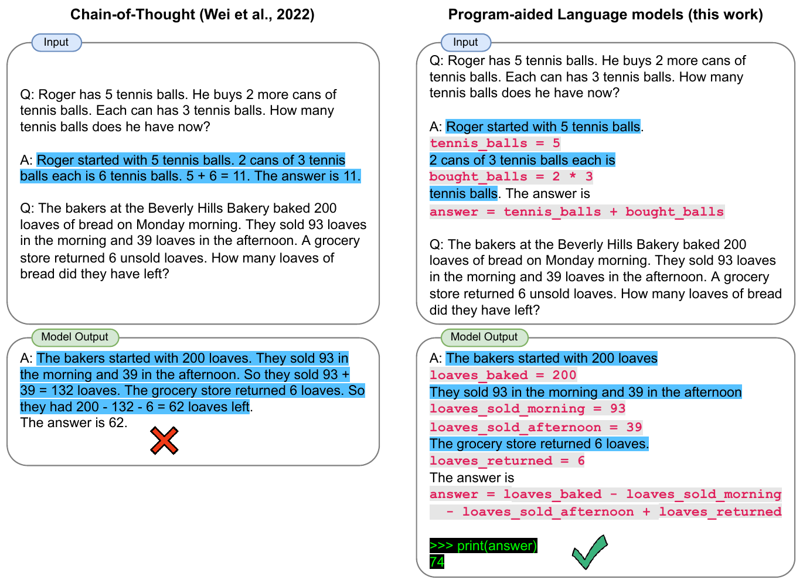
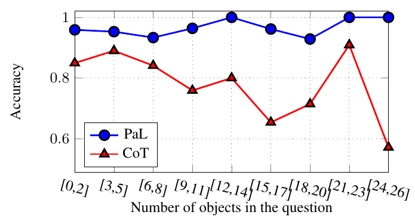
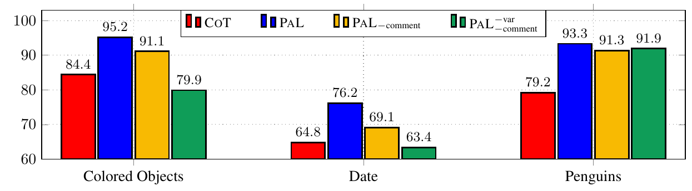

# 문제 이해는 언어모델에게, 계산은 인터프리터에게 — PAL: Program-aided Language Models
#### Abstract
대규모 언어모델(large language model, LLM)은 테스트 시점에 몇 개의 예시만 제공받아도("few-shot 프롬프팅") 산술 추론 및 기호 추론 과제를 수행하는 인상적인 능력을 보여 왔다. 이러한 성공의 상당 부분은 "사고의 사슬(chain-of-thought)"과 같은 프롬프팅 방법에 힘입은 것으로, 이 방법은 LLM을 문제 서술을 단계로 분해하여 이해하는 데에도, 각 단계를 풀어내는 데에도 함께 사용한다. LLM은 이러한 단계적 분해에는 능숙해 보이지만, 문제가 올바르게 분해된 경우에도 풀이 부분에서 논리적 오류와 산술 오류를 자주 범한다. 본 논문에서는 프로그램 보조 언어모델(Program-Aided Language models, PAL)을 제시한다. 이는 LLM이 자연어 문제를 읽고 중간 추론 단계로서 프로그램을 생성하게 하되, 풀이 단계는 Python 인터프리터와 같은 실행 환경(runtime)에 넘기는 새로운 접근법이다. PAL에서 LLM이 학습해야 할 과제는 자연어 문제를 실행 가능한 단계로 분해하는 일 하나뿐이며, 풀이는 인터프리터에 위임된다. 본 논문은 BIG-Bench Hard 등에서 가져온 13개의 수학적, 기호적, 알고리즘적 추론 과제에서 신경망 기반 LLM과 기호적 인터프리터 사이의 이러한 상승 작용을 보인다. 이 모든 자연어 추론 과제에서, LLM으로 코드를 생성하고 Python 인터프리터로 추론하는 방식은 훨씬 더 큰 모델보다 정확한 결과를 낸다. 예를 들어 CODEX를 사용한 PAL은 GSM8K에서 few-shot 기준 최고 수준(state-of-the-art)의 정확도를 달성하여, chain-of-thought를 사용한 PaLM-540B를 top-1 정확도 기준 절대 15%p 앞선다.
#### 요약
CoT 프롬프팅으로 LLM은 문제를 그럴듯하게 쪼갤 수 있게 되었지만, 정작 마지막 계산에서 틀리는 일이 잦다. PAL은 이 두 일을 분리한다. LLM은 문제 속 수량과 관계를 Python 코드로 옮겨 적는 번역가 역할만 하고, 계산과 상태 추적은 인터프리터가 맡는다. 프롬프트의 형식만 바꾸는 단순한 아이디어지만, 숫자가 커지는 순간 CoT가 무너지는 곳에서 PAL은 거의 흔들리지 않는다.

---

## 1. 문제의식: 분해는 잘하지만 계산은 틀린다

Chain-of-Thought(CoT, 사고의 사슬) 프롬프팅은 LLM이 답을 바로 내놓는 대신 풀이 과정을 단계별로 적어 내려가도록 유도하는 기법이다. 예시 문제 몇 개와 그 풀이 과정을 프롬프트에 함께 보여주면, 모델은 새 문제에서도 비슷한 방식으로 단계를 밟아 답에 도달한다. 이 기법은 LLM의 수학 및 기호 추론 성능을 크게 끌어올렸다.

그러나 저자들은 LLM이 문제 분해는 잘하면서도 그 단계를 실행하는 과정, 즉 산술 계산이나 상태 추적에서 자주 틀린다는 점에 주목한다. 추론 사슬 자체는 맞는데 최종 답이 틀리는 현상이 바로 그것이다. 수학 텍스트 1,640억 토큰으로 추가 학습한 PaLM 기반 모델(Minerva)조차 가장 흔한 실패 유형이 "잘못된 추론"과 "잘못된 계산"이었다는 선행 보고도 이 문제의식을 뒷받침한다.

아래 그림 1의 빵집 예제가 이 현상을 그대로 보여준다.



*그림 1. 왼쪽은 CoT, 오른쪽은 PAL이다. 위쪽 상자(Input)는 모델에 주어지는 프롬프트로, 테니스공 문제는 풀이 예시이고 빵집 문제는 모델이 새로 풀어야 할 질문이다. 아래쪽 상자(Model Output)는 모델이 생성한 결과다. 파란색 강조는 자연어 추론, 회색 바탕의 분홍 글씨는 PAL이 생성한 Python 코드, 검은 바탕의 초록 글씨는 인터프리터의 실행 결과를 뜻한다. CoT는 62라는 오답(X 표시)을, PAL은 74라는 정답(체크 표시)을 낸다.*

CoT는 "They sold 93 + 39 = 132 loaves... they had 200 − 132 − 6 = 62 loaves left"라고 답했다. 식료품점에서 팔리지 않은 빵 6개를 돌려받았으니 더해야 하는데 빼버린 것이다. 판매량을 합산하고 시작 수량에서 빼는 단계 구성 자체는 그럴듯하다. 틀린 곳은 마지막 계산 한 줄이다. PAL은 바로 이 지점을 겨냥한다.

## 2. 배경: few-shot 프롬프팅과 Chain-of-Thought

PAL을 이해하려면 먼저 few-shot 프롬프팅이 무엇인지, 그리고 CoT가 거기에 무엇을 덧붙였는지 알아야 한다. 논문은 이를 간단한 기호로 정리한다.

### 1) few-shot 프롬프팅

$$p \equiv \langle x_1 \cdot y_1 \rangle \,\|\, \langle x_2 \cdot y_2 \rangle \,\|\, \ldots \,\|\, \langle x_k \cdot y_k \rangle$$

few-shot 프롬프팅(few-shot prompting)은 모델의 가중치를 전혀 바꾸지 않고, 입력 앞에 풀이 예시 몇 개를 붙여 보여주는 것만으로 과제를 수행하게 하는 방식이다. 위 식에서 $x_i$는 $i$번째 예시의 질문, $y_i$는 그 정답이다. 가운데 점 기호 $\cdot$는 질문과 답을 이어 붙인다는 뜻이고, $\|$는 서로 다른 예시들을 이어 붙인다는 뜻이다. $k$는 예시의 개수로 보통 한 자릿수다. 즉 $p$는 "질문1 답1, 질문2 답2, ..., 질문k 답k"를 한 줄로 늘어놓은 텍스트다.

추론 시점에는 풀고 싶은 질문 $x_{test}$를 이 프롬프트 끝에 붙인 $p \,\|\, x_{test}$를 모델에 넣는다. 모델은 앞 예시들의 패턴을 따라 그 뒤를 이어 쓰면서 답 $y_{test}$를 생성한다. 이 경우 모델은 질문을 보자마자 답을 내야 하므로, 여러 단계를 거쳐야 하는 문제에 약하다.

### 2) Chain-of-Thought 프롬프팅

$$p \equiv \langle x_1 \cdot t_1 \cdot y_1 \rangle \,\|\, \langle x_2 \cdot t_2 \cdot y_2 \rangle \,\|\, \ldots \,\|\, \langle x_k \cdot t_k \cdot y_k \rangle$$

CoT는 각 예시에 "생각(thought)" $t_i$를 하나 더 끼워 넣는다. $t_i$는 질문 $x_i$에서 답 $y_i$로 가는 데 필요한 단계를 자연어로 서술한 것이다. 그래서 CoT 예시는 ⟨질문, 추론, 답⟩의 삼중쌍이 된다. 테니스공 예제라면 $t_1$은 "Roger started with 5 tennis balls. 2 cans of 3 tennis balls each is 6 tennis balls. 5 + 6 = 11."이고, $y_1$은 "The answer is 11."이다.

추론 시점에 모델은 새 질문에 대해 생각 $t_{test}$와 답 $y_{test}$를 모두 생성해야 한다. 먼저 추론 과정을 적게 하는 것만으로 다양한 과제에서 정확도가 올라간다는 것이 CoT의 발견이었다. 다만 여기서는 "5 + 6 = 11" 같은 계산도 모델이 직접 해야 한다는 점을 기억해 두자. PAL이 바꾸는 것이 바로 이 부분이다.

## 3. PAL의 핵심 아이디어

PAL은 LLM에게 자연어 문제를 읽고 중간 추론 단계를 Python 프로그램 형태로 생성하게 한 뒤, 실제 풀이는 Python 인터프리터에 맡긴다. LLM의 역할은 문제를 실행 가능한 단계로 분해하는 것으로 한정되고, 계산은 결정론적 실행기가 담당한다. 여기서 결정론적이라는 말은 같은 코드를 넣으면 언제나 같은 결과가 나온다는 뜻이다. LLM은 확률적으로 다음 토큰을 고르는 모델이라 "93 + 39"를 계산할 때도 틀릴 확률이 0이 아니지만, 인터프리터는 코드만 맞다면 계산을 틀리지 않는다.

### 1) PAL의 프롬프트 형식

$$p \equiv \langle x_1 \cdot t_1 \rangle \,\|\, \langle x_2 \cdot t_2 \rangle \,\|\, \ldots \,\|\, \langle x_k \cdot t_k \rangle, \qquad t_j = [s_1, s_2, \ldots, s_N],\; s_i \in \mathrm{NL} \cup \mathrm{PL}$$

CoT의 식과 비교하면 두 가지가 달라졌다. 첫째, 각 예시에서 정답 $y_i$가 사라졌다. CoT 예시가 ⟨질문, 추론, 답⟩이라면 PAL 예시는 ⟨질문, 추론⟩ 쌍이다. 답은 프롬프트에 적지 않고 나중에 실행으로 얻기 때문이다. 둘째, 추론 $t_j$의 성격이 바뀌었다. $t_j$는 $s_1$부터 $s_N$까지 이어지는 문장들의 나열이고, 각 문장 $s_i$는 자연어(Natural Language, NL)이거나 프로그래밍 언어(Programming Language, PL)다. $\mathrm{NL} \cup \mathrm{PL}$은 "자연어 또는 코드 중 하나"라는 뜻의 합집합 기호다. 즉 PAL의 추론은 자연어 설명과 코드가 섞여 있는 텍스트다.

### 2) 추론 시점의 동작

새 질문 $x_{test}$가 주어지면 이를 프롬프트 끝에 붙여 $p \,\|\, x_{test}$를 LLM에 넣는다. LLM은 중간 단계와 그에 대응하는 코드를 함께 담은 $t_{test}$를 생성한다. 이것을 인터프리터에 넘겨 실행하면 그 결과가 최종 답 $y_{test}$가 된다. 논문의 서술을 하나의 식으로 줄이면 다음과 같다.

$$y_{test} = \mathrm{Exec}\big(\mathrm{LLM}(p \,\|\, x_{test})\big)$$

여기서 $\mathrm{Exec}$은 Python 인터프리터의 실행을 뜻한다. CoT에서는 LLM이 $t_{test}$와 $y_{test}$를 모두 만들었다면, PAL에서 LLM은 $t_{test}$까지만 만들고 $y_{test}$는 인터프리터가 만든다. 이 식이 PAL의 분업 구조 전체를 요약한다. 이 구조가 왜 중요한지는 실험 결과와 ablation에서 다시 확인하게 된다.

자연어 단계는 `#` 주석으로 작성해 인터프리터가 무시하게 하고, 변수명은 `num_apples_in_basket`처럼 문제 속 개체와 연결되도록 의미 있게 짓는다. 별도 학습 없이 기존 CoT 프롬프트를 코드 형식으로 바꾸는 것만으로 적용할 수 있다는 점이 실용적 장점이다. 저자들은 PAL 프롬프트를 쓰는 데 처음 CoT 프롬프트를 쓰는 것 이상의 노력이 들지 않는다고 말한다.

## 4. 예제로 보는 PAL의 네 단계

논문은 여러 예제로 PAL의 작동 단계를 보여준다. 핵심은 Figure 1과 Figure 2의 테니스공 및 빵집 예제이고, 과제 유형별 프롬프트 예시는 Figure 3~5와 부록 K에, CoT와 PAL의 성공 및 실패 비교는 부록 L에 실려 있다. 여기서는 빵집 예제 하나로 전체 흐름을 따라간다.

### 1) few-shot 프롬프트 구성

먼저 사람이 풀이 예시 몇 개를 PAL 형식으로 작성한다. 논문은 기존 CoT 연구의 예시를 그대로 가져와 코드 형식으로 바꿨다. Figure 2의 테니스공 예제가 그 한 예다.

```python
Q: Roger has 5 tennis balls. He buys 2 more cans of tennis balls.
   Each can has 3 tennis balls. How many tennis balls does he have now?

# Roger started with 5 tennis balls.
tennis_balls = 5
# 2 cans of 3 tennis balls each is
bought_balls = 2 * 3
# tennis balls. The answer is
answer = tennis_balls + bought_balls
```

CoT라면 같은 예시를 "Roger started with 5 tennis balls. 2 cans of 3 tennis balls each is 6 tennis balls. 5 + 6 = 11. The answer is 11."처럼 자연어로만 쓰고 계산 결과 11까지 직접 적는다. PAL에서는 자연어 문장마다 대응하는 코드 한 줄을 붙이고, 최종 답 11은 적지 않는다. 답은 나중에 실행으로 얻기 때문이다. 앞 절의 식으로 말하면 CoT 예시가 ⟨질문, 추론, 답⟩이고 PAL 예시는 ⟨질문, 추론⟩인 셈이다.

코드를 자세히 보면 `bought_balls = 2 * 3`에서 6이라는 결과를 쓰지 않고 곱셈식 그대로 남겨 둔다. 예시 단계에서부터 "계산 결과가 아니라 계산 방법을 적는다"는 습관을 모델에게 보여주는 것이다.

### 2) 새 질문을 덧붙여 LLM에 입력

이렇게 만든 예시 3~6개 뒤에 풀고 싶은 질문을 붙여 LLM에 넣는다.

> Q: The bakers at the Beverly Hills Bakery baked 200 loaves of bread on Monday morning. They sold 93 loaves in the morning and 39 loaves in the afternoon. A grocery store returned 6 unsold loaves. How many loaves of bread did they have left?

### 3) LLM이 자연어 주석과 코드를 함께 생성

LLM은 예시의 형식을 모방해 다음과 같은 출력을 생성한다.

```python
# The bakers started with 200 loaves
loaves_baked = 200
# They sold 93 in the morning and 39 in the afternoon
loaves_sold_morning = 93
loaves_sold_afternoon = 39
# The grocery store returned 6 loaves.
loaves_returned = 6
# The answer is
answer = loaves_baked - loaves_sold_morning - loaves_sold_afternoon + loaves_returned
```

여기서 LLM이 하는 일은 문제 속 수량을 변수로 뽑아내고 그 관계를 수식으로 표현하는 것까지다. 실제 덧셈과 뺄셈은 수행하지 않는다. 자연어 단계는 `#` 주석으로 처리되므로 인터프리터는 이를 무시한다. 반품된 빵은 `+ loaves_returned`로 더해져 있다. CoT가 틀렸던 부호 처리를 PAL은 변수 이름 덕분에 자연스럽게 맞게 적었다. `loaves_returned`라는 이름이 "돌아온 빵"이라는 의미를 계속 붙들고 있기 때문이다.

### 4) Python 인터프리터로 실행

생성된 코드를 그대로 실행하면 정답이 나온다.

```python
>>> print(answer)
74
```

같은 질문에 CoT는 "200 − 132 − 6 = 62"라고 답했다. 반품된 6개를 더해야 하는데 빼버린 것이다. 문제를 단계로 나누는 과정은 그럴듯했지만 마지막 계산에서 틀렸고, PAL은 이 계산을 인터프리터에 넘김으로써 오류를 피했다. 논문의 실험에서는 단순화를 위해 생성이 끝난 뒤 코드를 한 번에 실행하는 사후(post-hoc) 실행 방식을 사용했다. 코드 조각을 하나씩 실행하고 그 결과를 다시 LLM에 넣어 다음 코드를 생성하게 하는 방식도 가능하다고 저자들은 언급하지만, 실험에서는 다루지 않았다.

## 5. 과제 유형별로 달라지는 프로그램의 모습

전체 흐름은 같지만, 3단계에서 LLM이 생성하는 코드의 형태는 과제마다 다르다. 이 차이를 보면 PAL이 단순히 "계산기를 붙인 것"이 아니라 문제의 구조를 프로그램의 자료구조로 옮기는 방법이라는 점이 드러난다.

### 1) 수학 문제

수학 문제(Figure 3)에서는 저자들이 자연어 주석이 별 도움이 되지 않음을 발견하고 주석을 빼고 의미 있는 변수명만 남겼다.

```python
# Q: Olivia has $23. She bought five bagels for $3 each. How much money does she have left?
money_initial = 23
bagels = 5
bagel_cost = 3
money_spent = bagels * bagel_cost
money_left = money_initial - money_spent
```

변수명 자체가 주석 역할을 한다. `money_initial`, `money_spent`, `money_left`만 읽어도 "처음 돈에서 쓴 돈을 빼면 남은 돈"이라는 추론이 그대로 보인다.

### 2) Colored Objects: 위치 추적을 리스트 인덱싱으로

Colored Objects(Figure 4, 부록 K.1)는 일렬로 놓인 물체들의 색과 위치를 묻는 과제다. PAL은 물체들의 순서와 색을 리스트로 만들고, 반복문으로 위치를 찾은 뒤 인덱스로 접근한다. 공간적 위치 추적을 리스트 인덱싱으로 바꾼 것이다.

```python
objects = []
objects += [('paperclip', 'purple')] * 1
objects += [('stress ball', 'pink')] * 1
...
for i, object in enumerate(objects):
    if object[0] == 'stress ball':
        stress_ball_idx = i
        break
direct_right = objects[stress_ball_idx + 1]
answer = direct_right[1]
```

각 물체는 (이름, 색) 쌍으로 저장된다. "스트레스 볼 바로 오른쪽"이라는 자연어 표현이 `stress_ball_idx + 1`이라는 정확한 인덱스 연산으로 바뀌고, "그 물체의 색"은 쌍의 두 번째 원소 `[1]`로 바뀐다.

### 3) Object Counting: 거르는 판단과 세는 계산의 분리

Object Counting(Figure 5)에서는 세어야 할 대상만 딕셔너리에 담고 합을 구한다. 의자, 탁자, 냉장고처럼 채소가 아닌 것을 걸러내는 판단은 LLM이 주석으로 명시하고, 합산은 인터프리터가 맡는다.

```python
# Q: I have a chair, two potatoes, a cauliflower, a lettuce head, two tables,
#    a cabbage, two onions, and three fridges. How many vegetables do I have?
# note: I'm not counting the chair, tables, or fridges
vegetables_to_count = {'potato': 2, 'cauliflower': 1, 'lettuce head': 1, 'cabbage': 1, 'onion': 2}
answer = sum(vegetables_to_count.values())
```

여기서 "무엇이 채소인가"는 상식이 필요한 판단이라 LLM이 잘하는 일이고, "2+1+1+1+2"는 기계적 계산이라 인터프리터가 잘하는 일이다. 같은 문제 안에서도 두 종류의 일이 깔끔하게 나뉜다.

### 4) Date Understanding: 달력 계산을 라이브러리에

Date Understanding(부록 K.3)에서는 `datetime`과 `relativedelta` 라이브러리를 사용해 날짜 계산을 처리한다.

```python
# Q: 2015 is coming in 36 hours. What is the date one week from today in MM/DD/YYYY?
today = datetime(2015, 1, 1) - relativedelta(hours=36)
one_week_from_today = today + relativedelta(weeks=1)
one_week_from_today.strftime('%m/%d/%Y')
```

"36시간 전", "일주일 뒤" 같은 시간 연산을 LLM이 머릿속으로 할 필요 없이, 달 경계나 윤년까지 알고 있는 라이브러리에 맡긴다.

## 6. 실험 설정

과제는 크게 세 부류, 총 13개다. 첫째는 수학 문장제(math word problem)로, GSM8K, SVAMP, ASDiv, 그리고 MAWPS의 네 하위 데이터셋(SingleEq, SingleOp, AddSub, MultiArith)이 포함된다. 모두 초등학교 수준의 대수 문장제다. 둘째는 BIG-Bench Hard의 기호 추론 과제로 Colored Objects, Penguins, Date가 있다. Penguins는 펭귄들의 표를 자연어로 주고 속성을 묻는데, 중간에 펭귄이 추가되거나 삭제되는 동적 변화가 포함된다. 셋째는 알고리즘 과제로 Object Counting과 Repeat Copy가 있다. Repeat Copy는 "duck을 네 번 말하되 중간에 quack도 말하라"처럼 지시에 따라 단어열을 생성하는 과제다.

기본 모델은 Codex(code-davinci-002)이고, 비교 기준은 질문에 곧바로 답하게 하는 Direct 프롬프팅과 CoT 프롬프팅이다. 디코딩은 온도 0의 탐욕적 디코딩(greedy decoding), 즉 매 단계 가장 확률이 높은 토큰만 고르는 방식을 썼다. 공정성을 위해 CoT 프롬프트가 이미 있는 과제에서는 선행 연구와 동일한 few-shot 예시를 사용했다. 예시 선택의 차이가 아니라 방법 자체의 차이만 비교하려는 설계다.

저자들은 여기에 GSM-Hard라는 데이터셋을 새로 만들었다. 선행 연구에 따르면 GSM8K에 등장하는 숫자의 50%가 0에서 8 사이의 정수다. 그렇다면 LLM이 큰 수나 정수가 아닌 수에도 일반화할 수 있는지가 의문으로 남는다. GSM-Hard는 GSM8K 각 문제의 숫자 하나를 최대 7자리의 무작위 정수로 바꾼 버전이다.

GSM-Hard의 정답을 구하는 방식도 흥미롭다. 1,319문제를 손으로 다시 계산하기는 너무 비싸므로, 저자들은 PAL이 원래 GSM8K에서 맞힌 문제(71%)의 경우 생성된 프로그램에서 초기값만 큰 수로 바꿔 다시 실행했다. 예를 들어 `money_initial = 23`을 `money_initial = 15687`로 바꾸고 돌리면 새 정답이 자동으로 나온다. 프로그램이 정답을 냈다고 해서 프로그램 자체가 맞다는 보장은 없지만, 25개를 직접 확인한 결과 모두 올바랐다고 한다. 나머지는 샘플링을 반복해 맞는 프로그램을 찾고, 끝내 풀리지 않은 50문제는 저자들이 직접 정답을 달았다.

## 7. 주요 결과

### 1) 수학 및 기호 추론 과제

아래 표는 논문의 Table 1과 Table 2에서 주요 과제와 비교 대상을 추린 것이다.

| 과제 | Direct (Codex) | CoT (PaLM-540B) | CoT (Codex) | PAL (Codex) |
|---|---|---|---|---|
| GSM8K | 19.7 | 56.9 | 65.6 | **72.0** |
| GSM-Hard | 5.0 | – | 23.1 | **61.2** |
| SVAMP | 69.9 | 79.0 | 74.8 | **79.4** |
| ASDiv | 74.0 | 73.9 | 76.9 | **79.6** |
| MultiArith | 44.0 | 94.7 | 95.9 | **99.2** |
| Colored Objects | 75.7 | – | 86.3 | **95.1** |
| Penguins | 71.1 | 65.1 | 79.2 | **93.3** |
| Date | 49.9 | 65.3 | 64.8 | **76.2** |
| Repeat Copy | 81.3 | – | 68.8 | **90.6** |
| Object Counting | 37.6 | – | 73.0 | **96.7** |

표의 수치는 정답률(solve rate, %)로, 전체 문제 중 최종 답을 맞힌 비율이며 높을수록 좋다. 각 행에서 가장 높은 값을 굵게 표시했다. 비교에서 눈여겨볼 대목은 두 가지다. 첫째, PaLM-540B는 Codex보다 훨씬 큰 모델인데, PAL은 더 작은 Codex로 CoT를 쓴 PaLM-540B를 모든 과제에서 앞선다. 둘째, 같은 Codex끼리 비교한 CoT 열과 PAL 열의 차이가 순수하게 프롬프트 방식의 차이다. 논문의 Table 1에는 수학 특화 학습을 거친 Minerva 540B의 GSM8K 결과(58.8)도 실려 있는데, PAL은 이 모델보다도 높다. PAL의 수학 결과는 프롬프트 예시 순서를 바꿔 세 번 실행한 평균이며, 표준편차는 GSM-Hard를 제외하면 0.5 이하로 작았다.

PAL은 모든 수학 데이터셋에서 당시 few-shot 최고 성능을 기록했다. 기호 추론에서는 Colored Objects에서 CoT 대비 8.8%p, Penguins에서 14.1%p, Date에서 11.4%p 높았고, Object Counting에서는 96.7%로 거의 다 풀어냈다. Repeat Copy에서는 의외로 Direct가 CoT보다 나았는데, PAL은 그 Direct보다도 9.3%p 높았다.

### 2) GSM-Hard: 숫자가 커지면 무너지는 CoT

가장 인상적인 결과는 GSM-Hard다. 숫자만 커졌을 뿐 문제 구조는 같은데, Direct는 19.7%에서 5.0%로, CoT는 65.6%에서 23.1%로 급락했다. 반면 PAL은 72.0%에서 61.2%로 비교적 안정적으로 유지되었다. (본문에는 CoT 20.1%, PAL 61.5%라는 수치도 등장하는데, 여기서는 Table 1의 값을 따랐다.)

그렇다면 CoT의 실패는 큰 수 때문에 추론 자체가 엉뚱해져서일까, 아니면 추론은 그대로인데 계산만 틀려서일까? 저자들은 같은 문제의 원래 버전과 큰 수 버전에서 CoT가 생성한 추론을 25개 비교했다. 그 결과 16개에서 CoT의 자연어 추론은 원래 문제와 거의 동일했다. 실패 원인이 추론 오류가 아니라 산술 계산 능력의 한계임을 보여주는 결과다. 부록 Table 13의 예시를 보면, 콘택트렌즈 문제에서 CoT는 "4906296 / 180"이라는 식을 세우고 그 결과를 2725849라고 적는다. 실제 값은 약 27257로, 자릿수가 두 개나 틀렸다. 범퍼카 문제에서도 "75 − 9318738 − 9318736 − 27956208"을 −55,828,829로 계산하는데, 올바른 값은 −46,593,607이다. 식은 원래 문제와 같은 구조로 세웠고 계산만 틀린 것, 정확히 PAL이 겨냥한 실패다.

CoT 프롬프트의 예시에도 큰 수를 넣어 보는 실험도 했다. 프롬프트 예시가 GSM-Hard의 숫자 분포와 맞으면 CoT도 나아지지 않을까 하는 질문이다. 결과는 23.3%에서 23.8%로 거의 변화가 없었다. 좋은 예시를 고르는 것만으로는 PAL의 이점을 얻을 수 없다는 뜻이다.

### 3) 다수결 샘플링과 문제 복잡도

CoT 계열 방법은 답을 여러 번 샘플링한 뒤 다수결로 최종 답을 고르면(self-consistency) 더 좋아진다고 알려져 있다. 같은 조건(40개 샘플)으로 실험하면 PAL의 GSM8K 정확도는 72.0%에서 80.4%까지 올라, 같은 샘플 수의 Minerva-540B(78.5%)보다 1.9%p 높다.

문제가 복잡해지면 어떻게 될까? 저자들은 Colored Objects에서 질문에 등장하는 물체 수를 복잡도의 척도로 삼아 성능 변화를 살폈다.



*그림 2. 가로축은 질문에 등장하는 물체의 개수 구간이고, 세로축은 정답률(0~1)이다. 파란 원이 PAL, 빨간 삼각형이 CoT다. 오른쪽으로 갈수록 추적해야 할 물체가 많아진다.*

물체 수가 늘어날수록 CoT의 정확도는 불안정하게 오르내리다 24~26개 구간에서 0.6 아래로 떨어진다. PAL은 모든 구간에서 0.93 이상, 여러 구간에서 1.0을 유지한다. 물체가 몇 개든 리스트에 넣고 인덱스로 접근하는 방식은 똑같이 작동하기 때문이다.

## 8. CoT가 실패하고 PAL이 성공한 사례

부록 L은 4단계의 실행이 왜 중요한지를 보여주는 사례를 제시한다. 두 사례 모두 CoT가 필요한 정보를 다 알고 있으면서도 틀린다는 점이 공통적이다.

### 1) Penguins: 생성한 정보를 종합하지 못하는 CoT

Penguins 과제(Figure 24)에서는 표에서 Bernard를 삭제한 뒤 8세 미만 펭귄 수를 묻는다. CoT는 "8세 미만은 Louis와 Bernard"라는 사실과 "Bernard가 삭제되었다"는 사실을 모두 언급하고도 답을 2라고 낸다. 앞서 생성한 정보를 종합하지 못한 것이다. 저자들은 이를 언어모델이 자신이 앞서 생성한 내용의 상태를 안정적으로 추적하지 못하는 전형적 실패로 본다. PAL은 리스트에서 Bernard를 필터링으로 제거한 뒤 조건에 맞는 원소 수를 `len()`으로 세므로 정답 1을 얻는다.

```python
penguins = [p for p in penguins if p[0] != 'Bernard']
penguins_under_8_years_old = [p for p in penguins if p[1] < 8]
answer = len(penguins_under_8_years_old)
```

첫 줄은 이름이 Bernard가 아닌 펭귄만 남기는 필터이고, 둘째 줄은 나이(두 번째 원소)가 8 미만인 펭귄만 남기는 필터다. "삭제"라는 상태 변화가 리스트 자체에 반영되므로, 이후 단계에서 그것을 잊어버릴 수가 없다.

### 2) Date: 알고 있는 지식을 적용하지 못하는 CoT

Date 과제(Figure 25)에서는 2001년 2월 마지막 날 태어난 사람의 16번째 생일로부터 24시간 뒤의 날짜를 묻는다. CoT는 "2월의 마지막 날은 28일"이라는 지식을 직접 언급하고도 02/29/2017이라는 존재하지 않는 날짜를 답한다. 2017년은 윤년이 아니므로 2월 29일이 없다. PAL은 `datetime(2001, 2, 28) + relativedelta(years=16)`에 24시간을 더하는 코드를 생성하고, 실제 달력 계산은 라이브러리가 처리하므로 03/01/2017을 정확히 얻는다. 저자들은 이런 실패가 특히 시간 간격이 달의 경계를 넘을 때 흔하다고 보고한다.

### 3) 토큰 수준에서 본 차이

부록 H는 Colored Objects 20문제를 골라, 모델이 각 토큰을 생성할 때의 확신도(log-likelihood)를 살폈다. CoT는 수량 정보, "가장 오른쪽" 같은 공간 형용사의 위치, 색 같은 속성, 물체를 가리키는 명사에서 확신도가 낮은 경우가 많았다. 또 같은 개념을 맥락마다 다르게 표현했다. 물체가 다섯 개면 "가장 오른쪽은 다섯 번째", 세 개면 "가장 오른쪽은 세 번째"라고 쓰고, 때로는 "가장 오른쪽은 목록의 마지막"처럼 구체적 정보가 없는 표현을 쓰기도 했다. PAL은 물체 수와 상관없이 언제나 `objects[-1]`을 확신 있게 생성했다. 프로그래밍 언어의 명시적이고 정의된 문법이 표현을 일관되게 만들고, 이것이 견고함으로 이어진다는 해석이다.

## 9. 성능 향상은 어디서 오는가

논문의 설득력은 성능 향상의 원천을 분리한 분석에서 나온다. PAL이 좋아진 이유가 코드 형식의 프롬프트 덕분인지, 인터프리터 덕분인지, 아니면 모델이 코드에 강해서인지를 하나씩 떼어 본다.

### 1) 인터프리터를 빼면 어떻게 되는가

| 설정 (GSM8K) | 정답률 |
|---|---|
| Direct (중간 추론 없음) | 19.7 |
| CoT | 65.6 |
| PAL | **72.0** |
| 한 줄짜리 코드 (Succinct Code) | 47.8 |
| LLM이 실행 결과까지 직접 생성 | 23.2 |

코드는 그대로 생성하되 인터프리터 없이 LLM이 실행 결과까지 직접 쓰게 하면, 즉 프롬프트 예시 끝에 `ans = 9`처럼 답을 적어 두고 모델이 코드 뒤에 답을 이어 쓰게 하면 GSM8K 정확도가 23.2%로 떨어져 Direct보다 겨우 4.5%p 높은 수준에 머문다. 이득은 코드 형식의 프롬프트가 아니라 인터프리터와의 결합에서 나온다는 것이다. 저자들은 현재 LLM이 문제를 푸는 높은 수준의 계획을 세우는 데는 뛰어나지만, 그 계획을 실행하는 능력은 여전히 없다고 정리한다.

여러 줄에 걸친 단계별 코드 대신 `return 5 + 2 + 2`처럼 한 줄짜리 식으로 답을 계산하게 하면 47.8%로 떨어진다. 인터프리터가 있더라도 문제를 여러 단계로 분해해 보여주는 과정 자체가 필요하다는 뜻이다. 분해와 실행, 두 요소가 모두 있어야 PAL의 성능이 나온다.

### 2) 변수명과 주석은 왜 중요한가

인터프리터 입장에서 변수명은 아무 의미가 없다. `money_left`든 `e`든 똑같이 계산한다. 그러나 LLM 입장에서는 다르다. 저자들은 두 가지 변형을 시험했다. PAL−comment는 자연어 주석을 뺀 PAL 프롬프트이고, PAL−var−comment는 주석을 빼고 변수명까지 무작위 문자로 바꾼 것이다.



*그림 3. 세 과제(Colored Objects, Date, Penguins)에서 네 가지 프롬프트 형식의 정답률(%)을 비교한 막대그래프다. 빨강은 CoT, 파랑은 원래 PAL, 노랑은 주석을 뺀 PAL, 초록은 주석과 의미 있는 변수명을 모두 뺀 PAL이다.*

Colored Objects와 Date에서는 주석만 빼도 정확도가 조금 떨어지지만 여전히 CoT보다 높다. 변수명까지 없애면 정확도가 더 떨어져 CoT보다도 낮아진다(Colored Objects 79.9 대 84.4, Date 63.4 대 64.8). Penguins에서는 두 변형 모두 CoT보다 훨씬 높게 유지되어 효과가 과제에 따라 다르게 나타난다. 수학 문제에서도 비슷한 결과가 나왔다(부록 A). 변수명을 한 글자로 바꾼 PAL은 59.0%로 CoT(63.1%)보다 낮았고, 변수명은 한 글자지만 유용한 주석을 붙인 버전은 69.0%로 회복되었으며, 원래 PAL은 71.8%였다. 텍스트 정보가 변수명으로든 주석으로든 들어 있어야 하며, 코드 구조만으로는 부족하다는 결론이다.

이는 PAL이 순수한 기호 처리가 아님을 보여준다. 변수명은 문제 속 개체와 코드를 이어 주는 연결 고리이고, LLM은 이 연결 고리 덕분에 "어떤 수에 어떤 연산을 해야 하는지"를 올바르게 고른다. 저자들은 Codex가 주로 의미 있는 이름을 쓰는 코드로 학습되었기 때문에 이런 결과가 자연스럽다고 해석한다. 빵집 예제에서 `loaves_returned`라는 이름이 덧셈 부호를 이끌어낸 것도 같은 원리다.

### 3) 코드 모델이어야만 하는가

PAL이 Codex에서만 통하는지 확인하기 위해 저자들은 여러 모델로 실험했다. 더 약한 코드 모델(code-cushman-001, code-davinci-001)에서는 절대 정확도는 낮아도 CoT 대비 PAL의 상대적 향상은 일관되게 유지되었다. 자연어 중심 모델에서는 결과가 갈렸다.

| 모델 (GSM8K) | CoT | PAL |
|---|---|---|
| text-davinci-001 | **26.5** | 8.6 |
| text-davinci-002 | 46.9 | **65.8** |
| text-davinci-003 | 65.3 | **69.8** |
| ChatGPT (gpt-3.5-turbo) | 76.8 | **79.6** |

코딩 능력이 약한 text-davinci-001에서는 PAL이 오히려 CoT보다 크게 뒤처졌다. 모델이 올바른 코드를 써내지 못하면 인터프리터가 아무리 정확해도 소용이 없다. 반면 코딩 능력이 충분한 text-davinci-002와 003, 그리고 ChatGPT에서는 PAL이 앞섰다. PAL은 코드 전용 모델에만 국한되지 않지만, 기반 모델의 코드 생성 능력이 일정 수준 이상이어야 한다는 전제 조건이 있는 셈이다.

생성된 코드의 품질도 확인했다. 생성된 Python 코드는 모두 문법적으로 올바랐고, 실행 중 예외가 발생한 경우는 1% 미만이었다. 가장 흔한 오류는 정의하지 않은 변수를 사용하는 `NameError`였다.

## 10. Least-to-Most 프롬프팅과의 결합

부록 J(Figure 15)는 PAL을 다른 프롬프팅 기법과 결합하는 예도 보여준다. Least-to-Most는 문제를 하위 질문으로 쪼개는 단계(reducing)와 이를 순서대로 푸는 단계(solving)로 나뉘는 프롬프팅 기법이다. 저자들은 쪼개는 단계는 논리적 사고가 필요하므로 자연어로 두고, 푸는 단계는 정밀함이 필요하므로 코드로 바꿨다.

```python
# Four years ago, Kody was only half as old as Mohamed.
# If Mohamed is currently twice 30 years old, how old is Kody?
# How old was Mohamed four years ago?
mohamed_age_current = 30 * 2
mohamed_age_4_years_ago = mohamed_age_current - 4
# Final Question: How old is Kody?
kody_age_4_years_ago = mohamed_age_4_years_ago / 2
kody_age_current = kody_age_4_years_ago + 4
```

앞 하위 질문의 결과가 변수로 남아 있어 뒤 질문에서 그대로 재사용할 수 있다는 점이 자연어 풀이보다 유리한 지점으로 제시된다. 자연어 풀이에서는 "앞에서 Mohamed가 56세였으므로"처럼 이전 답을 다시 인용해야 하지만, 코드에서는 `mohamed_age_4_years_ago`라는 이름으로 값이 공유된다. 이 결합으로 GSM8K 500문제 부분집합에서 정확도가 67.2%에서 72.8%로, SVAMP에서는 75.2%에서 78.2%로 올랐다.

## 11. 의의와 한계

이 연구는 신경망(LLM)이 문제를 기호적 표현으로 번역하고 기호 실행기가 이를 정확히 처리하는 분업 구조를 보여주며, 저자들도 결론에서 뉴로심볼릭(neuro-symbolic) 추론의 방향으로 의미를 부여한다. 이전에도 계산기를 붙이거나 날짜 전용 모듈을 덧붙인 연구들이 있었지만, PAL은 범용 프로그래밍 언어를 중간 표현으로 써서 산술과 날짜와 리스트 조작을 특수 모듈 없이 한꺼번에 다룬다. 논문에 따르면 외부 계산기는 GSM8K에서 Codex를 2.3%p 개선하는 데 그쳤지만, PAL은 6.4%p를 개선했다. 이후 도구 사용 LLM이나 코드 인터프리터 기반 에이전트의 직접적인 선행 연구로 자리매김했고, 비슷한 시기에 독립적으로 나온 Program of Thoughts(Chen et al., 2022)와 함께 자주 인용된다. 저자들은 Program of Thoughts와의 차이로 PAL이 수학 외에 기호 및 알고리즘 과제에서도 효과를 보였다는 점, 그리고 과제별로 예시를 새로 고르지 않고 선행 연구의 예시를 그대로 써서 방법의 효과와 예시 선택의 효과를 분리했다는 점을 든다.

한계도 분명하다. 정답 보장은 올바른 프로그램이 생성되었을 때에만 성립하므로 문제 분해 자체의 오류는 여전히 LLM에 남는다. 인터프리터는 잘못 세운 식을 정확하게 계산해 줄 뿐이다. 실험은 코드로 풀기 쉬운 계산형 과제에 집중되어 있어, 상식 추론처럼 코드로 옮기기 어려운 과제에서 어떤지는 다루지 않았다. 실행도 사후 1회로만 수행해, 실행 결과를 다시 추론에 반영하는 상호작용형 구조는 검토하지 않았다. 앞서 본 것처럼 기반 모델의 코딩 능력이 약하면 오히려 성능이 떨어진다는 전제 조건도 있다. 또한 GSM-Hard는 자동 생성되어 음수 답이나 "사과 3.5개를 샀다"처럼 상식에 맞지 않는 정답이 섞여 있다고 저자들 스스로 인정한다. 저자들은 이로 인한 5~10% 정도의 성능 저하가 모든 방법에 비슷하게 적용되므로 방법 간 상대 비교는 유효하다고 보지만, 절대 수치는 조심해서 읽어야 한다.

## 12. 맺으며

정리하면, 논문의 예제들은 일관되게 LLM은 문제 속 개체와 관계를 코드로 옮기는 번역가 역할만 하고, 계산과 상태 추적은 인터프리터가 맡는 구조를 보여준다. 이 구조가 효과를 내려면 세 가지가 함께 있어야 한다. 문제를 여러 단계로 분해해 적는 것, 변수명과 주석으로 코드와 문제 속 개체를 연결하는 것, 그리고 그 코드를 실제로 실행하는 것이다. 어느 하나만 빠져도 성능은 CoT 수준이나 그 아래로 내려간다.

PAL의 발상은 지금 보면 당연해 보일 만큼 단순하다. 그러나 "LLM에게 모든 것을 시키지 말고, 잘하는 일과 못하는 일을 나눠 맡기자"는 이 설계 원칙은 이후 도구를 쓰는 언어모델 연구 전반의 출발점이 되었다는 점에서 의미가 크다.
