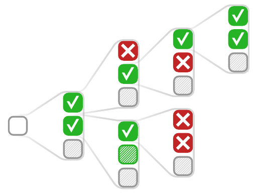
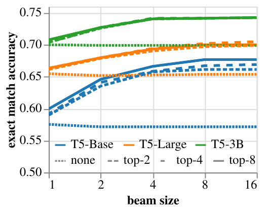
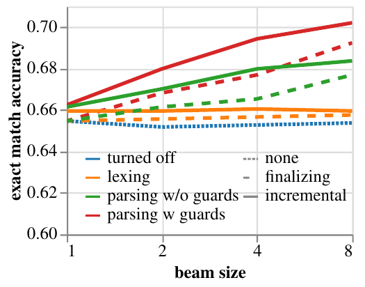

# 디코딩 단계마다 문법에 어긋나는 토큰을 지워 언어모델이 유효한 SQL만 만들게 하기 — PICARD: Parsing Incrementally for Constrained Auto-Regressive Decoding from Language Models
#### Abstract
텍스트 데이터로 학습한 대규모 사전학습 언어모델은 출력 공간에 제약이 없다. 즉 각 디코딩 단계에서 수만 개에 이르는 서브워드 토큰(sub-word token) 가운데 어느 것이든 생성할 수 있다. 이러한 모델을 SQL처럼 제약이 엄격한 형식 언어(formal language)를 목표로 파인튜닝하면, 모델은 유효하지 않은 코드를 자주 생성하며 이 코드는 사용할 수 없다. 본 논문에서는 증분 파싱(incremental parsing)을 통해 언어모델의 자기회귀 디코더(auto-regressive decoder)를 제약하는 방법인 PICARD를 제안한다. PICARD는 각 디코딩 단계에서 허용될 수 없는 토큰을 기각함으로써 유효한 출력 시퀀스를 찾도록 돕는다. 까다로운 Text-to-SQL 번역 과제인 Spider와 CoSQL에서, PICARD가 무난한 수준의 성능을 보이던 파인튜닝된 T5 모델을 최고 수준(state-of-the-art)의 해법으로 바꾸어 놓음을 보인다.
#### 요약
언어모델에게 SQL을 쓰게 하면 그럴듯하지만 실행되지 않는 쿼리가 섞여 나온다. 이 논문은 모델을 다시 설계하거나 다시 학습시키는 대신, 모델이 토큰을 하나 고를 때마다 그 토큰을 붙인 부분 SQL이 문법과 스키마에 맞는지를 파서로 즉시 검사하고, 맞지 않는 후보를 그 자리에서 지워 버린다. 이 단순한 필터 하나로 T5는 한 단계 큰 모델을 따라잡고, 가장 큰 T5-3B는 당시 Spider와 CoSQL의 최고 성능에 도달한다. 그 효과가 왜 빔 서치와 결합할 때 커지는지, 그리고 이 방법을 뉴로심볼릭의 관점에서 어디에 놓을 수 있는지까지 함께 살펴본다.

---

## 1. 문제의식: 언어모델은 왜 실행되지 않는 SQL을 만드는가

### 1) 자기회귀 디코딩의 기본 구조

PICARD를 이해하려면 먼저 언어모델이 문장을 만드는 방식부터 짚어야 한다. T5나 GPT 같은 모델은 출력을 한 번에 만들지 않는다. 앞에서 이미 만든 토큰들을 조건으로 삼아 다음 토큰 하나의 확률분포를 계산하고, 그 분포에서 토큰을 하나 골라 붙이고, 다시 다음 토큰을 예측하는 과정을 반복한다. 이를 자기회귀(auto-regressive) 디코딩이라 한다. 수식으로 쓰면 다음과 같다.

$$
P(y \mid x) = \prod_{t=1}^{T} p_\theta(y_t \mid y_{<t}, x)
$$

여기서 $x$는 입력(자연어 질문과 데이터베이스 스키마), $y = (y_1, \dots, y_T)$는 모델이 생성하는 출력 토큰 시퀀스(SQL 쿼리), $y_t$는 $t$번째 토큰, $y_{<t}$는 $t$번째 이전까지 이미 생성된 토큰들, $\theta$는 모델의 파라미터다. 이 식은 "출력 전체의 확률은 각 단계에서 다음 토큰을 고를 확률을 모두 곱한 것"이라는 뜻이다. 중요한 점은 각 단계의 분포 $p_\theta(\cdot \mid y_{<t}, x)$가 어휘집(vocabulary) 전체, 즉 T5의 경우 3만 2천여 개 서브워드 토큰 전부에 걸쳐 정의된다는 것이다. 모델은 원칙적으로 매 단계 이 중 아무 토큰이나 낼 수 있다. 문법이 정해진 SQL을 쓰고 있다는 사실을 모델이 "알고" 있는 것은 학습 데이터에서 그런 패턴을 많이 보았기 때문일 뿐이고, 문법을 어기는 토큰을 고를 확률이 0이라는 보장은 어디에도 없다.

### 2) Text-to-SQL과 실행 불가능한 SQL

Text-to-SQL은 "개 사육장의 전문가별 이메일과 휴대폰 번호는?" 같은 자연어 질문을 받아 이를 데이터베이스에서 실행할 수 있는 SQL 쿼리로 바꾸는 과제다. 자연어를 실행 가능한 형식 표현으로 옮긴다는 점에서 의미 파싱(semantic parsing)의 대표 사례에 해당한다. T5 같은 모델은 사전학습 단계에서 SQL 문법을 명시적으로 배운 적이 없고, Text-to-SQL 데이터로 파인튜닝을 해도 출력이 반드시 문법에 맞는다는 보장은 생기지 않는다. 그래서 실행되지 않는 SQL을 자주 만든다. 논문에 따르면 T5-3B는 Spider 개발셋에서 생성한 쿼리의 약 12%가 실행 오류를 냈다. 생성된 SQL은 한 글자만 틀려도 데이터베이스가 오류를 반환하므로, 이 12%는 곧 쓸 수 없는 출력이다.

### 3) 기존 해법의 두 갈래와 그 비용

기존 해법은 크게 두 갈래였다.

첫째는 추상 구문 트리(abstract syntax tree, AST) 기반의 문법 제약 디코딩이다. AST는 프로그램의 문법 구조를 나무 형태로 표현한 자료구조로, 예를 들어 SELECT 문은 "선택할 컬럼 목록", "FROM 절", "WHERE 조건" 같은 자식 노드를 가진 트리로 표현된다. RAT-SQL이나 SmBoP 같은 모델은 출력을 토큰 문자열이 아니라 이 트리를 짓는 행동(action)의 시퀀스로 생성하므로, 애초에 문법에 어긋난 SQL을 표현할 수조차 없게 만든다. 효과는 있지만 전용 어휘(특수 제어 토큰)나 전용 아키텍처가 필요하다는 비용이 따른다. 그 결과 T5처럼 일반 텍스트를 내도록 사전학습된 범용 디코더와는 호환되지 않는다.

둘째는 생성이 끝난 빔 후보를 사후에 유효성으로 거르는 방식이다(Suhr et al., 2020; BRIDGE, Lin et al., 2020). 모델은 아무 제약 없이 여러 개의 완성된 SQL 후보를 만들고, 그중 파싱이나 실행에 성공하는 것만 남긴다. 구현은 간단하지만, 유효한 후보가 하나라도 남으려면 처음부터 후보를 아주 많이 만들어야 한다. 실제로 이 방식은 빔 크기를 16에서 100까지 크게 늘려야 효과가 났다.

PICARD는 이 두 방식의 비용을 모두 피하려는 시도다. 모델의 어휘나 구조는 건드리지 않으면서, 사후 필터링처럼 거대한 빔에 기대지도 않는다.

## 2. PICARD의 핵심 아이디어

### 1) 매 스텝 점수를 바꾸는 단계별 필터

PICARD는 매 디코딩 스텝에서 두 가지 일을 한다. 먼저 확률 상위 $k$개 토큰만 남기고, 그 후보를 붙인 부분 SQL을 증분 파서(Haskell의 attoparsec 기반 모나딕 파서 컴비네이터)로 검사한다. 검사를 통과하지 못한 토큰과 상위 $k$개 밖의 토큰에는 점수 $-\infty$를 부여하고, 통과한 토큰은 원래 점수를 그대로 유지한다. 이를 식으로 정리하면 다음과 같다.

$$
\tilde{s}_t(v) =
\begin{cases}
s_t(v) & \text{if } v \in \mathrm{Top}_k(s_t) \ \text{and} \ \mathrm{Valid}(y_{<t} \oplus v) \\
-\infty & \text{otherwise}
\end{cases}
$$

$v$는 어휘집 안의 한 토큰, $s_t(v) = \log p_\theta(v \mid y_{<t}, x)$는 모델의 언어 모델링 헤드가 $t$번째 단계에서 토큰 $v$에 매긴 로그 확률 점수(log-softmax 값)다. $\mathrm{Top}_k(s_t)$는 이 점수가 가장 높은 $k$개 토큰의 집합이고, $y_{<t} \oplus v$는 지금까지 만든 부분 출력 뒤에 후보 토큰 $v$를 이어 붙인 문자열이다. $\mathrm{Valid}(\cdot)$는 그 부분 문자열이 "앞으로 무언가를 더 붙이면 올바른 SQL이 될 가능성이 남아 있는가"를 판정하는 파서의 검사 결과다. $\tilde{s}_t(v)$는 PICARD가 고쳐 쓴 점수다.

이 식이 말하는 바는 단순하다. 모델이 매긴 점수는 그대로 두되, 문법상 불가능한 선택지만 점수를 $-\infty$로 만들어 사실상 지운다. 로그 확률이 $-\infty$라는 것은 확률이 0이라는 뜻이므로, 이후 어떤 탐색 알고리즘도 그 토큰을 고르지 않는다. PICARD의 입력이 현재 가설의 토큰 id들과 각 토큰의 log-softmax 점수뿐이고, 출력도 같은 형태의 점수이기 때문에, 기존의 그리디 탐색이나 빔 탐색 알고리즘에 그대로 얹힌다. 파서는 이 판정을 위해 테이블명, 컬럼명, 그리고 어떤 컬럼이 어떤 테이블에 속하는지 같은 스키마 정보를 참조한다.

작은 예로 따져 보자. 모델이 지금까지 `select name from` 까지 생성했고, 다음 토큰 후보 상위 3개가 `singer`(로그 확률 $-0.3$), `where`($-1.6$), `singr`($-2.1$)라고 하자. $k=2$라면 `singr`은 상위 2개 밖이므로 검사 없이 $-\infty$가 된다. `where`는 상위 2개 안에 있지만 `from` 바로 뒤에 테이블명 없이 `where`가 오는 것은 문법 위반이므로 검사에서 탈락해 $-\infty$가 된다. 남는 것은 `singer` 하나이고, 그 점수는 원래 값 $-0.3$을 그대로 유지한다.

### 2) 그림으로 보는 제약 빔 서치

*그림 1. 빔 크기 2에서 PICARD가 적용된 빔 서치의 진행 모습(원 논문 Figure 2). 맨 왼쪽의 빈 사각형이 디코딩 시작점이고, 오른쪽으로 갈수록 디코딩 단계가 진행된다. 각 세로 묶음은 하나의 가설(지금까지 만든 부분 출력)에 대해 모델이 제안한 다음 토큰 후보 세 개를 위에서부터 확률이 높은 순서로 나열한 것이다. 이 예에서 PICARD는 상위 2개만 검사하며(즉 $k=2$), 맨 아래 회색 빗금 칸은 검사 대상이 아니므로 자동으로 $-\infty$가 된다. 빨간 X는 검사에서 기각된 토큰으로 역시 $-\infty$를 받고, 초록 체크는 통과한 토큰으로 원래 점수를 유지한다. 오른쪽 아래로 뻗은 가설은 다음 단계 후보가 모두 기각되어 더 이상 이어지지 못하고, 빔의 자리는 위쪽의 유효한 가설들로 채워진다는 점을 눈여겨볼 만하다.*

이 그림을 이해하려면 빔 서치가 무엇인지 알아야 한다. 그리디 탐색(greedy search)은 매 단계 확률이 가장 높은 토큰 하나만 골라 이어 붙인다. 빔 서치(beam search)는 이보다 넓게, 매 단계 누적 점수가 높은 부분 출력을 빔 크기 $B$개만큼 동시에 들고 간다. 각 가설의 누적 점수는 다음과 같이 계산한다.

$$
S(y_{1:t}) = \sum_{i=1}^{t} \tilde{s}_i(y_i)
$$

즉 가설에 포함된 토큰들의 (PICARD가 고쳐 쓴) 로그 확률을 모두 더한 값이다. 매 단계 각 가설을 후보 토큰들로 확장한 뒤, 이 누적 점수가 높은 순으로 $B$개만 남긴다. 여기서 PICARD와의 결합이 의미를 갖는다. 어떤 토큰의 점수가 $-\infty$이면 그 토큰을 포함한 가설의 누적 점수도 $-\infty$가 되므로, 그 가설은 다음 단계 빔에 절대 들어가지 못한다. 문법상 막다른 길에 들어선 가설은 그 순간 빔에서 퇴출되고, 비어 있는 자리는 유효한 다른 가설로 채워진다.

### 3) 증분 파싱이 필요한 이유

일반적인 파서는 완성된 문장 전체를 받아 문법에 맞는지를 판정한다. 그런데 PICARD는 SQL이 아직 다 만들어지지 않은 도중에, 토큰 하나가 추가될 때마다 판정을 내려야 한다. `select name from` 은 그 자체로 완성된 SQL은 아니지만 뒤에 테이블명을 붙이면 올바른 SQL이 될 수 있으므로 "아직 살아 있는" 부분 출력이다. 반면 `select name from where` 는 뒤에 무엇을 붙여도 올바른 SQL이 될 수 없다. 증분 파싱(incremental parsing)은 이처럼 미완성 입력을 받아 "아직 가능성이 있는가"를 판정하고, 새 토큰이 들어오면 처음부터 다시 파싱하지 않고 이전 상태에서 이어서 파싱하는 기법이다. PICARD는 Haskell의 attoparsec 라이브러리와 모나딕 파서 컴비네이터(monadic parser combinator)를 이용해 이를 빠르게 구현했다. 파서 컴비네이터는 "키워드 하나를 읽는 파서", "컬럼명 하나를 읽는 파서" 같은 작은 파서들을 조합해 큰 파서를 만드는 프로그래밍 기법이다.

## 3. 네 가지 검사 모드

PICARD의 검사 강도는 네 단계이며, 상위 모드를 통과하면 하위 모드도 반드시 통과하는 포함 관계다. 즉 위 단계로 갈수록 더 많은 오류를 잡아내지만, 그만큼 검사도 엄격해진다.

### 1) Off

검사하지 않는다. 일반적인 T5 디코딩과 같으며, 비교 기준선 역할을 한다.

### 2) Lexing

순서와 무관하게 어휘 수준만 본다. 여기서 어휘 수준이란, 생성된 부분 출력을 공백으로 구분된 개별 단위, 즉 `select` 같은 SQL 키워드, 괄호 같은 구두점, `+`나 `-` 같은 연산자, 조건에 들어가는 문자열과 숫자 리터럴, 그리고 별칭과 테이블명과 컬럼명 같은 식별자로 쪼갤 수 있는지만 확인한다는 뜻이다. 이들이 어떤 순서로 나오는지는 따지지 않는다. 이 단계에서 키워드 오타나 스키마에 없는 테이블명과 컬럼명을 잡아낸다.

예를 들어 Spider 개발셋의 `dog_kennels` 데이터베이스에 대해 "각 전문가의 이메일, 휴대폰 번호, 집 전화번호는?"이라는 질문이 주어졌을 때, 파인튜닝한 T5-Large는 `select email_address, cell_phone, home_phone from professionals` 를 생성했다. 그런데 이 스키마에 `cell_phone` 이라는 컬럼은 존재하지 않고 정답은 `cell_number` 다. 모델은 질문의 "cell phone"이라는 표현에 끌려 그럴듯한 이름을 지어낸 셈이다. Lexing 모드는 스키마에 없는 식별자를 허용하지 않으므로 이 오류가 이 단계에서 걸러진다.

### 3) Parsing without guards

문법 수준에서 검사한다. 부분 출력을 SQL의 AST로 파싱하려 시도하므로, Lexing과 달리 키워드와 절이 나오는 순서가 중요해진다. FROM 절 누락이나 절의 순서가 틀린 경우를 잡아낸다. 여기에 더해 몇 가지 구성상의 오류도 검사한다. `tid.cid` 형태로 테이블과 컬럼을 함께 썼는데 테이블 `tid` 에 컬럼 `cid` 가 실제로 없으면 기각한다. `alias.cid` 를 먼저 쓰고 나중에 `tid as alias` 로 별칭을 정의했는데 `tid` 에 `cid` 가 없어도 기각한다. 같은 SELECT 범위 안에서 하나의 별칭을 두 번 바인딩하는 것도 금지한다. 다만 중첩 쿼리에서 바깥 범위의 별칭을 안쪽에서 다시 정의하는 가림(shadowing)은 허용한다.

### 4) Parsing with guards

가장 강한 모드다. AST를 조립하면서 가드(guard)라 부르는 추가 분석을 수행한다. 참조한 테이블이나 별칭이 결국 FROM 절에 등장해야 하고, 별칭은 해당 컬럼을 가진 테이블이나 서브쿼리를 가리켜야 하며, 테이블 접두어 없이 쓴 컬럼은 범위 안의 테이블 중 정확히 하나에만 존재해야 한다는 조건을 건다. SQL에서는 `select` 절이 `from` 절보다 먼저 나오므로, 컬럼을 쓰는 시점에는 그 컬럼이 어느 테이블에서 올지 아직 알 수 없다. 가드는 이 조건들을 "나중에 반드시 충족되어야 할 약속"으로 기록해 두었다가, FROM 절을 파싱한 직후 즉시 확인한다. 이렇게 가능한 한 이른 시점에 실패를 판정하는(fail fast) 덕분에 잘못된 가설을 빔에서 일찍 제거할 수 있다.

이 모드에서만 잡히는 오류의 예가 있다. Spider의 `car_1` 스키마에서 "제조사와 모델은?"이라는 질문에 T5-Large는 `select maker, model from car_makers` 를 생성했다. 앞선 모드들의 관점에서 이 쿼리는 문제가 없다. 각 컬럼명은 스키마 어딘가에 존재하고, 절의 순서도 올바르다. 그러나 `car_makers` 테이블에는 `model` 컬럼이 없고, `maker` 와 `model` 을 모두 가진 테이블은 `model_list` 하나뿐이다. "FROM 절에 들어온 테이블들 중 정확히 하나가 이 컬럼을 가져야 한다"는 가드가 있어야만 이런 엉뚱한 테이블 선택을 기각할 수 있다.

저자들은 비교 대상 표현식의 타입이 일치하는지, UNION이나 EXCEPT, INTERSECT로 결합되는 쿼리들의 컬럼 타입이 맞는지 같은 검사도 생각해 볼 수 있지만 향후 과제로 남긴다고 밝힌다.

## 4. PICARD는 일종의 필터인가

PICARD를 처음 접하면 "T5의 추론 자체에는 개입하지 않고, T5의 출력에 대해 검사를 해서 더 나은 토큰을 선택하도록 하는 필터"로 이해하기 쉽다. 이 이해는 대체로 맞지만, 두 가지는 조금 다듬어서 이해하는 편이 더 정확하다.

### 1) 필터라는 이해가 맞는 부분

PICARD는 T5의 가중치나 순전파 계산에 손대지 않는다. T5가 매 스텝 내놓은 토큰별 log-softmax 점수를 입력으로 받아서, 상위 $k$개 밖의 토큰과 검사에 실패한 토큰의 점수를 $-\infty$로 바꾸는 것이 전부다. 구현 관점에서 보면 Hugging Face의 logits processor처럼 모델 출력과 탐색 알고리즘 사이에 끼워 넣는 점수 변환기다. logits processor는 모델이 계산한 다음 토큰 점수를 탐색 알고리즘에 넘기기 전에 가공하는 모듈로, 반복 억제나 특정 단어 금지 같은 기능이 이 자리에서 구현된다. PICARD는 사전학습에도 파인튜닝에도 관여하지 않으므로, 학습 없이 추론 시점에 켜고 끌 수 있다.

### 2) 출력이 아니라 매 스텝 분포를 거른다

필터가 걸리는 위치가 완성된 SQL이 아니라 토큰 하나하나의 후보 분포라는 점이 중요하다. 그리고 자기회귀 디코딩에서는 이번 스텝에 선택된 토큰이 다음 스텝 T5의 입력으로 들어간다. 앞의 식에서 $p_\theta(y_t \mid y_{<t}, x)$의 조건부에 $y_{<t}$가 들어 있다는 것이 바로 이 뜻이다. 그래서 PICARD가 T5 내부 계산을 바꾸지는 않지만, T5가 다음에 무엇을 조건으로 삼아 예측할지는 바꾼다. "추론에 개입하지 않는다"보다는 "모델은 그대로 두고 생성 경로를 바꾼다"고 보는 편이 정확하다.

이 점이 사후 필터링과의 차이이기도 하다. 완성된 후보를 마지막에 거르면 무효한 가설이 끝까지 빔의 자리를 차지한다. 빔 크기가 4인데 그중 3개가 도중에 이미 문법을 어긴 가설이라면, 실질적으로는 빔 1개로 탐색한 것과 다를 바 없다. 반면 PICARD는 무효해지는 순간 그 가설을 빔에서 내보내므로, 남는 자리가 유효한 후보로 채워진다. 뒤에서 볼 ablation에서 EOS 시점에만 검사하는 모드가 증분 모드보다 크게 뒤처진 이유가 이것이다.

### 3) 더 나은 토큰을 고르는 것이 아니라 틀린 토큰을 지운다

PICARD는 후보 사이의 순위를 매기지 않는다. 통과한 토큰들은 T5가 매긴 원래 점수를 그대로 유지하고, 그중 무엇을 고를지는 여전히 T5의 확률과 빔 탐색이 결정한다. 따라서 PICARD가 보장하는 것은 문법과 스키마 측면에서 "유효함"이지, 질문 의도에 더 맞는다는 의미의 "더 나음"은 아니다. 또 상위 $k$개 안에 올바른 토큰이 없으면 PICARD가 이를 끌어올릴 방법이 없다.

정리하면 PICARD는 T5가 낸 후보 분포에서 문법적으로 불가능한 선택지만 지우는 단계별 필터다. 그 결과 빔 탐색이 유효한 공간 안에서만 이루어지도록 생성 경로를 유도하는 장치라고 이해할 수 있다.

## 5. 실험 설정

실험은 Spider와 CoSQL 두 데이터셋에서 이루어졌다. Spider는 여러 도메인의 데이터베이스 200여 개에 걸친 교차 데이터베이스(cross-database) Text-to-SQL 데이터셋으로, 학습셋 7,000개 예제로 학습하고 개발셋과 비공개 테스트셋으로 평가한다. CoSQL은 사용자가 여러 차례 질문을 주고받는 대화 상황에서 각 질문에 대응하는 SQL을 예측하는 대화형 SQL 상태 추적 과제다. 두 데이터셋 모두 학습셋과 평가셋 사이에 질문도 데이터베이스도 겹치지 않는 제로샷 설정이다. 즉 모델은 평가 시점에 한 번도 본 적 없는 스키마를 다뤄야 하므로, 스키마에 없는 컬럼명을 지어내는 오류가 특히 생기기 쉽다.

평가 지표는 셋이다. Exact-set-match(EM) 정확도는 예측 SQL과 정답 SQL을 모두 정규화된 구조로 파싱해 구성요소가 일치하는지 비교한다. 조건에 들어가는 구체적 값은 비교하지 않으며, 의미가 같지만 다르게 쓴 쿼리는 틀린 것으로 처리될 수 있다. 실행 정확도(EX)는 두 쿼리를 실제 데이터베이스에서 실행해 결과가 같은지를 비교한다. 값까지 맞아야 하지만, 우연히 같은 결과가 나오는 거짓 양성이 많다는 단점이 있다. Test-suite 실행 정확도는 하나의 스키마에 대해 여러 데이터베이스 인스턴스에서 실행해 이 거짓 양성을 줄인 지표다. CoSQL에서는 질문 단위로 EM을 잰 질문 일치 정확도(QM)와, 한 대화의 모든 질문을 다 맞혀야 정답으로 치는 상호작용 일치 정확도(IM)를 쓴다.

기반 모델은 T5-Base, T5-Large, T5-3B다. 사전학습된 T5가 구조를 고치지 않고도 Text-to-SQL을 학습하고 처음 보는 데이터베이스에 일반화할 수 있다는 Shaw et al.(2021)의 결과를 출발점으로 삼았다. 입력에는 질문과 함께 스키마를 직렬화해 넣었고, 일부 실험에서는 BRIDGE와 비슷한 방식으로 데이터베이스의 실제 값까지 컬럼명에 붙여 넣었다. 학습은 Adafactor 옵티마이저, 배치 크기 2048, 학습률 $10^{-4}$로 최대 3,072 에폭 진행했다.

## 6. 결과

### 1) Spider

아래 표는 Spider에서 PICARD의 효과를 보여 준다. 모든 결과는 빔 크기 4, 상위 2개 토큰 검사($k=2$), guards 모드 기준이며, 데이터베이스의 실제 값을 입력에 넣은 설정은 † 표시로 구분했다.

| 모델 (Spider) | Dev EM | Dev EX | Test EM | Test EX |
|---|---|---|---|---|
| T5-Base | 57.2 | 57.9 | – | – |
| T5-Base + PICARD | **65.8** | **68.4** | – | – |
| T5-Large | 65.3 | 67.2 | – | – |
| T5-Large + PICARD | **69.1** | **72.9** | – | – |
| T5-3B | 69.9 | 71.4 | – | – |
| T5-3B + PICARD | **74.1** | **76.3** | – | – |
| T5-3B † | 71.5 | 74.4 | 68.0 | 70.1 |
| T5-3B + PICARD † | **75.5** | **79.3** | 71.9 | **75.1** |
| SmBoP + GraPPa † (당시 경쟁 모델) | 74.7 | 75.0 | 69.5 | 71.1 |
| LGESQL + ELECTRA † (당시 최고) | 75.1 | – | **72.0** | – |

*표 읽는 법: 숫자는 모두 백분율(%)이며 높을수록 좋다. EM은 SQL 구조가 정답과 일치하는 비율, EX는 실행 결과가 정답과 일치하는 비율이다. Dev는 공개된 개발셋, Test는 Spider 운영진이 직접 채점하는 비공개 테스트셋이다. 굵게 표시한 값은 같은 크기의 모델끼리 비교했을 때, 또는 마지막 네 줄 안에서 비교했을 때 가장 좋은 값이다. LGESQL + ELECTRA는 Text-to-SQL 전용으로 설계된 그래프 신경망 기반 모델로, 범용 T5에 필터 하나를 얹은 PICARD가 이 전용 모델과 대등해졌다는 점이 핵심이다.*

몇 가지 눈여겨볼 점이 있다.

모델 크기 한 단계를 대체하는 효과가 있다. T5-Base + PICARD(EM 65.8)는 PICARD 없는 T5-Large(65.3)를 앞섰고, T5-Large + PICARD는 EM에서는 T5-3B(69.9)에 약간 못 미쳤지만 EX에서는 72.9 대 71.4로 앞섰다. 파라미터 수를 몇 배 늘리는 것과 비슷한 이득을 학습 없이 디코딩 단계에서 얻은 셈이다.

실행 불가능한 SQL 비율은 T5-3B 기준 12%에서 2%로 줄었다. 남은 2%는 빔 안에서 유효한 SQL을 끝내 찾지 못한 경우다. 빔에 들어 있던 모든 가설이 도중에 기각되어 빔 서치가 유효한 출력 없이 종료된 것이다.

가장 큰 설정인 T5-3B + PICARD †는 개발셋 EM 75.5%, EX 79.3%, 테스트셋 EM 71.9%, EX 75.1%를 기록해 당시 최고 수준에 도달했다. 개발셋의 test-suite 실행 정확도는 71.9%였다.

### 2) CoSQL

| 모델 (CoSQL) | Dev QM | Dev IM | Test QM | Test IM |
|---|---|---|---|---|
| RAT-SQL + SCoRe (당시 최고) | 52.1 | 22.0 | 51.6 | 21.2 |
| T5-3B | 53.8 | 21.8 | 51.4 | 21.7 |
| T5-3B + PICARD | **56.9** | **24.2** | **54.6** | **23.7** |

*표 읽는 법: QM은 개별 질문 단위의 일치율, IM은 한 대화 안의 모든 질문을 맞힌 비율이다. IM은 대화 하나에서 한 번만 틀려도 0점이 되므로 QM보다 훨씬 낮게 나온다. 높을수록 좋다.*

CoSQL에서도 결과는 Spider와 비슷하다. T5-3B + PICARD가 질문 일치 정확도 테스트셋 54.6%, 상호작용 일치 정확도 23.7%로 당시 최고 성능을 기록했다.

### 3) 속도

속도 부담은 작다. A100 GPU에서 T5-3B를 빔 크기 4로 디코딩할 때 샘플당 2.5초에서 3.1초로 늘어난 수준이다. 매 스텝 상위 $k$개 후보에 대해서만 파싱을 수행하고, 증분 파서가 이전 상태를 재사용하기 때문에 가능한 수치다.

## 7. 빔 크기와 검사 모드에 따른 차이

### 1) 빔 크기의 효과

*그림 2. Spider 개발셋에서 빔 크기에 따른 EM 정확도 변화(원 논문 Figure 1). 가로축은 빔 크기(1, 2, 4, 8, 16), 세로축은 EM 정확도다. 색은 모델 크기(파랑 T5-Base, 주황 T5-Large, 초록 T5-3B)를, 선 모양은 PICARD 설정을 나타낸다. 점선(none)은 PICARD를 끈 경우이고, 파선과 실선은 각각 상위 2개, 4개, 8개 토큰을 검사한 경우다. 이 실험의 모델은 데이터베이스 값 없이 스키마만 입력으로 받았다. 먼저 같은 색의 점선과 실선을 비교해 보면 PICARD의 효과를, 이어서 점선이 가로로 평평하다는 점을 보면 PICARD 없이는 빔을 키워도 소용없다는 점을 읽을 수 있다.*

PICARD가 없으면 빔을 키워도 성능이 거의 오르지 않는다. 세 모델 모두 점선이 빔 크기 1부터 16까지 거의 수평이다. 반면 PICARD를 켜면 빔 1→2에서 크게 오르고, 2→4에서는 완만해지며, 4 이상에서는 포화된다. 빔 1, 즉 그리디 탐색에서도 PICARD는 약간의 개선을 준다.

이 차이는 앞에서 설명한 필터의 작동 방식으로 이해할 수 있다. PICARD 없는 빔 서치에서는 확률은 높지만 문법상 잘못된 가설이 빔의 자리를 차지하므로, 빔을 키워도 결국 비슷한 실수를 하는 가설들이 늘어날 뿐이다. PICARD가 있으면 잘못된 가설이 그때그때 빠지고 그 자리에 차순위 유효 가설이 들어오므로, 빔이 넓을수록 유효하면서 확률이 높은 경로를 찾을 기회가 늘어난다. 그리디 탐색에서는 막다른 길에 들어선 뒤 되돌아갈 다른 가설이 없으므로 이 이점이 제한된다.

상위 $k$ 값의 영향은 작고, 모델이 클수록 더 작아진다. T5-Base에서 가장 크고, T5-Large에서 작아지며, T5-3B에서는 거의 감지되지 않는다. 큰 모델일수록 올바른 토큰이 이미 상위 2개 안에 들어 있는 경우가 많기 때문으로 해석할 수 있다. 저자들은 $k=1$은 다루지 않았는데, 이 경우 빔 서치가 제약 그리디 탐색으로 축소되기 때문이다.

### 2) 검사 모드별 비교와 증분 검사의 효과

*그림 3. T5-Large(스키마만 사용, 상위 4개 검사)에서 검사 모드와 적용 시점에 따른 EM 정확도(원 논문 Figure 3). 색은 검사 모드(파랑 Off, 주황 Lexing, 초록 Parsing without guards, 빨강 Parsing with guards)를, 선 모양은 적용 시점을 나타낸다. 실선(incremental)은 매 디코딩 스텝마다 검사한 경우, 파선(finalizing)은 모델이 종료 토큰을 내서 가설을 완성하려는 시점에만 검사한 경우다. 위쪽 두 색(빨강, 초록)의 실선과 파선 사이 간격이 이 그림의 핵심이다.*

모드별로 보면 Lexing만으로는 개선이 미미하고, 빔 크기와도 거의 무관하다. 반면 두 파싱 모드에서는 빔이 커질수록 효과가 빠르게 커지며, guards 모드가 가장 우수했다. 빔 8에서 guards 모드는 EM이 약 0.70에 이르러, PICARD를 끈 경우(약 0.65)보다 5%p 가까이 높다.

더 흥미로운 비교는 적용 시점이다. 같은 검사를 매 스텝이 아니라 EOS(end-of-sequence, 문장 종료 토큰) 시점에만 적용하면, 즉 사후 필터링과 유사한 설정으로 바꾸면 효과가 크게 줄어든다. 두 방식의 격차는 빔이 커져야 비로소 좁혀지기 시작한다. 사후 필터링 계열 연구가 빔 크기를 16에서 100까지 썼다는 사실과 맞아떨어지는 결과다. 엄밀히는 이 EOS 시점 검사도 완전한 사후 필터링과는 다른데, PICARD에 기각된 가설은 애초에 빔에 들어가지 않고 자리를 차지하지 않기 때문이다. 그럼에도 격차가 크다는 것은, 증분 검사 자체가 성능 향상의 핵심 요인이라는 저자들의 주장을 뒷받침한다.

## 8. 빔 서치와 오늘날의 LLM 디코딩

PICARD의 효과가 빔 서치와 묶여 있다는 점은 자연스러운 질문으로 이어진다. 오늘날의 LLM 디코더에서도 빔 서치를 일반적으로 쓰는가?

### 1) 대화형 LLM의 기본값은 샘플링이다

현재의 대화형 LLM에서는 일반적으로 쓰지 않는다. 빔 서치는 PICARD가 나온 2021년 무렵의 seq2seq 모델, 즉 T5나 BART로 번역, 요약, 의미 파싱을 하던 시기의 표준 디코딩 방식이었다. seq2seq는 입력 시퀀스를 인코더로 읽고 출력 시퀀스를 디코더로 생성하는 구조를 말한다. GPT 계열의 디코더 전용 LLM이 주류가 되면서 기본값은 샘플링으로 바뀌었다.

대화형 서비스는 temperature, top-p, top-k 같은 설정을 둔 확률적 샘플링을 쓴다. temperature는 분포를 얼마나 평평하게 또는 뾰족하게 만들지 정하는 값이고, top-p는 누적 확률이 $p$에 이를 때까지의 상위 토큰들 안에서만 샘플링하라는 설정이다. 결정적인 출력이 필요할 때는 temperature를 0에 가깝게 둔 그리디 디코딩을 쓴다. 주요 상용 API는 빔 서치 옵션을 아예 제공하지 않는 경우가 대부분이다.

### 2) 빔 서치가 밀려난 이유

첫째, 개방형 생성에서는 품질이 오히려 나빠진다. 빔 서치는 전체 시퀀스 확률이 높은 출력을 찾는데, 긴 자유 텍스트에서는 확률이 높은 문장이 곧 반복적이고 밋밋한 문장인 경우가 많다. Holtzman 등(2020)이 이 현상을 체계적으로 지적한 이후 nucleus(top-p) 샘플링이 널리 퍼졌다.

둘째, 비용이 크다. 빔 폭만큼 가설을 병렬로 유지해야 하므로 KV 캐시 메모리와 연산이 그만큼 늘어나고, 대규모 서빙 환경에서는 처리량이 크게 떨어진다. KV 캐시는 트랜스포머가 이전 토큰들에 대해 계산해 둔 중간 결과를 저장해 다음 토큰 계산 때 재사용하는 메모리로, 가설마다 따로 유지해야 한다.

셋째, 스트리밍과 맞지 않는다. 빔 서치는 마지막까지 어떤 가설이 이길지 알 수 없어서, 토큰을 생성 즉시 사용자에게 보여 주는 방식과 충돌한다.

넷째, 이득이 작아졌다. 지시 학습과 RLHF를 거친 모델은 분포가 이미 날카로워서, 빔을 넓혀도 그리디 대비 개선 폭이 크지 않다.

### 3) 여전히 빔 서치가 쓰이는 곳

정답이 비교적 하나로 정해진 과제에서는 지금도 쓴다. 기계 번역 모델과 Whisper 같은 음성 인식 모델은 기본 설정에 빔 서치가 들어 있고, 코드 생성이나 의미 파싱 연구에서도 종종 사용된다. 출력 공간이 좁고 "가장 그럴듯한 하나"가 곧 정답에 가까운 과제라는 공통점이 있다. Text-to-SQL도 바로 이런 과제다.

여러 후보를 탐색한다는 발상 자체는 다른 형태로 살아 있다. 요즘은 샘플링으로 후보를 여러 개 뽑은 뒤 다수결로 고르거나(self-consistency), 검증기나 보상 모델로 최선을 고르는(best-of-N) 방식이 주로 쓰인다. 이른바 test-time compute 계열이 이에 해당한다.

### 4) PICARD 이후: 제약 디코딩의 계승과 남은 문제

토큰 점수를 마스킹하는 PICARD의 아이디어는 오늘날 JSON 스키마 강제나 문법 제약 디코딩으로 그대로 이어졌다. 다만 이들은 대개 빔 서치가 아니라 그리디나 샘플링 위에 얹혀 쓰인다. 그런데 PICARD 논문에서 제약의 효과가 빔 크기 2 이상에서 크게 나타났다는 점을 떠올리면 의미가 있다. 빔이 있어야 막다른 경로에 들어간 가설을 버리고 다른 가설로 갈아탈 수 있기 때문이다. 그리디 위에서 제약을 걸면 모델이 확률이 낮은 경로로 억지로 끌려가는 왜곡이 생길 수 있고, 이 문제는 이후 문법 제약 디코딩 연구에서 별도로 다뤄지고 있다.

## 9. 뉴로심볼릭 관점에서 본 PICARD

신경망과 기호 체계를 결합한다는 점에서 PICARD를 뉴로심볼릭(neuro-symbolic) 연구로 볼 수 있을까. 뉴로심볼릭 AI는 패턴 인식에 강한 신경망과, 명시적 규칙과 논리로 추론하는 기호 체계를 결합하려는 연구 흐름이다. 결론부터 말하면 넓은 의미에서는 뉴로심볼릭으로 볼 수 있지만, 이 분야의 전형적인 논문이라고 하기는 어렵다. 경계 사례로 다루는 편이 정확하다.

### 1) 뉴로심볼릭으로 볼 수 있는 근거

신경망이 생성을 맡고, 형식 문법과 스키마라는 명시적 기호 지식이 그 생성을 매 스텝 제약한다. 두 구성요소가 서로 다른 역할을 맡아 하나의 출력을 함께 만든다는 점에서 신경과 기호의 결합이라는 최소 정의는 충족한다. 또 Text-to-SQL 자체가 자연어를 실행 가능한 기호 프로그램으로 바꾸는 의미 파싱 과제다. NS-VQA처럼 신경망이 프로그램을 생성하고 기호 실행기가 이를 수행하는 구조는 뉴로심볼릭 서베이에서 자주 다뤄지는 계열이다. 이 관점에서 PICARD는 신경 생성기와 기호 실행기 사이의 접점을 강화하는 기법으로 읽을 수 있다.

### 2) 전형적이라고 보기 어려운 근거

첫째, 기호 쪽이 추론을 하지 않는다. PICARD의 파서는 새로운 사실을 도출하거나 규칙을 연쇄 적용하지 않고, 부분 출력이 문법과 스키마에 맞는지만 판정하는 검증기 역할에 그친다. 뉴로심볼릭 문헌의 중심에 있는 논리 추론, 지식 그래프 추론, 규칙 학습 같은 요소가 없다.

둘째, 기호 지식이 학습에 관여하지 않는다. 제약은 추론 시점에만 걸리고 손실함수나 네트워크 구조에는 들어가지 않으므로, 모델이 기호 지식을 내면화하지는 않는다. 저자들도 이 점을 장점으로 내세운다.

셋째, 저자들 스스로 뉴로심볼릭이라는 용어를 쓰지 않는다. 논문의 문제 설정과 인용 맥락은 NLP의 제약 디코딩 및 의미 파싱 계보에 놓여 있다.

### 3) Kautz의 분류에 대입하면

Henry Kautz는 신경과 기호의 결합 방식을 여섯 유형으로 나누었다. PICARD는 이 중 어느 유형에도 깔끔하게 들어가지 않는다. 가장 가까운 것은 신경 엔진이 내부에서 기호 엔진을 호출하는 Neural[Symbolic] 유형이다. 다만 Kautz가 이 유형에서 상정한 것은 기호 추론 엔진인데, PICARD의 기호 모듈은 추론기가 아닌 파서다. 한편 시스템 전체, 즉 T5가 SQL을 생성하고 DB 엔진이 이를 실행하는 구조로 보면 신경망 출력을 기호 시스템이 넘겨받는 Neural | Symbolic 파이프라인에 해당한다. PICARD는 이 파이프라인의 연결부를 토큰 단위로 촘촘하게 만든 것이라고 정리할 수 있다. 대비해서 짚어 두면, 제약 없는 T5 Text-to-SQL 자체는 기호를 입력받고 기호를 출력하는 표준 딥러닝이므로 Kautz의 Type 1(symbolic Neuro symbolic)에 해당한다.

이런 성격 때문에 PICARD는 뉴로심볼릭의 대표 사례로 삼기보다는, "디코딩 시점의 기호 제약"이라는 갈래를 설명할 때 초기 대표 사례로 언급하는 정도가 적절하다. 이 갈래는 이후 LLM의 문법 제약 디코딩과 구조화 출력으로 이어지므로, 대형 언어모델 시대의 신경과 기호 결합 방식을 서술할 때 연결 고리 역할을 할 수 있다.

## 10. 의의와 한계

### 1) 의의

PICARD의 의의는 생성 모델과 형식 제약을 깔끔하게 분리했다는 데 있다. 모델은 평범한 seq2seq로 학습하고, 문법과 스키마 지식은 디코딩 시점의 외부 검사기가 담당하는 구조다. 이 분리 덕분에 모델을 바꾸어도 검사기는 그대로 재사용할 수 있고, 검사기를 강화해도 모델을 다시 학습할 필요가 없다. 범용 사전학습 모델에 필터 하나를 얹어 전용 아키텍처와 대등한 성능을 냈다는 결과는, 이후 JSON 스키마나 문법 기반 구조화 출력처럼 범용 LLM에 제약 디코딩을 붙이는 흐름과 개념적으로 맞닿아 있다.

### 2) 한계

한계도 분명하다. 첫째, 대상 언어마다 증분 파서를 직접 작성해야 하며, 구현이 Haskell이라 이식 부담이 있다. SQL 방언이 바뀌거나 다른 형식 언어로 옮기려면 파서를 새로 짜야 한다.

둘째, 타입 일치 검사나 UNION 컬럼 타입 대조 같은 의미 수준의 검사는 향후 과제로 남겨 두었다.

셋째, 문법적으로 유효하고 스키마에 맞는 SQL이라도 질문의 의도와 다를 수 있다. 예컨대 "가장 나이 많은 가수"를 물었는데 `order by age asc` 로 정렬한 쿼리는 문법과 스키마 검사를 모두 통과하지만 답은 틀린다. 즉 PICARD는 오류의 한 유형인 무효한 SQL을 줄이는 방법이지, 의미 정확성을 보장하는 방법은 아니다.

넷째, 상위 $k$개 안에 정답 토큰이 없으면 구제할 수 없다는 구조적 제약이 있다. PICARD는 지우는 일만 할 수 있고, 모델이 낮게 평가한 토큰을 끌어올리지는 못한다.

## 11. 마무리

PICARD가 던지는 메시지는 간결하다. 언어모델이 형식 언어를 다룰 때 생기는 오류 중 상당 부분은 모델이 답을 전혀 모르기 때문이 아니라 탐색 과정에서 잘못된 경로를 고르기 때문에 생기며, 문법적으로 불가능한 선택지를 그때그때 지워 주기만 해도 같은 모델이 훨씬 나은 답을 찾는다. 다만 그 효과는 지워진 자리를 다른 후보로 채울 수 있는 빔 서치와 결합할 때 온전히 드러나고, 지우는 기준은 어디까지나 문법과 스키마이지 의미가 아니다. 이 두 조건을 염두에 두면, 오늘날 LLM의 구조화 출력 기법들이 어떤 지점에서 PICARD를 계승했고 어떤 지점에서 아직 같은 문제를 안고 있는지도 보다 분명하게 읽힌다.
