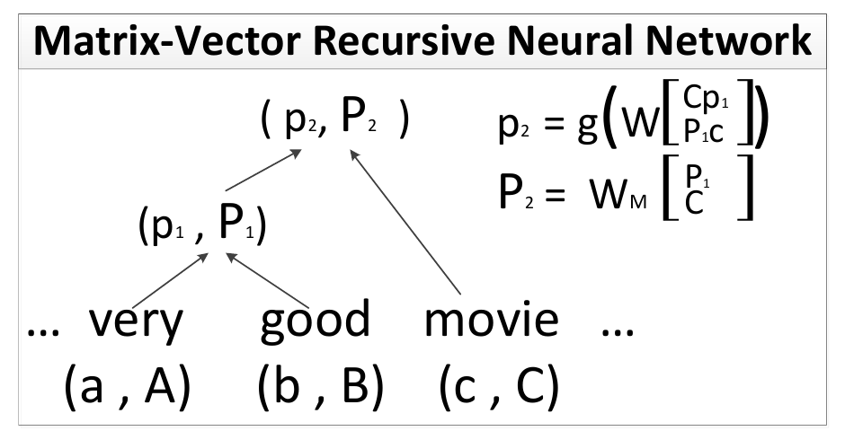
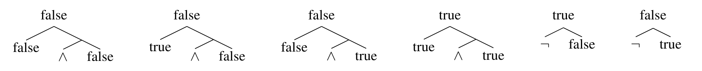
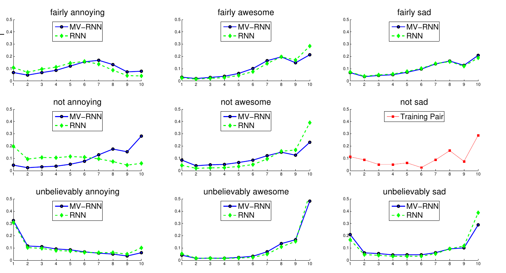

# 단어를 벡터이자 함수로 보기 — Semantic Compositionality through Recursive Matrix-Vector Spaces

#### Abastract

단어 단위의 벡터 공간 모델은 어휘 정보를 학습하는 데 매우 성공적이었다. 그러나 이러한 모델은 더 긴 구절의 합성적 의미를 포착하지 못하므로 언어를 심층적으로 이해하는 데 한계가 있다.

우리는 구문 유형과 길이에 관계없이 구절과 문장의 합성적 벡터 표현을 학습하는 재귀 신경망(Recursive Neural Network, RNN) 모델을 제안한다. 이 모델은 구문 분석 트리의 각 노드에 하나의 벡터와 하나의 행렬을 할당한다. 벡터는 해당 구성 성분이 지닌 고유한 의미를 포착하고, 행렬은 그 구성 성분이 주변 단어나 구절의 의미를 어떻게 변화시키는지를 나타낸다.

이러한 행렬-벡터 RNN은 명제 논리와 자연어에 등장하는 연산자의 의미를 학습할 수 있다. 제안한 모델은 다음 세 가지 실험에서 당시 최고 수준의 성능을 달성했다. 첫째, 부사-형용사 쌍의 세분화된 감성 분포를 예측하는 과제, 둘째, 영화 리뷰의 감성 레이블을 분류하는 과제, 셋째, 두 명사 사이의 구문 경로를 이용해 원인-결과나 주제-메시지와 같은 의미 관계를 분류하는 과제이다.

#### 블로그 요약

단어벡터는 단어의 의미만 표현한다. 문장은 단어의 합성인데, 두 단어가 결합(합성)되면서 변화된 의미를 갖게 된다. 이 합성과정에서 각 단어는 상대방에 영향을 미치고 그 결과로 결합된 의미가 생성된다는 것이 이 논문의 가정이다. 따라서 이 논문은 단어를 단어 자체를 표현하는 벡터와 주변 단어에 영향을 미치는 연산(행렬)의 쌍으로 정의하고, 두 단어가 결합되어 새로운 벡터와 행렬을 생성하는 과정을 수식화했다. 문장이 주어지면 먼저 구문 분석 트리로 변경하고, 말단 노드부터 재귀적으로 합성하면 문장 전체의 합성 의미를 얻을 수 있다. 이를 통해 문장의 감성 등 문장 전체의 특성을 예측하도록 학습하면, 이 과정에서 단어의 벡터, 행렬, 합성 과정에서의 가중치 등이 학습된다.
이 체계를 논리식에도 적용할 수 있는데, 리터럴을 단어에 대응시키고 논리 연산을 단어간 결합으로 대응시키면, 논리식을 트리로 표현해서 마찬가지로 최종 논리식의 값(T/F)를 예측하도록 학습이 가능하다. 
논리식을 벡터로 표현하고 행렬 연산을 통해 추론을 하는 프레임워크를 제안했다고 할 수 있다. 이 블로그는 그 과정을 상세하게 따라가며 설명한다.

---

## 1. 이 논문이 풀려는 문제

### 1) 단어 벡터는 합성성을 담지 못한다

의미 벡터 공간은 검색 질의 확장, 정보 검색을 위한 사실 추출, 위키피디아 링크 자동 주석 같은 여러 자연어 응용의 핵심에 있다. 이런 모델에서 단어의 의미는 그 단어와 이웃 단어들의 공기(co-occurrence) 통계로부터 계산된 벡터로 인코딩되고, 이렇게 얻은 벡터는 사람의 단어 유사도 판단과 잘 상관된다는 것이 알려져 있다.

문제는 그 다음이다. 단어 벡터는 개별 단어의 의미는 잘 잡지만 **합성성(compositionality)** 을 잡지 못한다. 합성성이란 화자가 단어들의 의미와 그것을 결합하는 규칙으로부터 더 긴 표현의 의미를 결정할 수 있게 해 주는 자연어의 성질이다. 이것이 없으면 더 긴 구나 문장의 의미에 대한 깊은 이해로 나아갈 수 없다.

가장 흔한 접근은 단어 벡터들의 선형 결합 — 합이나 가중 평균 — 을 취하는 것이다. 정보 검색이나 어휘 유사도 기반 텍스트 유사도 함수에서 실제로 이렇게 한다. 텍스트의 의미가 말 그대로 "부분들의 합"일 때는 잘 작동하지만, **단어가 다른 단어의 의미를 수정하는 연산자로 기능할 때는 무너진다.** "extremely strong"의 의미는 "extremely"와 "strong"의 벡터 합으로 잡히지 않는다.

### 2) 직전 연구들과 그 한계

Socher et al. (2011c)은 선형 결합을 넘어서는 가능성을 열었다. 단어 벡터 (a, b)에 곱해지는 행렬 W와 비선형 함수 g를 써서 부모 벡터를 계산한다.

$$p = g\left(W \begin{bmatrix} a \\ b \end{bmatrix}\right)$$

그리고 이 함수를 이진화된 파스 트리 안에서 재귀적으로 적용해 다단어 시퀀스의 벡터를 계산한다. 비선형성 덕분에 더 넓은 범위의 함수를 표현할 수 있지만, **고정된 W 하나가 모든 자연어 연산자의 의미 결합 효과를 담아내리라 기대하는 것은 거의 확실히 무리다.** 함수 g 안에서는 가능한 모든 단어 벡터 쌍에 대해 동일한 선형 변환이 적용되기 때문이다.

다른 쪽에서는 자연어 연산자를 **행렬로** 모델링하려는 시도가 있었다. Baroni & Zamparelli (2010), Zanzotto et al. (2010)이 그렇다. 이러면 "extremely"에 해당하는 행렬이 "smelly"나 "strong"의 벡터를 적절히 수정할 수 있다. 방향은 옳지만 지금까지는 단어 쌍의 **선형** 함수를 잡는 데 그쳤다.

MV-RNN은 두 아이디어의 강점을 결합한다. (i) **모든 단어에 벡터와 행렬을 함께 부여**하고, (ii) 임의의 구문 유형을 가진 다단어 시퀀스의 벡터·행렬 표현을 계산하는 **입력 특화적이고 비선형인 합성 함수를 학습**한다.

---

## 2. 핵심 아이디어 — 모든 노드에 벡터와 행렬

파스 트리의 모든 노드에 벡터 하나와 행렬 하나를 함께 부여한다.

- **벡터** = 그 구성요소 자체의 의미
- **행렬** = 그것이 이웃 단어의 의미를 어떻게 *바꾸는지* (연산자 역할)

품사 하나에만 행렬을 주는 게 아니라 모든 단어에 벡터-행렬 표현을 주는 것이 유연성을 높이고, 이 유연성이 성능으로 이어진다. 어떤 단어가 연산자 의미를 갖지 않는다면 그 행렬은 항등행렬이 될 수 있다. 반대로 "extremely"처럼 주로 연산자로 기능하는 단어는 **벡터가 0에 가까워지는 대신 행렬이 뚜렷한 연산자 의미를 갖게 된다** — 여기서는 수식받는 단어의 의미를 긍정·부정 양방향으로 증폭시키는 역할이다.

*그림 1. MV-RNN이 파스 트리의 비단말 노드에서 구를 다른 단어와 병합하는 예 (논문 Figure 2). 각 단어는 (벡터, 행렬) 쌍으로 표현되고, 병합 결과도 같은 형식의 쌍이다.*

---

## 3. 벡터와 행렬은 어떻게 만들어지는가

### 1) 초기화 — 단어 수준의 (벡터, 행렬)

모든 단어 w는 쌍 (x, X)를 갖는다.

**벡터 x ∈ ℝⁿ** 는 Collobert & Weston (2008)의 비지도 모델로 Wikipedia에서 사전학습한 50차원 벡터로 초기화한다. 문맥에서 단어의 출현 가능성을 예측하도록 학습된 것이라 구문·의미 정보를 담고 있다.

**행렬 X ∈ ℝⁿˣⁿ** 는 X = I + ε 로 초기화한다. 항등행렬 + 작은 가우시안 노이즈.

이 초기화 선택이 중요하다. 항등행렬은 "아무것도 바꾸지 않는 연산자"다. 즉 **모든 단어를 일단 '의미를 변형시키지 않는 중립 연산자'로 출발시킨 뒤, 학습이 필요한 단어만 항등에서 멀어지게** 하는 설계다. "the", "movie" 같이 연산자 성격이 없는 단어는 학습 후에도 항등 근처에 머물고, "extremely", "not" 같은 단어만 강한 연산자로 발달한다. ε 노이즈는 대칭성 깨기(symmetry breaking)용이다.

길이 m인 구나 문장은 순서 있는 리스트 ((a, A), (b, B), …, (m, M))로 표현된다.

### 2) 저랭크 근사 — 파라미터 폭발 억제

n = 100이면 단어당 행렬만 10,000개 파라미터다. 어휘 10만 개면 10억 파라미터. 그래서 논문은 행렬을 직접 저장하지 않고 분해해서 저장한다.

$$A = UV + \mathrm{diag}(a), \qquad U \in \mathbb{R}^{n \times r},\; V \in \mathbb{R}^{r \times n},\; a \in \mathbb{R}^n,\; r = 3$$

파라미터 수가 n² → 2nr + n 으로 줄어든다 (n = 100이면 10,000 → 700).

구조적으로도 의미가 있다. diag(a)가 **항등행렬 성격의 축별 스케일링**(각 차원을 독립적으로 증폭·감쇠)을 담당하고, UV(rank 3)가 **차원 간 상호작용**이라는 저차원 보정을 담당한다. 초기화 X = I + ε는 이 형식에서 a ≈ 1, UV ≈ 0 에 해당한다. 학습되는 실제 파라미터는 U, V, a이고 A는 그로부터 조립된다.

주의할 점은 이 근사가 **단어 행렬에만** 적용된다는 것이다. 아래 나올 W, W_M 같은 전역 행렬은 full rank다.

### 3) 두 단어의 합성 — 부모 벡터 p

자식이 (a, A), (b, B)일 때 부모 벡터는 다음과 같이 계산된다.

$$p = f_{A,B}(a,b) = f(Ba, Ab) = g\left(W \begin{bmatrix} Ba \\ Ab \end{bmatrix}\right)$$

두 단계로 나눠 보면 이렇다.

**Step 1. 교차 적용 (cross-application)**

- Ba ∈ ℝⁿ ← b의 연산자를 a의 벡터에 적용
- Ab ∈ ℝⁿ ← a의 연산자를 b의 벡터에 적용

여기가 모델의 핵심이다. 각 단어의 행렬이 **자기 벡터가 아니라 상대 벡터에** 곱해진다. "very good"이면 V·(good 벡터)가 "very가 good을 증폭한 결과"이고, G·(very 벡터)가 "good이 very를 문맥화한 결과"다. 양방향 modification을 모두 계산한다.

**Step 2. 연결 및 사영**

두 변환된 벡터를 세로로 이어 붙여 z = [Ba; Ab] ∈ ℝ²ⁿ 를 만들고, W ∈ ℝⁿˣ²ⁿ 로 다시 n차원으로 사영한다. W는 **모든 노드가 공유하는 전역 합성 함수**이고, 이 차원 보존이 재귀 가능성의 전제다 — p가 자식과 같은 크기여야 다음 합성의 입력이 될 수 있다. 편향항은 논문에서 표기 간결성을 위해 생략됐지만 추가할 수 있다.

g는 tanh나 sigmoid 같은 원소별 비선형이다. 뒤에 나올 논리 실험에서는 g(x) = max(min(x, 1), 0) 인 linear threshold unit을 썼다.

**역할 분담**을 정리하면, 단어 행렬 A, B가 **입력에 따라 달라지는(input-specific) 합성 효과**를 담당하고, W가 **모든 합성에 공통인 일반 규칙**을 담당한다. 표준 RNN은 W 하나만 있어서 모든 단어쌍에 동일한 선형변환을 강요하는데, 그 경직성을 A, B로 푼 것이다.

### 4) 부모 행렬 P — 자주 놓치는 부분

부모 노드도 다음 합성에서 **연산자로 기능해야** 하므로 행렬이 필요하다. 벡터와는 별개의 함수를 쓴다.

$$P = f_M(A,B) = W_M \begin{bmatrix} A \\ B \end{bmatrix}, \qquad W_M \in \mathbb{R}^{n \times 2n}$$

[A; B]는 두 n×n 행렬을 세로로 쌓은 2n×n 행렬이고, W_M을 왼쪽에서 곱하면 결과가 n×n으로 떨어진다. 각 입력 행렬과 똑같은 크기다. 벡터 쪽과 대칭적인 형태지만 세 가지가 다르다.

- 파라미터가 W가 아닌 **별도의 W_M**
- **비선형 g가 없다** (순수 선형)
- 교차 적용이 없다 — A, B를 그대로 쌓아 섞을 뿐

이 P가 저랭크 근사를 따르지 않는다는 점도 짚어둘 만하다. 저랭크는 어휘 저장 비용 때문인데, 파스 트리 내부 노드는 계산 시점에만 존재하므로 그 제약이 없다.

### 5) 재귀 — "very good movie" 전 과정

단어를 (a, A) = very, (b, B) = good, (c, C) = movie 라 하고, 파스 트리는 ((very good) movie) 라고 하자.

**노드 1: very + good**

$$p_1 = g\left(W \begin{bmatrix} Ba \\ Ab \end{bmatrix}\right), \qquad P_1 = W_M \begin{bmatrix} A \\ B \end{bmatrix}$$

**노드 2: (very good) + movie**

이제 왼쪽 자식이 단어가 아니라 구인데, **형식이 완전히 동일**하므로 같은 f, f_M을 그대로 재사용한다.

$$p_2 = g\left(W \begin{bmatrix} C p_1 \\ P_1 c \end{bmatrix}\right), \qquad P_2 = W_M \begin{bmatrix} P_1 \\ C \end{bmatrix}$$

C·p₁ 은 "movie가 구 'very good'을 수식한 결과", P₁·c 는 "구 'very good'이 movie를 수식한 결과"다. 단어일 때와 구일 때를 구분하는 로직이 전혀 없다 — 이것이 논문이 말하는 "recursively compatible"의 의미다.

이 과정을 트리 최상단까지 bottom-up으로 반복하면 루트의 (p_root, P_root)가 문장 전체의 표현이 된다.

### 6) 기존 모델들은 모두 특수 케이스

이 생성 절차의 파라미터를 고정하면 선행 연구가 그대로 나온다. 논문이 자기 모델을 위치시키는 방식이기도 하다.

| 설정 | 결과 모델 |
|---|---|
| W = [I I], g = identity | Mitchell & Lapata / Zanzotto: p = Ba + Ab |
| B = 0 | Baroni & Zamparelli: p = Ab (형용사-명사만) |
| A = B = I | Socher의 표준 RNN: p = g(W[a;b]) |

두 번째 줄, p = Ab 모델은 명사가 다른 명사를 수식하는 경우(예: disk drive)를 다룰 수 없다. 논문은 이 특수 케이스들을 실험에서 직접 비교 대상으로 삼는다.

---

## 4. 학습 과정

### 1) 무엇이 파라미터인가

$$\theta = (W, W_M, W^{label}, L, L_M)$$

| 기호 | 형태 | 역할 |
|---|---|---|
| W | n × 2n | 전역 벡터 합성 함수 |
| W_M | n × 2n | 전역 행렬 합성 함수 |
| W_label | K × n | softmax 분류기 |
| L | 전체 단어 벡터 집합 | 어휘별 의미 |
| L_M | 전체 단어 행렬 집합 | 어휘별 연산자 |

여기서 중요한 사실 하나. **사전학습된 단어 벡터도 학습 대상이다.** Collobert & Weston 벡터는 초기값일 뿐이고 태스크 데이터로 계속 갱신된다. 단어 행렬 L_M도 마찬가지로 I + ε에서 출발해 학습된다. 그리고 L_M은 실제로 행렬을 저장하는 게 아니라 저랭크 인자 (U, V, a)를 저장하므로, **진짜 갱신되는 파라미터는 U, V, a이고 A = UV + diag(a)는 매번 조립된다.**

### 2) Forward — bottom-up

파스 트리는 학습되지 않고 **주어진다.** Stanford Parser (Klein & Manning, 2003)로 이진화한 트리를 쓴다.

1. leaf에서 각 단어의 (벡터, 행렬)을 조회한다. 행렬은 저랭크 인자로부터 조립한다.
2. 트리를 따라 올라가며 각 내부 노드에서 p와 P를 계산한다.
3. **모든 노드**에 softmax를 얹어 클래스 분포를 낸다.

$$d(p) = \mathrm{softmax}(W^{label} p)$$

레이블이 K개면 d ∈ ℝᴷ 는 K차원 다항분포다.

### 3) 목적함수

문장 s와 그 트리 t에 대해, 최소화할 오차 함수 E(s, t, θ)는 **모든 노드에서의 cross-entropy 오차의 합**이다.

루트만이 아니라 중간 노드 전부에 감독 신호가 들어간다는 점이 핵심이다. 문장 하나가 노드 개수만큼의 학습 예제 역할을 하니 데이터 효율이 크게 올라간다.

전체 목적함수 J의 그래디언트가 논문의 식 (4)이다.

$$\frac{\partial J}{\partial \theta} = \frac{1}{N} \sum_{(x,t)} \frac{\partial E(x,t;\theta)}{\partial \theta} + \lambda\theta$$

λ가 스칼라가 아니라 **벡터**라는 점을 논문이 명시한다. 파라미터 그룹별로 정규화 계수가 다르다 — 단어 벡터, softmax, W, 단어 연산자 각각 따로 교차검증한다.

### 4) Backward — backpropagation through structure

Goller & Küchler (1996)의 BPTS를 쓴다. 먼저 모든 트리 노드 (pᵢ, Pᵢ)를 bottom-up으로 계산한 다음, 각 노드 softmax 분류기의 미분을 top-down으로 취한다. 표준 backprop과 다른 점이 세 가지다.

**계산 그래프가 예제마다 다르다.** 트리 모양이 문장마다 달라지므로 고정된 층 구조가 없다. 그래프를 매번 forward에서 만들고 그 위에서 역전파한다.

**각 노드에서 오차가 두 갈래로 합쳐진다.** 어떤 노드 p에 도달하는 오차는 (a) 그 노드 자신의 softmax에서 직접 발생한 오차와 (b) 부모 노드에서 내려온 오차의 합이다. 이걸 더한 뒤 자식들로 내려보낸다.

**벡터 경로와 행렬 경로가 얽혀 있다.** 단어 행렬 A는 두 곳에 등장한다 — p = g(W[Ba; Ab])의 Ab 항, 그리고 P = W_M[A; B]. 따라서 A의 그래디언트는 **벡터 경로와 행렬 경로 양쪽에서 흘러들어와 합쳐진다.** 여기서 다시 A = UV + diag(a)를 통해 연쇄법칙으로 U, V, a까지 내려간다.

여기에 **가중치 공유에 의한 누적**이 겹친다. W와 W_M은 트리의 모든 노드에서 재사용되므로, 한 문장 안에서만도 노드 수만큼의 그래디언트가 누적된다. 단어 벡터와 행렬은 그 단어가 등장한 **모든 문장의 모든 위치**에서 누적된다. "not"의 행렬이 부정 연산자로 발달하는 것은 수많은 문맥에서 "not X"의 감성 레이블이 X와 반대라는 신호가 이렇게 쌓인 결과다.

### 5) 최적화와 하이퍼파라미터

**L-BFGS, batch mode.** SGD나 미니배치가 아니라 전체 학습 데이터에 대한 그래디언트를 한 번에 계산해서 준-뉴턴 방법으로 갱신한다. 논문은 목적함수가 볼록하지 않지만 실제로는 잘 최소화되고 수렴이 매끄럽다고 보고한다. 요즘 기준으로는 낯선 선택인데, 데이터가 작아서 가능했다 — 부사-형용사 4,211쌍, MR 10,000문장 규모다.

부사-형용사 실험에서 교차검증한 범위는 정규화 계수 (10⁻⁴, 10⁻³)와 단어 벡터 크기 n = 6, 8, 10, 12, 15, 20 이었다. 결과가 재미있다. **모든 모델이 n < 12에서 최고 성능**을 냈다. 논문은 이걸 근거로 "성능 차이는 파라미터 수가 아니라 모델의 표현력에서 온다"고 주장한다. MV-RNN이 단어당 행렬을 추가로 갖는 만큼 파라미터가 많아서 이겼다는 반박을 미리 차단하는 장치다.

MR과 SemEval 실험은 공정한 비교를 위해 Socher et al. (2011c)의 공개 코드와 **완전히 동일한 설정**(정규화, 벡터 크기 등)을 썼다고 밝힌다.

### 6) 감성 태스크에서 각 노드의 레이블은 무엇인가

설계 의도로만 보면 답이 깔끔하다. 각 노드의 부모 벡터 p는 자식들로부터 f(Ba, Ab)로 계산되고, 그 위의 softmax가 **그 노드가 덮는 구(span)의 감성**을 예측한다. 예측 자체는 온전히 합성적이다. 논문도 부모 벡터를 "features describing that phrase"라고 부른다.

그런데 **레이블 쪽은 실험마다 사정이 다르고, 두 번째 경우가 좀 지저분하다.**

**부사-형용사 실험은 깔끔하다.** 트리가 노드 하나뿐이고, gold 분포는 IMDB에서 그 쌍이 등장한 리뷰들의 별점 분포를 정규화해 얻은 실제 데이터다. "unbelievably sad"라는 쌍 자체에 붙은 진짜 레이블이다. 논문이 명시적으로 강조하는 대목도 있다 — "We never give the algorithm sentiment distributions for single words." 즉 **leaf에는 감독 신호가 전혀 없다.** 단어 벡터·행렬은 오직 부모 노드의 오차가 역전파되면서만 학습된다. 테스트 셋은 본 적 없는 단어 쌍으로 구성되므로, 개별 단어의 감성을 외운 게 아니라 합성 규칙을 배웠는지가 정직하게 평가된다.

**MR 실험에서는 사정이 다르다.** MR 데이터셋에는 **문장 레벨 레이블만 있다.** 10,000개 문장에 긍/부정 하나씩이고 구 단위 주석은 존재하지 않는다. 그런데 목적함수는 모든 노드의 cross-entropy 합이다. 모든 노드에 목표가 필요한데 문장 레이블 하나뿐이니, 남는 방법은 **문장 레이블을 트리 전체 노드에 복사하는 것**이다. 논문이 "exact same setup as the published code of Socher et al. (2011c)"라고만 하고 넘어간 부분이 이것이다.

그래서 정확히 말하면, 예측은 "자식들로부터 합성된 그 구의 감성"이 맞지만 **MR에서 레이블은 그 구의 진짜 감성이 아니라 문장 전체의 감성이다.** 이건 명백한 근사이고 노이즈가 크다. 논문 Table 2에 실린 예문을 보면 긴장이 드러난다.

> Not always too whimsical for its own good this strange hybrid of crime thriller, quirky character study, third-rate romance and female empowerment fantasy never really finds the tonal or thematic glue it needs. → **0 (부정)**

"quirky character study"나 "female empowerment fantasy" 같은 하위 노드가 전부 부정 레이블을 받는다. 국소적으로는 중립이거나 오히려 긍정인데도. 문장 앞머리의 "Not always too whimsical for its own good"은 사실 완화된 칭찬에 가깝다.

정확히 이 한계 때문에 같은 그룹이 이듬해 **Stanford Sentiment Treebank**를 만든다 (Socher et al., 2013, RNTN). 파스 트리의 구 215,154개에 사람이 직접 감성 레이블을 달았다. 그제서야 "각 노드의 레이블 = 그 노드가 덮는 구의 실제 감성"이 성립하고, 노드별 감독이 원래 의도대로 작동한다. 말하자면 MV-RNN은 **아키텍처는 구 단위 감독을 전제로 설계해놓고, 그에 맞는 데이터가 없어서 문장 레이블로 때운 상태**였다.

참고로 SemEval 관계 분류 실험은 또 다르다. 전 노드가 아니라 **두 명사를 잇는 경로의 최상위 노드 하나**만 분류에 쓴다. 관계 레이블이 원래 그 노드 수준의 것이므로 이쪽도 레이블-노드 대응이 자연스럽다.

### 7) 실패한 시도 — 비지도 사전학습

논문이 솔직하게 적어둔 부분이다. MV-RNN으로 문맥 단어를 예측하게 해서 벡터-행렬을 비지도로 사전학습해봤지만 **성능 향상이 전혀 없었다.**

원인 분석이 날카롭다 — 감성 분석에서 반의어(good/bad)는 국소 구문 문맥이 거의 동일해서, 공기 통계 기반 비지도 학습은 이 둘에 유사한 벡터를 준다. 감성이라는 축이 분포 정보에 잘 드러나지 않는 것이다.

결론적으로 이 논문의 성능은 **전적으로 레이블 데이터를 쓴 지도학습**에서 나왔고, 그래서 학습된 표현은 태스크 특화적이다. 논문은 멀티태스크 학습으로 공유할 수 있으리라 언급하지만, 공정 비교를 위해 각 태스크의 지도 데이터만 썼다.

이 마지막 항목이 2012년이라는 시점을 잘 보여준다. 대규모 비지도 사전학습이 지도학습을 압도한다는 것이 확립되기 전이고, 여기서는 그 시도가 실패로 기록됐다. 몇 년 뒤 이 판단이 뒤집히게 된다.

---

## 5. 명제논리를 배울 수 있는가

논문 3.2절은 한 페이지짜리 곁가지 증명이지만, 모델의 성격을 가장 선명하게 드러내는 부분이다.

### 1) 왜 이 실험을 했나

문제의식은 이렇다. 감성 분석 같은 실제 태스크에서 "not"이 감성을 뒤집는 현상을 잡으려면, 모델이 원리적으로 부정·논리 연산을 표현할 수 있어야 한다. 노이즈 많은 실제 텍스트에서 그걸 배우기 전에, **깨끗한 장난감 환경에서 애초에 표현 가능한지**를 확인하는 필요조건 점검이다.

동시에 이건 형식의미론(Montague, 1974)과 분포적 벡터 공간을 잇는 시도이기도 하다. 논리 기반 접근은 합성성을 구문 구조 → 람다 계산 사상으로 깔끔하게 설명하지만 단어들이 서로 무관한 원자 기호다. 벡터 공간은 그 반대로, 대규모 코퍼스에서 지도 없이 지식을 뽑아내고 단어 의미 유사도에 대해 세밀한 진술을 할 수 있다. 두 접근은 흔히 직교하는 것으로 여겨진다.

여기서 방향을 오해하기 쉬운데, 논문의 의도는 "논리식을 벡터공간으로 매핑하는 것"이 목적지가 아니다. 오히려 **"벡터 공간 모델이 논리 기반 모델에 비해 부족하지 않다"**는 방어에 가깝다. 벡터 쪽이 논리 연산자마저 흡수할 수 있음을 보여 그 대립을 완화하려는 것이다. 진짜 관심사는 여전히 노이즈 많은 실제 문장이고, 논리는 표현력의 하한을 보여주는 시험대다.

### 2) 실험 설정

*그림 2. MV-RNN이 명제 연산자를 학습하기 위한 6개의 학습 트리 (논문 Figure 4). ∧ 트리는 오른쪽 가지가 먼저 묶이는 right-branching 구조다.*

**차원을 1로 축소한다.** n = 1. 따라서 벡터는 스칼라, 행렬은 1×1 스칼라다. 표현력을 극한으로 제한한 상태에서도 되는지 보려는 것이다.

**진리값 표현을 고정한다** (학습 대상이 아니다).

- true = (t = 1, T = 1)
- false = (f = 0, F = 1)

행렬을 둘 다 1(항등)로 고정한 게 핵심이다. 논문 표현으로 "essentially ignoring them" — **true/false는 연산자 역할을 하지 않는다.** 모든 연산자 부담을 ∧과 ¬에 몰아준다. 학습되는 것은 ∧의 (c, C), ¬의 (d, D), 그리고 전역 W, W_M 뿐이다.

학습 데이터는 트리 6개가 전부다.

| 입력 | 목표 |
|---|---|
| false ∧ false | false |
| true ∧ false | false |
| false ∧ true | false |
| true ∧ true | true |
| ¬ false | true |
| ¬ true | false |

**strictly right-branching** 트리라는 단서가 중요하다. "false ∧ false"는 `(false (∧ false))` 로 파싱된다. 즉 먼저 **∧과 오른쪽 피연산자가 합쳐져 중간 노드**를 만들고, 그 다음 왼쪽 피연산자와 합쳐진다. 이 중간 노드는 사실상 "AND-with-false"라는 **부분 적용된(curried) 연산자**다. 람다 계산의 커링과 구조가 같다 — 형식의미론과의 다리라는 주장과 잘 맞는 지점이다. ¬는 2토큰이라 노드가 하나뿐이다.

### 3) 목적함수가 다르다 — 왜 최소제곱인가

감성·관계 실험은 softmax + cross-entropy였지만 여기는 **softmax가 없다.** 최소제곱 재구성이다. ¬false의 경우:

$$\min \|p_{top} - t\|^2 + \|P_{top} - T\|^2$$

**벡터와 행렬을 둘 다 목표 진리값에 맞춘다**는 점을 놓치면 안 된다.

"벡터 자체가 진리값을 표현하니 분류기가 불필요하다"는 직관은 정확하다. 다만 그건 **가능한 이유**이고, **반드시 그래야 하는 이유**는 따로 있다.

**분류기로는 행렬을 제약할 방법이 없다.** softmax는 벡터 p에만 작용한다. W_label·p로 클래스를 읽어낼 뿐, **P가 무엇이 되든 아무 말도 하지 않는다.** 그런데 재귀 호환성에는 P도 필요하다. 루트 출력이 다시 다른 식의 피연산자로 쓰이려면 행렬도 T 또는 F와 같아야 하니까. 분류기 프레임으로는 이 요구를 표현할 수단이 없다.

**표현이 미리 못 박혀 있다는 점도 다르다.** 감성 태스크에서 구의 벡터는 자유롭다. 분류기가 감성을 읽어낼 수만 있으면 어떤 값이든 된다. 표현은 학습의 부산물이고 softmax는 그걸 읽는 **디코더**다. 논리 태스크에서는 true = (1,1), false = (0,1)이 실험 시작 전에 고정된다. 목표 표현이 좌표까지 정해져 있으니 회귀할 대상이 존재하고, 디코더가 낄 자리가 없다. **읽어낼 수 있으면 되는 게 아니라 그것과 같아져야 한다.**

**비선형성 선택**도 같은 이유에서 나온다. g(x) = max(min(x, 1), 0), linear threshold unit이다. tanh나 sigmoid는 0과 1에 점근할 뿐 정확히 도달하지 못한다. **정확한 재구성**이 목표이므로 0과 1을 실제로 출력할 수 있는 클리핑 함수가 필요했다.

또 하나, 감독은 **최상단 노드 하나에만** 들어간다. 논문 표기가 p_top, P_top인 게 그 뜻이다. 그런데 이게 단순한 선택이 아니라 **강제된 것**이라는 점이 재미있다. 중간 노드 `(∧ false)`는 명제가 아니라 함수이고, 함수에는 진리값이 없으니 애초에 진리값 레이블을 붙일 수가 없다. 트리에서 명제인 것은 오직 루트뿐이다. 그래서 중간 노드의 표현은 **완전히 자유롭게 남는다** — 루트를 맞추는 데 필요한 무엇이든 될 수 있고, 실제로 학습이 알아서 정한다. 감성 태스크(전 노드 감독)와 정반대 구조인 셈이다.

### 4) 실제로 어떻게 계산되는가

n = 1이므로 W = [w₁, w₂], W_M = [m₁, m₂]다. 합성 규칙을 그대로 적용한다 — 왼쪽 자식 (a, A), 오른쪽 자식 (b, B)일 때 p = g(W[Ba; Ab]), P = W_M[A; B].

**¬ 케이스 (노드 1개).** 왼쪽 = ¬ = (d, D), 오른쪽 = 진리값 (b, 1).

- ¬false: b = 0 → p = g(w₁·1·d + w₂·D·0) = g(w₁d), 목표 1
- ¬true: b = 1 → p = g(w₁d + w₂D), 목표 0

두 식의 차이가 오직 w₂D 항이라는 게 부정의 메커니즘이다. **D가 음의 기여를 만들어 g를 위쪽 클립에서 아래쪽 클립으로 밀어낸다.**

**∧ 케이스 (노드 2개).** 내부 노드 = (∧, 오른쪽 피연산자):

$$q = g(w_1 c + w_2 C \cdot b_{right})$$

오른쪽이 false(0)면 q = g(w₁c), true(1)면 q = g(w₁c + w₂C)다. **∧의 행렬 C가 오른쪽 피연산자의 진리값을 읽어 커링된 연산자를 두 종류로 분화시킨다.**

외부 노드 = (왼쪽 피연산자, 내부 노드)이고 내부 노드의 행렬을 Q라 하면:

$$p = g(w_1 Q \cdot a_{left} + w_2 q)$$

왼쪽이 false면 a_left = 0이라 첫 항이 사라지고 p = g(w₂q)다. 왼쪽이 true면 w₁Q가 더해진다.

### 5) 해가 존재함을 직접 확인

논문은 학습된 파라미터 값을 공개하지 않지만, 제약을 풀면 해가 실제로 존재한다. 예컨대 **W = [1, −1], ∧ = (1, 1), ¬ = (1, 1), m₁ + m₂ = 1** 로 두면 다음과 같다.

| 식 | 계산 | 결과 |
|---|---|---|
| ¬false | g(1) | 1 ✓ |
| ¬true | g(1 − 1) = g(0) | 0 ✓ |
| 내부 (∧ false) | q = g(1) = 1 | — |
| 내부 (∧ true) | q′ = g(1 − 1) = 0 | — |
| false ∧ false | g(−1·1) = g(−1) | 0 ✓ |
| false ∧ true | g(−1·0) = g(0) | 0 ✓ |
| true ∧ false | g(1 − 1) | 0 ✓ |
| true ∧ true | g(1 − 0) | 1 ✓ |

행렬 쪽도 확인된다. true와 false가 **둘 다 행렬 1**을 갖기 때문에 P = m₁A + m₂B 계산에서 어느 진리값이 오든 결과가 같고, m₁ + m₂ = 1이면 모든 최상단 노드가 P_top = 1을 출력한다. T = F = 1이므로 정확히 일치한다. 진리값의 행렬을 항등으로 고정한 설계가 여기서 값을 한다 — **행렬 경로는 자동으로 만족되고, 논리 전체가 벡터 경로에서 결정된다.**

재미있는 점은 이 해에서 ∧과 ¬의 파라미터가 동일하게 나온다는 것이다. 둘을 구분하는 것은 파라미터가 아니라 **트리 구조** — ¬는 직접 적용, ∧은 커링된 2단 적용이다.

### 6) "명제논리에 대해 완전하다"는 주장의 논리

논문의 결론은 이렇게 이어진다.

> the output of these 6 examples has exactly one of the truth representations, making it recursively compatible with further combinations of operators.

논증 구조는 다음과 같다.

1. 6개 예제의 최상단 출력이 (1,1) 또는 (0,1) 중 **정확히 하나**다 — 근사가 아니라 정확히. 학습 오차가 0이므로.
2. 그 출력은 입력 진리값과 형태가 구별 불가능하다. 따라서 **다른 연산의 피연산자로 그대로 투입 가능**하다.
3. 그러므로 학습된 ∧, ¬를 임의 깊이로 재귀 결합할 수 있다. ¬(true ∧ ¬false) 같은 것도 정의된다.
4. **{∧, ¬}는 기능적으로 완전한(functionally complete) 연산자 집합**이다. ∨ = ¬(¬a ∧ ¬b), xor도 이로부터 구성된다.
5. 따라서 이 MV-RNN은 임의 개수 입력의 모든 명제논리 함수를 표현한다.

3번이 이 실험의 전부라 해도 좋다. 오차가 0이 아니라 0.01이었다면 재귀할수록 오차가 누적·증폭되어 완전성 주장이 무너진다. 그래서 정확히 클리핑되는 threshold 함수를 골랐고, 그래서 행렬까지 재구성 목표에 넣었다.

다만 **깊은 중첩은 실제로 돌려본 게 아니라 논증이다.** 논문이 실험한 것은 6개 트리뿐이고, ¬(true ∧ ¬false) 같은 중첩식을 실제로 평가해 보인 대목은 없다. 완전성은 연역이다 — 루트 출력이 leaf 표현과 정확히 일치하므로 재귀 호환이고, 재귀 호환이면 기능적 완전성에 의해 임의 명제논리 함수가 구성된다. 논리적으로 견고한 논증이지만 경험적 검증은 아니다.

### 7) 임베딩이 아니라 평가다

여기가 가장 오해가 생기기 쉬운 부분이다.

"논리식을 벡터공간으로 매핑"이라고 하면 서로 다른 논리식이 서로 다른 벡터를 받고, 그 벡터들 사이 거리가 뭔가 의미를 갖는 임베딩을 떠올리게 된다. **그런데 여기선 정반대다.**

`true ∧ true` 와 `¬false` 는 루트에서 **완전히 동일한 표현** (1, 1)을 갖는다. 구분이 불가능하다. 그게 버그가 아니라 목적함수가 강제한 결과다. 루트 벡터는 1비트만 나른다.

즉 이건 논리식의 embedding이 아니라 **evaluation**이다. 식의 정체성이 아니라 값이 남는다. 신경망이 논리식 계산기로 동작함을 보인 것이지, 논리식들이 사는 의미 공간을 만든 게 아니다.

이 구분이 실전에서도 의미가 있다. 감성 분석에서 원하는 건 "not awesome"의 벡터가 "awesome"과 다른 쪽으로 이동하는 것이지, 두 표현이 같은 버킷으로 붕괴하는 게 아니다. 논리 실험의 붕괴는 진리값이라는 목표가 원래 1비트여서 생긴 것이고, 실제 태스크에서는 n차원 전체가 쓰인다.

두 태스크의 성격 차이를 정리하면 이렇다.

| | 감성 (MR) | 명제논리 |
|---|---|---|
| 감독 위치 | 모든 노드 | 루트만 (중간 노드는 명제가 아님) |
| 레이블 성격 | 문장 레이블 전파 (근사) | 고정된 정준 표현 |
| 출력 형식 | softmax 분포 | (벡터, 행렬) 쌍 그 자체 |
| 손실 | cross-entropy | 최소제곱 (벡터 + 행렬) |
| 표현의 지위 | 자유, 디코더가 읽음 | 못 박힘, 정확히 일치해야 |
| 성격 | 표현학습 + 분류 | 고정 코드북으로의 정확 재구성 |

오른쪽 열은 분류라기보다 **오토인코더에 가깝다.** 임의 입력을 두 개의 정준 코드 중 하나로 정확히 사상시키되, 그 코드가 다시 입력이 될 수 있어야 한다는 제약이 붙은 것이다.

### 8) 이 실험의 한계

논문 스스로 붙인 단서가 정확하다 — "a necessary (though not sufficient) condition". 몇 가지를 분명히 해두면 이렇다.

- **학습이 아니라 표현력 증명에 가깝다.** 6개 예제는 ∧의 진리표 4행 + ¬의 진리표 2행, 즉 **진리표 전체**다. 연산자 수준에서 미지의 입력 조합이 없고, 일반화를 평가할 테스트 셋도 없다. 일반화 주장은 오직 **합성 깊이** 방향에만 있다 — 학습 때 본 것보다 깊은 트리에서도 표현이 붕괴하지 않는가.
- **진리값 표현이 주어졌다.** 자연어에서 "무엇이 참인가"를 벡터로 만드는 문제는 손대지 않았다.
- **1차원이고 노이즈가 없다.** 실제 문장에서 "not"의 행렬이 이 깔끔한 부정 연산자로 수렴한다는 보장은 없다.
- **정리 증명기나 SAT 솔버가 아니다.** 파스 트리 구조와 leaf 진리값 할당이 주어진 상태에서 그 식의 값을 계산하는 평가기다. 논리학 용어로는 model checking 쪽이지 satisfiability나 추론 쪽이 아니다. 논문이 원한 것도 딱 그만큼인데, 자연어에서 "not X"를 만났을 때 필요한 것이 바로 그 평가 능력이기 때문이다.

---

## 6. 실험 결과

### 1) 부사-형용사 감성 분포 예측

IMDB에서 추출한 부사-형용사 쌍 데이터셋을 쓴다. 각 쌍은 그것이 등장한 리뷰들의 별점 분포를 정규화한 다항분포를 갖는다. 50회 이상 등장한 쌍만 남겨 4,211쌍을 학습에, 별도의 1,804쌍을 테스트에 쓴다. 테스트 셋은 **한 번도 본 적 없는 단어 쌍**으로 구성된다.

평가는 KL divergence로 한다. 낮을수록 좋다.

| 방법 | Avg KL |
|---|---|
| Uniform | 0.327 |
| Mean train | 0.193 |
| p = ½(a + b) — 벡터 평균 | 0.103 |
| p = a ⊗ b — 원소별 곱 | 0.103 |
| p = [a; b] — 연결 | 0.101 |
| p = Ab — Baroni & Lenci 유사 | 0.103 |
| RNN — p = g(W[a;b]) | 0.093 |
| Linear MVR — p = Ab + Ba | 0.092 |
| **MV-RNN** — p = g(W[Ba;Ab]) | **0.091** |

수치 차이는 미미하지만 논문의 요지는 다른 데 있다. **차이는 테스트 셋의 소수 부정 사례에서 나온다.**

*그림 3. 부사-형용사 쌍의 감성 분포 예측 (논문 Figure 3 오른쪽). x축은 별점 1–10. 행마다 같은 부사, 열마다 같은 형용사다.*

**MV-RNN만이 부정이 감성을 완전히 뒤집도록 허용할 만큼의 표현력을 갖는다.** 부정적 감성을 지닌 형용사가 부정되면 약간 긍정 쪽으로 이동하고, "not awesome"은 올바르게 감쇠된다. 반면 RNN과 linear MVR은 감성을 제대로 수정하지 못한다 — **"not awesome"이 "fairly awesome"보다 더 긍정적으로 예측되고, "not annoying"이 "unbelievably annoying"과 비슷한 모양을 갖는다.** linear MVR의 예측은 이 예시들에서 표준 RNN과 거의 동일하다.

상위 세 모델 모두 "unbelievably sad"의 U자 모양은 올바르게 잡는다. 이 쌍은 중의적이라 부정·긍정 양극에서 모두 봉우리를 갖는다 — 배우 연기를 두고 하는 말이면 매우 부정적이지만, 줄거리를 두고 하는 말이면 슬프고 생각할 거리를 주는 영화를 좋아하는 사람이 많기 때문이다.

정리하면, **행렬 표현(연산자)과 비선형성 둘 다 있어야** 다양한 합성 효과를 배울 수 있다는 것이 이 ablation의 결론이다.

### 2) 영화 리뷰 문장 감성 분류 (MR)

긍/부정 영화 리뷰 문장 10,000개로 구성된 표준 벤치마크다.

| 방법 | Accuracy |
|---|---|
| Tree-CRF (Nakagawa et al., 2010) | 77.3 |
| RAE (Socher et al., 2011c) | 77.7 |
| Linear MVR | 77.1 |
| **MV-RNN** | **79.0** |

높을수록 좋다. 눈여겨볼 것은 Linear MVR이 77.1로 **RAE보다도 낮다**는 점이다. 단어 행렬을 도입하는 것만으로는 부족하고 비선형 합성과 결합되어야 이득이 난다는 뜻이다.

### 3) 명사 간 의미관계 분류 (SemEval-2010 Task 8)

두 명사 사이의 의미 관계를 예측하는 태스크다. 예를 들어 "My [apartment]e1 has a pretty large [kitchen]e2."에서 kitchen과 apartment가 component-whole 관계임을 맞혀야 한다. 9개의 순서 있는 관계(양방향)와 방향 없는 other 클래스를 합쳐 19개 클래스다.

방법은 이렇다. 먼저 관계를 분류하려는 두 단어 사이의 파스 트리 경로를 찾고, 그 경로의 최상위 노드를 선택해 그 노드의 벡터를 특징으로 써서 관계를 분류한다. 감성 실험과 동일한 MV-RNN을 두 단어가 걸치는 부분 트리에 적용한다.

| 방법 | 사용한 자원 | F1 |
|---|---|---|
| SVM (Rink & Harabagiu, 2010) | POS, WordNet, 형태론, 의존파스, Levin classes, PropBank, FrameNet, NomLex-Plus, Google n-grams, 패러프레이즈, TextRunner | 82.2 |
| SVM | POS, WordNet, 형태론, 시소러스, Google n-grams | 77.6 |
| MaxEnt | POS, WordNet, 형태론, 명사 복합어 시스템, 시소러스, Google n-grams | 77.6 |
| RNN | — | 74.8 |
| Linear MVR | — | 73.0 |
| **MV-RNN** | — | **79.1** |
| RNN | POS, WordNet, NER | 77.6 |
| Linear MVR | POS, WordNet, NER | 78.7 |
| **MV-RNN** | POS, WordNet, NER | **82.4** |

높을수록 좋다. 이 표에서 흥미로운 대목은 **MV-RNN이 아무 외부 자원 없이 79.1로, 방대한 수작업 자원을 동원한 대부분의 시스템을 이긴다**는 점이다. 대부분의 경쟁 시스템은 상당량의 수작업 의미 자원을 썼지만 MV-RNN은 트리 구조를 위한 파서만 필요로 하고 나머지 의미는 전부 학습한다.

그리고 POS 태그(+0.9), WordNet 상위어(+1.3), 두 단어의 개체명 태그(+0.6) 세 가지를 MV-RNN 벡터에 덧붙여 softmax를 한 번 더 학습시키면 82.4가 되어, 훨씬 많은 자원을 쓴 당시 최고 성능(82.2)을 넘어선다.

---

## 7. 남는 것들

이 논문의 기여를 한 문장으로 줄이면, **단어를 "벡터"이자 "함수"로 동시에 보는 관점**을 제시하고 그것이 세 개의 서로 다른 태스크에서 실제로 작동함을 보인 것이다. 분포적 벡터 공간에서 논리 연산자를 학습할 수 있음을 보여 형식의미론과의 다리를 놓으려 한 초기 시도이기도 하다.

한계도 분명하다.

**파라미터가 무겁다.** 어휘당 n×n 행렬이 필요하고, 저랭크 근사(r = 3)로 눌러도 구조적 부담은 남는다. 이 한계는 이듬해 같은 그룹의 RNTN(Socher et al., 2013)에서 어휘별 행렬을 버리고 **공유 텐서** 하나로 대체하면서 해소된다.

**레이블이 아키텍처를 따라오지 못했다.** 4장 6절에서 본 대로, 모든 노드에 감독을 주는 설계인데 MR에는 구 단위 주석이 없어 문장 레이블을 복사해 썼다. 이 간극이 Stanford Sentiment Treebank를 낳았다.

**비지도 사전학습이 실패로 기록됐다.** 논문은 이를 감성 축이 공기 통계에 드러나지 않는 탓으로 정확히 진단했지만, 결론적으로 태스크별 지도 데이터에 전적으로 의존하게 됐다. 이 판단은 몇 년 안에 뒤집힌다.

**파스 트리에 의존한다.** 구조가 외부에서 주어져야 하고, 파서 오류가 그대로 전파된다. 몇 년 뒤 트리 구조 자체를 버리는 방향(시퀀스 모델, 그리고 Transformer)이 주류가 된다.

그럼에도 "구성요소마다 값과 그 값을 변형하는 연산자를 함께 들고 다닌다"는 발상 자체는 여전히 읽을 가치가 있다. 이후의 어텐션 계열 모델들이 다른 방식으로 도달한 지점 — 문맥에 따라 표현을 동적으로 변형한다는 아이디어 — 을 2012년의 어휘로 표현한 것에 가깝기 때문이다.

---

## 참고

- Socher, R., Huval, B., Manning, C. D., & Ng, A. Y. (2012). Semantic Compositionality through Recursive Matrix-Vector Spaces. *EMNLP-CoNLL 2012*, 1201–1211.
- 코드: www.socher.org
- 후속 연구: Socher et al. (2013), Recursive Deep Models for Semantic Compositionality Over a Sentiment Treebank (RNTN)
