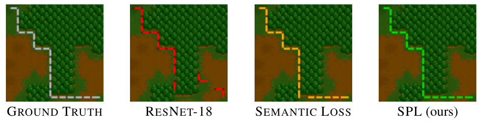
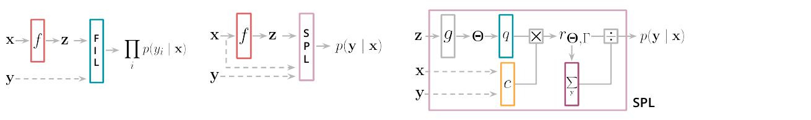
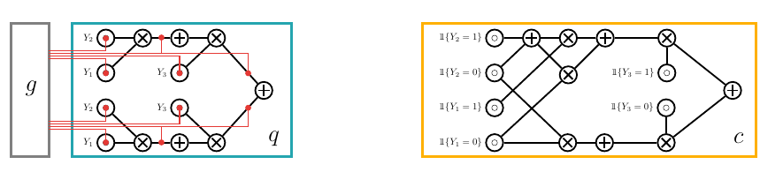

# 논리 제약을 100% 보장하는 예측 레이어: Semantic Probabilistic Layers for Neuro-Symbolic Learning

> Ahmed, Teso, Chang, Van den Broeck, Vergari — *NeurIPS 2022*
> 코드: [github.com/KareemYousrii/SPL](https://github.com/KareemYousrii/SPL)

이 글은 "Semantic Probabilistic Layers for Neuro-Symbolic Learning" 논문을 읽으며 나눈 대화를 정리한 것이다. 단순한 요약이 아니라, 이 모델이 **왜 이렇게 설계되었는지**를 명제 논리 예시로 끝까지 따라가며 이해하는 데 초점을 맞췄다.

---

## 1. 이 논문이 풀려는 문제

### 1) 구조화 출력 예측에서 논리 제약이 깨지는 문제

구조화 출력 예측(SOP, Structured-Output Prediction) 과제에서는 수백 개의 서로 얽힌 라벨을 예측해야 한다. 계층적 다중라벨 분류, 경로 찾기(pathfinding), 선호 학습 같은 문제가 그 예다. 그런데 일반 신경망은 라벨 사이의 논리적 제약(예: "고양이면 반드시 동물", "예측된 경로는 실제로 연결된 유효 경로여야 함")을 **추론 시점에 보장하지 못한다**.

기존 신경-기호(neuro-symbolic) 기법들은 제약 위반을 손실 항으로 벌점화하지만 테스트 시점의 일관성은 보장하지 못하거나, 보장하더라도 특정 제약에만 국한되거나 복잡한 제약에서 계산이 폭발한다.

논문의 Figure 1이 이 문제를 단적으로 보여준다. Warcraft 지형 지도에서 좌상단부터 우하단까지 최소 비용 경로를 예측하는 과제인데, 일반 ResNet-18이나 최신 기법인 Semantic Loss조차 **끊기거나 갈라진 무효 경로**를 내놓는다. 오직 SPL만이 유효한 경로를 보장한다.



이런 불일치는 단백질 기능 예측, 상호작용 예측, 신약 탐색처럼 안전이 중요한 상황에서는 해로울 뿐 아니라 큰 비용으로 이어질 수 있다.

### 2) 신경-기호 예측기가 갖춰야 할 여섯 가지 요건

저자들은 신경-기호 예측기가 갖춰야 할 여섯 가지를 정의하고, SPL이 이 모두를 만족하는 **유일한** 방법임을 보인다(논문 Table 1).

- **D1 확률적(Probabilistic):** 정규화된 확률을 내어 최대우도 학습과 건전한 의사결정을 가능하게 함
- **D2 표현력(Expressive):** 라벨 간의 복잡한 상관을 컴팩트하게 인코딩
- **D3 일관성(Consistent):** 항상 제약과 일치하는 예측만 출력 (위반 조합에 확률 0)
- **D4 일반성(General):** 명제 논리 등 형식 언어로 표현된 풍부한 제약 지원
- **D5 모듈성(Modular):** 임의의 기성 신경망에 끼워넣어 end-to-end 학습 가능
- **D6 효율성(Efficient):** 예측 계산 시간이 모델·제약 표현 크기에 선형

일반 시그모이드 레이어(논문에서 FIL, Fully Independent Layer로 부름)는 확률적·모듈적·효율적(D1, D5, D6)이지만, 라벨 상관과 논리 제약을 못 다뤄 불일치 예측을 낸다(D2–D4 실패). Semantic Loss, DL2, MultiplexNet, CCN 등 다른 방법들도 하나 이상을 놓친다.

---

## 2. SPL의 핵심 아이디어

### 1) 두 회로의 곱을 정규화한다

SPL(Semantic Probabilistic Layer)은 어떤 신경망에도 끼워넣을 수 있는 **예측 레이어**로, 시그모이드 레이어를 그대로 대체하면서 예측이 사전에 정의된 논리 제약과 **항상 일치**하도록 보장한다. 식 (2)처럼 두 요소의 곱을 정규화해서 확률을 낸다.

$$
p(\mathbf{y}\mid f(\mathbf{x})) = \frac{q_\Theta(\mathbf{y}\mid f(\mathbf{x}))\cdot c_K(\mathbf{x},\mathbf{y})}{Z(\mathbf{x})}, \qquad Z(\mathbf{x})=\sum_{\mathbf{y}} q_\Theta(\mathbf{y}\mid f(\mathbf{x}))\cdot c_K(\mathbf{x},\mathbf{y})
$$

- **확률 회로 $q_\Theta(\mathbf{y}\mid f(\mathbf{x}))$** — 신경망 임베딩으로 파라미터화되어 라벨 간 복잡한 상관관계를 표현하는 조건부 분포. 데이터에서 "무엇이 그럴듯한가"를 학습하는 부분이다.
- **제약 회로 $c_K(\mathbf{x},\mathbf{y})$** — 논리 제약 $K$를 만족할 때만 1, 아니면 0을 내는 지시함수. 곧 $c_K(\mathbf{x},\mathbf{y})=\mathbb{1}\{(\mathbf{x},\mathbf{y})\models K\}$이다. 이걸 곱하면 제약을 어기는 예측에는 확률 질량이 0이 된다.
- **$Z(\mathbf{x})$** — 재정규화 항, 곧 분할함수(partition function).

곱 $r_{\Theta,K}(\mathbf{y},\mathbf{x}) = q_\Theta(\mathbf{y}\mid f(\mathbf{x}))\cdot c_K(\mathbf{x},\mathbf{y})$는 제약 $K$에 의해 그 지지집합(support)이 잘려나가므로, 불일치 예측에는 어떤 확률 질량도 배정할 수 없다. 이것이 D3(일관성)의 보장 원리다.

Figure 2가 이 구조를 한눈에 보여준다. 왼쪽의 일반 FIL 레이어를 가운데의 SPL로 그대로 교체할 수 있고, 오른쪽이 그 내부 구현이다. 신경망 임베딩 $\mathbf{z}$가 게이팅 함수 $g$를 거쳐 확률 회로 $q$의 파라미터 $\Theta$가 되고, 제약 회로 $c$와 곱해진 뒤 정규화되어 $p(\mathbf{y}\mid\mathbf{x})$가 나온다.



### 2) 입력과 출력은 어떻게 표현되나

논문의 표기를 보면 구분이 분명하다. **출력 $\mathbf{y}$** 는 불리언이다. 라벨 벡터가 $\mathbf{y}\in\{0,1\}^L$로 정의되고, $L$개의 서로 얽힌 라벨 각각이 True/False(0/1)이다. 논리식 $K$는 바로 이 출력 라벨들 위에서 정의된다.

반면 **입력 $\mathbf{x}$** 는 일반적으로 불리언이 아니다. 논문은 인스턴스를 $\mathbf{x}\in\mathbb{R}^D$, 즉 실수 벡터로 둔다. Warcraft 실험의 지도 이미지처럼 연속값 입력이 그대로 신경망 특징 추출기 $f$에 들어가 임베딩 $\mathbf{z}=f(\mathbf{x})$를 만들고, 그 임베딩이 회로의 파라미터를 결정한다.

단, 입력의 일부는 논리식에 들어갈 수 있다. 제약 $K$는 라벨 $\mathbf{y}$ 위에서, 그리고 **선택적으로 $\mathbf{x}$의 이산 입력 변수의 부분집합** 위에서 정의된다. 경로 찾기 실험이 그 예로, 예측된 경로가 "입력 그래프에 실제로 존재하는 간선들"의 부분집합 안에 있어야 한다는 제약을 쓴다.

---

## 3. 명제 논리 예시로 보는 동작 방식

SPL의 동작을 논문 자체의 예시인 **동물 계층 제약**으로 끝까지 따라가 보자.

### 1) 문제 설정

세 개의 불리언 라벨을 예측한다고 하자: `Y_cat`, `Y_dog`, `Y_animal`. 제약은 식 (1)이다.

$$
K = (Y_{\text{cat}}{=}1 \Rightarrow Y_{\text{animal}}{=}1) \;\wedge\; (Y_{\text{dog}}{=}1 \Rightarrow Y_{\text{animal}}{=}1)
$$

"고양이거나 개면 반드시 동물"이라는 뜻이다. 라벨이 3개니까 가능한 조합은 $2^3=8$개이고, 이 중 $K$를 만족하는 것은 5개, 위반하는 것은 3개다. 위반하는 3개는 "동물이 아닌데 고양이/개인" 경우들이다: `(cat,dog,animal)` = `(1,0,0)`, `(0,1,0)`, `(1,1,0)`.

### 2) 두 부품

**① 확률 회로 $q_\Theta$ — "무엇이 그럴듯한가"를 학습.** 신경망 특징 추출기 $f$가 입력을 임베딩으로 바꾸고, 게이팅 함수 $g$(MLP)가 그 임베딩을 회로의 파라미터로 변환한다. 구체적으로 입력 유닛의 베르누이 파라미터 $\lambda$는 시그모이드로, 합 유닛의 가중치 $\omega$는 소프트맥스로 출력된다. 이 회로는 8개 조합 전체에 확률을 배분한다.

**② 제약 회로 $c_K$ — "무엇이 허용되는가"를 강제.** 논리식 $K$를 SDD/OBDD로 컴파일한 뒤 회로로 바꾼다. 이 회로는 조합이 $K$를 만족하면 1, 아니면 0을 출력한다.

### 3) 곱과 정규화 — 숫자로

신경망이 어떤 이미지에 대해 $q_\Theta$로 다음 (독립 근사) 주변확률을 냈다고 하자: `p(cat)=0.8`, `p(dog)=0.3`, `p(animal)=0.6`. 각 조합의 $q$, 제약 $c$, 곱, 정규화 결과는 이렇다.

| (cat, dog, animal) | $q_\Theta$ | $c_K$ | $q\cdot c$ | $p(\mathbf{y}\mid\mathbf{x}) = q\cdot c/Z$ |
|---|---|---|---|---|
| (0,0,0) | 0.056 | 1 | 0.056 | 0.085 |
| (0,0,1) | 0.084 | 1 | 0.084 | 0.128 |
| (0,1,0) | 0.024 | **0** | 0 | 0 |
| (0,1,1) | 0.036 | 1 | 0.036 | 0.055 |
| (1,0,0) | 0.224 | **0** | 0 | 0 |
| (1,0,1) | 0.336 | 1 | 0.336 | **0.512** |
| (1,1,0) | 0.096 | **0** | 0 | 0 |
| (1,1,1) | 0.144 | 1 | 0.144 | 0.220 |

곱 단계에서 위반 조합 3개의 확률이 0으로 잘려나가고(잃은 질량 0.344), 남은 유효 조합들의 합 $Z = 0.656$으로 나눠 다시 정규화한다. 결과적으로 SPL은 **불일치 예측에 확률 0을 배정**하고(D3 일관성 보장), 나머지는 여전히 합이 1인 정상 분포다(D1).

예측(MAP)은 argmax인 `(1,0,1)` = "고양이·동물"로, 일관된 답이다. 대비를 위해, 만약 $q$의 주변확률이 `dog=0.7, animal=0.45`였다면 일반 시그모이드 레이어(FIL)는 각 라벨을 0.5 기준으로 독립 판정해 `(0,1,0)` = "개인데 동물 아님"이라는 **모순된 예측**을 낼 수 있다. SPL은 그 조합을 애초에 0으로 만들어 이런 일이 구조적으로 불가능하다.

### 4) 왜 효율적인가

순진하게 하면 8개(실전에선 $10^{43}$개)를 다 열거해야 하지만, SPL은 그러지 않는다. $q_\Theta$와 $c_K$를 **호환(compatible)** 되도록 — 같은 변수 스코프를 같은 방식으로 분해하도록 — 만들면, 두 회로의 곱과 분할함수 $Z$를 $O(|q|\cdot|c|)$ 시간에 정확히 계산할 수 있다(정리 3.1). 결정적(deterministic)이면 MAP도 같은 선형 시간에 구한다. 조합을 나열하지 않고 회로 구조를 타고 한 번의 순전파로 $Z$를 얻는 것이 핵심 트릭이다.

---

## 4. 제약은 모두 명제 논리 기반이다

이 모델의 제약은 근본적으로 **명제 논리(propositional logic) 기반**이다. 요건 D4가 "라벨 위에서 어떤 형식 언어로 표현된 풍부한 논리 제약, 예컨대 명제 논리를 지원해야 한다"고 정의한다.

컴파일 메커니즘이 이를 결정한다. 논문은 논리식을 OBDD(순서형 이진결정도), SDD(문장적 결정도) 같은 **명제 지식 컴파일(knowledge compilation)** 표현으로 변환한 뒤, 그것을 negation normal form으로 쓰고 AND 게이트를 곱 유닛, OR 게이트를 합 유닛으로 바꿔 회로로 만든다. OBDD/SDD는 본질적으로 명제 불리언 함수를 표현하는 도구이므로, 컴파일 가능한 제약은 곧 명제 논리식이다.

1차 논리(FOL)나 연속 변수 위의 산술 제약은 직접 지원하지 않는다. 다만 변수가 유한하고 이산인 경우, FOL 제약은 **grounding**을 통해 명제식으로 펼칠 수 있으므로 간접적으로 표현할 수 있다. 이 동물 예시처럼 라벨이 곧 명제인 경우는 SPL 내부에서 grounding이 필요 없다 — 문제 자체가 이미 명제 수준으로 주어져 있기 때문이다.

한 가지 정밀하게 할 점: **CNF는 "컴파일러의 입력 형식"이지 회로 자체는 아니다.** 논문은 컴파일러가 만드는 회로 크기가 "논리식의 CNF 표현의 treewidth에 대해 최악의 경우 지수적"이라고 말한다. 즉 명제식을 보통 CNF로 써서 지식 컴파일러에 넣지만, 실제 $c_K$ 회로는 CNF가 아니라 그것을 SDD/OBDD로 컴파일해 만든 **결정적 NNF 회로**다. CNF 자체는 정확한 주변화 같은 tractable 연산을 지원하지 못하기 때문에 컴파일이 필요하다.

---

## 5. 식 (1)이 어떻게 회로가 되는가: 단계별 컴파일

지식 컴파일의 표준 절차를 따라 식 (1)을 Figure 3의 오른쪽 제약 회로로 변환해 보자. 라벨 인덱스는 그림과 맞춰 `Y1=cat`, `Y2=dog`, `Y3=animal`로 둔다.



**0단계 — 제약의 의미 정리.** 두 함의를 하나로 묶으면 `(cat ∨ dog) ⟹ animal`, 대우로는 `¬animal ⟹ (¬cat ∧ ¬dog)`이다.

**1단계 — 변수 순서(vtree) 정하기.** 회로가 decomposable하려면 변수를 계층적으로 분할하는 순서를 먼저 정해야 한다. 여기서는 superclass인 **animal(Y3)을 먼저 떼어내고, 그다음 {dog(Y2), cat(Y1)}** 로 나눈다. animal을 최상위에 두는 이유는, 제약이 animal 값에 따라 갈라지기 때문이다.

**2단계 — animal에 대한 케이스 분할.** Y3(animal)을 기준으로 분할한다.

- **animal = 1인 가지:** 두 함의의 결론이 이미 참이므로 cat, dog는 무엇이든 상관없다. 즉 {Y1,Y2}에 대한 하위 함수는 **TRUE**(4개 조합 모두 허용).
- **animal = 0인 가지:** 대우에 따라 `¬cat ∧ ¬dog`가 강제된다. 하위 함수는 **`(Y1=0) ∧ (Y2=0)`**.

**3단계 — 결정도를 회로 유닛으로 번역.** OR 게이트 → 합 유닛(⊕), AND 게이트 → 곱 유닛(⊗), 각 리터럴 → 지시함수 입력 유닛(`1{Y=1}` 또는 `1{Y=0}`)으로 일대일 치환한다.

**4단계 — smoothing.** `animal=1` 가지의 TRUE는 "cat도 dog도 자유"라는 뜻인데, 회로가 smooth하려면 그 자유 변수를 명시적으로 채워줘야 한다. 각 변수의 두 리터럴을 더한 합 유닛으로 표현한다: `(1{Y2=1}+1{Y2=0}) ⊗ (1{Y1=1}+1{Y1=0})`. 값은 항상 1이지만, 이렇게 써야 두 가지가 같은 변수 집합을 다뤄 smoothness가 성립한다.

**5단계 — 완성된 제약 회로.** 조립하면 Figure 3 오른쪽 회로가 된다.

```
cK = 1{Y3=1} ⊗ [ (1{Y2=1}+1{Y2=0}) ⊗ (1{Y1=1}+1{Y1=0}) ]
     ⊕
     1{Y3=0} ⊗ [ 1{Y2=0} ⊗ 1{Y1=0} ]
```

이제 세 구조적 성질을 모두 만족한다. **Decomposable:** 모든 곱 유닛이 서로소인 변수 집합을 곱한다. **Smooth:** 4단계 덕분에 모든 합 유닛의 입력이 같은 스코프를 가진다. **Deterministic:** 루트 합 유닛의 두 입력이 `1{Y3=1}`과 `1{Y3=0}`으로 지지집합이 서로소라, 임의의 조합에 대해 정확히 한 가지만 켜진다.

**검산:** 이 회로에 조합을 넣어 1이 나오는 것만 세면 `animal=1` 가지에서 4개, `animal=0` 가지에서 `(0,0,0)` 1개, 총 5개 유효 조합이 나와 $K$의 해와 정확히 일치한다. 마지막으로 이 스코프 분할 순서를 확률 회로 $q_\Theta$도 똑같이 쓰게 만들면 둘이 compatible해져서, 이후 효율적 추론이 가능해진다.

---

## 6. 학습과 추론, 그리고 SPL을 어떻게 이해할 것인가

### 1) 학습되는 것은 q뿐, 하지만 c도 그래디언트에 관여한다

학습 대상은 실제로는 특징 추출기 $f$와 게이팅 함수 $g$(MLP)다. 회로 $q_\Theta$의 **구조**는 고정이고, 그 파라미터 $\Theta$는 매 입력마다 $\Theta = g(f(\mathbf{x}))$로 신경망이 만들어낸다. 반면 $c_K$는 논리식을 한 번 컴파일해 만든 고정 회로라 학습 파라미터가 없고, 순전파로 진리값만 낸다.

다만 $c_K$가 학습에서 아무 역할이 없는 건 아니다. 최대우도 학습은 $\log p(\mathbf{y}^*\mid\mathbf{x}) = \log(q\cdot c)(\mathbf{y}^*) - \log Z$를 최대화하는데, 분모 $Z$가 $c_K$에 의존하므로 $\Theta$에 대한 그래디언트가 $c_K$를 거쳐 흐른다. 곧 $c_K$는 학습 가능한 값은 없지만, "어떤 조합이 유효한가"라는 정보로 그래디언트를 형성해 $q$가 유효 영역 안에서만 확률을 배분하도록 유도한다.

### 2) Z는 소프트맥스가 아니라 "출력공간 전체에 대한 합"

$Z(\mathbf{x})$를 소프트맥스로 오해하기 쉬운데, 그렇지 않다. $Z$는 분자 $q\cdot c$를 모든 라벨 조합에 대해 더한 값이고, 최종 확률은 그냥 나눗셈 $p(\mathbf{y}\mid\mathbf{x}) = q\cdot c(\mathbf{y}) / Z(\mathbf{x})$다.

소프트맥스와 닮은 점은 "출력공간 전체에 대한 합으로 정규화한다"는 분모의 역할뿐이다. 하지만 소프트맥스는 로짓에 exp를 씌운 뒤 더하는 반면, 여기서는 $q\cdot c$가 이미 음이 아닌 (비정규화) 확률값이라 exp가 없다. 또 소프트맥스는 평평한 클래스 집합 위의 합이지만, $Z$는 조합적 라벨 공간($2^L$개) 위의 합을 회로의 tractable 주변화로 한 번의 순전파에 정확히 계산한다. 그래서 "$q\cdot c$에 소프트맥스를 다시 적용"이 아니라, **"$q\cdot c$를 출력공간 전체 합 $Z$로 나눠 재정규화(renormalize)"** 라고 이해하는 게 정확하다.

### 3) SPL은 "불리언 마스크 위의 확률 분포"

"SPL은 입력·출력 변수의 모든 조합에 불리언을 할당하는 회로인가?"라는 질문을 정리하면 이렇다. 그 "불리언 값을 할당하는 회로"는 SPL의 두 부품 중 하나인 제약 회로 $c_K$뿐이다.

$c_K$ 하나만 보면 그 설명이 정확하다. 유효한 조합엔 1, 위반 조합엔 0을 할당하는 순수한 진리값 함수다. **그러나 SPL 전체는 불리언이 아니라 실수(확률)를 할당한다.** $c_K$는 "어떤 조합이 살아남는가"를 정하는 불리언 마스크 역할이고, $q_\Theta$가 "살아남은 조합들에 확률을 어떻게 나눌 것인가"를 정한다. 두 조합이 모두 유효해도 SPL은 서로 다른 확률을 준다(앞 예에서 `(1,0,1)`=0.512 vs `(1,1,1)`=0.220처럼).

게다가 그 확률 가중치는 제약에 쓰이지 않는 입력까지 포함한 **전체 입력 $\mathbf{x}$에 조건부로** 결정된다. 정리하면, **$c_K$는 논리 변수 조합에 불리언을 할당하는 회로이고, SPL 전체는 그 불리언 마스크로 무효 조합을 0으로 만든 뒤 학습된 확률을 유효 조합에 배분하고 정규화하는 회로**로 이해하는 게 정확하다.

---

## 7. 실험: 입력과 출력을 어떻게 설계했나

논문은 네 가지 과제를 쓰는데, 공통 원칙은 **출력 $\mathbf{y}$를 불리언 벡터/행렬로 인코딩하고, 그 위에 논리 제약을 걸었다**는 것이다.

### 1) Simple path prediction (4×4 격자)

입력 $\mathbf{x}$는 길이 `|V|+|E|`의 이진 벡터다. 앞쪽 `|V|`개 변수는 출발/도착 노드를, 뒤쪽 `|E|`개 변수는 사용 가능한 부분그래프 $G'\subseteq G$를 나타낸다. 출력 $\mathbf{y}$는 길이 `|E|`의 이진 벡터로, $G'$ 안에서의 유일한 최단 경로를 간선 on/off로 인코딩한다. 제약 $K$는 예측된 간선들이 입력 그래프의 부분집합이면서 유효한 단순 경로(연결·비순환)를 이뤄야 한다는 것이다.

이 과제는 특징 추출기로 **5층 MLP**를 쓴다. 입력 이진 벡터가 MLP $f$를 지나 임베딩이 되고, 게이팅 $g$가 그 임베딩을 단일 회로 SPL의 파라미터로 변환한다. 제약의 한 조각을 작은 그래프로 구체화하면(노드 {1,2,3,4}, 간선 `e12,e13,e24,e34`, 출발=1, 도착=4):

```
(a) 가용성:   Y_e ⟹ avail_e                        (입력에 있는 간선만 사용)
(b) 끝점 차수 1:  (Y_e12 ∨ Y_e13) ∧ ¬(Y_e12 ∧ Y_e13)   (노드1)
             (Y_e24 ∨ Y_e34) ∧ ¬(Y_e24 ∧ Y_e34)   (노드4)
(c) 중간 차수 0또는2:  (Y_e12 ⟺ Y_e24)  (노드2),  (Y_e13 ⟺ Y_e34)  (노드3)
```

이 식을 만족하는 조합은 정확히 두 경로 `{e12,e24}`(1→2→4)와 `{e13,e34}`(1→3→4)뿐이다. 실제 4×4 격자에서는 절이 훨씬 많아지고 연결성·비순환 조건까지 포함해 PySDD로 컴파일한다.

### 2) Preference learning (초밥 선호)

$n$개 항목의 순서를 이진 행렬 $Y$로 표현한다. `Y_ij=1`이면 "항목 $i$가 순위 $j$번째"라는 뜻이다. 입력은 사용자의 6종 초밥 선호이고, 출력은 나머지 4종에 대한 엄격한 전순서를 예측한다. 제약은 $Y$가 유효한 전순서(순열 행렬 조건)를 인코딩해야 한다는 것이다. 데이터는 5,000명의 초밥 선호 순위, 60/20/20 분할.

### 3) Warcraft Shortest Path (12×12 격자, 지형 지도)

입력은 Warcraft II 지형 지도 **이미지**로, 연속값이라 ResNet-18이 처리한다. 출력은 좌상단→우하단 최소 비용 경로를 지시 행렬로 인코딩한다. 제약 회로 크기가 약 $10^{10}$으로 커서, 여기서만 두 회로 방식 SPL을 쓴다. 이 과제가 "입력은 연속값 이미지, 출력은 불리언 구조"라는 대비를 가장 잘 보여준다.

### 4) Hierarchical Multi-Label Classification (12개 실제 데이터셋)

입력은 특징 벡터(수치형+범주형)이고, 출력은 클래스 계층 위의 이진 라벨 벡터다. 클래스 수는 56~499개로, 큰 데이터셋은 라벨 공간이 $2^{499}$ 조합에 달한다(그래도 컴파일하면 약 108KB 회로). 제약은 바로 3절의 cat/dog/animal류 **계층 제약**("하위 클래스가 참이면 상위 클래스도 참")이다.

정리하면 설계 패턴은 이렇다: **출력은 항상 불리언 벡터/행렬로 인코딩**하고(경로=간선 on/off, 순위=위치 지시 행렬, 계층=클래스 지시 벡터), 그 위에 "유효 경로/유효 전순서/계층 일관성" 같은 명제 제약을 걸어 회로로 컴파일한다. **입력은 과제에 따라** 이진 벡터, 연속값 이미지, 혼합 특징 벡터일 수 있으며, 경로 과제처럼 입력의 이산 부분이 제약에 직접 참여하기도 한다.

---

## 8. 결과

Simple path와 preference learning에서 SPL은 정확도(EXACT match)로 손실 기반 경쟁자들을 앞서면서 **일관성 100%** 를 유지한다. 값이 높을수록 좋다.

| 방법 | SimplePath EXACT | SimplePath CONSISTENT | Preference EXACT | Preference CONSISTENT |
|---|---|---|---|---|
| MLP + FIL | 5.6 | 7.0 | 1.0 | 2.7 |
| MLP + Semantic Loss | 28.5 | 75.2 | 15.0 | 69.8 |
| MLP + NeSyEnt | 30.1 | 91.6 | 18.2 | 96.0 |
| **MLP + SPL (ours)** | **37.6** | **100.0** | **20.8** | **100.0** |

경쟁자인 Semantic Loss와 그 엔트로피 확장(NeSyEnt)조차 일관성이 100%에 못 미친다(예: 75.2%, 91.6%). SPL만이 정확도에서 앞서면서 동시에 **모든 예측이 제약을 만족**한다.

Warcraft 최소 비용 경로에서도 결과는 확연하다.

| 방법 | EXACT | HAMMING | CONSISTENT |
|---|---|---|---|
| ResNet-18 + FIL | 55.0 | **97.7** | 56.9 |
| ResNet-18 + Semantic Loss | 59.4 | **97.7** | 61.2 |
| **ResNet-18 + SPL (ours)** | **78.2** | 96.3 | **100.0** |

SPL은 EXACT match에서 FIL보다 약 +23%, Semantic Loss보다 약 +19% 앞서고 일관성은 100%다. HAMMING 점수는 라벨 독립을 가정하는 경쟁자에게 유리한 지표라 근소하게 낮지만, 이는 일관성을 고려하지 않는 지표라는 점을 감안해야 한다. 시간 면에서도 SPL은 $10^{10}$ 유효 조합 공간에서 배치당 14초 만에 가능도를 계산할 만큼 실용적이다. HMLC 12개 데이터셋에서도 SPL은 11개에서 최신 기법 HMCNN을 유의하게 앞섰다.

---

## 9. 정리와 남은 과제

SPL은 임의의 신경망 분류기 위에 복잡한 확률적 추론과 논리 제약을 통합하는 첫 명확한 인터페이스를 제공하면서, 효율적 추론과 학습을 유지한다. 핵심을 한 줄로 요약하면 **"학습된 확률 회로 $q$"** 와 **"컴파일된 논리 회로 $c$"** 를 곱해 위반 조합을 0으로 잘라내고 남은 부분을 정규화하는 레이어이며, 회로의 호환성 덕분에 이 곱·정규화·MAP을 전부 선형 시간에 정확히 해내는 것이 구현의 요체다.

논문이 남긴 방향으로는 (i) 여러 신경망에 걸친, 1차 논리로 표현되는 제약으로의 확장, (ii) 데이터로부터 제약 자체를 학습하기, (iii) 대규모 언어 모델에 확장 가능한 논리 제약을 주입해 확률적 추론 능력을 부여하기 등이 있다.

명제 논리로 국한된다는 게 표현력의 약점은 아니다. 오히려 이 논문의 핵심 기여는, 순진하게 명제식을 처리하면 회로 크기가 폭발하는데(Warcraft 예에서 $10^{10}$), 최신 컴파일러를 쓰면 회로 크기가 논리식 CNF의 treewidth에 대해서만 지수적이고 실제로는 훨씬 작아진다는 점이다. 곧 **"명제 논리에 국한하되, 그것을 효율적·정확하게 회로로 다룬다"** 가 이 모델의 설계 철학이다.
