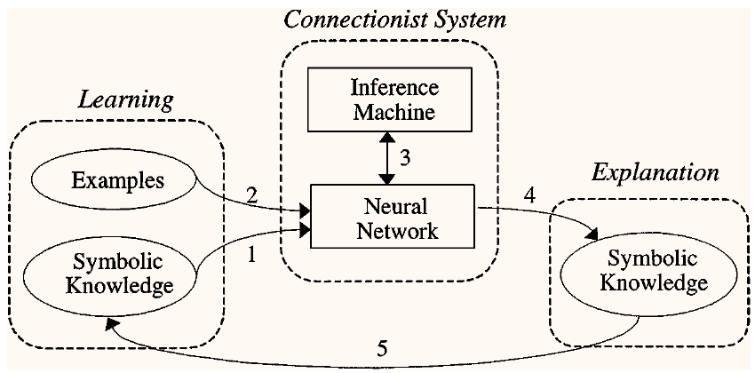
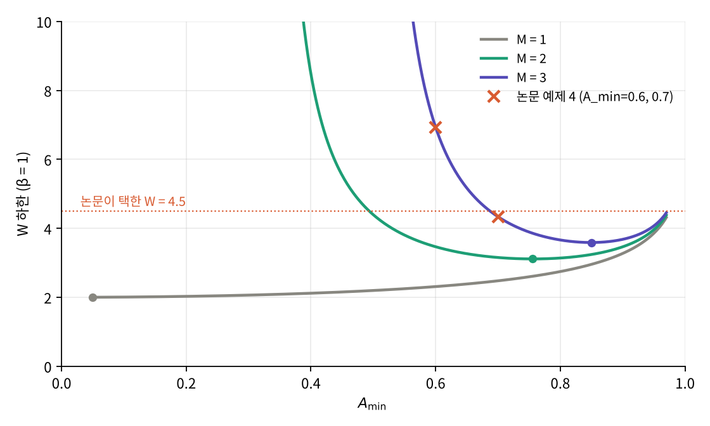
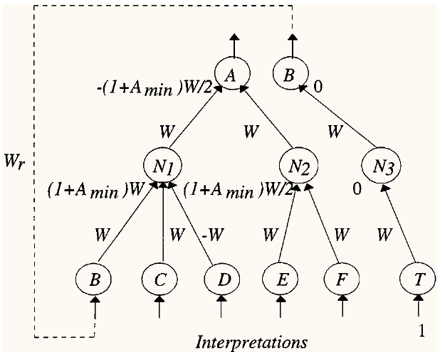
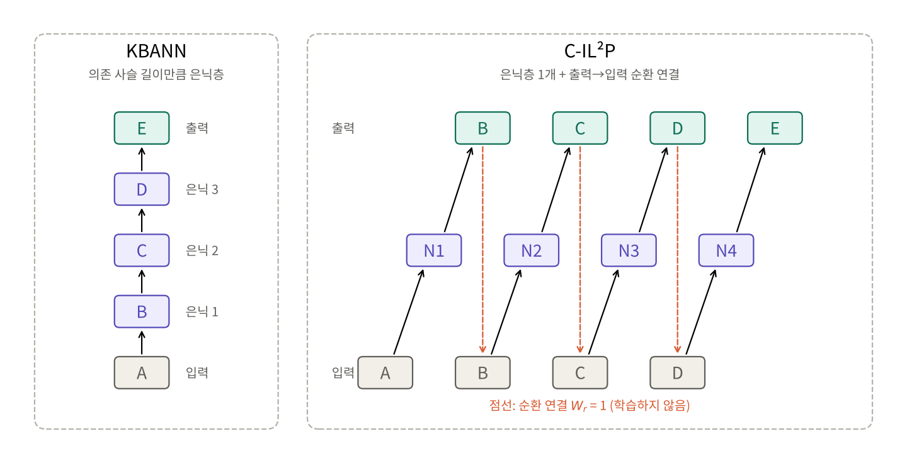
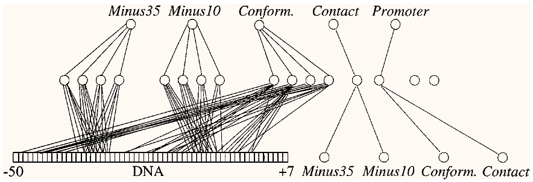

# 논리 프로그램을 단일 은닉층 신경망으로 정확히 옮기고 예제로 정제하기 — The Connectionist Inductive Learning and Logic Programming System
#### Abstract
본 논문에서는 연결주의 귀납 학습 및 논리 프로그래밍 시스템(Connectionist Inductive Learning and Logic Programming System, C-IL²P)을 제시한다. C-IL²P는 순방향 인공신경망(feedforward artificial neural network)에 기반한 새로운 대규모 병렬 계산 모형으로, 예제와 배경지식(background knowledge)으로부터의 귀납 학습(inductive learning)을 논리 프로그래밍(logic programming)의 연역 학습(deductive learning)과 통합한다. 명제 논리 프로그램(propositional logic program)으로 표현된 배경지식에서 출발하여 변환 알고리즘(translation algorithm)을 적용하면 예제로 학습시킬 수 있는 신경망이 생성된다. 이렇게 정제된 신경망으로 얻은 결과는 망으로부터 수정된 논리 프로그램을 추출함으로써 설명할 수 있다. 또한 신경망은 배경지식으로 삽입되었거나 예제로 학습된 논리 프로그램의 안정 모형(stable model)을 계산하므로, 논리 프로그래밍을 위한 병렬 시스템으로 기능한다. 우리는 C-IL²P를 계산생물학의 실제 문제 두 가지, 구체적으로 DNA 서열 분석에 성공적으로 적용하였다. 동일한 도메인 지식을 사용하는 주요 신경망, 기호 및 혼합형(hybrid) 귀납 학습 시스템의 결과와 비교한 결과는 C-IL²P의 효과성을 보여준다.
#### 요약
전문가가 가진 규칙을 신경망에 미리 넣어 두고, 그 위에서 데이터로 학습시키면 두 패러다임의 장점을 함께 얻을 수 있지 않을까. 이 논문은 그 질문에 대해 "논리 프로그램의 절 하나를 은닉 뉴런 하나로 옮기되, 가중치와 임계값을 프로그램 구조에서 수학적으로 계산하면 망이 원래 프로그램과 정확히 같은 것을 계산한다"는 답을 내놓는다. 의존 관계가 아무리 길어도 은닉층은 하나로 유지하고, 그 대신 출력을 입력으로 되먹이는 순환 연결로 추론을 반복한다는 설계가 이 시스템의 핵심이다. 이 글은 그 변환을 수식과 작은 예제로 직접 따라가 보고, 논문이 충분히 설명하지 않고 넘어간 지점들까지 함께 짚는다.

---

## 1. 왜 신경망과 논리를 합치려 하는가

### 1) 두 패러다임의 장단점

이 연구는 1999년 Applied Intelligence에 발표된 것으로, 이후 뉴로심볼릭(neuro-symbolic) AI 계보에서 자주 인용되는 C-IL²P 시스템을 처음 체계적으로 제시한 연구이다. 뉴로심볼릭 AI란 신경망의 학습 능력과 기호 논리의 추론 및 설명 능력을 하나의 시스템 안에서 결합하려는 연구 분야를 가리킨다.

신경망은 병렬성, 귀납 학습, 일반화에 강하지만 추론 과정을 설명하지 못한다. 학습된 지식이 수많은 가중치에 흩어져 저장되기 때문에, 망이 왜 그런 판단을 내렸는지를 사람이 읽을 수 있는 형태로 꺼내기 어렵다. 반대로 기호 시스템은 "A이고 B이면 C이다" 같은 규칙으로 지식을 표현하므로 설명력과 선언적 지식 표현에 강하지만, 지식 획득 병목(knowledge acquisition bottleneck)에 시달린다. 지식 획득 병목이란 전문가 시스템을 만들 때 전문가의 머릿속 지식을 규칙으로 일일이 옮겨 적는 과정이 가장 많은 비용과 시간을 잡아먹는 문제를 말한다. 게다가 이렇게 얻은 규칙은 대개 불완전하다. 일부 경우를 놓치거나, 일부는 틀린 채로 남는다.

저자들은 배경지식(불완전한 도메인 이론)을 신경망의 초기 구조로 넣고 예제로 정제하면 두 장점을 함께 얻을 수 있다고 본다. 여기서 도메인 이론(domain theory)이란 해당 분야 전문가가 알고 있는 규칙의 집합이고, 정제(refinement)란 그 규칙이 데이터와 맞지 않는 부분을 학습으로 고쳐 나가는 과정이다. 이런 문제 설정을 이론 정제(theory refinement)라 부르며, 논문의 키워드에도 첫 번째로 올라 있다.

### 2) 선행 연구: Hölldobler와 Kalinke, 그리고 KBANN

이 발상은 두 선행 연구를 직접 계승한다. 하나는 Towell과 Shavlik의 KBANN(Knowledge-Based Artificial Neural Network)이다. KBANN은 규칙을 신경망으로 옮기고, 역전파(backpropagation)로 학습시킨 뒤, 다시 규칙을 추출하는 시스템으로, 배경지식을 넣은 망이 예제만으로 학습한 망보다 적은 데이터로 더 잘 일반화함을 실험으로 보였다. 다른 하나는 Hölldobler와 Kalinke의 연구로, 논리 프로그램의 고정점 연산자 $T_{\mathcal P}$를 이진 임계 뉴런(binary threshold neuron)으로 이루어진 3층 신경망이 정확히 계산할 수 있음을 증명하였다. 다만 이진 임계 뉴런은 미분이 불가능해 역전파로 학습시킬 수 없다는 한계가 있다.

C-IL²P는 이 둘을 합친 자리에 있다. Hölldobler와 Kalinke처럼 "망이 논리 프로그램과 정확히 같은 것을 계산한다"는 수학적 보장을 유지하면서, KBANN처럼 미분 가능한 뉴런을 써서 역전파 학습이 가능하도록 만든 것이다.

## 2. 읽기 전에 필요한 논리 프로그래밍 개념

논문을 따라가려면 논리 프로그래밍의 기본 용어 몇 가지가 필요하다. 이 절은 처음 접하는 독자를 위해 그 용어를 정리한다.

### 1) 원자, 리터럴, 절, 프로그램

원자(atom)는 참 또는 거짓 값을 갖는 가장 작은 명제이다. 예를 들어 "비가 온다"를 B라 부르면 B는 원자이다. 리터럴(literal)은 원자 그 자체이거나 원자의 부정이다. B는 양의 리터럴, not B는 부정 리터럴이다.

일반 절(general clause)은 $A\leftarrow L_1,\dots,L_k$ 형태의 규칙이다. 화살표 왼쪽의 A를 머리(head), 오른쪽의 $L_1,\dots,L_k$를 본문(body)이라 부르며, "본문의 리터럴이 모두 성립하면 머리 A가 참이다"라고 읽는다. 쉼표는 "그리고(AND)"를 뜻한다. 본문이 비어 있는 절 $B\leftarrow$는 조건 없이 B가 참이라는 뜻이며 사실(fact)이라 부른다. 일반 논리 프로그램(general logic program)은 이런 절의 유한 집합이다.

여기서 not은 고전 논리의 부정과 조금 다르다. not D는 "D가 거짓임이 증명되었다"가 아니라 "D가 참이라는 근거를 찾을 수 없다"는 뜻이며, 이를 기본 부정(default negation) 또는 실패에 의한 부정(negation as failure)이라 한다. 예를 들어 "새는 날 수 있다, 단 펭귄이라는 근거가 없다면" 같은 상식 추론을 표현할 때 쓰인다.

### 2) 해석과 $T_{\mathcal P}$ 연산자

해석(interpretation)은 모든 원자에 참 또는 거짓을 하나씩 배정한 것이다. 원자가 m개면 해석은 길이 m의 참/거짓 벡터로 볼 수 있다.

$T_{\mathcal P}$는 해석 하나를 받아 새 해석 하나를 돌려주는 함수로, 프로그램의 규칙을 한 번 적용하는 연산이라 생각하면 된다. 정의는 다음과 같다. 해석 $i$가 주어졌을 때, 원자 A에 대해 본문이 $i$에서 모두 만족되는 절 $A\leftarrow L_1,\dots,L_k$가 하나라도 있으면 $T_{\mathcal P}(i)(A)$는 참이고, 그런 절이 없으면 거짓이다. 즉 각 절은 본문에 대한 AND로, 같은 머리를 갖는 여러 절은 OR로 결합된다.

### 3) 고정점과 안정 모형

$T_{\mathcal P}$를 적용해도 더 이상 바뀌지 않는 해석, 즉 $T_{\mathcal P}(i)=i$인 해석을 고정점(fixed point)이라 한다. 고정점은 "현재 믿고 있는 사실들로 규칙을 적용해 보니 정확히 같은 사실들이 다시 나온다"는 의미에서 자기 일관적인 해석이다. 안정 모형(stable model)은 기본 부정이 있는 프로그램에서 이런 자기 일관적 해석을 정의하는 표준 의미론(semantics)이며, Gelfond와 Lifschitz가 1988년에 제안하였다.

일반 프로그램은 고정점이 여러 개이거나 없을 수도 있다. 논문은 수용 가능 프로그램(acceptable program)이라는 부류에 대해서는 고정점이 정확히 하나이고, 어떤 해석에서 출발해 $T_{\mathcal P}$를 반복 적용해도 그 고정점으로 수렴하며, 그것이 곧 유일한 안정 모형이라는 기존 결과(Fitting, 1994)를 이용한다. 수용 가능성의 정의는 각 원자에 자연수 수준(level)을 매겼을 때 머리의 수준이 본문 리터럴의 수준보다 높도록 할 수 있다는 조건인데, 직관적으로는 규칙이 꼬리를 물고 무한히 맴도는 순환이 없다는 뜻으로 이해하면 충분하다.

## 3. C-IL²P의 전체 구조

*그림 1. C-IL²P의 다섯 단계 순환 구조. 왼쪽 점선 상자(Learning)에는 학습의 재료인 예제(Examples)와 기호 지식(Symbolic Knowledge, 즉 논리 프로그램)이 있고, 가운데 상자(Connectionist System)에는 신경망과 그 신경망을 추론 장치로 쓰는 부분이 있다. 오른쪽 상자(Explanation)는 학습이 끝난 망에서 꺼낸 수정된 규칙이다. 화살표에 붙은 숫자 1에서 5가 처리 순서를 나타내며, 5번 화살표가 추출된 규칙을 다시 처음으로 되돌려 학습 순환을 닫는다.*

C-IL²P는 다섯 단계의 순환 구조를 가진다. (1) 명제 일반 논리 프로그램을 신경망으로 변환하고, (2) 예제로 역전파 학습을 하며, (3) 신경망을 논리 프로그래밍용 병렬 추론기로 사용하고, (4) 학습된 망에서 수정된 규칙을 추출하며, (5) 전문가가 이를 검토해 다시 투입한다. 이 논문은 1에서 3단계를 다루고, 4단계 추출은 별도 기술보고서로 미룬다.

## 4. 변환 알고리즘: 논리 프로그램을 신경망으로

### 1) 절 하나를 은닉 뉴런 하나로

변환의 기본 아이디어는 단순하다. 각 절 $A\leftarrow L_1,\dots,L_k$를 은닉층 뉴런 하나에 대응시킨다. 양의 리터럴은 가중치 $W$, 부정 리터럴은 $-W$로 은닉 뉴런에 연결하고, 은닉 뉴런은 머리(head) 원자에 해당하는 출력 뉴런에 $W$로 연결한다. 입력층과 출력층의 각 뉴런은 원자 하나에 대응하므로, 뉴런과 원자를 같은 이름으로 부를 수 있다.

은닉 뉴런은 본문이 모두 만족될 때만(AND), 출력 뉴런은 연결된 은닉 뉴런 중 하나라도 활성일 때만(OR) 켜지도록 임계값을 설정한다. 앞 절의 $T_{\mathcal P}$ 정의와 비교하면 정확히 대응한다는 것을 알 수 있다. 은닉층이 "각 절의 본문이 만족되는가"를, 출력층이 "그런 절이 하나라도 있는가"를 계산하므로, 입력층에 해석 $i$를 넣으면 출력층에 $T_{\mathcal P}(i)$가 나오게 된다.

여기서 뉴런의 동작을 짧게 정리하면, 뉴런은 들어오는 값에 가중치를 곱해 모두 더한 뒤 임계값(threshold) $\theta$를 뺀 양, 즉 입력 전위(input potential) $I=\sum_j w_j x_j-\theta$를 계산하고, 이를 활성화 함수에 통과시켜 출력을 낸다. 임계값을 높이면 뉴런이 켜지기 어려워지고, 낮추면 쉽게 켜진다. AND와 OR의 차이는 결국 이 임계값을 어디에 두느냐의 문제이다.

### 2) 양극성 활성화 함수와 참/거짓 구간

KBANN과의 결정적 차이는 활성화 함수이다. KBANN은 출력이 [0,1] 범위인 단극성(unipolar) 시그모이드를 써서 참과 거짓이 모두 양수로 표현되므로, 본문 원자 수가 많으면 만족되지 않은 해석이 뉴런을 잘못 활성화하는 문제가 생긴다. 거짓을 0.3 같은 작은 양수로 표현하면, 거짓인 입력이 여럿 모일 때 그 작은 값들이 쌓여 임계값을 넘을 수 있기 때문이다. C-IL²P는 [−1,1] 범위의 양극성(bipolar) 함수

$$h(x)=\frac{2}{1+e^{-\beta x}}-1$$

를 사용해 거짓을 음수로 표현함으로써 이 문제를 해결한다. 여기서 $\beta$는 곡선의 가파르기를 정하는 기울기 매개변수이다. $\beta$가 클수록 $h(x)$는 0 근처에서 급하게 −1에서 1로 넘어가 계단 함수에 가까워진다.

출력이 연속값이므로 참과 거짓을 판정할 기준이 필요하다. 논문은 참으로 간주할 최소 활성값 $A_{\min}\in(0,1)$을 정하고, 출력이 $[A_{\min},1]$이면 참, $[-1,-A_{\min}]$이면 거짓으로 읽는다. 그 사이 구간 $(-A_{\min},A_{\min})$은 판정 불가 영역인데, 뒤에서 보듯 변환 알고리즘이 정한 가중치와 임계값에서는 망이 이 영역의 값을 아예 출력하지 않는다. 또한 거짓을 0 대신 −1로 두면 학습도 빨라진다. 역전파에서 어떤 가중치의 갱신량은 그 가중치로 들어오는 입력값에 비례하는데, 입력이 0이면 해당 가중치가 전혀 갱신되지 않기 때문이다.

### 3) 알고리즘 단계

이를 위해 $A_{\min}$과 가중치 $W$의 하한을 프로그램 구조(절의 최대 본문 길이 $k$와 같은 머리를 갖는 절의 수 $\mu$ 중 큰 값)로부터 계산하는 식을 유도하고, 이 조건을 만족하면 신경망이 $T_{\mathcal P}$를 정확히 계산한다는 정리 3을 증명한다. 알고리즘을 정리하면 다음과 같다. 프로그램에 절이 $q$개 있고, 절 $C_l$의 본문 리터럴 수를 $k_l$, 같은 머리를 갖는 절의 수를 $\mu_l$이라 하자. 그리고 모든 $k_l$과 $\mu_l$ 중 최댓값을 $M=\max_{\mathcal P}(k_1,\dots,k_q,\mu_1,\dots,\mu_q)$라 쓴다.

1. 프로그램 전체에서 $M$을 계산한다.
2. $A_{\min}>\frac{M-1}{M+1}$이 되도록 $A_{\min}$을 정한다.
3. $W\ge\frac{2}{\beta}\cdot\frac{\ln(1+A_{\min})-\ln(1-A_{\min})}{M(A_{\min}-1)+A_{\min}+1}$이 되도록 $W$를 정한다.
4. 각 절 $C_l$마다 은닉 뉴런 $N_l$을 추가하고, 본문의 양 리터럴은 $W$, 부정 리터럴은 $-W$로 연결하며, $N_l$을 머리 원자의 출력 뉴런에 $W$로 연결한다. 은닉 뉴런의 임계값은 $\theta_l=\frac{(1+A_{\min})(k_l-1)}{2}W$, 출력 뉴런의 임계값은 $\theta_A=\frac{(1+A_{\min})(1-\mu_l)}{2}W$로 둔다.
5. 입력층에는 항등함수 $g(x)=x$를, 은닉층과 출력층에는 $h(x)$를 활성화 함수로 쓴다. 입력층이 항등함수이므로 입력 벡터가 곧 해석이 된다.
6. 완전 연결망이 필요하면 나머지 연결은 모두 가중치 0으로 둔다.

### 4) 사실을 넣는 두 가지 방법: 수정 가능한 지식과 수정 불가능한 지식

부수적으로 흥미로운 장치가 하나 있다. 사실(fact) $B\leftarrow$를 $k=0$인 절로 넣으면 학습 중 예제에 의해 수정될 수 있는 기각 가능한(defeasible) 지식이 되고, 항상 1로 고정된 뉴런 $T$를 두어 $B\leftarrow T$로 넣으면 수정되지 않는 지식이 된다. 앞의 경우 은닉 뉴런이 임계값 하나로만 켜져 있으므로 학습 과정에서 그 임계값이나 연결 가중치가 바뀌면 B가 거짓으로 뒤집힐 수 있다. 뒤의 경우 $T$ 뉴런이 1로 고정되어 있고 그 연결 가중치를 고정해 두면 예제가 아무리 반대 증거를 보여도 B는 계속 참으로 남는다. 가중치의 가변/고정 여부로 지식의 수정 가능성을 조절하는 셈이다. 프로그램을 계산하는 관점에서는 두 방식에 아무 차이가 없고, 차이는 오직 학습 단계에서 드러난다.

## 5. 정리 3: 가중치 하한은 어떻게 나오는가

정리 3은 "앞의 알고리즘으로 만든 망은 $T_{\mathcal P}$를 정확히 계산한다"는 내용이다. 증명은 짧지 않지만, 핵심 아이디어 하나만 잡으면 단계별로 따라갈 수 있다. 여기서는 그 과정을 차례로 풀어 본다. 논문은 계산의 편의를 위해 거짓의 최대값 $A_{\max}$를 $-A_{\min}$으로 두는데, 참 구간과 거짓 구간을 0을 중심으로 대칭으로 잡는다는 뜻이다.

### 1) 출발점: 판정선을 입력 전위 기준으로 바꾸기

출발점은 "참/거짓 판정선"을 입력 전위 기준으로 바꿔 쓰는 일이다. 양극성 함수 $h(x)$의 역함수는

$$h^{-1}(y)=\frac{1}{\beta}\ln\frac{1+y}{1-y}$$

이므로, 뉴런 출력이 $A_{\min}$ 이상(참)이려면 입력 전위 $I\ge\tau$, $-A_{\min}$ 이하(거짓)이려면 $I\le-\tau$이어야 한다. 여기서

$$\tau=\frac{1}{\beta}\ln\frac{1+A_{\min}}{1-A_{\min}}$$

이다. $\tau$는 "출력을 $A_{\min}$까지 끌어올리는 데 필요한 최소 입력 전위"라고 읽으면 된다. 예를 들어 $\beta=1$, $A_{\min}=0.7$이면 $\tau=\ln(1.7/0.3)\approx1.735$이므로, 입력 전위가 1.735 이상이면 참, −1.735 이하면 거짓이다. $h$가 단조증가하므로 증명은 "아슬하게 만족되는 경우"와 "아슬하게 위반되는 경우" 두 경계만 보면 충분하다. 가장 불리한 경우에도 판정이 맞으면, 그보다 유리한 모든 경우에도 맞기 때문이다.

### 2) 은닉 뉴런: 만족 측과 위반 측의 최악 경우

1단계(은닉 뉴런, 만족 측 최악). 본문 $k$개 리터럴이 모두 만족되지만 최대한 약하게 만족되는 상황이다. 양의 리터럴은 $A_{\min}$, 부정 리터럴은 $-A_{\min}$에 있고, 부정 리터럴의 가중치가 $-W$이므로 두 경우 모두 기여가 $+A_{\min}W$이다. 따라서 최소 전위는 $kA_{\min}W-\theta_l$이다.

2단계(은닉 뉴런, 위반 측 최악). 리터럴 하나만 아슬하게 위반되고($-A_{\min}$) 나머지 $k-1$개는 최대값 1에 있는 상황이다. 위반된 리터럴이 하나라도 있으면 절은 만족되지 않으므로 뉴런은 꺼져야 하는데, 다른 리터럴들이 최대한 강하게 밀어 올리는 이 경우가 꺼뜨리기 가장 어렵다. 최대 전위는 $(k-1)W-A_{\min}W-\theta_l$이다.

3단계(임계값은 두 경계의 중점). 두 값의 중점을 임계값으로 잡으면

$$\theta_l=\frac{kA_{\min}+(k-1-A_{\min})}{2}W=\frac{(1+A_{\min})(k-1)}{2}W$$

로 알고리즘 4단계의 식이 그대로 나온다. 이 선택의 핵심은 대칭성이다. 대입해 보면 만족 측 여유와 위반 측 여유가 부호만 다르고 크기가 같아진다.

$$\text{여유}=\frac{W}{2}\big[k(A_{\min}-1)+A_{\min}+1\big]$$

만족 측 조건 "여유 $\ge\tau$"와 위반 측 조건 "$-$여유 $\le-\tau$"가 결국 같은 부등식 하나로 합쳐지는 것이다. 논문이 식 (2)와 (8), 식 (5)와 (11)이 동치라고 말하는 이유가 여기에 있다. 직관적으로 말하면, 임계값을 두 경계 사이 정확히 한가운데에 두었기 때문에 양쪽으로 똑같은 거리만큼 떨어져 있고, 그 거리가 $\tau$보다 크기만 하면 양쪽 판정이 모두 맞게 된다.

4단계(조건 정리). 대괄호가 양수여야 하므로 $A_{\min}>\frac{k-1}{k+1}$이고, 그 위에서 $W\ge\frac{2\tau}{k(A_{\min}-1)+A_{\min}+1}$, 즉 식 (2)를 얻는다. 대괄호를 $(1+A_{\min})-k(1-A_{\min})$로 다시 쓰면 직관이 분명해진다. 리터럴 하나가 위반될 때 생기는 낙차 $1+A_{\min}$이, $k$개 리터럴이 모두 아슬하게 참일 때 누적되는 손실 $k(1-A_{\min})$보다 커야 한다는 뜻이다. 리터럴 하나가 "가장 약한 참"에서 "가장 약한 거짓"으로 바뀔 때 입력이 $1+A_{\min}$만큼 떨어지는데, 참인 리터럴들이 이상적인 값 1에서 조금씩 모자란 손실이 쌓여 그 낙차를 넘어서면 두 상황을 구별할 수 없게 된다. 본문이 길수록 손실이 더 많이 쌓이므로 $A_{\min}$을 1에 더 가깝게, 즉 참/거짓 구간을 더 좁고 확실하게 잡아야 한다.

### 3) 출력 뉴런: 같은 논리의 OR 버전

5단계(출력 뉴런, OR). 같은 논리를 적용한다. 만족 측 최악은 활성 은닉 뉴런 하나가 $A_{\min}$이고 나머지 $\mu-1$개가 $-1$인 경우, 위반 측 최악은 $\mu$개 모두가 $-A_{\min}$인 경우이다. 중점을 잡으면

$$\theta_A=\frac{(1+A_{\min})(1-\mu)}{2}W$$

가 되고, 여유는 $k$ 자리에 $\mu$가 들어간 동일한 형태 $\frac{W}{2}[\mu(A_{\min}-1)+A_{\min}+1]$가 된다. 출력 뉴런의 임계값이 $\mu\ge2$일 때 음수가 된다는 점이 눈에 띄는데, 이는 꺼진 은닉 뉴런들이 −1로 끌어내리는 몫을 상쇄해서 하나만 켜져도 출력이 켜지도록 문턱을 미리 낮춰 둔 것이다.

### 4) 전체 통합

6단계(전체 통합). $x(A_{\min}-1)+A_{\min}+1$은 $x$에 대해 감소하므로 가장 까다로운 경우는 모든 $k_l,\mu_l$ 중 최댓값 $M=\max_{\mathcal P}(k,\mu)$이다. 이로부터 식 (15), (16)이 나온다.

$$A_{\min}>\frac{M-1}{M+1},\qquad W\ge\frac{2}{\beta}\cdot\frac{\ln(1+A_{\min})-\ln(1-A_{\min})}{M(A_{\min}-1)+A_{\min}+1}$$

가장 긴 절과 가장 많은 대안을 가진 머리에 맞춰 $A_{\min}$과 $W$를 정하면, 그보다 짧은 절과 적은 대안에는 모두 여유가 생기므로 프로그램 전체에 하나의 $W$를 쓸 수 있다. 논문 각주 4가 밝히듯 가중치를 모두 같은 크기로 통일할 필요는 없지만, 알고리즘을 단순하게 하기 위해 그렇게 한 것이다.

예제 4로 검산하면 $M=3$, $A_{\min}=0.6$일 때 분자 $\ln 4=1.386$, 분모 $0.4$로 $W\ge6.931/\beta$, $A_{\min}=0.7$일 때 $W\ge4.336/\beta$로 논문 값과 일치한다.

참고로 식 (7)에는 오타가 있다. 우변 로그 인자가 $\frac{1-A_{\min}}{1+A_{\min}}$로 적혀 있어 $+\tau$가 되는데, 바로 앞 문장과 식 (10)에 비추어 보면 $\frac{1+A_{\min}}{1-A_{\min}}$, 즉 $-\tau$가 맞다. 결과식 (8)은 올바르게 도출되어 있다.

### 5) $A_{\min}$과 $W$의 상충 관계

*그림 2. $\beta=1$에서 $M$별로 요구되는 $W$의 하한을 $A_{\min}$에 따라 그린 것(필자 작성). 가로축은 참으로 판정할 최소 활성값 $A_{\min}$, 세로축은 정리 3이 요구하는 최소 가중치이다. 각 곡선의 점은 $W$ 하한이 가장 작아지는 지점이고, 주황색 X는 논문 예제 4가 계산한 두 값($A_{\min}=0.6$과 0.7), 점선은 논문이 실제로 택한 $W=4.5$이다.*

그래프에서 눈여겨볼 점은 $W$ 하한이 $A_{\min}$에 대해 U자형이라는 사실이다. $A_{\min}$이 하한 $\frac{M-1}{M+1}$에 가까우면 분모가 0으로 가서 $W$가 발산하고, 1에 가까우면 분자의 로그 항이 발산한다. 그 사이에 $W$를 최소화하는 $A_{\min}$이 존재하며, $M=3$이면 대략 $A_{\min}\approx0.85$에서 $W\approx3.59$이다. 논문 예제의 $A_{\min}=0.7$, $W=4.5$는 조건을 만족하지만 최소값은 아니다.

이 점은 학습 측면에서 의미가 있다. $W$가 클수록 시그모이드가 포화 영역(saturation region), 즉 곡선이 거의 평평해져 입력이 조금 바뀌어도 출력이 거의 변하지 않는 구간에 들어가 기울기가 작아지고, 그만큼 배경지식이 예제에 의해 수정되기 어려워진다. 같은 지식을 정확히 인코딩하면서도 수정 가능성을 최대한 남기려면 최소점 근처의 $A_{\min}$을 고르는 것이 합리적이다. 또한 $M$이 커지면 곡선 전체가 오른쪽 위로 이동한다. 예컨대 뒤에서 볼 스플라이스 접합부의 EI 규칙은 9개 위치 조건에 not EI_Stop까지 본문 리터럴이 10개이므로, 계산해 보면 $A_{\min}>0.82$가 필요하고 $W$ 하한은 최소 5 안팎이 된다.

## 6. 작은 예제로 직접 확인하기 (예제 2, 4, 9)

정리 3이 실제로 어떻게 작동하는지는 논문의 작은 예제로 확인할 수 있다. 필자는 논문의 수치 그대로 망을 구성해 직접 시뮬레이션해 보았다.

### 1) 프로그램과 구조 수치

대상 프로그램은 $\mathcal P=\{A\leftarrow B,C,\text{not }D;\ A\leftarrow E,F;\ B\leftarrow\}$이다. A는 두 가지 경로로 도출될 수 있고, B는 무조건 참인 사실(fact)이다. 예제 4에서는 사실 $B\leftarrow$를 $B\leftarrow T$로 바꿔 넣는데, T는 항상 1로 고정된 입력 뉴런이므로 B가 학습으로 수정되지 않는 지식이 된다.

| 절 | 본문 리터럴 수 $k$ | 같은 머리 절 수 $\mu$ | 은닉 뉴런 |
|---|---|---|---|
| $A\leftarrow B,C,\text{not }D$ | 3 | 2 | N1 |
| $A\leftarrow E,F$ | 2 | 2 | N2 |
| $B\leftarrow T$ | 1 | 1 | N3 |

모든 $k$와 $\mu$ 중 최댓값은 $M=3$이므로 $A_{\min}>0.5$이어야 한다. 논문은 $A_{\min}=0.7$, $\beta=1$을 택하고, 이때 $W\ge4.336$이므로 $W=4.5$로 둔다.

### 2) 가중치와 임계값

이 값을 알고리즘 4단계에 대입하면 다음 망이 나온다.

| 뉴런 | 들어오는 연결 | 임계값 |
|---|---|---|
| N1 | B(+4.5), C(+4.5), D(−4.5) | $(1.7)(3-1)/2\times4.5=7.65$ |
| N2 | E(+4.5), F(+4.5) | $(1.7)(2-1)/2\times4.5=3.825$ |
| N3 | T(+4.5) | 0 |
| 출력 A | N1(+4.5), N2(+4.5) | $(1.7)(1-2)/2\times4.5=-3.825$ |
| 출력 B | N3(+4.5) | 0 |

*그림 3. 예제 4의 프로그램을 변환해 얻은 신경망(논문 그림 3). 맨 아래 줄 B, C, D, E, F, T가 입력층(Interpretations, 즉 해석이 들어가는 곳)이고, 가운데 N1, N2, N3가 절 하나씩에 대응하는 은닉 뉴런, 맨 위 A, B가 출력층이다. 연결선 옆의 W와 −W는 가중치, 뉴런 옆의 $(1+A_{\min})W$ 같은 식은 임계값이다. T 아래의 1은 이 뉴런이 항상 1로 고정되어 있음을 뜻하고, 왼쪽의 점선 $W_r$은 출력 B를 다음 단계의 입력 B로 되돌리는 순환 연결이다. 가중치가 0인 연결은 생략되어 있다.*

그림 3에 표기된 $(1+A_{\min})W$, $(1+A_{\min})W/2$, $-(1+A_{\min})W/2$가 각각 7.65, 3.825, −3.825에 해당한다. 출력 A의 임계값이 음수인 점이 눈에 띄는데, A로 들어오는 은닉 뉴런이 둘이라서 하나는 꺼져($-1$) 있고 하나만 켜져도 A가 활성화되도록 문턱을 낮춘 것이다. 이것이 OR 구현의 핵심이다.

### 3) 경계 사례 수치 확인

가장 아슬하게 N1의 절이 만족되는 경우, 즉 B와 C가 0.7, D가 −0.7인 입력에서 N1의 전위는 $3\times0.7\times4.5-7.65=1.8$이고 출력은 $h(1.8)=0.716$으로 $A_{\min}=0.7$을 간신히 넘는다. 반대로 C 하나만 아슬하게 거짓(−0.7)이고 나머지는 최대값인 경우, 즉 B가 1이고 D가 −1(부정 리터럴이므로 기여는 +4.5)인 경우 전위는 $4.5-3.15+4.5-7.65=-1.8$, 출력은 $-0.716$이 된다. 앞서 설명한 중점 임계값의 대칭성이 숫자로 그대로 드러난다. 첫 번째 경계 사례에서 E, F가 거짓이면 N2는 −1에 가깝고, 출력 A의 전위는 $4.5\times0.716-4.5+3.825=2.55$로 $h=0.855$가 되어 참으로 판정된다.

여섯 원자의 참/거짓 조합 64가지 전부를 각각 극단값(±1)과 경계값(±0.7)으로 넣어 시뮬레이션해 보면, 망의 출력이 $T_{\mathcal P}$와 어긋나는 경우는 하나도 없었고 출력이 판정 구간 경계에 가장 가까이 붙은 경우에도 0.155의 여유가 있었다. 정리 3이 이 예제에서 실제로 성립함을 확인한 셈이다.

### 4) 순환 추론 (예제 9)

출력을 입력으로 되먹이면 망은 $T_{\mathcal P}$를 반복 적용한다. 이 프로그램에서 C, D, E, F는 머리로 등장하는 절이 없으므로 첫 반복에서 바로 거짓이 되고, B는 T로부터 참이 되며, A는 C가 거짓이고 E, F도 거짓이므로 거짓이 된다. 결과는 유일한 안정 모형 $M(\mathcal P)=\{B\}$이다.

무작위 초기값으로 세 번 돌려 보았는데, 그중 한 번은 초기값에서 B와 C가 우연히 참이고 D가 거짓이어서 첫 단계 출력에서 A가 0.93으로 참이 되었다. 그러나 다음 단계에서 C가 거짓으로 덮어써지면서 A도 −0.98로 바뀌었고, 결국 세 경우 모두 같은 고정점에 도달했다. 다음 절에서 설명할 "입력층은 상태 레지스터이고 초기값은 반복 과정에서 교정된다"는 점을 그대로 보여주는 사례이다.

## 7. 순환 연결과 연역: 입력층은 사실 상태 레지스터이다

### 1) 순환 연결을 통한 안정 모형 계산

출력층의 각 뉴런을 입력층의 대응 뉴런에 고정 가중치 1로 되먹이면, 망은 $T_{\mathcal P}$를 반복 적용하게 된다. 수용 가능한(acceptable) 프로그램이라면 임의의 초기 입력에서 출발해도 유일한 고정점, 즉 안정 모형(stable model)으로 수렴함을 보인다(따름정리 8). 이 방식 덕분에 의존 사슬의 길이와 무관하게 은닉층이 항상 하나로 유지되며, 이는 사슬 길이만큼 은닉층이 깊어지는 KBANN에 비해 학습 성능 면에서 큰 이점으로 제시된다. 또한 $T_{\mathcal P}$ 1회 계산이 상수 시간(입력에서 은닉, 은닉에서 출력의 2 스텝)에, 뉴런 $O(q+r)$개와 연결 $O(q\cdot r)$개로 이루어지므로 병렬 계산 모형으로서 최적이라고 주장한다. 여기서 $q$는 절의 수, $r$은 원자의 수이다. 같은 계산을 순차적으로 하면 $O(q\cdot r)$ 시간이 걸리므로, 프로세서 수와 시간의 곱이 순차 시간과 같은 차수가 되어 낭비가 없다는 뜻이다.

### 2) 입력은 동시에 들어가는가

한 번의 계산 단계에서는 그렇다. 입력층은 원자 전체에 대한 해석 벡터 $\mathbf i=(A,B,C,D)$를 한꺼번에 받고, 은닉층과 출력층을 거쳐 $T_{\mathcal P}(\mathbf i)$를 내놓는다. 다만 추론은 이 단계를 여러 번 반복하는 과정이라 시간 축이 따로 있다.

### 3) 순환 연결은 RNN인가

구조적으로는 RNN(순환 신경망, recurrent neural network)이 맞다. 정확히는 은닉층끼리 연결되는 Elman형이 아니라 출력이 다음 시점 입력으로 돌아가는 Jordan형이며, 논문도 Jordan(1986)을 인용한다. 다만 순환 가중치가 1로 고정되고 입력층 활성화가 항등함수 $g(x)=x$이므로, 입력 노드 B는 "직전 시점 출력 B의 지연된 복사본"이 된다. 즉 같은 시점에 값을 공유하는 것이 아니라

$$\mathbf i_{t+1}=T_{\mathcal P}(\mathbf i_t)$$

라는 반복 사상을 구현한 것이다.

자기 자신에게 영향을 주는지는 프로그램 구조에 달려 있다. 사슬 구조 $\{B\leftarrow A,\ C\leftarrow B,\ D\leftarrow C,\ E\leftarrow D\}$라면 B의 출력은 다음 시점에 C를 계산하는 N2로 들어갈 뿐 B 자신에게 돌아오지 않는다. 반면 $A\leftarrow B,\ B\leftarrow A$처럼 순환이 있는 프로그램이면 실제로 자기 영향이 생기고, 이때 진동이나 다중 고정점 문제가 생길 수 있어 논문이 수용 가능 프로그램이라는 조건을 거는 것이다.

이 사슬 프로그램에서 A를 관측값으로 고정하고 B, C, D를 모두 거짓으로 초기화했을 때의 반복 과정은 다음과 같다.

| 시점 | 입력 (A, B, C, D) | 출력 (B, C, D, E) |
|---|---|---|
| 0 | T, F, F, F | T, F, F, F |
| 1 | T, T, F, F | T, T, F, F |
| 2 | T, T, T, F | T, T, T, F |
| 3 | T, T, T, T | T, T, T, T |
| 4 | T, T, T, T | 변화 없음 (고정점) |

표를 읽는 방법은 이렇다. 각 행에서 입력으로 해석을 넣으면 같은 행 오른쪽의 출력이 나오고, 그 출력이 다음 행의 입력(B, C, D 자리)으로 복사된다. 참 값이 한 시점에 한 칸씩 사슬을 따라 전파되는 것을 볼 수 있다. KBANN이 깊이 4의 망으로 한 번에 계산하는 것을 C-IL²P는 얕은 망으로 4번 반복해 계산하는 셈이다. 시간 축으로 펼치면 C-IL²P는 가중치를 공유하는 깊은 망이 되므로, 두 방식의 차이는 깊이를 시간으로 바꾸고 층간 가중치를 묶은 것으로 이해할 수 있다.

### 4) 추론된 값이 입력 노드로 돌아오는 것이 이상하지 않은가

입력 노드라면 무조건 외부 입력으로 정해져야 하는데, 추론된 값이 입력으로 돌아온다는 것은 어색해 보인다. 이 직관이 핵심을 찌른다. 이 구조에서 "입력층"은 외부 관측을 받는 층이라기보다 현재 해석을 담는 상태 레지스터로 보는 것이 맞고, 입력층이라는 이름이 오해를 부른다. 원자를 세 종류로 나누면 정리가 된다.

첫째, 본문에만 등장하는 원자(예제의 A, DNA 실험의 염기 위치)는 출력 뉴런이 없고 순환 연결도 없다. 이들은 외부에서 값을 주고 반복 내내 유지하므로 진짜 의미의 입력이다. 둘째, 본문과 머리 모두에 등장하는 중간 개념(B, C, D, 또는 뒤에 나올 Minus10, Contact 등)은 입력 슬롯이 사실상 상태 변수이다. 초기값은 임의이고 반복 과정에서 추론값으로 덮어써진다. 셋째, 머리에만 등장하는 원자(E, Promoter)는 출력으로만 존재한다. 논문이 "부분적으로(partially) 순환 연결"이라고 표현하는 이유가 여기에 있다.

중간 개념의 초기값이 임의여도 되는 근거가 따름정리 8이다. 수용 가능 프로그램이면 어떤 초기 입력에서 시작해도 유일한 안정 모형으로 수렴하므로, 위 표에서 C를 처음에 참으로 잘못 넣어도 다음 시점에 B의 출력으로 덮여 결국 같은 고정점에 도달한다. 오히려 이 정리는 순수 연역 모드에서 입력층 초기값이 결과에 아무 영향을 주지 못한다는 뜻이기도 하다. 예제 9가 "어떤 초기 활성에서 출발해도" $\{B\}$로 수렴한다고 쓴 것이 바로 그 의미이다.

엄밀히 말하면 첫째 유형도 순수한 $T_{\mathcal P}$ 의미론에서는 문제가 된다. A를 머리로 하는 절이 없으면 $T_{\mathcal P}$는 A를 거짓으로 만들기 때문이다. 그래서 논문의 연역 모드에서는 관측을 입력 고정이 아니라 사실 $A\leftarrow$ 또는 $A\leftarrow T$로 프로그램에 넣는다. DNA 실험처럼 예제마다 서열을 입력으로 넣고 유지하는 방식은 "예제마다 관측 사실을 프로그램에 추가하는 것"과 동치로 해석하면 의미론과 맞아떨어진다.

## 8. KBANN과의 변환 방식 비교

*그림 4. 규칙 $\{B\leftarrow A,\ C\leftarrow B,\ D\leftarrow C,\ E\leftarrow D\}$를 두 방식으로 변환한 결과(필자 작성). 회색은 입력, 보라색은 은닉(절 또는 중간 개념), 청록색은 출력이다. 왼쪽 KBANN은 B, C, D가 각각 별도의 은닉층을 차지해 은닉층이 셋이 된다. 오른쪽 C-IL²P는 절마다 은닉 뉴런 N1에서 N4를 하나씩 두어 모두 한 층에 배치하고, 중간 개념 B, C, D는 출력층과 입력층에 모두 나타나며 주황색 점선(순환 연결)으로 이어진다.*

이 예제는 논문 4장 말미가 직접 드는 예이다. KBANN은 규칙의 위계를 그대로 망의 깊이로 옮긴다. B, C, D가 각각 별도의 은닉층을 차지하므로 E에 대한 오차가 A까지 역전파되려면 네 층을 거쳐야 한다. 일반적으로 은닉층이 깊어지면 역전파 오차 신호가 층을 거칠수록 약해져 학습이 느려지는데(각주 5), 1999년 당시에는 이를 완화할 기법이 거의 없었다. C-IL²P는 절마다 은닉 뉴런 하나를 두고 모두 한 층에 배치한다. 중간 개념 B, C, D는 출력층과 입력층에 모두 나타나며, 고정 가중치 1의 순환 연결로 다음 단계 입력으로 되먹여진다. 추론은 이 순환을 고정점에 도달할 때까지 반복하는 방식으로 이루어지고, 학습은 단일 은닉층 위에서 표준 역전파로 진행된다. 논문은 이 차이를 훈련 RMS 오차 곡선(그림 14, 15)의 격차로 연결한다.

두 방식의 차이는 층 구조 외에도 두 가지가 더 있다. 첫째, 임계값 설정이다. KBANN은 고정된 경험적 규칙으로 편향을 정하는 반면, C-IL²P는 앞서 유도한 대로 프로그램 구조 $M$에서 $A_{\min}$과 $W$를 계산한다. 둘째, 활성 구간이다. KBANN은 [0,1] 단극성, C-IL²P는 [−1,1] 양극성을 쓴다.

그런데 양극성 함수의 이점은 논문이 강조하는 것보다 제한적이라고 본다. $h(x)=2\sigma(\beta x)-1$이므로(여기서 $\sigma$는 [0,1] 범위의 로지스틱 시그모이드), 양극성 망은 입출력에 선형 변환 $u=(x+1)/2$를 가한 로지스틱 망과 함수 집합이 같다. 즉 양극성 망으로 표현할 수 있는 것은 가중치와 편향을 적절히 바꾸면 단극성 망으로도 정확히 표현할 수 있다. 실제로 단극성 표현에서 분리 조건을 계산하면 $A_{\max}<\frac{1}{k+1}$이 나오는데, 이를 양극성 좌표로 옮기면 정확히 $A_{\min}>\frac{k-1}{k+1}$이 된다. 따라서 정리 3이 보여주는 것은 양극성이 충분조건이라는 것이지 필요조건이라는 것이 아니며, 실질적 기여는 $A_{\min}$과 $W$를 구조로부터 도출하는 원리에 있다고 해석하는 편이 정확하다. 다만 입력이 0이면 해당 가중치 갱신이 0이 되는 문제를 피한다는 학습 동역학상의 이점은 여전히 유효하다.

## 9. 귀납 학습 절차

배경지식을 넣은 망을 예제로 학습시키는 절차는 네 단계이다. (i) 훈련 데이터에 배경지식에 없는 개념이 있으면 입력층과 출력층에 해당 뉴런을 추가한다. (ii) 학습이 수렴하려면 필요한 경우 은닉층에 뉴런을 추가한다. 배경지식이 불완전하므로, 규칙에 없는 새 패턴을 담을 여분의 은닉 뉴런이 필요하기 때문이다. (iii) 새 개념을 학습할 수 있도록 가중치 0인 연결을 추가해 완전 연결망을 만든다. (iv) 대칭성으로 인한 학습 문제를 피하기 위해 모든 가중치에 작은 난수를 더해 섞는다. 같은 값으로 시작한 가중치들은 역전파에서 똑같이 갱신되어 영원히 같은 값으로 남기 때문에, 대칭을 깨 주어야 서로 다른 역할을 배울 수 있다. 이 섞음은 배경지식의 계산에 영향을 주지 않을 만큼 작아야 한다(각주 7).

순환 연결은 가중치 1로 고정되어 학습되지 않고, 논문은 이를 "출력과 입력 사이의 외부 과정"이라 부른다. 덕분에 표준 역전파를 그대로 쓸 수 있다는 것이 논문의 설명이다. 이 선택이 무엇을 뜻하는지는 11절에서 다시 짚는다.

## 10. 실험 1: 원핵생물 프로모터 인식

### 1) 과제와 입력 부호화

논문은 KBANN 논문과 동일한 DNA 서열 분석 벤치마크 두 가지를 사용한다. 먼저 배경을 정리하면, DNA는 아데닌(a), 구아닌(g), 티민(t), 시토신(c) 네 가지 염기가 일렬로 이어진 서열이고, 그중 단백질 합성의 설계도 역할을 하는 구간을 유전자(gene)라 한다.

프로모터(promoter)는 유전자 시작 위치 앞에 놓인 짧은 DNA 서열이고, 과제는 57개 염기 구간(기준점 기준 −50에서 +7)이 프로모터인지 판별하는 것이다. 원핵생물(prokaryote)은 대장균처럼 세포핵이 없는 단세포 생물을 말한다. 데이터는 프로모터 53개와 비프로모터 53개, 총 106개이다. 각 위치는 a, g, t, c 네 개의 입력 뉴런으로 부호화되므로 입력층은 $57\times4=228$개 뉴런이다. 어떤 위치에 t가 있으면 t 뉴런은 1, 나머지 셋은 −1이 된다.

규칙 표기 "@−14 `tataat`"는 −14 위치부터 t, a, t, a, a, t가 연속으로 나타나야 한다는 뜻이고, 별표(*)는 아무 염기나 허용하므로 리터럴로 연결되지 않는다. 예컨대 $Minus35\leftarrow$ @−36 `ttg*ca`는 −36 t, −35 t, −34 g, −32 c, −31 a의 5개 리터럴짜리 절이 된다. 논문 그림 5의 가상 규칙 $Minus5\leftarrow$ @−1 `gc`, @5 't'에서 c가 +1 위치에 연결되는 것은 위치 0을 쓰지 않는 관례 때문이다.

### 2) 배경지식과 망 구조

표 2의 배경지식은 계층 구조를 가진다.

| 머리 | 규칙 본문 |
|---|---|
| Promoter | contact, conformation |
| Contact | Minus10, Minus35 |
| Minus10 | @−14 `tataat` / @−13 `tataat` / @−13 `ta*a*t` / @−12 `ta***t` (4개 대안) |
| Minus35 | @−37 `cttgac` / @−36 `ttgaca` / @−36 `ttgac` / @−36 `ttg*ca` (4개 대안) |
| Conformation | @−45 `aa**a` |
| Conformation | @−45 `a***a`, @−28 `t***t*aa**t`, @−4 't' |
| Conformation | @−49 `a****t`, @−27 `t****a**t*tg`, @−1 'a' |
| Conformation | @−47 `caa*tt*ac`, @−22 `g***t*c`, @−8 `gcgcc*cc` |

최상위에 $Promoter\leftarrow contact, conformation$이 있고, $Contact\leftarrow Minus10, Minus35$가 그 아래에 있으며, Minus10과 Minus35는 각각 네 가지 대안 서열 규칙으로, Conformation은 네 가지 규칙으로 정의된다. 생물학적으로 −10과 −35 영역은 RNA 중합효소가 결합하는 부위이고, Conformation은 DNA의 입체 구조와 관련된 부위이다. 같은 머리를 갖는 대안 규칙이 넷이라는 것은 출력 뉴런 쪽에서 $\mu=4$인 OR가 된다는 뜻이다.

*그림 5. 프로모터 인식을 위한 초기 신경망(논문 그림 6). 맨 아래 왼쪽의 긴 칸 띠가 DNA 입력으로, 칸 하나가 한 위치이며 각 칸은 a, g, t, c 네 개의 입력 뉴런으로 부호화된다. 가운데 줄의 작은 원들이 규칙 하나씩에 대응하는 은닉 뉴런이고(Minus35 4개, Minus10 4개, Conformation 4개, Contact 1개, Promoter 1개), 맨 오른쪽 두 원은 새 개념 학습을 위해 추가한 은닉 뉴런이다. 아래 오른쪽의 Minus35, Minus10, Conform., Contact는 중간 개념이 입력층에 다시 나타난 것으로, 순환 연결로 출력층과 이어진다. 완전 연결망이지만 가중치가 작은 연결은 생략되어 있다.*

변환 결과는 그림 5와 같다. 14개 절이 각각 은닉 뉴런이 되고, 새 개념 학습을 위해 은닉 뉴런 2개를 추가한다. Minus35, Minus10, Conformation, Contact는 출력층과 입력층에 모두 나타나 순환 연결로 이어지고, 망은 완전 연결이되 규칙에 없는 연결은 0에 가까운 작은 가중치로 시작한다.

여기서 하나 계산해 볼 만한 점이 있다. 가장 긴 절은 Conformation의 네 번째 규칙으로, `caa*tt*ac`(7개), `g***t*c`(3개), `gcgcc*cc`(7개)를 합하면 본문 리터럴이 17개이다. 따라서 $M=17$이고 $A_{\min}>16/18\approx0.889$가 필요하며, 이 조건에서 $W$ 하한은 $A_{\min}\approx0.98$일 때 최소 약 5.60이다. 논문은 실험에 실제로 쓴 $A_{\min}$과 $W$를 보고하지 않아 이 부분은 확인할 수 없다.

### 3) 실험 절차

106개 예제에 leave-one-out 교차검증을 적용해 105개로 학습하고 1개로 평가하는 과정을 106번 반복한다. 교차검증(cross-validation)이란 데이터를 여러 조각으로 나눠 한 조각씩 돌아가며 평가용으로 쓰고 나머지로 학습하는 방법으로, 학습에 쓰지 않은 데이터에서의 성능, 즉 일반화 성능을 추정하는 표준 절차이다. 학습은 표준 역전파이며, 훈련 예제의 99%에서 출력 오차가 0.25 이내가 되거나, 100 에포크에 도달하거나, 훈련 정확도가 90% 이상이면서 5 에포크 동안 개선이 없으면 종료한다. 에포크(epoch)는 훈련 데이터 전체를 한 번 훑는 단위이다.

## 11. 실험 2: 진핵생물 스플라이스 접합부 판별

### 1) 과제와 데이터

진핵생물(eukaryote)은 세포핵을 가진 생물이며, 이들의 유전자는 단백질로 번역되는 엑손(exon)과 전사 후 잘려 나가는 인트론(intron)이 번갈아 있다. 인트론이 잘려 나가는 지점을 스플라이스 접합부(splice junction)라 한다. 과제는 60개 염기 구간(−30에서 +30)의 중심이 엑손에서 인트론으로 넘어가는 경계(EI)인지, 인트론에서 엑손으로 넘어가는 경계(IE)인지, 둘 다 아닌지를 판별하는 3분류이다. 전체 3,190개 중 EI와 IE가 각각 약 25%, 나머지가 50%이며, 실험마다 1,000개를 무작위 추출해 10-fold 교차검증을 한다. 입력층은 $60\times4=240$개 뉴런이다. 출력은 EI와 IE 두 뉴런뿐이고, 세 번째 범주는 둘 다 꺼진 상태로 표현한다.

### 2) 배경지식의 특징

표 3의 배경지식은 다음과 같다.

| 머리 | 규칙 본문 | 비고 |
|---|---|---|
| EI | @−3 `maggtragt`, not EI_Stop | |
| EI_Stop | @−3, @−4, @−5 위치의 `taa`, `tag`, `tga` (9개 규칙) | 수정 불가(⇐) |
| IE | pyramidine_rich, @−3 `yagg`, not IE_Stop | |
| pyramidine_rich | 6 of (@−15 `yyyyyyyyyy`) | m-of-n 규칙 |
| IE_Stop | @1, @2, @3 위치의 `taa`, `tag`, `tga` (9개 규칙) | 수정 불가(⇐) |

이 배경지식에는 프로모터 과제에 없던 세 가지 요소가 들어 있다.

첫째, 부정과 수정 불가 규칙이다. $EI\leftarrow$ @−3 `maggtragt`, not EI_Stop은 "경계 서열 패턴이 있고 정지 코돈이 없으면 EI"라는 뜻이다. 정지 코돈(stop codon)은 단백질 번역을 끝내라는 신호인 세 염기 조합 taa, tag, tga를 말한다. EI_Stop은 −3, −4, −5 위치에서 정지 코돈 중 하나가 나타나는 9개 규칙으로 정의되며, 이 규칙들은 ⇐로 표시되어 가중치가 고정된다. 엑손 안에 읽기 틀에 맞는 정지 코돈이 있으면 안 된다는 생물학적 사실은 데이터로 뒤집혀서는 안 되는 지식으로 취급한 것이다. 앞서 본 $B\leftarrow T$와 같은 취지의 설계이다.

둘째, 모호 염기 코드이다. m(a 또는 c), r(a 또는 g), y(c 또는 t) 같은 코드가 들어 있는 규칙은 원래 염기만 쓰는 여러 규칙으로 쪼갠다. 예컨대 `yagg`는 `cagg`와 `tagg` 두 절이 된다. `maggtragt`는 m과 r이 각각 두 경우이므로 EI 절이 4개가 되고, 각 절의 본문은 9개 위치에 not EI_Stop을 더해 10개 리터럴이다. 따라서 이 과제의 $M$은 약 10이고, $A_{\min}>0.818$, $W$ 하한은 $A_{\min}\approx0.96$일 때 최소 약 4.99이다.

셋째, m-of-n 규칙이다. $pyramidine\_rich\leftarrow 6\ of\ (@{-15}\ \text{`yyyyyyyyyy`})$는 −15부터 10개 위치 중 6개 이상이 피리미딘(c 또는 t)이면 참이라는 규칙이다. 논문은 이를 단순히 $k_l=m$으로 두어 변환한다고 설명한다.

### 3) m-of-n 변환에 대한 의문

그런데 이 설명은 양극성 표현과 맞지 않는다. 10개 입력을 모두 연결하고 임계값을 $k=6$ 기준 $(1+A_{\min})(6-1)W/2$로 두면, 6개가 아슬하게 참(0.9)이고 나머지 4개가 거짓(−1)인 경우 거짓 입력 4개가 전위를 크게 끌어내린다. $A_{\min}=0.9$, $W=6$으로 계산하면 이 경우 출력이 −1.0으로, 규칙이 만족되었는데도 뉴런이 꺼진다. 양극성 표현에서는 거짓이 0이 아니라 음수로 기여하기 때문이다.

같은 방식으로 경계 사례를 다시 유도하면, 만족 측 최악(m개가 $A_{\min}$, 나머지 $n-m$개가 −1)의 전위는 $mA_{\min}W-(n-m)W-\theta$, 위반 측 최악($m-1$개가 1, 나머지 $n-m+1$개가 $-A_{\min}$)의 전위는 $(m-1)W-(n-m+1)A_{\min}W-\theta$이다. 두 값이 분리되려면 $A_{\min}>\frac{n-1}{n+1}$이어야 하고, 중점 임계값은

$$\theta=\frac{(1+A_{\min})(2m-n-1)}{2}W$$

가 된다. $m=n$이면 원래 식 $\frac{(1+A_{\min})(k-1)}{2}W$와 일치하고, 6-of-10이면 $\theta=(1+A_{\min})W/2$가 된다. 이 임계값으로 같은 경계 사례를 계산하면 만족 측 0.874, 위반 측 −0.874로 대칭이 회복된다. 게다가 이 규칙은 각 위치가 다시 c 또는 t라는 OR 조건이어서, 한 위치의 c와 t 뉴런을 모두 $W$로 연결하면 피리미딘이 있을 때 기여가 $W-W=0$, 없을 때 $-2W$가 되는 식으로 계산이 더 복잡해진다. 논문 서술만으로는 이 규칙을 실제로 어떻게 인코딩했는지 재현하기 어렵다.

### 4) 중간 개념의 역할

그림 7(논문)의 망에서 Pyramidine, EI-St., IE-St.는 중간 개념으로, 망이 작동하는 동안 배경지식과 DNA 서열 입력에 따라 계산된 값이 순환 연결로 다시 입력된다. 논문은 이 순환 연결이 학습 중 배경지식을 "강화하는" 역할을 한다고 설명한다.

## 12. 실험 결과

### 1) 테스트 정확도

아래 표는 학습에 쓰지 않은 예제에 대한 정확도(%)로, 높을수록 좋다. 위쪽 묶음은 예제만으로 학습하는 시스템과의 비교, 아래쪽 묶음은 예제와 배경지식(이론)을 함께 쓰는 시스템과의 비교이다. Backprop과 Perceptron은 배경지식 없이 학습한 일반 신경망, ID3는 결정 트리, Cobweb은 개념 군집화 방식의 기호 학습기이며, Either, Labyrinth-K, FOCL은 배경지식을 활용하는 기호 학습기, KBANN은 C-IL²P와 같은 혼합형 신경망이다. Stormo는 생물학자가 제안한 합의 서열(consensus pattern) 기반 방법으로, 이 분야 전문가의 방법과도 비교했다는 점에서 의미가 있다.

| 과제 | 비교군 | C-IL²P | KBANN | Backprop | Perceptron | ID3 | Cobweb | 기타 |
|---|---|---|---|---|---|---|---|---|
| 프로모터 | 예제만 (그림 8) | **97.2** | | 94.3 | 91.5 | 80.0 | 94.3 | Stormo 93.3 |
| 프로모터 | 예제와 이론 (그림 10) | **92.8** | 92.0 | | | | | Labyrinth-K 87.0, FOCL 85.8, Either 79.0 |
| 스플라이스 | 예제만 (그림 9) | **94.8** | | 93.5 | 89.2 | 89.7 | 88.0 | |
| 스플라이스 | 예제와 이론 (그림 11) | **94.8** | 94.2 | | | | | |

C-IL²P는 순수 귀납 학습기와 이론+데이터 결합 시스템 모두보다 테스트 성능이 높게 보고된다. 다만 KBANN과의 차이는 저자들 스스로 근소하다고 인정한다. 두 시스템 모두 역전파에 기반해 예제와 배경지식으로 학습하는 혼합형 신경망이기 때문이다. 프로모터 과제에서 C-IL²P 값이 그림 8에서는 97.2%, 그림 10에서는 92.8%로 다르게 제시되는데, 그 이유는 본문에 설명되지 않는다.

### 2) 적은 데이터에서의 일반화

배경지식의 가치는 데이터가 적을 때 가장 크게 드러난다. 큰 규모의 정확한 훈련 데이터를 모으기는 대개 어렵기 때문에 이 점은 실용적으로 중요하다. 프로모터 소표본 실험(그림 12)에서는 26개를 평가용으로 떼어 두고 훈련 예제를 20, 40, 60, 80개로 늘려 가며 오류율을 측정한다. 그래프 판독값으로 보면 훈련 예제 20개에서 역전파는 약 0.30, KBANN은 약 0.13, C-IL²P는 약 0.16이고, 40개부터는 C-IL²P가 약 0.07로 가장 낮아진다. 스플라이스 소표본 실험(그림 13)은 798개를 평가용으로 두고 훈련 예제를 100, 200, 300개로 늘린다. 100개에서 역전파는 약 0.22, KBANN과 C-IL²P는 약 0.12에서 0.13 수준이고, 300개에서는 세 시스템이 0.10에서 0.12 사이로 수렴한다. 배경지식이 초기 위상을 잡아주는 효과가 표본이 적을 때 크게 나타난다는 것이 요점이다.

### 3) 학습 속도

더 뚜렷한 차이는 학습 속도에서 나타난다. RMS(평균 제곱근) 오차는 훈련 예제에 대한 출력 오차의 크기로, 에포크에 따라 얼마나 빨리 내려가는지가 학습 속도를 보여준다. 프로모터 과제(그림 14)에서 C-IL²P의 훈련 RMS 오차가 KBANN보다 훨씬 빠르게 감소하며, 스플라이스 과제(그림 15)에서는 C-IL²P가 0.2에서 출발해 0.1까지 내려가는 반면 KBANN과 역전파는 0.4에서 0.55 사이에서 출발해 0.32에서 0.35 수준에 머문다. 저자들은 이를 단일 은닉층 구조의 효과로 설명한다.

## 13. 비판적으로 읽을 지점

### 1) 범위와 누락

몇 가지 한계와 의문점이 있다. 첫째, 다루는 범위가 명제 논리에 한정되어 변수와 양화사를 쓰는 일차 논리(first-order logic)로의 확장은 향후 과제로 남는다. 둘째, 시스템의 핵심 가치 중 하나인 설명 가능성을 담당하는 규칙 추출 단계가 이 논문에서 빠져 있다. 셋째, 앞서 본 대로 프로모터 과제의 두 그림 사이 정확도 불일치가 설명되지 않는다. 넷째, 결론부에서 스플라이스 접합부 실험 중 Conformation 관련 지식이 수정되었다고 서술하지만, Conformation은 프로모터 도메인의 개념이어서 서술상 혼동으로 보인다. 또한 KBANN 대비 우위가 근소하고 통계적 유의성 검정 결과가 구체적으로 제시되지 않는다는 점도 비판적으로 볼 여지가 있다. 실험에 쓴 $A_{\min}$, $W$, $\beta$가 보고되지 않았고, m-of-n 규칙과 모호 염기 코드의 인코딩 방식이 양극성 표현과 맞물리는 방식이 불분명하다는 점도 재현을 어렵게 한다.

### 2) 학습 속도 비교에 섞인 초기 상태 효과

학습 속도 비교에는 초기 상태 효과가 섞여 있다. 그림 14와 15에서 C-IL²P의 RMS 오차는 0 에포크에서 이미 KBANN보다 낮게 출발한다(프로모터 약 0.3 대 0.5, 스플라이스 약 0.2 대 0.4). 격차의 상당 부분이 학습 속도보다 초기 인코딩의 정확도에서 비롯되었을 가능성이 있다.

### 3) 순환 연결을 통한 오차 전달

순환 연결을 통한 오차 전달이 불분명하다. 논문은 순환 연결이 학습되지 않는 "외부 과정"이므로 역전파를 그대로 적용할 수 있다고 하지만, 그렇다면 최종 출력(Promoter)의 오차는 순환 경로를 타고 중간 개념(Minus10, Conformation 등)의 규칙 뉴런까지 전달되지 않는다. 역전파가 시간 축으로 펼치지 않고 한 단계만 수행되므로, 되먹여진 중간 개념 값은 상수 입력처럼 취급되기 때문이다. 이는 시간 펼침 역전파(backpropagation through time, BPTT)를 쓰는 일반 RNN과의 결정적 차이이다. 훈련 데이터에는 중간 개념의 정답이 없으므로, 이 규칙들이 어떤 신호로 수정되는지가 설명되어야 한다. 그럼에도 결론부는 Conformation 지식이 수정되었다고 서술하는데, 앞서 지적한 도메인 혼동과 겹쳐 이 부분은 서술 그대로 받아들이기 어렵다. 실제 수정은 완전 연결로 추가된 저가중치 연결과 새 은닉 뉴런을 통해 일어났을 가능성이 더 높아 보인다.

## 14. 맺으며

이 연구는 "논리 프로그램을 신경망에 정확히 인코딩하고, 학습 후 다시 논리로 꺼낸다"는 번역 기반(translation-based) 뉴로심볼릭 접근의 전형을 정립한 작업으로 평가된다. 작은 예제는 변환 알고리즘이 수학적으로 정확하게 작동함을 깔끔하게 보여주고, 실제로 재현해도 논문 수치와 정확히 일치한다. DNA 과제는 이 변환이 실제 도메인 이론에도 적용 가능함을 보여주지만, 재현에 필요한 정보 중 일부가 빠져 있다. 계산해 보면 프로모터 과제의 $M=17$은 $A_{\min}$을 0.89 이상으로 강제하는데, 이는 출력이 거의 ±1 근처에서만 판정된다는 뜻이어서 시그모이드 포화로 인한 학습 문제와도 연결된다.

저자들은 후속 방향으로 고전적 부정을 추가한 확장 프로그램(extended logic program)을 다뤄 안정 모형 대신 답 집합(answer set)을 계산하는 확장, 전력 계통 고장 진단 적용, 일차 논리로의 확장, 그리고 배경지식과 예제가 모순될 때 지식을 고치는 믿음 수정(belief revision)과의 연결을 제시한다. 이후 흐름은 Garcez 등의 단행본 Neural-Symbolic Learning Systems(2002), 양상 논리와 시간 논리로의 확장, 그리고 최근 Logic Tensor Networks 같은 미분 가능 논리 연구로 이어진다. 특히 13절에서 짚은 순환 연결의 오차 전달 문제는 "번역 기반 접근에서 중간 개념이 어떻게 정제될 수 있는가"라는 일반적 질문으로 확장되며, 후속 미분 가능 논리 계열이 이 문제를 어떻게 다루는지와 대비해 볼 만한 지점이다.
