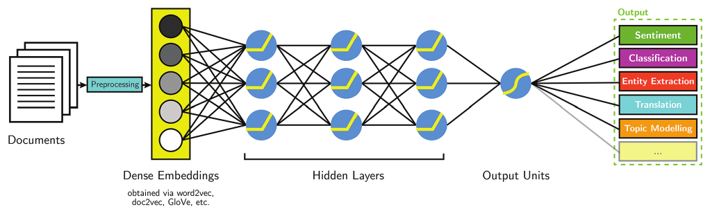
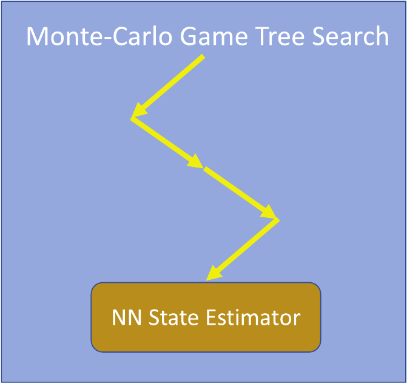
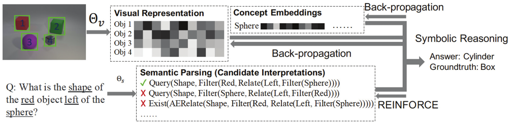
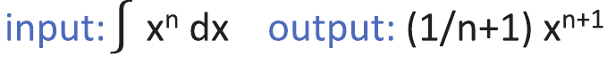
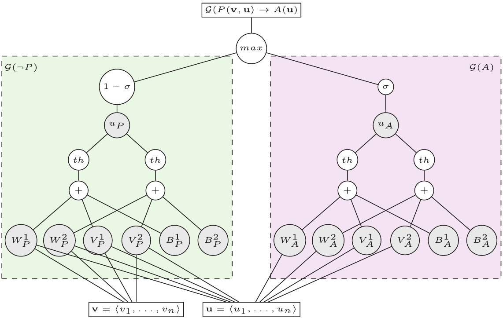
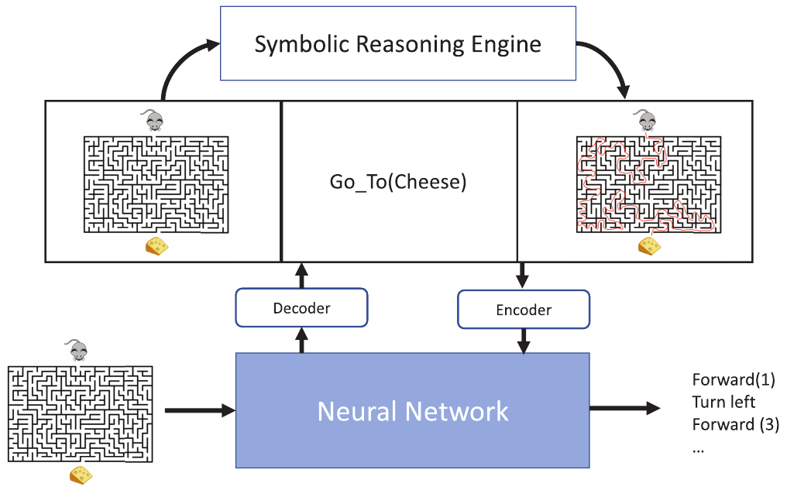

# AI의 계절 순환사와 뉴로심볼릭 결합의 여섯 가지 설계 — The third AI summer: AAAI Robert S. Engelmore Memorial Lecture

#### Abstract
(이 글은 강연록이므로 별도의 초록이 없다. 아래는 서론 첫 두 문단의 전문 번역으로 초록을 대신한다.)

본 글은 저자가 2020년 2월 10일 제34회 AAAI 인공지능 학술대회(Thirty-Fourth AAAI Conference on Artificial Intelligence)에서 발표한 로버트 S. 엥겔모어 기념 강연(Robert S. Engelmore Memorial Lecture)을 정리한 것이다. 본 글은 AI 역사에서 반복되어 온 주제, AI가 가져오는 실재하는 위험과 상상된 위험, 그리고 이 분야의 미래를 탐구한다. 우리는 지금 AI의 세 번째 여름(third AI summer), 곧 급속한 과학적 진보와 폭넓은 상업화, 그리고 일반 지능의 비밀을 풀 수 있다는 열광, 어쩌면 비이성적 열광(irrational exuberance)의 시기에 있다. 이 분야는 과거 두 차례 이와 같은 시기를 겪었고, 그때마다 상업화가 무너지고 정부의 연구 투자가 급격히 삭감되는 겨울이 뒤따랐다. 본 글에서는 이러한 순환적 역사에도 불구하고 매 여름마다 지속적인 통찰이 꽃피었다고 주장한다. 겨울은 새로운 아이디어와 기존 아이디어의 종합을 통해 진전이 이루어지는 숙고와 통합의 시기로 볼 수 있다. 또한 우리가 이 순환 패턴의 끝에 와 있을 수 있다고 주장한다. 진보와 열광은 둔화될 가능성이 크지만, 세 번째 겨울이 올 가능성은 낮다고 볼 과학적 근거와 실용적 근거가 모두 존재한다.

#### 요약
AI의 역사는 흔히 기호주의가 신경망을 누르다가 딥러닝이 등장해 판세를 뒤집은 단순한 대결 구도로 이야기된다. Kautz는 이 구도를 거부하고, 매번의 여름이 남긴 통찰이 겨울 동안 종합되어 다음 진보의 재료가 되었다는 연속성의 역사를 제시한다. 그리고 그 연장선에서 다음 진보는 신경망과 기호 추론의 결합에서 나올 것이라고 보고, 그 결합이 실제로 취할 수 있는 형태를 여섯 가지 설계로 분류한다. 이 분류체계는 이후 뉴로심볼릭 AI 연구에서 가장 널리 인용되는 기준 틀이 되었으며, 이 글의 후반부는 그 여섯 유형을 정의와 사례 중심으로 상세히 해설한다.

---

## 1. 이 글은 어떤 글인가

이 논문은 실험 결과를 보고하는 연구 논문이 아니라, AAAI 학회에서 경력 전체의 공로를 인정받은 연구자에게 주어지는 기념 강연을 글로 옮긴 에세이이다. 저자 Henry Kautz는 로체스터 대학교 컴퓨터과학과 교수로, 2010년 AAAI 회장을 지냈고 2018년부터 2021년까지 미국 국립과학재단(NSF)의 정보 및 지능 시스템 부서장으로서 국가 AI 연구소(National AI Research Institutes) 프로그램을 이끌었다. 그 자신이 논리적 추론 알고리즘(충족 가능성 판정 문제의 국소 탐색 기법인 WalkSAT 등)과 센서 데이터로부터 인간 행동을 추론하는 확률 모형 양쪽에서 업적을 쌓은 사람이라, 기호주의와 통계적 학습 어느 한쪽에 치우치지 않은 시각으로 AI의 역사를 서술할 수 있는 위치에 있다.

글은 크게 세 부분으로 구성된다. 첫째 부분은 AI의 역사를 세 번의 여름과 두 번의 겨울로 나누어 각 시기가 남긴 지속적 통찰을 정리한다. 둘째 부분은 AI가 사회에 끼치는 해악을 다루되, 대중적으로 많이 논의되는 위험보다 실제로 더 심각하지만 덜 주목받는 위험이 무엇인지를 따진다. 셋째 부분은 AI의 미래를 다루며, 여기서 저자는 신경망과 기호 추론을 결합하는 여섯 가지 아키텍처를 제시하고 각각에 이름을 붙인다. 이 여섯 가지 분류는 오늘날 "Kautz의 뉴로심볼릭 분류체계(Kautz taxonomy)"라 불리며, 뉴로심볼릭 관련 서베이 논문 대부분이 이를 출발점으로 삼는다. 따라서 이 글에서는 앞의 두 부분은 요약으로 다루고, 세 번째 부분의 분류체계에 가장 많은 지면을 할애한다.

## 2. AI의 세 번의 여름과 두 번의 겨울

저자는 AI 역사를 만화로 그린다면 다음과 같을 것이라고 말한다. 첫 장면에서는 기호주의 AI(고양이)가 신경망(생쥐)을 두들겨 패고, 둘째 장면에서는 둘 다 겨울 풍경 속에서 떨고 있으며, 셋째 장면에서는 딥러닝으로 거대해진 생쥐 쪽이 고양이를 가볍게 처치한다. 이 만화에는 일말의 진실이 있지만, 연대기로서도 불완전하고 그 사이에 얽히며 발전해 온 풍부한 아이디어를 보여주지 못한다는 것이 저자의 문제의식이다. 이하에서는 저자의 시기 구분을 따라 각 시기의 핵심을 정리한다.

### 1) 첫 번째 여름(1948–1966): 비이성적 열광

첫 번째 여름은 서로 다른 세 갈래의 연구 흐름이 동시에 시작된 시기이다.

첫 갈래는 인공신경망이다. 저자는 그 기원을 신경과학자이자 공학자였던 William Grey Walter에서 찾는다. Walter는 1948년부터 진공관 몇 개로 된 아날로그 전자 두뇌를 탑재한 거북이 모양의 자율 로봇을 만들었다. 이 로봇은 촉각, 빛, 소리 센서의 신호를 받아 모터를 제어했고, 후기 버전은 축전기 기반의 기억 장치로 조건 반사 학습을 구현했다. 예컨대 호루라기 소리와 장애물 충돌 센서가 동시에 활성화되는 경험이 반복되면, 나중에는 소리만 들려도 충돌 시의 반사 행동(후진 후 회전)이 일어났다. 이후 신경망 연구는 Rosenblatt의 퍼셉트론 학습 규칙(1958), 다층 신경망 학습을 위한 역전파(backpropagation, 1974 및 1986), 합성곱 신경망처럼 매개변수를 공유하는 구조(1980 및 1989)로 이어진다. 저자는 Walter가 아날로그 전자회로와 자극–반응 학습에 머물렀다는 점에서 틀렸다기보다 너무 일렀을 뿐일지 모른다고 평가한다. 오늘날 에너지 효율을 위해 아날로그 신경망 하드웨어가 다시 연구되고 있고, 자극–반응 학습은 현재 기계학습의 가장 중요한 난제인 비지도 학습의 초기 시도로 볼 수도 있기 때문이다.

거북이 로봇이 남긴 또 하나의 유산은 지능적 행동이 에이전트와 환경의 상호작용에서 생겨난다는 관점이다. 이는 Norbert Wiener가 이름 붙인 사이버네틱스(cybernetics), 곧 피드백 루프와 제어이론으로 동물과 기계의 지능을 이해하려는 흐름으로 이어졌다. 사이버네틱스는 미국 AI 학계에 오랫동안 뿌리내리지 못하다가, 제어이론과 동적 계획법(dynamic programming)이 결합된 강화학습(reinforcement learning)의 형태로 다시 등장한다. 강화학습이 단순한 자극–반응 학습과 구별되는 지점은 보상이 행동 시점으로부터 시간적으로 멀리 떨어져 있어도 학습할 수 있다는 데 있으며, 저자는 지연된 보상을 위해 행동하는 능력을 지능의 핵심으로 본다. 시간차 학습(temporal-difference learning)이 그 일반적 방법을 제공했고, 이는 에이전트의 내부 상태를 신경망으로 표현할 때 특히 효과적이었다. 신경망과 강화학습의 이 강력한 결합은 세 번째 여름에 다시 등장한다.

둘째 갈래는 선언적 지식 표현(declarative knowledge representation), 곧 논리 기반 AI이다. 그 뿌리는 기원전 350년경 아리스토텔레스까지 거슬러 올라간다. 아리스토텔레스의 핵심 통찰은 진술의 의미를 고려하지 않고 그 구문적 형식만으로 추론을 수행할 수 있다는 것이었으며, 저자는 이것이 논리학뿐 아니라 계산 이론 전체의 기반이라고 본다. 19세기 말 Boole, Frege, Peirce, Hilbert 등은 수학의 엄밀한 기초를 세우려는 목적에서 형식 논리를 정비했고, 괴델의 불완전성 정리(1931)로 그 꿈이 무너지는 것을 보았다. 그러나 초기 AI 연구자들의 관심은 달랐다. 이들은 모든 정리가 아니라 일부 정리라도 자동으로 증명하는 프로그램(1956년의 Logic Theorist는 『수학 원리』의 정리 38개를 증명했다)에 고무되었고, 논리의 불완전성에 개의치 않았다. John McCarthy는 난해한 수학을 공리화하는 대신 일상의 상식 지식(어디에 있을 수 있는지, 어떻게 이동하는지)을 논리로 표현해야 한다고 주장했다. 같은 시기에 개념을 꼭짓점으로, 관계를 간선으로 표현하는 의미망(semantic network)이 등장했고, 이는 이후 기술 논리(description logic)로 정식화되었다가 오늘날 구글 등의 대규모 지식 그래프(knowledge graph)로 이어진다.

셋째 갈래는 조합적 탐색(combinatorial search)을 효율화하는 알고리즘의 탐구이다. 오늘날 우리는 충분히 표현력 있는 형식 체계에서의 일반적 추론이 NP-완전 이상의 난도를 가지며, 블록 쌓기 세계 같은 단순한 계획 문제조차 NP-완전임을 안다. 저자는 오히려 이런 복잡도 결과가 아직 알려지지 않았던 덕분에 초기 연구자들이 중요한 통찰에 이를 수 있었다고 본다. 즉 거대한 가능성의 공간도 단순 열거보다 훨씬 효율적인 방식으로 탐색할 수 있다는 통찰이다. Newell, Shaw, Simon의 일반 문제 해결기(General Problem Solver)에 구현된 수단–목표 분석(means-ends analysis), 완전하고 최적인 휴리스틱 탐색의 일반 틀을 제공한 A* 알고리즘, 무작위 변경으로 순환에 빠지는 것을 막는 잡음 섞인 반복 수정(simulated annealing, WalkSAT), 그리고 막다른 길에서 원인이 된 선택 조합을 새 제약으로 학습하는 절 학습(clause learning)을 더한 DPLL 알고리즘이 그 계보이다. 이 탐색 기법들은 뒤에서 볼 뉴로심볼릭 분류체계에서 기호 추론 엔진의 실체가 된다.

### 2) 첫 번째 겨울(1967–1977): 무너진 꿈

첫 여름 동안 많은 사람들은 기계 지능이 몇 년 안에 실현될 것이라고 믿었다. 미국 국방고등연구계획국(DARPA)은 러시아어–영어 자동 번역과 전장용 자율 전차를 목표로 AI 연구를 지원했는데, 연구자들은 이미 그 목표가 훨씬 어렵다는 것을 알면서도 지킬 수 없는 약속을 하고 연구비를 받았다. 1960년대 중반까지 어느 것도 실현되지 않자 반발이 일었다. DARPA는 지원 프로그램을 취소했고, 1969년 상원 다수당 원내대표 Mike Mansfield는 특정 군사 기능을 넘어선 기초 연구에 군이 연구비를 지원하는 것을 금지하는 법을 통과시켜 수십 년간 군의 AI 연구 지원을 위축시켰다. 영국에서는 응용수학자 James Lighthill이 의회의 의뢰로 작성한 보고서(1973)가 AI의 성공은 장난감 문제에 국한되며 조합적 폭발 때문에 현실 문제로 확장될 수 없다고 주장했고, 그 결과 영국의 AI 공공 연구비가 전면 중단되었다. 저자는 이 보고서가 바로 조합적 탐색을 길들이려는 AI의 노력을 무시했다고 지적한다.

### 3) 두 번째 여름(1968 또는 1978–1987): 지식이 곧 힘이다

두 번째 여름의 특징은 상식 지식에서 전문가 지식으로의 초점 이동이다. 의사 같은 전문가의 경험을 지식 공학자(knowledge engineer)가 인터뷰를 통해 규칙과 사실의 집합으로 옮기면, 범용 기호 추론 시스템이 그 규칙을 적용해 개별 문제를 푸는 방식이 전문가 시스템(expert system)이다. 저자는 이 시기의 시작을 정규표현식 표기를 빌려 "19[67]8"로 적는데, 이는 최초의 전문가 시스템 Dendral이 등장한 1968년으로 볼 수도 있고, 상업적 전환점이 된 XCON이 배치된 1978년으로 볼 수도 있다는 뜻이다. XCON은 DEC사의 VAX 컴퓨터 주문 시 수백 가지 옵션의 호환성을 맞추는 구성 작업을 최대 90일에서 약 90분으로 단축했고, 이 성공을 계기로 온갖 기업이 전문가 시스템을 도입했다. Feigenbaum의 "지식이 곧 힘이다(knowledge is power)"가 이 시대의 구호였다. 두 번째 여름은 정부 자금만큼이나 상업 자본이 주도했다는 점에서 첫 번째와 달랐으며, LISP와 Prolog를 직접 실행하는 전용 하드웨어 회사들까지 생겨났다.

### 4) 두 번째 겨울(1988–2011): 경시된 과학

전용 하드웨어 회사들은 값싼 범용 유닉스 워크스테이션에 밀려 몰락했고, 많은 전문가 시스템은 유지보수 비용 때문에 폐기되었다. 의료 전문가 시스템은 최신 상태 유지의 어려움, 질환마다 다른 시스템을 익혀야 하는 부담, 그리고 무엇보다 컴퓨터의 진단보다 자신의 직관을 신뢰하려는 의사들의 성향 때문에 자리 잡지 못했다. 1987년 밴쿠버의 IJCAI는 수천 명의 비학계 참가자와 거대한 전시회를 치렀지만, 이듬해 AAAI는 작은 순수 학술 행사로 축소되었다.

저자는 상업적 요인과 별개로 두 가지 기술적 난제가 이 겨울을 불렀으며, 그 난제의 극복이 이후 20년간 AI 연구의 과제가 되었다고 본다. 첫째는 원리에 기반하면서도 실용적인 확률 추론 방법의 부재였다. MYCIN 같은 시스템은 규칙에 확신도(certainty factor) 수치를 붙여 임시방편적으로 결합했다. 이 문제는 Pearl의 베이지안 네트워크(Bayesian network, 1988) 같은 그래프 확률 모형으로 해결되었다. 베이지안 네트워크는 다변량 확률분포를 지수적으로 큰 확률표 없이 간결하게 표현하는 방법으로, 각 조건부 확률 진술을 노드로 향하는 방향 간선과 조건부 확률표로 나타낸다. 이후 Heckerman과 Shortliffe는 MYCIN의 확신도에 확률적 해석이 가능한 조건을 밝혀, 전문가 시스템이 왜 때로는 합리적인 답을 내고 때로는 그렇지 못했는지 설명했다. 세기 전환기에는 그래프 모형의 의미론과 1차 논리의 표현력을 결합하는 통계적 관계 추론(statistical-relational reasoning, 예: 마르코프 논리 네트워크)이 등장했다.

둘째 난제는 지식 획득 병목(knowledge acquisition bottleneck)이다. 좁은 영역을 넘어서려면 막대한 수의 규칙이 필요했고, 그만큼의 전문가를 확보하기도 어려웠을 뿐 아니라 지식 베이스가 커질수록 불일치와 오류가 불가피하게 쌓였다. 이 문제가 기계학습에 대한 관심을 되살렸다. 결정 트리, 논리 규칙 학습(귀납 논리 프로그래밍), 그래프 모형 매개변수의 EM 추정, PAC 학습 이론, 그리고 서포트 벡터 머신(SVM)이 이 시기의 성과이다. 저자는 SVM이 과도하게 매개변수화되어도 과적합되지 않는 경우가 많았다는 직관에 반하는 특성을 지적하며, 딥러닝도 같은 특성을 공유한다고 덧붙인다. 이 시기 내내 업계에서는 "인공지능"이라는 말 자체가 경멸의 대상이어서, IBM은 Watson을 홍보할 때 AI 대신 "인지 컴퓨팅(cognitive computing)"이라는 말을 만들어 썼다.

### 5) 세 번째 여름(2012 또는 2016–): 딥러닝

기술적 돌파는 2012년에 일어났다. 1000개 범주에 걸친 100만 장 이상의 이미지를 분류하는 ImageNet 대회에서 GPU로 학습한 다층 신경망 AlexNet이 오류율 16%를 기록해, 26%에 그친 기존 컴퓨터 비전 기법들을 압도했다. 몇 달 만에 컴퓨터 비전 학계 대부분이 다층 신경망으로 옮겨갔고 딥러닝(deep learning) 분야가 탄생했다. 세상이 다시 AI를 진지하게 받아들인 해는 2016년으로, 구글 딥마인드의 AlphaGo가 이세돌 9단을 이긴 해이다. 저자는 이 대국이 중국의 "스푸트니크 모멘트"로 불리며 전 세계 정부와 기업의 막대한 투자를 촉발했다고 쓴다.

저자는 세 번째 여름이 첫 번째 여름의 주제인 신경망과 강화학습을 다시 점화했다고 보면서, 여기에 더해진 새로운 통찰 두 가지를 꼽는다. 하나는 계층적 표현 학습(hierarchical representation learning)이다. 논리 기반 지식 표현은 원래 계층 구조를 포착하는 데 집중했지만, 그 이전의 기계학습은 특징(feature)과 범주(class)라는 두 수준만 다루었고 적절한 추상 수준의 특징을 설계하는 일은 사람의 몫이었다. 딥러닝은 이 수작업 특징 설계를 없애고 여러 층에 걸친 추상화를 스스로 학습한다. 다른 하나는 덜 주목받지만 못지않게 중요한 통찰로, 딥러닝의 표현이 개념 간 유사성(similarity)을 직접 지원한다는 점이다. 모든 것이 활성값 벡터이므로 벡터 간 거리(코사인 유사도 등)로 유사성을 쉽게 계산할 수 있다. 딸이 새끼 고양이를 원할 때 다 큰 고양이는 그럴듯한 대체물이고, 개는 위험하며, 집은 전혀 아니라는 판단이 이런 유사성 추론의 예이다. 저자는 유사성이 확률로 포착되지 않는다고 강조한다. 개가 고양이일 확률이 몇 퍼센트라는 식의 표현은 성립하지 않기 때문이다. 이 구분은 뒤의 Neuro[Symbolic] 아키텍처 논의에서 유사성 추론은 신경 시스템에 남아야 한다는 주장으로 다시 등장한다.

### 6) 시기 정리

| 시기 | 기간 | 지배적 접근 | 남긴 지속적 통찰 | 종결 요인 |
|---|---|---|---|---|
| 첫 번째 여름 | 1948–1966 | 신경망, 사이버네틱스, 논리, 휴리스틱 탐색 | 비열거적 탐색, 상식 지식 표현, 피드백 제어 | 번역과 자율 전차 약속의 실패 |
| 첫 번째 겨울 | 1967–1977 | (연구비 중단) | 조합적 탐색 연구의 지속 | 전문가 시스템의 등장 |
| 두 번째 여름 | 1968/1978–1987 | 전문가 시스템, 규칙 기반 추론 | 지식 공학, 기호 추론 엔진 | 유지보수 비용, 확률 처리 및 지식 획득 문제 |
| 두 번째 겨울 | 1988–2011 | 그래프 확률 모형, 통계적 기계학습 | 베이지안 네트워크, 통계적 관계 추론, SVM | AlexNet(2012), AlphaGo(2016) |
| 세 번째 여름 | 2012/2016– | 딥러닝, 심층 강화학습 | 계층적 표현 학습, 벡터 유사성 | (저자는 겨울이 오지 않을 것으로 전망) |

## 3. 겨울은 다시 오지 않을 수 있다, 그리고 AI의 실제 해악

### 1) 왜 세 번째 겨울은 오지 않을 것인가

저자는 현재의 AI가 일반 인공지능과는 거리가 멀지만 번역에서 투자 포트폴리오 관리까지 수많은 실용적 문제를 풀기에 충분히 좋다는 점을 출발점으로 삼는다. 그렇다면 뇌와 규모도, 조직도, 학습 알고리즘도 다르고 신체를 갖지도 않은 인공신경망이 어떻게 인간 지능의 일부를 그토록 잘 흉내 내는가. 저자는 두 가지 답을 내놓는다.

첫째 답은 수렴 진화(convergent evolution)의 비유이다. 문어와 인간의 공통 조상은 3억 년 전의 원시적 신경계를 가진 벌레 같은 생물이었고, 문어는 다리마다 뇌엽이 달린 고리 모양의 뇌를 가지며 부모의 돌봄 없이 고독하게 5년을 산다. 그럼에도 문어는 학습, 계획, 도구 사용이라는 지능의 특징을 보인다. 인공신경망도 이처럼 인간 뇌의 특정 구조와 무관한 지능의 일반 원리를 포착하고 있는 기술적 수렴 진화의 사례일 수 있다는 것이다. 둘째 답은 세계의 불합리할 정도의 예측 가능성이다. 트랜스포머 언어 모델은 본질적으로 단어 동시 출현의 통계 모형, 곧 앞 단어열이 주어졌을 때 다음 단어의 확률분포를 추정하는 모형인데, 이런 "타자기 앞의 통계적 원숭이"가 GPT-2처럼 길고 일관된 영어 문단을 생성할 줄은 아무도 몰랐다. 어느 답이 맞든 AI는 이미 다양한 영역에서 실용적 문제를 풀 만큼 좋아졌으므로, 과열은 식더라도 연구와 상업적 지원은 줄지 않을 것이라는 것이 저자의 결론이다. 저자는 과열이 식는 것을 오히려 폭염 뒤에 오는 쾌적한 여름 날씨에 비유한다.

### 2) AI for Bad: 과장된 위험과 간과된 위험

저자는 "AI for Good"이라는 흔한 구호 대신 "AI for Bad"를 다루며, 우리가 실제로 끔찍한 위협에 직면해 있지만 그것은 대중적으로나 학술적으로 가장 많이 논의되는 위협이 아니라고 주장한다. 이 부분은 의도적으로 논쟁적인 서술이 많아, 저자의 견해로 읽을 필요가 있다.

첫째, 얼굴이 아니라 마음의 사생활을 지켜야 한다. 얼굴 인식의 인종 간 정확도 차이에 대한 문제 제기로 여러 도시가 경찰의 얼굴 인식 사용을 금지했지만, 저자는 정확도 차이가 학습 데이터의 집단 비율을 반영한다는 것은 놀랄 일이 아니고, 정확도는 판정 임계값에 따른 오탐과 미탐의 상충관계에 달려 있으며, 인간 목격자의 오인식이 DNA 증거로 뒤집힌 오판 사례의 약 70%에 기여했다는 점과 비교해야 한다고 반박한다. 그보다 훨씬 심각한 위협은 휴대전화의 데이터 흔적만으로 개인의 신념, 선호, 목표를 추론하는 기술이다. 저자 자신도 GPS 궤적만으로 일상 활동(친구 방문, 쇼핑, 출근)을 추론하는 연구를 했다. 저자는 이 기술이 미국에서는 상업적, 정치적 표적화에 은유적으로 무기화되어 있고, 권위주의 국가에서는 문자 그대로 무기화될 수 있다고 경고한다. 과거 동독 슈타지는 인구의 2%를 상근 인력으로 고용해야 했지만, AI는 감시와 사회 통제를 값싸고 확장 가능하게 만들며, 반항 가능성이 높은 개인만 정밀하게 표적화할 수 있게 한다는 것이다.

둘째, 가짜 뉴스가 아니라 가짜 친구가 실존적 위협이다. 저자는 가짜 뉴스는 인쇄술 이전부터 있었고 AI 없이도 조잡한 가짜 뉴스가 효과를 발휘해 왔으므로, AI 기반 가짜 뉴스 자체는 새로운 문제가 아니라고 본다. 반면 언어 모델과 딥페이크로 만든 "가짜 친구"의 상업화는 외로움이 확산된 젊은 세대에게 고통 없는 대체 관계를 제공함으로써 인간 관계를 맺는 능력 자체를 발달시키지 못하게 할 수 있다. 친구가 건네는 제안의 형태를 띤 광고의 수익성을 생각하면 이를 상업화하려는 유인은 막대하며, 저자는 특히 이것이 아동에게 판매될 때를 가장 두려워한다.

셋째, 자율 살상 무기가 아니라 환경 파괴 무기가 더 위험하다. 저자는 자율 드론에 대해서는 방어 체계가 함께 발전할 것이고, 미국이 2015년 이후 13,072회의 드론 공습에도 아프가니스탄 전쟁에서 패했듯 드론이 결정적 전쟁 무기도 아니라고 본다. 반면 배터리용 희토류 수요 때문에 추진되는 심해저 로봇 채굴은 수억 년간 변하지 않은 미지의 생태계를 되돌릴 수 없이 파괴할 수 있다. 기후 변화를 막으려는 전기차 전환이 더 치명적인 생태 재앙을 낳고, 지구를 파멸시키는 로봇 군대가 하늘이나 땅이 아니라 바다 밑에서 보이지 않게 일하게 된다면 작지 않은 아이러니일 것이라고 저자는 쓴다.

## 4. 뉴로심볼릭 분류체계를 읽기 위한 준비

### 1) 문제 제기: 결합해야 한다는 데는 모두 동의한다

글의 셋째 부분에서 저자는 다음 과학적 진보가 무엇일지를 묻는다. Marcus와 Davis는 『Rebooting AI』(2019)에서 인간 수준의 AI에는 기호 추론이 필요하므로 지배적 신경망 접근은 정체에 이르렀다고 주장하면서도, 결국 다음 진보는 기호적 방법과 신경망 방법의 결합일 것이라고 결론짓는다. 저자는 이들이 외로운 싸움을 하는 것처럼 썼지만 실은 딥러닝 연구자들과 격렬하게 동의하고 있다(violent agreement)고 꼬집는다. "뉴로심볼릭 추론(Neuro-Symbolic Reasoning)"이라는 깃발은 AI의 모든 진영 위에 휘날릴 수 있다. 문제는 세부에 있다. 그런 하이브리드 시스템의 아키텍처는 정확히 어떤 모습이어야 하는가. 저자는 이 질문에 답하기 위해 여섯 가지 가능한 설계를 개관하고 각각의 본질을 담은 이름을 붙인다.

### 2) 기본 개념: 기호적 표현과 신경적 표현

분류체계를 이해하려면 먼저 두 표현 방식의 차이를 분명히 해야 한다.

기호적 표현(symbolic representation)은 사람이 읽을 수 있는 이산적 기호와 그 조합 규칙으로 지식을 나타낸다. "Parent(철수, 영희)", "∀x Cat(x) → Animal(x)", 체스판의 말 배치, 미로의 격자 지도, 수식 ∫xⁿdx가 모두 기호적 표현이다. 기호 표현 위에서 작동하는 기호 추론(symbolic reasoning)은 탐색, 정리 증명, 제약 만족, 계획 수립처럼 명시적 규칙을 단계적으로 적용하는 과정이며, 결과가 정확하고 그 근거를 추적할 수 있다는 장점이 있는 반면 지각처럼 규칙으로 명세하기 어려운 문제에는 약하고 경우의 수가 폭발하는 문제를 안고 있다.

신경적 표현(neural 또는 subsymbolic representation)은 지식을 실수 벡터와 가중치 행렬로 나타낸다. "고양이"라는 단어는 [0.6, 0.9, 0.1, …] 같은 벡터가 되고, 개념의 의미는 다른 벡터들과의 상대적 거리로만 드러난다. 신경망은 데이터로부터 이런 표현을 학습하며, 잡음이 섞인 지각 데이터에 강하고 유사성 판단에 탁월하지만, 내부 과정을 해석하기 어렵고 수십 단계의 엄밀한 조합적 추론에는 약하다.

저자가 2장에서 정리한 역사를 이 구분에 대응시키면, 첫 번째와 두 번째 여름의 논리, 탐색, 전문가 시스템이 기호 쪽이고, 신경망과 딥러닝이 신경 쪽이다. 뉴로심볼릭 AI는 이 둘의 장점을 하나의 시스템에서 결합하려는 시도이며, 여섯 유형은 그 결합 방식의 차이이다.

### 3) 표기법 읽는 법

저자가 각 유형에 붙인 이름은 일종의 표기법이어서, 기호의 의미를 알면 이름만으로 구조를 짐작할 수 있다. 이 표기는 프로그래밍 언어의 관례를 빌려 온 것으로 보인다.

| 표기 | 의미 | 해당 유형 |
|---|---|---|
| A B A (나란히 씀) | 입력과 출력은 A, 가운데 처리는 B | Symbolic Neuro symbolic |
| A[B] | A가 주 시스템이고 B는 A 내부에서 호출되는 서브루틴 | Symbolic[Neuro], Neuro[Symbolic] |
| A \| B | A의 출력이 B의 입력으로 넘어가는 파이프라인 (유닉스 파이프) | Neuro \| Symbolic |
| A: B → A | B가 만든 것을 A가 학습함 | Neuro: Symbolic → Neuro |
| A_{B} | B가 A의 내부 구조에 아래첨자처럼 새겨져(컴파일되어) 들어감 | Neuro_{Symbolic} |

### 4) 유형을 가르는 세 가지 질문

여섯 유형을 구별할 때는 다음 세 가지를 물어보면 된다. 첫째, 시스템 전체의 제어권을 누가 쥐는가. 즉 바깥에서 전체 흐름을 이끄는 주 시스템이 신경망인가 기호 추론기인가. 둘째, 기호는 어디에 있는가. 입출력 경계에만 있는가, 중간 표현으로 존재하는가, 학습 데이터 속에만 있는가, 신경망 구조 자체에 녹아 있는가. 셋째, 실행 시점(추론 시점)에 기호 추론 엔진이 실제로 돌아가는가, 아니면 학습 단계에서만 쓰이고 사라지는가. 이 질문들은 5장의 각 유형 설명 끝에 정리하고 7장의 비교 표로 종합한다.

## 5. 여섯 가지 유형의 정의와 사례

### 1) 유형 1: Symbolic Neuro symbolic — 기호 입력, 신경 처리, 기호 출력

정의. 입력과 출력은 기호(단어, 범주 라벨)이지만, 그 사이의 모든 처리는 신경망이 수행하는 구조이다. 기호 입력은 임베딩을 통해 벡터로 변환되어 신경망에 들어가고, 신경망의 출력층은 softmax 연산을 통해 다시 기호 범주나 기호열로 변환된다. 저자는 이를 현재 자연어 처리 딥러닝의 표준 운영 절차(SOP, standard operating procedure)라고 부른다.

*그림 1 (원문 Figure 10). 유형 1의 전형적 구조(출처: Aylien 2020). 왼쪽 끝의 문서(기호)가 전처리를 거쳐 노란 상자의 밀집 임베딩(dense embedding), 곧 word2vec이나 GloVe로 얻은 단어 벡터로 변환된다. 가운데의 은닉층들이 이 벡터를 처리하고, 출력 유닛이 감성, 분류, 개체명 추출, 번역, 토픽 모델링 같은 기호적 결과를 낸다. 그림의 왼쪽 끝과 오른쪽 끝만 기호이고 그 사이 전체는 벡터 연산이라는 점에 주목하면 된다.*

작동 방식. 예를 들어 영화 리뷰 "연출이 지루했다"의 감성을 분류한다고 하자. 먼저 각 단어(기호)가 임베딩 표에서 벡터로 바뀐다. 이 벡터들이 여러 층의 신경망을 통과하며 문장 전체를 요약하는 벡터가 된다. 마지막 출력층은 범주별 점수 $z_c$를 내고, 이를 다음 softmax 식으로 확률로 바꾼다.

$$p(y=c \mid x) = \frac{\exp(z_c)}{\sum_{k=1}^{K} \exp(z_k)}$$

여기서 $x$는 입력 문장, $c$는 후보 범주 하나(예: 긍정 또는 부정), $K$는 범주의 개수, $z_c$는 신경망이 범주 $c$에 매긴 실수 점수이다. 분자의 지수함수는 점수를 모두 양수로 만들고, 분모는 모든 범주의 지수값을 더해 합이 1이 되도록 정규화한다. 예컨대 점수가 긍정 1.0, 부정 3.0이면 $e^1 \approx 2.72$, $e^3 \approx 20.09$이므로 부정의 확률은 $20.09/(2.72+20.09) \approx 0.88$이 된다. 가장 확률이 높은 범주를 고르면 "부정"이라는 기호가 출력된다. 이 식은 유형 1에서 신경 표현이 기호로 되돌아가는 유일한 지점이라는 점에서 중요하다. 연속적인 벡터 공간과 이산적인 기호 공간 사이의 다리 역할을 하는 셈이다.

예시. 저자가 드는 예는 word2vec이나 GloVe 임베딩을 쓰는 신경망 기반 자연어 처리 전반이다. 오늘날 기준으로 보면 BERT 기반 문서 분류기, 신경망 기계번역, 그리고 토큰을 입력받아 토큰을 출력하는 GPT 계열 언어 모델도 구조적으로는 모두 이 유형에 속한다.

해설. 이 유형은 엄밀히 말하면 기호 추론을 전혀 하지 않는다. 기호는 입출력의 형식일 뿐 내부 처리는 순수한 신경망이다. 그럼에도 저자가 이를 분류체계의 첫 번째로 둔 것은, 이것이 기준선(baseline)이기 때문으로 읽을 수 있다. 오늘날 대부분의 신경망 시스템이 이미 이 의미에서 기호와 접하고 있으며, 나머지 다섯 유형은 이 기준선에서 기호를 얼마나 더, 어떤 방식으로 깊이 끌어들이느냐의 차이로 볼 수 있다. 세 가지 질문에 답하면, 제어권은 신경망에 있고, 기호는 입출력 경계에만 있으며, 실행 시점에 기호 추론 엔진은 없다.

### 2) 유형 2: Symbolic[Neuro] — 기호 문제 해결기 안의 신경 서브루틴

정의. 기호적 문제 해결기가 주 시스템이 되어 전체 흐름을 제어하고, 그 내부에서 신경망을 패턴 인식 서브루틴으로 호출하는 구조이다. 대괄호 표기는 "Symbolic이라는 함수 안에서 Neuro를 호출한다"는 뜻으로 읽으면 된다.

*그림 2 (원문 Figure 11). 유형 2의 개념도. 바깥의 큰 파란 상자가 주 시스템인 몬테카를로 게임 트리 탐색(Monte-Carlo Game Tree Search)이다. 노란 화살표는 탐색이 게임 트리를 따라 수를 하나씩 내려가는 경로를 나타내고, 경로의 끝(잎 노드)에 도달하면 안쪽의 갈색 상자인 신경망 상태 평가기(NN State Estimator)가 호출되어 그 국면이 얼마나 유리한지 평가한다. 신경망이 바깥 상자 안에 들어 있다는 배치 자체가 대괄호 표기의 의미이다.*

작동 방식. 서브루틴(subroutine)이란 주 프로그램이 필요할 때 호출하고, 결과를 돌려받으면 다시 주 프로그램이 제어를 이어가는 하위 함수를 말한다. 유형 2에서는 탐색, 계획, 규칙 적용 같은 기호 알고리즘이 주 프로그램이고, 그 알고리즘이 "이 국면은 좋은가", "이 이미지에 무엇이 있는가" 같은 판단이 필요할 때마다 신경망을 호출한다. 신경망은 질문에 답만 할 뿐 다음에 무엇을 할지는 결정하지 않는다.

예시. 저자는 AlphaGo를 이 유형의 원형으로 든다. AlphaGo의 문제 해결기는 몬테카를로 트리 탐색(MCTS)이고, 그 휴리스틱 평가 함수가 신경망이다. 바둑은 경우의 수가 너무 많아 끝까지 탐색할 수 없으므로, 탐색을 일정 깊이에서 멈추고 그 국면의 승률을 신경망으로 추정한다. 이는 2장에서 본 A*나 휴리스틱 탐색의 오랜 전통, 곧 탐색 알고리즘에 좋은 휴리스틱 함수를 붙이는 방식에서 휴리스틱 함수만 사람이 설계한 식 대신 학습된 신경망으로 바꾼 것이라 볼 수 있다. 저자는 또한 대부분의 로봇과 자율주행차가 이 유형이라고 지적한다. 자율주행차를 예로 들면, 카메라 영상에서 보행자, 차선, 신호등을 인식하는 일은 신경망이 맡지만, 그 인식 결과를 받아 경로를 계획하고 교통 규칙에 따라 정지와 차선 변경을 결정하는 상위 제어 루프는 대개 명시적 계획 및 규칙 시스템이다.

해설. 이 유형의 강점은 신뢰성과 해석 가능성이 기호 쪽에서 확보된다는 점이다. 탐색과 계획의 논리는 명시적이므로 왜 그런 결정을 내렸는지 추적할 수 있고, 신경망은 사람이 규칙으로 쓰기 어려운 지각과 평가만 맡는다. 반면 신경망이 기호 시스템으로부터 학습 신호를 받는 구조는 아니므로, 두 부분은 대체로 따로 학습되어 조립된다. 세 질문에 답하면, 제어권은 기호 시스템에 있고, 기호는 주 시스템의 상태와 연산 전체이며, 실행 시점에 기호 엔진이 돈다.

### 3) 유형 3: Neuro | Symbolic — 신경 지각에서 기호 추론으로 이어지는 파이프라인

정의. 신경망이 이미지의 픽셀 같은 비기호적 입력을 기호적 자료구조로 변환하고, 그 자료구조를 기호 추론 시스템이 처리하는 구조이다. 세로 막대 표기는 유닉스 셸의 파이프처럼 앞 단계의 출력이 뒤 단계의 입력으로 흐른다는 뜻이다.

*그림 3 (원문 Figure 12). 유형 3의 대표 사례인 Neuro-Symbolic Concept Learner(출처: Mao et al. 2019). 위쪽 흐름에서는 장면 이미지가 시각 신경망(Θv)을 거쳐 물체별 시각 표현(Obj 1~4)으로 바뀌고, 이것이 "구(sphere)" 같은 개념 임베딩과 비교된다. 아래쪽 흐름에서는 질문 "구의 왼쪽에 있는 빨간 물체의 모양은?"이 의미 파서(Θs)를 거쳐 Query, Filter, Relate 같은 연산으로 된 기호 프로그램 후보들로 바뀐다(체크 표시가 올바른 해석, X 표시가 잘못된 해석). 오른쪽의 기호 추론기가 이 프로그램을 물체 표현 위에서 실행해 답(Cylinder)을 내고, 이를 정답(Box)과 비교한 결과가 역전파(Back-propagation)와 REINFORCE 화살표를 따라 두 신경망으로 되돌아간다.*

작동 방식. 그림 3의 질문을 따라가 보자. 의미 파서는 자연어 질문을 다음과 같은 기호 프로그램으로 번역한다.

Query(Shape, Filter(Red, Relate(Left, Filter(Sphere))))

이 프로그램은 안쪽부터 읽는다. 먼저 장면의 물체 중 구를 걸러내고(Filter(Sphere)), 그 구의 왼쪽에 있는 물체들을 찾고(Relate(Left, …)), 그 가운데 빨간 것을 걸러낸 뒤(Filter(Red, …)), 그 물체의 모양을 묻는다(Query(Shape, …)). 각 연산은 시각 신경망이 만든 물체 표현 위에서 실행된다. 즉 "빨간가"라는 판단은 물체 벡터와 "빨강" 개념 벡터의 유사도로 계산되지만, 어떤 순서로 무엇을 거를지는 기호 프로그램이 결정한다. 이렇게 하면 답이 왜 그렇게 나왔는지 단계별로 추적할 수 있고, 학습 때 보지 못한 새로운 질문 조합에도 일반화하기 쉽다.

이 사례에서 특히 중요한 점은 기호 추론 시스템이 신경망 학습을 위한 피드백 신호를 제공한다는 것이다. 실행 결과(Cylinder)가 정답(Box)과 다르면, 시각 신경망은 역전파로, 의미 파서는 REINFORCE라는 강화학습 기법으로 수정된다. 의미 파서에 역전파 대신 강화학습을 쓰는 이유는, 프로그램을 고르는 일이 이산적 선택이라 미분이 불가능하기 때문이다. 정답을 낸 프로그램 후보에 보상을 주어 그런 후보가 더 자주 선택되도록 학습하는 것이다. 놀라운 점은 이 시스템이 물체 라벨이나 정답 프로그램 없이 이미지, 질문, 답의 쌍만으로 개념과 파싱을 함께 학습한다는 것이다.

예시. 저자가 드는 예는 Mao 등(2019)의 Neuro-Symbolic Concept Learner(NS-CL)이다. 같은 계열로는 이미지를 물체 목록으로 바꾸고 질문을 프로그램으로 바꾼 뒤 실행하는 시각 질의응답 연구들이 있으며, 더 넓게는 문서 이미지에서 신경망으로 표와 필드를 추출한 뒤 규칙 엔진으로 검증하는 업무 자동화 파이프라인도 같은 구조이다.

유형 2와의 관계. 저자는 Neuro | Symbolic의 그림을 반시계 방향으로 90도 돌리면 Symbolic[Neuro]와 비슷해 보인다고 말하면서, 둘의 차이는 신경망 부분이 서브루틴이 아니라 코루틴(coroutine)이라는 점이라고 정리한다. 서브루틴은 호출되면 일을 마치고 결과를 돌려준 뒤 끝나며, 제어는 언제나 호출한 쪽에 있다. 반면 코루틴은 두 루틴이 대등하게 제어를 주고받으면서 각자 상태를 유지하는 관계이다. 유형 2에서 신경망은 탐색기가 부를 때만 답하는 하위 함수이지만, 유형 3에서는 신경망이 기호 시스템에 입력을 넘기고, 기호 시스템은 그 결과로 다시 신경망에 학습 신호를 넘기는 식으로 양방향의 대등한 협력이 이루어진다. 세 질문에 답하면, 제어권은 순차적으로 넘어가며(앞은 신경, 뒤는 기호), 기호는 두 단계 사이의 중간 표현으로 존재하고, 실행 시점에 기호 엔진이 돈다.

### 4) 유형 4: Neuro: Symbolic → Neuro — 기호 규칙으로 만든 데이터로 신경망을 학습

정의. 아키텍처 자체는 유형 1의 표준 구조와 같지만, 학습 방식이 특별하다. 기호 규칙을 사용해 입력–출력 쌍을 대량으로 생성하고, 신경망이 그 쌍을 학습하게 하는 구조이다. 이름의 콜론 앞 Neuro는 최종 시스템이 신경망이라는 뜻이고, 콜론 뒤 Symbolic → Neuro는 기호에서 신경으로 지식이 옮겨진다는 뜻이다.

*그림 4 (원문 Figure 13). 유형 4의 예. 입력은 적분식 ∫xⁿdx이고, 출력은 그 결과 (1/(n+1))xⁿ⁺¹이다. 신경망은 이런 (문제, 답) 쌍을 학습하지만, 그 사이의 유도 과정은 학습하지 않는다.*

작동 방식. 그림 4가 보여주는 학습 쌍은 다음 거듭제곱 적분 규칙에서 나온 것이다.

$$\int x^n \, dx = \frac{x^{n+1}}{n+1} + C \qquad (n \neq -1)$$

여기서 $x$는 변수, $n$은 지수, $C$는 적분 상수이다(원문 그림은 $C$를 생략했다). 이 식은 "x의 n제곱을 적분하면 지수가 하나 올라가고 새 지수로 나누어진다"는 규칙을 말한다. 예를 들어 $n=2$이면 $\int x^2 dx = x^3/3 + C$이다. 유형 4에서 신경망은 이 규칙 자체를 명시적으로 배우지 않는다. 대신 (∫x²dx, x³/3), (∫x⁵dx, x⁶/6), … 같은 수많은 쌍을 보고, 수식을 기호열로 읽어 결과 기호열을 출력하는 번역 과제처럼 학습한다.

예시. 저자가 드는 사례는 Lample과 Charton(2020)의 기호 수학 연구이다. 이들은 트랜스포머 시퀀스-투-시퀀스(sequence-to-sequence) 모델을 수식 A와 그것을 단순화한 수식 B의 쌍 (A, B)으로 학습시켰고, 학습 후 처음 보는 수식도 대개 올바르게 단순화했다. 저자는 이 신경망이 단계별 유도를 생성한 것이 아니라 교훈을 너무 철저히 흡수한 나머지 정답을 그냥 추측해 낼 수 있었다는 점을 강조한다. 이런 연구에서 학습 데이터를 만드는 방법이 기호 시스템의 몫이다. 예컨대 적분 문제의 경우, 무작위로 생성한 함수 F를 컴퓨터 대수 시스템으로 미분해 f = F′를 얻으면 (∫f, F)라는 정답이 보장된 적분 문제를 무한히 만들 수 있다. 미분은 기계적으로 쉽지만 적분은 어렵다는 비대칭을 이용해, 쉬운 방향의 기호 계산으로 어려운 방향의 학습 데이터를 만드는 것이다. 같은 발상은 물리 시뮬레이터나 규칙 엔진이 생성한 합성 데이터로 신경망을 학습시키는 일, 혹은 느린 기호 해법기의 입출력을 빠른 신경망에 증류(distillation)하는 일에서도 찾을 수 있다.

해설. 이 유형의 핵심은 기호 지식이 학습이 끝난 뒤에는 시스템에 남아 있지 않고 신경망 가중치 속으로 흡수된다는 점이다. 실행 시점에 기호 엔진은 없으며, 결과는 빠르지만 왜 그런 답이 나왔는지 설명하지 못한다. 다만 기호 수학처럼 답의 검증이 쉬운 영역에서는, 신경망이 추측한 답을 기호 시스템으로 확인하는 방식(적분 결과를 미분해 원래 식과 비교)으로 신뢰성을 보완할 수 있다. 이 유형은 뒤에서 보듯 저자가 지지하는 유형 6의 학습 방법으로 다시 등장한다. 세 질문에 답하면, 제어권은 신경망에 있고, 기호는 학습 데이터 생성 과정에만 있으며, 실행 시점에 기호 엔진은 없다.

### 5) 유형 5: Neuro_{Symbolic} — 기호 규칙을 신경망 구조 속에 새겨 넣기

정의. 기호 규칙을 신경망 내부 구조를 위한 템플릿으로 변환하는 구조이다. 규칙이 학습 데이터로 바뀌는 유형 4와 달리, 여기서는 규칙이 신경망의 연결 구조, 연산 그래프 또는 손실 함수의 형태 자체를 결정한다. 아래첨자 표기는 기호가 신경망 안에 컴파일되어 들어간다는 뜻으로 읽을 수 있다.

*그림 5 (원문 Figure 14). 유형 5의 사례인 논리 텐서 네트워크(Logic Tensor Network)에서 규칙 P(v, u) → A(u)가 신경망 연산 그래프로 변환된 모습(출처: Serafini, Donadello, Garcez 2017). 맨 아래의 v와 u는 두 개체의 벡터 표현이다. 왼쪽 초록 영역은 술어 P가 거짓일 정도 𝒢(¬P)를, 오른쪽 분홍 영역은 술어 A가 참일 정도 𝒢(A)를 계산하는 작은 신경망이며, W, V, B는 각 술어의 학습 가능한 매개변수, th는 tanh, σ는 시그모이드 함수이다. 맨 위에서 두 값의 최댓값(max)을 취해 규칙 전체가 참일 정도 𝒢(P → A)를 얻는다. 논리식의 구조가 그대로 신경망의 연결 구조가 되었다는 점이 핵심이다.*

작동 방식. 논리 텐서 네트워크(LTN)를 예로 단계별로 보자. 구체적 예로 규칙 "v가 u를 가르치면 u는 학생이다", 곧 Teaches(v, u) → Student(u)를 생각한다. 그림의 P가 Teaches, A가 Student에 해당한다.

첫째 단계는 접지(grounding)이다. 논리의 각 개체(철수, 영희)는 벡터로, 각 술어(Teaches, Student)는 벡터를 받아 0과 1 사이의 참값을 내는 작은 신경망으로 대응시킨다. 이 대응을 𝒢로 쓴다. 두 개체를 받는 술어 P의 참값은 다음과 같이 계산된다.

$$\mathcal{G}(P)(\mathbf{v},\mathbf{u}) = \sigma\!\left( u_P^{\top} \tanh\!\left( \mathbf{v}^{\top} W_P^{[1:k]} \mathbf{u} + V_P \begin{bmatrix}\mathbf{v}\\ \mathbf{u}\end{bmatrix} + B_P \right)\right)$$

각 기호의 의미는 다음과 같다. $\mathbf{v}$와 $\mathbf{u}$는 두 개체의 벡터, $W_P^{[1:k]}$는 $k$장의 행렬로 된 3차원 텐서로 두 벡터 사이의 상호작용(쌍선형 항)을 포착하고, $V_P$는 두 벡터를 이어 붙인 것에 곱하는 일반 가중치 행렬, $B_P$는 편향, $u_P$는 결과를 하나의 수로 모으는 가중치 벡터이다. tanh는 값을 −1과 1 사이로 누르는 비선형 함수이고, 바깥의 시그모이드 σ는 최종값을 0과 1 사이의 참값으로 만든다. 그림 5에서 $k=2$이므로 $W_P^1, W_P^2$와 $V_P^1, V_P^2$, $B_P^1, B_P^2$가 각각 두 개씩 그려져 있다. 한 문장으로 말하면, 이 식은 "두 개체 벡터가 술어 P의 관계에 얼마나 들어맞는지를 0과 1 사이 점수로 매기는 학습 가능한 함수"이다. 한 개체만 받는 술어 A도 같은 형태로 정의된다.

둘째 단계는 논리 연결사를 미분 가능한 연산으로 바꾸는 것이다. 고전 논리에서 함의 P → A는 "P가 거짓이거나 A가 참"과 같으므로, 그림 5는 이를 다음과 같이 계산한다.

$$\mathcal{G}(P \rightarrow A) = \max\big(1 - \mathcal{G}(P),\ \mathcal{G}(A)\big)$$

$1-\mathcal{G}(P)$는 P가 거짓일 정도이고, max는 "또는"의 연속적 대응물이다. 수치 예를 들면, 철수가 영희를 가르친다는 참값이 0.9이고 영희가 학생이라는 참값이 0.3이면 규칙의 참값은 max(0.1, 0.3) = 0.3으로 낮다. 즉 현재의 벡터와 매개변수는 이 규칙을 잘 만족하지 못한다. 학습은 데이터의 사실들과 함께 이런 규칙들의 참값을 최대화하는 방향으로 매개변수를 조정하므로, 결국 Student(영희)의 참값이 올라가게 된다. 만약 Student(영희)가 0.95였다면 규칙의 참값은 0.95로 높아 더 수정할 필요가 없다. 이 식이 중요한 이유는, 논리 규칙이 "지켜야 할 제약"으로서 신경망 학습에 직접 개입하는 통로가 되기 때문이다. 규칙이 학습 데이터를 거치지 않고 손실 함수와 연산 그래프에 곧바로 새겨진다는 점이 유형 4와의 결정적 차이이다.

예시. 저자는 논리 텐서 네트워크와 함께 Smolensky 등(2016)의 텐서곱 표현(tensor product representation, TPR)을 든다. TPR은 구조화된 기호 지식을 벡터로 부호화하는 방법으로, "고양이가 쥐를 쫓는다"라는 문장을 역할(role)과 그 역할을 채우는 값(filler)의 결합으로 표현한다.

$$S = \mathbf{f}_{\text{고양이}} \otimes \mathbf{r}_{\text{행위자}} + \mathbf{f}_{\text{쥐}} \otimes \mathbf{r}_{\text{피행위자}}$$

$\mathbf{f}$는 채움값(고양이, 쥐)의 벡터, $\mathbf{r}$은 역할(행위자, 피행위자)의 벡터, ⊗는 두 벡터의 외적으로 만든 행렬이다. 이렇게 더해 놓아도 역할 벡터들이 서로 독립적으로 선택되어 있으면, 행렬 $S$에 "행위자" 역할의 쌍대 벡터를 곱하는 것만으로 고양이 벡터를 다시 꺼낼 수 있다. 같은 단어로 이루어진 "쥐가 고양이를 쫓는다"는 역할 결합이 달라 다른 행렬이 된다. 이처럼 누가 무엇에 대해 무엇을 했는가라는 기호적 구조가 벡터 공간 안에 보존된다. 저자는 이런 방법들이 추상화 계층과 부분–전체(part-of) 계층을 신경망에 넣는 데 성공했다고 평가한다. 이 밖에 지식 베이스의 논리 규칙을 임베딩 공간의 제약으로 주입하는 규칙 주입(rule injection) 연구들, 그리고 논리 제약을 손실 항으로 추가하는 접근들도 이 유형의 연장선에서 흔히 논의된다.

한계. 저자는 자신이 아는 한 이 접근이 분리 규칙(disjunctive rules), 곧 "A이거나 B이다" 형태의 규칙을 부호화해 경우별 조합적 추론(reasoning by cases)을 가능하게 하는 데까지는 탐구되지 않았다고 지적한다. 경우별 추론이란 "A인 경우를 가정해 결론을 얻고, B인 경우를 가정해 결론을 얻은 뒤 둘을 합치는" 방식의 추론으로, 경우의 수가 늘어날수록 탐색 공간이 기하급수적으로 커진다. 위의 함의 예처럼 규칙을 연속적 제약으로 바꾸면 매끄러운 학습은 가능해지지만, 여러 갈래를 체계적으로 모두 따져보는 조합적 탐색 능력은 얻지 못한다는 것이 이 지적의 요지이다. 이 한계가 저자가 다음 유형으로 넘어가는 동기가 된다. 세 질문에 답하면, 제어권은 신경망에 있고, 기호는 신경망 구조와 손실 함수 속에 녹아 있으며, 실행 시점에 별도의 기호 엔진은 없다.

### 6) 유형 6: Neuro[Symbolic] — 신경 엔진 안에 기호 추론 엔진을 내장

정의. 신경 엔진이 주 시스템이 되고, 그 안에 기호 추론 엔진을 서브루틴으로 내장하는 구조이다. 목표는 신경망만으로는 불가능한 수준의 추론(저자의 표현으로 super-neuro reasoning)과 조합적 추론을 가능하게 하는 것이다. 저자는 여섯 유형 가운데 이것이 논리 기반 AI와 신경망 기반 AI의 강점을 결합할 가장 큰 잠재력을 가진 접근이라고 본다. 유형 2와 대괄호의 안팎이 정확히 뒤집혀 있다는 점에 주목해야 한다. 유형 2에서는 기호가 신경을 부르고, 유형 6에서는 신경이 기호를 부른다.

이론적 배경: 빠른 사고와 느린 사고. 이 아키텍처는 Kahneman의 이중 과정 이론(dual process theory), 곧 『생각에 관한 생각(Thinking, Fast and Slow)』(2011)의 시스템 1과 시스템 2 구분에 기반한다. 시스템 1은 자동적이고 빠르며, 노력이나 자발적 통제감 없이 작동하고, 유사성에 기반한다. 예컨대 찌푸린 남자를 보고 그가 화가 났다고 결론짓는 것은, 그 표정이 과거에 본 화난 사람들의 표정과 비슷하기 때문이다. 그 결론은 틀릴 수 있지만(틀니 때문에 찌푸린 것일 수도 있다), 일상 추론의 99%에는 충분히 잘 작동한다. 시스템 2는 노력이 드는 정신 활동에 주의를 배분한다. 선택지와 상상한 결과의 나무를 의식적으로, 때로는 고통스럽게 하나씩 따라간다. 사람이 시스템 2 추론에서 실수하는 것은 사고의 규칙이 틀려서가 아니라 인간의 뇌가 그 일에 서툴게 설계되었기 때문이다. 우리는 선택지를 빠뜨리고 확률을 잘못 계산하며, 추론이 열두 단계 남짓만 넘어가도 거의 확실히 길을 잃는다.

저자는 시스템 1과 시스템 2의 성질이 각각 인공신경망 접근과 논리 기반 접근의 성질과 놀랄 만큼 닮았다고 지적한다. 그리고 중요한 관찰을 덧붙인다. 시스템 2를 실행하는 중에도 궁극적인 주도권은 시스템 1에 있다. 언제 시스템 2를 가동할지 결정하는 것이 시스템 1이기 때문이다. Neuro[Symbolic]라는 이름은 바로 이 관계, 곧 기호 하위 시스템이 주 신경 시스템의 서브루틴이라는 점을 나타내기 위해 선택되었다.

*그림 6 (원문 Figure 15). 생쥐–미로 영역으로 예시한 Neuro[Symbolic] 아키텍처. 왼쪽 아래에서 시스템 1 역할의 신경망(Neural Network)이 미로와 그 너머의 치즈를 보고 인식한다. 신경망은 직접 행동을 출력할 수도 있지만(오른쪽의 Forward(1), Turn left, Forward(3) …), 이 상황에서는 시스템 2를 호출하는 행동을 선택한다. 디코더(Decoder)를 통해 주의 스키마(가운데 위 상자)에 미로의 격자 지도와 과제 Go_To(Cheese)라는 기호 표현을 채우면, 위쪽의 기호 추론 엔진(Symbolic Reasoning Engine), 여기서는 최단 경로 알고리즘이 경로를 찾아 격자 위에 빨간 표시로 기록한다(오른쪽 위 상자). 이 표시된 지도가 인코더(Encoder)를 통해 다시 신경망으로 들어가고, 신경망은 학습을 통해 이 표시를 해석해 치즈까지 가는 행동을 낸다.*

작동 방식. 저자가 제시하는 구현 방식을 단계별로 정리하면 다음과 같다.

첫째, 호출 결정. 이 아키텍처의 자연스러운 구현은 강화학습 에이전트로, 행동 집합 안에 "시스템 2를 가동하라"는 행동이 포함된다. 즉 기호 엔진을 부를지 말지도 학습된 정책이 결정한다. 여기에 시스템 2의 시간과 계산 자원 사용량을 감시하다가 과도해지면 중단시키는 행동도 둘 수 있다. 사람도 어려운 문제를 계속 붙잡고 있다가 적당한 시점에 포기하거나 대충 짐작하기로 결정하는데, 그 메타 수준의 판단까지 신경망이 학습하도록 한 것이다.

둘째, 문제 전달. 시스템 1은 어떻게 풀어야 할 문제의 기술을 시스템 2에 넘기는가. 시스템 2는 기호 구조 위에서 작동하므로, 시스템 1은 과제의 내부 기호 표현을 생성해야 한다. 저자는 여기서 심리학자 Graziano(2019)가 『의식을 다시 생각하다(Rethinking Consciousness)』에서 제안한 주의 스키마(Attention Schema) 가설을 빌려 온다. 뇌가 지금 무엇을 생각하고 있는지에 대한 기호적 표현을 생성하는 인지 메커니즘이 있다는 가설이다. 따라서 시스템 2를 가동하는 행동은 먼저 주의 스키마를 현재 과제의 기호 표현으로 채워야 한다. 그림 6에서는 미로의 격자 지도와 Go_To(Cheese)가 그 내용이다. 저자는 이런 내부 기호 구조를 생성하는 데 언어 모델이 문장을 생성할 때 쓰는 것과 같은 종류의 신경망 구조를 쓸 수 있다고 본다. 덧붙여, 이 주의 스키마는 딥러닝의 어텐션(attention) 메커니즘과 전혀 다른 개념이므로 혼동하지 말아야 한다고 각주에서 명시한다.

셋째, 결과 반환. 시스템 2의 결과는 두 가지 방식으로 시스템 1에 돌아갈 수 있다. 하나는 기호 추론 하위 시스템의 출력을 마치 자연어가 딥러닝 시스템에 입력되듯 신경망에 다시 넣는 방식으로, 저자는 이를 "머릿속의 작은 목소리(little voice in the head)"에 비유한다. 다른 하나는 시스템 2의 출력이 시스템 1의 지각 영역을 수정하는 방식으로, 그림 6에서 미로 지도에 경로를 표시하는 것이 그 예이다(원문은 이 대목에서 Figure 14를 가리키지만, 내용상 Figure 15를 뜻하는 것으로 보인다). 사람이 복잡한 길을 찾을 때 지도에 형광펜으로 경로를 그어 놓고 그 표시를 따라 걷는 것과 비슷하다.

넷째, 다수의 전문 엔진. 이 아키텍처는 여러 종류의 전문화된 기호 추론 하위 시스템을 포함하도록 일반화할 수 있다. A* 상태 공간 탐색, 제약 만족, 수치 및 기호 수학, 1차 논리 정리 증명 등이 그 예로, 2장에서 본 첫 번째와 두 번째 여름의 성과물들이 그대로 부품이 되는 셈이다. 이런 하위 시스템은 인간의 시스템 2보다 압도적으로 강력할 수 있다. 저자는 Heule, Kullmann, Marek(2016)가 DPLL 계열의 충족 가능성 판정 알고리즘으로 불리언 피타고라스 세 쌍 문제를 풀었고, 그 증명의 크기가 200테라바이트였다는 사례를 든다. 어떤 인간도 그런 증명을 만들 수 없다. 사람의 시스템 2는 열두 단계쯤에서 길을 잃지만, 기계의 시스템 2는 그런 한계가 없다는 것이 이 아키텍처의 핵심 매력이다.

관련 연구. 저자는 Bengio 연구진(Madan et al. 2021)이 제안한 순환 독립 메커니즘(recurrent independent mechanisms)이 주의 스키마와 비슷한 모듈을 갖지만, 그 모듈이 완전한 기호 표현이 아니라 신경망 상태의 축약된 벡터 표현을 담는다는 점에서 다르다고 설명한다. 그리고 축약된 벡터 표현이 어떻게 빠른 조합적 탐색을 지원할 수 있을지는 아직 모른다고 지적한다.

예시와 오늘날의 해석. 논문 집필 시점(2021)에 저자는 이 유형을 주로 제안으로서 제시했다. 이후 등장한 대형 언어 모델이 계산기, 코드 인터프리터, 검색 엔진, 정리 증명기 같은 외부 도구를 스스로 판단해 호출하고 그 결과를 다시 받아 답을 이어가는 도구 사용(tool use) 방식은, 언어 모델이 시스템 1, 외부 도구가 시스템 2, 도구 호출 형식이 주의 스키마 역할을 하는 구조로 읽을 수 있어 이 유형의 현대적 실현으로 자주 해석된다. 다만 이는 이 글의 해석이며 원문이 다룬 사례는 아니다. 세 질문에 답하면, 제어권은 신경망에 있고, 기호는 주의 스키마에 필요할 때 생성되는 내부 표현으로 존재하며, 실행 시점에 기호 엔진이 신경망의 판단에 따라 호출된다.

## 6. Neuro[Symbolic]에 대한 반론과 저자의 응답

저자는 자신이 지지하는 유형 6에 대해 예상되는 반론 세 가지를 직접 제기하고 답한다. 이 대목은 여섯 유형이 서로 독립된 칸이 아니라 서로를 보완하는 관계임을 보여준다는 점에서 중요하다.

첫째 반론은 미분 불가능성이다. 기호 해법기는 일반적으로 미분 가능하지 않으므로, 경사하강법으로 시스템 1을 학습시킬 때 기호 엔진을 거쳐 기울기를 흘려보낼 수 없다. 저자의 답은, 시스템 1은 여전히 기호 해법기의 입출력 쌍으로 학습될 수 있다는 것이다. 이는 유형 4(Neuro: Symbolic → Neuro)에서 쓰인 방식 그대로이다. 시간이 지날수록 시스템 1은 문제의 해답을 점점 더 잘 예측하게 되고, 그 결과 시스템 2를 덜 자주 호출하게 된다. 저자는 이것이 우리가 산수를 배우는 방식에 대한 직관과 맞아떨어진다고 말한다. 처음에는 간단한 덧셈도 손으로 힘들게 계산하지만, 결국 최소한 두 자리 계산 정도는 반사적으로 풀게 된다. 이 관점에서 유형 6은 유형 4를 학습 기제로 품고 있는 셈이다. 느린 기호 추론의 결과가 쌓여 빠른 신경적 직관이 되는 과정이 시스템 안에 내장되는 것이다.

둘째 반론은 적용 범위이다. 이 접근은 논리적 추론이나 논리적 추론으로 환원되는 문제에만 국한되지 않는가. 저자는 확률적 추론으로 확장하지 못할 근본적 이유가 없다고 답한다. 예컨대 주의 스키마를 베이지안 네트워크로 채우고, 시스템 2 엔진을 확률 추론 엔진으로 두면 된다. 두 번째 겨울의 성과물인 그래프 확률 모형도 시스템 2의 부품이 될 수 있다는 뜻이다. 다만 저자는 확률 추론과 달리 유사성 추론은 시스템 1에 남아 있어야 한다고 단서를 단다. 2장에서 보았듯 유사성은 확률로 포착되지 않으며, 벡터 공간의 거리로 다루는 것이 신경망의 고유한 강점이기 때문이다.

셋째 반론은 인지적 타당성이다. 이 아키텍처는 인지 모형에서 영감을 받았지만 Marr가 말한 구현 수준(implementation level)에서 뇌를 모형화하지 않으며, 알고리즘 수준에서도 다를 수 있다. 사람이 논리 문제를 풀 때 실제로 절 학습을 갖춘 DPLL 탐색을 수행한다고 보기는 어렵다. 저자는 이를 전적으로 타당한 비판으로 인정하면서도, 우리의 궁극적 목표가 인간 지능의 이해가 아니라 인간 능력을 넘어서는 과학, 공학, 상업의 수많은 문제를 푸는 AI 시스템의 구축이라면 이는 문제가 되지 않는다고 답한다. 참고로 Marr의 세 수준이란 시스템이 무엇을 왜 계산하는지(계산 수준), 어떤 표현과 절차로 계산하는지(알고리즘 수준), 그것이 물리적으로 어떻게 실현되는지(구현 수준)를 구분하는 틀이다.

## 7. 여섯 유형의 비교와 상호 관계

이 논문에는 실험 결과표가 없으므로, 대신 5장에서 각 유형마다 물었던 세 질문의 답을 하나의 표로 종합한다. 이 표가 사실상 분류체계 전체의 요약이다.

| 유형 | 표기 | 주 시스템(제어권) | 기호의 위치 | 실행 시 기호 엔진 | 학습 신호의 흐름 | 대표 사례 |
|---|---|---|---|---|---|---|
| 1 | Symbolic Neuro symbolic | 신경망 | 입출력 경계 | 없음 | 출력 오차의 역전파 | word2vec/GloVe 기반 NLP, BERT 분류기, 신경망 번역 |
| 2 | Symbolic[Neuro] | 기호 해법기 | 주 시스템의 상태와 연산 | 있음(주 시스템) | 신경 모듈 별도 학습 | AlphaGo(MCTS + 신경 평가), 로봇, 자율주행차 |
| 3 | Neuro \| Symbolic | 순차 이양(신경 → 기호) | 두 단계 사이의 중간 표현 | 있음(후단) | 기호 실행 결과가 신경망으로 피드백(코루틴) | Neuro-Symbolic Concept Learner |
| 4 | Neuro: Symbolic → Neuro | 신경망 | 학습 데이터 생성 과정 | 없음 | 기호 규칙이 생성한 입출력 쌍 | Lample & Charton의 기호 수학 |
| 5 | Neuro_{Symbolic} | 신경망 | 신경망 구조와 손실 함수 | 없음 | 규칙이 제약으로 손실에 직접 반영 | 논리 텐서 네트워크, 텐서곱 표현 |
| 6 | Neuro[Symbolic] | 신경망 | 주의 스키마(필요 시 생성) | 있음(신경망이 호출) | 기호 해법기의 입출력 쌍(유형 4 방식) | 저자 제안, 생쥐–미로 예시 |

표를 읽는 방법. 표를 세로로 훑으면 몇 가지 구조가 드러난다. 우선 실행 시 기호 엔진 열을 보면, 유형 1, 4, 5는 최종 시스템이 사실상 신경망 하나이고 기호는 형식, 데이터, 구조의 형태로만 남는다. 반면 유형 2, 3, 6은 실제로 돌아가는 기호 엔진을 가진 진정한 하이브리드 시스템이다. 저자가 유형 5의 한계로 조합적 경우 추론의 부재를 지적하고 유형 6을 가장 유망하다고 본 이유도 여기에 있다. 실행 시점에 기호 엔진이 실제로 돌아가야만 2장에서 본 수십 년간의 탐색과 추론 기술을 그대로 활용할 수 있기 때문이다.

다음으로 주 시스템 열에서 유형 2와 6은 정확히 대칭을 이룬다. 둘 다 한쪽이 다른 쪽을 서브루틴으로 부르지만, 유형 2는 기호가 주인이고 유형 6은 신경이 주인이다. 저자가 유형 6을 선호하는 근거는 인간 인지에서 시스템 1이 언제나 주도권을 쥔다는 관찰, 그리고 실세계의 입력은 대부분 비기호적이어서 먼저 지각하고 판단하는 쪽이 바깥에 있어야 자연스럽다는 점이다. 유형 3은 그 둘 사이에서 신경과 기호가 대등하게 순서를 주고받는 형태이다.

마지막으로 학습 신호 열에서 유형 4는 독립된 유형이면서 동시에 유형 6의 학습 기제로 재등장한다. 이는 Kautz의 분류가 서로 배타적인 범주가 아니라 결합 방식의 기본 단위들이며, 실제 시스템은 여러 유형을 조합해 만들어질 수 있음을 보여준다.

저자는 각주에서 이것이 뉴로심볼릭 시스템의 여러 가능한 분류 가운데 하나일 뿐이며, 다른 분류로 Garcez와 Lamb(2020)를 참고하라고 밝힌다. 실제로 이후의 뉴로심볼릭 서베이들은 Kautz의 여섯 유형을 "유형 1부터 유형 6"으로 번호 붙여 기준 틀로 삼으면서도, 지식 표현 방식이나 연구 과제 영역 같은 다른 축의 분류를 함께 쓰는 경우가 많다.

## 8. 맺으며: 이 논문의 의의와 한계

저자의 결론은 다음과 같이 요약된다. AI의 역사는 처음의 만화 같은 대결의 역사가 아니다. 각 여름은 지속적인 통찰을 남겼고, 각 겨울은 당대 방법이 기술적 장벽에 부딪혀 지키지 못한 약속에 대한 반발이었으며, 과학은 겨울 동안에도 조용히 그 장벽을 우회하는 방법을 찾아냈다. 현재의 여름에도 과장된 약속이 많지만, 과장 대비 실제 성과의 비율은 그 어느 때보다 높다. 저자는 이 글을 마무리하던 무렵 발표된 AlphaFold의 단백질 구조 예측 성공을 AI 역사상 가장 중요한 실용적 성과일 수 있다고 평가한다. 그리고 많은 과학자들이 다음 과학적 진보는 신경망과 기호 접근의 통합에서 올 것이라 믿지만, 그 통합이 어떤 형태를 취할지는 아직 모른다고 말한다. 여섯 가지 분류는 바로 그 형태를 체계적으로 따져보기 위한 지도이다.

이 논문의 가장 큰 기여는 막연한 "결합해야 한다"는 구호를 구체적인 아키텍처 선택의 문제로 바꾸었다는 데 있다. 누가 제어권을 갖는가, 기호는 어디에 존재하는가, 학습 신호는 어떻게 흐르는가라는 질문으로 서로 달라 보이는 시스템들을 한 축 위에 배치할 수 있게 했고, 그 결과 이 분류는 이후 거의 모든 뉴로심볼릭 서베이의 출발점이 되었다. 또한 분류체계를 앞부분의 역사 서술과 연결해 읽으면, 각 유형이 첫 번째 여름의 탐색 알고리즘, 두 번째 여름의 규칙 기반 추론, 두 번째 겨울의 확률 모형, 세 번째 여름의 표현 학습을 어떻게 다시 엮는지가 보인다. 겨울은 통합의 시기라는 저자의 역사관이 분류체계 자체에 투영되어 있는 셈이다.

한계도 분명하다. 첫째, 여섯 유형의 경계가 엄밀하게 정의되어 있지 않다. 저자 스스로 유형 2와 3이 그림을 돌리면 비슷하다고 말하듯, 실제 시스템을 하나의 유형에 귀속시키는 데는 해석의 여지가 크며, 복수의 유형이 섞인 시스템도 흔하다. 둘째, 각 유형의 사례가 한두 개에 그치고 정량적 비교가 없어, 어느 유형이 어떤 과제에서 우월한지에 대한 실증적 근거는 제공하지 않는다. 셋째, 저자가 가장 유망하다고 본 유형 6은 이 글에서 구체적 구현이나 실험 없이 개념적 제안으로만 제시된다. 주의 스키마를 신경망이 어떻게 안정적으로 생성하는지, 언제 시스템 2를 부를지를 학습하는 보상은 어떻게 설계하는지 같은 핵심 문제는 열린 과제로 남아 있다. 넷째, AI의 해악을 다룬 부분은 얼굴 인식, 자율 무기, 가짜 뉴스에 관한 기존 논의를 상당히 단정적으로 평가하고 있어, 학술적 논증이라기보다 저자의 문제 제기로 받아들이는 것이 적절하다.

그럼에도 2020년 초에 발표된 이 강연이 제시한 방향, 곧 빠른 신경적 직관이 주도권을 쥐고 필요할 때 느리지만 정확한 기호 추론을 불러 쓰는 시스템이라는 그림은, 이후 대형 언어 모델이 외부 도구와 추론 엔진을 호출하는 방향으로 발전해 온 흐름과 상당히 맞닿아 있다. 이 분류체계가 여전히 뉴로심볼릭 연구를 읽는 기본 문법으로 쓰이는 이유가 거기에 있다.
