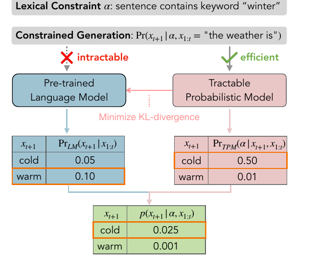
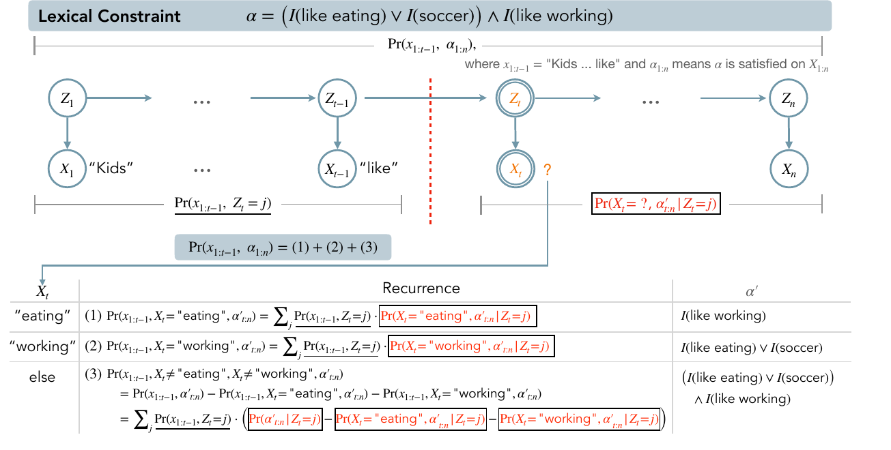
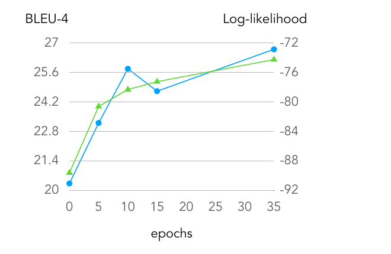

# 다루기 쉬운 확률모형으로 언어모델에 어휘 제약을 보장하기 — Tractable Control for Autoregressive Language Generation

#### Abstract

자기회귀(autoregressive) 대규모 언어모델이 텍스트 생성에서 성공을 거두었음에도, 복잡한 제약을 만족하는 텍스트를 생성하는 일은 여전히 주요한 난제로 남아 있다. 가장 단순한 어휘 제약(lexical constraint) α에 대해서도 조건부 분포 Pr(text | α)로부터 표본을 추출하는 것은 계산적으로 다루기 어렵다(intractable). 이 난제를 극복하기 위해 본 논문에서는 다루기 쉬운 확률모형(tractable probabilistic model, TPM)을 사용하여 자기회귀 텍스트 생성 모델에 어휘 제약을 부과하는 방법을 제안하며, 이를 GeLaTo(Generating Language with Tractable Constraints)라 부른다. 이 프레임워크의 효과를 보이기 위해, Pr(text | α)를 효율적으로 계산할 수 있는 증류된(distilled) 은닉 마르코프 모형(hidden Markov model)을 사용하여 GPT2의 자기회귀 생성을 유도한다. GeLaTo는 제약 조건부 텍스트 생성의 까다로운 벤치마크(예: CommonGen)에서 최고 수준(state-of-the-art)의 성능을 달성하며, 여러 강력한 기준 모델을 큰 차이로 앞선다. 본 연구는 대규모 언어모델을 제어하는 새로운 길을 열 뿐 아니라, 더 표현력 있는 TPM의 개발에 대한 동기를 제공한다.

#### 요약

언어모델에게 "이 단어들을 반드시 넣어서 문장을 만들라"고 시키면, 대부분의 방법은 그럴 가능성을 높여 줄 뿐 확실하게 지키게 하지는 못한다. 이 논문은 문장을 만드는 일은 GPT2에게, "앞으로 제약을 지킬 수 있는가"를 계산하는 일은 정확한 확률 추론이 가능한 은닉 마르코프 모형에게 나누어 맡기는 방식을 제안한다. 그 결과 제약 충족을 100% 보장하면서도 문장 품질 지표에서 기존 방법들을 앞선다.

---

## 1. 문제의식: 언어모델은 왜 제약을 지키기 어려운가

### 1) 자기회귀 언어모델이 계산하는 것

GPT 계열 자기회귀 언어모델은 문장을 왼쪽에서 오른쪽으로 한 토큰(token, 단어 또는 단어 조각)씩 생성한다. 각 단계에서 모델이 계산하는 것은 지금까지 생성된 앞부분(접두사, prefix) x_{1:t}가 주어졌을 때 다음 토큰이 무엇일지에 대한 분포, 즉 Pr(x_{t+1} | x_{1:t})뿐이다. 문장 전체의 확률은 이 다음 토큰 확률들을 차례로 곱해서 얻는다.

문제는 여기에 "특정 키워드가 문장 어딘가에 반드시 들어가야 한다" 같은 단순한 어휘 제약 α를 붙이는 순간 생긴다. 우리가 원하는 것은 Pr(x_{1:n} | α), 즉 제약을 만족하는 문장들만 놓고 본 분포이다. 이를 한 토큰씩 생성하려면 각 단계에서 Pr(x_{t+1} | x_{1:t}, α)를 알아야 한다. 그런데 이 값을 정확히 계산하려면 "이 토큰을 고른 뒤 앞으로 나올 수 있는 모든 후속 문장 가운데 키워드를 포함하는 것들의 확률 합"을 구해야 한다. 어휘 크기가 5만 개이고 남은 길이가 20토큰이라면 후속 문장의 경우의 수는 50000^20에 달한다. 언어모델은 이 합을 한 번에 계산해 주는 구조를 갖고 있지 않으므로, 제약 조건부 분포는 계산 불가능(intractable)하다. 키워드가 문장 끝에 나와야 한다는 정도의 단순한 제약조차 마찬가지이다.

### 2) 기존 접근과 그 한계

가장 흔한 방법은 과제에 맞게 파인튜닝(fine-tuning)하거나 프롬프트로 조건을 알려주는 것이다. 그러나 이는 본질적으로 근사적 방법이라 제약 충족을 보장하지 못한다. 모델이 지시를 "대체로" 따를 뿐, 어떤 문장에서는 키워드를 빠뜨린다.

이를 보완하기 위한 기존 연구는 크게 세 갈래이다. 첫째, NeuroLogic Decoding이나 A*esque 같은 탐색 기반 디코딩은 빔 탐색(beam search) 과정에 제약을 주입하고 앞으로의 충족 가능성을 휴리스틱으로 내다본다. 별도 학습이 필요 없다는 장점이 있지만 탐색 공간이 넓어 느리고, 휴리스틱이므로 보장이 없다. 둘째, FUDGE와 NADO는 "이 접두사에서 출발하면 제약이 충족될 확률"을 근사하는 보조 신경망을 학습하여 토큰 단위로 생성을 유도한다. 이 보조 모델은 제약을 입력으로 받아 학습되므로, 제약의 유형이 바뀌면 다시 학습해야 한다. 셋째, InsNet 같은 삽입 기반 모델은 키워드를 먼저 배치해 두고 그 사이를 채워 넣는 방식으로 키워드 포함을 보장하지만, 문장의 자연스러움에서 손해를 본다.

## 2. 핵심 아이디어: 계산 가능한 확률모형에 추론을 맡긴다

### 1) 다루기 쉬운 확률모형(TPM)이란

신경망 언어모델과 별개로, 기계학습에는 다루기 쉬운 확률모형(tractable probabilistic model, TPM)을 연구하는 흐름이 있다. 여기서 "다루기 쉽다"는 것은 표현력이 약하다는 뜻이 아니라, 주변확률(marginal probability)이나 특정 논리 조건이 주어졌을 때의 조건부 확률 같은 질의를 정확하게, 그리고 다항 시간 안에 계산할 수 있다는 뜻이다. 은닉 마르코프 모형(HMM), 합곱 네트워크(sum-product network) 등이 이에 속하며, 이들을 하나의 틀로 묶은 것이 확률 회로(probabilistic circuit)이다.

논문의 착상은 간단하다. 언어모델이 계산하지 못하는 "제약 조건부 확률"을 TPM에게 계산시키자는 것이다. 이 논문에서는 TPM의 예시로 HMM을 사용한다.

### 2) 그림 1 읽기

*그림 1. GeLaTo의 전체 구조. 맨 위에 제약 α("문장에 winter라는 키워드를 포함할 것")와 현재까지 생성된 접두사 "the weather is"가 주어져 있다. 왼쪽 파란 상자(사전학습 언어모델)는 제약을 고려한 다음 토큰 분포를 직접 계산하지 못하고(intractable), 제약을 무시한 다음 토큰 확률만 낸다. 오른쪽 분홍 상자(다루기 쉬운 확률모형)는 언어모델을 흉내 내도록 학습되어 있으며(가운데 "Minimize KL-divergence" 화살표), 각 후보 토큰을 골랐을 때 앞으로 제약이 충족될 확률을 효율적으로 계산한다. 아래 초록 표는 두 값을 곱해 얻은 최종 다음 토큰 점수이다.*

그림의 숫자를 따라가 보면 작동 방식이 바로 보인다. 언어모델만 놓고 보면 "the weather is" 다음에 warm(0.10)이 cold(0.05)보다 두 배 그럴듯하다. 그러나 TPM이 계산한 "이 단어를 고른 뒤 결국 winter가 문장에 등장할 확률"은 cold가 0.50, warm이 0.01이다. 추운 날씨 이야기를 시작하면 겨울 이야기로 이어지기 쉽기 때문이다. 두 값을 곱하면 cold는 0.05 × 0.50 = 0.025, warm은 0.10 × 0.01 = 0.001이 되어 순위가 뒤집힌다. 언어모델은 유창성을, TPM은 제약 충족 방향을 담당하는 분업 구조인 것이다.

### 3) 1단계: 증류(distillation)

TPM이 쓸모 있으려면 먼저 언어모델의 분포를 충분히 비슷하게 흉내 내야 한다. 그렇지 않으면 TPM이 계산한 "제약 충족 확률"이 언어모델이 실제로 생성할 문장들과 동떨어지게 된다. 그래서 첫 단계는 GPT2-large에서 문장을 대량으로 샘플링하고, 이를 학습 데이터로 삼아 HMM을 최대우도 추정(maximum likelihood estimation, MLE)하는 것이다. 이는 다음과 같이 두 분포 사이의 KL 발산(Kullback-Leibler divergence)을 최소화하는 것과 같다.

$$
D_{KL}(\Pr_{LM} \,\|\, \Pr_{TPM}) = \mathbb{E}_{x_{1:n} \sim \Pr_{LM}} \log \Pr_{LM}(x_{1:n}) - \mathbb{E}_{x_{1:n} \sim \Pr_{LM}} \log \Pr_{TPM}(x_{1:n})
$$

여기서 Pr_LM은 언어모델의 문장 분포, Pr_TPM은 HMM의 문장 분포, x_{1:n}은 길이 n의 토큰열이다. KL 발산은 "언어모델이 만드는 문장을 TPM이 얼마나 낯설게 느끼는가"를 재는 거리로 이해하면 된다. 우변 첫째 항은 언어모델 자신의 엔트로피(의 음수)로 TPM과 무관한 상수이므로, KL 발산을 줄이는 것은 둘째 항, 즉 언어모델이 만든 문장에 대한 TPM의 평균 로그우도를 키우는 것과 정확히 같다. 이것이 "언어모델의 샘플로 MLE를 하면 곧 언어모델을 근사하는 것"이라는 말의 의미이다. 신경망 지식 증류에서 큰 모델의 출력으로 작은 모델을 학습시키는 것과 같은 발상이다.

중요한 점은 이 단계에서 제약 α를 전혀 사용하지 않는다는 것이다. TPM은 그저 "GPT2가 쓰는 문장"의 분포를 배울 뿐이다. 따라서 학습된 HMM 하나로 어떤 어휘 제약이든 재학습 없이 처리할 수 있다. 제약을 입력으로 받아 학습하는 FUDGE나 NADO와 갈리는 지점이 바로 여기이다.

### 4) 2단계: 확률적 추론

생성 시점에는 각 단계마다 HMM으로 "지금까지의 접두사에 이 후보 토큰을 붙였을 때 앞으로 제약이 충족될 확률" Pr_TPM(α | x_{1:t+1})을 정확히 계산하고, 이를 언어모델의 다음 토큰 확률과 결합한다. 구체적인 결합 방식은 언어모델이 어떻게 학습되었는지에 따라 두 가지로 나뉜다.

## 3. 두 가지 결합 방식

### 1) 비지도 설정: 베이즈 규칙으로 곱하기

비지도 설정이란 언어모델이 "제약을 입력으로 받아 그것을 만족하는 문장을 쓰도록" 학습되지 않은 경우이다. 해당 분야 문장으로 도메인 적응만 했을 뿐, 키워드를 보여 주며 학습하지는 않았다. 이때의 결합 공식은 베이즈 규칙에서 나온다.

저자들은 먼저 β라는 가상의 "품질 제약"을 도입한다. β는 "언어모델이 실제로 생성할 법한 유창하고 문법적인 문장"이라는 조건을 뜻하며, β로 조건화한 TPM, 즉 Pr_TPM(· | β)는 언어모델 Pr_LM과 거의 같다고 가정한다. 우리가 원하는 것은 제약 α도 만족하고 품질 β도 갖춘 문장이므로 Pr_TPM(x_{t+1} | x_{1:t}, α, β)에서 생성하면 된다. 여기에 핵심 독립성 가정, 즉 접두사 x_{1:t+1}이 주어지면 α와 β가 조건부 독립이라는 가정을 더하면 다음이 성립한다.

$$
\Pr_{TPM}(x_{t+1} \mid x_{1:t}, \alpha, \beta) \;\propto\; \Pr_{TPM}(\alpha \mid x_{1:t+1}, \beta) \cdot \Pr_{TPM}(x_{t+1} \mid x_{1:t}, \beta) \;\propto\; \Pr_{TPM}(\alpha \mid x_{1:t+1}) \cdot \Pr_{LM}(x_{t+1} \mid x_{1:t})
$$

첫 번째 비례식은 베이즈 규칙 Pr(A | B) ∝ Pr(B | A) Pr(A)를 x_{t+1}과 α에 적용한 것이다. 두 번째 비례식에서는 두 가정이 쓰인다. 독립성 가정 덕분에 Pr_TPM(α | x_{1:t+1}, β)에서 β를 지울 수 있고, Pr_TPM(· | β) ≈ Pr_LM이라는 가정 덕분에 Pr_TPM(x_{t+1} | x_{1:t}, β)를 언어모델의 다음 토큰 확률로 바꿀 수 있다. 그래서 실제로 쓰는 생성 분포는 다음과 같다.

$$
p(x_{t+1} \mid x_{1:t}, \alpha) \;\propto\; \Pr_{TPM}(\alpha \mid x_{1:t+1}) \cdot \Pr_{LM}(x_{t+1} \mid x_{1:t}) \tag{1}
$$

말로 풀면 "언어모델이 이 토큰을 얼마나 자연스럽게 여기는가"와 "이 토큰을 고르면 나중에 제약을 지킬 수 있을 가능성이 얼마나 되는가"를 곱한 것이다. 그림 1의 계산이 정확히 이 식이다.

독립성 가정이 비지도 설정에서 대체로 성립한다고 보는 이유는, 언어모델이 제약에 대해 아무것도 모르기 때문이다. 키워드를 포함한다고 해서 문장이 더 유창해지거나 덜 유창해지지는 않고, 단지 문장이 무엇에 관한 이야기인지가 달라질 뿐이라는 논리이다. 이 식의 형태는 FUDGE, NADO와 같다. 차이는 이들이 Pr(α | x_{1:t+1})를 제약을 입력으로 받는 신경망으로 근사하는 반면, GeLaTo는 제약 없이 학습한 HMM으로 정확히 계산한다는 점이다.

### 2) 지도 설정: 가중 기하평균

지도 설정은 언어모델을 seq2seq 방식으로 파인튜닝한 경우이다. 예를 들어 "weather winter cold = the weather is cold in winter"처럼 "=" 앞에 키워드를 나열하고 뒤에 정답 문장을 붙인 데이터로 학습하면, 언어모델은 접두사에 들어 있는 키워드를 보고 그것을 쓰려고 한다. 이 경우 언어모델 자체가 이미 제약 정보를 반영하므로, 위의 독립성 가정이 깨진다. 식 (1)대로 곱하면 같은 정보를 두 번 반영하는 셈이 된다.

그래서 저자들은 관점을 바꾸어, 두 모델을 "같은 과제를 푸는데 서로 다른 편향을 가진 두 분류기"로 본다. 각 모델이 참 로짓(logit)을 가우시안 잡음이 섞인 형태로 예측한다고 가정하면, 가장 그럴듯한 로짓은 두 모델의 기하평균으로 얻어진다(Satopää et al., 2014). 이에 따라 다음과 같은 가중 기하평균을 사용한다.

$$
p(x_{t+1} \mid x_{1:t}, \alpha) \;\propto\; \Pr_{TPM}(x_{t+1} \mid x_{1:t}, \alpha)^{\,w} \cdot \Pr_{LM}(x_{t+1} \mid x_{1:t})^{\,1-w} \tag{2}
$$

w ∈ (0, 1)은 TPM과 언어모델 중 어느 쪽 의견을 더 반영할지 정하는 가중치이다. w가 0에 가까우면 언어모델만, 1에 가까우면 TPM만 따른다. 로그를 취하면 log p = w · log Pr_TPM + (1 − w) · log Pr_LM이 되므로, 로그 공간에서의 가중평균이라고 보아도 된다. 실험에서는 교차검증으로 w = 0.3을 골랐다.

### 3) 100% 충족 보장의 근거

두 방식 모두에서 제약을 만족시킬 수 없게 만드는 토큰은 HMM이 확률 0을 부여한다. 비지도 설정에서는 Pr_TPM(α | x_{1:t+1}) = 0이 곱해지므로 0이 되고, 지도 설정에서도 w > 0인 한 0의 거듭제곱은 여전히 0이다. 따라서 생성 결과의 제약 충족이 100% 보장된다. 이것이 어떤 제약에 대해, 어떤 원리로 성립하는지를 다음 절에서 예를 들어 살펴본다.

## 4. 어떤 제약을 보장하는가

### 1) CNF로 표현되는 어휘 제약

GeLaTo가 100% 충족을 보장하는 대상은 "특정 토큰열이 생성 문장 안에 등장하는가"로 표현되는 어휘 제약, 그중에서도 CNF(conjunctive normal form, 논리곱 정규형)로 쓸 수 있는 것들이다. 형태는 다음과 같다.

$$
\big(I(w_{1,1}) \lor \cdots \lor I(w_{1,d_1})\big) \land \cdots \land \big(I(w_{m,1}) \lor \cdots \lor I(w_{m,d_m})\big)
$$

여기서 I(w)는 토큰열 w가 문장 어딘가에 나타나면 참, 아니면 거짓인 지시변수(indicator variable)이다. ∨는 "또는"(논리합), ∧는 "그리고"(논리곱)를 뜻한다. 괄호 하나를 절(clause)이라 부르며 "이 후보들 중 하나 이상 등장"을 의미하고, 절들을 ∧로 묶으니 "모든 절이 각각 충족"되어야 한다. 논문에서는 각 w_{i,j}를 키스트링(keystring)이라 부르는데, 하나의 단어가 토크나이저에 의해 여러 토큰으로 쪼개질 수 있으므로 "단어"가 아니라 "토큰열"로 정의한 것이다. 다음은 표현 가능한 제약의 예이다.

| 제약의 의미 | CNF 표현 |
|---|---|
| "winter"를 반드시 포함 | I(winter) |
| "dog"와 "park"를 모두 포함 | I(dog) ∧ I(park) |
| "run"을 어떤 굴절형으로든 포함 | I(run) ∨ I(runs) ∨ I(ran) ∨ I(running) |
| 여러 토큰으로 된 단어 포함 | I(fr ⊕ is ⊕ bee) — "frisbee"가 토큰 3개로 쪼개진 경우 |
| "like eating" 또는 "soccer" 중 하나, 그리고 "like working"은 반드시 | (I(like eating) ∨ I(soccer)) ∧ I(like working) |

표에서 ⊕는 토큰을 이어 붙이는 연산(문자열 연결)을 뜻한다.

### 2) CommonGen 과제의 예

CommonGen의 "catch frisbee snow" 과제가 대표적이다. CommonGen은 3~5개의 개념어를 주고 이를 모두 사용한 자연스러운 문장을 생성하도록 요구하는 벤치마크이며, 개념어는 어떤 순서로든, 어떤 굴절형으로든 쓰여도 된다. 이 과제에서 세 개념어 각각이 하나의 절이 되고, 절 안에는 LemmInflect라는 도구로 만든 굴절형들(catch, catches, caught, catching 등)이 ∨로 나열된다.

$$
[I(\text{catch}) \lor I(\text{caught}) \lor \cdots] \land [I(\text{fr} \oplus \text{is} \oplus \text{bee}) \lor I(\text{fr} \oplus \text{is} \oplus \text{bees}) \lor \cdots] \land [I(\text{snow}) \lor I(\text{snow} \oplus \text{ing}) \lor \cdots]
$$

따라서 "A boy caught a frisbee in the snow"도, "Kids are catching frisbees on snowy days"도 제약을 충족한 것으로 처리된다. 논문에서는 추가로 키스트링 뒤에 공백, 쉼표, 문장 끝 토큰 중 하나가 와야 한다는 조건도 붙였다. 이 조건이 없으면 "snowboard" 같은 단어의 앞부분이 "snow"로 잘못 인정될 수 있기 때문이다.

∨에는 굴절형뿐 아니라 사용자가 원하는 대안이면 무엇이든 넣을 수 있다. 예컨대 "car, automobile, vehicle 중 하나"처럼 동의어 집합을 직접 지정하면 그것도 보장 대상이 된다. 또 뒤에서 볼 Yelp!Review와 News 실험에서처럼, 알고리즘을 약간 수정하면 "키워드가 주어진 순서대로 등장"하는 제약도 다룰 수 있다.

### 3) 보장이 성립하는 원리: 한 단계씩 보기

개념어 "dog, frisbee", 최대 길이 n = 12 토큰이라고 하자. 지금까지 "The dog jumped high to" (5토큰)가 생성된 상태이다. "dog"는 이미 나왔으므로 남은 제약은 I(frisbee) 하나로 줄어든다.

이 시점에서 HMM은 후보 토큰마다 "이 토큰을 붙인 뒤 남은 자리 안에서 frisbee가 등장할 확률"을 정확히 계산한다. 남은 자리가 7토큰으로 넉넉하므로 대부분의 토큰이 양의 확률을 받고, 언어모델은 자유롭게 문장을 이어간다. 물론 frisbee로 이어지기 쉬운 토큰(예: grab, catch)은 더 높은 확률을 받아 생성이 그쪽으로 기운다.

그런데 생성이 진행되어 "The dog jumped high to grab the red"(8토큰)까지 왔고, 남은 자리가 4토큰이라고 하자. frisbee는 토큰 3개(fr, is, bee)로 이루어져 있고, 그 뒤에 공백이나 문장 끝을 나타내는 토큰이 하나 와야 한다. 즉 남은 4자리를 정확히 "fr, is, bee, 끝"으로 채워야만 제약을 지킬 수 있다. 이제 "fr" 이외의 토큰을 고르면 남은 3자리 안에 frisbee를 완성할 방법이 없으므로 Pr_TPM(α | x_{1:t+1}) = 0이 된다. 이 값이 언어모델 확률에 곱해지므로, 해당 토큰들은 언어모델이 아무리 선호해도 확률 0이 되어 선택될 수 없다.

문장 끝(EOS) 토큰도 마찬가지이다. HMM은 EOS 뒤에 EOS만 오도록 특별하게 구성되어 있어서, 제약이 미충족인 채로 문장을 끝내는 선택 역시 확률 0을 받는다.

핵심은 이 0이 근사값이 아니라는 점이다. HMM이 GPT2를 얼마나 잘 흉내 내는지와 무관하게, "남은 공간 안에 제약을 만족하는 완성이 존재하는가"라는 논리적 판단은 동적 프로그래밍으로 정확하게 계산된다. 그래서 근사의 질은 문장의 자연스러움에만 영향을 주고, 제약 충족 여부에는 영향을 주지 않는다. 반면 NeuroLogic 계열은 휴리스틱으로 제약 쪽으로 유도할 뿐이어서 충족률이 93~98% 수준에 머문다.

### 4) 보장하지 않는 것

첫째, 의미적 제약은 범위 밖이다. "긍정적인 어조로", "정치 이야기는 하지 말 것", "질문 형태로" 같은 조건은 특정 토큰열의 등장 여부로 환원되지 않으므로 이 틀로 표현할 수 없다.

둘째, 논문의 정식화에서 리터럴은 모두 "등장한다"는 긍정형이다. "특정 단어를 쓰지 말 것" 같은 부정 제약은 이 논문이 제시한 알고리즘의 직접적인 대상이 아니다. 이는 같은 연구진의 후속 연구인 Ctrl-G에서 제약을 결정적 유한 오토마톤(deterministic finite automaton, DFA)으로 표현하는 방식으로 일반화되며 다루어진다.

셋째, 키워드가 "의미 있게" 쓰였다는 것은 보장하지 않는다. 단어가 문자열로 들어갔을 뿐 어색하게 끼워 넣어졌을 수도 있다. 뒤에서 볼 인간 평가에서 개념어 포함(Concepts) 항목 점수가 만점 3점이 아니라 2.73인 것이 이를 보여 준다.

넷째, 형식적 전제도 있다. 최대 길이 n 안에서 제약을 만족하는 문장이 존재해야 하고, 키스트링들 사이에 한 키스트링의 접두사가 다른 키스트링의 접미사와 겹치지 않는다는 비중첩(non-overlapping) 가정이 필요하다. 또한 절 개수가 늘면 계산량이 2^|α|로 증가하므로, 원리상 보장되더라도 키워드가 많아지면 실용성이 떨어진다.

정리하면, GeLaTo의 보장은 "지정한 단어나 구가 (어떤 변형으로든, 필요하면 정해진 순서로) 문장에 반드시 들어간다"는 문자열 수준의 보장이며, 그 대가로 의미 수준의 제어는 언어모델의 몫으로 남겨 둔 구조이다.

## 5. HMM 위의 동적 프로그래밍

앞 절에서 "HMM이 Pr(α | x_{1:t+1})를 정확히 계산한다"고 했는데, 이 절에서는 그것이 어떻게 가능한지를 살펴본다. 이 논문의 기술적 핵심이 바로 이 부분이다.

### 1) 은닉 마르코프 모형의 기초

HMM은 관측변수 X_{1:n}과 은닉(잠재)변수 Z_{1:n}의 결합 분포를 표현하는 모형이다. 언어 모델링에서 X_t는 위치 t의 토큰이고, Z_t는 그 위치의 은닉 상태로 1부터 h까지의 값을 가진다(h는 은닉 상태의 개수로, 이 논문에서는 4,096). 은닉 상태는 "지금 문장이 어떤 흐름에 있는가"를 요약하는 보이지 않는 변수로 이해하면 된다. 생성 과정은 은닉 상태가 Pr(z_t | z_{t−1})(전이 행렬)에 따라 다음 상태로 옮겨 가고, 각 상태에서 Pr(x_t | z_t)(방출 행렬)에 따라 토큰이 하나씩 방출되는 구조이다.

HMM의 결정적 성질은 마르코프 성질(Markov property)이다.

$$
\Pr(x_{t:n} \mid z_t, x_{1:t-1}) = \Pr(x_{t:n} \mid z_t) \tag{3}
$$

현재 은닉 상태 z_t만 알면, 그 이전에 어떤 토큰들이 나왔는지는 앞으로의 생성에 아무 영향을 주지 않는다는 뜻이다. 과거 전체가 h개 값 중 하나로 압축되는 셈이다. 이 성질 덕분에 앞부분 확률과 뒷부분 확률을 은닉 상태를 경계로 깔끔하게 쪼갤 수 있다. GPT2처럼 모든 과거 토큰에 주의(attention)를 기울이는 모델에서는 이런 분해가 불가능하다.

앞부분의 확률은 다음 재귀식, 즉 전방 알고리즘(forward algorithm)으로 효율적으로 계산된다.

$$
\Pr(x_{1:t}, z_t) = \sum_{z_{t-1}=1}^{h} \Pr(x_t \mid z_t)\, \Pr(z_t \mid z_{t-1})\, \Pr(x_{1:t-1}, z_{t-1})
$$

직전 위치의 각 은닉 상태에서 현재 상태로 옮겨 올 확률을 모두 더하고, 현재 상태에서 관측된 토큰이 나올 확률을 곱하는 것이다. 위치마다 h × h번의 계산이면 되므로, 가능한 은닉 상태 경로 h^t개를 일일이 나열할 필요가 없다.

가변 길이 문장을 다루기 위해, 최대 길이 n을 정하고 그보다 짧은 문장은 EOS 토큰으로 채운다. 그리고 EOS 뒤에는 EOS만 올 수 있도록 HMM을 구성한다. 이렇게 하면 HMM은 길이 n 이하의 모든 문장에 대한 분포가 된다.

### 2) 그림 2 읽기

*그림 2. 동적 프로그래밍 알고리즘의 예시. 맨 위는 제약 α = (I(like eating) ∨ I(soccer)) ∧ I(like working)이다. 가운데는 HMM을 베이지안 네트워크로 그린 것으로, 위쪽 원(Z)이 은닉 상태, 아래쪽 원(X)이 토큰이다. 지금까지 "Kids ... like"까지 생성되었고(빨간 점선 왼쪽), 다음 토큰 X_t를 정해야 한다. 아래 표는 X_t가 "eating"인 경우, "working"인 경우, 그 밖의 경우로 나누어 확률을 계산하는 방법과, 각 경우에 남는 제약 α′(오른쪽 열)을 보여 준다. 밑줄 친 항은 전방 알고리즘으로, 빨간 상자 항은 동적 프로그래밍으로 계산된다.*

그림의 상황을 풀어 보자. 지금까지 "Kids ... like"까지 생성되었다. 마지막 토큰이 "like"이므로, 다음 토큰이 무엇이냐에 따라 제약의 처지가 달라진다.

다음 토큰이 "eating"이면 "like eating"이 완성되어 첫 번째 절이 충족된다. 남은 제약 α′은 I(like working) 하나이다(표의 (1)행). 다음 토큰이 "working"이면 "like working"이 완성되어 두 번째 절이 충족된다. 남은 제약은 I(like eating) ∨ I(soccer)이다((2)행). 그 밖의 토큰이면 아무 절도 충족되지 않으므로 원래 제약 전체가 그대로 남는다((3)행).

각 경우에서 계산해야 할 확률은 마르코프 성질에 의해 두 부분으로 쪼개진다. 은닉 상태 Z_t = j를 경계로, 왼쪽의 Pr(x_{1:t−1}, Z_t = j)는 이미 생성된 부분의 확률로 전방 알고리즘으로 계산되고(밑줄), 오른쪽의 Pr(X_t = ?, α′_{t:n} | Z_t = j)는 "상태 j에서 출발해 이 토큰을 내고 남은 구간에서 줄어든 제약 α′을 만족할 확률"로 동적 프로그래밍으로 미리 계산해 둔다(빨간 상자). 이 둘을 곱해 j에 대해 합하면 된다. "그 밖의" 경우는 전체에서 앞의 두 경우를 빼는 방식으로 구한다.

이 구조의 묘미는 제약이 이미 충족된 절을 하나씩 떼어 내면서 점점 "쉬운" 하위 문제로 줄어든다는 데 있다. 하위 문제의 종류는 "남은 절들의 부분집합", "현재 위치", "은닉 상태", "키스트링의 어느 부분까지 진행되었는가"의 조합으로 유한하므로, 이를 모두 계산해 캐시에 저장해 두면 생성 중에는 표를 찾아보듯 값을 꺼내 쓸 수 있다.

### 3) 재귀식과 계산량

이를 일반화한 재귀식은 다음과 같다(논문 3.2절의 Case 1). x_{l:r}은 키스트링의 앞부분(접미사)으로 아직 진행 중인 토큰열이고, S(x_{l:r}, α)는 x_{l:r} 뒤에 붙여서 어떤 키스트링을 완성할 수 있는 문자열들의 집합이다. 예컨대 x = "Kids ... like"이면 S(x, α) = {"eating", "working"}이다.

$$
\Pr(x_{l:r}, \alpha_{l:n} \mid z_l) = \sum_{z_{r+1}} \Pr(x_{l:r}, z_{r+1} \mid z_l) \Big[ \Pr(\alpha_{r+1:n} \mid z_{r+1}) + \sum_{s \in S} \Pr\big(s_{r+1:r+|s|}, (\alpha \setminus x_{l:r} \oplus s)_{r+1:n} \mid z_{r+1}\big) - \sum_{s \in S} \Pr\big(s_{r+1:r+|s|}, \alpha_{r+1:n} \mid z_{r+1}\big) \Big]
$$

복잡해 보이지만 그림 2의 세 경우를 일반화한 것에 불과하다. 대괄호 안의 첫 항은 "아무것도 완성하지 않는 경우까지 포함해 원래 제약을 만족할 확률"이고, 두 번째 합은 "s를 붙여 어떤 키스트링을 완성한 뒤 줄어든 제약 α \ (x ⊕ s)를 만족할 확률", 세 번째 합은 첫 항에 이미 포함되어 중복으로 세어진 "s를 붙였지만 원래 제약 기준으로 계산된 확률"을 빼 주는 보정항이다. 즉 "s를 붙이는 경우"에 대해서만 원래 제약을 줄어든 제약으로 바꿔 끼우는 계산이다. 앞의 Pr(x_{l:r}, z_{r+1} | z_l)는 HMM 파라미터로 바로 계산된다.

x_{l:r}이 빈 문자열인 경우(Case 2)는 어휘 전체에 대해 첫 토큰을 합산하여 Case 1로 환원한다. 어휘가 5만 개에 이르지만, 대부분의 토큰은 어떤 키스트링과도 관련이 없으므로 이들을 한 덩어리로 묶어 GPU 병렬 연산으로 처리한다(부록 A).

전체 시간복잡도는 O(2^|α| · n · m)이다. 여기서 |α|는 절의 개수, n은 최대 길이, m은 키스트링들의 서로 다른 접미사 개수이다. 2^|α|가 붙는 이유는 "남은 절들의 부분집합"마다 하위 문제를 따로 계산해야 하기 때문이다. 절 개수에 지수적이지만, 키워드가 3~5개인 CommonGen 같은 과제에서는 2^5 = 32 수준이라 충분히 다룰 만하다.

## 6. 실험 결과

### 1) 실험 설정

기반 언어모델은 GPT2-large이다. 비지도 설정에서는 CommonGen 학습 데이터의 정답 문장만으로(키워드 없이) 1 에폭 도메인 적응 파인튜닝을 했고, 지도 설정에서는 "car snow drive = a car drove through snow" 형식으로 3 에폭 seq2seq 파인튜닝을 했다.

HMM은 은닉 상태 4,096개로, 파인튜닝된 GPT2-large에서 샘플링한 길이 32의 문장으로 학습했다. 기대값 최대화(expectation-maximization, EM) 알고리즘으로 40 에폭 학습했고 에폭마다 20만 개의 문장을 새로 샘플링했다. HMM은 확률 회로 형태로 Juice.jl 프레임워크에서 학습했으며, 잠재변수 증류(latent variable distillation) 기법을 활용했다. 디코딩은 식 (1), (2)가 정의하는 분포에 대해 빔 탐색을 하고, 최종 빔들을 도메인 적응된 GPT2-large의 로그우도로 재정렬해 최상위 문장을 고른다.

비교 대상은 앞서 소개한 세 갈래의 대표 방법인 InsNet(삽입 기반), NeuroLogic과 A*esque(탐색 기반), NADO(보조 신경망 기반)이다. InsNet을 제외한 모든 방법이 GPT2-large를 기반 모델로 쓰므로, 기반 모델의 차이가 아니라 제약을 거는 방식의 차이를 비교하는 실험이다.

### 2) 주요 결과

다음 표는 CommonGen에서의 BLEU-4 점수이다. BLEU-4는 생성 문장과 정답 문장이 연속된 1~4개 단어 묶음을 얼마나 공유하는지를 재는 지표로, 높을수록 정답 문장에 가깝다. dev는 검증 세트, test는 시험 세트이며, "-"는 원 논문에서 보고되지 않은 값이다.

| 방법 | 비지도 dev | 비지도 test | 지도 dev | 지도 test |
|---|---|---|---|---|
| InsNet | 18.7 | - | - | - |
| NeuroLogic | - | 24.7 | - | 26.7 |
| A*esque | - | 28.6 | - | 28.2 |
| NADO | 26.2 | - | 30.8 | - |
| GeLaTo | **30.3** | **29.0** | **34.0** | **34.1** |

같은 표에서 제약 충족 지표만 따로 보면 다음과 같다. 성공률(success rate)은 모든 개념어를 빠짐없이 포함한 문장의 비율이다. † 표시는 원 논문에 값이 없어 GeLaTo 저자들이 재현한 수치이다.

| 방법 (지도 설정) | 개념어 포함률 (test) | 성공률 |
|---|---|---|
| NeuroLogic | 97.7 | 93.9† (test) |
| A*esque | 97.8 | 97.9† (test) |
| NADO | 97.1 (dev) | 88.8† (dev) |
| GeLaTo | **100.0** | **100.0** |

두 표를 함께 읽으면 GeLaTo의 위치가 분명해진다. 다른 방법들은 품질을 얻는 대신 일부 문장에서 키워드를 빠뜨리지만, GeLaTo는 제약을 100% 지키면서도 품질 지표에서 앞선다. 저자들이 특히 강조하는 것은 비지도 GeLaTo(dev 30.3)가 지도 학습된 NADO(dev 30.8)와 거의 같은 수준이라는 점이다. 키워드를 보며 학습한 적이 없는 언어모델이라도, HMM의 안내만으로 지도 학습된 경쟁 방법에 근접할 수 있다는 뜻이다.

키워드 순서까지 고정해야 하는 Yelp!Review와 News 데이터셋에서도 비지도 GeLaTo가 가장 높은 BLEU-4를 기록했다(Yelp!Review 6.6, News 5.4; NADO는 각각 6.0, 4.5). 두 데이터셋은 학습 데이터에 키워드가 주어지지 않아 지도 파인튜닝 자체가 불가능한데, 제약 없이 학습하는 GeLaTo의 구조가 이런 상황에서 이점을 갖는다.

인간 평가에서도 종합(Overall) 점수가 NADO보다 약간 높게 나왔다(1~3점 척도에서 2.60 대 2.54). 다만 개념어 포함(Concepts) 점수는 2.73으로, 문자열로는 100% 포함되었어도 평가자가 보기에 모든 개념어가 의미 있게 쓰인 것은 아니었다.

### 3) 부가 분석

*그림 3. HMM 학습 에폭(가로축)에 따른 두 지표의 변화. 초록 삼각형은 GPT2-large가 생성한 문장에 대한 HMM의 로그우도(오른쪽 축)로, 높을수록 HMM이 GPT2를 잘 흉내 낸다는 뜻이다. 파란 원은 해당 시점의 HMM으로 GeLaTo를 돌렸을 때의 BLEU-4(왼쪽 축, 빔 재정렬 전)이다. 두 선이 함께 올라가는 것을 보면 된다.*

첫째, HMM이 GPT2를 잘 근사할수록(로그우도 상승) BLEU도 함께 오르는 양의 상관이 관찰되었다. 2절에서 "근사의 질은 문장의 자연스러움에 영향을 준다"고 했던 것이 실험으로 확인된 셈이다. 저자들은 이를 근거로, 더 표현력 있는 TPM을 개발하면 GeLaTo의 성능도 더 오를 것이라고 해석한다.

둘째, 지도 설정의 가중치 w는 0.1~0.8 범위에서 모두 기존 최고 성능을 넘을 만큼 강건하다. w = 0이면(언어모델만 쓰면) BLEU가 24.8로 떨어지고, w가 1에 가까워질수록(TPM만 쓰면) 다시 떨어진다. 두 모델이 서로 보완한다는 증거이다.

셋째, 빔 크기를 16에서 128로 키울수록 성능이 단조 증가한다.

넷째, 실행 시간은 설정에 따라 다르다. 비지도 설정에서는 탐색 기반인 A*esque보다 훨씬 빠르다. 개념어 3개 기준으로 A*esque가 문장당 약 473초 걸린 반면 GeLaTo는 빔 16에서 13.5초, 빔 128에서도 69.8초였다. A*esque가 제약 없는 넓은 탐색 공간에서 헤매는 반면, GeLaTo는 HMM이 미리 방향을 잡아 주기 때문이다. 반면 지도 설정에서는 언어모델이 이미 키워드를 쓰도록 학습되어 A*esque의 탐색 부담이 작으므로, GeLaTo가 다소 느리다(개념어 3개 기준 A*esque 8.5초, GeLaTo 빔 16에서 11.1초).

## 7. 의의와 한계

이 논문의 의의는 "신경망은 유창성, 다루기 쉬운 확률모형은 논리적 제약에 대한 정확한 추론"이라는 역할 분담을 통해, 근사가 아닌 보장된 제약 충족을 달성했다는 데 있다. 신경망의 생성 능력과 기호적 제약 추론을 결합한다는 점에서 뉴로심볼릭(neuro-symbolic) 접근의 대표 사례로 볼 수 있다. 또한 TPM을 제약 없이 한 번만 학습하면 어떤 어휘 제약에든 재사용할 수 있다는 점에서, 제약마다 보조 모델을 새로 학습해야 하는 기존 방법보다 실용적이다.

다만 몇 가지 한계도 읽힌다. 첫째, HMM의 표현력이 품질의 상한을 결정한다. 그림 3이 보여 주듯 근사가 좋을수록 품질이 오르는데, 은닉 상태 4,096개의 HMM이 GPT2-large 정도는 따라갈 수 있어도 훨씬 큰 최신 언어모델로 확장하면 근사 격차가 커질 수 있다. 둘째, 비지도 설정의 조건부 독립 가정은 이론적으로 엄밀히 정당화되기보다 "대략 성립한다"는 수준의 논증에 머문다. 셋째, 절 개수에 지수적인 계산량 때문에 키워드가 많은 제약에는 부담이 생긴다. 넷째, 평가가 짧은 문장 위주이고 BLEU 중심이라는 점도 감안할 필요가 있다. CommonGen의 문장 길이는 평균 32토큰 안팎이다.

후속 연구의 방향도 이 한계들과 맞닿아 있다. 같은 연구진의 Ctrl-G에서는 제약 표현을 CNF에서 결정적 유한 오토마톤으로 일반화하여 부정 제약이나 길이 제약 같은 더 넓은 범위를 다루고, 더 큰 언어모델에 적용하는 방향으로 이어졌다.

## 8. 맺음말

GeLaTo가 던지는 메시지는 "언어모델에게 모든 것을 시키지 말고, 잘하지 못하는 계산은 그것을 잘하는 모형에게 맡기라"는 것이다. 자기회귀 언어모델은 다음 토큰을 예측하는 데 탁월하지만 미래 전체에 대한 확률적 질의에는 답하지 못한다. HMM은 언어를 생성하는 능력에서는 GPT2에 미치지 못하지만, 마르코프 성질 덕분에 "앞으로 이 제약을 지킬 수 있는가"라는 질문에 정확히 답할 수 있다. 두 모델을 증류로 연결하고 베이즈 규칙으로 결합함으로써, 이 논문은 품질과 보장을 동시에 얻는 길을 보였다. 그 보장이 문자열 수준에 머문다는 한계는 분명하지만, 더 표현력 있는 다루기 쉬운 확률모형이 등장할수록 이 틀이 감당할 수 있는 제약의 범위도 넓어질 것이다.
