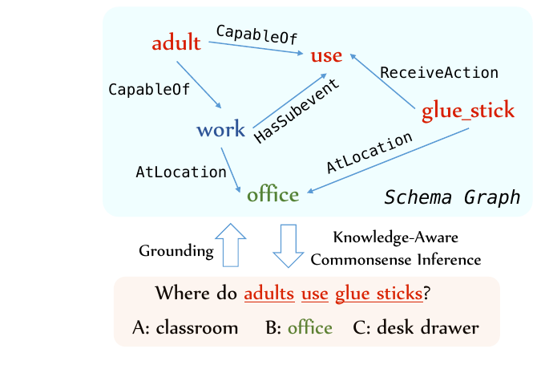
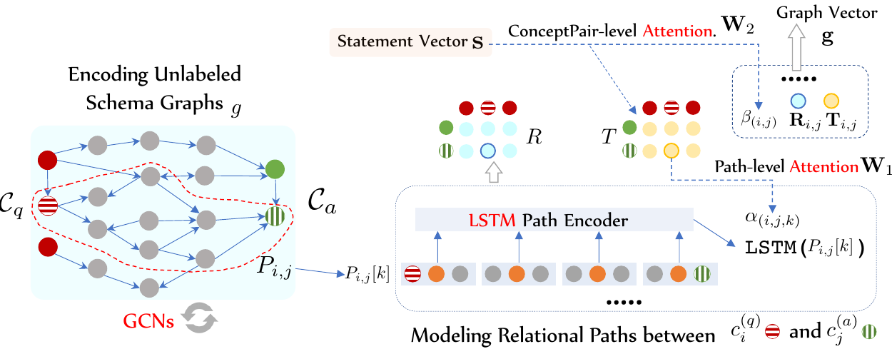
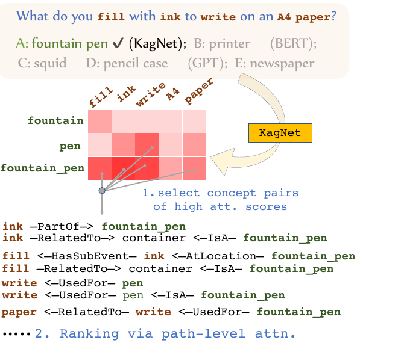

# KagNet: 외부 지식그래프로 상식 추론을 풀고, 그 근거까지 보여주기

한 줄로 요약하면, KagNet은 외부 상식 지식그래프(ConceptNet)를 활용해 상식 추론 문제(질문-답변)를 풀고, 그 과정을 **해석 가능하게** 만드는 프레임워크다. 이 글은 논문의 문제의식에서 출발해 핵심인 GCN-LSTM-HPA 아키텍처를 수식과 함께 뜯어보고, 모델의 입출력 구조와 학습 방식, 어텐션 기반 해석, 그리고 이 접근이 지금의 LLM 시대에서 어떤 의미를 갖는지까지 정리한다.

---

## 1. 왜 이 논문이 나왔나 — 상식 추론과 LLM 파인튜닝의 한계

### 1) 풀려는 문제

CommonsenseQA 같은 상식 문제는 사람에게는 쉽지만 기계에게는 까다롭다. 예를 들어 "성인은 어디서 풀스틱을 쓰는가? → 교실 / 사무실 / 서랍" 같은 질문이 있다. 정답은 사무실이지만, 오답 후보들도 질문 문맥과 highly 관련되어 있어서 — 그냥 덜 그럴듯할 뿐이라 — 문제를 더 어렵게 만든다. 논문은 이런 상식 추론을, 특히 질문-답변(question-answering) 세팅에서 기계가 어떻게 하게 만들 수 있는지를 다룬다.

### 2) 기존 접근의 한계

BERT·GPT 같은 사전학습 언어모델을 파인튜닝하면 강력한 베이스라인이 된다. 실제로 이들은 상식 지식을 파라미터 안에 암묵적으로 저장하고 있어서 다른 방법들보다 훨씬 높은 성능을 낸다. 하지만 두 가지 한계가 있다. 첫째, 인간 성능과 여전히 큰 격차가 있다. 둘째, 왜 그 답을 골랐는지 근거가 불투명하다 — 신경망 추론은 투명성과 해석가능성이 부족해서, 어떻게 그 답에 도달했는지 알 방법이 없고 추론을 신뢰하기 어렵다.

논문의 주장은, 단순히 큰 언어모델을 코퍼스에 사전학습시키는 것만으로는 설명 가능한 상식 추론을 위한 잘 정의되고 재사용 가능한 구조를 얻을 수 없다는 것이다. 그래서 외부 상식 지식베이스를 **명시적으로** 끌어와 추론 능력을 relational inductive bias로 강화하고, 동시에 모델 행동의 투명성을 높이자고 제안한다.

---

## 2. 핵심 아이디어 — 두 단계로 나눈 지식 인지 추론

KagNet 프레임워크는 두 개의 큰 단계로 이루어진다.

*그림 1. 질문-답변 쌍("성인은 어디서 풀스틱을 쓰는가?")을 의미 공간(semantic space)에서 기호 공간(symbolic space)의 스키마 그래프로 그라운딩하는 예시. adult, use, glue_stick, work, office 같은 개념들이 CapableOf, HasSubevent, AtLocation 등의 관계로 연결된다.*

**첫째, 스키마 그래프 그라운딩(Schema Graph Grounding).** 각 질문-답변 후보 쌍에 대해, 질문과 답변에서 언급된 개념(concept)을 인식하고, ConceptNet에서 이 개념들을 잇는 경로(path)를 찾아 관련 하위 그래프를 추출한다. 이 하위 그래프를 게슈탈트 심리학의 스키마 이론에서 영감을 받아 "스키마 그래프(schema graph)"라 부른다. 실제로 추출된 스키마 그래프는 그림 1의 이상적인 모습보다 훨씬 복잡하고 노이즈가 많다. 그래서 지식그래프 임베딩(TransE)으로 각 경로의 신뢰도를 점수화해 무의미한 경로를 잘라낸다(path pruning).

**둘째, KagNet 모듈로 그래프 모델링.** 추출한 스키마 그래프를 인코딩해 답변의 타당성 점수(0~1)를 매긴다. 이 모듈이 논문의 핵심인 GCN-LSTM-HPA 아키텍처다. 여기서 BERT 등 언어 인코더가 만든 statement 벡터(의미 공간)와 그래프 벡터(기호 공간)를 결합해 최종 점수를 낸다.

전체 흐름은 이렇다. QA 쌍이 들어오면 → 개념 인식 → 경로 찾기로 스키마 그래프 구성 → KagNet이 그래프를 인코딩 → MLP + sigmoid로 타당성 점수 산출 → 같은 질문의 후보들 중 점수가 최대인 것을 정답으로 선택.

---

## 3. GCN-LSTM-HPA 아키텍처 상세

KagNet의 핵심은 GCN-LSTM-HPA라는 세 부분으로 된 아키텍처다. 전체 목표는 하나다: 스키마 그래프를 인코딩해 "질문 q에 대한 답변 후보 a가 얼마나 그럴듯한지"를 나타내는 그래프 벡터를 만드는 것.

*그림 3. GCN-LSTM-HPA 아키텍처. 왼쪽에서 GCN이 스키마 그래프의 개념 벡터를 정제하고, 가운데에서 LSTM이 질문 개념 $C_q$와 답변 개념 $C_a$ 사이의 경로 $P_{i,j}$를 인코딩하며, 오른쪽에서 경로 수준·개념쌍 수준의 계층 어텐션($W_1$, $W_2$)으로 그래프 벡터 $g$를 만든다.*

### 1) GCN — 개념 벡터를 문맥에 맞게 정제

목적은 사전학습된 개념 임베딩을 스키마 그래프의 문맥에 맞게 정제(refine)하는 것이다. 예를 들어 "close"는 동사("문을 닫다")일 수도, 형용사("가까운")일 수도 있는데, 이웃 노드 정보로 문맥을 반영해 disambiguation을 한다. 또 그래프의 구조 패턴 — 질문-답변 개념이 짧고 촘촘히 연결되면 타당성이 높다는 식의 정보 — 도 포착한다.

여기서 중요한 설계 선택은 **관계 타입을 무시한 "plain" 그래프**(무방향·무라벨)에 GCN을 적용한다는 점이다. R-GCN처럼 관계별로 파라미터를 다 두면 모델이 과하게 커지고(over-parameterization) multi-hop 정보를 잘 못 쓰기 때문이다.

개념 $c_i \in V_g$의 벡터는 처음에 사전학습 임베딩으로 초기화된다:

$$h_i^{(0)} = V_i$$

그리고 $(l+1)$번째 레이어에서 이웃 노드 $N_i$의 특징을 풀링해 업데이트한다:

$$h_i^{(l+1)} = \sigma\left(W_{self}^{(l)} h_i^{(l)} + \sum_{j \in N_i} \frac{1}{|N_i|} W^{(l)} h_j^{(l)}\right)$$

자기 자신($W_{self}$로 변환)과 이웃 노드들의 평균($\frac{1}{|N_i|}$로 정규화)을 더한 뒤 비선형 활성화 $\sigma$를 통과시킨다. 관계 타입은 이 단계에서 버려지지만, 다음 LSTM 단계에서 다시 살린다.

### 2) LSTM — 경로를 인코딩해 multi-hop 관계 포착

목적은 GCN이 만든 개념 벡터 위에서, 질문 개념 $C_q$와 답변 개념 $C_a$ 사이의 **경로(path)** 를 인코딩해 multi-hop 관계 정보를 잡는 것이다. 그래프 표현이 "답변의 타당성 측정"이라는 특수 목적을 갖기 때문에, 경로 중심으로 표현한다.

$i$번째 질문 개념 $c_i^{(q)}$과 $j$번째 답변 개념 $c_j^{(a)}$ 사이의 $k$번째 경로는 트리플(triple)의 시퀀스다:

$$P_{i,j}[k] = [(c_i^{(q)}, r_0, t_0), \ldots, (t_{n-1}, r_{n-1}, c_j^{(a)})]$$

각 트리플은 세 벡터(head 개념, 관계, tail 개념)의 concatenation으로 표현된다. 이때 **관계 벡터는 학습 가능**(사전학습 관계 임베딩으로 초기화)하고, 개념 벡터는 앞서 GCN이 출력한 $h^{(l)}$을 쓴다 — GCN에서 버렸던 관계 타입 정보가 여기서 복원되는 지점이다.

이 트리플 시퀀스를 LSTM으로 인코딩하고, 두 개념 사이 모든 경로의 표현을 평균해 잠재 관계 $R_{i,j}$를 만든다:

$$R_{i,j} = \frac{1}{|P_{i,j}|} \sum_k \text{LSTM}(P_{i,j}[k])$$

$R_{i,j}$는 질문 개념 $c_i^{(q)}$와 답변 개념 $c_j^{(a)}$ 사이의 "잠재 관계"로 볼 수 있다.

#### LSTM의 입출력을 정확히 보면

LSTM은 **경로 하나(path)를 단위로** 처리한다. "모든 경로를 한꺼번에" 넣는 게 아니라, 경로마다 따로 인코딩한 뒤 나중에 집계하는 구조다. 입력은 경로 $P_{i,j}[k]$ 하나에 해당하는 트리플 시퀀스이고, 각 트리플이 시퀀스의 한 "타임스텝"이 된다. 길이 $n$짜리 경로면 LSTM에 $n$개의 트리플 벡터가 순서대로 들어간다. 출력은 그 경로 하나에 대한 고정 길이 벡터다 — 논문은 LSTM의 첫 hidden state와 마지막 hidden state를 이어붙여 경로 벡터로 쓴다.

여기서 두 가지를 짚어둘 만하다. 첫째, **같은 LSTM 파라미터가 모든 경로·모든 개념쌍에 공유**된다(경로마다 다른 LSTM이 아니다). 둘째, 개념 벡터는 GCN이 출력한 $h^{(l)}$을 쓰지만 **관계 벡터는 LSTM 입력 안에서 학습되는 별도 파라미터**라는 점이다.

#### statement 벡터와의 결합

각 개념 쌍마다 추가 벡터 $T_{i,j}$를 붙인다. 이건 Relation Network에서 영감을 받은 것으로, 그래프가 아니라 **문장(statement) 문맥**에서 나오는 관계 정보를 담는다:

$$T_{i,j} = \text{MLP}([s\,;\, c_i^{(q)}\,;\, c_j^{(a)}])$$

여기서 $s$는 **statement 벡터**로, 언어 인코더(BERT/GPT 등)에서 나온다. 질문과 답변을 "question + [sep] + answer" 형태로 합쳐 넣고 '[cls]' 토큰의 벡터를 사용한다. 즉 $T_{i,j}$는 기호 공간(그래프)이 아닌 **언어 의미 공간** 쪽의 관계 표현이다. 이렇게 하면 개념 쌍의 관계 표현을 기호 공간(스키마 그래프)과 의미 공간(언어) 양쪽에서 결합하게 된다.

### 3) HPA — 계층적 경로 기반 어텐션

앞의 GCN-LSTM-mean 구조(단순 평균 풀링)에는 문제가 있다. 어떤 경로는 다른 경로보다 추론에 더 중요하고, 모든 질문-답변 개념 쌍이 똑같이 기여하지도 않기 때문이다. 그래서 **두 수준의 어텐션**을 둔다 — Yang et al.(2016)의 word/sentence 계층 어텐션과 유사한 발상으로, 여기서는 경로 수준과 개념쌍 수준이다.

**(a) 경로 수준 어텐션.** 파라미터 행렬 $W_1$을 학습해 각 경로 $P_{i,j}[k]$의 중요도를 계산한다:

$$\alpha_{(i,j,k)} = T_{i,j} W_1 \text{LSTM}(P_{i,j}[k])$$

$$\hat{\alpha}_{(i,j,\cdot)} = \text{SoftMax}(\alpha_{(i,j,\cdot)})$$

이제 단순 평균 대신 어텐션 가중합으로 $\hat{R}_{i,j}$를 만든다:

$$\hat{R}_{i,j} = \sum_k \hat{\alpha}_{(i,j,k)} \cdot \text{LSTM}(P_{i,j}[k])$$

**(b) 개념쌍 수준 어텐션.** 마찬가지로 statement 벡터 $s$와 $T_{i,j}$로 각 개념 쌍의 중요도를 계산한다:

$$\beta_{(i,j)} = s W_2 T_{i,j}$$

$$\hat{\beta}_{(\cdot,\cdot)} = \text{SoftMax}(\beta_{(\cdot,\cdot)})$$

최종 그래프 벡터 $\hat{g}$는 개념쌍 어텐션으로 가중합된다:

$$\hat{g} = \sum_{i,j} \hat{\beta}_{(i,j)} [\hat{R}_{i,j}\,;\, T_{i,j}]$$

### 4) 최종 점수

이 그래프 벡터를 MLP + sigmoid에 넣어 0~1의 타당성 점수를 낸다:

$$\text{score}(q,a) = \text{sigmoid}(\text{MLP}(\hat{g}))$$

같은 질문의 답변 후보 중 이 점수가 최대인 것을 최종 답으로 고른다.

정리하면 전체 흐름은 **GCN(개념 벡터 문맥화) → LSTM(경로별 multi-hop 관계 인코딩) → HPA(중요 경로·개념쌍 선별)** 이다. 핵심 통찰 두 가지는, 첫째 GCN은 관계를 무시한 plain 그래프에 적용하고 관계 정보는 LSTM 경로 인코딩에서 되살린다는 점, 둘째 어텐션 점수($\hat{\alpha}, \hat{\beta}$)가 어떤 경로·개념쌍이 추론에 쓰였는지 드러내므로 모델이 해석 가능해진다는 점이다.

---

## 4. 입출력 구조 — "후보"와 "개념"의 두 층위

이 모델을 처음 볼 때 헷갈리기 쉬운 지점이 "답변 후보(choice)"와 "답변 개념(concept)"의 구분이다. 이 둘은 서로 다른 층위다.

### 1) 전체 모델 입력과 후보 수준

전체 모델 입력은 질문 $q$ 하나와 여러 개의 객관식 후보 $\{a_1, \ldots, a_N\}$이다. CommonsenseQA는 $N=5$다. 모델은 **한 번에 QA 쌍 하나씩** 처리한다. 즉 후보가 4개면 $(q, a_1), (q, a_2), (q, a_3), (q, a_4)$ 이렇게 **4개의 독립적인 QA 쌍**을 각각 KagNet에 통과시켜 4개의 점수를 낸다. 각 후보마다 별도의 스키마 그래프가 만들어지고 별도로 인코딩된다.

### 2) 개념 수준 — $c_i$, $c_j$는 후보가 아니라 개념

$c_i$, $c_j$는 여러 답변 후보를 가리키는 게 아니다. **하나의 QA 쌍 안에서**, 질문 텍스트에 등장하는 개념들과 그 한 답변 텍스트에 등장하는 개념들을 가리킨다.

예를 들어 QA 쌍 $(q, a_2)$ 하나를 처리할 때, $C_q$는 질문 문장에서 뽑은 개념 집합이고(예: "Sitting too close to watch tv can cause what?" → {sitting, close, watch_tv, tv, ...}) **여러 개일 수 있다.** $C_a$는 그 **한 답변 후보** $a_2$에서 뽑은 개념 집합이고(예: "eye pain" → {eye, pain}) 역시 여러 개일 수 있다.

그래서 $c_i$(질문 개념)도 하나가 아니라 여러 개이고, $c_j$(답변 개념)도 그 후보 안에서 여러 개일 수 있다. 이 둘의 모든 조합에 대해 관계를 계산하고 집계한다. 만약 질문 개념이 3개, 그 후보의 답변 개념이 2개면 이 QA 쌍 하나 안에서 $3 \times 2 = 6$개의 개념 쌍이 있고, 각 쌍마다 여러 경로가 있고, 각 경로마다 LSTM이 돈다.

### 3) 그래프 벡터 $g$의 층위

정리하면 층위는 이렇게 흐른다:

- **개념 쌍 수준** → $R_{i,j}$ (질문개념 $c_i$ × 답변개념 $c_j$ 하나의 쌍에 대한 관계 벡터). 한 QA 쌍 안에 $|C_q| \times |C_a|$개 존재.
- **QA 쌍(후보) 수준** → $g$. 위의 $[R_{i,j}; T_{i,j}]$들을 모두 집계(HPA에서는 개념쌍 어텐션 가중합)해서 **하나로** 만든다. 즉 개념 쌍 여러 개가 $g$ 하나로 압축된다.

$$g = \sum_{|C_q| \times |C_a|} [R_{i,j} \,;\, T_{i,j}]$$

그래서 후보 4개면 그래프 벡터도 $g_1, g_2, g_3, g_4$ 네 개가 생기고, 각각이 MLP+sigmoid를 거쳐 점수가 된다. 마지막으로 4개 점수 중 최대인 후보를 정답으로 고른다. 한 문장으로: **개념 쌍들 → 집계 → $g$ 하나 (후보당) → 점수 하나 (후보당) → 후보들끼리 비교해 최종 선택.**

---

## 5. 학습은 어떻게 이루어지는가

핵심은 LSTM이나 GCN을 따로 학습시키는 게 아니라, **전체 KagNet이 하나의 미분 가능한(end-to-end) 네트워크로 함께 학습된다**는 것이다.

**무엇을 예측하나.** 각 질문 $q$와 답변 후보 $a$ 쌍에 대해 모델은 타당성 점수 $\text{score}(q,a) = \text{sigmoid}(\text{MLP}(\hat{g}))$를 낸다. CommonsenseQA는 한 질문에 5개 후보가 있고 정답은 하나이므로, 이것은 여러 후보 중 정답을 고르는 랭킹/분류 문제로 학습된다. 정답 후보의 점수는 높아지고 오답(distractor) 후보들의 점수는 낮아지도록 손실을 건다.

**어떻게 학습되나.** 손실의 gradient가 네트워크 전체를 거꾸로 흐른다:

$$\text{loss} \rightarrow \text{MLP} \rightarrow \hat{g} \rightarrow \text{어텐션}(W_1, W_2) \rightarrow \text{LSTM} \rightarrow \text{GCN}(W^{(l)}) \rightarrow \text{임베딩}$$

이 한 번의 역전파에서 GCN 가중치 $W^{(l)}, W_{self}^{(l)}$, LSTM 내부 가중치, 관계 임베딩, 어텐션 행렬 $W_1, W_2$, 마지막 MLP가 동시에 업데이트된다. "정답을 맞히는 데 어떤 경로가 유용한지"를 최종 손실 신호가 알려주면, LSTM은 그에 맞게 경로를 인코딩하도록, 어텐션은 유용한 경로에 큰 가중치를 주도록, GCN은 개념 벡터를 유용하게 정제하도록 함께 조정된다.

**초기화와의 관계.** 개념·관계 임베딩은 ConceptNet에서 TransE 같은 지식그래프 임베딩(KGE)으로 사전학습하고, 이 값을 GCN 입력과 관계 벡터의 초기값으로 쓴다. 언어 인코더(BERT/GPT)에서 나오는 statement 벡터 $s$는 고정 특징으로 쓸 수도 있고 함께 파인튜닝할 수도 있다. 하지만 이 사전학습은 "출발점"일 뿐이고, 실제 QA 정답 신호로 위 파라미터들이 다시 조정된다.

---

## 6. 실험 결과

CommonsenseQA 공식 split(리더보드)에서의 비교다. 값은 정확도(%)이며 높을수록 좋다. test 열이 핵심이다.

| 모델 | dev-Acc. | test-Acc. |
|---|---|---|
| Random guess | 20.0 | 20.0 |
| ESIM + GloVe | – | 34.1 |
| GPT-Finetuning | 47.11 | 45.5 |
| BERT-Base-Finetuning | 53.57 | 53.0 |
| BERT-Large-Finetuning | 62.34 | 56.7 |
| CoS-E (추가 인간 주석 사용) | – | 58.2 |
| **KagNet (제안)** | **64.46** | **58.9** |
| Human Performance | – | 88.9 |

주목할 점 두 가지다. 첫째, BERT/GPT 기반 사전학습 방법이 다른 베이스라인보다 훨씬 높은데, 이는 언어모델이 상식 지식을 암묵적으로 저장한다는 것을 보여준다. KagNet은 그 위에서 BERT-Large 대비 test 정확도를 절대값 2.2%p(56.7 → 58.9) 끌어올려 당시 SOTA를 달성했다. 둘째, CoS-E는 추가로 사람이 만든 설명을 학습에 쓰는데도 KagNet(58.9)이 그보다 높다 — 그리고 KagNet은 그런 추가 인간 주석을 전혀 쓰지 않는다는 점이 강조된다. 어블레이션에서도 GCN-LSTM-HPA를 전통적 R-GCN으로 바꾸면 over-parameterization 때문에 성능이 떨어지고, 두 수준의 어텐션과 path pruning이 모두 실제로 기여함이 확인됐다.

---

## 7. 어텐션 기반 해석 — 근거를 눈으로 보기

KagNet의 해석가능성은 HPA의 **두 수준 어텐션 점수를 역으로 읽는 것**에서 나온다. 어텐션은 성능을 위한 장치이기도 하지만, 동시에 "모델이 어떤 지식을 근거로 답을 골랐는지"를 사람이 읽을 수 있게 해주는 창(window) 역할을 한다.

*그림 4. 계층 어텐션 점수로 모델 행동을 해석하는 예시. 질문 "What do you fill with ink to write on an A4 paper?"에 대해 KagNet은 정답 fountain pen을 고른다. 먼저 개념쌍 히트맵에서 어텐션이 높은 쌍을 고르고(1단계), 그 쌍 안에서 경로 수준 어텐션으로 상위 경로를 순위 매긴다(2단계).*

### 1) 왜 어텐션이 근거가 되나

일반 신경망 QA 모델(BERT 파인튜닝 등)은 왜 그 답을 냈는지 알 수 없는 블랙박스다. 반면 KagNet은 답을 낼 때 실제로 ConceptNet의 명시적 지식 트리플과 경로를 사용하고, HPA가 그중 어디에 얼마나 가중치를 뒀는지가 $\hat{\alpha}$(경로 수준), $\hat{\beta}$(개념쌍 수준)라는 숫자로 남는다. 이 점수가 높은 경로·개념쌍을 뽑아보면 모델이 근거로 삼은 추론 사슬이 그대로 드러난다.

### 2) 어떻게 읽는가 — 두 단계 절차

1단계로 개념쌍 수준 어텐션 $\hat{\beta}$로 중요한 (질문개념, 답변개념) 쌍을 고른다. 한 QA 쌍 안에는 $|C_q| \times |C_a|$개의 개념 쌍이 있는데, 그중 $\hat{\beta}$가 높은 쌍이 추론에 결정적이었다는 뜻이다. 2단계로 그 선택된 쌍 안에서 경로 수준 어텐션 $\hat{\alpha}$로 상위 1~2개 경로를 본다.

그림 4의 예시에서 정답 "fountain pen"을 고를 때 뽑힌 상위 경로들은 이렇다:

- ink —PartOf→ fountain_pen
- ink —RelatedTo→ container ←IsA— fountain_pen
- fill ←HasSubEvent— ink ←AtLocation— fountain_pen
- write ←UsedFor— pen ←IsA— fountain_pen
- paper ←RelatedTo— write —UsedFor→ fountain_pen

질문의 핵심 개념(ink, fill, write, paper)과 정답 개념(fountain_pen)을 잇는 이 경로들이 실제 추론 과정과 매우 밀접하다 — 잉크를 채워서, 종이에 글을 쓰는 도구가 만년필이라는 사슬이 그대로 드러난다.

### 3) 부수적 관찰

첫째, 노이즈 개념이 자동으로 억제된다. "fountain pen"에서 grounding 단계는 "fountain"이라는 무관한 개념도 끌고 오는데, 어텐션이 이런 노이즈 개념에 낮은 가중치를 줘서 모델링 과정에서 사라진다. 즉 어텐션 점수를 보면 모델이 무엇을 무시했는지도 알 수 있다. 둘째, 이 해석은 사후에 설명을 지어내는 방식이 아니라 **답을 계산하는 데 실제로 쓰인 어텐션 가중치를 그대로 노출**하는 방식이며, 어블레이션으로 그 기여가 확인되었기에 근거로 읽는 것이 정당화된다. 논문은 이 점을 BERT/GPT 단독 파인튜닝이 갖지 못한 KagNet의 차별적 강점("a unique merit")으로 강조한다.

---

## 8. 지금 관점에서 — LLM 시대에 이 접근은 어떤 의미인가

큰 흐름을 보면, 실무에서 상식 QA를 풀 때 KagNet처럼 지식그래프 + GNN을 명시적으로 붙이는 방식은 지금은 주류가 아니고, 대부분 대형 트랜스포머 LLM으로 바로 푼다. 다만 "완전히 죽었다"기보다 역할이 바뀌었다고 보는 게 정확하다.

### 1) 왜 LLM으로 옮겨갔나

KagNet(2019)이 겨냥한 문제 — 사전학습 언어모델은 강력하지만 인간 성능과 격차가 있다 — 자체가 스케일로 상당 부분 해소됐다. GPT-3 이후 모델들은 방대한 웹 텍스트를 학습하면서 상식 지식을 파라미터 안에 암묵적으로 흡수했고, CommonsenseQA 같은 벤치마크는 파인튜닝 없이 few-shot만으로도 인간 수준을 넘어서게 됐다. ConceptNet에서 경로를 찾아 그래프를 만드는 복잡한 파이프라인보다, 그냥 큰 모델에 프롬프트를 넣는 게 더 정확하고 훨씬 단순해진 것이다.

### 2) 그럼에도 이어지는 유산 — RAG와 GraphRAG

KagNet의 "외부 지식을 끌어온다"는 핵심 아이디어는 **RAG(검색 증강 생성)** 로 이어졌다. 다만 방식이 바뀌어서, 심볼릭 그래프 경로 대신 벡터 검색으로 문서·지식을 가져와 LLM 컨텍스트에 넣는다. LLM 파라미터에 없는 최신 정보나 사내 데이터, 사실 정확성이 중요한 도메인(의료·법률·기업 QA)에서는 지금도 표준이다. 더 나아가 **GraphRAG**는 엔티티 간 관계를 그래프로 구성해 다중 홉 추론이나 여러 문서에 흩어진 정보를 종합하는 질문에서 순수 벡터 검색보다 유리하다는 이유로 다시 주목받고 있다 — KagNet의 multi-hop 경로 추론 문제의식과 맥이 닿아 있다.

### 3) 설명가능성이라는 미해결 과제

KagNet의 어텐션 기반 근거 제시는 지금의 설명가능성 접근과 나란히 놓고 볼 수 있다.

- **Chain-of-Thought.** 모델이 추론 단계를 자연어로 풀어 쓰게 한다. multi-hop 추론을 드러낸다는 목표는 KagNet과 닮았지만, 그 사슬이 외부 지식에 grounding 되어 있지 않고 실제 내부 계산과 다를 수 있다(unfaithfulness)는 약점이 있다. KagNet의 어텐션은 최소한 계산에 쓰인 값 그 자체라는 점에서 이 부분이 더 견고했다.
- **Attribution / Citation.** RAG에서 답변의 각 주장에 근거 문서를 인용으로 붙이는 방식으로, KagNet의 "답을 명시적 지식에 grounding 하고 근거를 노출해 신뢰를 준다"는 정신을 가장 직접적으로 계승한다. 차이는 근거의 형태다 — KagNet은 심볼릭 트리플(ink —PartOf→ fountain_pen), 요즘 RAG는 자연어 스니펫이다.
- **어텐션·기계적 해석.** "어텐션 점수를 읽어 근거를 파악한다"는 발상의 연장선이지만, 순수 트랜스포머에서는 "어텐션이 곧 설명"이라는 등식이 도전받았다. KagNet은 어텐션이 해석 가능한 심볼릭 경로 위에 걸려 있어 이 비판에서 상대적으로 자유로웠다.

관통하는 긴장은 이것이다. KagNet은 **설명을 구조에 심어** 충실성과 grounding을 얻었지만 성능·확장성에서 결국 LLM에 밀렸다. LLM은 성능을 압도했지만 설명은 **사후에 생성하는** 쪽으로 가면서 충실성이라는 약한 고리를 안게 됐다. 그래서 지금의 흐름은 두 세계를 다시 붙이려는 시도 — RAG/GraphRAG로 grounding을 되살리고, citation으로 검증 가능성을 주고, faithfulness 연구로 CoT가 실제 추론을 반영하게 만들려는 노력 — 으로 볼 수 있다.

---

## 9. 마무리

KagNet의 GCN-LSTM-HPA라는 특정 아키텍처는 이제 역사적 방법이 됐다. 하지만 이 논문이 던진 질문 — "모델이 외부 지식의 무엇을 근거로 답했는지 사람이 확인할 수 있는가" — 는 해결된 게 아니라, LLM 시대에 인용·grounding·faithfulness라는 이름으로 여전히 진행 중인 핵심 과제로 남아 있다. 순수 벤치마크 성능만 보면 LLM 단독이 이겼지만, 실전 시스템에서는 LLM + 검색/지식그래프 조합이 흔한 그림이고, 그 안에 KagNet의 문제의식이 살아 있다.

> 이 글의 8~9장 일부는 2025년 5월 기준의 개념 정리이며, 그 이후의 최신 연구 동향은 별도 확인이 필요하다.
