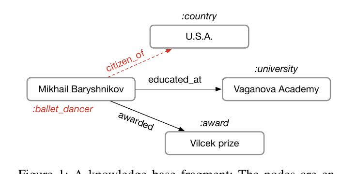
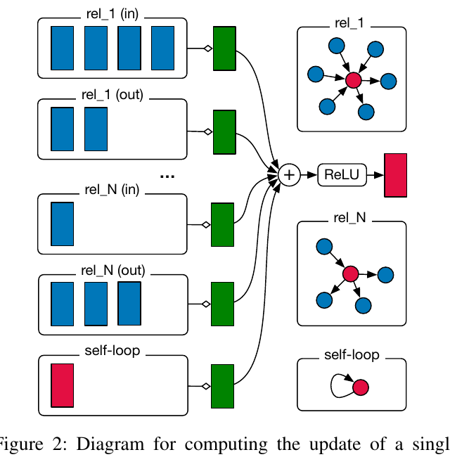
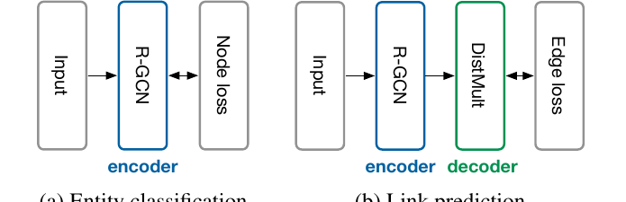

# 지식 그래프를 위한 그래프 신경망: R-GCN 뜯어보기

*Schlichtkrull et al., "Modeling Relational Data with Graph Convolutional Networks" (ESWC 2018) 리뷰*

이 글은 R-GCN 논문을 GCN을 이미 이해한 상태에서 "그래프로부터 네트워크를 어떻게 구축하고 학습시키는가"에 초점을 맞춰 정리한 것이다. 특히 링크 예측 학습 과정은 작은 예제로 숫자까지 따라가며 살펴본다.

---

## 1. 왜 이 논문인가: 지식 그래프의 빠진 정보

DBpedia, Wikidata, Yago 같은 대형 지식베이스도 항상 불완전하다. 유지·보수에 막대한 노력이 들어가지만 여전히 사실이 빠져 있고, 이 커버리지 부족은 질의응답이나 정보 검색 같은 다운스트림 응용의 성능을 떨어뜨린다. 빠진 정보를 채우는 것이 통계적 관계 학습(statistical relational learning, SRL)의 핵심 과제다.

이 논문은 그래프의 이웃 구조에 흩어져 있는 정보를 모아서 빠진 정보를 채우는 두 가지 과제를 푼다.

- **링크 예측(link prediction)**: 빠진 사실, 즉 (주어, 술어, 목적어) 트리플을 복원
- **엔티티 분류(entity classification)**: 노드에 빠진 타입/속성 라벨을 부여

*지식베이스 조각. 노드는 엔티티, 엣지는 타입이 붙은 관계이며, 노드에는 엔티티 타입(예: university)이 붙는다. 빨간색으로 표시된 엣지(citizen_of → U.S.A.)와 노드 라벨(ballet_dancer)이 바로 추론해야 할 빠진 정보다.*

핵심 직관은 이렇다. "Mikhail Baryshnikov가 Vaganova Academy에서 educated_at 했다"는 사실을 알면, 그가 person 라벨을 가져야 한다는 것과 (Mikhail Baryshnikov, lived_in, Russia)라는 트리플이 그래프에 속해야 한다는 것을 둘 다 유추할 수 있다. 즉 이웃 구조에 답의 단서가 들어 있다. 이 직관을 따라 저자들은 관계 그래프 위에서 엔티티를 인코딩하는 모델을 만들고, 그것을 두 과제 모두에 적용한다.

지식베이스는 방향성 있는 라벨 멀티그래프 $G=(V,E,R)$로 표현한다. 엔티티가 노드 $v_i \in V$에, 트리플이 라벨 붙은 엣지 $(v_i, r, v_j) \in E$에 대응하고, $r \in R$이 관계 타입이다.

---

## 2. 배경: GCN에서 무엇을 물려받고 무엇을 바꿨나

### 1) 엔티티 분류는 GCN의 노드 분류와 같은 문제다

R-GCN의 엔티티 분류는 기존 GCN(Kipf & Welling 2017)이 풀던 노드 분류와 **본질적으로 같은 문제**다. GCN 논문이 풀던 것이 준지도(semi-supervised) 노드 분류, 즉 일부만 라벨이 있는 상태에서 나머지 노드의 클래스를 맞추는 것이었고, R-GCN의 엔티티 분류도 똑같이 노드별 softmax와 cross-entropy로 라벨을 예측한다. 문제 정의 자체는 동일하다.

차이는 **입력 그래프의 성격**에 있다. 기존 GCN은 엣지 종류가 하나(또는 무시)인 단순 그래프를 가정했지만, R-GCN은 엣지마다 관계 타입이 다른 **다중 관계(multi-relational) 그래프**를 다룬다. 그래서 관계별 가중치 행렬과 뒤에서 볼 basis/block 분해 같은 장치가 추가된 것이다. 요약하면 "같은 과제, 더 일반화된 그래프"다.

### 2) 링크 예측은 새로 얹힌 과제이지만 뿌리가 있다

링크 예측은 GCN이 원래 풀던 문제가 아니라 새로 추가된 과제다. 다만 두 가지를 짚어둘 필요가 있다.

첫째, 링크 예측은 R-GCN을 그냥 분류기로 쓰는 게 아니라 **오토인코더 구조**로 다시 쓴다. R-GCN이 엔티티 임베딩을 만드는 인코더 역할을 하고, 그 뒤에 DistMult 같은 디코더가 트리플 점수를 매긴다. 즉 "분류 문제에 링크 예측을 얹었다"기보다는, 같은 R-GCN 인코더를 두 가지 다른 과제에 각각 붙여서 쓴 구조다.

둘째, 링크 예측의 오토인코더 발상 자체도 완전히 새로운 것은 아니다. 같은 저자들의 이전 연구인 GAE/VGAE(Kipf & Welling 2016, "Graph Auto-Encoders")에서 GCN 인코더와 내적 디코더로 링크를 복원하는 아이디어를 이미 냈고, R-GCN은 이를 다중 관계와 DistMult 디코더로 확장한 것이다.

그래서 이 논문은 기존 GCN의 두 갈래 후속 작업 — 노드 분류(GCN 2017)와 링크 예측용 오토인코더(GAE 2016) — 을 **다중 관계 그래프로 통합·확장한 것**이라고 보면 정확하다.

### 3) 읽는 순서

배경 논문을 읽는다면 순서는 이렇다.

- **꼭 먼저**: 2017 GCN — 메시지 패싱/그래프 컨볼루션의 기본. R-GCN의 뼈대인 "이웃 노드 특징을 정규화된 합으로 모아 층을 쌓는다"는 핵심 구조가 여기서 나온다. 이걸 이해하면 뒤에 나올 R-GCN 전파식의 관계별 확장이 자연스럽게 읽힌다.
- **선택적으로**: 2016 GAE — 링크 예측 오토인코더의 배경. 필수는 아니고 링크 예측 파트를 깊이 볼 때 도움이 되는 정도다.
- **디코더가 궁금하면**: DistMult(Yang et al. 2014) — 트리플 점수를 매기는 텐서 분해 방식.

시간이 빠듯하면 2017 GCN 하나만 보고 R-GCN으로 넘어와도 충분히 이해된다.

---

## 3. 그래프에서 네트워크를 구축하기: R-GCN 인코더

이제 R-GCN이 그래프로부터 어떻게 네트워크를 구성하고 학습하는지 단계별로 본다.

### 1) 그래프를 다중 관계 형태로 정리

GCN과의 첫 차이가 여기서 나온다. R-GCN은 **정방향(canonical)과 역방향(inverse) 관계를 모두 별도 타입으로 취급**한다. 예를 들어 `born_in`이 있으면 `born_in_inv`를 별도 관계로 추가한다. 그래서 실제 관계 수는 원래의 두 배에 self-loop 한 종류가 더해진다. 이렇게 해야 메시지가 엣지 방향을 따라 양쪽으로 흐를 수 있다.

### 2) 입력 특징 준비

노드에 별도 특징이 없으면(featureless), 각 노드를 **원-핫 벡터**로 둔다. 즉 첫 층의 입력 $h_i^{(0)}$는 노드 $i$ 위치만 1인 벡터이고, 이는 사실상 "노드마다 학습 가능한 임베딩을 하나씩 두는 것"과 같다(첫 층 가중치가 임베딩 룩업 테이블 역할). GCN처럼 bag-of-words 같은 사전 특징이 있으면 그것을 넣어도 된다.

### 3) R-GCN 층: 관계별 메시지 패싱

핵심 전파식이다.

$$h_i^{(l+1)} = \sigma\!\left( \sum_{r \in R} \sum_{j \in N_i^r} \frac{1}{c_{i,r}}\, W_r^{(l)} h_j^{(l)} + W_0^{(l)} h_i^{(l)} \right)$$

GCN과 비교하면 이렇게 읽힌다.

- $N_i^r$: **관계 $r$로 연결된** 이웃들의 집합. GCN은 이웃 하나만 봤지만, R-GCN은 관계 타입별로 이웃을 나눠서 본다.
- $W_r^{(l)}$: **관계마다 다른 가중치 행렬**. 이것이 R-GCN의 정체성이다. 같은 이웃이라도 어떤 관계로 연결됐는지에 따라 다른 변환을 받는다.
- $\frac{1}{c_{i,r}}$: 문제별 정규화 상수. 보통 $c_{i,r} = |N_i^r|$(그 관계 이웃 수)로 두어 이웃 수가 많아도 스케일이 폭주하지 않게 한다.
- $W_0^{(l)} h_i^{(l)}$: **self-loop 항**. 자기 자신의 이전 표현을 다음 층에 직접 전달하는 통로로, 별도 관계 타입 하나로 취급된다.
- $\sigma$: ReLU 같은 활성화 함수.

*한 노드(빨강)의 업데이트 계산. 이웃 노드(파랑)의 활성값이 관계별·방향별(in/out)로 그룹지어져 각 그룹마다 개별 변환을 받고, 그 결과(초록)가 정규화 합으로 모인 뒤 self-loop와 합쳐져 ReLU를 통과한다. 이 노드별 업데이트는 그래프 전체에 공유된 파라미터로 병렬 계산된다.*

직관적으로 이 식은 이웃 노드들의 변환된 특징 벡터를 정규화된 합으로 누적한다. 일반 GCN과 다른 점은 엣지의 타입과 방향에 따라 **관계별 변환**을 적용한다는 것이다. 이 층을 $L$개 쌓으면 한 노드가 $L$-홉 떨어진 관계 경로까지 정보를 받는다. 즉 층 수가 관계 그래프에서 정보가 몇 단계 전파되는지를 결정한다. 구현은 이웃마다 명시적으로 더하지 않고 **희소 행렬 곱**으로 전 노드를 병렬 처리한다.

---

## 4. 파라미터 폭증 문제와 두 가지 정규화

관계가 수백~수천 종이면 $W_r$이 관계 수만큼 필요해 파라미터가 폭증하고, 특히 희귀 관계에서 과적합한다. 그래서 저자들은 $W_r$을 직접 학습하지 않고 **분해해서** 만드는 두 방법을 도입한다.

**Basis decomposition.** 공유 기저 행렬 $V_b$를 $B$개 두고, 관계마다 계수만 다르게 조합한다.

$$W_r^{(l)} = \sum_{b=1}^{B} a_{rb}^{(l)}\, V_b^{(l)}$$

관계별로 학습하는 것은 계수 $a_{rb}$뿐이라 파라미터가 크게 줄고, 기저를 공유하니 희귀 관계도 빈번한 관계로부터 간접적으로 학습된다. 파라미터 업데이트가 희귀 관계와 빈번한 관계 사이에 공유되기 때문에 희귀 관계 과적합이 완화된다.

**Block-diagonal decomposition.** $W_r$을 작은 블록들의 대각합(direct sum)으로 만들어 희소하게 둔다.

$$W_r^{(l)} = \bigoplus_{b=1}^{B} Q_{br}^{(l)}$$

이때 $W_r^{(l)}$은 블록 대각 행렬 $\mathrm{diag}(Q_{1r}^{(l)}, \dots, Q_{Br}^{(l)})$가 된다. 잠재 특징을 몇 개 그룹으로 묶고 그룹 안에서만 강하게 상호작용하게 하는 희소성 제약이다. 논문에서 FB15k-237에는 이쪽이 더 잘 맞았다.

두 분해 모두 다중 관계 데이터에서 학습할 파라미터 수를 줄여준다. basis 분해는 관계 타입 간 효과적인 가중치 공유로, block 분해는 관계별 가중치 행렬에 대한 희소성 제약으로 이해할 수 있다.

---

## 5. 엔티티 분류 학습

가장 단순하다. R-GCN 층을 쌓고 마지막 층 출력에 **노드별 softmax**를 씌운 뒤, 라벨이 있는 노드에 대해서만 cross-entropy를 최소화한다.

$$\mathcal{L} = -\sum_{i \in Y}\sum_{k=1}^{K} t_{ik} \ln h_{ik}^{(L)}$$

$Y$는 라벨 있는 노드 집합, $h_{ik}^{(L)}$는 $i$번째 라벨 노드에 대한 네트워크 출력의 $k$번째 원소, $t_{ik}$는 정답 라벨이다. 라벨 없는 노드는 손실에서 무시하지만 메시지 패싱에는 참여한다(준지도 학습). 논문은 full-batch 경사하강, Adam(lr 0.01), 2층·16 hidden·basis 분해로 학습했다.

*(a) 엔티티 분류: R-GCN 인코더 + 노드별 손실. (b) 링크 예측: R-GCN 인코더(중간에 dense 층이 섞임)와, 두 노드 표현 쌍을 받아 엣지 점수를 내는 DistMult 디코더. 손실은 엣지 단위로 평가된다.*

---

## 6. 링크 예측 학습: 오토인코더로 다시 쓰기

여기가 GCN에는 없던 부분이다. 링크 예측은 **그래프 오토인코더** 구조로 학습한다. 이 과정을 아주 작은 예제로 끝까지 따라가 본다.

### 1) 세팅: 아주 작은 지식 그래프

엔티티 3개(Mikhail, Vaganova, Russia), 관계 2개(educated_at, lived_in)를 둔다. 관측된 사실(training 트리플 $\hat{E}$)은 이 두 개다.

- (Mikhail, educated_at, Vaganova)
- (Mikhail, lived_in, Russia)

목표는 이 관측된 사실만 보고, 그래프에 없는 트리플에도 "얼마나 그럴듯한지" 점수를 매길 수 있게 만드는 것이다.

### 2) 인코더가 임베딩을 만든다

R-GCN 인코더가 앞서 설명한 메시지 패싱을 돌려 각 엔티티를 벡터로 바꾼다. 예제에서는 이미 계산된 결과라고 치고 2차원으로 뒀다.

$$e_{\text{Mikhail}}=[1.0,\ 0.5],\quad e_{\text{Vaganova}}=[0.8,\ -0.2],\quad e_{\text{Russia}}=[0.3,\ 0.9]$$

중요한 점은 이 임베딩이 **고정값이 아니라** R-GCN 파라미터로부터 나온다는 것이다. 그래서 손실을 역전파하면 인코더 가중치($W_r$ 등)까지 함께 업데이트된다. 이것이 인코더 없는 순수 DistMult(엔티티 벡터를 직접 학습)와의 결정적 차이다.

### 3) 디코더(DistMult)가 트리플 점수를 매긴다

관계마다 대각 행렬 $R_r$을 하나씩 둔다. 점수는 원소별 곱의 합이다.

$$f(s,r,o)=e_s^\top R_r\, e_o=\sum_k e_s[k]\,R_r[k]\,e_o[k]$$

예제에서 $R_{\text{educated\_at}}=\mathrm{diag}(1.2,\ 0.4)$라고 하면, (Mikhail, educated_at, Vaganova)의 점수는

$$f = (1.0)(1.2)(0.8) + (0.5)(0.4)(-0.2) = 0.96 - 0.04 = 0.92$$

이 점수 자체는 확률이 아니라 실수라서, 시그모이드 $l(\cdot)$을 씌워 0~1로 만든다. $l(0.92)=0.715$.

> **여기서 대각 행렬 값은 어디서 왔나?** 위의 $1.2, 0.4$ 같은 숫자는 설명을 위해 임의로 정한 값이다. 실제 R-GCN/DistMult에서 관계 대각 행렬 $R_r$은 **학습되는 파라미터**다. 무작위로 초기화한 뒤, 아래의 cross-entropy 손실을 $R_r$에 대해 미분해 진짜 트리플 점수는 올리고 가짜 트리플 점수는 내리는 방향으로 업데이트한다. 즉 $R_r$은 그래프 구조에서 계산해내는 값이 아니라 데이터로부터 학습된다. 학습 대상은 세 종류다: 인코더의 관계별 가중치 $W_r$, 그로부터 나오는 엔티티 임베딩 $e_i$, 그리고 디코더의 관계별 대각 행렬 $R_r$. $W_r$은 인코딩 단계에서 이웃 정보를 관계에 맞게 변환하는 행렬이고, $R_r$은 디코딩 단계에서 두 엔티티 벡터가 그 관계로 얼마나 잘 맞는지 점수를 내는 대각 행렬이다.

### 4) Negative sampling: 가짜 사실 만들기

여기가 학습의 핵심 장치다. 관측된 트리플은 전부 "참(positive)"인데, 모델이 "무조건 참"이라고 답하면 손실이 줄어버린다. 그래서 **일부러 틀린 트리플을 만들어** 대비시킨다.

방법은 관측 트리플마다 주어나 목적어를 무작위로 다른 엔티티로 갈아끼우는 것이다. (Mikhail, educated_at, **Vaganova**)에서 목적어를 바꾸면 (Mikhail, educated_at, **Russia**) 같은 가짜 트리플이 나온다. 관측 트리플 하나당 $\omega$개의 가짜를 샘플링한다.

### 5) 손실: positive는 올리고 negative는 내린다

각 트리플에 라벨 $y$(진짜=1, 가짜=0)를 붙이고 이진 cross-entropy를 계산한다.

$$\mathcal{L} = -\frac{1}{(1+\omega)|\hat{E}|}\sum_{(s,r,o,y)\in T}\Big[\, y\log l\big(f(s,r,o)\big) + (1-y)\log\big(1-l(f(s,r,o))\big)\Big]$$

$T$는 실제와 가짜 트리플을 합친 집합, $l$은 로지스틱 시그모이드, $y$는 진짜면 1·가짜면 0이다. 미니배치 [진짜 (Mikhail, educated_at, Vaganova), 가짜 (Mikhail, educated_at, Russia)]로 계산하면 이렇게 나온다.

| 트리플 | $y$ | $p=l(f)$ | 손실 |
|---|---|---|---|
| (Mikhail, educated_at, Vaganova) | 1 | 0.715 | 0.335 |
| (Mikhail, educated_at, Russia) | 0 | 0.632 | 0.999 |

평균 손실은 약 **0.667**. 가짜인데도 확률이 0.632로 높게 나와서 손실이 크다. 학습은 이 0.999를 줄이는 방향으로 파라미터를 밀어낸다.

정규화로는 엣지 드롭아웃(self-loop 0.2, 나머지 0.4)을 쓰는데, 이는 denoising autoencoder처럼 작동해 일반화를 돕는다. 디코더에는 L2 정규화(패널티 0.01)를 건다.

### 6) 역전파로 무엇이 업데이트되나

이 손실을 미분하면 gradient가 **두 갈래**로 흐른다. **디코더** 쪽에서는 각 관계 대각 행렬 $R_r$이 진짜 트리플 점수는 올리고 가짜는 내리도록 조정된다. **인코더** 쪽에서는 점수가 엔티티 임베딩 $e_s, e_o$에 의존하고 그 임베딩이 R-GCN 가중치 $W_r$의 함수이므로, gradient가 인코더까지 타고 들어가 이웃 정보를 모으는 방식 자체가 바뀐다. 한 스텝 후에는 진짜 트리플 점수가 올라가고 가짜들의 점수가 내려가, 진짜가 가짜보다 높은 순위를 갖게 된다.

### 7) 학습이 끝나면 (평가)

빠진 사실을 예측할 때는, 예를 들어 "Mikhail은 어디서 educated_at 했나?"를 묻기 위해 **모든 후보 엔티티**를 목적어에 넣어 점수를 매기고 정렬한다. 정답이 몇 등에 오는지로 **MRR(평균 역순위)** 과 **Hits@n** 을 잰다. 진짜 트리플이 상위에 오면 좋은 모델이다. 이때 다른 정답 트리플들은 순위에서 빼주는 "filtered" 설정을 주로 쓴다.

### 8) DistMult의 한계 하나

DistMult가 **대각** 행렬을 쓰는 것은 의도적인 단순화다. 대각이면 $f(s,r,o)=\sum_k e_s[k]R_r[k]e_o[k]$가 주어·목적어에 대칭이라, 파라미터가 적고 계산이 빠른 대신 비대칭 관계(예: `parent_of`와 `child_of`)를 구분하지 못하는 한계가 있다. 논문이 ComplEx를 디코더로 바꾸면 개선될 수 있다고 언급한 이유가 이것이다. 디코더는 오토인코더 프레임 안에서 어떤 스코어링 함수로도 교체 가능하다.

---

## 7. 실험 결과

### 1) 엔티티 분류

R-GCN은 AIFB와 AM에서 SOTA를 달성했다(정확도, 10회 평균).

| 모델 | AIFB | MUTAG | BGS | AM |
|---|---|---|---|---|
| Feat | 55.55 | 77.94 | 72.41 | 66.66 |
| WL | 80.55 | **80.88** | 86.20 | 87.37 |
| RDF2Vec | 88.88 | 67.20 | **87.24** | 88.33 |
| **R-GCN** | **95.83** | 73.23 | 83.10 | **89.29** |

MUTAG와 BGS에서 뒤처지는 것은 데이터셋 특성 때문이다. 이 둘은 라벨된 엔티티가 특정 feature를 나타내는 고차수(high-degree) 허브 노드를 통해서만 연결되는데, 고정된 정규화 상수가 고차수 노드에서 문제를 일으킨다고 저자들은 추측한다. 정규화 상수를 데이터 의존적인 attention 가중치로 바꾸는 것이 향후 개선 방향으로 제시된다.

### 2) 링크 예측 (FB15k-237)

이 논문의 하이라이트는 역방향 관계 쌍이 제거되어 실제로 어려운 **FB15k-237**에서의 결과다. FB15k와 WN18은 학습셋의 트리플과 그 역트리플이 테스트셋에 들어 있어 과제 상당 부분이 암기로 풀려버리는 결함이 있었고, FB15k-237은 그런 역쌍을 제거한 버전이다.

| 모델 | MRR (filtered) | Hits@1 | Hits@3 | Hits@10 |
|---|---|---|---|---|
| DistMult (디코더만) | 0.191 | 0.106 | 0.207 | 0.376 |
| CP | 0.182 | 0.101 | 0.197 | 0.357 |
| TransE | 0.233 | 0.147 | 0.263 | 0.398 |
| HolE | 0.222 | 0.133 | 0.253 | 0.391 |
| ComplEx | 0.201 | 0.112 | 0.213 | 0.388 |
| **R-GCN** | **0.248** | **0.153** | 0.258 | 0.414 |
| **R-GCN+** | **0.249** | 0.151 | **0.264** | **0.417** |

(모두 높을수록 좋음. R-GCN+는 R-GCN과 DistMult의 앙상블.)

주목할 점은 R-GCN이 인코더 없는 DistMult 대비 filtered MRR에서 **29.8%** 향상을 보인다는 것이다. 같은 DistMult 디코더를 쓰면서도 앞에 R-GCN 인코더를 붙이는 것만으로 이만큼 좋아진다. 이는 별도의 인코더로 이웃 정보를 명시적으로 모으는 것이 실제 사실 복원에 크게 기여함을 보여준다. 반면 역관계가 그대로 남아 있는 FB15k/WN18에서는 이웃 정보를 그대로 베끼는 단순 baseline(LinkFeat)이 강해, R-GCN의 이점이 덜 부각된다.

---

## 8. 정리

전체 파이프라인은 이렇게 요약된다. 지식 그래프에 역관계와 self-loop를 추가해 멀티그래프를 만들고 → 노드를 원-핫으로 입력해 → 관계별 가중치($W_r$, basis/block 분해)로 메시지 패싱하는 R-GCN 층을 $L$개 쌓아 엔티티 임베딩을 얻는다. 이 임베딩을 분류면 softmax 헤드에, 링크 예측이면 DistMult 디코더에 연결해 각각 cross-entropy로 end-to-end 학습한다.

핵심은 "관계마다 다른 변환 + 분해 기반 파라미터 공유"라는 인코더 하나를 두 과제에 공통으로 재사용한다는 점이다. 기존 GCN의 노드 분류(2017)와 링크 예측용 오토인코더(2016)를 다중 관계 그래프로 통합·확장한 것이라고 보면 정확하다. R-GCN 인코더가 이웃 구조로 임베딩을 만들기 때문에, 순수 DistMult보다 "주변 사실을 종합해 빠진 사실을 추론하는" 능력이 생긴다.

남은 과제로는 고차수 노드를 위한 attention 기반 정규화, 그리고 비대칭 관계를 다룰 수 있는 ComplEx 같은 디코더와의 결합이 열려 있다.
