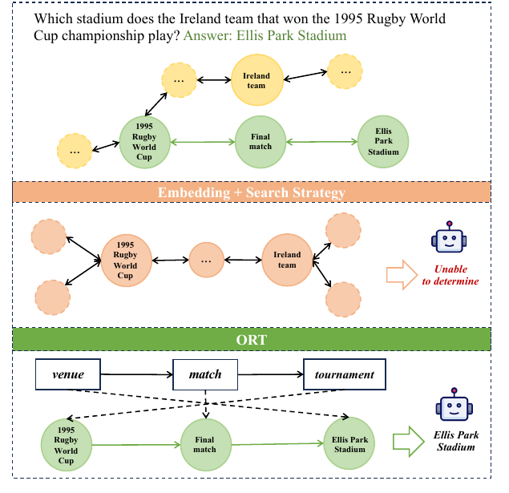
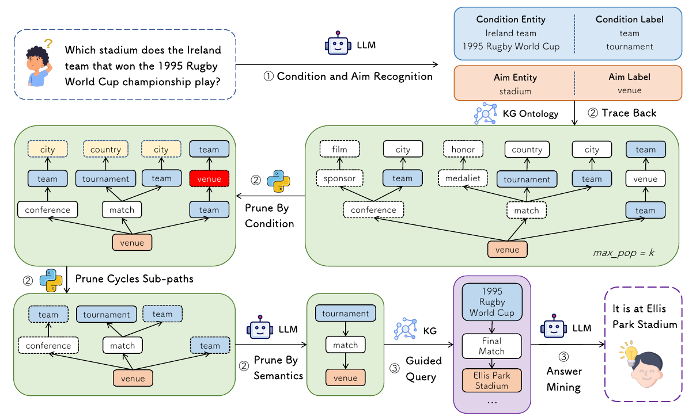

# 목적에서 조건으로 거꾸로 걷기 — ORT 논문 읽기

> **Ontology-Guided Reverse Thinking Makes Large Language Models Stronger on Knowledge Graph Question Answering**
> Runxuan Liu, Bei Luo, Jiaqi Li, Baoxin Wang, Ming Liu, Dayong Wu, Shijin Wang, Bing Qin
> ACL 2025 (Volume 1: Long Papers), pp. 15269–15284
> Harbin Institute of Technology · Beijing University of Posts and Telecommunications · Joint Laboratory of HIT and iFLYTEK 외

---

## 1. 이 논문이 풀려는 문제

### 1) 기존 KGQA의 두 갈래와 각각의 한계

지식 그래프 질의응답(KGQA)에서 LLM을 쓰는 방법은 크게 두 갈래인데, 각각 뚜렷한 한계가 있다.

**파인튜닝 계열**(RoG, KD-CoT, LPKG)은 고품질 학습 데이터 구축 비용이 크고, 학습되지 않은 그래프에는 일반화가 어렵다. 지식 그래프는 고도로 구조화된 데이터라, 파인튜닝하지 않은 유형의 질문을 만나면 품질을 보장하기 어렵다.

**임베딩 + 탐색 계열**(MindMap, Think-on-Graph)은 엔티티 벡터 매칭에 의존한다. 그런데 질문의 *목적*은 추상적이라 특정 엔티티와 매칭되지 않는다. 그 결과 목적까지의 추론 경로를 효율적으로 세우지 못하고, 정보 손실과 중복이 발생한다.

### 2) "stadium 문제"

논문의 도입부 예시가 이 한계의 핵심을 잘 보여준다.



*위: 정답에 이르는 실제 경로. 가운데: 기존 임베딩+탐색 방식은 조건 엔티티 주변만 훑다가 "판단 불가"에 도달한다. 아래: ORT는 `venue → match → tournament`라는 레이블 경로를 먼저 세우고, 그 경로를 따라 정답에 도달한다.*

질문은 이렇다.

> **"Which stadium does the Ireland team that won the 1995 Rugby World Cup championship play?"**
> (1995 럭비 월드컵에서 우승한 아일랜드 팀이 뛰는 경기장은?)
> 정답: Ellis Park Stadium

여기서 `stadium`은 **개념(concept)** 이지 지식 그래프 안의 엔티티가 아니다. 그래서 임베딩 탐색 전략은 "1995 Rugby World Cup"과 "Ireland Team", 그리고 그 이웃들 사이의 경로만 찾을 수 있을 뿐, 정답인 "Ellis Park Stadium"에는 도달하지 못한다.

### 3) 핵심 아이디어 — 역방향 사고

ORT는 인간의 **역방향 사고(reverse thinking)** 를 모방한다. 조건에서 목적으로 가는 대신, **목적(aim)에서 출발해 조건(condition)으로 거슬러 올라가는** 추론 경로를 KG 온톨로지 위에서 만든다.

엔티티가 아닌 **레이블(타입) 수준**에서 추론한다는 것이 결정적 차이다. 이렇게 만든 정제된 추론 경로가 지식 그래프 질의를 유도하고, 마지막에 LLM이 지식을 종합해 답을 생성한다.

---

## 2. 일반적인 Graph-RAG와 무엇이 다른가

한 줄로 요약하면 이렇다. Graph-RAG는 **인스턴스(엔티티) 그래프를 직접 탐색**하고, ORT는 **스키마(온톨로지) 위에서 먼저 계획을 세운 뒤** 인스턴스를 훑는다. 2단 추상화가 있느냐 없느냐가 본질적 차이다.

### 1) 축별 비교

| | 일반 Graph-RAG | ORT |
|---|---|---|
| 그래프 출처 | 비정형 문서에서 LLM이 추출해 구축 | 이미 존재하는 큐레이션 KG (Freebase) |
| 스키마 | 사실상 없음 (타입이 있어도 느슨) | 형식 온톨로지가 **전제이자 핵심 자원** |
| 진입점 | 질문 엔티티 ↔ 노드 벡터 유사도 | 질문의 **목적 타입**(venue 등) |
| 탐색 방향 | 조건 → 바깥으로 확장 (BFS/이웃 확장) | 목적 → 조건으로 역추적 |
| 검색 단위 | 텍스트 청크 / 커뮤니티 요약 | 트리플 경로(엔티티 path) |
| 노이즈 제거 시점 | 검색 **후** rerank·필터 | 검색 **전**, 추상 경로 단계에서 가지치기 |
| 선행 비용 | 인덱싱 시 대량 LLM 호출 | 인덱싱 불필요, 질의 시 LLM 3회 |

### 2) 벡터 매칭의 구조적 한계

Graph-RAG의 첫 동작은 질문을 임베딩해 유사한 노드를 찾는 것이다. 그런데 "경기장은?"의 *stadium*은 그래프 안에 인스턴스로 존재하지 않는 **타입**이다. 임베딩할 대상 자체가 없으니, 확장은 "1995 Rugby World Cup"과 "Ireland Team" 주변에서만 일어나고, 정답까지의 관계 체인이 3홉이면 예산이 소진되기 전에 도달하지 못한다.

ORT는 이 추상적 의도를 `venue`라는 온톨로지 레이블로 바꿔 **명시적 앵커**로 삼는다.

### 3) 탐색 예산의 성격이 다르다

Graph-RAG의 홉 제한과 top-k는 recall과 노이즈 사이의 직접적 트레이드오프다. 넓히면 컨텍스트가 오염되고 좁히면 정답이 빠진다.

ORT는 `venue → match → tournament` 같은 **타입 수준 경로**를 먼저 확정한 뒤, 그 레이블에 맞는 엔티티만 따라간다. 즉 브랜칭 팩터를 데이터 접근 *전에* 잘라내는 것이라, recall을 희생하지 않고 노이즈를 줄인다. 뒤에 나올 ablation에서 방향만 뒤집은 정방향 버전(Trace Forward)이 CWQ에서 12%p 떨어지는 것이 이 효과의 크기다.

### 4) 계보가 다르다

ORT는 doc-RAG 계열이라기보다 **semantic parsing / text-to-SPARQL**에 가깝다. 다만 실행 가능한 쿼리를 바로 생성하는 대신, 온톨로지 그래프 탐색으로 타입 경로를 **유도(derive)** 한다는 점이 다르다. LLM이 스키마를 잘못 외워 존재하지 않는 관계를 지어내는 실패를 구조적으로 막는다.

근거의 형태도 다르다. Graph-RAG의 답은 요약된 텍스트에 근거하므로 출처 추적은 되지만 논리 체인 검증은 어렵다. ORT는 답이 명시적 트리플 경로로 나오므로 추론 과정이 그대로 감사 가능하다.

### 5) 우열이 아니라 적용 영역의 문제

ORT는 **잘 정의된 온톨로지가 있는 KG**를 요구한다. 사내 문서 더미나 논문 코퍼스처럼 스키마가 없는 데이터에는 그대로 적용되지 않는다. 그 영역은 여전히 Graph-RAG의 몫이다. 반대로 Freebase·Wikidata·제품 카탈로그·의료 온톨로지처럼 타입 체계가 갖춰진 곳에서는 Graph-RAG의 벡터 확장 방식이 명백히 손해를 본다.

---

## 3. label은 무엇인가 — T-Box와의 관계

ORT에서 말하는 "label"은 일종의 entity type이고, 온톨로지로 치면 T-Box의 class에 대응한다. 대체로 맞는 이해지만, **기능적으로는 T-Box, 형식적으로는 T-Box에 한참 못 미친다.** "유도된(derived) T-Box" 정도로 보는 게 정확하다.

### 1) T-Box와 닮은 점

- 인스턴스와 분리된 **클래스 층위**에서 추론한다 → T-Box/A-Box 분리와 같은 발상
- `[label, relation, label]` 추상 트리플은 사실상 관계의 **domain/range 선언**
- 이 층에서 먼저 계획하고 A-Box로 내려간다 → 전형적인 스키마 우선 질의 계획

### 2) 다른 점 (더 중요하다)

**선언된 게 아니라 관계명에서 긁어낸 것이다.** Appendix B.1을 보면 Freebase 프로퍼티 `meteorology.cyclone_affected_area.cyclones`에서 주어 레이블은 `cyclone_affected_area`, 목적어 레이블은 `cyclones`를 쓴다.

```
meteorology . cyclone_affected_area . cyclones
    │                  │                  │
  도메인            주어의 타입        프로퍼티명
                   (rdfs:domain)      (range 대용)
```

주어 쪽은 Freebase의 실제 타입이라 rdfs:domain을 정확히 뽑은 셈이지만, 목적어 쪽은 프로퍼티 이름을 range의 **대용품으로 쓴 휴리스틱**이다. 실제 range는 아마 `meteorology.cyclone`일 것이다.

**레이블이 내재적(intrinsic)이 아니라 관계 상대적(relational)이다.** 논문 Case 2에서 결정적 증거가 나온다.

```
[person] Ovadia Yosef -> leader [leadership] m.048bcbz -> leader [leader] Ovadia Yosef -> religion [religion] Judaism
```

**같은 경로 안에서** Ovadia Yosef가 `person`이자 `leader`로 등장한다. DL이라면 개체가 여러 클래스에 속하는 건 정상이지만, 여기선 "어떤 관계의 몇 번째 인자로 참여했는가"에 따라 레이블이 붙는다. 클래스 소속이라기보다 **인자 슬롯의 타입 시그니처**에 가깝다.

**계층(subClassOf)이 없다.** 이게 실무적으로 가장 큰 결손이다. `stadium ⊑ venue` 같은 포섭 관계가 없으니 **추론기가 할 수 있는 일을 LLM이 대신**한다. "stadium → venue" 매핑이 프롬프트 분류로 처리되는 이유가 이것이다.

**공리가 없다.** disjointness, cardinality, inverseOf, transitivity가 전부 없다. 그래서 뒤에서 보듯 **사이클을 손으로 잘라낸다.** 양방향 관계가 `owl:inverseOf`로 선언돼 있었다면 애초에 생기지 않았을 문제다.

| | OWL T-Box | ORT의 label |
|---|---|---|
| 출처 | 사람이 설계·선언 | 관계명에서 자동 추출 |
| 성격 | 개체의 내재적 소속 | 관계 인자 슬롯의 타입 |
| 계층 | subClassOf 있음 | 없음 (평평함) |
| 공리 | disjoint, inverse, cardinality | 없음 |
| 추론 | 추론기(reasoner) | LLM + DFS + 수동 가지치기 |

그래프 DB 용어로는 **schema graph / type graph**, RDF 쪽 표현으로는 rdfs:domain·range만 남긴 **RDFS 수준 이하의 스키마**라고 부르는 게 더 정확하다. 논문이 "ontology"라고 부르는 건 다소 관대한 명명이다.

### 3) 온톨로지는 주어진 것이 아니라 저자가 구성했다

논문 Appendix B가 명확히 답한다. **온톨로지도 레이블도 저자가 만들었다.**

> "We **traverse the dataset triples and extract** entity label information in a normalized format, **constructing** abstract triples of the form [label, relation, label]. These abstract triples collectively form the knowledge graph ontology." (B.2)

섹션 제목 자체가 "Ontology **Construction**"이다. 외부에서 온톨로지를 가져온 게 아니라, **같은 트리플을 훑어서 스키마를 역으로 뽑아낸 것**이다.

| | 주어졌나 | 실제 |
|---|---|---|
| 트리플 | ✅ RoG 배포 서브그래프 | 2.29M(CWQ) / 2.28M(WebQSP) |
| 관계 | ✅ | 4,726 / 5,051개 |
| 엔티티 타입 어서션 | ❌ | 관계명에서 유도 |
| 온톨로지(스키마 그래프) | ❌ | 트리플 순회로 구성 |
| 타입 계층 | ❌ | 없음 |

Table 5의 데이터셋 통계에 Node·Triple·Relationship만 있고 **레이블/타입 항목이 없다는 점**도 이를 뒷받침한다.

짚어둘 만한 것이 세 가지 있다.

**Freebase에는 진짜 타입 시스템이 있는데 쓰지 않았다.** Freebase는 `common.topic.notable_types`, `freebase.type_profile` 등 정식 타입 체계와 계층을 갖고 있다. 저자들이 이를 쓰지 않은 건 RoG가 배포한 서브그래프가 **트리플만 담은 형태**라서로 보인다. 원본 덤프에서 타입 어서션을 가져왔다면 계층까지 활용해 훨씬 정교한 T-Box를 얻었을 텐데, 데이터 파이프라인의 제약에 갇힌 인상이다. (논문이 이유를 밝히진 않으므로 이건 추정이다.)

**정규화 방식이 명시되지 않았다.** B.2의 "normalized format"이 정확히 무엇인지 설명이 없다. `cyclone_affected_area`는 통째로 유지되는데 사례에는 `season`, `team` 같은 짧은 레이블이 나온다. 어떤 규칙인지 알 수 없어 **재현이 어려운 부분**이다.

**이식성이 이 규약에 묶여 있다.** 이 추출법은 Freebase의 `domain.type.property` 명명 규약에 전적으로 의존한다. Wikidata는 `P54`, `P31` 같은 불투명한 숫자 ID라 파싱이 불가능하고(대신 `P31` 문장을 읽어야 하는데 완전히 다른 코드가 필요하다), Neo4j류 속성 그래프는 노드 레이블이 이미 내재적으로 있어 오히려 더 깔끔하다. 사내 RDF/OWL이라면 진짜 T-Box가 있으므로 ORT가 더 잘 작동할 여지가 있다.

즉 **LLM에 대해서는 plug-and-play가 맞지만, KG에 대해서는 아니다.**

덧붙이면, 온톨로지를 데이터 자체에서 뽑는다는 건 외부 지식을 전혀 추가하지 않는다는 뜻이기도 하다. 수작업이 필요 없다는 장점과, 데이터의 노이즈·불완전성을 그대로 물려받는다는 단점이 한 몸이다.

---

## 4. 3단계 파이프라인 상세



*질문에서 조건과 목적을 뽑고(①), 목적 레이블을 루트로 온톨로지를 역방향 순회한 뒤 세 번 가지치기하고(②), 정제된 레이블 경로로 KG를 질의해 답을 생성한다(③).*

아래에서는 논문 Table 7에 실린 Case 1의 실제 실행 기록을 따라간다. 질문은 이렇다.

> **"Lou Seal is the mascot for the team that last won the World Series when?"**
> (Lou Seal이 마스코트인 팀이 마지막으로 월드시리즈를 우승한 건 언제인가?)

### 1) 1단계 — 조건·목적 인식

LLM에게 질문과 **레이블 목록 전체**를 주고 네 가지를 뽑게 한다.

| 기호 | 의미 | Case 1 |
|---|---|---|
| $\mathcal{E}_C$ | 조건 엔티티 | `Lou Seal` |
| $\mathcal{L}_C$ | 조건 레이블 | `mascot` |
| $\mathcal{E}_A$ | 목적 엔티티 | `championship` |
| $\mathcal{L}_A$ | 목적 레이블 | `championship` |

출력 형식은 마침표로 조건/목적을 나누고 세미콜론으로 복수를 구분한다.

```
Lou Seal,mascot. championship,championship
```

**여기서 $\mathcal{E}_A$는 버려진다.** 논문이 §2.1에서 명시하듯 목적 엔티티는 레이블을 얻기 위한 중간 산물일 뿐이다("the aim entity is not used in the subsequent processing steps. It serves as an intermediate step for obtaining its corresponding labels").

그렇다면 왜 굳이 뽑게 할까. LLM에게 "무엇을 묻는지"를 먼저 명사구로 말하게 한 뒤 타입을 붙이라고 하면 분류 정확도가 올라가는 프롬프팅 기법이다. 일종의 CoT다.

이 예에서는 엔티티와 레이블이 우연히 같지만, 도입부 stadium 예시에서는 `stadium`(엔티티 표현) → `venue`(레이블)로 갈린다.

### 2) 2단계 Step I — 이웃 레이블 사전 구축

온톨로지의 모든 추상 트리플을 훑어 각 레이블의 이웃을 모은다.

$$\mathcal{N}(l_i) = \{\, l_k \mid (l_i,\ \text{relationship},\ l_k) \in \mathcal{G} \,\}$$

$$\mathcal{D} = \{\, l_i : \mathcal{N}(l_i) \,\}$$

$\mathcal{G}$는 지식 그래프의 전체 트리플 집합이고, $\mathcal{N}(l_i)$는 레이블 $l_i$와 같은 트리플에 등장하는 레이블들의 집합이다. $\mathcal{D}$는 $l_i$를 키로, $\mathcal{N}(l_i)$를 값으로 갖는 사전이다.

Case 1 관련 부분만 발췌하면 이런 모습이다.

```
championship : [team, season, event, league, relationship, ...]
team         : [mascot, school, brand, game, season, league, ...]
mascot       : [team, game, brand, school, ...]
```

이건 질문과 무관하게 **KG마다 한 번만 만들면 되는 정적 자료구조**다. Graph-RAG의 무거운 인덱싱과 대비되는 지점이다.

**여기에 이 논문의 중요한 설계 손실이 하나 숨어 있다.** 식 (1)에서 `relationship`은 **존재 한정으로만 쓰이고 결과에 남지 않는다.** 집합의 원소는 $l_k$뿐이다. 즉 이웃 레이블 사전을 만드는 이 단계에서 **어떤 관계로 연결됐는지가 이미 버려진다.** $\mathcal{D}$가 `{l_i : [(rel, l_k), ...]}` 형태였다면 관계까지 제약하는 경로를 만들 수 있었겠지만, 설계상 그 정보가 남아 있지 않다. 이 결과는 뒤(7장)에서 노이즈로 되돌아온다.

### 3) 2단계 Step II — 역추론 트리 구성

목적 레이블을 루트에 놓고 $\mathcal{D}$를 따라 재귀 확장한다. $\mathcal{L}_A$가 여러 개일 수 있어 가상 루트를 하나 두고 그 자식으로 단다.

```
(virtual root)
└── championship          ← 목적 레이블
    ├── team
    │   ├── mascot        ★ 조건 레이블 도달
    │   ├── school
    │   │   └── ...
    │   ├── brand
    │   └── game
    ├── season
    │   ├── team
    │   │   └── mascot    ★
    │   └── game
    ├── event
    ├── league
    └── relationship
```

깊이 제한은 **`MAX_POP = 5`**(Appendix B.3)다. WebQSP·CWQ의 최대 홉이 4라서 여유를 1 둔 값이다. 여기까지는 질문 의미를 전혀 보지 않고 **구조만으로** 뻗는다.

### 4) 2단계 Step III — 조건 기준 가지치기

루트에서 DFS를 돌며 각 경로를 검사한다.

- 조건 레이블이 **하나도 없는** 경로 → **통째로 삭제**
- 조건 레이블이 **있는** 경로 → **마지막 조건 노드까지만 남기고 이후 절단**

절단이 핵심이다. `championship → team → mascot → brand → school`에서 `mascot` 뒤는 이미 알고 있는 정보를 지나 다시 미지의 영역으로 나가는 것이라 무의미하다. 도착점을 찍었으면 거기서 멈춰야 한다.

결과가 $\mathcal{T}_{Condition}$이다.

### 5) 2단계 Step IV — 사이클 제거

양방향 관계 때문에 `team → season → team` 같은 순환이 생긴다. DFS로 visited 집합을 관리하며 이미 방문한 이름이 다시 나오면 부모와의 엣지를 끊고, 백트래킹 시 visited에서 뺀다(다른 경로에서는 그 노드를 쓸 수 있어야 하므로).

앞서 말했듯 `owl:inverseOf`가 선언된 진짜 온톨로지였다면 불필요한 단계다. 결과가 $\mathcal{T}_{Cycle}$이다.

### 6) 2단계 Step V — 의미 기준 가지치기, 여기서 처음 LLM이 질문을 본다

$\mathcal{T}_{Cycle}$의 모든 경로를 DFS로 뽑고 **정방향으로 뒤집어**(조건 → 목적 순서) 질문과 함께 LLM에 넣는다.

**입력된 10개 후보:**

```
mascot -> game -> season -> championship
mascot -> team -> season -> championship
mascot -> team -> championship
mascot -> school -> team -> championship
mascot -> brand -> team -> championship
mascot -> team -> league -> championship
mascot -> team -> relationship -> championship
mascot -> brand -> relationship -> championship
mascot -> game -> event -> championship
mascot -> team -> event -> championship
```

**LLM이 선택한 3개:**

```
mascot -> team -> championship
mascot -> team -> event -> championship
mascot -> team -> season -> championship
```

`school`, `brand`, `game`을 경유하는 것들이 전부 탈락했다. 마스코트는 팀에 직접 속하지 학교나 브랜드를 거칠 이유가 없다는 판단이다.

### 7) 3단계 — 유도된 답 탐색

이제서야 **실제 KG 데이터**를 건드린다. 추상 경로를 따라 정방향으로 엔티티 트리를 키운다.

`mascot -> team -> championship`을 예로 들면 이렇다.

```
Level 0 :  [mascot] Lou Seal                        ← 조건 엔티티가 앵커
              │ (team 관계로 이웃 조회)
Level 1 :  [team] San Francisco Giants              ← 레이블 team 일치 → 유지
              │                                       레이블 불일치 이웃은 폐기
              │ (championship 관계로 이웃 조회)
Level 2 :  [championship] 2010 World Series
           [championship] 2012 World Series
           [championship] 2014 World Series
```

각 홉에서 **다음 레이블과 일치하는 이웃만 남긴다.** 이게 검색 공간을 억제하는 실질적 메커니즘이다. 이웃이 너무 많으면 **`TOP_K = 10`개를 무작위로** 고른다.

여기서 중요한 것은 **실제 KG에 존재하는 엣지만 따라간다**는 점이다. 추상 경로는 후보를 *생성*하는 템플릿이 아니라, 실재하는 이웃을 *걸러내는* 필터다.

| | 2단계 | 3단계 |
|---|---|---|
| 대상 | 추상 트리플 `[label, rel, label]` (T-Box 유사) | 실제 트리플 `[entity, rel, entity]` (A-Box) |
| 동작 | 레이블 그래프 순회 → 경로 **생성** | 실제 이웃 조회 → 레이블로 **필터** |
| 결과 | `mascot → team → championship` | `Lou Seal → Giants → 2014 WS` |

그래서 추상 경로는 "막다른 길"이 될 수 있다. 2단계에서 살아남은 경로라도 특정 엔티티에서 인스턴스화되지 않으면 그냥 조용히 죽는다. `mascot -> brand -> relationship -> championship`이 선택됐더라도, Lou Seal에 `brand` 레이블 이웃이 실제로 없으면 첫 홉에서 끝난다. 결과 0개, 비용은 조회 한 번이다.

보장의 방향을 정확히 하면 — 식 (1)의 구성상 $\mathcal{D}$의 모든 추상 엣지는 KG 어딘가의 실제 트리플이 증인이다. 하지만 그건 **전역적 존재**일 뿐이고, 특정 앵커에서 **연결된 체인**으로 인스턴스화되는지는 전혀 별개다. 스키마 경로와 인스턴스 경로 사이의 고전적 간극이다.

이 성질에서 두 가지가 따라온다.

**환각이 구조적으로 불가능하다.** 최종 프롬프트에 들어가는 근거가 전부 실제 트리플이라 LLM이 없는 관계를 지어낼 여지가 없다. RoG가 파인튜닝을 하는 이유가 정확히 이 지점이다. LLM에게 관계 경로를 **생성**시키면 KG에 없는 관계명을 만들어내므로, "faithful"하게 만들려고 학습이 필요하다. ORT는 생성 대신 온톨로지 순회로 경로를 얻으므로 애초에 그 문제가 없다.

**역으로 재현율 상한이 KG 자체다.** KG에 엣지가 없으면 어떤 추론도 도달할 수 없다. 논문이 다루지 않는 실패 모드인데, Freebase는 2016년 이후 갱신이 멈춘 그래프라 실무 적용 시 이 상한이 먼저 걸린다.

### 8) 마지막 한 단계 — 후보 중 답 고르기

트리 완성 후 DFS로 전체 엔티티 경로를 수집하면 Case 1에서 **83개**가 나온다. 선택된 추상 경로 3개에서 파생된 것이다.

```
path 1 : [mascot] Lou Seal -> team [team] San Francisco Giants
         -> champion [championship] 2010 World Series
path 2 : ... -> championship [championship] 2014 World Series
path 3 : ... -> champion [championship] 2012 World Series
...
path 83: [mascot] Lou Seal -> team_mascot [team] San Francisco Giants
         -> team [season] National League West
         -> championship [championship] National League Division Series
```

83개를 질문과 함께 최종 프롬프트에 넣고 답을 생성한다. 프롬프트에는 조건·목적, 추상 경로, 엔티티 경로가 모두 들어간다.

**Final Answer: `2014 World Series`**

파이프라인이 답을 **한 개로 좁혀주지 못한다**는 점을 분명히 볼 필요가 있다. 구조적 추론이 끝난 시점에도 우승 연도가 셋 남아 있고, `"last won"`이라는 시간 조건을 처리해 2014를 고르는 건 순전히 LLM의 독해력이다.

정리하면 ORT는 **탐색 공간을 8,800만 엔티티에서 83개 경로로 줄여주는 장치**이고, 그 83개에서 1개를 고르는 일은 여전히 LLM에 맡긴다. 기여의 범위를 이렇게 보는 게 정확하다.

---

## 5. 실험 환경 — Freebase, WebQSP, CWQ

### 1) Freebase

2007년 Metaweb이 시작한 협업 편집형 구조화 지식베이스다. 위키백과의 지식을 사람이 아니라 **기계가 읽을 수 있는 트리플 형태**로 담자는 발상이었다. 2010년 Google이 인수해 초기 Knowledge Graph의 근간으로 썼다.

이 글에서 계속 등장한 것들이 전부 Freebase의 특징이다.

- **MID(Machine ID)** — `m.048bcbz` 같은 불투명 식별자
- **CVT(Compound Value Type)** — n항 관계를 구체화한 중간 노드. "누가, 언제부터 언제까지, 어떤 직위를" 같은 관계를 표현하려면 이런 더미 노드가 필요하다. 최종 프롬프트에 사람이 못 읽는 노드가 섞여 들어가는 원인이다.
- **`domain.type.property` 프로퍼티 명명 규약** — ORT의 레이블 추출 전체가 이 규약에 의존한다.

**지금은 죽은 그래프다.** 2014년 말 종료가 발표되고 2015년 읽기 전용으로, 2016년 8월 API가 완전히 닫혔다. 데이터 상당 부분은 Wikidata로 이관됐다.

그런데 KGQA 연구는 지금도 Freebase를 쓴다. 벤치마크가 여기 묶여 있어서다. **지식은 낡았지만 고정되어 있어 10년치 논문의 수치를 직접 비교할 수 있다**는 게 유일한 장점이다. 논문이 보고한 규모는 8,800만 엔티티 / 2만 관계 / 1.26억 트리플이다.

### 2) WebQSP (WebQuestionsSP)

Yih et al., ACL 2016, *"The Value of Semantic Parse Labeling for Knowledge Base Question Answering"*.

핵심은 **재주석 데이터셋**이라는 점이다. 원본은 Berant et al.(2013)의 **WebQuestions** — Google Suggest API에서 긁은 실제 검색 질문 5,810개에 크라우드워커가 답만 달아둔 것이었다. 논리형(logical form)이 없어서 시스템이 *어떻게* 답에 도달했는지 배울 수가 없었다.

WebQSP는 여기에 **SPARQL 파스를 붙였다.** 완전한 파스가 붙은 질문이 **4,737개**, 유효한 파스를 만들 수 없었던 나머지 1,073개는 부분 주석이다.

실제 검색 질의라 대부분 단순하다. 논문 Figure 5 기준 **1홉 65.5%, 2홉 34.5%, 3홉 이상 0%** 다.

### 3) CWQ (ComplexWebQuestions)

Talmor & Berant, NAACL 2018, *"The Web as a Knowledge-Base for Answering Complex Questions"*.

**WebQSP에서 파생됐다.** 만든 방식이 독특하다.

1. WebQSP의 SPARQL 쿼리를 가져와
2. **기계적으로 제약을 덧붙여** 더 복잡한 쿼리로 만들고
3. 크라우드워커에게 그 기계 생성 질문을 **자연스러운 문장으로 다시 쓰게** 함

복잡화 유형은 네 가지다 — **composition**(합성), **conjunction**(교집합), **superlative**(최상급), **comparative**(비교). 총 34,689개(train 27,734 / dev 3,480 / test 3,475)이고, **1홉 40.9%, 2홉 38.3%, 3홉 이상 20.8%** 로 확실히 깊다.

### 4) 두 데이터셋을 함께 쓰는 이유

| | WebQSP | CWQ |
|---|---|---|
| 성격 | 실제 검색 질의, 단순 | 합성된 복잡 질의 |
| ≥3홉 | 0% | 20.8% |
| 역할 | 기본기 확인 | **다중 홉 스트레스 테스트** |
| 논문 테스트셋 | 1,628 | 3,531 (RoG 분할 따름) |

두 점수의 **격차가 곧 다중 홉 능력의 지표**다.

```
RoG    : 85.7 → 62.6   격차 23.1
ORT    : 89.4 → 72.9   격차 16.5
```

ORT는 절대 성능도 높지만 **떨어지는 폭이 더 작다.** 역방향 설계가 깊은 질문에서 특히 효과를 낸다는 논문 주장을 뒷받침하는 부분이다.

> 사소한 오류 하나. 논문 Appendix A.1이 WebQSP를 **"(Devlin et al., 2019)"** 로 인용하는데, 그건 **BERT 논문**이다. 본문 §3.1에서는 `(tau Yih et al., 2016)`으로 올바르게 인용하니 부주의한 실수로 보인다.

---

## 6. 실험 결과

### 1) 주요 성능 비교

논문 Table 1에서 대표적인 것만 추렸다. **Hit@1과 F1 모두 높을수록 좋다.**

| 유형 | 방법 | WebQSP Hit@1 | WebQSP F1 | CWQ Hit@1 | CWQ F1 |
|---|---|---|---|---|---|
| Embedding | NSM | 68.7 | 62.8 | 47.6 | 42.4 |
| Retrieval | SR+NSM+E2E | 69.5 | 64.1 | 49.3 | 46.3 |
| LLM 단독 | DeepSeek-v3 | 64.0 | 43.9 | 41.1 | 33.8 |
| LLM+KG (파인튜닝) | KD-CoT | 68.6 | 52.5 | 55.7 | – |
| LLM+KG (파인튜닝) | RoG | 85.7 | 70.8 | 62.6 | 56.2 |
| LLM+KG (비파인튜닝) | MindMap | 64.9 | 47.1 | 48.8 | 43.3 |
| LLM+KG (비파인튜닝) | **ORT** | **89.4** | **71.8** | **72.9** | **62.6** |

가장 주목할 비교는 **RoG**다. RoG는 이 문제를 위해 LLM을 직접 파인튜닝한 방법인데, ORT는 **파인튜닝 없이** 이를 모든 지표에서 앞선다. CWQ Hit@1에서는 10.3%p 차이다.

### 2) LLM 독립성

ORT의 기반 LLM을 바꿔가며 직접 응답과 비교한 결과다(논문 Table 2).

| 모델 | WebQSP Hit@1 | +ORT | CWQ Hit@1 | +ORT |
|---|---|---|---|---|
| GPT-4o | 61.79 | **87.67** (↑25.7) | 38.20 | **65.43** (↑27.2) |
| Qwen-max | 59.00 | **88.14** (↑29.1) | 36.42 | **67.87** (↑31.5) |
| DeepSeek-v3 | 64.00 | **89.43** (↑25.4) | 41.12 | **72.91** (↑31.8) |

세 모델 모두에서 Hit@1이 25%p 이상 오른다. 특정 LLM에 종속되지 않는 plug-and-play 방식이라는 주장의 근거다.

### 3) Ablation — 설계 근거

논문 Table 4다.

| 방법 | WebQSP Hit@1 | WebQSP F1 | CWQ Hit@1 | CWQ F1 |
|---|---|---|---|---|
| **ORT** | **89.43** | 71.83 | **72.91** | **62.63** |
| w/o LLM Filter | 86.58 | **73.01** | 62.58 | 53.24 |
| Trace Forward | 77.82 | 58.73 | 60.73 | 49.30 |
| w/o Rules | 64.00 | 43.87 | 41.12 | 33.80 |

세 가지가 읽힌다.

**규칙 없이 LLM에 직접 답하게 하면 급락한다**(89.4 → 64.0). 레이블 추론 경로가 성능의 대부분을 만든다.

**Trace Forward가 방향의 가치를 증명한다.** 조건에서 목적으로 가는 정방향 버전인데, WebQSP에서 Hit@1이 11.61%p, CWQ에서 12.18%p 떨어진다. 다만 이 버전조차 MindMap보다는 나은데, 이는 KG 온톨로지와 추상 경로를 쓰는 것 자체가 유효함을 보여준다.

**LLM 필터는 미묘하다.** 이 단계를 빼면 CWQ에서는 F1이 62.6 → 53.2로 크게 떨어지지만, **WebQSP에서는 Recall과 F1이 오히려 올라간다**(73.01 vs 71.83). 경로를 안 자르면 더 많이 건지긴 하는 것이다. 저자들은 그럼에도 환각 억제와 신뢰성을 이유로 필터를 유지했다고 밝히는데, 논쟁의 여지가 있는 선택이다.

---

## 7. 한계와 열린 질문

### 1) 관계를 제약하지 않는다

3단계 탐색에서 제약이 걸린 대상은 *neighbor의 label*이지 *관계*가 아니다. 추상 경로는 *노드 타입의 시퀀스*이지 *엣지의 시퀀스*가 아니다.

Case 1이 증거다. 같은 추상 홉 `mascot → team`이 서로 다른 관계로 실현된 경로가 둘 다 살아남는다.

```
path 1  : Lou Seal -[team]->        [team] San Francisco Giants
path 82 : Lou Seal -[team_mascot]-> [team] San Francisco Giants
```

도착 엔티티가 **동일한 San Francisco Giants**인데도 두 관계가 각각 별도 경로로 전개됐다. 다음 홉 `team → championship`도 `champion`과 `championship` 두 관계로 중복된다. 원인은 앞서 본 식 (1)의 정보 손실이다.

결과적으로 추상 경로 3개가 엔티티 경로 83개로 불어난다. 억제 장치는 `TOP_K = 10` 하나뿐이다.

**RoG와의 대비가 이 설계를 잘 드러낸다.**

| | RoG | ORT |
|---|---|---|
| 생성하는 경로 | **관계 경로** | **레이블 경로** |
| 어떻게 얻나 | LLM 파인튜닝 | 온톨로지 순회 + 프롬프팅 |
| 조회 정밀도 | 높음 (엣지까지 확정) | 낮음 (노드 타입만 확정) |
| 비용 | 학습 데이터·연산 필요 | 없음 |

ORT는 **관계 수준 정밀도를 포기하는 대가로 파인튜닝을 없앤 것**이다. 성능이 RoG를 넘은 건 역방향 설계와 LLM 필터가 그 손실을 상쇄하고도 남았다는 뜻이지만, 정밀도 자체는 분명히 더 거칠다.

개선 방향은 비교적 명확해 보인다. Step I에서 $\mathcal{D}$에 관계를 함께 저장하고 추상 경로를 `(label, relation, label)` 시퀀스로 만들면, 파인튜닝 없이도 RoG 수준의 조회 정밀도에 근접할 수 있다. 다만 후보 경로 수가 늘어 Step V의 LLM 필터 부담이 커지는 부작용은 따져봐야 한다. (이건 논문의 주장이 아니라 이 글의 제안이다.)

### 2) 조건/목적 이분법에 빈 칸이 있다

앞서 본 path 83을 다시 보자.

```
path 83: Lou Seal -[team_mascot]-> [team] San Francisco Giants
         -[team]-> [season] National League West
         -[championship]-> [championship] National League Division Series
```

이 경로는 선택된 추상 경로 3번(`mascot -> team -> season -> championship`)을 **충실히 따르고 있다.** 규칙을 어긴 게 아니라 규칙대로 간 결과다. 즉 누수가 아니라 **설계상의 맹점**이고, 원인은 상류에 있다.

```
Aims:       [["championship", "championship"]]
Conditions: [["Lou Seal", "mascot"]]
```

질문에 명시된 `World Series`가 조건 목록에 없다. 대신 **목적 엔티티 `championship`으로 추상화**되었고, §2.1 규칙에 따라 목적 엔티티는 곧바로 폐기되고 레이블만 남는다. 그러니 파이프라인 전체를 통틀어 "월드시리즈여야 한다"는 제약이 **어디에도 인코딩되지 않는다.** `2014 World Series`와 `National League Division Series`는 둘 다 `championship` 타입을 만족하므로 동등하게 통과한다.

그리고 이건 사고가 아니라 의도된 설계다. Figure 7의 프롬프트를 보면 저자들이 직접 쓴 few-shot 예시가 **바로 이 질문**이다.

```
Example1:
Input:  Lou Seal is the mascot for the team that last won the World Series when?
Output: Lou Seal,mascot. championship, championship
```

즉 "World Series를 목적 타입으로 흡수하라"는 것이 gold demonstration으로 박혀 있다. LLM이 실수한 게 아니라 시킨 대로 한 것이다.

**구조적 이유는 이렇다.** ORT는 질문의 모든 정보를 조건 엔티티(순회의 앵커가 됨) 아니면 목적 엔티티(레이블만 남기고 폐기) 둘 중 하나로 보낸다. 그런데 "World Series"는 어느 쪽도 아니다. **목적을 한정하는 제약**이다. 앵커로 쓸 것도 아니고, 타입으로만 뭉개기엔 정보 손실이 크다. 이 제3의 범주를 담을 슬롯이 없다.

같은 이유로 **`"last"`도 통째로 증발한다.** 시간 순 최상급은 조건 엔티티도 목적도 아니니 표현될 자리가 없다. 결국 두 정보 모두 마지막 LLM 프롬프트에 원문 질문 형태로만 전달된다.

SPARQL로 짰다면 이 두 줄이 명시됐을 것이다.

```sparql
?ws  = <World Series>            # 바운드된 엔티티 — 타입이 아님
?champ ns:championship_of ?ws    # 명시적 제약
ORDER BY DESC(?date) LIMIT 1     # "last"의 표현
```

ORT는 이 둘을 모두 포기하고 타입 필터 하나로 대체한다. semantic parsing 계보에 가깝다고 했지만, **연산자와 상수를 표현하는 능력은 물려받지 못한** 축약판인 셈이다.

**다만 아키텍처가 못 하는 건 아니다.** ORT는 하나의 경로에 여러 조건을 꿸 수 있다. Step III가 "마지막 조건 노드까지 유지"라고 되어 있는 건 경로에 조건 레이블이 여럿 있을 수 있음을 전제한 것이고, 도입부 stadium 예시가 실제로 그렇게 동작한다. 거기서는 `1995 Rugby World Cup`이 **엔티티로 바운드되어** 순회의 출발점 역할을 한다. 같은 성격의 정보인데 stadium 예시에서는 조건, Case 1에서는 목적 타입으로 분류된 것이다.

그러니 정확히 말하면 **아키텍처의 한계라기보다 추출 단계의 분류 실패**에 가깝다. 그리고 그 실패가 논문 **자신의 few-shot 예시**에 들어 있다는 게 이 방법론의 취약점을 잘 보여준다.

여기서 CWQ의 복잡화 유형 중 **superlative**가 있다는 사실이 의미심장하다. `"last won the World Series"`가 정확히 이 유형이다. CWQ는 최상급·비교급 연산을 의도적으로 넣어 만든 데이터셋인데, ORT에는 이 연산자를 담을 슬롯이 없다. CWQ 점수 72.9가 WebQSP 89.4에 못 미치는 이유 중 하나가 여기 있을 것으로 보인다. 홉 깊이만의 문제가 아니라는 뜻이다. (논문이 분석하지 않은 부분이고 이 글의 해석이다.)

### 3) 죽은 경로도 프롬프트에 들어간다

§2.3은 트리 완성 후 "DFS로 **모든** 엔티티 경로를 수집"한다고 되어 있다. 추상 경로를 끝까지 완주하지 못한 경로도 포함된다. Case 1의 path 82가 그 예다.

```
path 82: [mascot] Lou Seal -> team_mascot [team] San Francisco Giants
         -> league [season] m.0crt4b6
```

`mascot → team → season → championship`을 따라가다 `season`에서 멈췄고, 도착점 `m.0crt4b6`은 Freebase CVT — 사람이 읽을 수 없는 구체화 노드다. 답에 아무 기여도 못 하면서 83개 컨텍스트의 한 자리를 차지한다. 완주한 경로만 남기는 필터를 두지 않은 건 개선 여지로 보인다.

### 4) Hit@1 정의가 관대하다

논문 Appendix A.2의 Hit@1 정의는 이렇다.

$$\text{Hit@1} = \mathbb{I}(\exists\, \hat{y}_i \in A_{gold})$$

논문이 든 예시가 정의를 명확히 보여준다. 질문 "What religion does India follow?"의 정답이 "Hinduism"이고 모델의 예측이 "Christianity, Hinduism, Islam"일 때, "Hinduism"이 포함되어 있으므로 **Hit@1 = 1**이다.

즉 모델이 여러 답을 내놓고 그중 하나만 맞아도 1점이다. 저자들은 "our method has only one output"이라 최고 확률 예측을 고를 필요가 없다고 설명하지만, 위 예시처럼 출력 문자열 안에 여러 후보가 나열되면 관대해진다. 이 논문만의 문제는 아니고 KGQA 문헌 전반의 관행이지만, Hit@1 수치를 해석할 때 염두에 둘 만하다. 이런 이유로 논문도 F1을 함께 보고한다.

### 5) 저자들이 밝힌 한계

논문 Limitations는 두 가지를 든다. 첫째, 추론 경로를 따라 KG를 질의할 때 레이블 제약을 만족하는 엔티티가 너무 많으면 무관한 결과로 이어질 수 있다. 둘째, 최종 답 생성 시 모든 엔티티 경로를 LLM에 넣으면 무관한 경로가 섞여 정확도를 떨어뜨릴 수 있다. 위에서 본 path 82와 path 83이 각각의 구체적 사례다.

---

## 8. 정리

ORT의 기여는 **질문의 추상적 의도를 온톨로지 레이블로 바꿔 명시적 앵커로 삼고, 거기서 조건 쪽으로 역추적해 타입 수준 경로를 만든 뒤, 그 경로로 실제 KG 탐색을 유도한다**는 한 문장으로 압축된다.

이 설계의 힘은 **매칭 문제를 바꿔치기했다**는 데 있다. "stadium ↔ Ellis Park Stadium"은 질문에 단서가 없어 성립 자체가 불가능한 매칭이지만, "stadium ↔ venue"는 수천 개 규모의 닫힌 집합에서 의미적으로 인접한 항목을 고르는 문제라 LLM이 충분히 풀 수 있다. 풀 수 없는 매칭을 풀 수 있는 매칭으로 치환한 셈이다.

동시에 이 글에서 짚은 것들이 그 힘의 경계이기도 하다.

- 관계를 제약하지 않아 경로가 곱셈으로 불어난다
- 조건/목적 이분법에 "목적을 한정하는 제약"과 최상급 연산자가 들어갈 자리가 없다
- 온톨로지가 Freebase의 명명 규약에서 유도된 것이라, LLM에 대해서는 plug-and-play지만 KG에 대해서는 아니다
- 후보를 83개로 좁혀줄 뿐, 그중 하나를 고르는 일은 여전히 LLM의 몫이다

그럼에도 파인튜닝 없이 파인튜닝 SOTA(RoG)를 모든 지표에서 넘었다는 사실은 가볍지 않다. 특히 **스키마 층위에서 먼저 계획하고 인스턴스 층위로 내려간다**는 발상은, 진짜 T-Box를 갖춘 KG에 적용하면 여기서 보인 것보다 더 잘 작동할 여지가 있어 보인다. subClassOf가 있으면 목적 레이블 매핑을 LLM 추측이 아니라 포섭 추론으로 처리할 수 있고, inverseOf 선언이 있으면 사이클 가지치기 단계 자체가 불필요해진다.

---

### 참고

- 논문: [ACL Anthology — ACL 2025, pp. 15269–15284](https://aclanthology.org/)
- WebQSP: [The Value of Semantic Parse Labeling for KBQA (Yih et al., 2016)](https://www.microsoft.com/en-us/research/publication/the-value-of-semantic-parse-labeling-for-knowledge-base-question-answering-2/)
- CWQ: [The Web as a Knowledge-Base for Answering Complex Questions (Talmor & Berant, 2018)](https://arxiv.org/pdf/1803.06643)
- RoG: [Reasoning on Graphs (Luo et al., ICLR 2024)](https://arxiv.org/abs/2310.01061)
