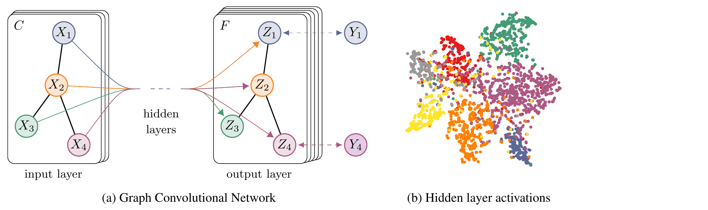

# 소수의 라벨로 그래프 전체를 분류하기: GCN 논문 뜯어보기

> Thomas N. Kipf, Max Welling, *Semi-Supervised Classification with Graph Convolutional Networks*, ICLR 2017

이 글은 GNN(그래프 신경망) 분야의 기초가 된 GCN 논문을 예제와 함께 차근차근 풀어본 기록이다. "무엇을 푸는 문제인가"에서 출발해, GCN의 전파 규칙을 4개짜리 작은 그래프에서 손으로 계산하고, 라벨 2개만으로 실제 학습을 돌려 보고, 마지막으로 이 단순한 규칙이 스펙트럴 그래프 이론에서 어떻게 유도되는지까지 따라간다.

---

## 1. 무슨 문제를 푸는가

### 1) 인용 네트워크라는 예제

구체적인 예로 **논문 인용 네트워크(Cora 데이터셋)** 를 들어보자.

머신러닝 논문 2,700편이 있다고 하자. 각 논문을 하나의 **노드**로 보고, "논문 A가 논문 B를 인용했다"는 관계를 **엣지**로 연결한다. 그러면 논문들이 서로 얽힌 거대한 그래프가 만들어진다.

각 논문은 두 가지 정보를 가진다.

- **노드 특징(feature)**: 그 논문의 초록·본문에 어떤 단어가 등장하는지를 나타내는 단어 출현 벡터(bag-of-words).
- **클래스(label)**: 그 논문이 어떤 주제인지(예: 신경망 / 강화학습 / 확률모델 등 7개 분야 중 하나).

### 2) 핵심 어려움: 라벨이 거의 없다

우리가 하고 싶은 건 "각 논문이 어느 분야인지" 분류하는 것이다. 그런데 문제는 **극소수의 논문만 분야가 라벨링되어 있다**는 점이다. 이 논문의 실험 세팅에서는 **클래스당 단 20편**, 즉 7개 분야면 라벨이 붙은 논문은 겨우 140편뿐이다. 나머지 2,500편 이상은 분야가 미지 상태다.

즉, 정답지가 전체의 약 5%밖에 없는 상태에서 나머지 95% 논문의 분야를 맞춰야 한다. 이게 바로 **준지도 학습(semi-supervised learning)** 상황이다. 지도학습처럼 정답이 충분하지도, 비지도학습처럼 정답이 아예 없지도 않은 중간 지대다.

### 3) 그래프가 왜 도움이 되는가

만약 각 논문의 단어 벡터만 보고 분류한다면, 라벨 140개로는 학습이 턱없이 부족하다. 하지만 **인용 관계**라는 힌트가 있다. 보통 서로 인용하는 논문들은 같은 분야일 가능성이 높다. "라벨이 붙은 강화학습 논문이 인용한 옆 논문은, 라벨이 없어도 아마 강화학습일 것"이라는 식이다.

그래서 이 문제의 본질은 이렇게 정리된다.

> **소수의 라벨 + 각 노드의 특징 + 노드 간 연결 구조**를 함께 활용해, 라벨 없는 노드들의 클래스를 예측하기.

### 4) 기존 방식의 한계

예전 방법들은 "연결된 노드는 같은 라벨을 가진다"는 가정을 손실함수에 직접 규제 항으로 넣었다. 논문이 인용한 기존 접근의 손실함수는 다음과 같은 형태다.

$$\mathcal{L} = \mathcal{L}_0 + \lambda \mathcal{L}_{reg}, \qquad \mathcal{L}_{reg} = \sum_{i,j} A_{ij}\, \lVert f(X_i) - f(X_j) \rVert^2 = f(X)^\top \Delta f(X)$$

여기서 $\mathcal{L}_0$는 라벨된 부분에 대한 지도 손실, 뒤의 $\mathcal{L}_{reg}$가 그래프 정규화 항이다. $\Delta = D - A$는 그래프 라플라시안이고, 이 항은 "연결된 노드 $i, j$의 예측이 다르면 벌점을 준다"는 뜻이다. 즉 연결된 노드끼리 같은 라벨을 갖도록 강제한다.

문제는 엣지가 항상 '유사함'을 뜻하진 않는다는 것이다. 예를 들어 어떤 논문이 **비판하려고** 다른 분야 논문을 인용할 수도 있다. 이렇게 연결이 곧 같은 라벨은 아닌 경우, 그 가정이 오히려 모델의 표현력을 제약한다.

GCN은 이 가정을 손실함수에 강제로 넣는 대신, **연결 구조 자체를 신경망 입력으로 넣어서** 모델이 "어떤 연결이 실제로 의미 있는지"를 데이터로부터 학습하도록 만든 것이 출발점이다.

---

## 2. GCN의 핵심 아이디어: 이웃 정보를 섞어라

### 1) 한 문장 직관

GCN의 핵심 아이디어는 놀랍도록 단순하다. **각 노드의 표현을, 자기 자신과 이웃 노드들의 특징을 평균 내서 갱신한다.** 이걸 여러 번 반복하는 게 전부다.

'논문 A'라는 노드가 있고, A는 논문 B, C, D를 인용(연결)하고 있다고 하자. 처음에 각 논문은 자기 단어 벡터만 가지고 있다. 1층을 통과할 때 A의 새로운 표현은 대략 이렇게 만들어진다.

> 새로운 A = (A 자신의 특징 + B의 특징 + C의 특징 + D의 특징)을 가중 평균 → 가중치 행렬 W를 곱함 → 활성화 함수(ReLU) 통과

즉 A는 이제 자기 단어뿐 아니라 **이웃 논문들의 정보까지 담은 벡터**가 된다. 이 과정을 그래프의 모든 노드에 대해 동시에 수행한다.

### 2) 전파 규칙 수식

논문의 핵심 수식이 바로 이 "이웃 섞기"를 행렬로 한 번에 표현한 것이다.

$$H^{(l+1)} = \sigma\!\left( \tilde{D}^{-\frac{1}{2}} \tilde{A} \tilde{D}^{-\frac{1}{2}} H^{(l)} W^{(l)} \right)$$

각 부분이 방금 설명한 것과 대응된다.

- $H^{(l)}$: 현재 층에서 모든 노드의 특징을 쌓은 행렬(각 행이 한 논문). 첫 층은 $H^{(0)} = X$.
- $\tilde{A} = A + I$: 인접행렬에 self-loop(단위행렬 $I$)을 더한 것. "이웃 정보 + **자기 자신**의 정보도 함께 섞어라"는 뜻이다. 이게 없으면 자기 특징을 잃어버린다.
- $\tilde{A}$를 곱한다 = 각 노드에 대해 연결된 이웃들의 특징을 더한다(모으기).
- $\tilde{D}^{-1/2} \cdots \tilde{D}^{-1/2}$: 정규화. 인용을 100편 받은 유명 논문과 2편만 받은 논문을 그냥 더하면, 연결 많은 노드의 값이 폭발한다. 그래서 차수(연결 수)로 나눠 스케일을 맞춘다. 단순 평균보다 정교한 **대칭 정규화**다.
- $W^{(l)}$: 학습되는 가중치. 섞인 특징을 어떻게 변환할지 데이터로부터 배운다.
- $\sigma$: ReLU 같은 비선형 활성화.

### 3) 층을 쌓으면 이웃의 이웃까지

여기가 핵심이다. 한 층은 **1-홉(직접 연결된) 이웃**의 정보만 모은다. 그런데 층을 하나 더 쌓으면 어떻게 될까.

- 1층 후: A는 B, C, D의 정보를 가짐.
- 2층 후: A는 (B, C, D의 정보)를 다시 모으는데, 이때 B는 이미 자기 이웃 정보를 담고 있음 → 결과적으로 **A는 2-홉 떨어진 논문들의 정보까지** 간접적으로 흡수함.

그래서 논문은 보통 **2층 GCN**을 쓴다. 각 논문이 자기 주변 2단계 이웃까지의 문맥을 보고 분야를 판단하는 셈이다.

아래 그림이 이 구조를 한눈에 보여준다. 왼쪽은 $C$개의 입력 채널과 $F$개의 출력 특징을 갖는 다층 GCN의 개략도로, 그래프 구조(검은 선)는 모든 층에서 공유되고 라벨은 $Y_i$로 표시된다. 오른쪽은 Cora 데이터셋에서 라벨 5%만으로 학습한 2층 GCN의 은닉층 활성값을 t-SNE로 시각화한 것으로, 색이 문서 클래스다. 라벨을 거의 안 줬는데도 같은 클래스끼리 뚜렷하게 뭉쳐 있다.



---

## 3. 작은 그래프에서 직접 계산해보기

전파 규칙에 등장하는 $\tilde{A}$, $\tilde{D}$, 그리고 $-1/2$ 제곱이 각각 무엇인지, 노드 4개짜리 그래프에서 손으로 계산하며 확인해보자.

### 1) 예제 그래프

논문 A, B, C, D 네 편이 이렇게 인용으로 연결돼 있다고 하자.

- A ↔ B
- A ↔ C
- B ↔ C
- C ↔ D

GCN은 무방향 그래프라 연결은 양방향이다.

### 2) 인접행렬 A (self-loop 없음)

행/열 순서를 A, B, C, D로 두면, "연결돼 있으면 1, 아니면 0"이다.

```
      A  B  C  D
  A [ 0  1  1  0 ]
  B [ 1  0  1  0 ]
  C [ 1  1  0  1 ]
  D [ 0  0  1  0 ]
```

대각선이 전부 0인 데 주목하자. 즉 이 상태에서는 "자기 자신"과의 연결이 없다.

### 3) Ã = A + I (self-loop 추가)

단위행렬 $I$를 더한다는 건 대각선에 1을 채운다는 뜻이고, 의미는 **"각 노드가 자기 자신과도 연결됐다고 치자"**이다. 이웃 정보를 모을 때 자기 특징도 함께 섞기 위해서다.

```
      A  B  C  D
  A [ 1  1  1  0 ]
  B [ 1  1  1  0 ]
  C [ 1  1  1  1 ]
  D [ 0  0  1  1 ]
```

### 4) D̃ = Ã의 차수행렬(degree matrix)

$\tilde{D}$는 $\tilde{A}$로부터 계산된다. 방법은 간단하다. **$\tilde{A}$의 각 행을 다 더한 값을 대각선에 놓고, 나머지는 0.** 각 행의 합 = 그 노드가 (자기 자신 포함) 몇 개와 연결됐는지, 즉 **차수(degree)** 다.

- A행 합: 1+1+1+0 = **3**
- B행 합: 1+1+1+0 = **3**
- C행 합: 1+1+1+1 = **4**
- D행 합: 0+0+1+1 = **2**

```
      A  B  C  D
  A [ 3  0  0  0 ]
  B [ 0  3  0  0 ]
  C [ 0  0  4  0 ]
  D [ 0  0  0  2 ]
```

$\tilde{D}$는 대각행렬이라 "각 노드가 얼마나 인기 있는지(연결이 많은지)"를 담은 셈이다. C는 연결이 많고(4), D는 적다(2).

### 5) -1/2 제곱이 뭔가

$\tilde{D}^{-1/2}$는 두 연산을 합친 것이다.

- **-1 (역행렬)**: "나누기"를 뜻한다. 대각행렬은 역행렬이 그냥 각 대각 원소의 역수다. $\tilde{D}^{-1} = \mathrm{diag}(1/3, 1/3, 1/4, 1/2)$.
- **1/2 (제곱근)**: 대각행렬의 제곱근은 각 원소의 $\sqrt{\ }$다.

둘을 합치면 $\tilde{D}^{-1/2}$는 각 대각 원소를 $1/\sqrt{\text{차수}}$로 바꾼 것이다.

$$\tilde{D}^{-1/2} = \mathrm{diag}\left( \tfrac{1}{\sqrt3}, \tfrac{1}{\sqrt3}, \tfrac{1}{\sqrt4}, \tfrac{1}{\sqrt2} \right) = \mathrm{diag}(0.577,\ 0.577,\ 0.500,\ 0.707)$$

그런데 왜 $-1$ 전체가 아니라 $-1/2$를 양쪽에 나눠 곱할까? 정규화된 행렬은 이렇게 만들어진다.

$$\hat{A} = \tilde{D}^{-\frac{1}{2}} \tilde{A} \tilde{D}^{-\frac{1}{2}}, \qquad \hat{A}_{ij} = \frac{\tilde{A}_{ij}}{\sqrt{\text{차수}_i}\ \times\ \sqrt{\text{차수}_j}}$$

즉 어떤 연결의 값을, **양쪽 끝 노드 차수의 제곱근으로 나눠서** 스케일을 맞춘다. 만약 $\tilde{D}^{-1}$로 한쪽에서만 나누면 "내 이웃 수"로만 평균 내는 것이고, 양쪽 $\tilde{D}^{-1/2}$로 나누면 **"내 인기와 상대 인기를 둘 다 반영"** 하는 대칭 정규화가 된다. 그래서 연결 많은 허브 노드(C 같은)가 정보 전달을 독점하지 못하게 균형이 잡히고, 행렬이 대칭으로 유지돼 수치적으로도 안정적이다.

### 6) 최종 결과

위 그래프에 대해 $\hat{A} = \tilde{D}^{-1/2} \tilde{A} \tilde{D}^{-1/2}$를 실제로 계산하면 다음과 같다.

```
        A       B       C       D
  A [ 0.333   0.333   0.289   0     ]
  B [ 0.333   0.333   0.289   0     ]
  C [ 0.289   0.289   0.250   0.354 ]
  D [ 0       0       0.354   0.500 ]
```

몇 개만 손으로 확인해보면 앞의 공식과 맞아떨어진다.

- $(A, A) = 1 / (\sqrt3 \times \sqrt3) = 1/3 = 0.333$
- $(A, C) = 1 / (\sqrt3 \times \sqrt4) = 1/(1.732 \times 2) = 0.289$ — A(차수 3)와 C(차수 4)를 잇는 연결
- $(C, D) = 1 / (\sqrt4 \times \sqrt2) = 1/(2 \times 1.414) = 0.354$ — C(차수 4)와 D(차수 2)를 잇는 연결
- $(D, D) = 1 / (\sqrt2 \times \sqrt2) = 1/2 = 0.500$ — 연결이 적은 D는 자기 값이 크게 남음

이 $\hat{A}$가 바로 전파 규칙 $H^{(l+1)} = \sigma(\hat{A} H^{(l)} W)$에서 **"이웃 정보를 정규화해서 섞는 가중치 행렬"** 역할을 한다. $\hat{A}$의 A행을 보면 [0.333, 0.333, 0.289, 0]이므로, 새로운 A의 특징 = 0.333·A + 0.333·B + 0.289·C + 0·D, 즉 자기 자신과 이웃 B·C를 차수로 정규화한 가중 합이다. D는 연결 안 됐으니 0이다.

정리하면 $\tilde{A}$는 원래 인접행렬에 self-loop을 더한 것($A + I$), $\tilde{D}$는 그 $\tilde{A}$의 행 합으로 만든 차수 대각행렬, $\tilde{D}^{-1/2}$는 각 차수를 $1/\sqrt{\text{차수}}$로 바꾼 것이다. 이 셋을 $\tilde{D}^{-1/2} \tilde{A} \tilde{D}^{-1/2}$로 조합하면 "자기+이웃 정보를, 양쪽 노드의 인기도로 균형 있게 정규화해 섞는" 행렬이 완성된다. 이게 논문에서 말한 **renormalization trick**의 실체다.

---

## 4. 특징을 넣고 한 층 통과시켜 보기

같은 4-노드 그래프에 특징을 넣고 실제로 한 층을 통과시켜 보자.

### 1) 출발: 각 노드에 특징 벡터 부여 (H⁰)

각 논문에 2차원 특징을 준다. 이해를 돕기 위해 "종류"를 나타내는 값으로 세팅했다.

```
       특징1  특징2
  A [  1     0  ]   ← 유형 1
  B [  1     0  ]   ← 유형 1
  C [  0     1  ]   ← 유형 2
  D [  0     1  ]   ← 유형 2
```

A·B는 [1,0], C·D는 [0,1]로 시작한다. 아직 그래프 정보는 하나도 안 섞였고, 각자 자기 특징만 있다.

### 2) 이웃 섞기 (Â · H⁰)

앞에서 구한 정규화 행렬 $\hat{A}$를 곱하면, 각 노드가 자기+이웃의 특징을 정규화 가중합으로 흡수한다.

```
        특징1   특징2
  A [  0.667   0.289 ]
  B [  0.667   0.289 ]
  C [  0.577   0.604 ]
  D [  0       0.854 ]
```

한 줄만 손으로 확인해보자. **A의 새 값**은 $\hat{A}$의 A행 [0.333, 0.333, 0.289, 0]을 가중치로 쓴 조합이다.

- 특징1 = 0.333·(A의 1) + 0.333·(B의 1) + 0.289·(C의 0) + 0·(D) = **0.667**
- 특징2 = 0.333·(A의 0) + 0.333·(B의 0) + 0.289·(C의 1) + 0·(D) = **0.289**

여기서 벌어진 일이 핵심이다. A는 원래 [1, 0]으로 특징2가 0이었는데, 이웃 C(유형 2)와 섞이면서 **특징2가 0.289로 생겼다.** 즉 A의 표현에 "나는 유형 2 논문과도 이어져 있다"는 문맥이 스며든 것이다. 반대로 D를 보면, 이웃이 C 하나뿐이라 특징1은 0으로 남고 특징2(0.854)만 강하게 남았다.

### 3) 가중치 W로 변환하고 ReLU 통과

이제 학습되는 가중치 행렬 $W$를 곱해 특징을 새 공간으로 변환한 뒤, ReLU = max(0, x)로 음수를 0으로 만든다. 예시로 쓴 $W$와 최종 결과 $H^{(1)}$은 다음과 같다.

$$W = \begin{bmatrix} 1 & -1 \\ 0 & 2 \end{bmatrix}$$

```
        특징1   특징2
  A [  0.667   0     ]  ← H¹
  B [  0.667   0     ]
  C [  0.577   0.630 ]
  D [  0       1.707 ]
```

실제 학습에서는 이 $W$의 값들이 라벨을 잘 맞추도록 경사하강법으로 조정된다.

### 4) 무엇이 달라졌나

시작할 때와 비교해보자.

- **A와 B**는 그래프에서 위치(연결 구조)와 특징이 똑같아서, 통과 후에도 [0.667, 0]으로 **동일한 표현**을 갖는다. GCN이 구조적으로 비슷한 노드를 비슷하게 인코딩한다는 걸 보여준다.
- **C**는 유형 1(A, B)과 유형 2(D) 사이의 다리 역할이라, 두 특징이 [0.577, 0.630]으로 **골고루 섞였다.** 실제로 그래프에서 두 그룹을 잇는 중간 노드다운 표현이다.
- **D**는 C하고만 연결돼 [0, 1.707]로 **유형 2 색채가 강하게** 남았다.

즉, 처음엔 A=B이고 C=D였던 단순한 특징이, 한 층 지나자 **그래프에서의 위치에 따라 서로 다르게 재배치**됐다. 이 표현 위에 마지막 softmax 층을 얹으면 각 노드의 클래스를 예측하고, 라벨된 노드의 오차로 $W$를 학습하면 이 섞임이 "분류에 유리한 방향"으로 다듬어진다.

---

## 5. 라벨 2개로 학습시켜 보기

라벨을 딱 2개만 주고 실제로 학습시켜서, 그 라벨이 그래프를 따라 어떻게 번져 나가는지 미니 데모로 확인해보자.

### 1) 실험 설정

- **노드 10개**, 두 커뮤니티로 구성: 그룹1(노드 0~4), 그룹2(노드 5~9). 각 그룹 안은 촘촘히 연결되고, 두 그룹은 **노드 4–5 다리 하나로만** 이어져 있다.
- **특징은 featureless** — 단위행렬을 씀. 즉 각 노드는 "나는 몇 번 노드다"라는 정체성 외에 아무 정보도 없다. 오직 **그래프 연결 구조만으로** 분류해야 한다.
- **라벨은 딱 2개**: 노드 0 = 클래스 0, 노드 9 = 클래스 1. 나머지 8개는 정답 없음. (논문의 극단적 준지도 세팅, 클래스당 1개와 같은 상황)

### 2) 학습 전후 비교

학습 전(랜덤 초기화)에는 가중치가 랜덤이라 모든 노드를 그냥 클래스 1로 찍어 절반만 우연히 맞았다. 라벨 2개로만 300 epoch을 돌린 뒤에는 다음과 같이 바뀐다.

```
예측: [0 0 0 0 0 1 1 1 1 1]
정답: [0 0 0 0 0 1 1 1 1 1]  →  정확도 100%
```

라벨이 노드 0과 노드 9 **단 두 개**뿐이었는데, 나머지 8개 노드를 전부 맞췄다. 손실은 이 두 노드에 대해서만 계산했는데도 말이다.

### 3) 라벨이 번져 나간 흔적

각 노드가 "클래스 1(그룹2)일 확률"을 보면 라벨이 그래프를 타고 스며든 과정이 그대로 보인다.

```
  노드0: 0.00  ← 라벨(클래스0)
  노드1: 0.00
  노드2: 0.00
  노드3: 0.02
  노드4: 0.06   ← 다리 근처, 살짝 흔들림
  ────────── (그룹 경계) ──────────
  노드5: 0.96   ← 다리 근처, 살짝 흔들림
  노드6: 1.00
  노드7: 1.00
  노드8: 1.00
  노드9: 1.00  ← 라벨(클래스1)
```

주목할 점 두 가지다.

첫째, **라벨된 노드의 정보가 연결을 따라 퍼졌다.** 노드 0의 "클래스 0"이라는 신호가 $\hat{A}$를 통해 이웃 1, 2로, 다시 3, 4로 전파돼 그룹1 전체가 클래스 0으로 수렴했다. 노드 9도 마찬가지로 그룹2를 클래스 1로 물들였다. 학습 시 그래디언트가 인접행렬을 타고 라벨 없는 노드에게까지 흘러간 결과다.

둘째, **경계에서 확신이 낮아진다.** 두 그룹을 잇는 다리 양 끝 노드 4(0.06)와 노드 5(0.96)를 보면, 그룹 중심부(노드 0, 노드 9는 0.00 / 1.00)보다 확률이 애매하다. 반대편 그룹과 직접 연결돼 그쪽 정보도 조금 섞였기 때문이다. 이게 GCN이 그래프 구조를 실제로 반영하고 있다는 증거다. 경계에 가까운 노드일수록 애매하게, 중심부일수록 확실하게 예측한다.

### 4) 학습은 정확히 어떻게 이뤄지나

이 데모의 학습 메커니즘을 조금 더 정확히 짚어두자.

**순전파는 모든 노드에 대해 한다.** 순전파(forward)는 라벨 유무와 상관없이 전체 그래프의 모든 노드에 대해 이뤄진다. 이 단계에서 라벨 없는 노드를 빼면 안 된다. 라벨된 노드 0의 표현을 계산하려면 그 이웃(대부분 라벨 없음)의 특징이 $\hat{A}$를 통해 섞여 들어와야 하기 때문이다. 즉 라벨 없는 노드들은 "예측 대상"은 아니어도 **정보 전달 통로**로서 순전파에 반드시 참여한다.

**손실은 라벨된 노드에 대해서만 계산한다.** 모든 노드의 예측을 다 구했지만, cross-entropy 손실은 라벨이 있는 노드만 골라서 합산한다. 논문 수식이 바로 이걸 말한다.

$$\mathcal{L} = -\sum_{l \in \mathcal{Y}_L} \sum_{f=1}^{F} Y_{lf} \ln Z_{lf}$$

여기서 $\mathcal{Y}_L$이 "라벨이 있는 노드들의 집합"이다. 위 데모에서는 노드 0과 노드 9, 이 둘에 대해서만 손실을 계산했다.

그렇다면 라벨 없는 노드는 학습에서 제외되는가? 절반만 맞다. **손실 계산에서는 제외**되지만(라벨이 없으니 정답과 비교할 수 없다), **학습(가중치 갱신)에는 참여**한다. 역전파할 때, 라벨된 노드에서 계산된 그래디언트가 $\hat{A}$를 거꾸로 타고 이웃 노드들에게로 흘러가기 때문이다. 결과적으로 공유 가중치 $W^{(0)}, W^{(1)}$이 갱신될 때 라벨 없는 노드들의 특징도 반영된다.

비유하자면, 시험 채점(손실)은 답을 아는 2명 것만 하지만, 그 2명은 옆자리 친구들(라벨 없는 이웃)과 어깨너머로 정보를 주고받은 상태다. 그래서 2명을 채점하고 고쳐주면, 그 교정 신호가 연결망을 타고 친구들에게까지 전달돼 모두의 표현이 함께 다듬어진다. 이게 소수 라벨만으로 전체가 학습되는 준지도 학습의 메커니즘이다.

한 가지 덧붙이면, 원 논문의 기본 GCN은 미니배치를 쓰지 않는다. 그래프 전체가 $\hat{A}$로 엮여 있어서 노드 몇 개만 떼어내기 어렵기 때문이다. 그래서 매 iteration마다 전체 그래프를 한 번에 순전파(full-batch gradient descent)하고 $W$를 한 번 갱신한다. 논문도 이 방식의 한계를 인정하고, 그래프가 메모리에 안 들어갈 만큼 크면 미니배치 확장이 필요하다고 future work로 남겨뒀다.

### 5) 학습되는 것은 W이지 H가 아니다

마지막으로 미묘하지만 중요한 구분이 있다. 흔히 "좋은 표현 $H$를 학습한다"고 말하는데, 정확히는 다음과 같다.

$H$는 저장해두는 값이 아니라 매번 다시 계산되는 결과물이다. 순전파는 항상 $H^{(1)} = \sigma(\hat{A} X W^{(0)})$, $Z = \hat{A} H^{(1)} W^{(1)}$처럼 처음부터 다시 계산되고, 고정된 건 $X$(특징)와 $\hat{A}$(그래프 구조)뿐이다. $W$가 바뀌면 같은 입력이라도 $H$가 달라진다.

경사하강법이 실제로 값을 바꾸는 대상은 파라미터 $W^{(0)}, W^{(1)}$뿐이다. $H$는 파라미터가 아니라 $W$의 결과물이다. $W$가 좋아지면 그 결과로 $H$가 좋아지는 것이지, $H$를 직접 조정하는 게 아니다. 요리사($W$)를 훈련시키면 요리($H$)가 좋아지는 것이지, 요리를 직접 주무르는 게 아닌 것과 같다.

그래서 정확한 문장은 이렇다.

> 라벨 예측의 정확도를 높이는 **표현 $H$가 나오도록, $W$를 학습하는 것**이 목표다.

---

## 6. 이 단순한 규칙은 어디서 왔나: 스펙트럴 유도

$\tilde{D}^{-1/2} \tilde{A} \tilde{D}^{-1/2}$라는 형태는 임의로 고른 게 아니라, 스펙트럴 그래프 컨볼루션을 극한까지 근사·단순화한 종착점이다. 큰 흐름은 **스펙트럴 컨볼루션 → 너무 비쌈 → 다항식 근사 → 1차로 단순화 → renormalization**이다.

### 1) 출발점: 그래프에서 컨볼루션을 정의하기

일반 신호(이미지·음성)에서는 컨볼루션이 자연스럽지만, 그래프는 격자가 아니라서 "필터를 밀며 곱한다"가 안 된다. 그래서 **푸리에 변환**을 우회로로 쓴다. 핵심은 컨볼루션 정리다.

> 공간(정점)에서의 컨볼루션 = 주파수(스펙트럴) 영역에서의 곱셈

그래프에서 "푸리에 변환"의 역할을 하는 것이 **정규화 그래프 라플라시안**의 고유분해다.

$$L = I_N - D^{-\frac{1}{2}} A D^{-\frac{1}{2}} = U \Lambda U^\top$$

여기서 $U$는 고유벡터 행렬, $\Lambda$는 고유값들의 대각행렬이다. 직관적으로,

- **고유벡터 $U$** = 그래프 위의 "기본 진동 패턴"(=푸리에 기저). 이미지의 사인·코사인 주파수 성분에 해당.
- **고유값 $\Lambda$** = 각 패턴의 "주파수"(그래프 위에서 얼마나 급하게 출렁이는지).
- **$U^\top x$** = 신호 $x$를 이 주파수 성분들로 분해한 것 = 그래프 푸리에 변환.

이걸 쓰면 스펙트럴 그래프 컨볼루션은 이렇게 정의된다.

$$g_\theta \star x = U g_\theta U^\top x$$

읽는 법: $U^\top x$로 주파수 영역으로 보내고 → 필터 $g_\theta = \mathrm{diag}(\theta)$로 각 주파수를 스케일하고 → $U$로 다시 정점 영역으로 되돌린다. 필터 $\theta$가 각 주파수를 얼마나 통과/억제할지 정하는 파라미터다.

### 2) 문제점: 너무 비싸다

이 정의는 아름답지만 실전에선 치명적이다. 첫째, $L$을 $U \Lambda U^\top$로 분해하는 **고유분해 자체가 대략 $O(N^3)$** 로, 노드가 수백만이면 불가능하다. 둘째, $U$는 밀집(dense) 행렬이라 $U^\top x$ 한 번이 $O(N^2)$다. 셋째, $\theta$가 주파수마다 따로라 **필터가 비국소적**이다 — 한 노드가 그래프 전체의 영향을 받아 "국소적 이웃"이라는 개념이 사라진다. 큰 그래프에선 못 쓴다는 뜻이고, 그래서 근사가 필요하다.

### 3) 체비셰프 다항식 근사

핵심 아이디어: 필터 $g_\theta(\Lambda)$를 주파수마다 자유롭게 두지 말고, **고유값 $\Lambda$의 다항식으로 제한**하자. 구체적으로 체비셰프 다항식 $T_k$로 $K$차까지 절단한다.

$$g_{\theta'}(\Lambda) \approx \sum_{k=0}^{K} \theta'_k T_k(\tilde{\Lambda}), \qquad \tilde{\Lambda} = \frac{2}{\lambda_{max}} \Lambda - I_N$$

이게 왜 결정적이냐면, 필터를 $\Lambda$의 다항식으로 쓰면 $(U \Lambda U^\top)^k = U \Lambda^k U^\top$라는 성질 덕분에 **$U$가 통째로 사라진다.**

$$g_{\theta'} \star x \approx \sum_{k=0}^{K} \theta'_k T_k(\tilde{L}) x, \qquad \tilde{L} = \frac{2}{\lambda_{max}} L - I_N$$

이제 얻는 이점이 두 가지다. **고유분해가 불필요**하다 — $T_k(\tilde{L})x$는 $\tilde{L}$을 $x$에 반복해서 곱하는 것뿐이고, $L$은 희소행렬이라 값싼 희소 곱셈으로 계산된다. 그리고 **$K$-국소적(K-localized)** 이다 — $L$의 $K$차 다항식은 "최대 $K$홉 떨어진 이웃"까지만 영향을 준다. 이게 컨볼루션의 "국소성"을 되살린다.

### 4) GCN의 결정적 단순화: K=1, λ_max ≈ 2

Kipf & Welling은 여기서 과감하게 간다. 위 체비셰프 필터에서 **K=1(1차)** 만 쓰고, 게다가 **$\lambda_{max} \approx 2$** 로 근사한다("신경망 파라미터가 학습 중에 스케일 변화에 알아서 적응할 것"이라는 논리). 그러면 식이 확 줄어든다.

$$g_{\theta'} \star x \approx \theta'_0 x + \theta'_1 (L - I_N) x = \theta'_0 x - \theta'_1 D^{-\frac{1}{2}} A D^{-\frac{1}{2}} x$$

($L = I - D^{-1/2}AD^{-1/2}$이므로 $L - I = -D^{-1/2}AD^{-1/2}$를 대입한 것.) 이제 자유 파라미터가 $\theta'_0, \theta'_1$ 딱 둘로 줄었다. "한 층은 1홉 이웃만 본다"는 게 여기서 나온다. 대신 **층을 여러 개 쌓아** 더 넓은 이웃과 풍부한 필터를 복원한다 — 명시적 체비셰프 차수 $K$를 키우는 대신 깊이로 표현력을 얻는 전략이다.

### 5) 파라미터를 하나로 묶기

과적합을 줄이고 층당 연산을 최소화하려, 두 파라미터를 하나로 묶는다. $\theta = \theta'_0 = -\theta'_1$로 두면,

$$g_\theta \star x \approx \theta \left( I_N + D^{-\frac{1}{2}} A D^{-\frac{1}{2}} \right) x$$

이제 필터 파라미터가 $\theta$ 하나뿐이다. 괄호 안의 $I_N + D^{-1/2} A D^{-1/2}$가 바로 "자기 자신 + 정규화된 이웃"이다.

### 6) 마지막 단계: renormalization trick

그런데 방금 그 행렬 $I_N + D^{-1/2} A D^{-1/2}$는 **고유값 범위가 $[0, 2]$** 다. 이걸 깊은 신경망에서 반복해 곱하면 값이 폭발하거나 소실돼(exploding/vanishing gradient) 수치적으로 불안정해진다.

그래서 논문은 "재정규화 트릭"을 도입한다. self-loop을 밖에서 더하는 대신, **인접행렬 안에 넣고 다시 정규화**한다.

$$I_N + D^{-\frac{1}{2}} A D^{-\frac{1}{2}} \ \rightarrow\ \tilde{D}^{-\frac{1}{2}} \tilde{A} \tilde{D}^{-\frac{1}{2}}, \qquad \tilde{A} = A + I_N, \quad \tilde{D}_{ii} = \sum_j \tilde{A}_{ij}$$

이게 바로 3절에서 손으로 계산한 그 행렬이다. 정규화를 self-loop 포함 상태에서 다시 하니 고유값이 안정적 범위로 들어오고, 깊게 쌓아도 값이 폭주하지 않는다.

### 7) 다채널로 일반화 → 최종 층 규칙

지금까지는 노드당 스칼라 신호 $x$였다. 실제로는 노드마다 $C$차원 특징 벡터($X \in \mathbb{R}^{N \times C}$)이고 필터도 $F$개 원하므로, $\theta$를 행렬 $\Theta \in \mathbb{R}^{C \times F}$로 확장한다.

$$Z = \tilde{D}^{-\frac{1}{2}} \tilde{A} \tilde{D}^{-\frac{1}{2}} X \Theta$$

여기에 비선형 $\sigma$와 층 인덱스를 붙이면, 우리가 처음부터 봐온 전파 규칙이 완성된다.

$$H^{(l+1)} = \sigma\!\left( \tilde{D}^{-\frac{1}{2}} \tilde{A} \tilde{D}^{-\frac{1}{2}} H^{(l)} W^{(l)} \right)$$

정리하면 유도의 논리 사슬은 이렇다. (1) 그래프 컨볼루션을 스펙트럴(푸리에)로 정의한다 → (2) 고유분해가 $O(N^3)$라 비현실적 → (3) 필터를 라플라시안의 체비셰프 다항식으로 근사해 고유분해를 없애고 $K$-홉 국소성을 얻는다 → (4) K=1, $\lambda_{max} \approx 2$로 극단 단순화하고 파라미터를 하나로 묶는다 → (5) 수치 안정성을 위해 self-loop을 넣어 재정규화한다. 그 결과가 층당 $O(|E|)$로 값싸고, 깊이로 표현력을 키우는 지금의 GCN이다.

---

## 7. 실험 결과

논문은 세 개의 인용 네트워크(Citeseer, Cora, Pubmed)와 하나의 지식그래프(NELL)에서 GCN을 평가했다. 각 인용 네트워크는 클래스당 20개 라벨만, NELL은 클래스당 단 1개 라벨만 사용하는 극단적 준지도 세팅이다. 아래는 주요 비교 대상만 추린 분류 정확도(%)로, 숫자가 **높을수록** 좋다. 괄호 안은 수렴까지의 학습 시간이다.

| 방법 | Citeseer | Cora | Pubmed | NELL |
|---|---|---|---|---|
| ManiReg | 60.1 | 59.5 | 70.7 | 21.8 |
| DeepWalk | 43.2 | 67.2 | 65.3 | 58.1 |
| ICA | 69.1 | 75.1 | 73.9 | 23.1 |
| Planetoid* | 64.7 | 75.7 | 77.2 | 61.9 |
| **GCN (this paper)** | **70.3** | **81.5** | **79.0** | **66.0** |

GCN이 네 데이터셋 모두에서 기존 방법을 앞선다. 특히 Planetoid\*는 바로 이런 준지도 노드 분류를 겨냥해 설계된 강력한 그래프 임베딩 기반 방법인데, GCN은 그보다 Cora에서 약 6%p, NELL에서 약 4%p 높다. 게다가 속도도 훨씬 빠르다 — Cora 기준 GCN은 약 4초, Planetoid는 약 13초로 수렴했다.

이 결과가 보여주는 것은 앞에서 다룬 미니 데모의 대규모 확장판이다. 특징이 빈약하고 라벨이 클래스당 1~20개뿐인 극한 상황에서도, GCN은 "이웃 정보 섞기($\hat{A}$) → 변환($W$) → 비선형"을 두 층 쌓고 소수 라벨의 오차만 역전파하는 것만으로 전체 그래프를 정확히 분류한다.

---

## 8. 무방향 그래프 가정과 그 한계

인용은 원래 방향성이 있는 관계다("A가 B를 인용"). 그런데 이 논문은 **인용의 방향성을 버리고 무방향(양방향)으로 처리**한다. 실험 부분(5.1절)에 명시돼 있다.

> "We treat the citation links as (undirected) edges and construct a binary, **symmetric** adjacency matrix A."

즉 "A가 B를 인용"이든 "B가 A를 인용"이든 똑같이 $A_{ij} = A_{ji} = 1$로 놓아 대칭 인접행렬을 만든다. 지식그래프인 NELL도 원래는 방향·라벨이 있는 엣지지만, 마찬가지로 대칭 이진 인접행렬로 변환해서 쓴다.

### 1) 왜 방향성을 버렸나 — 스펙트럴 유도 때문

이건 편의상의 선택이 아니라 **이론적으로 강제되는** 부분이다. 6절에서 본 유도의 출발점이 정규화 그래프 라플라시안의 고유분해였다.

$$L = I - D^{-\frac{1}{2}} A D^{-\frac{1}{2}} = U \Lambda U^\top$$

여기서 $U$(고유벡터)가 "실수 직교 기저"가 되고 $\Lambda$(고유값)가 "실수 주파수"가 되려면, **$L$이 대칭 행렬이어야 한다.** 그런데 $L$이 대칭이려면 $A$가 대칭이어야 하고, 그건 곧 **무방향 그래프**를 뜻한다.

만약 방향성을 살려 $A$를 비대칭으로 두면, 라플라시안이 비대칭이 되어 고유값이 복소수로 나올 수 있고, "그래프 푸리에 변환"이라는 깔끔한 실수 스펙트럴 해석이 무너지며, 결국 $\tilde{D}^{-1/2} \tilde{A} \tilde{D}^{-1/2}$라는 대칭 정규화 형태 자체가 성립하지 않는다. 그래서 GCN의 전체 프레임워크는 **대칭 인접행렬 = 무방향 그래프를 전제**로 깔고 있다. 3절의 4-노드 예제에서 $A_{ij} = A_{ji}$로 두고 계산했던 것도 이 때문이다.

### 2) 이게 손해일까

인용 네트워크 노드 분류에서는 크게 문제되지 않는다. "두 논문이 인용으로 이어져 있다"는 사실 자체가 유사성 신호로 충분하고, 방향은 부차적이기 때문이다. 하지만 방향이 본질적으로 중요한 문제(예: 인용의 시간 순서로 영향력 전파를 보거나, 트위터 팔로우처럼 비대칭 관계가 핵심인 경우)에서는 이 대칭화가 정보 손실이 된다.

실제로 이 한계 때문에 후속 연구들이 방향성을 살린 GNN을 내놓았다. 대칭화 대신 in/out 방향을 따로 인코딩하는 Directed GCN 계열이나, 스펙트럴에 얽매이지 않고 이웃별 어텐션 가중치를 학습하는 GAT(Graph Attention Network)처럼 애초에 대칭 라플라시안이 필요 없는 접근들이 있다. GAT는 스펙트럴 유도 대신 "각 이웃에 어텐션으로 가중치를 준다"는 공간(spatial) 관점이라, 비대칭 관계도 자연스럽게 다룰 수 있다.

정리하면, 원 논문의 GCN은 스펙트럴 이론을 쓰기 위해 방향성을 의도적으로 포기하고 대칭 인접행렬을 썼고, 그 대가로 방향 정보를 잃는 한계를 가진다.

---

## 9. 정리

GCN의 기여는 간단하고 확장성 있는 층별 전파 규칙을 스펙트럴 이론으로 정당화하고, 이것이 준지도 노드 분류에서 기존 방법을 능가함을 보인 것이다.

핵심을 한 줄로 요약하면, GCN = "이웃 정보 모으기($\tilde{A}$) + 대칭 정규화($\tilde{D}^{-1/2}$) + 변환($W$) + 비선형($\sigma$)"을 층으로 쌓은 것이고, 이것만으로 소수 라벨에서 전체 그래프 분류가 된다. 이전 방법처럼 "연결된 노드는 같은 라벨"이라는 가정을 손실함수에 규제로 강제한 게 아니라, 연결 구조를 신경망에 직접 넣어 모델이 스스로 학습한다는 점이 결정적 차이다.

그리고 그 단순한 형태 $\tilde{D}^{-1/2} \tilde{A} \tilde{D}^{-1/2}$는 우연이 아니라, 스펙트럴 그래프 컨볼루션 → 체비셰프 근사 → 1차 단순화 → 재정규화로 이어지는 유도의 종착점이라는 것이 이 논문의 이론적 매력이다.
