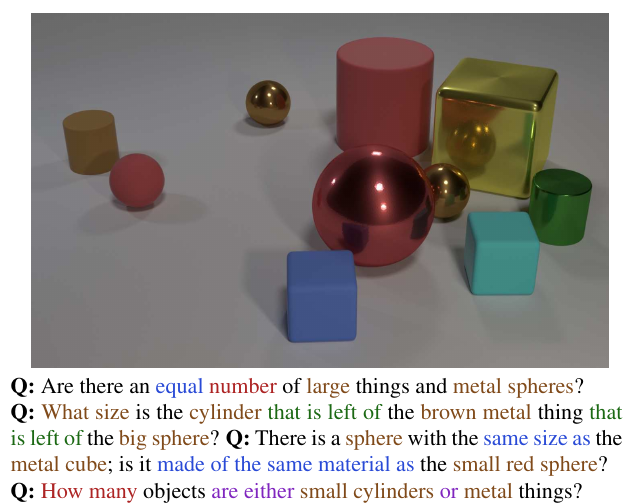
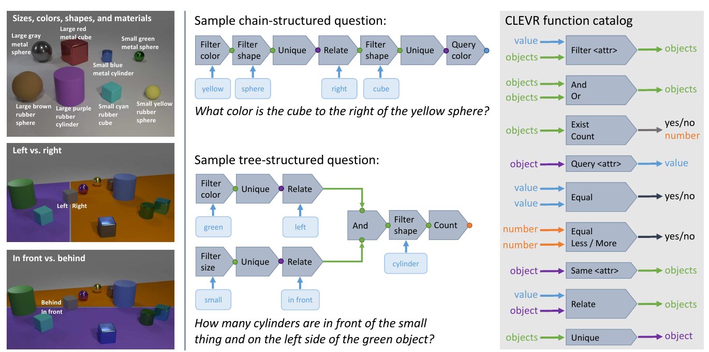
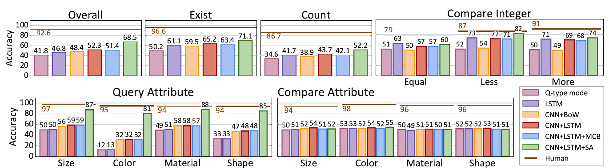

# 정답을 먼저 계산하고 이미지를 나중에 그리는 데이터셋 — CLEVR: A Diagnostic Dataset for Compositional Language and Elementary Visual Reasoning

#### Abstract

시각 데이터에 대해 추론하고 질문에 답하는 인공지능 시스템을 만들 때에는 진전을 분석하고 결함을 발견하기 위한 진단 검사(diagnostic test)가 필요하다. 시각 질의응답(visual question answering, VQA)에 대한 기존 벤치마크도 도움이 되지만, 이들에는 강한 편향(bias)이 있어 모델이 추론 없이도 질문에 정확히 답하는 데 그 편향을 이용할 수 있다. 또한 여러 오류 원인이 뒤섞여 있어 모델의 약점을 짚어내기 어렵다. 본 논문에서는 다양한 시각적 추론 능력을 검사하는 진단용 데이터셋을 제시한다. 이 데이터셋은 편향이 최소화되어 있으며, 각 질문이 어떤 종류의 추론을 요구하는지 기술하는 상세한 주석을 갖추고 있다. 우리는 이 데이터셋을 사용해 다양한 최신 시각 추론 시스템을 분석하고, 그 능력과 한계에 대한 새로운 통찰을 제공한다.

#### 요약

VQA 모델이 68%를 맞혔다는 숫자에서는 그 모델이 무엇을 할 줄 아는지 알 수 없다. CLEVR는 이 문제를 데이터를 만드는 순서를 뒤집어서 해결한다. 이미지를 먼저 모으고 사람에게 질문을 붙이는 대신, 장면 그래프와 함수형 프로그램이라는 완전한 정답 표현을 먼저 만들고 거기서 이미지와 질문을 렌더링해낸다. 그 덕분에 모델이 틀렸을 때 어느 추론 단계에서 틀렸는지를 역으로 추적할 수 있고, 이 논문은 그 추적으로 당시 최고 모델들이 두 물체를 비교하지 못하고, 공간 관계의 의미 대신 이미지의 절대 위치를 외우고 있었다는 사실을 드러낸다.

---

## 1. 왜 진단용 데이터셋이 필요했나

시각 정보에 대해 추론하고 질문에 답하는 시스템은 인공지능 연구의 오래된 목표다. 2015년 전후로 VQA 데이터셋들이 여럿 등장했고, 물체와 속성과 공간 관계를 인식하는 지각 능력부터 세기, 논리적 추론, 비교 같은 상위 능력까지 두루 요구하는 문제들이 제시되었다. 그런데 이 데이터셋들에는 두 가지 곤란이 있었다.

첫째, 편향이 심해서 모델이 이미지를 제대로 보지 않고도 질문 유형만으로 정답을 맞힐 수 있었다. 논문이 드는 예가 선명하다. "무엇이 땅을 덮고 있는가?"라는 질문에 통계적 학습기가 정답을 내는 이유는 장면을 이해해서가 아니라, 편향된 데이터셋이 땅에 대해 물을 때는 대개 눈으로 덮여 있기 때문이다. 둘째, 오류가 났을 때 그것이 인식 실패인지 추론 실패인지 언어 이해 실패인지 상식 부족인지를 구분할 수가 없었다. 여러 오류 원인이 하나의 정확도 숫자에 뒤섞여 있었다.

논문 제목의 CLEVR는 Clever Hans에서 온 이름이다. 주인의 미세한 표정을 읽고 계산 문제를 맞히는 것처럼 보였던 1900년대의 말 이야기다. 통계적 학습 시스템도 같은 방식으로 과제를 겉으로만 푸는 접근을 익힐 수 있다는 문제의식이 이 이름에 담겨 있다. 저자들은 성능 경쟁용 벤치마크가 아니라 진단용 데이터셋이 필요하다고 보고, 편향을 통제하고 각 질문이 어떤 추론 능력을 요구하는지 주석이 달린 데이터셋을 만들었다.

## 2. CLEVR의 세계 — 무엇이 입력이고 무엇이 출력인가



CLEVR의 표본 이미지와 질문. 속성 식별, 세기, 비교, 다중 주의집중, 논리 연산 같은 시각적 추론의 여러 측면을 검사한다.

이미지는 Blender로 렌더링한 단순한 3D 도형 장면이다. 3가지 형태(정육면체, 구, 원기둥), 2가지 크기(대, 소), 2가지 재질(금속, 고무), 8가지 색이 전부이고, 한 장면에 3개에서 10개의 물체가 놓인다. 인식 자체를 쉽게 만들어 추론 능력만 분리해서 보겠다는 의도다. 물체를 배치할 때는 서로 겹치지 않게 하고, 모든 물체가 최소한 일부는 보이게 하며, 이미지 평면상의 중심 사이에 가로세로 여백을 두어 공간 관계의 모호함을 줄인다. 조명과 카메라 위치는 이미지마다 조금씩 흔들린다.

과제 자체는 단순하다. 입력은 이미지 한 장과 자연어 질문 하나, 출력은 짧은 답 하나다. 답의 후보는 28개로 닫혀 있어서 채점이 명확하다.

```
입력 이미지: 회색 대형 금속 구, 빨간 대형 금속 정육면체,
            파란 소형 금속 원기둥, 녹색 소형 금속 구, ... (총 3~10개)

입력 질문: "What color is the cube to the right of the yellow sphere?"
출력: "red"

입력 질문: "How many cylinders are in front of the small thing
           and on the left side of the green object?"
출력: "2"

입력 질문: "Is the cube the same size as the sphere?"
출력: "yes"

출력 후보 28개 = yes/no(2) + 0~10(11) + 색(8) + 크기(2) + 재질(2) + 형태(3)
```

이미지가 시각적으로 단순하다는 사실이 질문까지 단순하다는 뜻은 아니다. 보지 못한 속성 조합에 일반화하려면 요인화된 표현이 필요하고, 세기나 비교 같은 과제에는 단기 기억이나 특정 물체에 대한 주의집중이 필요하며, 여러 부분 과제를 다양한 방식으로 조합한 질문에 답하려면 구성적인 시스템이 필요하다.

관계는 두 종류다. 하나는 left, right, behind, in front의 공간 관계이고, 다른 하나는 두 물체가 지정된 속성에서 같은 값을 갖는지를 따지는 same-attribute 관계다. 공간 전치사의 의미는 상대 위치뿐 아니라 카메라 시점과 맥락에도 달려 있어서 까다롭다. 저자들은 의미상 자연스러운 공간 관계 질문을 생성하기가 어려웠다고 밝히면서, 단순하고 모호하지 않은 정의를 택한다. 카메라 시선 벡터를 지면에 투영해 behind 방향 $b$ 를 정하고, 두 물체의 지면 좌표 $p_i, p_j$ 에 대해

$$
o_i \text{ is behind } o_j \iff \langle p_i,\, b \rangle > \langle p_j,\, b \rangle
$$

로 정의한다. 나머지 세 관계도 같은 방식으로 정의된다. 이 정의가 나중에 중요해진다. 관계가 카메라에 상대적으로 정의되어 있으므로 모델이 이미지의 절대 위치로 관계를 대신하려는 유혹이 생기고, 논문은 바로 그 유혹을 측정하는 실험을 설계한다.

## 3. 정답이 확정되는 경로



CLEVR 세계의 안내도. 왼쪽은 형태와 속성과 공간 관계, 가운데는 질문과 그에 대응하는 함수형 프로그램의 예, 오른쪽은 질문을 조립하는 데 쓰이는 기본 함수의 목록이다.

### 1) 장면 그래프와 함수 카탈로그

CLEVR의 핵심은 질문을 표현하는 방식이다. 모든 질문에는 그 이미지의 장면 그래프 위에서 실행하면 정답이 나오는 함수형 프로그램이 붙어 있다. 프로그램은 속성 질의, 집합 세기, 값 비교 같은 시각적 추론의 기본 연산에 대응하는 단순한 함수들의 합성이다.

$$
P = f_n \circ f_{n-1} \circ \cdots \circ f_1, \qquad a = P(S)
$$

여기서 $S$ 는 장면 그래프, $a$ 는 정답이다. 정답은 사람이 붙이는 것이 아니라 프로그램 실행의 결과다. 그래서 100만 개에 가까운 질문에 오답 라벨이 하나도 없다.

함수들은 입출력 타입이 정해져 있고, 프로그램은 타입이 맞는 함수들의 합성이다.

```
Object   : 물체 하나
ObjectSet: 물체의 집합
Value    : 속성값 (red, small, metal, cube ...)
Integer  : 0 ~ 10
Boolean  : yes / no
```

```
Scene()              : ()                   → ObjectSet    장면의 모든 물체
Filter_<attr>(v, S)  : (Value, ObjectSet)   → ObjectSet    속성이 v인 것만 남김
Unique(S)            : ObjectSet            → Object       원소가 정확히 1개일 때 그것을 반환
Relate(r, o)         : (Relation, Object)   → ObjectSet    o와 관계 r에 있는 물체들
Same_<attr>(o)       : Object               → ObjectSet    o와 같은 속성값을 가진 다른 물체들
Count(S)             : ObjectSet            → Integer
Exist(S)             : ObjectSet            → Boolean      비어 있지 않으면 yes
Query_<attr>(o)      : Object               → Value
Equal_<attr>(v1,v2)  : (Value, Value)       → Boolean
Equal_integer / Less / More (i1, i2)        → Boolean
And(S1, S2) / Or(S1, S2) : ObjectSet        → ObjectSet    교집합 / 합집합
```

이 목록에서 결정적으로 중요한 함수는 Unique다. 입력 집합의 크기가 1이 아니면 프로그램이 실패하는데, 이것이 곧 답이 여러 개인 질문(ill-posed)의 정의가 된다. 질문 생성기는 프로그램을 실행해 보고 실패하면 그 질문을 버린다.

### 2) 실행 트레이스

장면이 다음과 같다고 하자.

```
o1: large yellow metal sphere    (-1.2,  0.4)
o2: large red   metal cube       ( 0.8,  0.5)
o3: small blue  rubber cylinder  ( 0.1, -1.0)
o4: small green rubber sphere    ( 1.5, -0.3)
```

질문 A는 체인 구조다. "What color is the cube to the right of the yellow sphere?"

```
단계 1  Scene()                    → {o1, o2, o3, o4}
단계 2  Filter_color(yellow, ·)    → {o1}
단계 3  Filter_shape(sphere, ·)    → {o1}
단계 4  Unique(·)                  → o1              (크기 1, 통과)
단계 5  Relate(right, o1)          → {o2, o3, o4}
단계 6  Filter_shape(cube, ·)      → {o2}
단계 7  Unique(·)                  → o2              (크기 1, 통과)
단계 8  Query_color(o2)            → "red"
```

질문 B는 트리 구조다. "How many cylinders are in front of the small thing and on the left side of the green object?"

```
가지 1  Scene → Filter_size(small) → {o3, o4}
        Unique → 실패 (크기 2)   ← 이 장면에서는 이 질문이 ill-posed, 폐기
```

여기서 생성기가 어떻게 작동하는지 드러난다. 같은 질문 템플릿이라도 장면에 따라 살아남거나 폐기된다. 만약 소형 물체가 o3 하나뿐이었다면 이렇게 진행된다.

```
가지 1  Scene → Filter_size(small) → {o3} → Unique → o3
        Relate(front, o3)          → {o4}
가지 2  Scene → Filter_color(green) → {o4} → Unique → o4
        Relate(left, o4)           → {o1, o2, o3}
합류    And({o4}, {o1,o2,o3})      → {}
        Filter_shape(cylinder, ·)  → {}
        Count(·)                   → 0
```

질문 C는 same-attribute 관계를 쓴다. "What color is the cube that is the same size as the sphere?"

```
Scene → Filter_shape(sphere) → {o1, o4} → Unique → 실패
```

이 계열이 모델에게 특히 어려운 이유가 여기서 이미 보인다. 참조를 풀려면 한 물체의 속성값을 기억한 채 다른 물체들과 대조해야 한다.

### 3) 질문 패밀리와 편향 제거

함수형 블록으로는 무한히 많은 프로그램을 만들 수 있으므로, 어떤 구조를 다룰지 정하고 프로그램을 자연어로 옮길 방법이 필요하다. 저자들은 질문 패밀리로 이 문제를 푼다. 하나의 패밀리는 프로그램 템플릿 하나와 그것을 자연어로 표현하는 여러 개의 문장 템플릿으로 이루어진다.

```
문장 템플릿:   "What color is the <S> to the <R> of the <C> <S2>?"
프로그램 템플릿: Query_color(Unique(Filter_shape(<S>,
                   Relate(<R>, Unique(Filter_shape(<S2>,
                     Filter_color(<C>, Scene())))))))

바인딩:  <S>=cube, <R>=right, <C>=yellow, <S2>=sphere

→ 질문: "What color is the cube to the right of the yellow sphere?"
→ 프로그램: Scene → Filter_color(yellow) → Filter_shape(sphere) → Unique
            → Relate(right) → Filter_shape(cube) → Unique → Query_color
```

CLEVR에는 90개의 질문 패밀리가 있고, 패밀리마다 문장 템플릿이 평균 네 개다. 문장 템플릿은 패밀리당 한두 개를 직접 쓴 뒤 크라우드소싱으로 다시 쓴 표현을 모아 늘렸고, 형태와 색과 재질마다 동의어 집합을 두어 언어적 다양성을 더 키웠다. 템플릿 하나에 파라미터가 최대 19개까지 붙으므로, 적은 수의 패밀리로 막대한 수의 고유 질문이 나온다.

| 분할 | 이미지 | 질문 | 고유 질문 | 학습셋과 겹침 |
|---|---|---|---|---|
| 전체 | 100,000 | 999,968 | 853,554 | — |
| Train | 70,000 | 699,989 | 608,607 | — |
| Val | 15,000 | 149,991 | 140,448 | 17,338 |
| Test | 15,000 | 149,988 | 140,352 | 17,335 |

값 조합을 무작위로 뽑아 나쁜 질문을 걸러내는 소박한 방법은 통하지 않는다. 패밀리의 설정 수가 파라미터 개수에 지수적이고 그중 대부분이 못 쓸 질문이기 때문이다. 그래서 저자들은 깊이 우선 탐색으로 유효한 값을 찾되, 장면의 정답 정보를 이용해 탐색 공간을 크게 쳐낸다. 예컨대 구가 없는 장면에서는 "구의 오른쪽에 있는 무엇"이라는 형태의 질문을 아예 고려하지 않는다.

프로그램이 있으니 나쁜 질문을 자동으로 판별할 수 있다.

```
장면에 정육면체가 셋 있는데 "What color is the cube to the right
of the sphere?" → Unique가 3개 원소를 받음 → ill-posed, 폐기

장면에 정육면체가 하나뿐인데 "What color is the cube to the right
of the sphere?" → "구의 오른쪽"이라는 조건을 빼도 답이 같음
→ degenerate(겉만 복잡한 질문), 폐기
```

여기에 거부 표집으로 패밀리별 정답 분포를 균등에 가깝게 맞춘다. 같은 패밀리의 질문들은 언어적 구조를 공유하므로, 이렇게 하면 질문 조건부 편향이 크게 줄어든다.

## 4. 모델이 답을 예측하는 경로

여기서 강조할 점이 하나 있다. 이 논문에서 평가한 여섯 모델 중 어느 것도 함수형 프로그램을 사용하지 않는다. 모델은 이미지와 문장만 받아 28개 후보 중 하나를 고르는 분류기다. 프로그램은 오로지 정답 생성과 사후 진단에만 쓰인다.

$$
\hat{a} = \arg\max\ \mathrm{softmax}\big(\mathrm{MLP}(\,\Phi(I) \oplus \Psi(Q)\,)\big)
$$

$\Phi$ 는 이미지 인코더, $\Psi$ 는 질문 인코더, $\oplus$ 는 두 표현을 합치는 연산이다. 여섯 모델의 차이는 전부 이 세 자리를 무엇으로 채우느냐에 있다.

### 1) 이미지 인코딩

ImageNet으로 사전학습한 ResNet-101을 고정한 채 특징을 뽑는다. 파인튜닝은 하지 않고, 이미지는 224×224로 리사이즈한다. 어느 층에서 뽑느냐가 모델마다 다르다.

```
공간 주의집중 모델 : conv4 마지막 층  → 14 × 14 × 1024   (위치 정보 보존)
나머지 모델        : 최종 average pool →      2048        (위치 정보 소실)
```

2048차원 벡터는 이미지 전체를 하나로 뭉갠 것이라 무엇이 어디에 있는지가 남아 있지 않다. 공간 관계 질문에서 이 모델들이 이미지를 보지 않는 기준선 대비 이득을 거의 못 얻는 이유가 여기 있다.

### 2) 질문 인코딩

```
LSTM 계열 : 단어를 학습되는 임베딩으로 변환 → 단어 단위 LSTM 통과
            → 마지막 은닉 상태 하나를 질문 벡터로 사용
            (1~2층, 층당 512 또는 1024 유닛)

BoW 계열  : GoogleNews word2vec 벡터를 단어마다 조회 → 전부 평균
            (사전학습 벡터를 고정, 파인튜닝하지 않음)
```

BoW는 단어 순서를 버린다. 그래서 "Are there fewer cubes than red things?" 같은 정수 비교 질문에서 두 집합의 서술어가 뒤섞여 버려 우연 수준의 성능이 나온다. 무엇과 무엇을 비교하는지 자체를 구분할 수 없기 때문이다.

### 3) 두 표현의 결합

```
CNN+BoW, CNN+LSTM : 이어붙이기(concat)  → [2048 + d]
CNN+LSTM+MCB      : 압축 이중선형 풀링. 외적을 직접 계산하면 차원이 폭발하므로
                    count sketch로 사영한 뒤 FFT 영역에서 원소곱을 하고
                    역변환해 근사한다. 곱셈적 상호작용을 살리려는 목적.
CNN+LSTM+SA       : 소프트 공간 주의집중
```

가장 성능이 좋았던 공간 주의집중 모델의 내부는 한 단계씩 풀어 볼 만하다. 이미지 특징은 14×14 격자이므로 1024차원 영역 벡터 $v_i$ 가 196개 있고, 질문 벡터 $q$ 는 LSTM의 마지막 은닉 상태다. Yang 등이 제시한 방식을 따르면 한 라운드는 이렇게 된다.

$$
h_i = \tanh(W_v v_i + W_q q), \qquad
\alpha = \mathrm{softmax}(W_a h), \qquad
\tilde{v} = \sum_{i=1}^{196} \alpha_i v_i, \qquad
q' = \tilde{v} + q
$$

$\alpha$ 는 196개 영역에 대한 가중치이고 합이 1이다. 질문이 각 영역과 얼마나 맞는지를 점수로 매겨 부드럽게 한 곳을 고른 다음, 그 가중합을 질문 벡터에 더해 질의를 갱신한다. 갱신된 $q'$ 로 같은 과정을 한 번 더 반복하고, 최종 $q''$ 를 MLP에 넣어 28차원 분포를 얻는다.

여기서 이 구조가 무엇을 잘하고 무엇을 못하는지가 갈린다. 속성 질의 질문에서 이 모델은 93%까지 올라간다. 주의집중이 대상 물체 한 곳에 집중해서 그 색이나 재질을 읽어내는 데 성공한다는 뜻이다. 반면 속성 비교 질문에서는 50%, 즉 우연 수준에 머문다. 두 물체를 동시에 보고 그 값을 나란히 유지해야 하는데, 주의집중 분포는 매 라운드 하나의 가중합으로 붕괴하므로 두 값을 따로 들고 있을 자리가 없다.

### 4) 답 예측

결합된 벡터를 MLP에 통과시켜 28개 답 후보에 대한 분포를 출력한다. ReLU와 dropout을 쓰고, 은닉층 1~2개에 층당 1024~8192 유닛이다. 학습은 Adam으로 교차 엔트로피를 최소화하고, 예측은 argmax다. 하이퍼파라미터는 모델별로 검증셋에서 따로 조정했고, 설계를 확정한 뒤 테스트셋에 단 한 번 돌렸다. 모든 실험 결과는 검증셋에서 테스트셋으로 그대로 일반화되었다.

사람의 성능은 Mechanical Turk에서 테스트셋의 무작위 질문 5500개에 대해 응답을 모아, 질문마다 작업자 세 명의 다수결로 정했다.

### 5) 두 경로를 겹쳐 놓으면

같은 질문에 대해 정답 경로는 여덟 단계를 밟았고, 모델 경로는 이미지를 한 번, 질문을 한 번 읽고 벡터 두 개를 섞은 뒤 한 번에 분류했다.

```
정답 경로 : Filter → Unique → Relate → Filter → Unique → Query
            중간 상태가 명시적이고, 단계마다 실패 가능
모델 경로 : CNN(이미지) ⊕ LSTM(문장) → MLP → argmax
            중간 상태가 없고, 한 번의 순전파
```

이 대비에서 두 가지가 따라 나온다. 하나는 계산량이 질문 복잡도와 무관하다는 점이다. 정답 프로그램은 짧으면 함수 두세 개, 길면 스무 개 가까이 된다. 그런데 모델 쪽은 어떤 질문이 들어오든 순전파 한 번, 주의집중은 1~2라운드로 고정이다. 이 라운드 수는 하이퍼파라미터이지 질문에 따라 달라지는 값이 아니다. "빨간 물체가 있나?"와 "보라색 금속 물체의 오른쪽에 있는 고무 원기둥 앞의 큰 파란 원기둥의 왼쪽에 있는 큰 물체의 형태는?"에 똑같은 양의 계산을 쓰는 셈이다.

다른 하나는 중간 상태를 표현할 자리가 없다는 점이다. 프로그램 실행은 ObjectSet, Object, Value, Integer 같은 타입이 붙은 중간 결과를 단계마다 만들어낸다. 모델에는 이에 대응하는 것이 없고, 고정 길이 벡터 하나만 층을 따라 흘러간다. 답이 28개 후보 중 하나라는 점 자체도 이 설계를 드러낸다. 답을 계산해서 얻는 것이 아니라 후보 중에서 고르는 것이므로, 세는 질문에서도 "7"이라는 클래스의 점수가 높아지도록 학습할 뿐 실제로 세는 절차가 일어나지는 않는다.

흥미로운 것은 저자들이 경로 추론 모델을 시도하지 않은 것이 아니라는 점이다. 4.1절의 각주에 나오는데, Andreas 등의 동적 모듈 네트워크로 초기 실험을 했다고 밝히고 있다. 이 모델은 질문을 구문 분석해서 모듈 배치도를 만들고 그에 맞는 신경망을 조립하는 방식이라 정답 경로와 발상이 닮아 있다. 그런데 그 구문 분석 휴리스틱이 CLEVR의 복잡한 질문에 일반화되지 않아서 그대로는 작동하지 않았고, 결국 본문 비교에서 빠졌다.

## 5. 이미지를 보지 않는 기준선은 왜 필요한가

평가 대상에 이미지를 아예 입력받지 않는 모델이 둘 있다. 질문 유형별로 학습셋에서 가장 흔한 답을 내는 Q-type mode와, 질문 문장만 LSTM으로 읽는 LSTM이다.

```
LSTM 기준선
  입력  "What color is the cube to the right of the yellow sphere?"
  처리  단어 임베딩 → LSTM → 마지막 은닉 상태 → MLP
  출력  28개 답 후보에 대한 분포 → argmax
```

이미지가 없으니 이 모델이 학습할 수 있는 것은 $P(a \mid Q)$ 뿐이다. 그런데 학습 데이터에서 같은 문장이 여러 이미지와 짝지어져 서로 다른 답을 갖는다. 그래서 이 모델이 하는 일은 이 문장 형태의 질문이 나왔을 때 데이터셋 전체에서 가장 흔한 답을 외우는 것이다. 개별 질문에 답하는 것이 아니라 질문 표현과 답 사이의 통계적 잔여 상관을 이용하는 것이다.

이런 모델을 왜 넣었는지가 이 논문의 설계에서 중요하다. 이미지를 보지 않는 모델의 점수는 그 데이터셋에서 단서만으로 얼마나 풀 수 있는지를 재는 눈금이 된다. 즉 성능을 겨루라고 넣은 모델이 아니라 측정 도구다. 기존 VQA 데이터셋에서는 이 눈금이 상당히 높았고, 이미지를 보는 최고 모델과의 격차가 놀랄 만큼 작았다. 그것이 진단용 데이터셋을 만든 동기다.

CLEVR에서 이 눈금이 어디에서 사라졌는지를 보면 설계가 의도대로 작동했음을 알 수 있다.

```
속성 질의 (LSTM)
  색   13   ← 색이 8가지이므로 우연 수준 12.5
  형태 33   ← 3가지이므로 33.3
  크기 50   ← 2가지이므로 50
  재질 51   ← 2가지이므로 50
속성 비교 (LSTM)
  네 속성 모두 약 50   ← yes/no이므로 50
```

정확히 우연이다. 질문 문장만으로는 아무 정보도 얻을 수 없다는 뜻이고, 거부 표집이 의도대로 작동했다는 증거다. 논문이 각 절에서 Q-type mode와 LSTM 점수를 먼저 보고하는 이유가 이것이다. 편향이 없음을 확인한 뒤에야 이미지를 보는 모델의 점수를 해석할 수 있기 때문이다.

반면 편향이 남은 영역도 있고, 논문은 그 원인까지 밝힌다. 존재 여부 질문에서 Q-type mode 50.2에 대해 LSTM은 61.1이다. 거부 표집은 질문 패밀리 단위로 정답 분포를 맞추는데, 같은 패밀리 안에서도 필터 개수가 다르다. "빨간 정육면체가 있나?"보다 "큰 빨간 고무 정육면체가 있나?"가 조건이 많아 없다가 답일 확률이 높다. LSTM은 문장이 길고 수식어가 많으면 no 쪽으로 기울면 된다는 것을 학습한다.

세기 질문에서는 Q-type mode 34.6에 대해 LSTM이 41.7이다. 이쪽은 저자들이 균등 분포를 강제하지 못했다고 밝힌 부분이다. 이미지에 물체가 3개에서 10개뿐이고 질문은 그 부분집합을 묻기 때문에 답이 작은 수에 몰릴 수밖에 없다. 거부 표집을 균등 쪽으로 밀기는 하되 강한 제약으로 걸지는 않았다. 정수 비교 질문에서 LSTM이 63에서 73까지 얻는 것도 비슷하다. 집합의 크기가 그 집합을 서술하는 표현의 길이와 상관되기 때문이다. "정육면체"보다 "큰 빨간 금속 정육면체"가 가리키는 집합이 작다. 정답 분포 자체는 균등한데도 문장에서 이런 단서가 새어 나온다.

## 6. 실험 결과 — 추론 경로가 없을 때 생기는 일



여섯 방법의 질문 유형별 정확도. 갈색 가로선이 사람의 성능이다.

| 질문 유형 | 우연 | Q-type mode | LSTM | CNN+BoW | CNN+LSTM | CNN+LSTM+SA | 사람 |
|---|---|---|---|---|---|---|---|
| 전체 | — | 41.8 | 46.8 | 48.4 | 52.3 | **68.5** | 92.6 |
| 존재 | 50 | 50.2 | 61.1 | 59.5 | 65.2 | **71.1** | 96.6 |
| 세기 | — | 34.6 | 41.7 | 38.9 | 43.7 | **52.2** | 86.7 |
| 정수 비교 (같음) | 50 | 51 | **63** | 50 | 57 | 60 | 79 |
| 정수 비교 (적음) | 50 | 52 | 73 | 54 | 72 | **82** | 87 |
| 정수 비교 (많음) | 50 | 50 | 71 | 49 | 69 | **74** | 91 |
| 속성 질의 (크기) | 50 | 50 | 50 | 56 | 59 | **87** | 97 |
| 속성 질의 (색) | 12.5 | 12 | 13 | 32 | 32 | **81** | 95 |
| 속성 질의 (재질) | 50 | 49 | 51 | 58 | 58 | **88** | 94 |
| 속성 질의 (형태) | 33.3 | 33 | 33 | 47 | 48 | **85** | 94 |
| 속성 비교 (크기) | 50 | 50 | 51 | 52 | **54** | 52 | 94 |
| 속성 비교 (색) | 50 | 53 | 53 | 52 | 54 | **55** | 98 |
| 속성 비교 (재질) | 50 | 50 | 49 | **51** | **51** | **51** | 96 |
| 속성 비교 (형태) | 50 | 52 | 52 | 52 | **53** | 51 | 96 |

값이 높을수록 좋다. 굵은 값은 모델 중 최고이며, 사람은 비교 기준이다. 지면상 CNN+LSTM+MCB 열은 뺐는데, 이 모델의 값은 대체로 CNN+LSTM과 1~2점 차이 안에 있다. 우연 열은 그 유형에서 답을 무작위로 찍었을 때의 기대 정확도다.

이 표의 마지막 네 줄을 첫 네 줄과 나란히 놓으면 이 논문의 발견이 한눈에 들어온다. 아래에서는 4.2절부터 4.7절까지가 각각 어떤 실패를 분리해 보여주는지를 정리한다.

### 1) 속성을 읽는 것은 되는데 비교하는 것은 안 됨

가장 선명한 대비다. 속성 질의에서 공간 주의집중 모델은 크기 87, 색 81, 재질 88, 형태 85를 얻는다. 속성 비교에서는 네 속성 모두 약 50, 즉 우연이다. "What color is the thing right of the red sphere?"는 잘 맞히면서 "Is the cube the same size as the sphere?"는 못 맞힌다.

논문이 강조하는 지점이 여기다. 모델은 물체의 속성을 식별하는 능력 자체는 갖고 있는데, 두 물체의 속성을 각각 뽑아 나란히 놓고 비교하는 일을 못 한다. 프로그램으로 보면 Query가 두 번 실행되고 그 결과 두 개가 Equal에 입력으로 들어가야 하는데, 모델에는 첫 번째 Query 결과를 담아둘 자리가 없다. 저자들은 주의집중 기제가 두 물체에 동시에 주의를 기울이지 못한다고 해석하면서, 명시적 기억을 붙인 모델이 필요하다는 후속 연구 방향을 제시한다.

### 2) 공간 관계보다 same-attribute 관계가 어려움

관계를 하나만 포함한 질문끼리 비교한 결과다.

```
Query 질문, CNN+LSTM+SA
  "What color is the cube to the right of the sphere?"          93
  "What color is the cube that is the same size as the sphere?" 78
```

같은 한 단계짜리 관계인데 15점 차이가 난다. Relate는 대상 물체의 좌표만 보면 되지만 Same_size는 대상의 크기값을 기억한 채 나머지 물체와 대조해야 하기 때문이다. 위의 비교 실패와 같은 원인이 관계 함수 수준에서 다시 나타난 것이다. 세기 질문에서도 same-attribute 쪽이 대체로 어려웠고, 존재 질문에서는 결과가 엇갈렸다.

### 3) 트리 구조 질문이 체인 구조보다 어려움

관계를 두 개 포함한 질문을 위상별로 나눈 결과다.

```
Query 질문, CNN+LSTM+SA
  체인: "How many cubes are to the right of the sphere that is
         to the left of the red thing?"                    92
  트리: "How many cubes are both to the right of the sphere
         and left of the red thing?"                       74

Count 질문
  체인: SA 55 > LSTM 49
  트리: 어떤 모델도 LSTM(이미지를 보지 않는 모델)을 못 넘음
```

체인은 한 갈래로 쭉 흘러가지만 트리는 두 갈래를 각각 끝까지 계산한 다음 And로 합쳐야 한다. 모델은 순전파 한 번으로 답을 내므로 두 부분 과제를 병렬로 유지했다가 합류시키는 구조 자체가 없다. 특히 Count 트리 질문에서 이미지를 아예 안 보는 모델보다 나은 모델이 없다는 결과는, 시각 정보가 있어도 그것을 조합할 방법이 없으면 무용지물이라는 뜻이다.

### 4) 표면 길이가 아니라 유효 길이가 문제

4.5절의 예시가 이 논문에서 가장 잘 설계된 진단이다. 질문의 크기를 프로그램에 포함된 함수의 개수로 정의하면, 직관적으로는 긴 질문일수록 어려워야 한다. 그런데 정확도는 질문 크기와 무관하게 나왔다.

이유는 많은 질문이 부분 과제를 제대로 풀지 않고도 맞힐 수 있기 때문이다. 저자들은 이를 정량화하기 위해 유효 질문을 정의한다. 원래 프로그램에서 함수를 쳐내어, 같은 이미지의 장면 그래프에서 원래와 같은 답을 내는 가장 작은 프로그램을 찾는 것이다.

$$
P^{*} = \arg\min_{P' \sqsubseteq P} |P'| \quad \text{s.t.} \quad P'(S) = P(S)
$$

$P' \sqsubseteq P$ 는 $P$ 에서 함수를 쳐내어 얻을 수 있는 프로그램을 뜻하고, $|P^{*}|$ 가 그 질문의 유효 크기다.

```
원 질문: "There is a large object that is on the left side of the large
         blue cylinder in front of the rubber cylinder on the right side
         of the purple shiny thing; what is its shape?"
유효 질문: "What shape is a large object left of a cylinder?"
```

이 장면에서는 왼쪽에 있는 큰 물체가 전부 원기둥이라 긴 참조 사슬을 풀지 않아도 답이 맞는다. 그런데 이 질문은 퇴화 질문이 아니다. 파란 원기둥이 둘, 고무 원기둥이 둘 있어서 참조를 해소하려면 전체 사슬이 실제로 필요하기 때문이다. 다만 답만 놓고 보면 지름길이 존재한다.

여기서 나온 결과가 인상적이다. 질문의 표면 길이와 정확도는 무관했다. 반면 유효 길이가 길어질수록 모든 모델의 오류율이 올라갔다. 즉 모델은 긴 질문에 겁먹지 않는다. 지름길이 있으면 긴 질문도 잘 맞힌다. 지름길이 없어서 실제로 여러 단계를 밟아야 할 때만 무너진다. 추론 경로가 없다는 사실을 이보다 직접적으로 보여주기 어렵다.

### 5) 관계의 의미 대신 절대 위치를 학습함

4.6절도 같은 방식의 진단이다.

```
질문: "There is a purple cube that is in front of the yellow metal
      sphere; what material is it?"
지름길: "There is a purple cube in the front half of the image;
        what material is it?"
```

이 장면에서는 이미지 아래쪽 절반에 보라색 정육면체가 하나뿐이라, 금속 구와의 상대 위치를 따질 필요가 없다. 저자들은 Relate 함수의 의미를 바꿔서 이런 질문을 식별한다. 입력 물체를 무시하고 관계에 해당하는 이미지 절반의 물체 집합을 반환하도록 바꾼 연산자를 $\widetilde{\mathrm{Relate}}$ 라 하고, 그렇게 바꾼 프로그램을 $\widetilde{P}$ 라 하면

$$
\widetilde{P}(S) = P(S) \iff \text{이 질문은 절대 공간 추론만으로 풀린다}
$$

가 판정 기준이 된다. 이런 질문을 제외하자 Query에서 공간 주의집중 모델의 성능이 크게 떨어졌고, Count에서는 LSTM을 넘는 모델이 없었으며, Exist에서는 Q-type mode를 넘는 모델조차 없었다. 모델이 앞에 있다는 말의 의미를 배운 것이 아니라 이미지 아래쪽을 보는 요령을 배웠다는 결론이다.

### 6) 속성을 분리해서 배우지 않음

CoGenT 실험이다. 조건 A에서는 정육면체가 회색, 파랑, 갈색, 노랑이고 원기둥이 빨강, 초록, 보라, 청록이다. 조건 B에서는 두 팔레트를 맞바꾼다. 구는 양쪽 다 모든 색으로 나온다. A로 학습해서 A와 B에 각각 시험한다.

```
CNN+LSTM+SA, 색 질의
  구              A→A 83.8   A→B 83.5     (변화 없음)
  정육면체/원기둥  A→A 85.2   A→B 51.1     (붕괴)

CNN+LSTM+SA, 재질 질의
  정육면체/원기둥  A→A 90.0   A→B 80.8     (완만)
```

구는 학습 때 모든 색으로 등장했으므로 조건이 바뀌어도 영향이 없다. 반면 정육면체와 원기둥은 색 분포가 뒤바뀌자 절반 수준으로 떨어진다. 색과 형태를 분리된 표현으로 배운 것이 아니라 정육면체는 회색 계열이라는 상관관계를 외웠다는 뜻이다. 재질 쪽 낙폭이 작은 것은 금속 정육면체와 빨간 금속 물체를 학습 때 둘 다 봤기 때문에 빨간 금속 정육면체의 재질은 이해할 수 있어서라고 논문은 설명한다.

### 7) 세기에는 CNN 특징이 거의 기여하지 못함

세기 질문에서 이미지를 보지 않는 LSTM이 41.7인데 이미지를 보는 CNN+LSTM이 43.7이다. 시각 정보를 추가한 이득이 2점에 불과하다. 저자들은 CNN 특징에 세기와 관련된 정보가 거의 담겨 있지 않다고 해석한다. 세기는 본질적으로 반복 절차인데, 2048차원 벡터 하나를 MLP에 통과시키는 구조로는 그 절차가 표현되지 않는다.

## 7. 정리와 남는 질문

이 결과들을 묶으면 논문 5절의 네 가지 결론이 된다. 단기 기억의 부재, 긴 추론 사슬에서의 붕괴, 공간 관계 의미의 미학습, 분리되지 않은 표현이다. 여기서 눈여겨볼 만한 서술 전략이 하나 있다. 이 실패들이 개별 모델의 성능 부족이 아니라 구조적 결함이라는 점을, 여러 축에서 반복적으로 같은 패턴이 나타난다는 사실로 논증한다는 점이다. 프로그램 표현이 없었다면 정확도 68.5%라는 숫자 하나만 남았을 것이고, 그 숫자로는 무엇을 고쳐야 하는지 알 수 없었을 것이다.

성공한 사례도 있다. 공간 주의집중은 여러 단계의 추론이 필요한 질문에서도 모델이 물체에 초점을 맞추어 그 속성을 식별하게 해 준다. 속성 질의에서 다른 모델들을 크게 앞선 것이 그 증거다.

저자들은 CLEVR 점수 자체가 목표가 아니라고 못 박는다. 이 세계에 특화된 규칙 기반 시스템은 높은 점수를 받아도 현실로 일반화되지 않기 때문에, 다른 VQA 데이터셋과 함께 진단 도구로 써야 한다는 입장이다. 향후 연구로는 값을 비교할 수 있게 해 주는 명시적 단기 기억, 분리된 표현의 학습을 유도하는 접근, 서로 다른 추론 패턴에 맞는 네트워크 구조를 컴파일하는 방법을 꼽는다.

마지막 항목은 앞서 본 각주와 이어진다. 동적 모듈 네트워크가 CLEVR에서 그대로 작동하지 않았다는 실패가 그 자리에 남아 있었다. 같은 저자들이 이듬해 발표한 IEP는 여기서 자연스럽게 이어진다. 질문에서 프로그램을 예측하는 신경망과 그 프로그램을 모듈 네트워크로 실행하는 신경망을 붙여서, 모델의 답 생성 경로를 정답 경로와 같은 모양으로 만든 것이다. CLEVR가 진단 도구로 설계되었다는 말의 의미가 이 후속 연구에서 드러난다. 이후 FiLM, 관계 네트워크, MAC 같은 구성적 추론 모델들이 모두 이 시험대를 거쳐 갔고, 지금은 시각 언어 모델의 구성적 일반화를 점검하는 용도로도 쓰인다.
