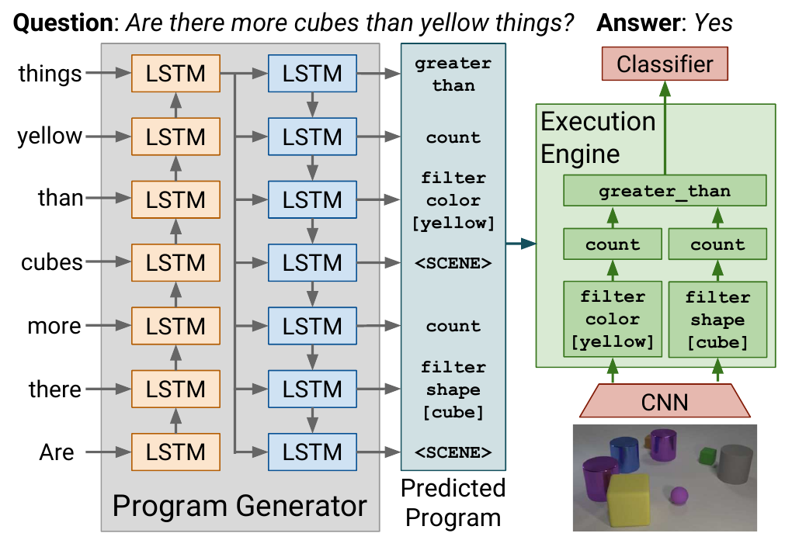
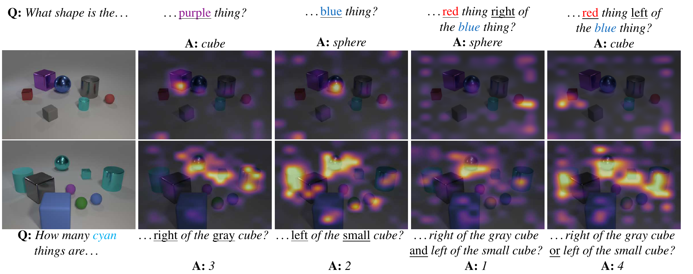

# 질문을 프로그램으로 번역하고, 그 프로그램을 신경망으로 실행하기 — Inferring and Executing Programs for Visual Reasoning
#### Abstract
시각 추론(visual reasoning)에 대한 기존 방법들은 그 밑에 놓인 추론 과정을 명시적으로 모델링하지 않은 채, 블랙박스 구조를 사용해 입력을 출력으로 직접 매핑하려 한다. 그 결과 이런 블랙박스 모델들은 시각 추론을 수행하는 법을 배우기보다 데이터에 있는 편향을 이용하는 법을 배우는 경우가 많다. 본 논문은 모듈 네트워크(module network)에서 착안하여, 수행되어야 할 추론 과정의 명시적 표현을 구성하는 프로그램 생성기(program generator)와 그렇게 만들어진 프로그램을 실행해 답을 내놓는 실행 엔진(execution engine)으로 이루어진 시각 추론 모델을 제안한다. 프로그램 생성기와 실행 엔진은 모두 신경망으로 구현되며, 역전파와 REINFORCE를 결합해 학습된다. 시각 추론을 위한 CLEVR 벤치마크를 사용해, 제안 모델이 강력한 베이스라인들을 큰 폭으로 앞서고 다양한 설정에서 더 잘 일반화됨을 보인다.
#### 요약
"파란 모자를 쓴 사람이 뒤쪽 자전거를 만지고 있는가" 같은 질문에 답하려면 사람, 자전거, 접촉이라는 기본 개념을 그때그때 조합해야 한다. 이미지와 질문을 통째로 신경망에 밀어 넣는 방식이 이런 질문에서 무너지는 이유가 여기에 있다. 이 논문은 질문을 먼저 프로그램이라는 이산 구조로 번역한 다음, 그 프로그램의 모양대로 신경망을 조립해 실행한다. 구문은 심볼릭으로 남기고 의미는 전부 학습으로 채운다는 이 분업이, 오늘날 도구를 호출하는 에이전트 구조까지 이어지는 계보의 출발점 가운데 하나다.

---

## 1. 문제의식

많은 응용에서 컴퓨터 비전 시스템은 시각 세계에 대해 추론해서 정교한 질의에 답해야 한다. 이때 필요한 능력이 구성성(compositionality)이다. "사람이 자전거를 만진다"라는 표현을 한 번도 본 적이 없더라도, 사람과 자전거와 만지다를 각각 이해하고 있다면 그 조합을 이해할 수 있어야 한다. 논문 서두의 표현대로, 이런 구성적 추론은 인간 지능의 특징이며 사람이 제한된 기본 기술만으로 무수히 많은 문제를 풀 수 있게 해 준다.

반면 기존의 시각 질의응답(VQA) 모델은 입력에서 출력으로 가는 매핑을 직접 학습한다. 구성적 계획을 명시적으로 세우고 실행하지 않는다. 이 방식은 이미지를 분류하거나 소수의 고정된 범주를 검출하는 데에는 잘 작동하지만, 객체와 속성과 행동과 상호작용의 조합이 지수적으로 커지는 과제에서는 강력한 베이스라인조차 넘어서지 못한다. 대신 모델은 데이터에 있는 편향을 학습한다. 이 논문의 실험에서 이미지를 아예 보지 않고 질문만 LSTM으로 처리하는 모델이 CLEVR에서 47.0%를 낸다는 사실 자체가 그 증거다.

논문의 주장은 명료하다. 복잡한 추론 과제를 제대로 수행하려면 구성적 추론을 모델 구조 안에 명시적으로 집어넣어야 할지 모른다는 것이다. 그래서 시스템을 두 부분으로 나눈다. 질문을 읽고 답을 얻기 위한 계획, 즉 프로그램을 만드는 프로그램 생성기와, 각 함수를 작은 신경 모듈로 구현해 그 모듈 네트워크를 이미지 위에서 실행하는 실행 엔진이다.

## 2. 무엇을 심볼릭으로 남길 것인가

### 1) 세 부분으로 나눠 보기

고전적인 방식으로 시각 질의응답을 푼다면 세 부분이 필요하다. 자연어를 형식 표현으로 옮기는 파서, 그 형식 표현 자체, 그리고 그것을 장면 데이터베이스 위에서 실행하는 인터프리터다. Andreas의 neural module network는 파서와 모듈 구조를 사람이 만들고 모듈 가중치만 학습했다. 이 논문은 파서를 학습된 seq2seq 모델로, 인터프리터를 학습된 신경 모듈로 각각 대체하고, 가운데의 형식 표현만 심볼릭으로 남긴다.

결국 사람이 손으로 준 심볼릭 요소는 함수 어휘와 각 함수의 항수, 그리고 트리 구성 규칙이 전부다. 구문은 심볼릭이고 의미는 전부 뉴럴이다. 3.1절에서 저자들이 "we focus on learning semantics for a fixed syntax"라고 쓴 문장이 이 논문의 좌표를 한 줄로 요약한다.

앞선 모듈 네트워크와 갈라지는 실질적 이유도 있다. 기성 구문 파서는 CLEVR의 복잡한 질문에서 실패한다. 그래서 이 논문의 실험에서는 가장 비교하고 싶었던 neural module network를 아예 표에 넣지 못했다. 이 실패 자체가 파서를 학습된 생성기로 바꾼 동기다.

### 2) 전체 구조

모델은 이미지 $x$와 질문 $q$를 받아 고정된 답 집합 $\mathcal{A}$ 안에서 답 $a$를 고른다. 내부적으로는 먼저 추론 단계를 나타내는 프로그램 $z$를 예측하고, 그 프로그램을 이미지 위에서 실행한다.

$$
z = \pi(q), \qquad a = \phi(x, z) = \phi\big(x, \pi(q)\big)
$$

$\pi$가 프로그램 생성기, $\phi$가 실행 엔진이다. 두 함수 모두 데이터로부터 학습되는 신경망이며, 앞선 연구들과 달리 프로그램을 만들거나 실행하기 위한 어떤 휴리스틱도 사람이 설계하지 않는다. 이 한 줄의 분해가 논문 전체의 뼈대다.



*시스템 개요. 왼쪽 회색 상자가 프로그램 생성기, 오른쪽 초록 상자가 실행 엔진이다. 질문 "Are there more cubes than yellow things?"가 함수 열로 번역되고, 그 열이 구문 트리로 복원되어 모듈 네트워크로 조립된다.*

## 3. 프로그램 생성기의 동작

프로그램 생성기 $\pi$는 구조 자체는 평범한 LSTM sequence-to-sequence 모델이다. 특별한 점은 출력 토큰이 단어가 아니라 함수라는 것, 그리고 그 함수 열이 트리로 복원된다는 것이다. 단계별로 보면 다음과 같다.

### 1) 출력 어휘 정의

함수 집합 $\mathcal{F}$는 `filter_color[yellow]`, `filter_shape[cube]`, `count`, `exist`, `unique`, `relate[right]`, `greater_than`, `equal_size`, `same_material` 같은 항목으로 이루어지고, 각 함수 $f$는 고정된 항수 $n_f \in \{1, 2\}$를 갖는다. 여기에 이미지의 시각 특징을 뜻하는 특수 상수 `Scene`이 추가되는데, 이것이 트리의 잎 노드 역할을 한다. 어휘와 항수는 사람이 미리 지정하는 유일한 사전 지식이고, 각 함수가 무슨 의미인지는 어디에도 명시하지 않는다.

### 2) 프로그램의 직렬화

프로그램은 본래 구문 트리, 즉 비순차적 구조인데 seq2seq로 다루려면 열이 필요하다. 논문은 전위 순회(prefix traversal)로 직렬화한다. 위 그림의 예를 보면, `greater_than`이 최상위이고 그 아래 `count` 두 개, 각 `count` 아래 `filter_color[yellow]`와 `filter_shape[cube]`, 그 아래 `Scene`이 놓인 트리다. 전위 순회하면 다음 일곱 개 토큰 열이 된다.

```
greater_than  count  filter_color[yellow]  <SCENE>  count  filter_shape[cube]  <SCENE>
```

항수가 고정돼 있으므로 이 열은 트리를 유일하게 결정한다.

### 3) 인코딩과 디코딩

인코딩 단계에서는 질문을 단어 단위로 토큰화해 임베딩한 뒤 LSTM에 순차 입력하고, 마지막 은닉 상태에 질문 전체가 압축된다. 디코딩 단계에서는 또 다른 LSTM이 함수 어휘에 대한 확률 분포를 매 스텝 내놓고, 시험 시점에는 각 스텝의 argmax를 취해 결정론적으로 함수 열을 얻는다. 여기에는 주의 기제도, 문법 제약도 없다. 디코더는 문법적으로 유효한 열만 내도록 강제되지 않고, 그저 학습으로 유효한 열을 내도록 배운다.

그림을 읽을 때 한 가지 주의할 점이 있다. 왼쪽 인코더 열에 단어가 위에서부터 things, yellow, than 순으로 적혀 있어 입력이 역순처럼 보이지만, 박스 사이 화살표는 아래에서 위로 향한다. 즉 첫 시점이 맨 아래의 Are이고 위로 올라가면서 there, more, cubes, than, yellow, things 순으로 들어간다. 질문 그대로의 순서다. 이렇게 그린 이유는 인코더와 디코더의 접점을 붙여놓기 위해서로 보인다. 인코더는 아래에서 위로 올라가 맨 위 박스에서 최종 은닉 상태가 나오고, 그 지점에서 오른쪽으로 선이 빠져나와 세로 버스를 타고 디코더의 모든 시점에 입력으로 들어간다. 디코더 열의 화살표는 반대로 위에서 아래로 향하므로 첫 출력이 맨 위의 `greater_than`이고, 이 순서가 그림 설명에 적힌 전위 순회와 일치한다. 두 열이 반대 방향으로 흐르면서 맨 위에서 만나는 배치다.

### 4) 후처리

생성된 열이 전위 순회로 해석되지 않는 경우가 생긴다. 열이 너무 짧아 자식이 모자라는 함수가 있으면 부족한 자리를 `Scene` 상수로 채우고, 반대로 너무 길어 부모가 없는 토큰이 남으면 그 토큰들은 버린다. 이 두 규칙 덕분에 어떤 출력이든 항상 유효한 구문 트리로 환원되고, 따라서 실행 엔진은 언제나 조립 가능한 모듈 네트워크를 받는다.

## 4. 실행 엔진과 모듈 설계

### 1) 함수와 모듈은 일대일로 미리 만들어 둔다

3.3절에 "For each function $f \in \mathcal{F}$, the execution engine maintains a neural network module $m_f$"라고 되어 있다. 학습 전에 함수 어휘의 모든 항목에 대해 모듈을 하나씩 만들어 두고, 이 일대일 대응은 고정이다. 실행 엔진은 프로그램의 각 노드를 대응 모듈로 치환하기만 하면 된다. `filter_color[yellow]`와 `filter_color[red]`는 서로 다른 함수이므로 모듈도 각각 따로 존재한다.

모든 모듈은 같은 인터페이스를 갖는다. 항수 $n$인 모듈은 $C \times H \times W$ 특징 맵을 $n$개 받아 같은 모양의 특징 맵 하나를 내놓는다.

$$
m_f : \underbrace{\mathbb{R}^{C \times H \times W} \times \cdots \times \mathbb{R}^{C \times H \times W}}_{n_f} \;\longrightarrow\; \mathbb{R}^{C \times H \times W}
$$

이 통일된 시그니처가 중요한 이유는, 이것이 있어야 임의의 유효한 프로그램 $z$가 곧바로 유효한 신경망 하나에 대응하기 때문이다. 구조 템플릿은 두 가지뿐이다. 단항 모듈은 $3 \times 3$ 합성곱 두 개짜리 residual block이고, 이항 모듈은 입력 둘을 채널 방향으로 이어 붙인 뒤 $1 \times 1$ 합성곱으로 $2C$를 $C$로 줄이고 residual block에 넣는다. `Scene` 모듈만 예외로 ImageNet에서 사전학습한 ResNet-101의 conv4 특징을 합성곱 네 개로 처리한다. 마지막 특징 맵은 평탄화되어 다층 퍼셉트론 분류기로 들어가고 답에 대한 분포를 낸다.

정리하면, 사람이 정해두는 것은 어떤 함수가 존재하고 각각 몇 개의 입력을 받는지, 그리고 모듈의 공통 구조뿐이다. 각 모듈이 실제로 무슨 연산을 하는지는 전부 가중치 학습으로 정해진다.

### 2) 이항 모듈의 1×1 합성곱은 무엇을 하는가

$3 \times 3$ 합성곱이 아홉 개 픽셀을 압축한다면, $1 \times 1$ 합성곱은 압축할 것이 없어 보인다. 하지만 합성곱은 공간 축과 채널 축 두 방향으로 정보를 모은다. $3 \times 3$ 합성곱이 압축하는 것은 아홉 개 픽셀만이 아니라 아홉 개 위치 $\times$ $C$개 채널, 즉 $9C$개 숫자다. $1 \times 1$ 합성곱은 이 중 공간 방향 집약을 포기하고 채널 방향 집약만 남긴 것이라, 압축할 정보가 없는 게 아니라 한 축으로만 압축하는 것이다.

구체적으로 입력이 $C \times H \times W$일 때 각 픽셀 위치 $(i, j)$에는 길이 $C$인 벡터가 하나씩 있다. $1 \times 1$ 합성곱은 이 벡터에 행렬 하나를 곱해 $C'$차원으로 바꾸는 연산이고, 모든 위치에 같은 행렬을 적용한다.

$$
y_{:,i,j} = W\,x_{:,i,j}, \qquad W \in \mathbb{R}^{C' \times C}
$$

다시 말해 픽셀마다 독립적으로 작동하는 완전연결 층 하나를 이미지 전체에 공유해서 미끄러뜨리는 것이다. 채널이 512개라면 위치마다 512개 숫자를 섞어 새로운 조합을 만드는 것이니 결코 항등 연산이 아니다. 파라미터도 $C \times C'$개 있다. 흔히 쓰이는 이유도 여기서 나온다. 채널 간 상호작용을 학습하면서 차원을 줄이고, $3 \times 3$에 비해 연산량이 9분의 1이라 GoogLeNet이나 ResNet의 bottleneck에서 병목 축소용으로 자주 등장한다.

이 논문의 이항 모듈에서는 역할이 더 분명하다. 예를 들어 `greater_than` 모듈은 자식 모듈 두 개에서 각각 $C \times H \times W$ 특징 맵 $h_L, h_R$을 받는데, 이를 채널 방향으로 이어 붙이면 $2C \times H \times W$가 된다. 여기에 $1 \times 1$ 합성곱을 걸어 다시 $C$로 되돌린다.

$$
m_f(h_L, h_R) = \mathrm{ResBlock}\big(W_{1\times1} * [\,h_L ; h_R\,]\big), \qquad W_{1\times1} \in \mathbb{R}^{C \times 2C}
$$

목적이 두 가지다. 하나는 융합이다. 같은 위치 $(i, j)$에서 왼쪽 자식이 내놓은 $C$개 값과 오른쪽 자식이 내놓은 $C$개 값을 하나로 결합하는데, 두 특징 맵이 같은 이미지 격자에 정렬돼 있으므로 이 결합은 본래 위치별 연산이다. 이웃 픽셀까지 끌어올 이유가 없는 지점이라 $1 \times 1$이 적절하다. 다른 하나는 인터페이스 유지다. 모든 모듈이 $C \times H \times W$를 받아 $C \times H \times W$를 내놓아야 임의의 프로그램 구조로 조립할 수 있는데, 이어 붙이면서 늘어난 채널을 여기서 되돌려 놓는다.

공간 방향 정보 통합이 사라지는 것도 아니다. $1 \times 1$로 융합한 직후에 $3 \times 3$ 합성곱 두 개짜리 residual block이 이어지므로, 채널을 먼저 섞고 공간을 그다음에 섞는 순서로 나뉘어 있을 뿐이다. 모듈이 여러 층 쌓일수록 $3 \times 3$들이 누적되면서 수용 영역도 넓어진다. `relate[right]` 같은 공간 관계 모듈이 작동하려면 이 부분이 필요하다.

## 5. 학습: 이산 병목과 REINFORCE

정답 프로그램이 있으면 학습은 간단하다. $(q, z)$ 쌍으로 프로그램 생성기를 평범한 seq2seq 교차 엔트로피로 학습시키고, $(x, z, a)$ 삼항으로 실행 엔진을 역전파로 학습시키면 된다.

문제는 자유형 자연어 질문에 대해 정답 프로그램을 다는 일이 비싸다는 점이다. 정답 프로그램 없이 $(x, q, a)$만으로 두 부분을 함께 학습하려면 argmax를 거쳐 실행 엔진으로 이어지는 경로를 통과해야 하는데, 이산 연산이라 미분이 되지 않는다. 심볼을 사이에 끼운 대가다. 논문의 답은 argmax를 샘플링으로 바꾸고 REINFORCE를 쓰는 것이다.

$$
\nabla_\theta \, \mathbb{E}_{z \sim p_\theta(z \mid q)}\big[R(z)\big]
= \mathbb{E}_{z \sim p_\theta(z \mid q)}\Big[\big(R(z) - b\big)\,\nabla_\theta \log p_\theta(z \mid q)\Big]
$$

여기서 $p_\theta(z \mid q)$가 프로그램 생성기의 출력 분포, 보상 $R(z)$는 실행 엔진의 음의 0-1 손실, 즉 $\phi(x, z)$가 정답을 맞히면 높고 틀리면 낮은 값이다. $b$는 분산을 줄이기 위한 이동평균 기저선이다. 기울기가 모듈 내부로 흐르지 않고 로그 확률의 기울기에 보상을 곱하는 형태로 대체되므로, 미분 불가능한 이산 선택을 우회할 수 있다.

다만 처음부터 이렇게 공동 학습하면 잘 수렴하지 않는다. 저자들이 든 이유가 정확하다. 생성기는 함수의 의미를 모른 채 올바른 프로그램을 만들어야 하고, 실행 엔진은 부정확한 프로그램에서 올바른 답을 내야 한다. 서로가 서로를 필요로 하는 부트스트랩 문제다. 그래서 실제 준지도 학습은 세 단계로 나뉜다.

1. 적은 수의 정답 프로그램으로 프로그램 생성기를 먼저 지도학습한다.
2. 생성기를 고정한 채, 예측 프로그램을 써서 실행 엔진을 전체 $(x, q, a)$ 데이터에 학습시킨다.
3. 두 부분을 REINFORCE로 함께 미세조정한다.

정답 프로그램은 오직 1단계에만 쓰인다.

## 6. 실험

논문의 실험 구성은 4.2절 하나로 끝나지 않는다. 성능, 해석 가능성, 그리고 세 축의 일반화를 각각 다른 절이 담당한다.

### 1) CLEVR 정확도

비교 대상은 CLEVR 논문에서 쓴 모델들을 그대로 재현한 것이다. 질문 유형별 최빈 답을 내는 Q-type mode, 이미지를 보지 않고 질문만 처리하는 LSTM, CNN 특징과 LSTM 은닉 상태를 이어 붙이는 CNN+LSTM, 여기에 두 차례 공간 어텐션을 얹은 CNN+LSTM+SA, 어텐션 출력의 선형 변환을 MLP로 바꾼 CNN+LSTM+SA+MLP다.

| 모델 | Count | Compare Integer (Equal) | Query Color | 전체 |
|---|---|---|---|---|
| LSTM | 42.5 | 63.0 | 12.2 | 47.0 |
| CNN+LSTM+SA+MLP | 59.7 | 60.3 | 73.1 | 73.2 |
| 사람 | 86.7 | 79.0 | 95.0 | 92.6 |
| Ours-strong (700K prog.) | **92.7** | **98.0** | **98.4** | **96.9** |
| Ours-semi (18K prog.) | 90.1 | 93.9 | 97.1 | 95.4 |
| Ours-semi (9K prog.) | 79.7 | 85.2 | 93.3 | 88.6 |

CLEVR 질문 응답 정확도이고 높을수록 좋다. 사람 성능은 5.5K 문항 부분집합에서 측정한 값이다. 눈여겨볼 베이스라인은 CNN+LSTM+SA+MLP인데, 공간 어텐션을 두 번 거치는 당대의 강력한 VQA 구조인데도 개수 세기와 정수 비교에서 60% 안팎에 머문다. 이진 비교에서 60%면 거의 찍는 수준이다. 반면 제안 모델은 같은 유형에서 90%대다. 격차가 어디서 나는지 분명하다.

준지도 결과도 인상적이다. 정답 프로그램 1.8만 개면 70만 개를 쓴 모델과 거의 같고, 9천 개만 써도 베이스라인을 15%p 넘게 앞선다. 저자들은 이것이 생성기가 프로그램을 외운 결과가 아니라고 강조한다. CLEVR의 고유 프로그램이 약 45만 개이므로 4% 이하만 보고 나머지로 일반화한 셈이다. 프로그램 개수를 늘릴 때 예측 정확도는 2만 개 부근에서 거의 포화하고, 정답 프로그램 대신 예측 프로그램으로 실행 엔진을 학습시키면 3%p 정도 손해를 보지만 공동 미세조정으로 상당 부분 만회한다. 참고로 프로그램 정확도는 완전 일치로 측정하므로 기능적으로 동일한 다른 프로그램은 오답 처리되어 실제보다 낮게 잡혔을 수 있다.

### 2) 모듈은 무엇을 배웠는가



*예측 답 점수의 합을 마지막 특징 맵으로 미분한 기울기의 노름을 시각화한 것이다. 왼쪽에서 오른쪽으로 갈수록 질문에 모듈이 하나씩 추가되고, 새로 추가된 모듈에 해당하는 단어에 밑줄이 그어져 있다.*

두 가지가 드러난다. 하나는 공간 관계와 교집합, 합집합이 얽힌 복잡한 지시 표현에서도 올바른 물체에 반응한다는 점이다. 다른 하나는 질문에서 단어 하나만 바꿔 모듈 하나를 교체했을 때, 예컨대 purple을 blue로, left를 right로, and를 or로 바꾸면 주목 영역과 답이 함께 크게 달라진다는 점이다. 모듈 출력에 아무런 감독을 주지 않았는데도 각 모듈이 의도한 기능, 즉 위치 찾기와 집합 연산을 실제로 수행한다는 증거다.

### 3) 새로운 속성 조합

CLEVR-CoGenT는 조건 A에서 정육면체가 회색, 파랑, 갈색, 노랑이고 원기둥이 빨강, 초록, 보라, 청록인데 조건 B에서 이 색 팔레트를 맞바꾼다. A로 학습해 B로 시험하면 제안 모델은 96.6에서 73.7로 떨어진다. 베이스라인 80.3에서 68.7보다는 낫지만 여전히 무너지는 것이고, 특히 모양과 색을 묻는 질문에서는 베이스라인을 앞서지 못한다.

저자들의 해석이 설득력 있다. 빨간 정육면체를 한 번도 못 봤다면 모델에게는 "빨강"이 색을 가리키는지 모양을 가리키는지 구분할 유인이 없다. 다만 조건 B 데이터로 미세조정하면 92.7까지 회복하고, 질문 1만 개, 이미지로는 약 1천 장만으로도 베이스라인을 전면적으로 앞선다. 구성적 구조 덕분에 새 속성 의미를 적은 데이터로 빠르게 익힌다는 주장이다.

### 4) 더 긴 추론 사슬

CLEVR 질문을 question family 단위로 나눠 평균 프로그램 길이가 16 미만이면 짧은 질문, 아니면 긴 질문으로 분류한다.

| 모델 | 짧은 질문만 학습 → 짧은 | 짧은 질문만 학습 → 긴 | 둘 다 미세조정 → 짧은 | 둘 다 미세조정 → 긴 |
|---|---|---|---|---|
| CNN+LSTM | 54.0 | 52.8 | 54.3 | 54.2 |
| CNN+LSTM+SA+MLP | 74.2 | **64.3** | 74.2 | 67.8 |
| Ours (25K prog.) | **95.9** | 55.3 | **95.6** | **77.8** |

짧은 질문만으로 학습하면 짧은 질문 95.9%인데 긴 질문은 55.3%로, 같은 조건의 베이스라인 64.3%보다도 낮다. 원인은 생성기의 짧은 프로그램 편향이다. 긴 질문에 대해 조건절 일부를 빠뜨린 짧은 프로그램을 만들어 엉뚱한 물체를 가리킨다.

흥미로운 처방은 실행 엔진을 고정한 채 생성기만 REINFORCE로 미세조정하는 것이다. 정답 프로그램은 전혀 쓰지 않고 답만으로 학습하는데, 긴 질문 정확도가 77.8%로 올라 전체 데이터로 학습한 베이스라인 67.8%를 크게 앞선다. 문제가 생성기에 있음을 실험 설계로 못박은 셈이다.

### 5) 사람이 쓴 질문

CLEVR 질문이 알고리즘으로 생성된 것이라 특정 접근에 유리할 수 있다는 반론에 답하기 위해, Amazon Mechanical Turk 작업자에게 CLEVR 이미지에 대해 "똑똑한 로봇이 답하기 어려울" 질문을 쓰게 했다. 세 명에게 답을 시켜 다수가 맞히지 못한 질문은 제거하고, 이미지당 한 문항씩 학습 17,817 / 검증 7,202 / 시험 7,145문항을 모았다. 이 데이터의 성격이 중요한데, 기존 VQA 데이터셋과 달리 상식 지식이 필요 없고 순수하게 시각 추론 능력만 묻는다.

학습은 데이터가 적어 실행 엔진은 건드리지 않고 생성기만 미세조정하며, CLEVR에 없던 단어의 임베딩만 무작위 초기화한다. 결과는 CLEVR만으로 학습했을 때 54.0%로 베이스라인 50.4%보다 조금 낫고, 미세조정 후에는 66.6%로 베이스라인 57.6%와 9%p 차이가 난다. 논문의 예시를 보면 "box"를 `filter_shape[cube]`에 대응시키는 식으로 새 어휘를 기존 모듈에 연결하고, CLEVR 함수로 정확히 표현할 수 없는 질문도 의미가 근사한 프로그램으로 옮긴다. 실패하는 경우는 대체로 모듈 목록에 없는 능력을 요구할 때다.

## 7. 한계

여기서 심볼은 이름만 심볼이다. `count` 모듈이 정말로 세는지는 보장이 없고, 학습으로 근사한 함수일 뿐이라 건전성이나 논리적 의미론이 없다. 장면 표현도 여전히 연속적인 특징 맵이어서 객체 단위의 이산 상태나 데이터베이스가 존재하지 않는다. CoGenT에서 색과 모양이 얽혀 무너지는 현상이 바로 이 지점의 대가다. 진짜 심볼릭 실행기라면 빨강이 색 속성이라는 사실이 정의에 들어 있으니 애초에 생기지 않을 실패다.

모듈 목록이 고정이라 새 개념을 선언적으로 추가할 수도 없다. 논문이 드는 예가 "What color is the object with a unique shape?"인데, 유일한 모양을 식별하는 모듈이 없어 표현할 방법이 없다. 제어 흐름도 없다. 5절에서 저자들이 if/then/else와 for/do를 넣어 튜링 완전한 모듈 집합을 만들자고 제안하는 것은, 자기들이 만든 언어가 아직 표현력이 제한된 도메인 특화 언어임을 인정하는 대목이다. 감독 없이 새 모듈을 자동으로 찾아 학습하는 문제는 미해결로 남는다.

## 8. 뉴로심볼릭 맥락에서

논문 자신이 결론 첫 문장에서 "심볼릭 표현을 (신경) 기계학습 모델에 통합하려는 긴 연구 흐름에 속한다"고 밝히고 있다. 그러니 이 계보 안에 놓고 읽는 것은 저자들의 의도이기도 하다.

### 1) 심볼릭 구조를 남겨서 얻은 것

첫째는 구성성이다. Fodor와 Pylyshyn 이래 연결주의 비판의 핵심이 체계성 부재였는데, 프로그램이라는 이산 구조는 본 적 없는 함수 조합을 자유롭게 만들어낼 수 있다. 짧은 질문으로 배운 모듈을 긴 사슬로 이어 붙이는 실험이 이 성질을 직접 시험한다.

둘째는 해석 가능성이다. 단순히 어텐션 지도를 보여주는 수준이 아니라 모델의 추론 계획을 문자열로 읽을 수 있다. 예측 프로그램을 질문 의미와 대조해 맞았는지 근사했는지 무관한지 판정하는 것이 가능한 이유다.

셋째는 오류 귀인이다. 모델이 틀렸을 때 프로그램이 틀렸는지 실행이 틀렸는지 분리해서 물을 수 있다. 4.5절은 아예 실행 엔진을 고정한 채 생성기만 미세조정해 원인이 생성기의 짧은 프로그램 편향임을 실험으로 못박는다. 단일 블랙박스에서는 설계할 수 없는 진단이다.

넷째는 표본 효율이다. CoGenT에서 이미지 1천 장 정도로 새 속성 조합에 적응하는 결과가 여기 해당한다.

### 2) 계보와 그 이후

앞에는 파서와 모듈을 손으로 만든 Andreas의 neural module network가 있고, 동시기에 Hu 외의 end-to-end module network가 같은 아이디어에 도달한다. 이 논문 다음에 오는 것이 뉴로심볼릭 방향으로 한 발 더 나간 NS-VQA(Yi 외, 2018)인데, 이미지를 객체 속성 테이블로 역렌더링해 장면 표현까지 심볼로 만들고 프로그램은 결정론적 실행기로 돌린다. 그 결과 CLEVR에서 99.8%를 얻으면서 정답 프로그램은 270개만 쓴다. 이 논문이 70만 개를 쓴 것과 비교하면 심볼릭 비중을 높일수록 데이터 효율이 극적으로 올라간다는 논증이 된다. Mao 외의 neuro-symbolic concept learner는 여기서 프로그램 감독마저 걷어낸다.

반대편 흐름을 함께 보아야 논의가 정직해진다. FiLM은 질문 임베딩으로 합성곱 특징을 아핀 변조하는 것만으로 97.6%, MAC은 어텐션 기반 재귀 셀만으로 98.9%를 낸다. 둘 다 프로그램도 모듈 조립도 없는 순수 뉴럴이다. CLEVR 정확도만 놓고 보면 명시적 심볼 구조는 필요조건이 아니었다. 이 사실이 뉴로심볼릭 논쟁의 축소판인데, 심볼릭 구조의 정당화 근거가 정확도에서 해석 가능성, 데이터 효율, 분포 밖 일반화, 오류 진단 가능성 쪽으로 옮겨가야 한다는 뜻이다. 이 논문의 실험이 4.2절 하나가 아니라 네 개의 다른 일반화 시험으로 이루어진 것도 같은 맥락으로 읽힌다.

마지막으로 현재와 잇는 선이 있다. 질문을 프로그램으로 번역하고 그 프로그램을 실행해 답을 낸다는 골격은 그대로 남고, 학습된 LSTM 생성기 자리에 대형 언어모델이 들어앉은 것이 VisProg나 ViperGPT 같은 시각 프로그래밍 연구다. 이제 프로그램은 파이썬 코드이고 모듈은 사전학습된 검출기나 VLM이며, 생성기는 별도 학습 없이 프롬프트만으로 작동한다. 더 넓게 보면 오늘날의 도구 호출 에이전트도 같은 구조다. 언어모델이 계획을 이산적 호출 열로 내놓고 외부 실행기가 그것을 수행한다.

이 논문의 자리는 그래서 두 겹이다. 뉴로심볼릭의 오래된 문제인 이산 병목과 부트스트랩을 신경망 두 개와 REINFORCE로 정면 돌파한 초기 사례이자, 오늘날 에이전트 구조의 원형이다.

---

## 참고

- Johnson et al., *Inferring and Executing Programs for Visual Reasoning*, ICCV 2017. 코드는 `facebookresearch/clevr-iep`.
- Johnson et al., *CLEVR: A Diagnostic Dataset for Compositional Language and Elementary Visual Reasoning*, CVPR 2017.
- Yi et al., *Neural-Symbolic VQA: Disentangling Reasoning from Vision and Language Understanding*, NeurIPS 2018.
