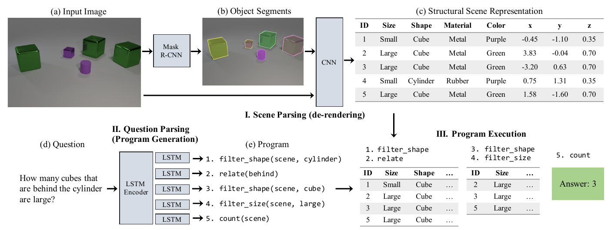
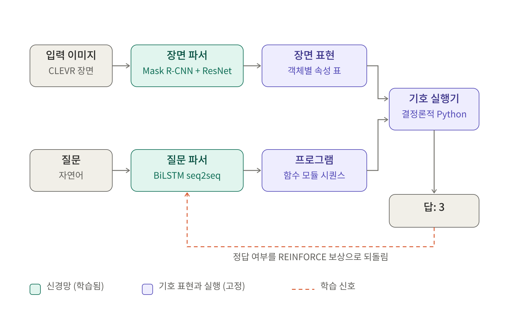
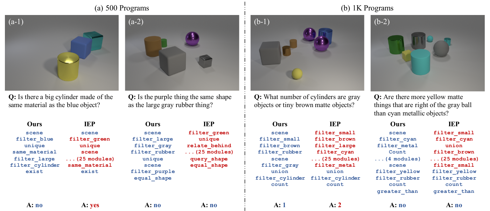
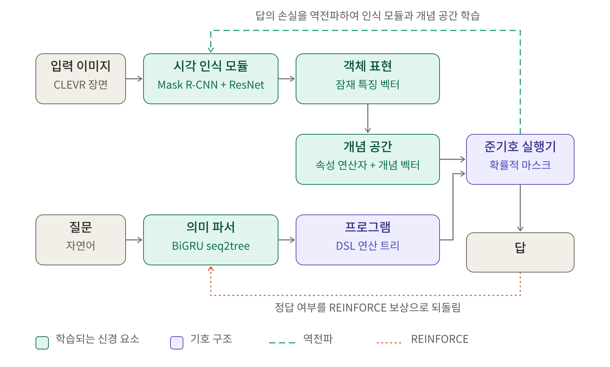

# 지각과 추론을 분리하여 기호 실행기 위에서 시각 질문에 답하기 — Neural-Symbolic VQA: Disentangling Reasoning from Vision and Language Understanding
#### Abstract
본 논문은 두 가지 강력한 아이디어, 즉 시각 인식과 언어 이해를 위한 심층 표현 학습(deep representation learning)과 추론을 위한 기호적 프로그램 실행(symbolic program execution)을 결합한다. 제안하는 신경-기호 시각 질의응답(neural-symbolic visual question answering, NS-VQA) 시스템은 먼저 이미지로부터 구조적 장면 표현(structural scene representation)을, 질문으로부터 프로그램 실행 경로(program trace)를 복원한다. 이어서 장면 표현 위에서 프로그램을 실행하여 답을 얻는다. 기호적 구조를 사전지식(prior knowledge)으로 도입하는 것은 세 가지 고유한 이점을 제공한다. 첫째, 기호 공간에서 프로그램을 실행하는 방식은 긴 프로그램 실행 경로에 대해 더 강건하며, 본 모델은 복잡한 추론 과제를 더 잘 해결하여 CLEVR 데이터셋에서 99.8%의 정확도를 달성한다. 둘째, 본 모델은 데이터 효율성과 메모리 효율성이 더 높다. 적은 수의 학습 데이터로 학습한 뒤에도 좋은 성능을 보이며, 이미지를 간결한 표현으로 부호화할 수 있어 오프라인 질의응답에서 기존 방법보다 적은 저장 공간을 요구한다. 셋째, 기호적 프로그램 실행은 추론 과정에 대한 완전한 투명성을 제공하므로, 각 실행 단계를 해석하고 진단할 수 있다.
#### 요약
이미지를 보고 질문에 답하는 문제에서 "보는 일"과 "생각하는 일"을 하나의 신경망 안에 섞지 않고 완전히 떼어놓으면 어떤 일이 벌어지는가. 이 논문은 신경망에게는 이미지와 질문을 기호로 번역하는 역할만 맡기고, 추론은 사람이 짠 결정론적 프로그램이 수행하도록 설계한다. 그 결과 270개의 프로그램 주석만으로 CLEVR에서 99.8%의 정확도를 얻고, 추론의 모든 단계를 사람이 읽을 수 있게 된다. 뉴로심볼릭(neuro-symbolic) 연구의 출발점으로 자주 인용되는 이 논문을, 직전 모델인 IEP 및 후속 모델인 NS-CL과 나란히 놓고 읽는다.

---

## 1. 연구 배경과 문제의식

### 1) 시각 질의응답이란 무엇이며 왜 어려운가

시각 질의응답(visual question answering, VQA)은 이미지 한 장과 그 이미지에 관한 자연어 질문이 주어졌을 때 답을 내놓는 과제이다. "이 사진에서 가장 큰 원기둥 옆에 있는 물체는 무슨 색인가?" 같은 질문에 답하려면 모델은 이미지 속 물체를 알아보고(시각 이해), 질문이 무엇을 묻는지 파악하고(언어 이해), 둘을 결합해 몇 단계의 논리 연산을 거쳐야 한다(추론). 텍스트만 다루는 질의응답과 달리 의미 이해와 시각 이해가 동시에 요구된다는 점에서 인공지능 시스템의 종합 시험대로 여겨져 왔다.

당시 VQA 모델은 대부분 이미지와 질문을 입력받아 답을 바로 출력하는 종단간(end-to-end) 신경망이었다. 종단간 학습이란 입력에서 출력까지의 모든 처리 과정을 하나의 신경망이 통째로 학습한다는 뜻으로, 중간 단계에 사람이 정의한 구조가 없다. 이런 모델은 일반적인 사진 질문에서는 어느 정도 성과를 냈지만, 질문이 여러 단계의 논리를 요구할 때는 성능이 크게 떨어졌다. 더 큰 문제는 이 모델들이 실제로 추론을 하는지, 아니면 데이터셋의 통계적 편향을 외우는지 확인하기 어렵다는 점이었다. 예를 들어 "하늘은 무슨 색인가?"라는 질문에는 이미지를 보지 않고 "파란색"이라고 답해도 대부분 맞는다. 실제로 이미지 특징과 질문 특징을 이어 붙여 분류기에 넣는 단순한 기준 모델이 정교한 모델과 비슷한 성능을 낸다는 보고가 나오면서, 기존 VQA 모델이 데이터셋 편향에 과적합되어 있다는 우려가 커졌다.

### 2) CLEVR 데이터셋과 IEP

이 문제를 진단하기 위해 Johnson 등(2017a)은 CLEVR 데이터셋을 만들었다. CLEVR는 정육면체, 구, 원기둥 같은 단순한 3차원 도형을 렌더링한 합성 이미지로 구성되며, 각 물체는 형태, 색상, 재질, 크기, 3차원 좌표라는 속성을 가진다. 질문은 90개의 논리 템플릿에서 기계적으로 생성되고, 각 질문에는 그 질문을 푸는 정답 프로그램이 함께 딸려 있다. 편향을 통제했기 때문에 모델이 정말 추론하는지를 측정하기에 적합하다. 그리고 당시 최고 수준의 VQA 모델들은 CLEVR에서 좋은 성능을 내지 못했다.

이후 Johnson 등(2017b)은 사람 언어에 담긴 사전지식을 프로그램 형태로 모델에 넣어주면 기계가 추론을 배울 수 있음을 보였다. 이들의 모델인 IEP(Inferring and Executing Programs)는 질문에서 그 밑에 깔린 프로그램을 추론하는 프로그램 생성기와, 그 프로그램을 입력 이미지 위에서 실행하는 학습된 어텐션 기반 실행기로 구성된다. 이 결합은 CLEVR에서 매우 좋은 성능을 냈고, 같은 이미지에 사람이 직접 작성한 질문을 짝지은 CLEVR-Humans에도 어느 정도 일반화되었다.

그러나 IEP에는 두 가지 한계가 남아 있었다. 첫째, 프로그램 생성기를 학습하려면 대량의 주석(약 70만 개 프로그램)이 필요했다. 둘째, 어텐션 기반 신경망 실행기의 동작을 해석하기 어려웠다. 반면 사람은 CLEVR와 CLEVR-Humans의 문제를 몇 개의 예시만 보고도 풀 수 있고, 자신이 어떻게 풀었는지도 명확하게 설명할 수 있다.

### 3) 사람의 추론은 해석 가능하고 분리되어 있다

*그림 1. 논문의 Figure 2. NS-VQA의 세 구성 요소를 하나의 예시 질문으로 보여준다. 위쪽 줄(I)은 입력 이미지 (a)에서 Mask R-CNN으로 물체를 분할하고 (b), CNN으로 각 물체의 속성을 읽어내 오른쪽의 표 (c)를 만드는 장면 파싱 과정이다. 아래 왼쪽(II)은 질문 (d)를 LSTM이 다섯 단계의 프로그램 (e)로 바꾸는 질문 파싱 과정이다. 아래 오른쪽(III)은 그 프로그램을 표 위에서 차례로 실행하면서 후보 물체가 줄어들고, 마지막에 개수 3이 나오는 프로그램 실행 과정이다. 표의 행이 단계마다 줄어드는 모습을 따라가면 실행 과정을 읽을 수 있다.*

저자들은 논문 첫머리에서 사고 실험 하나를 제시한다. 장면 앞에 서서 눈을 감고 오직 손으로 더듬어 장면을 파악한다고 상상해 보자. 그래도 추론하는 데는 아무 어려움이 없다. 사람에게 추론은 완전히 해석 가능하며, 시각 지각과 반드시 얽혀 있지도 않다. 우리는 먼저 지각을 통해 장면에 대한 추상적 지식을 얻고, 그 위에서 논리적 추론을 수행한다. 이 관찰이 논문 전체의 설계 원리가 된다.

이 원리에 따라 저자들은 학습(learning)과 모델링(modeling)의 스펙트럼에서 IEP보다 한 걸음 더 모델링 쪽으로 나아가, 시각 및 언어 이해를 추론으로부터 완전히 분리(disentangle)하는 신경-기호 접근인 NS-VQA를 제안한다. 신경망은 이미지에서 물체 기반의 구조적 장면 표현을 추론하고 질문에서 프로그램을 생성하는 강력한 파싱(parsing) 도구로 쓰고, 신경 파서를 보완하는 기호적 프로그램 실행기가 장면 표현 위에서 프로그램을 실행해 답을 얻는다.

## 2. NS-VQA의 구조

### 1) 전체 파이프라인

NS-VQA는 세 모듈로 구성된다. 장면 파서(scene parser)는 이미지를 구조적 장면 표현으로 역렌더링(de-rendering)하고, 질문 파서(question parser)는 질문으로부터 계층적 프로그램을 생성하며, 프로그램 실행기(program executor)는 그 프로그램을 구조적 표현 위에서 실행해 답을 낸다. 여기서 역렌더링이란 컴퓨터 그래픽스의 렌더링, 즉 "물체 목록과 속성을 받아 이미지를 그리는 과정"을 거꾸로 뒤집어 "이미지를 보고 물체 목록과 속성을 복원하는 과정"을 말한다.

아래 그림은 이 구조를 학습 신호의 흐름까지 포함해 다시 정리한 것이다. 위쪽이 이미지 경로, 아래쪽이 질문 경로이며, 두 경로가 기호 실행기에서 만난다.

*그림 2. NS-VQA 아키텍처. 청록색 상자는 학습되는 신경망이고, 보라색 상자는 기호 표현과 그것을 처리하는 고정된 실행기이다. 회색 상자는 입력과 출력이다. 주황색 점선은 학습 신호로, 실행 결과의 정답 여부가 강화학습 보상으로 질문 파서에만 되돌아간다. 장면 파서로 거슬러 올라가는 화살표가 없다는 점에 주목할 필요가 있다.*

그림에서 청록색 상자는 학습되는 신경망이고, 보라색 상자는 기호 표현과 그것을 처리하는 고정된 실행기이다. 신경망은 입력을 기호로 바꾸는 번역기 역할만 맡고, 추론 자체는 전부 보라색 영역에서 일어난다는 점이 이 구조의 핵심이다.

### 2) 장면 파서: 이미지를 속성 표로 바꾸기

장면 파서는 이미지 속 장면의 구조적이고 분리된 표현을 복원한다. 이 과정은 분할(segment) 기반의 두 단계 방식으로 이루어진다. 먼저 여러 개의 분할 후보를 생성하고, 각 분할 영역마다 물체와 그 속성을 분류한다.

첫 단계에는 Mask R-CNN이 쓰인다. Mask R-CNN은 이미지에서 물체를 찾아 그 윤곽을 픽셀 단위로 오려내는 객체 분할(instance segmentation) 모델이다. NS-VQA에서는 분할 마스크와 함께 색상, 재질, 크기, 형태 같은 이산적 고유 속성의 범주 라벨도 이 네트워크가 예측한다. 경계 상자 점수가 0.9 미만인 후보는 버린다.

둘째 단계에서는 각 물체의 분할 영역을 원본 이미지와 짝지어 224×224 크기로 조정한 뒤 ResNet-34에 넣어 자세(pose)나 3차원 좌표 같은 공간 속성을 추출한다. 원본 이미지 전체를 함께 넣는 이유는 맥락 정보를 활용하기 위해서이다. 예를 들어 물체가 "큰지 작은지"는 그 물체만 오려낸 조각보다 장면 전체 안에서 볼 때 더 정확히 판단할 수 있다.

결과물은 그림 1의 (c)처럼 물체마다 한 행을 차지하는 표이다. 각 행에는 크기, 형태, 재질, 색상, x, y, z 좌표가 기록된다. 저자들은 이 표현이 분리되어 있고(disentangled), 간결하며(compact), 풍부하다(rich)고 설명한다. 분리되어 있다는 것은 색상과 형태 같은 속성이 서로 독립된 칸에 들어 있다는 뜻이고, 간결하다는 것은 이미지 한 장의 정보가 몇 개의 숫자와 범주값으로 요약된다는 뜻이다.

### 3) 질문 파서: 질문을 프로그램으로 바꾸기

질문 파서는 자연어 질문을 잠재 프로그램(latent program)으로 사상한다. 프로그램은 함수 모듈의 계층 구조로 이루어지며, 각 모듈은 장면 표현에 대한 독립적인 연산 하나를 수행한다. 예를 들어 filter_shape(cube)는 "정육면체만 남겨라", relate(behind)는 "기준 물체 뒤에 있는 것을 찾아라", count는 "개수를 세라"라는 연산이다. 계층적 프로그램을 추론의 골격으로 쓰면 구성성(compositionality)과 일반화 능력이 자연스럽게 확보된다. 구성성이란 작은 부품을 조합해 새로운 전체를 만드는 성질로, 몇 개의 기본 연산만 알면 그것을 조합해 처음 보는 복잡한 질문도 풀 수 있게 된다는 의미이다.

질문 파서의 구조는 어텐션 기반의 sequence-to-sequence(seq2seq) 모델이다. seq2seq란 단어열을 입력받아 다른 기호열을 출력하는 모델로, 기계 번역에서 널리 쓰이는 인코더-디코더 구조를 가진다. 여기서는 "자연어 질문을 프로그램 언어로 번역하는 번역기"라고 보면 된다.

인코더는 양방향 LSTM이며, 길이가 제각각인 질문을 입력받아 각 시점 $i$마다 부호화 벡터 $e_i$를 출력한다.

$$
e_i = [e_i^F, e_i^B], \quad e_i^F, h_i^F = \mathrm{LSTM}(\Phi_E(x_i), h_{i-1}^F), \quad e_i^B, h_i^B = \mathrm{LSTM}(\Phi_E(x_i), h_{i+1}^B)
$$

여기서 $x_i$는 질문의 $i$번째 단어이고, $\Phi_E$는 단어를 벡터로 바꾸는 인코더 단어 임베딩(word embedding)으로 모델과 함께 학습된다. LSTM(long short-term memory)은 문장을 앞에서부터 한 단어씩 읽으며 기억 상태를 갱신하는 순환 신경망이다. 위첨자 $F$는 앞에서 뒤로(forward) 읽는 LSTM, $B$는 뒤에서 앞으로(backward) 읽는 LSTM을 뜻하며, $h$는 각 LSTM의 은닉 상태, $e$는 출력이다. 순방향 LSTM은 직전 단어의 상태 $h_{i-1}^F$를 이어받고, 역방향 LSTM은 다음 단어의 상태 $h_{i+1}^B$를 이어받는다. 최종 부호화 $e_i$는 두 방향의 출력을 이어 붙인 것이다.

양방향으로 읽는 이유는 질문의 의미가 뒤쪽 단어에 의해 결정되는 경우가 많기 때문이다. "How many cubes that are behind the cylinder are large?"에서 "cubes"가 무엇을 세는 대상인지는 문장 끝의 "are large"까지 읽어야 확정된다. 양방향 LSTM은 각 단어 위치에서 문장 전체의 앞뒤 맥락을 모두 반영한 표현을 만든다.

디코더는 비슷한 구조의 LSTM으로, 출력 시퀀스의 직전 토큰 $y_{t-1}$로부터 벡터 $q_t$를 생성한다. 이 $q_t$를 어텐션 층에 넣어 부호화 상태들의 가중합인 맥락 벡터 $c_t$를 얻는다.

$$
q_t = \mathrm{LSTM}(\Phi_D(y_{t-1})), \quad \alpha_{ti} \propto \exp(q_t^\top W_A e_i), \quad c_t = \sum_i \alpha_{ti} e_i
$$

$\Phi_D$는 디코더 단어 임베딩이다. $\alpha_{ti}$는 프로그램의 $t$번째 토큰을 만들 때 질문의 $i$번째 단어를 얼마나 참고할지를 나타내는 어텐션 가중치로, 디코더 상태 $q_t$와 인코더 출력 $e_i$의 유사도가 클수록 커진다. 저자들은 단순화를 위해 $q_t$와 $e_i$의 차원을 같게 두고 어텐션 가중 행렬 $W_A$를 단위 행렬로 고정했다. 즉 유사도는 두 벡터의 내적 그 자체이다. 맥락 벡터 $c_t$는 "지금 만들려는 토큰과 관련된 질문 부분의 요약"이라 할 수 있다. 예를 들어 디코더가 filter_shape(cylinder)의 인자를 만들 차례라면 질문의 "cylinder" 위치에 가중치가 집중되어야 한다.

마지막으로 맥락 벡터와 디코더 출력을 이어 붙여 소프트맥스(softmax) 활성화를 가진 완전연결층에 통과시켜, 다음 토큰의 확률 분포를 얻는다.

$$
y_t \sim \mathrm{softmax}(W_O[q_t, c_t])
$$

소프트맥스는 점수 벡터를 합이 1인 확률 분포로 바꾸는 함수이고, $W_O$는 출력층의 가중치이다. 따라서 이 식은 "가능한 모든 프로그램 토큰 중 다음에 올 토큰의 확률"을 계산한다. 이 확률 분포로부터 토큰을 하나씩 뽑아 프로그램을 완성하는데, 프로그램을 확률적으로 뽑는다는 점이 뒤에서 설명할 강화학습의 전제가 된다. 인코더와 디코더는 모두 256차원 은닉 벡터를 가진 2개의 은닉층으로 구성되며, 단어 벡터는 300차원이다.

### 4) 프로그램 실행기: 결정론적 Python 함수의 집합

프로그램 실행기는 데이터셋 질문 밑에 깔린 모든 논리 연산을 처리하도록 설계된, 결정론적이고 범용적인 함수 모듈의 집합으로 Python으로 구현되었다. 각 함수 모듈은 입력 프로그램 시퀀스의 토큰과 일대일로 대응한다. 모든 모듈이 같은 입출력 인터페이스를 공유하므로 어떤 길이, 어떤 순서로도 배열될 수 있다. 일반적인 프로그램 시퀀스는 원래의 장면 표현을 입력으로 받는다는 신호인 scene 토큰으로 시작하고, 이후 각 모듈이 직전 모듈의 출력 위에서 차례로 실행된다. 마지막 모듈이 질문에 대한 최종 답을 출력한다.

인접한 모듈 사이에서 입력과 출력의 자료형이 맞지 않으면, 예를 들어 숫자를 내놓는 count 다음에 물체 집합을 기대하는 filter가 오면, 오류 신호가 발생하고 모델은 마지막 모듈이 낼 수 있는 모든 출력 중 하나를 무작위로 뽑아 답한다.

실행 과정 전체가 순수하게 기호적인 연산으로 이루어지며, 프로그램 시퀀스에 대해 완전히 결정론적이고 분리되어 있으며 해석 가능하다. "결정론적"이란 같은 표와 같은 프로그램이 주어지면 항상 같은 답이 나온다는 뜻이고, 이 단계에는 학습되는 파라미터가 전혀 없다.

### 5) 예시로 따라가기

예시 질문 "원기둥 뒤에 있는 큰 정육면체는 몇 개인가?"로 전체 과정을 따라가 보자. 장면 파서가 이미지를 5개 물체의 속성 표로 바꾸고, 질문 파서는 filter_shape(cylinder), relate(behind), filter_shape(cube), filter_size(large), count의 다섯 단계 프로그램을 만든다. 실행기는 먼저 표에서 원기둥(4번 물체)을 찾고, 그 뒤에 있는 물체로 범위를 좁힌 다음, 그중 정육면체만 남겨 1, 2, 3, 5번 물체를 얻는다. 여기서 큰 것만 남기면 2, 3, 5번 물체가 남고, 마지막으로 개수 3을 답으로 낸다. 그림 1의 III 영역에서 표의 행이 단계마다 줄어드는 모습이 바로 이 과정이다.

이 예시에서 중요한 점은 실행의 각 단계에서 "지금 어떤 물체들이 남아 있는가"를 사람이 정확히 확인할 수 있다는 것이다. 답이 틀렸다면 그것이 장면 파서가 물체 속성을 잘못 읽었기 때문인지, 질문 파서가 프로그램을 잘못 만들었기 때문인지를 단계별로 추적할 수 있다.

## 3. 학습 방식

NS-VQA의 학습 방식은 한 문장으로 요약하면 "장면 파서는 독립적으로 학습되고, 질문 파서는 기호 실행기와 연결되어 강화학습으로 학습된다"이다. 다만 두 가지를 보완해서 보아야 정확하다.

### 1) 장면 파서: 질문과 무관하게 독립 학습

장면 파서는 질문이나 답을 전혀 보지 않고, 물체 단위 정답 라벨만으로 학습된다. 두 단계로 나뉘는데, Mask R-CNN은 Detectron 구현을 바탕으로 ResNet-50 FPN 백본을 써서 물체 분할과 이산 속성(색상, 재질, 크기, 형태) 분류를 학습하고(이미지 8장 배치로 30,000회 반복), 이어서 ResNet-34는 분할된 물체 영역과 원본 이미지를 함께 입력받아 3차원 좌표 같은 연속 속성을 평균제곱오차(mean squared error)로 회귀 학습한다(학습률 0.002, 배치 크기 50, 30,000회 반복). 둘 다 CLEVR 이미지 4,000장으로 학습되며, 이 라벨은 CLEVR 렌더링 엔진이 자동으로 제공하는 장면 정보에서 나온다. 합성 데이터이기 때문에 사람이 일일이 라벨을 붙이지 않아도 정답 속성을 공짜로 얻을 수 있다는 점이 이 설계를 가능하게 한다.

학습이 끝나면 장면 파서는 고정되고, 이후 질문 파서 학습 과정에서 갱신되지 않는다. 그림 2에서 장면 파서 쪽으로 피드백 화살표가 없는 이유가 이것이다.

### 2) 질문 파서: 지도 사전학습 후 강화학습

질문 파서는 강화학습만으로 학습되는 것이 아니라, 지도학습으로 먼저 사전학습한 뒤 강화학습으로 미세조정하는 2단계 구조이다. 첫 단계에서는 소수의 정답 질문-프로그램 쌍(CLEVR 기준 270개)으로 일반적인 seq2seq 지도학습을 한다(학습률 $7 \times 10^{-4}$, 20,000회 반복). 두 번째 단계에서는 질문 파서를 결정론적 실행기와 연결하고, 더 많은 질문-답 쌍에 대해 REINFORCE 알고리즘으로 미세조정한다(학습률 $10^{-5}$, 최대 200만 회 반복, 조기 종료 적용). 이때 보상 신호는 생성한 프로그램을 실행해 얻은 답이 정답인지 여부뿐이다. 두 단계 모두 배치 크기는 64이고, 전체 모델은 PyTorch로 구현되었다.

REINFORCE는 강화학습의 정책 경사(policy gradient) 방법 중 가장 기본적인 알고리즘이다. 논문은 이를 수식 없이 서술하지만, 일반적인 형태로 쓰면 다음과 같다.

$$
\nabla_\theta J(\theta) = \mathbb{E}_{P \sim \pi_\theta(\cdot \mid Q)}\big[(r(P) - b)\, \nabla_\theta \log \pi_\theta(P \mid Q)\big]
$$

$Q$는 질문, $P$는 질문 파서가 확률적으로 생성한 프로그램, $\pi_\theta(P \mid Q)$는 파라미터 $\theta$를 가진 질문 파서가 그 프로그램을 생성할 확률이다. $r(P)$는 보상으로, 프로그램 $P$를 실행한 답이 정답이면 높고 오답이면 낮다. $b$는 기준선(baseline)으로, 저자들은 감쇠 가중치 0.9로 갱신되는 상수 기준선을 사용해 분산을 줄였다. 식의 의미를 일상 언어로 풀면 "평소보다 좋은 결과를 낸 프로그램은 다음에 더 자주 생성하도록, 평소보다 나쁜 결과를 낸 프로그램은 덜 생성하도록 파서를 조정하라"는 것이다. 기준선이 필요한 이유는, 이것이 없으면 정답 보상이 들어올 때마다 그 프로그램의 확률을 무조건 올리게 되어 학습이 크게 흔들리기 때문이다. 기준선은 "평소 수준"의 역할을 하며, 보상이 평소보다 높을 때만 강화가 일어나도록 만든다.

사전학습 단계가 실질적으로 중요하다는 점은 논문의 Table 1에서 드러난다.

| 사전학습 프로그램 수 | 템플릿당 표본 수 | CLEVR 전체 정확도 (%) |
|---|---|---|
| 90 | 1 | 74.4 |
| 180 | 2 | 89.5 |
| 270 | 3 | 99.8 |

*표 1. 사전학습에 쓴 프로그램 수에 따른 NS-VQA의 CLEVR 정확도. 프로그램은 90개 질문 템플릿에서 균등하게 뽑았다. 값은 세 번 실행한 평균이며, 270개 이상에서는 실행 간 표준편차가 0.1%p 미만이다.*

사전학습 프로그램이 90개일 때 정확도는 74.4%, 180개일 때 89.5%, 270개일 때 99.8%로, 초기 프로그램 신호가 부족하면 강화학습이 좋은 프로그램 공간을 찾지 못한다. 프로그램 시퀀스의 탐색 공간이 워낙 넓어서, 무작위에 가까운 초기 정책에서는 정답 보상을 거의 얻지 못하기 때문이다. 수십 개의 함수 토큰을 여러 단계 이어 붙여야 하는 상황에서 우연히 맞는 프로그램을 뽑을 확률은 극히 낮고, 보상을 한 번도 받지 못하면 강화학습은 아무것도 배우지 못한다. 소량의 지도 사전학습은 파서를 "대체로 그럴듯한 프로그램을 만드는" 출발점에 올려놓아, 강화학습이 그 주변을 탐색하며 정교화할 수 있게 만든다.

### 3) "실행기와 합쳐서 학습한다"의 의미

실행기는 Python 함수의 집합이라 학습 파라미터가 없다. 따라서 "실행기와 합쳐서 학습한다"는 말은 실행기가 함께 학습된다는 뜻이 아니라, 실행기를 보상 계산 장치로 붙여 질문 파서만 갱신한다는 뜻이다. 강화학습을 쓰는 이유도 여기서 나온다. 신경망 학습의 표준 방법인 역전파(backpropagation)는 출력의 오차를 미분을 통해 입력 쪽으로 거슬러 전달하는데, 실행기는 "표에서 정육면체인 행을 고른다" 같은 이산적 연산으로 이루어져 미분이 불가능하다. 그래서 답의 오차를 역전파로 질문 파서까지 전달할 수 없고, 정답 여부를 스칼라 보상으로 바꿔 정책 경사로 학습하는 것이다.

이 구조의 결과로 두 파서는 끝까지 한 번도 공동 학습되지 않는다. 장면 파서가 물체를 잘못 인식하면 그 오류는 실행 단계로 그대로 전파되고, 이를 바로잡을 학습 경로가 없다. Minecraft 실험에서 오답 대부분이 심하게 가려진 물체의 지각 오류에서 나왔다고 보고한 것도 같은 맥락이다. 반대로 이 분리 덕분에 CLEVR-CoGenT에서는 속성 인식 네트워크만 재학습하고 질문 파서는 손대지 않아도 일반화가 회복되었다.

한 가지 덧붙이면, REINFORCE 단계에서 실행기가 읽는 장면 표현이 장면 파서의 예측값인지 정답 장면인지는 논문 본문에 명시되어 있지 않다. 이 세부 사항이 중요하다면 공개 코드(github.com/kexinyi/ns-vqa)의 학습 스크립트를 확인하는 것이 확실하다.

## 4. 실험 결과

### 1) CLEVR: 270개 프로그램으로 99.8%

다음 표는 논문의 Table 1에서 주요 기준 모델을 추려 정리한 것이다. 수치는 CLEVR 검증 세트에서의 질의응답 정확도(%)이며, 높을수록 좋다. 열은 질문 유형으로, Count는 개수 세기, Exist는 존재 여부, Compare Number는 두 집합의 개수 비교, Compare Attribute는 두 물체의 속성 동일성 비교, Query Attribute는 특정 물체의 속성 묻기이다.

| 모델 | 프로그램 주석 | Count | Exist | Compare Number | Compare Attribute | Query Attribute | Overall |
|---|---|---|---|---|---|---|---|
| 사람 | - | 86.7 | 96.6 | 86.4 | 96.0 | 95.0 | 92.6 |
| IEP | 700K | 92.7 | 97.1 | 98.7 | 98.9 | 98.1 | 96.9 |
| CNN+GRU+FiLM | 0 | 94.5 | 99.2 | 93.8 | 99.0 | 99.2 | 97.6 |
| MAC | 0 | 97.1 | 99.5 | 99.1 | 99.5 | 99.5 | 98.9 |
| TbD+reg+hres | 700K | 97.6 | 99.2 | 99.4 | 99.6 | 99.5 | 99.1 |
| NS-VQA (270개 프로그램) | 270 | 99.7 | 99.9 | 99.9 | 99.8 | 99.8 | 99.8 |

*표 2. CLEVR 질의응답 정확도 비교(논문 Table 1에서 발췌). 모든 열에서 NS-VQA가 최고값이다. 프로그램 주석 열은 질문 파서 학습에 쓴 정답 프로그램의 수이다.*

읽을 때 주목할 점은 두 가지이다. 첫째, NS-VQA는 다섯 가지 질문 유형 모두에서 기존 모델을 앞서며, 특히 기존 모델들이 가장 취약했던 Count에서 격차가 크다. 개수 세기는 신경망이 연속적인 특징 맵 위에서 근사하기 어려운 연산이지만, 기호 표 위에서는 행의 수를 세기만 하면 된다. 둘째, TbD와 IEP는 70만 개의 프로그램 주석 전체를 사용한 반면 NS-VQA는 270개만 사용했다. 이는 Johnson 등(2017b)이 약지도 학습의 하한으로 제시한 9K보다도 적은 수이다. 사람의 정확도가 92.6%로 오히려 낮은 것은, 사람이 긴 질문을 읽다가 실수하기 때문이며 CLEVR에서는 흔한 현상이다.

다만 공정하게 비교하려면 MAC과 FiLM은 프로그램 주석을 전혀 쓰지 않는다는 점도 함께 보아야 한다. 논문의 Figure 4c에 따르면 MAC은 프로그램 주석 없이도 높은 정확도를 얻는 반면, NS-VQA는 270개의 프로그램 주석으로 사전학습해야 하지만 비슷한 성능에 도달하는 데 필요한 질문-답 쌍은 더 적다.

### 2) 프로그램 복원 정확도와 메모리 효율

*그림 3. 논문의 Figure 3. CLEVR에서 NS-VQA(Ours)와 IEP가 생성한 프로그램을 나란히 비교한 정성적 결과이다. 파란색은 맞는 모듈과 답, 빨간색은 틀린 모듈과 답을 뜻한다. (a)는 500개, (b)는 1K개 프로그램으로 학습한 조건이다. (a-2), (b-2)를 보면 IEP는 25개 모듈짜리 엉뚱한 프로그램을 만들고도 정답 "no"를 맞히는데, 이것이 본문에서 말하는 "틀린 프로그램으로 정답을 맞히는" 현상이다.*

해석 가능한 모델이라면 정답뿐 아니라 올바른 프로그램도 출력할 수 있어야 한다. 그래서 저자들은 답의 정확도와 함께 모델이 질문 밑에 깔린 프로그램을 얼마나 잘 복원하는지도 평가했다. IEP는 1K개 이상의 프로그램으로 학습해야 비로소 참 프로그램을 잡아내기 시작하고, 9K개 프로그램을 써도 절반 정도만 복원한다. 그림 3의 예시는 IEP가 정답으로 이어지는 길고 틀린 프로그램을 꾸며내는 경향을 보여준다. 반면 NS-VQA는 500개 주석으로 88%의 프로그램 정확도를 얻고, 9K개 프로그램이면 질의응답과 프로그램 복원 모두에서 거의 완벽한 성능을 낸다.

메모리 측면에서는 이미지당 구조적 표현이 100바이트 미만이다. 반면 IEP 같은 어텐션 기반 방법은 원본 이미지나 그 특징 맵을 저장해야 하므로 이미지당 최소 20KB가 필요하다. 99% 가량의 저장 공간 절감이다. 미리 이미지를 처리해 두고 나중에 질문이 들어올 때마다 답하는 오프라인 질의응답 상황에서는 이 차이가 크게 작용한다.

### 3) 일반화: CLEVR-CoGenT, CLEVR-Humans, Minecraft

일반화 실험은 세 가지이다.

첫째는 속성 조합을 의도적으로 편향시킨 CLEVR-CoGenT이다. split A에는 회색, 파란색, 갈색, 노란색 정육면체와 빨간색, 초록색, 보라색, 청록색 원기둥만 있고, split B에는 그 반대 조합이 있다(구는 양쪽 모두 아무 색이나 가능). split A로만 학습한 모델이 split B에서도 잘하는지를 보는 시험이다. 처음에 NS-VQA는 split A 99.8%, split B 63.9%로 크게 무너졌다. 저자들은 원인을 장면 파서의 속성 인식 네트워크가 색으로 형태를 판별하는 편향을 학습한 데서 찾는다. "보라색이면 원기둥"이라는 지름길을 배운 것이다. 그러나 속성 인식 네트워크만 split A 4,000장과 split B 1,000장으로 재학습하자(질문이나 프로그램은 전혀 쓰지 않음) split A 99.6%, split B 99.0%를 회복했다. 흑백 이미지만 입력받는 별도의 형태 인식 네트워크를 둔 NS-VQA+Gray는 split B 데이터를 전혀 보지 않고도 split A 99.6%, split B 98.4%를 얻었다. 질문 파서와 실행기는 손댈 필요가 없었는데, 이는 모듈 분리의 이점을 보여준다. 지각의 편향이 지각 모듈 안에 갇혀 있으므로 그 모듈만 고치면 된다.

둘째는 사람이 작성한 질문으로 구성된 CLEVR-Humans이다. CLEVR와 같은 논리 영역이지만 질문이 정해진 구조 없이 실제 대화체로 쓰여 있다. 저자들은 CLEVR 프로그램 소량으로 사전학습한 뒤 CLEVR-Humans에서 REINFORCE로 미세조정했고, 인코더 단어 임베딩은 GloVe 벡터로 초기화해 사전학습 동안 고정했다. 그 결과 적은 프로그램 주석 조건에서 IEP를 크게 앞섰다.

| 프로그램 수 | NS-VQA | IEP |
|---|---|---|
| 100 | 60.2 | 38.7 |
| 200 | 65.2 | 40.1 |
| 500 | 67.8 | 49.2 |
| 1K | 67.8 | 63.4 |
| 18K | 67.0 | 66.6 |

*표 3. CLEVR-Humans 질의응답 정확도(%, 논문 Table 2b). 프로그램이 적을수록 두 모델의 격차가 크고, 18K개에서는 거의 같아진다.*

셋째는 Minecraft 장면이다. 저자들은 Wu 등(2017)의 도구로 Minecraft 장면 10,000개를 렌더링했고, 각 이미지에는 12종의 개체 중에서 뽑은 3개에서 6개의 물체가 있다. 각 물체는 범주(12차원), 2차원 평면 위치(2차원), 바라보는 방향(앞, 뒤, 왼쪽, 오른쪽)으로 표현되어 18차원 벡터가 된다. CLEVR와 달리 "늑대와 돼지는 동물이고, 동물과 나무는 생물이다" 같은 계층적 속성이 들어간다. 500개 주석으로 87.3%를 얻었고(50개 71.1%, 100개 72.4%, 200개 86.9%), 오답 대부분은 심하게 가려진 물체를 잘못 지각한 데서 나왔으며 질문 파서는 여전히 질문을 잘 해석했다.

## 5. 직전 모델 IEP와의 비교

두 모델은 겉보기 구조가 매우 비슷하다. 둘 다 LSTM seq2seq로 질문을 프로그램으로 바꾸고, 그 프로그램을 실행해 답을 얻으며, 소수의 정답 프로그램으로 사전학습한 뒤 REINFORCE로 미세조정한다. 결정적 차이는 프로그램을 무엇 위에서, 무엇으로 실행하느냐에 있다.

### 1) 핵심 차이: 실행기와 장면 표현

IEP의 실행기는 학습되는 신경망이다. 각 함수 토큰(filter_color, relate 등)마다 작은 CNN 모듈이 대응하고, 이 모듈들이 ResNet에서 뽑은 이미지 특징 맵(feature map)을 입력으로 받아 연산한다. 즉 "빨간 물체를 걸러낸다"는 연산이 실제로는 특징 맵 위의 연속적인 변환으로 근사된다. 이 구조를 신경 모듈 네트워크(neural module network)라고 부른다.

NS-VQA는 이미지를 먼저 물체 단위의 속성 표로 변환한 뒤, 그 표 위에서 Python 함수가 결정론적으로 연산한다. filter_color는 말 그대로 표에서 해당 색의 행을 고르는 작업이고, 학습 파라미터가 없다.

| 구분 | IEP (Johnson et al., 2017b) | NS-VQA |
|---|---|---|
| 장면 표현 | CNN 특징 맵 (비구조적, 연속) | 물체별 속성 표 (구조적, 기호적) |
| 실행기 | 학습되는 신경망 모듈 | 고정된 결정론적 함수 |
| 실행기 학습 | 질문-답 쌍으로 공동 학습 | 학습 없음 |
| 필요한 프로그램 주석 | 수천에서 70만 개 | 270개로 99.8% |
| 추가로 필요한 주석 | 없음 | 장면 파서용 물체 속성 라벨 |
| 이미지당 저장 용량 | 20KB 이상 | 100바이트 미만 |

*표 4. IEP와 NS-VQA의 구조 비교.*

### 2) 이 차이가 낳는 결과

첫째, 프로그램의 정확성이 강제된다. IEP는 프로그램 생성기와 신경망 실행기를 함께 학습하므로, 실행기가 생성기의 오류를 보정하도록 적응할 수 있다. 그래서 그림 3에서 보듯 IEP는 의미 없는 긴 프로그램을 만들고도 정답을 맞히는 경우가 많다. NS-VQA의 실행기는 고정되어 있어 틀린 프로그램으로는 정답에 도달하기 어렵고, 따라서 REINFORCE가 올바른 프로그램 쪽으로 학습을 유도한다. 500개 주석으로 88%의 프로그램 정확도를 얻은 이유가 여기에 있다.

둘째, 데이터 효율성이 크게 다르다. 실행기를 따로 학습할 필요가 없으므로 학습 부담이 질문 파서에만 집중되고, 그 결과 훨씬 적은 프로그램 주석으로 수렴한다.

셋째, 해석 가능성의 수준이 다르다. IEP도 프로그램 형태로 추론 구조를 드러내지만, 각 단계에서 실제로 무슨 일이 일어나는지는 특징 맵 내부에 숨겨져 있다. NS-VQA는 매 단계의 중간 결과가 어떤 물체 집합인지 그대로 확인할 수 있어 오류 진단이 단계별로 가능하다.

넷째, 모듈 분리 덕분에 일반화 방식이 달라진다. CLEVR-CoGenT 실험에서 NS-VQA는 편향된 속성 인식기만 교체하거나 재학습하면 질문 파서와 실행기는 그대로 둔 채 성능을 회복했다. IEP처럼 지각과 추론이 하나의 신경망 안에 얽혀 있으면 이런 국소적 수정이 불가능하다.

### 3) 공정하게 보아야 할 부분

논문은 "270개 프로그램 대 70만 개"라는 비교를 강조하지만, NS-VQA는 그 대신 장면 파서 학습을 위해 4,000장 이미지의 물체 분할 마스크와 속성 라벨을 사용한다. CLEVR는 렌더링 엔진이 이 정보를 자동으로 제공하므로 비용이 거의 없지만, 실제 이미지에서는 이 주석이 오히려 더 큰 부담이 될 수 있다. IEP는 이런 속성 주석 없이 원본 이미지만으로 학습한다. 즉 NS-VQA는 지도 신호를 프로그램 쪽에서 장면 표현 쪽으로 옮긴 것이고, 사람이 설계한 속성 체계라는 강한 사전지식에 의존한다는 점에서 IEP보다 적용 범위가 좁다.

정리하면, IEP는 "추론 구조는 기호적으로, 실행은 신경망으로" 처리한 모델이고, NS-VQA는 한 걸음 더 나아가 "실행과 장면 표현까지 기호적으로" 처리해 지각과 추론을 완전히 분리한 모델이라고 볼 수 있다.

## 6. 뉴로심볼릭 관점에서 본 NS-VQA

### 1) 뉴로심볼릭과 Kautz의 6유형 분류

뉴로심볼릭 AI(neuro-symbolic AI)는 데이터에서 패턴을 학습하는 신경망(connectionism)과, 기호와 규칙으로 논리적 추론을 수행하는 기호주의(symbolism)를 결합하려는 연구 흐름이다. 신경망은 잡음이 많은 원시 데이터에서 강하지만 많은 데이터가 필요하고 내부를 해석하기 어렵다. 기호 체계는 적은 예시로도 정확히 추론하고 과정을 설명할 수 있지만, 이미지 같은 원시 입력을 직접 다루지 못하고 학습 능력이 약하다. 둘을 결합해 각자의 약점을 보완하자는 것이 뉴로심볼릭의 출발점이다.

두 요소를 "어떻게" 결합하느냐에 따라 시스템의 성격이 크게 달라지므로, 결합 방식을 분류하는 체계가 필요하다. 가장 널리 쓰이는 것이 Henry Kautz가 AAAI 2020 강연에서 제시한 6유형 분류이다. 간단히 정리하면 다음과 같다. Type 1(Symbolic Neuro Symbolic)은 기호를 입력받아 신경망이 처리하고 기호를 출력하는 구조로, 단어를 임베딩해 번역하는 일반적인 자연어처리 모델이 여기에 속한다. Type 2(Symbolic[Neuro])는 기호적 문제 해결기가 전체 제어권을 쥐고 신경망을 서브루틴으로 호출하는 구조로, 몬테카를로 트리 탐색이 신경망 평가 함수를 부르는 AlphaGo가 대표 사례이다. Type 3(Neuro|Symbolic)은 신경망이 비기호적 입력을 기호 표현으로 바꾸고 별도의 기호 추론기가 그 위에서 작동하는 파이프라인 구조이다. Type 4(Neuro: Symbolic → Neuro)는 기호 지식을 신경망의 구조나 학습 데이터 속으로 컴파일하는 구조이다. Type 5(Neuro_Symbolic)는 논리 규칙을 손실 함수의 제약으로 넣어 신경망 가중치에 녹이는 구조이다. Type 6(Neuro[Symbolic])은 신경망 내부에 기호 추론 엔진이 내장된 구조로, Kautz가 가장 큰 잠재력을 가진다고 본 유형이지만 아직 이 기준을 온전히 충족하는 시스템은 없다고 평가된다.

### 2) NS-VQA는 Type 3이다: 두 가지 근거

NS-VQA를 뉴로심볼릭 연구로 보는 데에는 이견이 거의 없으며, Kautz 분류에서는 Type 3로 분류하는 것이 일반적이다. 그런데 그 이유를 "질문 파서의 결과가 기호 실행기로 연결되는 파이프라인 때문"이라고만 말하면 절반만 맞다. 파이프라인 구조가 핵심인 것은 맞지만, 질문 파서 쪽 연결만이 근거는 아니고, 어떤 기준으로 Type 3를 정의하느냐에 따라 강조점이 달라진다.

먼저 Kautz의 원래 정의를 기준으로 보자. Type 3는 신경망이 이미지 같은 비기호적 입력을 기호 표현으로 바꾸고, 그 위에서 별도의 기호 추론기가 작동하는 구조이다. NS-VQA에는 이런 경로가 두 개 있다. 장면 파서가 이미지를 물체 속성 표로 바꾸는 경로와, 질문 파서가 자연어를 프로그램으로 바꾸는 경로이다. 둘 다 신경망이 기호를 만들어 실행기에 넘기는 구조이므로, 원래 정의만 놓고 보면 오히려 장면 파서 쪽이 Type 3의 전형에 더 가깝다. "지각은 신경망이, 추론은 기호 체계가" 맡는다는 그림이 이미지 경로에서 가장 선명하게 드러나기 때문이다.

Kautz는 Type 2와의 차이를 신경 부분이 서브루틴이 아니라 코루틴(coroutine)이라는 점으로 설명했다. 서브루틴은 상위 프로그램이 필요할 때 불러 쓰는 하위 절차이고, 코루틴은 서로 대등하게 실행 흐름을 주고받는 절차이다. Type 2(예: AlphaGo)는 기호 탐색기가 전체 제어권을 쥐고 필요할 때 신경망을 호출하는 반면, NS-VQA는 기호 실행기가 신경망을 호출하지 않는다. 신경 모듈과 기호 모듈이 각자 맡은 단계를 수행하고 결과를 다음 단계로 넘기는 대등한 관계라는 점이 Type 3로 가는 이유이다.

분류의 근거를 분명히 하려면 소거법으로 보는 것도 유용하다. 입력이 이미지이고 중간에 기호 추론기를 거치므로 Type 1이 아니다. 기호 지식이 신경망 구조나 학습 데이터 속으로 컴파일되지 않고 외부에 독립된 실행기로 남아 있으므로 Type 4도 아니다. 논리 규칙을 손실 함수에 넣는 것도 아니므로 Type 5가 아니고, 신경망 내부에 추론 엔진이 내장된 것도 아니므로 Type 6도 아니다.

다음으로 Wang 등(IEEE TPAMI)의 좁힌 정의를 기준으로 보자. 이들은 Type 2와의 모호성을 없애려고 Type 3를 신경 부분과 기호 부분의 상호작용이 서로의 성능을 끌어올리는 협력 관계로 한정했다. 단순히 신경망 출력을 기호 모듈이 받아 쓰는 기능적 의존만으로는 부족하고, 기호 쪽에서 신경 쪽으로 되돌아가는 학습 신호가 있어야 한다는 뜻이다. 이 기준에서 NS-VQA를 Type 3로 만드는 것은 단방향 파이프라인 자체가 아니라, 실행 결과가 REINFORCE 보상으로 질문 파서에 되돌아가는 고리이다. 반면 장면 파서는 이 기준을 충족하지 못한다. 실행기로부터 아무 피드백도 받지 않고 독립적으로 학습되기 때문이다.

따라서 "파이프라인 때문"이라는 설명은 Kautz 원래 정의에는 충분하지만, 그 경우 근거는 두 파서 모두이고 특히 장면 파서 쪽이 전형적이다. Wang 등의 정의를 따르면 근거는 질문 파서와 실행기 사이의 강화학습 피드백 고리로 좁혀진다.

### 3) 서베이 문헌의 분류

NS-VQA를 Type 3로 명시한 서베이는 여러 편이다. Wang, Yang, Wu의 서베이 「Towards Data-and Knowledge-Driven AI: A Survey on Neuro-Symbolic Computing」(IEEE TPAMI)는 Neuro|Symbolic 범주의 첫 항목으로 NS-VQA를 두고, 지식 표현 차원은 Symbolic Expression으로 분류한다. 본문에서도 고수준 명세를 만족하는 기호 프로그램을 딥러닝으로 생성하는 프로그램 합성 계열 알고리즘들이 이 범주에 속한다고 서술하며 NS-VQA를 인용한다.

흥미로운 점은 같은 서베이가 IEP는 Type 4(Neuro: Symbolic → Neuro)로 분류한다는 것이다. IEP의 지식 표현은 Symbolic Expression, 지식 임베딩 위치는 하위기호 표현(sub-symbolic representation)으로 정리되어 있고, 본문은 기호 프로그램을 생성해 실행하되 그 프로그램을 완전히 미분 가능한 연산이나 신경망으로 구현하는 시각 질의응답 모델군을 Type 4로 묶는다. 실행기가 신경망이냐 기호 함수냐에 따라 두 모델이 다른 유형으로 갈린 셈이어서, 5장에서 본 IEP와 NS-VQA의 차이가 분류 체계에서도 그대로 드러난다.

Wan 등의 「Towards Cognitive AI Systems: a Survey and Prospective on Neuro-Symbolic AI」는 Kautz 분류에서 착안해 뉴로심볼릭 알고리즘을 다섯 패러다임으로 정리했고, Neuro|Symbolic을 신경 시스템과 기호 시스템이 파이프라인으로 결합되어 각자 상보적 과제를 맡는 하이브리드 시스템으로 정의하면서 NS-VQA를 이 범주에 넣었다. 연산 특성은 "신경망과 사전 정의된 물체", 벡터 형식은 비벡터(non-vector)로 표기했다. 2026년 Frontiers in Artificial Intelligence에 실린 자연어처리 분야 뉴로심볼릭 서베이도 Type 3의 예시로 NS-CL과 NS-VQA를 함께 제시한다.

한 가지 주의할 점이 있다. Kautz의 강연과 이를 정리한 Garcez와 Lamb 등의 문헌에서 Type 3의 대표 사례로 드는 것은 NS-VQA가 아니라 후속작인 NS-CL이다. 따라서 "Kautz가 NS-VQA를 Type 3로 분류했다"고 쓰기보다는 "Wang 등과 Wan 등이 Type 3로 분류했다"처럼 분류 주체를 밝히는 편이 정확하다.

## 7. 후속 연구 NS-CL과의 비교

NS-VQA의 가장 큰 약점은 장면 파서 학습에 물체 속성 라벨이 필요하다는 점이었다. 같은 연구 그룹이 이듬해 ICLR 2019에 발표한 NS-CL(Neuro-Symbolic Concept Learner, Mao et al., 2019)은 바로 이 지점을 겨냥한다. NS-CL은 물체 속성 라벨도, 프로그램 주석도 없이 이미지와 질문-답 쌍만 보고 시각 개념, 단어, 의미 파싱을 함께 학습한다.

### 1) NS-CL의 구조

*그림 4. NS-CL 아키텍처. 그림 2와 같은 배치로 그렸다. 청록색은 학습되는 신경 요소, 보라색은 기호 구조이다. 초록색 긴 점선은 답의 손실이 역전파로 인식 모듈과 개념 공간까지 전달되는 경로이고, 주황색 짧은 점선은 정답 여부가 REINFORCE 보상으로 의미 파서에 전달되는 경로이다.*

그림 2와 비교하면 두 군데가 달라졌다. 장면 표현 상자가 보라색(기호)에서 청록색(학습되는 잠재 벡터)으로 바뀌고 그 아래 개념 공간이 새로 생겼으며, 실행기에서 인식 모듈로 거슬러 올라가는 역전파 경로가 추가되었다. 이 두 변화가 두 모델의 차이 대부분을 설명한다.

시각 인식 모듈은 사전학습된 Mask R-CNN으로 물체 후보를 얻고, 각 물체의 경계 상자와 원본 이미지를 ResNet-34에 넣어 영역 특징(RoI Align)과 이미지 전체 특징을 추출한 뒤 이어 붙여 물체 표현으로 쓴다. 여기까지는 NS-VQA와 거의 같지만, 결과물이 "빨강, 정육면체" 같은 이산 값이 아니라 잠재 벡터라는 점이 다르다.

개념 공간이 NS-CL의 핵심 장치이다. 색상, 형태 같은 속성은 물체 표현을 속성별 임베딩 공간으로 사상하는 신경 연산자로 구현되고, 정육면체나 구 같은 개념은 그 공간 안의 벡터로 표현되어 함께 학습된다. 물체가 어떤 개념에 속하는지는 다음과 같이 확률로 판정한다.

$$
\Pr[o_i \text{ is Cube}] = \sigma\left(\frac{\langle \mathrm{ShapeOf}(o_i),\, v^{\mathrm{Cube}} \rangle - \gamma}{\tau}\right)
$$

$o_i$는 $i$번째 물체의 잠재 표현, $\mathrm{ShapeOf}(\cdot)$는 물체 표현을 "형태 공간"으로 사상하는 신경 연산자, $v^{\mathrm{Cube}}$는 그 공간 안에서 정육면체 개념을 나타내는 벡터이다. $\langle \cdot, \cdot \rangle$는 두 벡터의 코사인 유사도로, 방향이 비슷할수록 1에 가깝다. $\gamma$와 $\tau$는 유사도 값을 이동 및 척도 조정하는 상수이고, $\sigma$는 값을 0과 1 사이로 바꾸는 시그모이드 함수이다. 일상 언어로 풀면 "이 물체를 형태의 관점에서 바라본 벡터가 정육면체 개념 벡터와 얼마나 같은 방향을 가리키는가"를 확률로 나타낸 것이다. 속성마다 별도의 공간을 쓰기 때문에 "형태를 판단할 때는 색 정보를 쓰지 않는" 구조가 자연스럽게 만들어지며, 이것이 뒤에서 볼 CLEVR-CoGenT 일반화의 비결이 된다.

의미 파서는 양방향 GRU로 질문을 고정 길이 벡터로 부호화하고 GRU 기반 디코더로 연산의 계층 구조를 복원하는 sequence-to-tree 방식이다. GRU는 LSTM을 단순화한 순환 신경망이다. 질문 속 개념 단어는 수작업 규칙으로 추출하여 연산의 인자로 고른다.

실행기는 DSL(domain-specific language, 이 과제를 위해 설계한 연산 언어)의 논리 연산을 구현한 결정론적 함수 모듈의 집합이라는 점은 NS-VQA와 같지만, 중간 결과를 확률적으로 표현한다. 물체 집합을 장면 내 전체 물체에 대한 [0, 1] 범위의 마스크 벡터로 나타내므로 시각 표현에 대해 미분이 가능하다. 예를 들어 Filter 연산은 다음과 같이 정의된다.

$$
\mathrm{out}_i = \min\big(\mathrm{in}_i,\ \mathrm{ObjClassify}(oc)_i\big)
$$

$\mathrm{in}_i$는 $i$번째 물체가 현재 집합에 속할 확률, $\mathrm{ObjClassify}(oc)_i$는 그 물체가 개념 $oc$(예: 초록색)에 해당할 확률이다. 둘 중 작은 값을 취하는 것은 논리곱(AND)을 연속값으로 완화한 것이다. NS-VQA의 filter가 "초록색인 행만 남겨라"라는 이산 연산이었다면, NS-CL의 Filter는 "각 물체가 남아 있을 확률을 초록색일 확률만큼 깎아라"라는 연속 연산이다. 저자들이 이를 준기호(quasi-symbolic) 실행기라고 부르는 이유이다. 다만 추론 시에는 모든 연산을 NS-VQA처럼 이산화해 실행할 수도 있다고 밝히고 있다.

### 2) NS-CL의 학습 방식

NS-CL은 두 파서를 하나의 목적함수로 함께 학습한다. 인식 모듈의 파라미터(ResNet-34, 속성 연산자, 개념 임베딩)는 실행기를 통한 역전파로, 의미 파서의 파라미터는 정답이면 1, 오답이면 0인 보상을 쓰는 REINFORCE로 최적화하며, REINFORCE의 분산을 줄이기 위해 오프폴리시 탐색(off-policy search)을 함께 쓴다. 논문 부록에 따르면 인식 모듈이 고정된 단계에서는 가능한 프로그램을 모두 열거하여 실행해 보고 정답을 내는 것을 찾은 뒤, 이를 정답 프로그램처럼 사용해 정확한 기울기를 계산한다.

이 공동 학습은 커리큘럼 학습(curriculum learning) 없이는 작동하지 않는다. 커리큘럼 학습이란 사람이 쉬운 문제부터 배우듯 쉬운 예제에서 어려운 예제 순으로 학습시키는 방법이다. NS-CL은 물체가 3개 이하인 단순한 장면과 "원기둥은 무슨 색인가?" 같은 짧은 질문으로 물체 수준 개념을 먼저 배우고, 이어서 관계 질문, 그다음 복잡한 질문으로 나아가며, 장면 속 물체 수도 3개에서 10개로 점차 늘린다. 물체 수에 대한 커리큘럼을 빼면 인식 모듈이 무작위 추측 수준에 머물고, 프로그램 복잡도에 대한 커리큘럼을 빼면 인식 모듈과 의미 파서의 공동 학습이 수렴하지 않는다고 보고되어 있다. 라벨 대신 학습 순서 설계라는 형태의 사전지식이 들어간 셈이다.

### 3) 비교

| 구분 | NS-VQA (NeurIPS 2018) | NS-CL (ICLR 2019) |
|---|---|---|
| 장면 표현 | 이산 속성 표 (기호) | 잠재 물체 벡터 + 개념 임베딩 |
| 속성 판정 | 분류기 출력이 곧 기호 | 코사인 유사도 기반 확률 |
| 실행기 | 순수 기호, 이산 값 연산 | 준기호, 확률적 마스크 연산 |
| 미분 가능성 | 없음 | 시각 표현과 개념에 대해 가능 |
| 장면 쪽 학습 신호 | 물체 속성 라벨 (독립 학습) | 질문-답 손실의 역전파 |
| 파서 쪽 학습 신호 | 270개 프로그램 사전학습 + REINFORCE | 프로그램 주석 0개, REINFORCE + 오프폴리시 탐색 |
| 질문 파서 구조 | BiLSTM seq2seq | BiGRU sequence-to-tree |
| 학습 구조 | 두 파서 분리 | 공동 학습, 커리큘럼 필수 |
| CLEVR 정확도 | 99.8% | 98.9% (5천 장), 99.2% (전체) |

*표 5. NS-VQA와 NS-CL의 비교. NS-CL의 98.9%는 CLEVR 학습 이미지 7만 장 중 5천 장만 사용한 결과이다.*

성능 면에서는 흥미로운 대비가 나타난다. CLEVR에서는 NS-VQA가 더 높고 NS-CL 저자들도 이를 인정하지만, 그 대신 NS-VQA는 학습에 시각 속성 주석과 프로그램 주석이 필요하다는 점을 지적한다. 반면 Minecraft에서는 NS-CL이 93.3%로 NS-VQA의 87.7%를 앞섰다. 저자들은 물체가 서로 가리는 환경에서 검출 상자가 부정확해지고, 이를 정답 상자에 대응시켜 얻은 속성 라벨에 잡음이 생겨 NS-VQA의 장면 파서가 손상된 것을 원인으로 본다. 라벨에 의존하는 독립 학습의 약점이 실제로 드러난 사례이다.

데이터 효율성도 주목할 만하다. NS-CL은 학습 데이터의 10%만 쓰고도 98.9%를 얻은 반면, 같은 조건에서 MAC은 67.3%, TbD는 54.2%로 크게 떨어졌다. 추론 절차를 사람이 프로그래밍해 두었기 때문에 데이터로부터 배워야 하는 것이 시각 개념과 질문 해석뿐이라는 점이 이 차이를 만든다.

일반화 실험에서도 차이가 있다. CLEVR-CoGenT에서 NS-VQA는 split B 데이터로 재학습하거나 흑백 입력을 쓰는 우회책이 필요했지만, NS-CL은 사전학습한 속성 연산자를 고정한 채 split A에서 개념 임베딩과 의미 파서만 학습해 split A 98.8%, split B 98.9%를 기록했다. 속성별로 분리된 임베딩 공간이 색과 형태의 혼동을 구조적으로 막아준 것이다. 또한 NS-CL은 MS-COCO 기반 VQS 데이터셋까지 적용 범위를 넓혔는데, 이 경우 프로그램은 사전학습된 구문 의존 파서로 추출했고 정확도는 기존 기준 모델과 비슷한 수준이었다.

### 4) 비교에서 짚을 점

NS-CL을 "주석 없이 학습한다"고만 쓰면 과장이 된다. Mask R-CNN은 NS-VQA와 같은 방식으로 경계 상자가 주석된 CLEVR 이미지 4,000장으로 사전학습되고, ResNet-34는 ImageNet으로 사전학습되며, 질문 속 개념 단어는 수작업 규칙으로 추출된다. 정확히는 물체 속성 라벨과 프로그램 주석을 없앤 것이고, DSL 설계와 개념 어휘, 커리큘럼은 여전히 사람이 제공한다.

Kautz 분류로 돌아가면, 두 모델 모두 Type 3에 속하지만 Wang 등의 협력 기준에서는 차이가 분명하다. NS-VQA는 기호 실행기의 피드백이 질문 파서에만 도달하는 반면, NS-CL은 실행기를 미분 가능하게 완화함으로써 피드백이 시각 개념 학습까지 전달된다. NS-VQA는 두 경로 중 하나에서만 협력이 성립하는 느슨한 Type 3이고, NS-CL은 두 경로 모두에서 협력이 성립하는 Type 3라고 대비할 수 있다. 다만 그 대가로 실행기가 확률적 연산으로 바뀌어 순수 기호성은 일부 약해졌다. NS-VQA에서 NS-CL로의 이행은 기호성을 조금 양보하고 지도 신호를 크게 줄인 교환으로 정리할 수 있다.

## 8. 한계와 의의

저자들은 기호적 표현을 사전지식으로 주입하면 성능, 데이터 효율성, 메모리 효율성, 해석 가능성이 동시에 향상된다고 주장한다. 기계학습 연구 공동체는 기호적 추론이 취약하고 자연스러운 상황으로 일반화하기 어렵다는 이유로 오랫동안 회의적이었는데, 저자들은 입력을 기호 공간으로 사상하는 부분을 학습된 신경망이 맡기 때문에 이 우려가 상당 부분 완화된다고 본다.

다만 한계도 분명하다. 장면 표현의 속성 체계(형태, 색상, 재질 등)와 함수 모듈 집합을 사람이 미리 설계해야 하고, 장면 파서 학습에 속성 라벨이 필요하다. CLEVR처럼 통제된 합성 환경에서는 잘 작동하지만, 실제 이미지처럼 속성 공간이 열려 있는 상황으로 확장하는 것은 저자들도 미해결 과제로 남겨 두었다. 장면과 문장 의미에 대한 구조적 표현을 진정으로 새로운 상황에 일반화되는 방식으로 구축하는 일은 이 논문을 포함한 많은 접근의 공통 과제이며, 저자들은 비지도 또는 약지도 표현 학습의 진전을 이 방향과 결합하는 것을 유망한 후속 연구로 제시했다. 그 제안이 실제로 이어진 것이 7장에서 본 NS-CL이다.

정리하면 NS-VQA의 의의는 성능 수치보다 설계 원리에 있다. 지각과 추론을 분리하면 추론은 완전히 투명해지고, 지각의 오류는 지각 모듈 안에 국한되며, 데이터 요구량은 크게 줄어든다. 그 대가는 사람이 설계한 기호 체계에 대한 의존이다. 이후의 뉴로심볼릭 시각 추론 연구는 이 교환 관계를 어떻게 완화할 것인가, 즉 기호 체계의 투명성은 유지하면서 그 체계를 얼마나 데이터로부터 학습할 수 있는가를 중심으로 전개되었다고 볼 수 있다.

---

#### 참고문헌

- Yi, K., Wu, J., Gan, C., Torralba, A., Kohli, P., & Tenenbaum, J. B. (2018). Neural-Symbolic VQA: Disentangling Reasoning from Vision and Language Understanding. NeurIPS. 코드: https://github.com/kexinyi/ns-vqa
- Johnson, J., Hariharan, B., van der Maaten, L., Fei-Fei, L., Zitnick, C. L., & Girshick, R. (2017a). CLEVR: A Diagnostic Dataset for Compositional Language and Elementary Visual Reasoning. CVPR.
- Johnson, J., Hariharan, B., van der Maaten, L., Hoffman, J., Fei-Fei, L., Zitnick, C. L., & Girshick, R. (2017b). Inferring and Executing Programs for Visual Reasoning. ICCV.
- Mao, J., Gan, C., Kohli, P., Tenenbaum, J. B., & Wu, J. (2019). The Neuro-Symbolic Concept Learner: Interpreting Scenes, Words, and Sentences From Natural Supervision. ICLR. https://arxiv.org/abs/1904.12584
- Kautz, H. (2022). The Third AI Summer: AAAI Robert S. Engelmore Memorial Lecture. AI Magazine, 43(1), 93–104.
- Wang, W., Yang, Y., & Wu, F. Towards Data-and Knowledge-Driven AI: A Survey on Neuro-Symbolic Computing. IEEE TPAMI. https://arxiv.org/abs/2210.15889
- Wan, Z., et al. (2024). Towards Cognitive AI Systems: a Survey and Prospective on Neuro-Symbolic AI. arXiv:2401.01040. https://arxiv.org/abs/2401.01040
