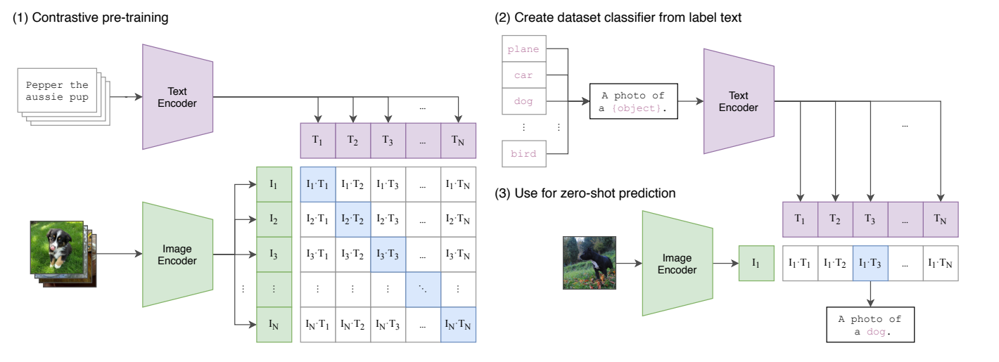
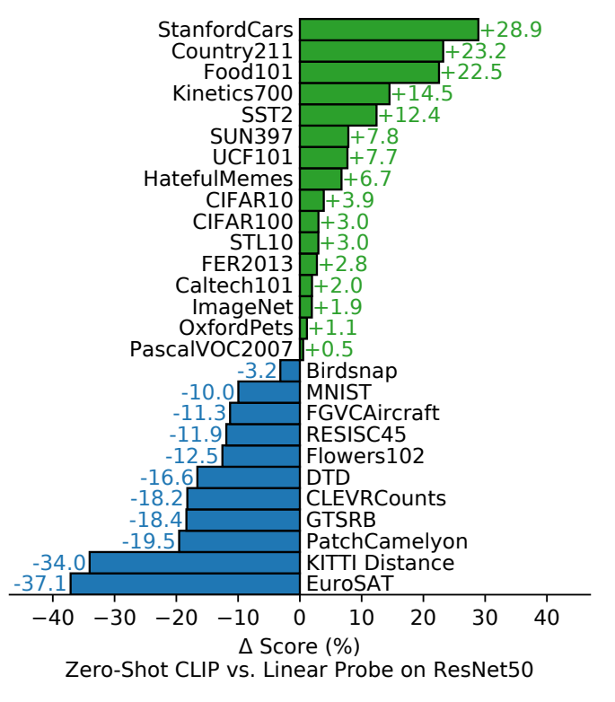
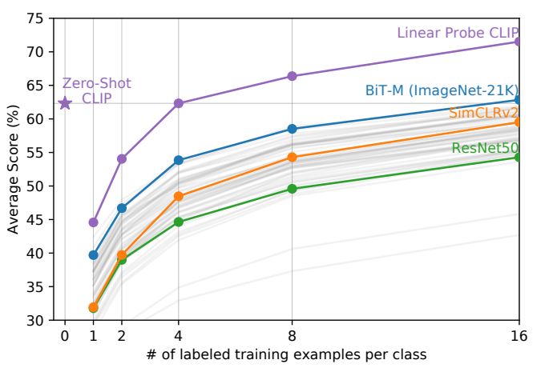

# CLIP 읽기: 자연어 감독으로 전이 가능한 시각 모델 학습하기

> Radford et al., *Learning Transferable Visual Models From Natural Language Supervision*, ICML 2021 (OpenAI)

## 1. 이 논문이 풀려는 문제

기존 컴퓨터 비전 시스템은 **미리 정해진 고정 클래스 집합**을 예측하도록 학습됩니다. ImageNet 모델은 1000개 클래스만 알고, 여기에 새로운 개념 하나를 추가하려면 그 개념에 대한 레이블 데이터를 새로 모아야 합니다. 이 제약이 일반성과 사용성을 근본적으로 제한합니다.

같은 시기 NLP에서는 정반대의 일이 벌어지고 있었습니다. 웹 텍스트에서 직접 학습하는 사전학습 방법이 분야를 갈아엎었고, "text-to-text"라는 표준 입출력 인터페이스 덕분에 과제 비종속적(task-agnostic) 아키텍처가 downstream 데이터셋으로 제로샷 전이할 수 있게 됐습니다. GPT-3는 데이터셋별 학습 데이터를 거의 쓰지 않고도 여러 과제에서 전용 모델과 경쟁합니다.

논문의 출발 질문은 여기서 나옵니다. **웹 텍스트에서 직접 학습하는 확장 가능한 사전학습이 비전에서도 같은 돌파구를 만들 수 있을까?**

핵심 아이디어는 문제 설정을 바꾸는 것입니다. 이미지 분류를 "고정된 N개 클래스 중 하나 맞히기"가 아니라 **"이 이미지와 짝이 맞는 캡션 찾기"** 문제로 바꿉니다. 그러면 두 가지가 따라옵니다. 첫째, 인터넷에 널린 (이미지, 텍스트) 쌍을 그대로 학습 신호로 쓸 수 있습니다. 둘째, 추론 시엔 자연어로 클래스를 지정할 수 있습니다.

## 2. 핵심 구조

### 1) 세 단계로 보는 전체 그림

*Figure 1. 표준 이미지 모델이 이미지 특징 추출기와 선형 분류기를 함께 학습해 레이블을 예측하는 것과 달리, CLIP은 이미지 인코더와 텍스트 인코더를 함께 학습해 배치 안의 (이미지, 텍스트) 쌍 중 어느 것이 실제로 짝지어진 것인지를 예측한다. 테스트 시에는 학습된 텍스트 인코더가 대상 데이터셋 클래스의 이름이나 설명을 임베딩해 제로샷 선형 분류기를 합성한다.*

**(1) Contrastive pre-training.** 배치 안의 이미지 N장과 텍스트 N개를 각각의 인코더로 임베딩합니다. N×N 유사도 행렬에서 **대각선(파란 칸)이 정답 쌍**이고, 나머지 N²−N개는 오답입니다. 여기서 텍스트 입력이 `"Pepper the aussie pup"` 같은 자연스러운 문장 한 덩어리라는 점을 눈여겨볼 필요가 있습니다. 클래스 이름이 아니라 사람이 사진에 붙인 실제 캡션입니다.

**(2) Create dataset classifier from label text.** 추론할 데이터셋의 클래스 이름 목록(`plane`, `car`, `dog`, ..., `bird`)을 `"A photo of a {object}."` 템플릿에 넣고 텍스트 인코더에 통과시켜 임베딩 $T_1 \dots T_N$을 얻습니다. **이것이 곧 분류기 가중치**입니다. 학습이 아니라 순전파 한 번으로 분류기가 만들어집니다.

**(3) Use for zero-shot prediction.** 분류할 이미지를 임베딩해 $I_1$을 얻고, $T_1 \dots T_N$과의 코사인 유사도 중 최댓값을 고릅니다.

이 그림의 진짜 메시지는 (2)번 패널에 있습니다. 보통 분류기의 마지막 선형층 가중치는 레이블 데이터로 **학습**해서 얻는 것인데, CLIP은 그것을 **텍스트를 읽어서 생성**합니다. 그래서 클래스 집합을 바꾸는 데 재학습이 필요 없습니다.

### 2) 데이터: WIT (WebImageText)

기존 연구는 주로 MS-COCO, Visual Genome, YFCC100M을 썼습니다. 앞의 둘은 고품질 크라우드 레이블 데이터셋이지만 학습 사진이 각각 10만 장 정도로 현대 기준에서는 작습니다. YFCC100M은 1억 장으로 대안이 될 만하지만 메타데이터가 희소하고 품질이 들쭉날쭉합니다. 많은 이미지가 `20160716_113957.JPG` 같은 자동 생성 파일명을 "제목"으로 갖거나 카메라 노출 설정을 "설명"으로 담고 있습니다. 영어 자연어 제목·설명이 있는 것만 남기면 6분의 1로 줄어 1500만 장, 대략 ImageNet 크기가 됩니다.

그래서 저자들은 새 데이터셋을 만듭니다.

- 공개 웹 소스에서 수집한 **4억 개 (이미지, 텍스트) 쌍**
- 가능한 넓은 시각 개념을 덮기 위해 **50만 개 쿼리**로 검색. base query list는 영어 위키피디아에 100회 이상 등장하는 모든 단어이고, 여기에 pointwise mutual information이 높은 bigram, 일정 조회수 이상의 위키 문서 제목, 아직 포함되지 않은 WordNet synset이 추가됩니다
- 쿼리당 최대 2만 쌍으로 근사적 클래스 밸런싱
- 총 단어 수는 GPT-2를 학습시킨 WebText와 비슷한 규모

여기서 중요한 설계 의도 하나. 50만 쿼리로 검색하고 쿼리당 상한을 두는 것은 사실상 **"웬만한 명사 개념은 충분한 예시를 확보하자"** 는 뜻입니다. 나중에 제로샷이 작동하는 이유의 일부가 여기서 만들어집니다 — 클래스 이름 커버리지는 우연이 아니라 의도된 것입니다.

### 3) 목적함수: 왜 캡션 생성이 아니라 대조 학습인가

초기 접근은 VirTex와 비슷하게 이미지 CNN과 텍스트 트랜스포머를 함께 스크래치 학습해 **캡션을 생성**하는 것이었습니다. 그런데 확장이 잘 되지 않았습니다. 6300만 파라미터 트랜스포머 언어모델은 이미 ResNet50 이미지 인코더의 두 배 연산을 쓰면서도, 같은 텍스트의 bag-of-words 인코딩을 예측하는 단순한 baseline보다 ImageNet 클래스를 **3배 느리게** 배웠습니다.

원인은 과제가 지나치게 어렵다는 데 있습니다. 캡션을 정확한 단어 순서까지 복원하는 것은 이미지 이해와 무관한 부담을 잔뜩 지웁니다. 같은 사진에도 캡션은 수없이 많은 방식으로 쓰일 수 있으니까요.

그래서 저자들은 **"전체로서의 어떤 텍스트가 어떤 이미지와 짝인지만 맞히는"** 더 쉬운 프록시 과제로 바꿉니다. 같은 bag-of-words baseline에서 예측 목적함수를 대조 목적함수로 교체하자 효율이 **추가로 4배** 올랐습니다. 결국 언어모델 대비 12배입니다.

구체적으로, 배치 크기 $N$에 대해 이미지 특징 $I_f$와 텍스트 특징 $T_f$를 각각 선형 투영 후 L2 정규화하고,

$$
I_e = \frac{W_i^\top I_f}{\lVert W_i^\top I_f \rVert_2}, \qquad
T_e = \frac{W_t^\top T_f}{\lVert W_t^\top T_f \rVert_2}
$$

두 임베딩의 코사인 유사도에 학습 가능한 온도를 곱해 로짓을 만듭니다.

$$
\text{logits} = I_e \, T_e^\top \cdot \exp(t)
$$

여기서 $\exp(t)$는 온도의 역수 $1/\tau$에 해당합니다. 손실은 이 $N \times N$ 행렬에 대해 **행 방향과 열 방향 크로스엔트로피의 평균**입니다. 정답 레이블은 항상 대각선, 즉 `labels = arange(N)`입니다.

$$
\mathcal{L} = \frac{1}{2}\Big[
\underbrace{\text{CE}(\text{logits}, \, \text{labels}, \, \text{axis}{=}0)}_{\text{이미지}\to\text{텍스트}}
+
\underbrace{\text{CE}(\text{logits}, \, \text{labels}, \, \text{axis}{=}1)}_{\text{텍스트}\to\text{이미지}}
\Big]
$$

손실이 **대칭**인 것이 중요합니다. 한 방향만 쓰면 "이 이미지에 맞는 캡션 찾기"나 "이 캡션에 맞는 이미지 찾기" 중 하나만 학습되는데, 양방향을 다 걸어야 두 모달리티가 서로를 향해 정렬됩니다.

온도 $\tau$는 하이퍼파라미터가 아니라 **log-parameterized 곱셈 스칼라로 직접 최적화**됩니다. 0.07 상당값으로 초기화하고, 로짓 스케일이 100을 넘지 않도록 클리핑합니다 — 이 클리핑이 없으면 학습이 불안정해집니다. 온도를 튜닝 대상에서 빼버린 것은 실용적으로 큰 단순화입니다.

이 배치 구성과 목적함수는 Sohn(2016)의 multi-class N-pair loss가 원형이고, 의료 영상 도메인에서 (텍스트, 이미지) 표현 학습에 적용한 Zhang et al.(2020)의 ConVIRT가 직접적 선행 연구입니다. CLIP은 여기서 여러 가지를 **덜어냅니다**. 과적합이 큰 문제가 아니기 때문입니다.

- 사전학습 가중치로 초기화하지 않고 **스크래치 학습**
- 표현과 대조 임베딩 공간 사이의 비선형 projection을 제거하고 **선형 projection만** 사용
- 문장을 하나 균등 샘플링하던 텍스트 변환 함수 $t_u$ 제거 (WIT의 쌍 상당수가 이미 한 문장이라 불필요)
- 이미지 증강은 **resize 후 random square crop 하나뿐**

### 4) 아키텍처와 스케일링

| | 이미지 인코더 | 스케일링 방식 |
|---|---|---|
| ResNet 계열 | RN50, RN101, RN50x4, RN50x16, RN50x64 | EfficientNet식으로 width·depth·resolution에 연산을 **균등 배분** |
| ViT 계열 | ViT-B/32, ViT-B/16, ViT-L/14 | patch+position embedding 뒤에 LayerNorm 추가 |

기존 비전 연구는 폭만 늘리거나 깊이만 늘리는 식으로 스케일링했지만, CLIP은 Tan & Le(2019)를 따라 세 축에 연산을 고르게 배분합니다.

텍스트 인코더는 전부 Transformer입니다. 기본 크기는 12층 × 512폭 × 8헤드(6300만 파라미터). 소문자 BPE 표현 위에서 동작하고(vocab 49,152, 문맥 길이 76으로 truncate — 이 수치는 arXiv 판 부록 기준), `[SOS]`/`[EOS]`로 감싼 뒤 **최상위층 `[EOS]` 위치의 활성값**을 텍스트 표현으로 삼아 layer norm 후 멀티모달 공간으로 선형 투영합니다. masked self-attention을 유지했는데, 언어모델링을 보조 목적함수로 추가할 여지를 남기기 위함이며 실제 탐색은 후속 과제로 남겨뒀습니다.

스케일링할 때 텍스트 인코더는 **폭만** ResNet 폭 증가에 비례해 늘리고 **깊이는 전혀 늘리지 않습니다.** CLIP 성능이 텍스트 인코더 크기에 덜 민감했기 때문입니다.

### 5) 학습 규모와 엔지니어링

- 배치 크기 **32,768**. 대조 학습에서는 배치가 곧 negative 개수라 성능에 직결됩니다
- 32 에폭, AdamW(gain/bias 제외 가중치에 decay), cosine 스케줄
- mixed precision, gradient checkpointing, half-precision Adam 통계, 텍스트 인코더 가중치 stochastic rounding
- 유사도 행렬을 GPU별로 **샤딩** — 각 GPU가 자기 로컬 임베딩에 필요한 부분 유사도만 계산
- RN50x64는 V100 592장 × 18일, ViT-L/14는 V100 256장 × 12일
- ViT-L/14는 마지막에 **336px 해상도로 1에폭 추가 학습**(FixRes 방식). 이것이 논문의 대표 모델 `ViT-L/14@336px`이고, 별도 언급이 없는 한 논문의 "CLIP" 결과는 전부 이 모델입니다

## 3. 텍스트가 분류기가 되는 순간

### 1) 사전학습에는 프롬프트가 없다

여기서 자주 혼동되는 지점을 짚고 갑니다. **사전학습 때는 클래스 이름도, 프롬프트 템플릿도 쓰지 않습니다.** 텍스트 인코더의 입력은 학습 내내 웹에서 긁어온 원본 캡션·alt-text 그대로입니다. WIT에는 애초에 레이블이라는 개념이 없습니다.

프롬프트는 오직 **제로샷 추론 단계**에서만 등장합니다. 데이터셋의 클래스 이름을 텍스트 인코더에 넣는 것도 이때가 처음입니다.

### 2) 왜 이름만 넣으면 안 되는가

클래스 이름을 단독으로 넣으면 성능이 떨어집니다. 이유가 두 가지입니다.

**분포 불일치.** 사전학습 텍스트는 대부분 문장인데 `"dog"` 같은 단어 하나는 인코더 입장에서 out-of-distribution입니다. `"A photo of a {label}."`로 감싸주면 사전학습 분포에 가까워집니다.

**다의어(polysemy).** Oxford-IIIT Pets의 `boxer`는 개 품종이지만 텍스트만 보면 권투선수입니다. `construction cranes`와 새 `crane`도 마찬가지고요. 문맥이 없으면 구분할 방법이 없습니다.

그래서 논문은 도메인 힌트를 넣습니다. 반려동물이면 `"A photo of a {label}, a type of pet."`, 위성 사진이면 `"a satellite photo of a {label}."`, OCR 과제면 인식할 텍스트에 따옴표를 두르는 식입니다. 나아가 ImageNet에서는 **80개 템플릿의 임베딩을 앙상블**합니다. 이 프롬프트 엔지니어링과 앙상블만으로 ImageNet 정확도가 약 **5%p** 오릅니다. ResNet 연산량을 4배 늘린 것과 맞먹는 효과인데, 임베딩을 한 번 평균 내서 캐시해두면 되므로 추론 비용은 사실상 공짜입니다.

### 3) 캡션으로 학습한 공간에 라벨 단어가 들어맞는 이유

그렇다면 캡션만 보고 학습한 텍스트 인코더에 클래스 이름 프롬프트를 넣는 것이 애초에 왜 작동할까요. 세 가지가 겹칩니다.

**텍스트 인코더는 분류기가 아니라 범용 언어 인코더입니다.** BPE 토큰 시퀀스를 받는 Transformer라서 임의의 문자열을 임베딩할 수 있습니다. `"A photo of a dog."`와 캡션 `"my dog sleeping on the couch"`는 `dog`라는 토큰을 공유하고, 그 토큰이 시각적 의미를 갖도록 4억 쌍 동안 학습됐습니다. 프롬프트는 새로운 입력 형식일 뿐, 새로운 어휘가 아닙니다.

**데이터 수집이 이미 클래스 이름 커버리지를 노렸습니다.** 앞서 본 50만 쿼리 설계가 여기서 회수됩니다.

**결정적으로, 분류에서는 절대 위치가 아니라 텍스트끼리의 상대 순서만 맞으면 됩니다.** 제로샷 분류는 이미지 임베딩 하나를 N개 텍스트 임베딩과 비교해 argmax를 취합니다.

$$
\hat{y} = \arg\max_{j \in \{1..N\}} \; \cos\big(I_e, \; T_e^{(j)}\big)
$$

그러니 "캡션 스타일 텍스트와 프롬프트 스타일 텍스트가 공간상 다른 영역에 있다"는 사실 자체는 치명적이지 않습니다. N개 프롬프트가 **다 같이** 그 영역으로 밀려나면 공통 오프셋은 argmax에서 상쇄되니까요. 필요한 것은 그 영역 안에서 개 이미지가 `"a photo of a dog"`를 `"a photo of a cat"`보다 높게 매기는 것뿐입니다.

실제로 후속 연구(Liang et al., *Mind the Gap*, NeurIPS 2022)에서 CLIP의 이미지 임베딩과 텍스트 임베딩은 완전히 섞이지 않고 서로 다른 원뿔(cone) 영역에 분리되어 있다는 것이 밝혀졌습니다. 그런데도 분류가 잘 되는 이유가 바로 이 상쇄 논리입니다.

**그래서 "완벽히" 매핑되지는 않습니다.** 클래스 이름만 단독으로 넣어도 동작은 하지만, 프롬프트로 캡션 분포에 맞춰주면 5%p가 더 나옵니다. 이 5%p가 곧 "설명문으로 학습한 공간에 라벨 단어를 억지로 밀어넣을 때 생기는 손실"의 크기입니다. 완전 실패도 아니고 공짜도 아닌, 그 사이입니다.

## 4. 제로샷 성능

### 1) 선행 연구와의 비교

제로샷 전이를 이런 방식으로 처음 연구한 것은 Visual N-Grams(Li et al., 2017)입니다. 직접 비교하면 다음과 같습니다.

| | aYahoo | ImageNet | SUN |
|---|---|---|---|
| Visual N-Grams | 72.4 | 11.5 | 23.0 |
| **CLIP** | **98.4** | **76.2** | **58.5** |

*Table 1. 세 데이터셋 모두에서 큰 폭으로 개선. 다만 이 격차는 Visual N-Grams 이후의 여러 변화(모델, 데이터, 연산량)가 뒤섞인 결과이므로 방법론만의 기여로 읽으면 안 된다는 단서가 논문에 붙어 있습니다.*

ImageNet 76.2%라는 숫자가 특히 상징적입니다. **128만 장으로 학습한 원조 ResNet50과 동급**을, 그 데이터셋의 학습 이미지 0장으로 달성한 것이니까요.

### 2) Figure 4: 27개 데이터셋에서 무엇을 이기고 무엇을 지는가

*Figure 4. 27개 평가 데이터셋에서 제로샷 CLIP 분류기가 ResNet50 특징 위에 학습된 완전지도 선형 분류기를 16개 데이터셋에서 능가한다.*

x축은 **제로샷 CLIP 정확도 − ResNet50 linear probe 정확도**입니다. 양쪽이 쓴 자원이 비대칭이라는 점이 핵심입니다.

- **baseline**: ImageNet 128만 장으로 사전학습한 ResNet50의 특징을 동결하고, **각 데이터셋의 전체 학습 레이블**로 정규화된 로지스틱 회귀를 학습
- **CLIP**: 해당 데이터셋의 학습 예시를 **단 한 장도** 쓰지 않음. 클래스 이름만 텍스트 인코더에 넣어 분류기를 즉석 합성

즉 0-shot 대 full-shot의 대결인데, 27개 중 16개에서 CLIP이 이깁니다.

**승패를 가르는 축은 하나입니다.** 데이터셋 성격별로 묶어 보면 네 덩어리가 순위와 거의 일치해서 늘어섭니다. 우연이 아니라 **"그 과제에 해당하는 감독 신호가 웹 캡션에 얼마나 자연스럽게 들어 있는가"**라는 단일 변수로 대부분 설명됩니다.

**(가) 웹 텍스트에 풍부한 개념 (+7 ~ +29%p)** — StanfordCars(+28.9), Country211(+23.2), Food101(+22.5), Kinetics700(+14.5), SST2(+12.4), SUN397(+7.8), UCF101(+7.7), HatefulMemes(+6.7)

사람들이 사진을 올리며 **실제로 쓰는 말**이 곧 레이블인 경우입니다. `"2015 Audi A4"`, `"homemade pad thai"` 같은 문구는 웹에 널려 있습니다. Country211은 ImageNet 특징에 국가라는 개념 자체가 없어서 baseline이 무너지는 사례이고, SST2는 렌더링된 문장을 읽어야 하는 사실상 OCR 과제입니다.

특히 **Kinetics700과 UCF101**이 시사적입니다. ImageNet 레이블은 전부 명사 분류체계라 동사를 배울 길이 없지만, 캡션은 문장이라 행동·관계가 자연히 섞여 들어옵니다. "무엇이 있는가"를 넘어 "무엇을 하고 있는가"까지 학습된다는 증거입니다.

**(나) 일반 객체 인식 (+0.5 ~ +3.9%p)** — CIFAR10, CIFAR100, STL10, FER2013, Caltech101, ImageNet, OxfordPets, PascalVOC2007

사실상 무승부입니다. 이 구간은 baseline의 홈그라운드인데도 CLIP이 근소하게 앞섭니다. STL10은 별도로 언급할 만한데, 제로샷으로 **99.3%를 찍어 당시 SOTA**를 경신했습니다 — 레이블이 적은 상황을 위해 설계된 데이터셋을 레이블 0장으로 푼 셈입니다.

**(다) 세밀 분류인데 어휘가 희소 (−3 ~ −13%p)** — Birdsnap(−3.2), FGVCAircraft(−11.3), Flowers102(−12.5)

여기가 해석의 함정을 막아주는 대조군입니다. 이들도 StanfordCars·Food101과 똑같이 세밀 분류인데 결과는 정반대입니다. 그러니 **"세밀 분류라서 어렵다"가 아니라 "그 세부 어휘를 사람들이 캡션에 쓰느냐"** 가 진짜 변수입니다. 자동차 모델명과 요리 이름은 쓰지만, `Boeing 737-800`과 `737-900`을 구분해 적거나 붓꽃 품종명을 정확히 명시하는 사람은 드뭅니다. 논문은 이 차이를 WIT와 ImageNet 사이의 과제별 감독량 차이로 설명합니다.

**(라) 전문·추상 과제 (−10 ~ −37%p)** — MNIST(−10.0), RESISC45(−11.9), DTD(−16.6), CLEVRCounts(−18.2), GTSRB(−18.4), PatchCamelyon(−19.5), KITTI Distance(−34.0), EuroSAT(−37.1)

두 가지가 겹칩니다. 첫째, 감독 신호 부재 — `"이 림프절 절편에 전이 조직이 있음"`(PatchCamelyon) 같은 문장은 웹 캡션으로 존재하지 않습니다. 둘째, 애초에 **"물체 이름 대기"가 아닌 과제**입니다. 개수 세기(CLEVRCounts), 가장 가까운 차와의 거리 추정(KITTI), 질감 분류(DTD), 토지 피복 판정(EuroSAT)은 자연어 지시로 표현하기 어려운 체계적·기하학적 추론입니다. 논문은 이 중 일부가 사실상 **랜덤 수준**이라고 밝히며, 의료 같은 영역에서는 비전문가 인간 베이스라인과의 비교 없이 제로샷을 쓰면 안 된다는 단서를 답니다.

MNIST는 특히 뼈아픈 사례입니다. 딥러닝에서 가장 쉬운 문제로 통하지만, 4억 쌍 안에 손글씨 숫자와 그 레이블이 짝지어진 데이터가 거의 없습니다. **웹 분포에 없으면 아무리 쉬운 과제여도 못 한다** — 일반화의 한계가 과제 난이도가 아니라 데이터 분포에 걸려 있음을 보여줍니다.

### 3) Figure 4에서 끌어낼 함의

**능력의 경계가 "난이도"가 아니라 "웹 분포"를 따라 그어집니다.** MNIST를 못 하면서 Country211을 잘 하는 모델은 기존의 난이도 감각으로 설명되지 않습니다. 이건 CLIP이 **웹에 언어로 기록된 시각 세계**를 학습했다는 사실의 직접적 반영입니다. 실무 판단 기준도 여기서 단순해집니다 — 대상 개념이 인터넷에서 자연어로 불리는 것이라면 제로샷이 강력한 기본값이고, 위성·의료·산업 검사처럼 전문 도메인이면 few-shot이나 파인튜닝이 필요합니다.

**논문 스스로 경계하는 부분도 있습니다.** 본문은 CLIP이 baseline을 "slightly" 능가한다고 표현합니다. ResNet50 linear probe는 SOTA가 아니라 **손쉽게 구할 수 있는 기준선**일 뿐입니다. "16승 11패"를 CLIP이 지도학습을 대체한다는 뜻으로 읽으면 과대 해석입니다.

**스케일링 관점의 귀결.** 승리 구간이 전부 "웹에 많이 언급되는 것"이라면, 데이터를 더 키울 때 (다) 구간은 (가) 구간으로 이동할 여지가 있습니다. 반면 (라) 구간은 데이터 양이 아니라 **과제의 종류**가 문제라 스케일만으로는 해결되기 어렵습니다. 이후 등장한 LAION-5B 계열이나 SigLIP이 전자를 밀어붙인 방향이고, 개수 세기·공간 추론은 지금까지도 VLM의 약점으로 남아 있습니다.

## 5. 제로샷과 few-shot의 역설

### 1) Linear probe 프로토콜

표현 학습 능력을 재기 위해 논문은 linear probe를 씁니다. 절차는 이렇습니다.

1. 사전학습 끝난 이미지 인코더를 **동결**
2. 각 이미지를 한 번씩 통과시켜 특징 벡터를 뽑아 캐시 (역전파가 없으니 1 epoch만 돌리면 끝)
3. 그 위에 **레이블을 써서** scikit-learn L-BFGS 로지스틱 회귀를 학습. L2 강도만 검증셋 스윕으로 결정

여기서 **텍스트 인코더는 완전히 버려집니다.** 특징을 뽑는 위치는 멀티모달 임베딩 공간으로 보내는 **선형 projection 직전**입니다. ResNet은 attention pooling 출력, ViT는 최종 LN 출력이죠. projection 후의 벡터는 텍스트와 정렬시키려고 차원이 줄고 정보가 압축된 상태라, 표현력 평가 목적에는 그 이전 것이 적합합니다.

파인튜닝 대신 이 프로토콜을 택한 이유는 하이퍼파라미터 튜닝 여지가 적어 **모델 간 비교가 공정**하기 때문입니다. EfficientNet, BiT, SimCLRv2 등에 완전히 동일한 절차를 적용할 수 있습니다.

측정 대상이 바뀐다는 점도 분명히 해둘 필요가 있습니다. 제로샷은 "이 모델이 과제를 수행할 줄 아는가"(task learning)를 보고, linear probe는 "특징이 얼마나 좋은가"(representation learning)를 봅니다. 후자는 레이블을 쓰므로 더 이상 제로샷이 아닙니다.

### 2) Figure 5: 0-shot이 4-shot과 맞먹는다

*Figure 5. 제로샷 CLIP은 같은 특징 공간에서 학습된 4-shot 선형 분류기의 평균 성능과 맞먹고, 공개된 모델들 중 최고 16-shot 선형 분류기에 거의 근접한다. BiT-M과 SimCLRv2는 각각 최고 성능 모델을 강조 표시했고, 연회색 선들은 평가 스위트의 다른 모델들이다. 클래스당 최소 16개 예시가 있는 20개 데이터셋을 사용했다.*

x축이 **클래스당 레이블 예시 개수**입니다. 보라색 별표가 x=0에 홀로 찍혀 있는 것이 제로샷 CLIP인데, 이 별표의 높이가 보라색 곡선(linear probe CLIP)의 x=4 지점과 같습니다.

**여기서 반직관적인 일이 벌어집니다.** 상식적으로는 예시를 한 장이라도 주면 아예 안 주는 것보다 나아야 합니다. 그런데 1-shot linear probe는 제로샷보다 **못하고**, 4-shot쯤 되어야 겨우 따라잡습니다. 그림에서 보라색 곡선이 별표 아래에서 출발해 x=4에서 만나는 구간이 그것입니다.

중요한 것은 zero-shot CLIP과 linear probe CLIP이 **같은 이미지 인코더, 같은 특징 공간**을 쓴다는 점입니다. 차이는 오직 분류기 가중치를 어디서 얻느냐뿐입니다.

- 제로샷은 텍스트 인코더가 `"a photo of a golden retriever"`를 읽어 가중치를 **합성**합니다. 사전학습에서 축적한 언어적 사전지식이 그대로 실려 있습니다
- Linear probe는 그 텍스트 경로를 잘라내고 이미지 몇 장에서 가중치를 **처음부터 추정**합니다

논문의 설명이 정확합니다. CLIP의 제로샷 분류기는 자연어로 생성되므로 시각 개념을 직접 **지정("communicate")** 할 수 있는 반면, "보통의" 지도학습은 개념을 학습 예시에서 간접적으로 **추론**해야 합니다. 문맥 없는 예시 기반 학습은 데이터와 양립하는 가설이 너무 많다는 약점이 있고, 특히 one-shot에서 심각합니다. 사진 한 장에는 여러 개념이 섞여 있으니까요(개, 잔디, 소파, 역광...). 유능한 학습자라면 "시연되는 개념은 이미지의 주 객체일 것"이라는 휴리스틱을 쓸 수 있지만, 보장은 없습니다.

**다른 모델과 비교하면 격차가 더 두드러집니다.** 제로샷 CLIP은 평가 스위트 안에서 **최고 성능 16-shot 분류기**(ImageNet-21K로 학습된 BiT-M ResNet152x2의 특징)와 대략 맞먹습니다. 그림에서 별표가 파란 곡선의 오른쪽 끝 근처 높이에 있는 것이 이것입니다. 저자들은 JFT-300M으로 학습된 BiT-L이라면 더 나았겠지만 공개되지 않았다고 덧붙입니다.

여기에 흥미로운 관찰이 하나 더 붙습니다. 16-shot에서 BiT-M ResNet152x2가 최고라는 사실 자체가 다소 의외인데, 완전지도 설정에서는 Noisy Student EfficientNet-L2가 27개 데이터셋 평균으로 그것을 거의 5% 앞서기 때문입니다. 즉 **완전지도에서 강한 특징과 few-shot에서 강한 특징이 반드시 같지 않습니다.**

그리고 이 그림은 논문이 스스로 인정하는 한계로 이어집니다. CLIP은 few-shot 성능을 직접 최적화하지 않고 그냥 linear probe로 fallback할 뿐이라, 제로샷 → few-shot 전환에서 성능이 떨어지는 이상한 구간이 생깁니다.

### 3) 표현 학습 자체는 어떤가

linear probe로 재면 CLIP 모델은 연산량 대비 매우 잘 스케일합니다. Kornblith et al.(2019)의 12개 데이터셋 스위트에서 가장 큰 모델이 기존 최고 모델(Noisy Student EfficientNet-L2)을 전체 점수와 연산 효율 양쪽에서 근소하게 앞섭니다. 최고 모델 `ViT-L/14@336px`는 이 스위트에서 평균 **2.6%** 우위이고, 더 넓은 27개 스위트로 가면 우위가 **5%** 로 커집니다.

27개 스위트에서 격차가 벌어지는 이유는 명확합니다. CLIP이 학습한 과제 중 지리 위치, OCR, 표정 인식, 행동 인식 같은 것들이 12개 스위트에는 **아예 측정되지 않기** 때문입니다. 논문은 이를 Kornblith et al. 스위트가 ImageNet과 겹치는 과제 쪽으로 기울어진 일종의 선택 편향이라고 지적합니다.

또한 CLIP ViT가 CLIP ResNet보다 약 **3배 연산 효율적**이라, 주어진 연산 예산 안에서 더 높은 성능에 도달할 수 있었습니다. 충분히 큰 데이터셋에서 ViT가 convnet보다 효율적이라는 Dosovitskiy et al.(2020)의 결과를 재현한 셈입니다.

## 6. 분포 이동에 대한 강건성

직관적으로, 제로샷 모델은 특정 분포에서만 성립하는 허위 상관(spurious correlation)을 이용할 수 없습니다. 그 분포로 학습된 적이 없으니까요. 그렇다면 제로샷 모델은 더 높은 effective robustness를 보일 수 있지 않을까 — 이것이 논문의 가설입니다.

ImageNet과 같은 성능을 내는 ResNet101과 비교한 결과입니다.

| 데이터셋 | ResNet101 | Zero-Shot CLIP | Δ |
|---|---|---|---|
| ImageNet | 76.2 | 76.2 | 0% |
| ImageNetV2 | 64.3 | **70.1** | +5.8% |
| ImageNet-R | 37.7 | **88.9** | +51.2% |
| ObjectNet | 32.6 | **72.3** | +39.7% |
| ImageNet Sketch | 25.2 | **60.2** | +35.0% |
| ImageNet-A | 2.7 | **77.1** | +74.4% |

*Figure 7 우측 표. 두 모델은 ImageNet 검증셋에서 동일한 76.2%로 출발하지만, 분포가 이동하면 완전히 갈라집니다. 높을수록 좋습니다.*

ImageNet-A(자연 적대 예제)에서 ResNet101이 **2.7%** 로 무너지는 동안 CLIP은 **77.1%** 를 유지합니다. 같은 in-distribution 성능에서 출발했는데 말이죠. 모든 제로샷 CLIP 모델이 effective robustness를 큰 폭으로 개선하며, ImageNet 정확도와 분포 이동 하 정확도 사이의 격차를 **최대 75%까지 줄입니다.** 제로샷 CLIP 모델들은 Taori et al.(2020)이 연구한 기존 204개 모델과 완전히 구별되는 강건성 프론티어를 그립니다.

## 7. 한계와 유의점

**성능 자체의 한계.** 제로샷 CLIP은 평균적으로 전체 SOTA에 미치지 못하고, 세밀 분류와 추상·체계적 과제에서 약합니다. 일부는 랜덤 수준입니다. 저자들의 추정으로는 현재 접근으로 전반적 SOTA 제로샷에 도달하려면 연산을 **약 1000배** 늘려야 하는데, 이는 현재 하드웨어로 실현 불가능한 규모입니다.

**엄밀한 의미의 제로샷이 아닙니다.** 개발 과정에서 검증 성능을 참조하며 프롬프트와 설정을 다듬었습니다. 진짜 제로샷 시나리오에서는 불가능한 일입니다. 반지도 학습 분야에서 제기된 것과 같은 우려입니다.

**평가 데이터셋 선정 문제.** 27개 스위트는 논문이 인정하듯 "다소 임의적(somewhat haphazard)"이고 **CLIP의 능력과 co-adapted** 되어 있습니다. 저자들은 광범위한 제로샷 전이 능력을 평가하기 위해 설계된 새 벤치마크가 필요하다고 명시합니다.

**자연어 인터페이스의 한계.** 자연어로 분류기를 지정하는 것은 유연하지만, 복잡한 과제는 텍스트만으로 표현하기 어렵습니다. 실제 학습 예시는 분명히 유용한데 CLIP은 few-shot을 직접 최적화하지 않아, 제로샷에서 few-shot으로 넘어갈 때 성능이 떨어지는 반직관적 구간이 생깁니다.

**데이터 오염은 미미합니다.** 중복 탐지기로 평가셋을 All/Overlap/Clean으로 나눠 정확도 차이를 계산하고 이항검정에 Bonferroni 보정을 적용한 결과, 35개 중 9개는 중복이 전혀 없고 중앙값 2.2%·평균 3.2%였습니다. 전체 정확도가 0.1% 넘게 흔들리는 경우가 7개뿐이고 그중 보정 후 유의한 것은 2개, 최대 개선은 Birdsnap의 0.6%입니다.

**편향과 오남용.** 클래스를 어떻게 설계하느냐가 성능과 편향에 크게 영향을 줍니다. FairFace 인종 레이블에 "criminal", "animal" 같은 악성 용어를 섞어 주면 0–20세 이미지를 **32.3%** 비율로 그 범주에 분류합니다. 클래스 목록에 "child"를 추가하면 8.7%로 떨어집니다. 성별·인종에 따른 'crime'/'non-human' 분류 불일치도 관찰되어, 신중한 클래스 설계에도 불구하고 차별적 영향의 가능성이 남습니다. 또한 과제별 학습 데이터가 필요 없다는 특성 때문에 감시·프라이버시 리스크가 있는 틈새 과제를 쉽게 열어줍니다. CelebA 실험에서 "in the wild" 셀럽 분류 top-1 정확도가 후보 100명 중 **59.2%**, 1000명 중 **43.3%** 였습니다.

## 8. 정리

CLIP의 기여를 한 문장으로 줄이면, **NLP에서 검증된 "과제 비종속적 웹 스케일 사전학습" 공식을 컴퓨터 비전으로 옮겨왔고, 그 결과 비슷한 성질의 현상이 비전에서도 나타난다는 것을 보인 것**입니다. 자연어 감독으로 학습하는 아이디어 자체는 20년도 더 된 것이고(Mori et al., 1999), 논문의 진짜 기여는 그것을 **대규모에서 관찰한 것**입니다.

읽고 나서 남는 것은 세 가지입니다.

**첫째, 문제 설정을 바꾸면 데이터 병목이 사라집니다.** "고정 클래스 중 하나 고르기"를 "짝 맞추기"로 바꾼 것만으로 레이블링된 데이터에서 인터넷 전체로 학습 자원이 확장됩니다.

**둘째, 자연어는 출력이 아니라 인터페이스입니다.** 텍스트 인코더가 분류기 가중치를 생성한다는 구조 덕분에, 클래스를 바꾸는 데 재학습이 필요 없습니다. Figure 5의 역설 — 0-shot이 4-shot과 맞먹는 현상 — 은 이 인터페이스가 실제로 정보를 전달하고 있다는 정량적 증거입니다.

**셋째, 능력의 지도는 웹 텍스트 분포를 따라 그려집니다.** Figure 4에서 CLIP이 이기는 곳과 지는 곳은 과제 난이도가 아니라 "그 개념이 캡션에 등장하는가"로 갈립니다. MNIST를 못 하면서 국가 식별을 잘 하는 모델은 이 사실 없이는 설명되지 않습니다. 강건성 결과도 같은 맥락에서 읽힙니다 — 특정 분포에 맞춰 학습되지 않았기 때문에 그 분포의 허위 상관에 의존하지 않는 것입니다.

---

**참고**: 이 글은 16페이지 ICML 판본을 기준으로 작성했습니다. 프롬프트 엔지니어링 세부, 전체 하이퍼파라미터, 데이터셋별 상세 결과는 arXiv 48페이지 판(arXiv:2103.00020) 부록에 있습니다.
