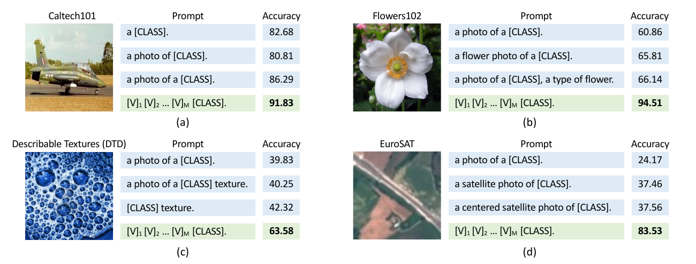
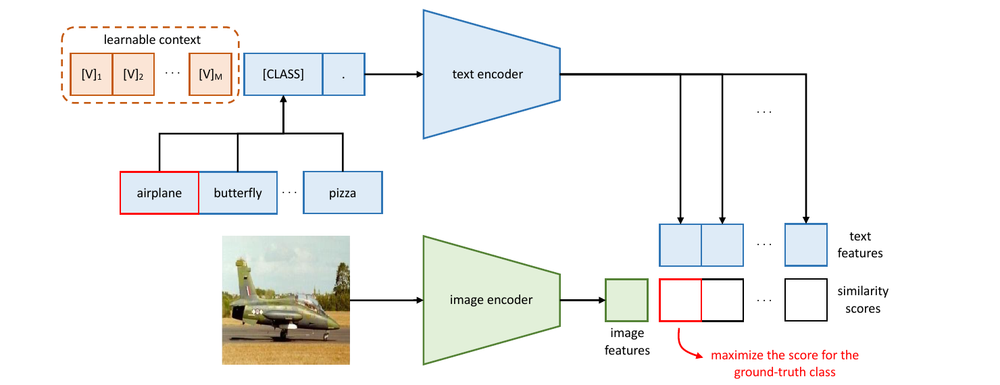
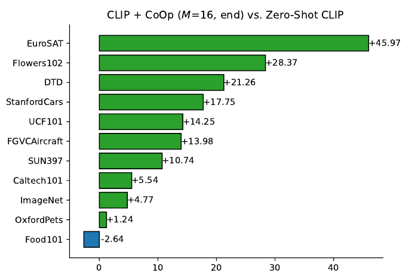

# CLIP에게 프롬프트를 학습시키다 — CoOp 논문 읽기

> [github.com/KaiyangZhou/CoOp](https://github.com/KaiyangZhou/CoOp)

---

## 1. 문제 — 단어 하나가 성능을 좌우한다

CLIP 같은 비전-언어 모델은 "a photo of a [CLASS]." 같은 텍스트 프롬프트로 분류 가중치를 합성해 zero-shot 전이가 가능하다. 전통적인 분류기가 이산 레이블로부터 랜덤 초기화된 가중치를 학습하는 것과 달리, 여기서는 **텍스트 인코더가 분류기를 만들어낸다.** 그 덕분에 닫힌 집합(closed-set)을 벗어나 새로운 카테고리로 확장할 수 있다.

그런데 실전에 배포하려고 보면 문제가 하나 있다. **성능이 프롬프트 문구에 극도로 민감하다.**



*Figure 1. 네 개 데이터셋에서 프롬프트 문구에 따른 정확도 변화. 맨 아래 초록색 행이 CoOp이 학습한 프롬프트다.*

숫자를 보면 상황이 명확해진다.

- **Caltech101**: `a photo of [CLASS].` 80.81% → `a photo of a [CLASS].` **86.29%**. 관사 "a" 하나를 넣었을 뿐인데 5% 이상 오른다
- **EuroSAT**: `a photo of a [CLASS].` 24.17% → `a satellite photo of [CLASS].` 37.46% → `a centered satellite photo of [CLASS].` 37.56%
- **Flowers102**: `a photo of a [CLASS].` 60.86% → `a photo of a [CLASS], a type of flower.` 66.14%
- **DTD**: 문장 구조를 아예 바꿔 `[CLASS] texture.`로 만들었을 때 42.32%로 가장 높다

즉 좋은 프롬프트를 찾으려면 **과제에 대한 사전 지식**("이건 위성사진이다", "이건 꽃이다")과 **언어모델의 작동 방식에 대한 감각**이 둘 다 필요하다. 게다가 문구를 고르려면 held-out 검증셋으로 일일이 비교해야 한다. 시간이 오래 걸리고, 그렇게 튜닝해도 그 프롬프트가 최적이라는 보장이 전혀 없다.

논문의 출발점은 여기다. **이 과정을 자동화할 수 없을까?**

---

## 2. CoOp의 핵심 아이디어

### 1) 먼저 zero-shot CLIP의 구조

CLIP은 이미지 인코더와 텍스트 인코더 두 개로 구성된다. 텍스트 쪽은 입력 문장을 BPE 토큰(어휘 크기 49,152)으로 바꾸고, `[SOS]`/`[EOS]`로 감싼 뒤 고정 길이 77로 맞춘다. 각 토큰 ID는 **512차원 워드 임베딩 벡터**로 매핑되어 Transformer를 통과하고, 최종적으로 `[EOS]` 위치의 특징이 layer norm과 선형 투영을 거쳐 나온다.

이미지 특징을 $f$, 텍스트 인코더가 만든 클래스 $i$의 가중치 벡터를 $w_i$라 하면 예측 확률은 이렇게 계산된다.

$$
p(y=i \mid x) = \frac{\exp(\cos(w_i, f)/\tau)}{\sum_{j=1}^{K} \exp(\cos(w_j, f)/\tau)}
$$

$\tau$는 CLIP이 학습한 온도 파라미터고 $\cos(\cdot,\cdot)$은 코사인 유사도다. 여기서 중요한 건 $w_i$가 **학습된 파라미터가 아니라 프롬프트를 텍스트 인코더에 통과시켜 얻은 결과**라는 점이다. 프롬프트를 바꾸면 분류기 자체가 바뀐다. Figure 1의 민감성은 여기서 나온다.

### 2) 컨텍스트를 학습 가능한 벡터로

CoOp의 아이디어는 단순하다. **프롬프트의 컨텍스트 단어들을 연속 벡터로 바꾸고, 그 벡터만 학습한다.**



*Figure 2. CoOp의 전체 구조. 주황색 점선 안의 learnable context만 학습되고, 텍스트 인코더와 이미지 인코더는 전부 동결된다.*

프롬프트는 다음 형태를 갖는다.

$$
t = [\text{V}]_1 [\text{V}]_2 \cdots [\text{V}]_M [\text{CLASS}]
$$

각 $[\text{V}]_m$은 워드 임베딩과 같은 차원(CLIP의 경우 512)을 가진 벡터이고, $M$은 컨텍스트 토큰 개수를 정하는 하이퍼파라미터다. 예측 확률은 앞의 식에서 $w_i$ 자리에 $g(t_i)$가 들어간 형태가 된다.

$$
p(y=i \mid x) = \frac{\exp(\cos(g(t_i), f)/\tau)}{\sum_{j=1}^{K} \exp(\cos(g(t_j), f)/\tau)}
$$

$g(\cdot)$가 텍스트 인코더다. 각 프롬프트 $t_i$의 클래스 토큰 자리에는 $i$번째 클래스명의 워드 임베딩이 들어간다.

학습은 **표준 교차 엔트로피 손실**을 최소화하는 것이고, 그래디언트는 텍스트 인코더 전체를 거슬러 역전파되어 컨텍스트 벡터에 도달한다. CLIP의 사전학습 파라미터는 전부 동결이다.

클래스 토큰을 끝이 아니라 중간에 둘 수도 있다.

$$
t = [\text{V}]_1 \cdots [\text{V}]_{\frac{M}{2}} [\text{CLASS}] [\text{V}]_{\frac{M}{2}+1} \cdots [\text{V}]_M
$$

이러면 프롬프트가 뒷부분을 보충 설명으로 채우거나, 마침표 같은 종료 신호로 문장을 일찍 끊는 선택지를 갖게 된다.

### 3) 두 가지 구현 — Unified context와 CSC

**Unified context**는 모든 클래스가 하나의 컨텍스트를 공유한다. 위의 식 그대로다.

**Class-Specific Context(CSC)** 는 클래스마다 독립된 컨텍스트를 둔다.

$$
[\text{V}]^i_1 [\text{V}]^i_2 \cdots [\text{V}]^i_M \neq [\text{V}]^j_1 [\text{V}]^j_2 \cdots [\text{V}]^j_M \quad (i \neq j)
$$

이 둘의 차이가 논문에서 가장 흥미로운 지점이라 뒤에서 따로 다룬다.

---

## 3. Prefix-tuning과 무엇이 다른가

수작업 프롬프트 대신 연속 벡터를 학습한다는 발상은 NLP의 prefix-tuning과 닮아 있다. 실제로 저자들도 2.2절에서 Li & Liang의 prefix-tuning, Lester et al.의 prompt tuning, Zhong et al.을 **"most related to our work"** 로 명시한다. 워드 임베딩 공간의 연속 벡터를 최적화하고 백본은 동결한다는 점에서 같은 계열이다.

### 1) 정확히는 prompt tuning에 더 가깝다

다만 세부적으로 보면 prefix-tuning보다 **Lester et al.의 prompt tuning에 더 가깝다.**

- **Prefix-tuning**: 모든 Transformer 레이어의 key/value에 prefix를 삽입한다. 게다가 학습 안정화를 위해 reparameterization MLP를 쓴다
- **CoOp**: 입력 임베딩 층에만 $M$개 벡터를 붙인다. 텍스트 인코더는 그대로 통과한다. 구조적으로는 soft prompt tuning이다

### 2) 진짜 차이는 학습 신호와 출력의 의미

**출력이 분류 가중치다.** NLP에서 soft prompt는 언어모델의 생성이나 토큰 분포를 조건화하지만, CoOp에서 프롬프트를 통과시킨 `[EOS]` 표현은 그 자체가 클래스 $i$의 **classifier weight 벡터**가 된다. 이미지 특징과 코사인 유사도를 재는 것이다. 즉 "텍스트로 분류기를 합성"하는 구조라서, 학습 목표가 언어모델링이 아니라 이미지에 대한 교차 엔트로피다. 그래디언트가 이미지 인코더 쪽에서 시작해 텍스트 인코더를 거꾸로 타고 올라온다.

**사전학습 목적도 다르다.** 대조학습 vs autoregressive. 저자들이 3.3절에서 든 차별점도 이것과 dual-encoder 구조다. 다만 솔직히 말하면 이 논쟁은 "방법이 다르다"기보다 "적용 도메인이 새롭다"에 가깝다. 실제 기여는 알고리즘적 신규성보다 *CLIP 적응에 soft prompt가 통한다는 것, 그것도 few-shot에서 linear probe를 이기고 도메인 시프트에도 강건하다는 것*을 처음 보인 데 있다.

**CSC는 NLP 쪽에 잘 대응되는 게 없다.** 클래스마다 별도 프리픽스를 두는 건, 프롬프트가 곧 분류기 가중치라는 이 세팅 특유의 설계다.

### 3) 흔한 오해 — "prefix-tuning은 가중치를 학습한다"

"prefix-tuning은 레이어의 key, value 등의 파라미터를 함께 학습한다"는 표현을 종종 보는데, 이건 정확하지 않다. **prefix-tuning도 트랜스포머 가중치는 학습하지 않는다.** $W_Q/W_K/W_V$ 같은 projection 행렬은 그대로 동결이다. 학습되는 건 각 레이어의 어텐션에 prepend되는 **key/value 활성값 벡터들**이다. 즉 "레이어별 파라미터를 함께 학습"이 아니라 "레이어별로 주입되는 벡터를 학습"이다.

그래서 두 방법의 차이는 *가중치를 학습하느냐 아니냐*가 아니라 **학습 가능한 벡터를 어디에 꽂느냐**다.

| | 학습 대상 | 주입 위치 | 규모 |
|---|---|---|---|
| CoOp | 컨텍스트 벡터 $M$개 | 입력 임베딩 층 1곳 | $M \times d$ |
| Prefix-tuning | prefix K/V 벡터 | 모든 레이어 어텐션 | $L \times 2 \times M \times d$ |

둘 다 백본 가중치는 0개 학습한다. 다만 prefix-tuning은 레이어 수 $L$배만큼 자유도가 크고(그만큼 파라미터도 많고), 학습 불안정 때문에 훈련 중에만 reparameterization MLP를 두었다가 추론 시 버린다. CoOp은 그런 장치 없이 표준편차 0.02 가우시안 랜덤 초기화 + warmup(첫 epoch lr 1e-5 고정)만으로 처리한다.

한 가지 덧붙이면 — CoOp의 벡터가 입력 층에만 있어도 **그래디언트는 텍스트 인코더 전체를 역전파해 통과한다.** 논문 Table 5가 이걸 보여준다. 텍스트 인코더 *출력*에 변환층을 붙이면 +0.68%, bias를 붙이면 +2.75%인데 CoOp은 +4.77%다. 인코더를 거슬러 올라오면서 사전학습된 언어 지식을 경유하는 것이 이득의 핵심이라는 뜻이다.

---

## 4. Unified context와 CSC의 학습 방법 차이

### 1) 파라미터화

**Unified context** — 학습 대상은 단 하나의 벡터 집합이다. 이걸 $K$개 클래스 전부가 공유한다. 클래스 $i$의 프롬프트는 **앞부분이 전부 동일하고 뒤의 클래스명 임베딩만 다르다.**

**CSC** — 클래스마다 독립된 집합을 갖는다. 전체 파라미터는 $K \times M \times 512$다.

$M=16$, 512차원 기준으로 보면 규모 차이가 확연하다.

| 방식 | 파라미터 수 | 예시 |
|---|---|---|
| Unified | $M \times 512$ = **8,192개** | 클래스 수와 무관하게 항상 동일 |
| CSC | $K \times M \times 512$ | EuroSAT(10클래스) 81,920개 / ImageNet(1000클래스) **약 8.2M개** |

### 2) Forward 경로는 동일하다

두 경우 모두 $K$개 프롬프트를 각각 텍스트 인코더에 통과시켜 $K$개의 분류 가중치를 얻고, 이미지 특징과 코사인 유사도를 계산한다. 손실도 표준 교차 엔트로피로 같다. **학습 알고리즘 자체는 차이가 없다. 차이는 오직 "몇 개의 벡터 집합을 두느냐"뿐이다.**

### 3) 그래디언트가 흐르는 방식 — 여기가 본질

이게 성능 차이를 만드는 지점이다.

**Unified context**에서는 배치의 모든 이미지가 $M$개 벡터에 그래디언트를 기여한다. 소프트맥스 분자(정답 클래스를 끌어당김)와 분모(오답 클래스를 밀어냄) 양쪽 모두 같은 벡터 집합을 통과하기 때문이다. $K$-way $n$-shot이면 **$K \times n$장 전부가 하나의 컨텍스트를 학습시킨다.**

**CSC**에서 클래스 $i$의 벡터 집합이 받는 신호는 다르다.

- **끌어당기는(positive) 신호**는 클래스 $i$의 이미지 $n$장에서만 온다
- 밀어내는(negative) 신호는 다른 클래스 이미지에서 오지만, 이건 "이건 $i$가 아니다"라는 정보일 뿐이다

즉 각 벡터 집합이 받는 유효 학습 신호가 **$1/K$로 줄어든다.** 1-shot이면 클래스당 이미지 딱 한 장으로 $512 \times 16$차원 벡터를 학습해야 한다. 파라미터는 $K$배 많은데 집합당 데이터는 $1/K$인 셈이라, 논문에서 **8샷 미만에서는 CSC가 대체로 unified에 밀린다**고 한 이유가 이것이다.

### 4) 표현력의 차이

Unified는 모든 클래스에 **하나의 공통 문맥**만 학습할 수 있다. "이건 위성사진이다" 같은 데이터셋 전역 정보를 담기엔 충분하지만, 클래스별로 서로 다른 판별 단서가 필요한 경우엔 표현이 부족하다.

CSC는 클래스마다 다른 문맥을 학습하므로, 항공기 모델이나 자동차 모델처럼 **클래스 간 시각적 차이가 미세하고 클래스명 자체가 정보를 거의 주지 않는** 경우(예: "737-800", "A320")에 유리하다. 클래스명 임베딩만으로는 구분이 안 되니, 컨텍스트가 그 부담을 나눠 지는 것이다.

### 5) 실험적 권장

| Unified이 나은 경우 | CSC가 나은 경우 |
|---|---|
| ImageNet, Caltech101 (일반 객체) | StanfordCars, Flowers102, FGVCAircraft (세분화) |
| SUN397 (장면) | DTD, EuroSAT (특수 과제, 16샷에서 특히) |
| UCF101 (행동) | |
| OxfordPets, Food101 (세분화지만 예외) | |

정리하면 **평균적으로는 unified가 낫고, 세분화·특수 도메인에서 샷 수가 충분할 때(16샷) CSC를 고려**하는 게 실용적 지침이다.

### 6) 논문이 명시하지 않은 실용적 함의

- **클래스 집합 변경 시** unified 컨텍스트는 새 클래스명에 그대로 붙여 재사용할 수 있다. 실제로 도메인 일반화 실험(ImageNet → V2/Sketch/A/R)이 이 성질에 의존한다. CSC는 클래스별로 벡터가 묶여 있어 새 클래스에 대응할 벡터가 아예 없다
- **컨텍스트 길이 $M$의 영향**도 다르다. CSC에서 $M$을 늘리면 파라미터가 $K$배로 증폭되므로 과적합 위험이 훨씬 빠르게 커진다

---

## 5. CSC가 이기는 조건 — 시각적 구분 가능성만으로는 부족하다

여기서 자연스럽게 나오는 직관이 있다. *"클래스별로 이미지 특징이 명확하게 구분된다면 CSC가 더 좋지 않을까?"*

절반만 맞다. **필요조건을 짚은 것이지 충분조건은 아니다.**

### 1) 맞는 부분

이미지 특징이 클래스별로 잘 분리되어 있어야 **추가 용량이 쓸모가 있다.** 이미지 인코더는 동결이라 $f$는 고정이고, CSC가 늘리는 자유도는 오직 텍스트 쪽 가중치 벡터 $w_i = g(t_i)$의 배치 자유도다. 시각 특징이 애초에 뒤엉켜 있으면 $w_i$를 아무리 자유롭게 놓아도 분리할 방법이 없고, 늘어난 파라미터는 과적합으로만 돌아온다.

### 2) 그런데 논문 안에 반례가 있다

OxfordPets(37종 견묘)와 Food101(101가지 요리)은 명백히 세분화 과제이고 시각적으로 클래스가 구분된다. 그런데 둘 다 **unified가 CSC보다 낫다.** 반면 StanfordCars, Flowers102, FGVCAircraft는 CSC가 이긴다. 시각적 구분 가능성만으로는 이 갈림을 설명할 수 없다.

### 3) 갈리는 지점은 두 공간의 정합성

갈리는 지점은 **시각 공간의 배치와 텍스트 의미 공간의 배치가 서로 대응하느냐**다. 관계적 조건이지 한쪽만의 속성이 아니다.

| | 텍스트 기하 정합 ○ | 텍스트 기하 정합 ✗ |
|---|---|---|
| **시각 분리 ○** | unified 우세<br>(Pets, Food101, Caltech101) | **CSC 우세**<br>(Aircraft, Cars, DTD, EuroSAT) |
| **시각 분리 ✗** | 무엇을 해도 한계 | 무엇을 해도 한계 |

Pets와 Food101이 unified로 충분한 이유는 CLIP 사전학습 웹 텍스트에 "golden retriever", "sushi"가 풍부해서 **텍스트 임베딩이 이미 해당 시각 클러스터 근처에 놓여 있기** 때문이다. 공유 컨텍스트가 전체를 조금 회전·이동시켜 주면 끝난다. 반면 "737-800"의 텍스트 임베딩은 시각 클러스터와 아무 관계 없는 위치에 있어서, 클래스마다 독립적으로 끌고 와야 한다.

기하학적으로 말하면 — unified는 $K$개 가중치 벡터를 **하나의 공통 변환**으로만 움직인다. 텍스트 임베딩의 상대적 배치는 거의 보존된다. CSC는 각 벡터를 **독립적으로 재배치**할 수 있다. 즉 CSC가 필요한 상황은 "상대 배치 자체가 틀린" 경우다.

> **정리하면** — 시각 특징이 클래스별로 분리 가능하면서 **동시에** 클래스명의 텍스트 의미 구조가 그 시각 구조를 반영하지 못할 때, CSC가 유리하다. 앞 조건은 "고칠 여지가 있는가", 뒤 조건은 "고칠 필요가 있는가"에 해당한다. 둘 다 있어야 CSC가 값을 한다.

### 4) 자유도의 사다리

여기서 한 걸음 더 나가면 구조가 선명해진다. CSC는 클래스마다 자유 파라미터를 주는 것이므로, **linear probe 쪽으로 한 칸 이동한 것**이다. 차이는 그 자유 파라미터가 분류기 가중치로 직접 놓이는 게 아니라 텍스트 인코더를 통과해서 만들어진다는 점이다. 세 방법이 같은 축 위에 있다.

```
zero-shot CLIP  →  CoOp unified  →  CoOp CSC  →  linear probe
   자유도 0         M×d            K×M×d       K×d (인코더 우회)
```

오른쪽으로 갈수록 표현력이 커지고, 데이터를 더 요구하고, 새 클래스·새 도메인으로의 전이가 나빠진다. 뒤에 나올 Table 1에서 linear probe가 도메인 시프트에 처참하게 무너지는 것이 이 축의 오른쪽 끝 증상이다. CSC도 정도는 약하지만 같은 성질을 물려받는다.

---

## 6. 실험 세팅 상세

### 1) 비교 대상 세 가지

세 방법 모두 **CLIP 사전학습 파라미터는 동결**이다. 차이는 "무엇을 학습하고, 분류 가중치를 어디서 얻느냐"다.

**Zero-shot CLIP** — 학습 파라미터 0개. 수작업 프롬프트를 텍스트 인코더에 통과시켜 분류 가중치를 합성한다. 학습 이미지를 한 장도 쓰지 않는다.

**Linear probe CLIP** — 동결된 이미지 인코더의 특징 위에 **선형 분류기($K \times d$)를 새로 학습**한다. 텍스트 인코더를 아예 쓰지 않는다는 게 핵심이다. 클래스명의 의미 정보가 전혀 개입하지 않고, 분류 가중치가 랜덤 초기화에서 시작한다. 논문이 이걸 베이스라인으로 고른 이유는 Tian et al.(2020) 등이 보인 대로 **정교한 few-shot 기법들과 대등한 강한 베이스라인**이기 때문이다.

**CoOp** — 컨텍스트 벡터만 학습(8,192개). 분류 가중치는 여전히 텍스트 인코더가 합성한다.

### 2) Zero-shot의 수작업 프롬프트

Radford et al.의 프롬프트 엔지니어링 가이드라인을 따랐고, 데이터셋 성격별로 셋으로 나뉜다.

| 유형 | 프롬프트 | 데이터셋 |
|---|---|---|
| 일반 | `a photo of a [CLASS].` | ImageNet, Caltech101, StanfordCars, SUN397 |
| 세분화(도메인 힌트 추가) | `a photo of a [CLASS], a type of pet.` | OxfordPets |
| | `a photo of [CLASS], a type of food.` | Food101 |
| | `a photo of a [CLASS], a type of flower.` | Flowers102 |
| | `a photo of a [CLASS], a type of aircraft.` | FGVCAircraft |
| 특수(구조 자체를 변형) | `[CLASS] texture.` | DTD |
| | `a centered satellite photo of [CLASS].` | EuroSAT |
| | `a photo of a person doing [CLASS].` | UCF101 |

이 표가 논문 서론의 주장을 그대로 보여준다 — **데이터셋마다 사람이 손으로 다르게 설계해야 했다**는 것. CoOp이 자동화하려는 게 바로 이 표다.

### 3) Few-shot 프로토콜

- CLIP 논문의 프로토콜을 따라 **1, 2, 4, 8, 16 shot**
- 학습은 few-shot이지만 **평가는 전체 테스트셋**에서 수행
- **3회 실행 평균** 보고

여기서 짚을 점은 학습 데이터만 few-shot이고 테스트는 풀 스케일이라는 것이다. 예를 들어 ImageNet은 16샷이면 학습 이미지 16,000장으로 학습해 **50,000장 테스트셋** 전체를 평가한다. SUN397은 테스트 19,850장, Food101은 30,300장이다.

### 4) CoOp 학습 하이퍼파라미터

- 백본 기본값 **ResNet-50**, 컨텍스트 길이 **M=16**
- 컨텍스트 초기화: **평균 0, 표준편차 0.02 가우시안** 랜덤
- 옵티마이저 **SGD**, 초기 lr **0.002**, **cosine annealing** 감쇠
- 에폭: **16/8샷 → 200**, **4/2샷 → 100**, **1샷 → 50** (ImageNet만 예외적으로 50 고정)
- **Warmup**: 초기 반복에서 그래디언트 폭주가 관찰되어, **첫 에폭 동안 lr을 1e-5로 고정**

샷 수가 적을수록 에폭을 줄인 게 눈에 띈다. 과적합 억제 목적이다. CoOp 자체는 **4가지 변형**을 돌린다 — (클래스 토큰 end/mid) × (unified/CSC).

### 5) 도메인 일반화 세팅

소스는 **ImageNet 하나**, 타깃 4개로 프롬프트를 그대로 옮긴다. 클래스명이 호환되므로 재학습 없이 전이된다.

| 타깃 | 시프트 유형 | 클래스 수 |
|---|---|---|
| ImageNetV2 | 동일 수집 절차, 다른 소스로 재현한 테스트셋 | 1,000 |
| ImageNet-Sketch | 스케치 이미지 (스타일) | 1,000 |
| ImageNet-A | 기존 분류기를 속이는 자연 적대 예제 | 200 |
| ImageNet-R | 회화·만화·조각 등 다양한 렌디션 | 200 |

백본 4종(ResNet-50/101, ViT-B/32, ViT-B/16) × 컨텍스트 길이 2종(M=16, M=4)으로 교차 실험했다.

### 6) 참고할 만한 세부 처리

- **Caltech101**은 "BACKGROUND Google"과 "Faces easy" 클래스를 제외
- **UCF101**은 비디오 데이터라 각 영상의 **중간 프레임 1장**만 이미지 인코더에 입력

---

## 7. 결과

### 1) 수작업 프롬프트 대비 개선폭

평균적으로 **2샷만에 zero-shot CLIP을 넘어서고, 16샷에서 평균 약 15%** 앞선다. 데이터셋별로 뜯어보면 편차가 크다.



*Figure 4. 16샷 CoOp(M=16, end)과 zero-shot CLIP의 절대 성능 차이.*

EuroSAT +45.97%, Flowers102 +28.37%, DTD +21.26%로 **특수 과제에서 폭발적**이다. 앞서 Figure 1에서 본 그대로다 — 이런 데이터셋은 사람이 아무리 문구를 튜닝해도 한계가 있었고, 학습이 그 간극을 메운다.

유일하게 떨어진 건 **Food101 −2.64%** 다. 논문 각주에 설명이 있는데, Food101은 "강렬한 색감과 때때로 잘못된 레이블"을 가진 노이지한 학습 데이터라서 CoOp과 linear probe 같은 학습 기반 모델이 모두 손해를 본다. 저자들도 결론에서 **"CoOp이 노이즈 레이블에 민감하다"** 는 한계로 인정한다.

### 2) 도메인 일반화 (Table 1)

가장 놀라운 결과다. ImageNet으로 학습했는데 **본 적 없는 분포에서도 zero-shot CLIP보다 강건하다.** 아래는 ResNet-50과 ViT-B/16 결과다(높을수록 좋음).

| 방법 | ImageNet (소스) | -V2 | -Sketch | -A | -R |
|---|---|---|---|---|---|
| **ResNet-50** | | | | | |
| Zero-Shot CLIP | 58.18 | 51.34 | 33.32 | 21.65 | 56.00 |
| Linear Probe CLIP | 55.87 | 45.97 | 19.07 | 12.74 | 34.86 |
| CLIP + CoOp (M=16) | 62.95 | 55.11 | 32.74 | 22.12 | 54.96 |
| CLIP + CoOp (M=4) | **63.33** | **55.40** | **34.67** | **23.06** | **56.60** |
| **ViT-B/16** | | | | | |
| Zero-Shot CLIP | 66.73 | 60.83 | 46.15 | 47.77 | 73.96 |
| Linear Probe CLIP | 65.85 | 56.26 | 34.77 | 35.68 | 58.43 |
| CLIP + CoOp (M=16) | **71.92** | 64.18 | 46.71 | 48.41 | 74.32 |
| CLIP + CoOp (M=4) | 71.73 | **64.56** | **47.89** | **49.93** | **75.14** |

읽어야 할 세 가지.

1. **Linear probe의 붕괴.** ImageNet-A에서 zero-shot 21.65% → linear probe 12.74%. 소스에서조차 zero-shot보다 낮다(55.87 vs 58.18). 텍스트 인코더를 우회하고 랜덤 초기화 가중치를 few-shot으로 학습하면 사전학습 지식을 잃는다는 뜻이다
2. **CoOp은 오히려 개선한다.** 학습 기반인데도 zero-shot보다 강건하다. 학습된 프롬프트가 일반화 가능하다는 증거다
3. **짧은 컨텍스트가 더 강건하다.** M=4가 M=16보다 타깃에서 대체로 낫다. 학습 파라미터가 적어 과적합이 덜한 것으로 보인다

### 3) 프롬프트 앙상블과의 비교 (Table 2)

CLIP 저자들은 여러 수작업 프롬프트로 만든 분류기를 앙상블하면 더 좋아진다고 제안했다. 그것과 비교해도 CoOp이 앞선다(ImageNet 정확도).

| 방법 | ResNet-50 | ResNet-101 | ViT-B/32 | ViT-B/16 |
|---|---|---|---|---|
| Prompt engineering | 58.18 | 61.26 | 62.05 | 66.73 |
| Prompt ensembling | 60.41 | 62.54 | 63.71 | 68.74 |
| **CoOp** | **62.95** | **66.60** | **66.85** | **71.92** |

앙상블은 ImageNet에서 광범위하게 튜닝된 프롬프트들을 쓴 것인데도 CoOp이 이긴다. 논문은 앙상블 관점에서 CoOp을 개선하는 것을 향후 과제로 남겨두었다.

### 4) 다른 파인튜닝 방식과의 비교 (Table 5)

ImageNet 16샷 기준, zero-shot 대비 차이다.

| 방법 | ImageNet | Δ |
|---|---|---|
| Zero-shot CLIP | 58.18 | — |
| Linear probe | 55.87 | −2.31 |
| Fine-tuning CLIP's image encoder | 18.28 | **−39.90** |
| Optimizing transformation layer (text) | 58.86 | +0.68 |
| Optimizing bias (text) | 60.93 | +2.75 |
| **CoOp** | **62.95** | **+4.77** |

이미지 인코더 파인튜닝이 18.28%로 **완전히 붕괴**하는 게 인상적이다. 16샷으로 거대 인코더를 건드리면 안 된다는 명확한 신호다. 텍스트 출력에 변환층이나 bias를 더하는 방식은 안전하지만 이득이 작다. **그래디언트가 텍스트 인코더를 통과해야 유용한 정보가 나온다**는 것이 이 표의 결론이다.

### 5) 부수적 발견

- **컨텍스트 길이**: 소스 분포 내에서는 길수록(4 → 8 → 16) 좋다. 도메인 강건성과는 반대 방향이라 **정답이 없는 트레이드오프**다
- **초기화**: 랜덤 초기화와 `"a photo of a"` 임베딩 초기화가 둘 다 72.65%로 **완전히 동일**하다. "좋은 초기화"는 별 의미가 없으니 실무에서는 랜덤을 권한다
- **백본**: 좋을수록 좋다. ResNet-50 62.95% vs ViT-B/16 71.92%. CoOp의 이득은 모든 아키텍처에서 유지된다

---

## 8. 실제 문제에 적용해 보기

논문의 결과를 실무 시나리오에 대입해 보면 이 프레임워크가 어떻게 작동하는지 더 잘 보인다. **재활용 가전제품 분류**를 예로 들어보자. 학습 이미지는 신제품 카탈로그 사진인데, 실제 분류 대상은 조금씩 훼손되거나 낡은 제품이라고 하자.

### 1) 먼저 유리한 근거

논문 4.2절이 정확히 이 상황을 다룬다. ImageNet(깨끗한 사진)으로 학습한 프롬프트를 Sketch/A/R로 전이했더니 zero-shot CLIP보다도 강건했다. 게다가 가전제품 카테고리(냉장고, 세탁기, 전자레인지)는 CLIP이 사전학습에서 충분히 본 개념이다. 앞의 사분면으로는 **Pets/Food101 쪽, 즉 텍스트 기하가 이미 정합된 영역**이다. 따라서 unified context가 맞고 CSC는 쓰지 않는 게 좋다.

### 2) 진짜 위험은 "훼손"이 아닐 수 있다

신제품 이미지는 대개 **스튜디오 카탈로그 컷**이다. 흰 배경, 정면각, 균일 조명, 단독 배치. 반면 재활용 대상은 창고나 수거장에서 찍힌 사진이다. 잡다한 배경, 비스듬한 각도, 부분 가림, 조명 불균일.

즉 실제 분포 차이는 **"낡음 vs 새것"보다 "카탈로그 사진 vs 현장 사진"이 지배적일 가능성이 높다.** 그리고 CoOp의 컨텍스트 벡터는 소스 분포에 맞춰 최적화되므로, 학습 결과가 사실상 *"제품 카탈로그 사진의"* 라는 문맥을 인코딩해버릴 수 있다. 정확히 원하지 않는 방향이다.

논문의 도메인 일반화 결과가 잘 나온 이유도 짚어볼 필요가 있다. 소스가 ImageNet이었다. 16샷이긴 해도 원본 자체가 스타일·배경이 극도로 다양한 데이터다. 단일 스타일로만 학습하는 경우와는 조건이 다르다.

### 3) 가장 효과적인 대응은 데이터 쪽이다

**훼손된 실제 사진을 소량이라도 학습에 넣는 것**이 압도적으로 높은 레버리지다. CoOp의 핵심 성질이 few-shot이라는 점을 활용하는 것이다. 논문에서 **평균 1~2샷만으로 수작업 프롬프트를 넘어선다.** 클래스당 실제 현장 사진 4~8장이면 카탈로그 이미지 16장보다 훨씬 낫다.

현장 사진으로 학습하면 **소스와 타깃 분포가 일치하므로 위의 위험이 사라진다.** 도메인 일반화 문제가 아니라 평범한 few-shot 학습이 되고, 이게 CoOp이 가장 강한 영역이다.

### 4) 병목을 먼저 진단하기

현장 사진으로 **linear probe를 학습해 정확도를 재보는 것**을 권한다. 배포용이 아니라 **천장 측정용**이다.

- **linear probe가 잘 나온다** → CLIP 시각 특징이 이미 클래스를 분리하고 있다는 뜻. 텍스트 쪽 가중치 배치만 고치면 되므로 CoOp이 확실히 먹힌다
- **linear probe도 천장에 막힌다** → 병목이 **이미지 인코더**다. CoOp은 이미지 인코더를 동결한 채 텍스트 쪽 $w_i$만 움직이므로, 시각 특징 자체가 두 클래스를 못 가르면 어떤 프롬프트도 못 고친다

### 5) 조건이 바뀌면 설정도 바뀐다

학습·평가 분포가 같아졌다면 앞의 권고 두 가지를 뒤집어야 한다.

- **M=4 → M=16.** 짧은 컨텍스트 권고는 도메인 시프트 대비용이었다. 소스 분포 내에서는 길수록 좋다
- **CSC를 한 번은 재고**해볼 만하다. 세탁기/건조기처럼 시각적으로 혼동되는 쌍이 있다면. 다만 8샷 미만에선 여전히 열세다

### 6) 프롬프트 학습보다 클 수 있는 레버 두 개

**백본 업그레이드.** 논문 ImageNet 기준 ResNet-50 62.95% vs ViT-B/16 71.92% — 백본 교체만으로 9점이다. 웬만한 프롬프트 이득보다 크다.

**검출기를 앞단에 붙이기.** 현장 사진에 배경 잡음과 다른 물체가 섞여 있다면, CLIP이 장면 전체를 보는 것 자체가 핸디캡이다. 검출기로 대상 영역을 크롭한 뒤 CLIP+CoOp으로 분류하는 2단 구성이 자연스럽다. 검출기는 "여기 물체가 있다"만 하면 되므로 클래스 구분 성능이 나빠도 상관없다.

이 셋(현장 데이터 + 백본 + 크롭)을 합치면 체감할 만한 개선이 나온다. 다만 **프롬프트 학습 단독 기여분은 전체의 일부**이고, 가장 큰 몫은 "학습 데이터를 배포 분포와 일치시킨 것"에서 나올 가능성이 높다.

---

## 9. 한계와 남는 질문

논문이 직접 인정하는 한계는 둘이다.

**해석 불가능성.** 학습된 벡터를 어휘 내 유클리드 최근접 단어로 역추적해도 의미가 잘 읽히지 않는다. Food101에서 "enjoyed", OxfordPets에서 "fluffy"와 "paw", DTD에서 "pretty" 정도가 그럴듯하지만, 16개를 이어 붙이면 문장이 되지 않는다. ImageNet에서는 "potd", "muh", "marvelcomics" 같은 것들이 나온다. 저자들은 학습된 벡터가 기존 어휘를 넘어선 의미를 인코딩할 수 있다고 추측하면서도, 최근접 단어로 해석하는 방식 자체가 부정확할 수 있으므로 확정적 결론을 내리지 않는다. 이건 Li & Liang이 discrete prompt search 대비 continuous 방식의 단점으로 지적한 바로 그 지점이고, 논문도 2.2절에서 인정하고 있다.

**노이즈 레이블 민감성.** Food101에서의 −2.64%가 그 증거다.

여기에 개인적으로 덧붙이자면, **이미지 인코더가 동결되어 있다는 것 자체가 성능 천장**이다. CoOp이 움직일 수 있는 건 텍스트 쪽 가중치 벡터의 배치뿐이다. 시각 특징이 클래스를 구분하지 못하는 문제는 프롬프트 학습으로 풀 수 없고, 이 경우 백본 교체나 전처리 파이프라인 같은 다른 레버가 필요하다.

마지막으로 이 논문의 실제 기여를 다시 정리하면 — 알고리즘 자체는 NLP의 soft prompt tuning과 크게 다르지 않다. 값어치는 **"CLIP 적응에 이게 통한다"는 것을, 그것도 강력한 베이스라인인 linear probe를 이기고 도메인 시프트에도 강건한 형태로 처음 보인 것**에 있다. 파라미터 8,192개로 15%를 얻는다는 사실은, 거대 파운데이션 모델을 어떻게 값싸게 적응시킬 것인가라는 질문에 대한 꽤 설득력 있는 답이다.

---

### 참고

- Zhou et al., *Learning to Prompt for Vision-Language Models*, IJCV 2022
- Radford et al., *Learning Transferable Visual Models From Natural Language Supervision* (CLIP), ICML 2021
- Li & Liang, *Prefix-Tuning: Optimizing Continuous Prompts for Generation*, 2021
- Lester et al., *The Power of Scale for Parameter-Efficient Prompt Tuning*, 2021
- Zhou et al., *Conditional Prompt Learning for Vision-Language Models* (CoCoOp), CVPR 2022
