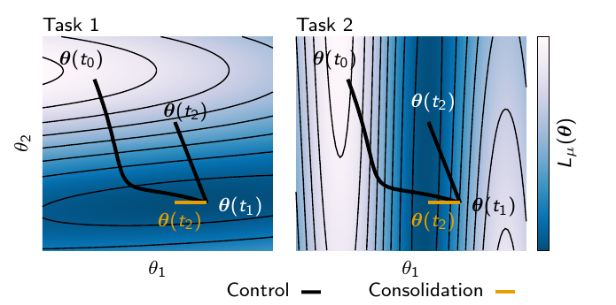
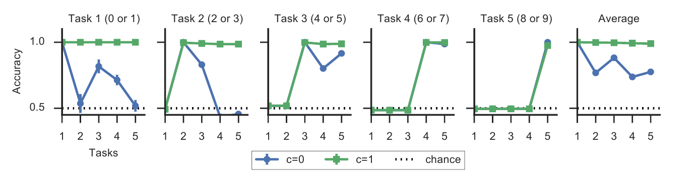
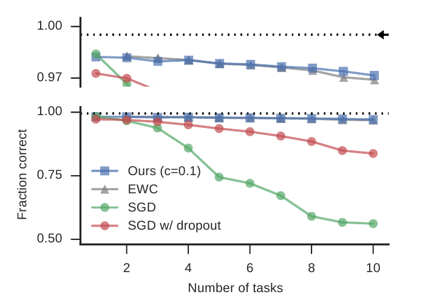
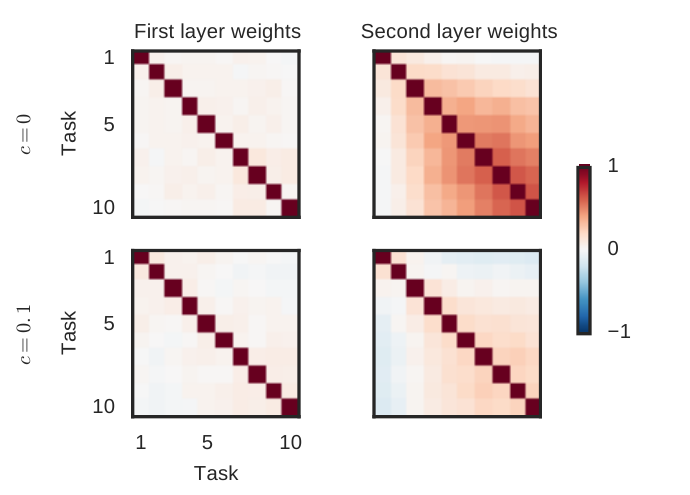

# 시냅스에 지능을 더하다 — Continual Learning Through Synaptic Intelligence 읽기

> Friedemann Zenke\*, Ben Poole\*, Surya Ganguli (Stanford University)
> *Proceedings of the 34th International Conference on Machine Learning (ICML 2017), PMLR 70*
> arXiv:1703.04200

신경망을 여러 태스크에 순차적으로 학습시키면 이전 태스크를 잊어버린다. 이른바 **catastrophic forgetting**이다. 이 논문은 각 시냅스가 스스로 "나는 과거에 얼마나 중요했는가"를 학습 도중에 계산하게 만들어서 이 문제를 완화한다. 제목의 "synaptic intelligence"가 가리키는 게 정확히 그 지점이다.

이 글은 논문의 핵심 메커니즘을 수식 수준에서 따라가되, 특히 **중요도를 왜 그렇게 정의했는가**와 **실험 설정이 무엇을 감추고 있는가**에 무게를 둔다. 후자는 이 논문이 명시적으로 다루지 않았지만 이후 continual learning 문헌 전체의 지형을 바꾼 문제라, 6장에서 따로 자리를 마련했다.

---

## 1. 왜 이 논문이 존재하는가

### 1) 학습 단계와 배포 단계가 분리된 인공신경망

인공신경망의 파라미터는 훈련 단계에서 학습된 뒤 고정되고, 배포 단계에서는 정적으로 사용된다. 데이터 분포가 바뀌면 과적합과 catastrophic forgetting을 피하기 위해 **전체 데이터셋에 대해 처음부터 다시 훈련**해야 한다.

반면 생물학적 신경망은 평생에 걸쳐 새로운 지식을 습득한다. 학습 단계와 회상 단계 사이에 뚜렷한 선을 긋기 어렵다. 우리 뇌는 비정상(non-stationary) 데이터로부터 학습하고 내부 기억을 실시간으로 갱신하도록 진화했다. 어떻게 그게 가능한지는 아직 모르지만, 현재 인공신경망에 구현되어 있지 않은 생물학적 하드웨어의 어떤 특성에 기대고 있을 가능성이 있다.

### 2) 시냅스는 스칼라 하나가 아니다

논문이 지목하는 가장 큰 간극은 **시냅스의 복잡도**다.

인공신경망에서 개별 시냅스(가중치)는 보통 스칼라 하나로 기술된다. 반면 생물학적 시냅스는 서로 다른 공간적·시간적 규모에서 가소성에 영향을 주는 복잡한 분자 기제를 갖고 있다. 이 복잡성이 기억 공고화(memory consolidation)에 기여한다는 추측은 오래전부터 있었지만, 그것이 인공신경망의 학습에 어떤 이득을 주는지 보여준 연구는 드물었다.

이 논문의 제안은 단순하다. 시냅스에 **3차원 상태 공간**을 준다. 각 시냅스는 (현재 파라미터 값, 과거 참조 값, 누적 중요도)를 추적한다. 태스크가 바뀌면 중요한 시냅스를 공고화해서 앞으로 변하지 않게 막는다. 그러면 미래 태스크의 학습은 주로 과거에 덜 중요했던 시냅스가 담당하게 되고, 과거 기억은 보존된다.

---

## 2. 기존 접근과 그 한계

### 1) 세 가지 계열

논문은 선행 연구를 세 가지로 분류한다.

**Architectural(구조적)** 접근은 목적 함수를 건드리지 않고 네트워크 구조를 바꿔 태스크 간 간섭을 줄인다. 가장 단순한 형태는 특정 가중치를 아예 얼리는 것이고, 좀 더 완화된 방식은 공유 레이어의 학습률을 낮추는 것이다. ReLU, MaxOut, local winner-take-all 같은 비선형성 선택이나 dropout을 통한 gradient 희소화도 여기 속한다. Rusu et al.(2016)의 Progressive Neural Networks는 더 극단적이어서, 이전 태스크의 네트워크 전체를 복사하고 새 특징을 덧붙인다. 망각을 완전히 막지만 **태스크 수에 비례해 구조가 커진다**.

**Functional(기능적)** 접근은 네트워크의 입출력 함수 변화에 페널티를 준다. Li & Hoiem(2016)은 knowledge distillation을, Jung et al.(2016)은 최종 은닉 활성값의 $\ell_2$ 거리를 규제한다. 둘 다 옛 태스크의 파라미터로 계산한 활성값을 저장하거나 다시 계산해야 하므로, **새 데이터 포인트마다 옛 네트워크의 forward pass가 추가로 필요**하다. 계산 비용이 크다.

**Structural(구조적 정규화)** 접근은 파라미터 자체가 옛 태스크의 값 근처에 머물도록 페널티를 준다. 이 논문이 속한 계열이다.

### 2) EWC: 가장 가까운 선행 연구

Kirkpatrick et al.(2017)의 **Elastic Weight Consolidation(EWC)** 이 직접적인 비교 대상이다. EWC는 새 태스크와 옛 태스크의 파라미터 차이에 이차 페널티를 걸고, 그 가중치로 **옛 태스크에서 계산한 Fisher 정보 행렬의 대각 성분**을 쓴다.

문제는 비용이다. Fisher의 대각을 정확히 계산하려면 가능한 모든 출력 레이블에 대해 합을 취해야 하므로 **복잡도가 출력 개수에 선형**이다. 출력 공간이 큰 문제에는 적용하기 어렵다. 게다가 이 계산은 각 태스크가 끝난 뒤 **별도의 단계**에서 수행되어야 한다.

이 논문이 겨냥하는 빈틈이 여기다. 같은 형태의 이차 페널티를 쓰되, 중요도를 **학습이 진행되는 동안 온라인으로, 각 시냅스에서 국소적으로** 계산할 수 없을까?

---

## 3. 핵심 아이디어 — 학습 궤적을 적분하는 시냅스



*Figure 1. 파라미터 공간의 궤적. 왼쪽은 Task 1의 손실 지형, 오른쪽은 Task 2의 손실 지형이다. Task 1을 학습하면 $\theta(t_0) \to \theta(t_1)$로 이동한다. 이어서 Task 2를 그냥 학습하면(검은 선) $\theta(t_1) \to \theta(t_2)$로 가는데, 이 종점은 Task 2의 손실은 최소화하지만 Task 1의 손실을 크게 올린다 — 이것이 catastrophic forgetting이다. 그런데 주황색으로 표시된 다른 지점 $\theta(t_2)$는 **두 태스크 모두에서 낮은 손실**을 달성한다. 논문의 목표는 "$\theta_2$가 Task 1을 푸는 데 $\theta_1$보다 중요했다"는 사실을 알아내고, Task 2를 푸는 동안 $\theta_2$가 많이 움직이지 못하게 막아서 이 주황색 지점을 찾아가는 것이다.*

논문의 목표는 **온라인으로 계산 가능하고 각 시냅스에서 국소적으로 구현 가능한** 구조적 정규화다. 각 시냅스에 "과거 태스크를 푸는 데 얼마나 중요했는가"라는 국소적 척도를 부여하고, 새 태스크를 학습할 때 중요한 파라미터의 변화에 페널티를 줘서 옛 기억이 덮어써지는 것을 막는다.

논문은 "시냅스"라는 용어를 "파라미터"와 같은 뜻으로 쓴다. 레이어 간 가중치뿐 아니라 편향도 포함한다.

### 1) 손실 변화를 파라미터별로 쪼갠다

시각 $t$에서의 미소 파라미터 갱신 $\delta(t)$에 대한 손실 변화는 1차 근사로 이렇게 쓸 수 있다.

$$L(\theta(t)+\delta(t)) - L(\theta(t)) \approx \sum_k g_k(t)\,\delta_k(t), \qquad g_k = \frac{\partial L}{\partial \theta_k}$$

핵심은 이 식이 **합의 형태**라는 것이다. 전체 손실 변화가 파라미터 $k$별 항 $g_k\delta_k$로 깔끔하게 분리되므로, "이 파라미터가 손실을 얼마나 떨어뜨렸는가"를 개별적으로 물을 수 있다.

### 2) 왜 gradient만으로는 안 되고 실제 변화량을 곱해야 하는가

여기서 자연스럽게 나오는 질문이 있다. $g_k$ 자체가 이미 "파라미터 $k$의 변화로 인한 손실 변화"를 나타내는 것 아닌가? 왜 굳이 $\delta_k(t)$를 곱하는가?

$g_k$는 **손실 변화 자체가 아니라 변화율**이기 때문이다.

$$g_k = \frac{\partial L}{\partial \theta_k}$$

이건 "$\theta_k$가 **1만큼** 움직였을 때 손실이 얼마나 변하는가"라는 비율이다. 실제로 손실이 얼마나 변했는지 알려면 실제로 얼마나 움직였는지를 곱해야 한다.

차원으로 보면 명확하다. $g_k$의 단위는 $[\text{loss}]/[\theta]$이고, $\delta_k$의 단위는 $[\theta]$다. 둘을 곱해야 $[\text{loss}]$가 나온다. $g_k$만 누적하면 손실 단위가 아닌 이상한 양이 된다.

등산 비유가 잘 맞는다. 기울기가 30도인 비탈에 서 있다는 사실만으로는 고도가 얼마나 변했는지 알 수 없다. 실제 고도 변화 = 기울기 × 이동거리다. 경사가 아무리 가파른 방향이라도 그 방향으로 한 발도 안 움직였다면 고도는 그대로다.

$g_k$만 쓸 때 어떤 일이 벌어지는지 구체적으로 보면 더 분명하다.

**(a) 큰 gradient, 0에 가까운 이동.** 어떤 파라미터가 큰 gradient를 받았지만 다른 제약(모멘텀 상쇄, 반대 방향 배치 gradient들의 평균화)으로 거의 안 움직였다면, 이 파라미터는 손실 감소에 실질적으로 기여한 게 없다. 그런데 $|g_k|$ 기준으로는 매우 중요한 파라미터로 잡힌다.

**(b) 종점에서의 gradient는 0이다.** 학습이 수렴하면 모든 $g_k \approx 0$이다. 종점 gradient만으로 중요도를 재려 하면 전부 0이 되어 아무 정보도 없다. EWC가 gradient 대신 Fisher 정보(gradient의 제곱 기댓값, 곧 곡률)를 쓰는 이유가 정확히 이것이다. SI는 대신 궤적 전체에 걸쳐 "실제로 일어난 기여"를 적분한다.

곱셈 형태의 또 다른 효과는 부호가 정보를 담는다는 점이다. $g_k$와 $\theta_k'$가 반대 부호면(= 경사를 내려가는 정상적인 방향) 곱은 음수가 된다. 반대로 어떤 파라미터가 손실을 **올리는** 방향으로 움직인 구간이 있으면 그만큼 음의 기여로 상계된다. 절댓값을 취하면 이 상쇄가 사라지고, 왔다갔다 진동만 한 파라미터가 중요하다고 잘못 계산된다.

정리하면 $g_k$는 "그 방향이 얼마나 민감한가"(잠재력)이고, $g_k\delta_k$는 "이번 학습에서 실제로 얼마나 벌었는가"(실현된 기여)다. 중요도는 후자여야 한다.

### 3) 경로적분으로의 확장

한 스텝이 아니라 태스크 $\mu$의 학습 전체($t_{\mu-1} \to t_\mu$)로 확장하면 gradient 벡터장의 경로적분이 된다.

$$\int_C g(\theta(t))\,d\theta = \int_{t_0}^{t_1} g(\theta(t))\cdot\theta'(t)\,dt$$

gradient는 보존장(conservative field)이므로 이 값은 경로와 무관하게 **손실의 총 감소량** $L(\theta(t_1)) - L(\theta(t_0))$과 같다. 논문의 핵심은 이것을 파라미터별로 분해할 수 있다는 데 있다.

$$\int_{t_{\mu-1}}^{t_\mu} g(\theta(t))\cdot\theta'(t)\,dt = \sum_k \underbrace{\int_{t_{\mu-1}}^{t_\mu} g_k(\theta(t))\,\theta_k'(t)\,dt}_{\equiv\, -\omega_k^\mu}$$

$\omega_k^\mu$는 **태스크 $\mu$를 푸는 동안 파라미터 $k$가 손실 감소에 기여한 총량**이다. 마이너스 부호는 손실이 줄어드는(= 좋은) 기여를 양수로 만들기 위한 규약이다.

그리고 이 분해는 근사가 아니라 **정확한 항등식**이다. 논문이 요구하는 건 단순한 민감도가 아니라 정확히 합이 맞는 credit assignment다. 손실 감소 총량을 파라미터들에게 남김없이 배분하고 싶은 것이다.

$$\underbrace{L(\theta(t_\mu)) - L(\theta(t_{\mu-1}))}_{\text{실제 손실 감소량}} = -\sum_k \omega_k^\mu$$

이 등식이 성립하려면 각 항이 반드시 $g_k \cdot \theta_k'$ 형태여야 한다. $|g_k|$나 $g_k^2$를 누적하면 총합이 실제 손실 변화와 아무 관계 없는 값이 된다. 앞 절에서 본 곱셈은 선택이 아니라 회계가 맞아떨어지기 위한 필연이다.

### 4) 온라인 구현

실제로는 적분이 아니라 SGD 스텝마다의 누적합이다.

```python
# 매 학습 스텝 (역전파 직후, 옵티마이저 업데이트 직후)
for k in params:
    delta = theta[k].value - theta_prev[k]      # 실제 파라미터 변화량
    omega[k] += -grad[k] * delta                 # 기여도 누적
    theta_prev[k] = theta[k].value
```

추가 비용이 거의 없다는 점이 중요하다. $g_k$는 역전파에서 이미 계산되어 있고, $\theta_k'$는 옵티마이저가 방금 적용한 업데이트다. 각 시냅스가 자기 자신의 정보만으로 국소적(local)으로 계산할 수 있다 — 논문이 강조하는 생물학적 타당성이 여기서 나온다.

주의할 점 두 가지가 있다.

- $\theta_k'$는 **실제 파라미터 변화량**이지 gradient가 아니다. Adam을 쓰면 gradient와 방향·크기가 다르다.
- 배치 경사하강 + 무한소 학습률이면 $\omega_k^\mu$는 정확히 "손실 변화에 대한 파라미터별 기여"다. 하지만 SGD에서는 $g_k$에 노이즈가 섞인다. 노이즈가 있는 gradient와 그 노이즈에 반응한 업데이트는 서로 상관되어 있어서, 곱의 누적합이 참값을 **과대추정**한다. 뒤에 나올 강도 파라미터 $c$를 1보다 작게 잡아야 하는 이유가 이것이다.

---

## 4. 중요도에서 페널티로

### 1) 정규화 — $\omega$에서 $\Omega$로

$\omega_k^\mu$를 그대로 페널티 가중치로 쓸 수는 없다. 이동 거리 제곱으로 나눠준다.

$$\Omega_k^\mu = \sum_{\nu<\mu} \frac{\omega_k^\nu}{(\Delta_k^\nu)^2 + \xi}, \qquad \Delta_k^\nu \equiv \theta_k(t_\nu) - \theta_k(t_{\nu-1})$$

세 가지 이유가 있다.

**(a) 단위 맞추기.** 페널티 항이 $\Omega_k(\tilde\theta_k - \theta_k)^2$ 형태이므로, $\theta$의 제곱을 곱해도 손실과 같은 단위가 되려면 $\Omega$가 $[\text{loss}]/[\theta^2]$ 차원이어야 한다. $\omega$는 $[\text{loss}]$ 차원이니 $\Delta^2$으로 나눠야 맞는다.

**(b) "많이 움직여서 많이 기여한 것"과 "조금 움직였는데도 많이 기여한 것"의 구분.** 후자가 훨씬 민감한, 즉 진짜 중요한 파라미터다. 나눗셈이 이 구분을 만든다.

**(c) 이론적 정당화.** 다음 절에서 다룬다.

$\xi$는 damping이다. 어떤 파라미터가 태스크 내내 거의 움직이지 않으면 $\Delta_k \to 0$이 되어 $\Omega_k$가 폭발한다. 실험에서는 $\xi = 10^{-3}$(split MNIST) 또는 $\xi = 0.1$(permuted MNIST)을 썼다.

여기에 미묘한 논리적 간극이 하나 있다는 점도 짚어둘 만하다. $\omega_k$가 재는 건 **"과거에 실제로 기여한 양"** 인데, 우리가 정작 알고 싶은 건 **"앞으로 이 값을 건드리면 옛 손실이 얼마나 망가지는가"** 다. 둘은 같은 게 아니다. 앞서 실패 사례로 든 "민감한데 별로 안 움직인 파라미터"가 바로 그 간극이 드러나는 지점이다. 기여도로 보면 약하지만, 사실 그런 파라미터야말로 **건드리면 위험한** 파라미터일 수 있다. 이미 좋은 자리에 있어서 움직일 필요가 없었을 뿐이니까.

$\Delta_k^2$로 나누는 정규화가 이 간극을 메운다. 조금 움직였는데($\Delta$ 작음) 기여는 했다($\omega$ 있음)면 비율이 커진다. 즉 최종 중요도 $\Omega$는 "총 기여량"이 아니라 **"단위 이동당 기여량", 곧 민감도(곡률)** 로 되돌아온다.

두 단계로 정리된다. $g_k\delta_k$를 곱해 실제로 일어난 일을 정직하게 기록하고($\omega$), 그 다음 이동거리로 나눠 민감도로 환산한다($\Omega$). 페널티에 실제로 들어가는 건 후자다.

### 2) 이론적 정당화: 정규화된 중요도는 Hessian으로 환원된다

논문 4장이 위의 (c)를 뒷받침한다. 이차 손실 함수

$$E(\theta) = \tfrac{1}{2}(\theta-\theta^*)^\top H(\theta-\theta^*)$$

위에서 배치 경사하강을 돌리면, $\omega$는 다음 행렬의 대각 성분이 된다.

$$Q = \tau\int_0^\infty \frac{d\theta}{dt}\frac{d\theta}{dt}^{\!\top} dt$$

Hessian $H$의 고유값 $\lambda_\alpha$와 고유벡터 $u^\alpha$로 전개하고 적분하면 닫힌 형태가 나오는데, 세 가지 경우에서 특히 깔끔해진다.

- **초기조건 평균**: 초기 불일치 $d_\alpha$가 분산 $\sigma^2$의 iid라고 두고 평균내면 $\langle Q_{ij}\rangle = \tfrac{1}{2}\sigma^2 H_{ij}$
- **대각 Hessian**: $Q_{ij} = \delta_{ij}(d_i)^2 H_{ii}$
- **rank-1 Hessian**: $Q_{ij} = \tfrac{1}{2}(d_1)^2 H_{ij}$

세 경우 모두 $Q$가 **Hessian에 이동거리 제곱 스케일을 곱한 형태**다. 따라서 $\Delta^2$으로 나누면 그 스케일이 정확히 상쇄되어 Hessian 대각 성분, 즉 곡률 기반 중요도가 복원된다. 정규화 항 $(\Delta_k^\nu)^2$의 존재 이유가 여기서 이론적으로 정당화된다.

논문은 rank가 낮은 Hessian이 continual learning에서 흥미로운 경우라고 지적한다. 손실 함수의 low-rank 구조는 시냅스 가중치 공간의 많은 방향을 한 태스크가 구속하지 않은 채로 남겨두고, 그 여유가 **옛 태스크를 방해하지 않고 미래 태스크를 풀 수 있는 excess capacity**가 되기 때문이다.

다만 이건 이차 손실에서만 성립하는 이야기다. 일반적인 손실 함수에서는 Hessian이 궤적을 따라 변하므로, 중요도 $\Omega_k$와 종점 Hessian 사이에 단순한 수학적 대응을 기대할 수 없다. 논문은 실제로는 두 척도가 상관되어 있음을 관찰했고, 이것이 SI와 EWC의 성능이 비슷한 이유일 수 있다고 본다.

### 3) 페널티 항의 의미 — 용수철 비유

최종 목적 함수는 이렇다.

$$\tilde L^\mu = L^\mu + c\sum_k \Omega_k^\mu\big(\tilde\theta_k - \theta_k\big)^2$$

$\tilde\theta_k = \theta_k(t_{\mu-1})$은 이전 태스크를 끝냈을 때의 파라미터 값이고, $c$는 무차원 강도 파라미터다.

이 페널티는 물리학의 **용수철 위치에너지** $\tfrac{1}{2}kx^2$과 똑같은 꼴이다. 실제로 그렇게 읽으면 된다.

> 이전 태스크를 끝낸 자리 $\tilde\theta_k$에 말뚝을 박고, 각 파라미터를 그 말뚝에 용수철로 묶어둔다. 용수철의 뻣뻣함이 $\Omega_k$다.

- **중요했던 시냅스**($\Omega_k$ 큼) → 굵고 뻣뻣한 용수철. 조금만 벗어나도 강하게 끌려온다.
- **안 중요했던 시냅스**($\Omega_k \approx 0$) → 용수철이 없는 것과 마찬가지. 어디로든 자유롭게 간다.
- **$c$** → 전체 용수철의 세기를 한꺼번에 조절하는 다이얼.

기울기를 구해보면 학습 중에 무슨 일이 일어나는지 선명해진다.

$$\frac{\partial \tilde L^\mu}{\partial \theta_k} = \underbrace{\frac{\partial L^\mu}{\partial \theta_k}}_{\text{새 태스크가 미는 힘}} + \underbrace{2c\,\Omega_k(\theta_k - \tilde\theta_k)}_{\text{용수철이 당기는 힘}}$$

**줄다리기**다. 새 태스크는 파라미터를 자기에게 유리한 쪽으로 밀고, 용수철은 옛 자리로 끌어당긴다. 두 힘이 균형을 이루는 지점에서 멈춘다. 그 지점의 이동량은 중요도에 **반비례**한다.

$$|\theta_k - \tilde\theta_k| \approx \frac{|\text{새 태스크의 gradient}|}{2c\,\Omega_k}$$

숫자를 넣어보면 감이 온다 ($c = 0.1$, 새 gradient는 둘 다 1로 동일하다고 가정).

| | $\Omega_k$ | 허용 이동량 |
|---|---|---|
| 시냅스 A (중요) | 100 | 0.05 |
| 시냅스 B (안 중요) | 0.01 | 500 (사실상 무제한) |

같은 세기로 밀려도 A는 거의 제자리를 지키고 B는 마음껏 움직인다. 여기서 세 가지 성질이 따라 나온다.

**얼어붙는 게 아니라 뻑뻑해지는 것이다.** 하드 제약이 아니라 소프트 페널티다. 새 태스크가 정말 절실하게 어떤 파라미터를 필요로 하면(gradient가 아주 크면) 중요한 시냅스도 결국 움직인다. 다만 그만큼의 대가를 손실로 치러야 한다. 네트워크가 스스로 "이 손해를 감수할 가치가 있나"를 계산하게 만드는 구조다.

**제곱이라서 멀어질수록 급격히 비싸진다.** 앵커에서 2배 멀어지면 벌점은 4배가 된다. 조금 삐끗하는 건 봐주지만 크게 이탈하는 건 강하게 막는다. 또 제곱이라 방향을 가리지 않는다.

**새 태스크는 "빈 방향"을 찾아 학습한다.** 뻣뻣한 용수철에 묶인 방향들은 막혀 있으니, 경사하강은 자연스럽게 용수철이 느슨한 방향으로 우회해서 새 태스크의 해를 찾는다. 앞서 언급한 low-rank Hessian과 excess capacity 이야기가 여기서 실제로 작동한다.

한 문장으로 줄이면, $L^\mu$는 "새 문제를 잘 풀어라"라고 말하고 페널티 항은 "단 과거에 신세 진 시냅스는 되도록 건드리지 말고 놀고 있는 시냅스로 해결해라"라고 말한다. $c$는 이 두 요구 사이의 협상 비율이다.

논문은 이 이차식을 **surrogate loss**로 정당화한다. 과거 태스크의 진짜 손실 $L^\nu$는 접근할 수 없으므로 대리 손실로 대체하는데, 이 대리 손실은 원래 학습 궤적의 세 가지 성질을 정확히 재현하도록 정해진다 — (1) 총 손실 감소량 $L(\theta(0))-L(\theta(T))$, (2) 파라미터 공간에서의 총 이동 $\theta(0)-\theta(T)$, (3) 종점에서 최소값을 가질 것. 이 세 조건이 이차함수를 유일하게 결정한다. 논문 Figure 2가 보여주듯 이건 **종점 Hessian에 의한 이차 근사와는 다른 곡선**이다. 엄밀히는 두 태스크에 대해서만 정확히 성립하는 논증이고, 3개 이상은 경험적으로 잘 작동한다는 것이 논문의 입장이다.

### 4) 두 개의 시간 척도

태스크 $\mu$를 학습하는 동안 $\Omega_k^\mu$와 $\tilde\theta_k$는 **완전히 얼어붙은 상수**다. 변수는 $\theta_k$ 하나뿐이다. 그래서 페널티가 깔끔한 이차식이 되고, 미분할 때도 $\theta_k$에 대해서만 미분한다. $\Omega_k$와 $\tilde\theta_k$로는 gradient가 전혀 흐르지 않는다.

헷갈리기 쉬운 지점이 하나 있다. **$\omega_k$는 현재 태스크에서 계속 변하고 있다.** 매 스텝 누적되고 있으니까. 하지만 $\omega_k$는 **손실 함수에 등장하지 않는다.** 별도의 장부에 기록만 되고 현재 학습에는 아무 영향을 주지 않는다. 다음 태스크를 위한 준비일 뿐이다. 따라서 $\omega_k$ 누적은 계산 그래프에서 떼어내야 한다(detach).

| | 태스크 $\mu$ 중 | 손실에 등장? |
|---|---|---|
| $\theta_k$ | 변함 (학습 대상) | ✓ |
| $\omega_k$ | 변함 (누적만) | ✗ |
| $\Omega_k^\mu,\ \tilde\theta_k$ | 고정 | ✓ |

결국 이 알고리즘은 서로 다른 속도로 도는 두 개의 시계를 가진 셈이다.

- **빠른 시계** (매 스텝): $\theta$가 움직이고, $\omega$가 그 궤적을 기록한다.
- **느린 시계** (태스크 경계): $\Omega \mathrel{+}= \omega/(\Delta^2+\xi)$, $\tilde\theta \leftarrow \theta(t_\mu)$, $\omega \leftarrow 0$.

태스크 경계에서만 일어나는 이 이산적 사건이 논문에서 말하는 **consolidation**이다. 신경과학의 기억 공고화 비유가 여기서 나온다 — 학습 중에는 흔적이 쌓이기만 하다가, 특정 시점에 그것이 굳어져 장기 기억이 된다.

$\Omega$는 리셋하지 않고 태스크마다 계속 누적된다. 이래서 태스크가 늘어날수록 네트워크가 점점 굳어간다(가용 용량 감소). SI뿐 아니라 이 계열 정규화 방법 전반의 알려진 한계다.

그리고 바로 이 점 때문에 SI는 **태스크 경계를 명시적으로 알아야 한다.** 언제 $\Omega$를 갱신하고 $\omega$를 리셋할지 알려줄 신호가 필요하기 때문이다. 태스크 경계가 흐릿하거나 데이터 분포가 연속적으로 변하는 상황에는 그대로 적용하기 어렵다.

---

## 5. 실험

논문은 split MNIST, permuted MNIST, 그리고 split CIFAR-10/100에서 평가한다.

### 1) Split MNIST

MNIST 전체를 연속된 숫자 두 개씩 5개 부분집합으로 쪼갠다. 태스크 1은 "0 vs 1", 태스크 2는 "2 vs 3", … 태스크 5는 "8 vs 9". 이걸 순차적으로 학습시킨다.

은닉층 2개 × 256 유닛의 작은 MLP를 쓰고, categorical cross-entropy에 consolidation 항을 더한다. 주목할 설정은 **multi-head** 방식이다. readout 레이어에서 **현재 태스크에 존재하는 숫자들에 대해서만** cross-entropy를 계산한다. 훈련 중 레이블 분포가 바뀌면서 생기는 readout 레이어의 crosstalk을 피하려는 조치다. 대신 각 태스크가 2지선다가 되므로 **chance level이 0.5**다.



*Figure 3. Split MNIST 벤치마크의 평균 분류 정확도. 앞의 다섯 패널은 각 태스크에 대한 정확도, 맨 오른쪽은 지금까지 학습한 태스크들에 대한 평균이다. 파란색이 $c=0$(consolidation 없음), 초록색이 $c=1$(consolidation 있음), 점선이 chance level(0.5)이다. 오차막대는 SEM($n=10$).*

**그림 읽는 법.** 이 그림에서 가장 헷갈리는 지점은 x축의 의미다. x축 "Tasks"는 *어떤 태스크인가*가 아니라 **지금까지 몇 개의 태스크를 학습했는가**다. 즉 각 패널은 왼쪽에서 오른쪽으로 읽는 **시간축**이고, 패널 제목이 "지금 성능을 측정하고 있는 대상 태스크"를 가리킨다.

그래서 $k$번째 패널은 세 구간으로 나뉜다.

- **$x < k$ (아직 안 배운 구간)**: 해당 태스크를 본 적이 없으므로 chance level(0.5)에 머문다.
- **$x = k$ (막 배운 시점)**: 1.0 근처로 뛰어오른다.
- **$x > k$ (유지 구간)**: 여기가 실제로 봐야 할 부분이다. 다른 태스크들을 추가로 학습하는 동안 이 태스크의 성능이 어떻게 되는가?

패널을 왼쪽에서 오른쪽으로 훑으면 점프 지점이 한 칸씩 오른쪽으로 밀리는 대각선 구조가 보인다. 태스크가 순차적으로 도입되기 때문이다.

**Task 1 패널이 핵심이다.** 이 패널은 "0 vs 1"을 학습한 직후부터 나머지 네 태스크를 차례로 학습하는 동안 태스크 1의 성능이 어떻게 변하는지를 보여준다.

- **$c=1$ (초록)**: 다섯 태스크를 모두 거치는 동안 1.0에서 거의 내려오지 않는다. 태스크 2~5를 학습했는데도 태스크 1을 처음과 같은 수준으로 푼다.
- **$c=0$ (파랑)**: 태스크 1을 막 배웠을 때만 1.0이고, 태스크 2를 학습하는 순간 chance(0.5) 부근까지 곤두박질친다. 이후 0.8 근처까지 일부 회복했다가 다섯 번째 태스크를 배우고 나면 다시 chance로 내려앉는다.

파란 곡선이 단조 감소가 아니라 **오르내린다**는 점은 눈여겨볼 만하다. 후속 태스크에서 우연히 태스크 1에도 도움이 되는 표현이 만들어지면 일시적으로 회복될 수 있다. 하지만 그건 보존이 아니라 우연이고, 태스크가 더 쌓이면 결국 chance로 수렴한다. 반면 초록 곡선은 처음부터 끝까지 평평하다.

Task 2 패널에서는 더 극단적인 현상이 보인다. $c=0$ 곡선이 네 번째 태스크 이후로는 **chance 아래로 내려간다.** 2지선다에서 50% 미만이라는 건 무작위보다도 못하다는 뜻, 즉 옛 태스크의 결정 경계가 단순히 흐려진 게 아니라 적극적으로 뒤집혔다는 신호다.

Task 5 패널에서는 두 곡선이 완전히 겹친다. 마지막 태스크라 그 뒤에 학습할 것이 없으니 잊을 기회 자체가 없기 때문이다. 이 패널은 consolidation이 **새 태스크의 학습 자체를 방해하지 않는다**는 것을 보여주는 통제 역할을 한다. 규제를 걸었는데도 마지막 태스크를 $c=0$과 똑같이 잘 배운다.

**Average 패널**이 전체 요약이다. $c=1$은 다섯 태스크 내내 0.99 부근에서 평평하게 유지되는 반면, $c=0$은 두 번째 태스크부터 0.75~0.87 사이에서 오르내린다. 논문 본문의 표현대로, 모든 MNIST 숫자를 다 본 뒤에는 consolidation이 없는 경우 앞의 두 태스크(= 처음 네 개 숫자)의 정확도가 chance 수준으로 되돌아간 반면, consolidation이 있는 모델은 미미한 성능 저하만 보였다.

### 2) Permuted MNIST

태스크마다 784개 픽셀의 순서를 **서로 다른 무작위 순열로 뒤섞는다.** 레이블은 그대로 0~9다.

순열은 정보를 전혀 잃지 않는다. 전단사(bijection)이고, 한 태스크 안의 모든 이미지에 똑같은 순열을 적용하기 때문이다. MLP라는 점까지 고려하면 더 강한 이야기를 할 수 있다. 첫 층이 fully-connected이므로 입력 순열은 **가중치 행렬 $W_1$의 열 순서를 바꾼 것과 정확히 같다.** 태스크 1의 해가 $W_1$이라면 태스크 $\mu$의 최적해는 $W_1 P_\mu$다. 즉 각 태스크는 원본 MNIST와 **완전히 동형(isomorphic)** 이고 난이도도 똑같다. 사람 눈에만 노이즈로 보일 뿐 MLP에게는 전혀 어려워지지 않는다. (CNN을 안 쓴 이유가 여기 있다. 합성곱은 공간적 국소성에 의존하므로 픽셀을 섞으면 진짜로 망가진다.)

그래서 이 벤치마크의 설계 의도는 이렇게 정리된다.

> **난이도가 동일하고 서로 통계적으로 무관한 태스크를 원하는 개수만큼 찍어낼 수 있는 장치**

순열만 새로 뽑으면 태스크가 무한히 생기니 10개든 100개든 늘릴 수 있고, 모두 난이도가 같으니 성능 저하가 보이면 그건 순전히 망각 때문이라고 해석할 수 있다.



*Figure 4. 학습한 모든 태스크에 대한 평균 분류 정확도. 파란색이 SI($c=0.1$), 회색이 EWC(Kirkpatrick et al. 2017에서 추출·재플롯), 초록이 SGD, 빨강이 은닉층 dropout 0.5를 적용한 SGD다. 위 패널은 상단 확대도로, 점선은 단일 태스크만 학습했을 때의 훈련 정확도, 검은 화살표는 같은 네트워크를 **모든 태스크에 동시에** 학습시켰을 때의 훈련 정확도다.*

여기서 강조할 점이 있다. 측정 대상은 **새 태스크를 배우는 능력이 아니라 옛 태스크를 지키는 능력**이다. SGD 기준선을 보면 알 수 있다. SGD는 새 태스크를 **아주 잘 배운다.** 매번 최신 태스크는 거의 완벽하게 푼다. 그런데도 곡선이 무너지는 이유는 y축이 "지금까지 배운 **모든** 태스크에 대한 평균 정확도"이기 때문이다. 새로 배우는 능력은 아무도 의심하지 않고, 문제는 그 과정에서 앞의 것들이 지워진다는 데 있다.

SI와 EWC는 태스크가 10개까지 늘어도 높은 정확도를 유지하고 서로 대등하다. 특히 SI는 동시 학습(검은 화살표)보다 아주 조금 낮은 수준에 머문다 — 순차 학습인데도 동시 학습에 근접한다는 뜻이다.

### 3) 메커니즘 검증

이 실험의 가장 흥미로운 부분은 정확도 곡선이 아니라 다음 그림이다.



*Figure 5. 태스크별 가중치 중요도 $\omega_k^\mu$의 상관행렬. 위는 일반 fine-tuning($c=0$), 아래는 consolidation($c=0.1$). 왼쪽이 첫 번째 레이어, 오른쪽이 두 번째 레이어다.*

- **첫 번째 은닉층**: 두 조건 모두 태스크 간 상관이 없다. 입력 픽셀 순열이 서로 무관하니 당연한 결과다. 태스크끼리 입력 수준에서 무관하다는 건 첫 층에서는 **긍정적 전이가 원천적으로 불가능**하다는 뜻이기도 하다.
- **두 번째 은닉층**: 여기서 갈린다. 그냥 fine-tuning하면 태스크가 쌓일수록 중요도 패턴의 상관이 **높아진다.** 모든 태스크가 같은 시냅스 집합에 몰려들어 서로를 덮어쓰고 있다는 뜻이고, 이것이 곧 catastrophic forgetting의 정체다. consolidation을 켜면 이 상관이 억제되어, 태스크마다 다른 시냅스를 쓴다.

정확도 곡선만으로는 "잘 된다"까지만 말할 수 있는데, 이 그림은 **왜 잘 되는지**를 보여준다. 앞서 이야기한 "느슨한 방향으로 우회해서 학습한다"는 예측이 실제로 관측된 셈이다.

### 4) Split CIFAR-10/100

더 복잡한 데이터셋과 큰 모델에서도 통하는지 확인하기 위해 CNN(합성곱 4층 + dropout이 적용된 dense 2층)을 썼다. 먼저 CIFAR-10 전체를 태스크 1로 학습하고, 이어서 CIFAR-100에서 연속된 10개 클래스씩 5개 태스크를 순차 학습한다.

두 가지 결과가 나왔다.

- consolidation이 있으면 모든 태스크에서 비슷한 검증 정확도를 보인 반면, 없으면 **오래된 태스크일수록 정확도가 낮은 age-dependent decline**이 나타났다.
- 더 흥미로운 건 두 번째다. consolidation으로 전체 태스크를 학습한 네트워크를, **각 태스크만 처음부터 따로 학습한 네트워크**와 비교했더니 전자가 더 낫거나 같았다. 반면 훈련 정확도에서는 경향이 반대였다. 즉 consolidation 없는 네트워크가 과적합에 더 취약했다는 뜻이다. 유일한 예외는 태스크 1(CIFAR-10)인데, 클래스당 예제 수가 10배 많기 때문으로 추정된다.

정리하면 consolidation은 옛 기억을 보호할 뿐 아니라, **데이터가 적은 새 태스크에서 일반화를 개선**하는 부수 효과도 냈다.

### 5) 실험 설정 정리

이 논문은 모든 결과를 그림으로 보고하며 수치 표를 싣지 않았다. 대신 본문에 흩어져 있는 실험 설정을 모으면 아래와 같다. 하이퍼파라미터가 벤치마크마다 꽤 다르다는 점이 눈에 띈다.

| | Split MNIST | Permuted MNIST | Split CIFAR-10/100 |
|---|---|---|---|
| 태스크 수 | 5 | 10 | 6 |
| 네트워크 | MLP 2×256 (ReLU) | MLP 2×2000 (ReLU) | CNN (conv 4 + dense 2) |
| 출력 헤드 | multi-head | 단일 softmax | multi-head |
| 미니배치 | 64 | 256 | 256 |
| Epoch | 10 | 20 | 60 (태스크 1) |
| $\xi$ (damping) | $1\times10^{-3}$ | $0.1$ | — |
| $c$ (강도) | 0 vs 1 비교 | **0.1** (grid search) | $10^{-3} < c < 0.1$ 탐색, 0.1 사용 |
| 옵티마이저 상태 | 태스크마다 리셋 | 태스크 간 **유지** | 태스크마다 리셋 |
| 반복 / 오차막대 | $n=10$, SEM | — | $n=5$, SD |
| Chance level | 0.5 | 0.1 | 0.1 |

세 실험 모두 Adam($\eta=1\times10^{-3}$, $\beta_1=0.9$, $\beta_2=0.999$)을 사용했다. 옵티마이저 상태 리셋 여부가 split MNIST와 permuted MNIST에서 서로 반대라는 점은, 이 방법이 설정에 어느 정도 민감하다는 신호로도 읽힌다.

---

## 6. 반드시 짚어야 할 구분 — Task-IL과 Class-IL

여기서부터는 논문이 명시적으로 논의하지 않은, 그러나 이 논문의 실험 결과를 어떻게 읽어야 하는지를 결정하는 이야기다.

### 1) multi-head가 무엇을 감췄나

split MNIST 실험으로 돌아가 보자. 논문은 출력 유닛 10개를 두고, 태스크 $\mu$에서는 그중 해당하는 2개만 골라 softmax와 cross-entropy를 계산했다. 나머지 8개는 그 태스크 동안 손실에 아예 등장하지 않는다. ("10개짜리 층을 마스킹한다"와 "2유닛짜리 헤드 5개를 따로 둔다"는 수학적으로 같다. 손실에 안 들어간 출력 유닛으로는 gradient가 0으로 흐르므로, 그 유닛에 연결된 가중치는 갱신되지 않는다.)

왜 이렇게 했을까. 10-way softmax를 그대로 쓰면 어떻게 되는지 생각해보면 이유가 분명해진다. 태스크 2("2 vs 3")를 학습하는 동안 숫자 0과 1은 **정답으로 한 번도 등장하지 않는다.** softmax는 정규화 항 때문에 정답 로짓을 올리는 동시에 나머지 전부를 끌어내리므로, 0과 1의 로짓은 계속 눌리기만 한다. 태스크 2가 끝날 때쯤이면 네트워크는 "0과 1은 절대 답이 아니다"를 학습해버린 상태가 된다.

이건 망각이긴 한데, **출력층의 레이블 분포가 바뀌어서 생긴 망각**이지 은닉 표현이 덮어써져서 생긴 망각이 아니다. 논문이 다루려는 문제는 후자다. 그래서 전자를 실험 설계로 제거한 것이다. 논문의 표현을 그대로 옮기면 "crosstalk between digits at the readout layer due to changes in the label distribution"을 피하기 위해서다. Consolidation이 실제로 작동하는 무대는 공유되는 몸통(256-256 은닉층)이고, 출력 헤드는 태스크마다 분리되어 있으니 애초에 간섭할 일이 없다.

합리적인 설계다. 하지만 대가가 있다. **추론 시점에 어느 헤드를 쓸지 알려줘야 한다.**

### 2) 세 가지 시나리오

이 대가의 정체를 정확히 규정한 것이 van de Ven & Tolias의 분류다. 이들은 continual learning 문제를 **테스트 시점에 태스크 정체(task identity)가 주어지는가, 주어지지 않는다면 그것을 추론해야 하는가**를 기준으로 세 가지로 나눈다.

| 시나리오 | 테스트 시 태스크 ID | Split MNIST에서의 질문 | 선택지 |
|---|---|---|---|
| **Task-IL** (task-incremental) | 주어짐 | "이건 0인가 1인가?" (태스크 1임을 알고) | 2 |
| **Domain-IL** (domain-incremental) | 안 주어짐, 추론 불필요 | "이건 짝수인가 홀수인가?" | 2 |
| **Class-IL** (class-incremental) | 안 주어짐, 추론 필요 | "이건 0~9 중 무엇인가?" | 10 |

같은 태스크 시퀀스라도 세 시나리오 모두로 수행할 수 있다는 점이 중요하다. 데이터가 아니라 **평가 규약**의 차이다.

Zenke et al.의 split MNIST와 split CIFAR 실험은 명백히 **Task-IL**이다. multi-head를 쓴다는 것 자체가 테스트 시점에 태스크 ID를 알고 있다는 뜻이기 때문이다.

permuted MNIST는 다르다. 레이블 공간이 항상 10개로 동일하고 단일 softmax 헤드를 계속 공유하므로, 태스크 ID 없이도 답할 수 있다. 입력 분포만 바뀌는 전형적인 **Domain-IL**이다. (논문이 두 벤치마크에서 출력층 구조를 다르게 가져간 이유가 여기 있다.)

즉 이 논문의 실험은 **세 시나리오 중 쉬운 두 개**만 다룬 셈이다.

### 3) Class-IL이 훨씬 어려운 이유

Class-IL이 어려운 건 단순히 선택지가 많아서가 아니다. 문제의 **구조**가 다르다.

Task-based 설정에서 Class-IL은 두 개의 하위 문제로 분해된다.

1. **태스크 내부 예측** — "태스크 1의 두 클래스 중 어느 쪽인가"
2. **태스크 정체 추론** — "이 입력이 애초에 어느 태스크에 속하는가"

Task-IL은 1번만 요구하고 2번은 공짜로 준다. Class-IL은 둘 다 풀어야 한다. 그리고 어려운 쪽은 압도적으로 2번이다.

왜 어려운가. 2번은 본질적으로 **out-of-distribution detection에 가까운 문제**이기 때문이다. 태스크 1을 학습하는 동안 네트워크는 숫자 2~9를 한 번도 본 적이 없다. 그런데 나중에 "이 입력은 0/1 클래스가 아니라 4/5 클래스다"라고 판정하려면, 함께 관찰된 적이 없는 클래스들 사이의 결정 경계를 세워야 한다. 더 일반적으로 말하면, **한 번도 같이 등장하지 않은 클래스들을 구별하는 법을 배우는 것**이 Class-IL의 핵심 난점이다.

이건 망각의 문제가 아니다. 애초에 그 정보가 데이터에 주어진 적이 없다.

### 4) 정규화 계열이 Class-IL에서 무너지는 이유

여기서 SI와 EWC의 한계가 드러난다.

파라미터 정규화 방법이 하는 일은 **과거 태스크를 잘 풀던 가중치를 보존하는 것**이다. 은닉 표현이 덮어써지는 것을 막는 데는 효과적이다. 그런데 그건 위 분해의 1번 — 태스크 내부 예측 — 을 지키는 일이다. 2번, 즉 태스크 간 경계를 세우는 일에 대해서는 아무것도 해주지 않는다. 존재한 적 없는 정보를 보존할 수는 없기 때문이다.

실제로 후속 문헌은 이 예측과 일치하는 결과를 보고한다. 파라미터 정규화 방법은 task-incremental 및 domain-incremental 문제에서는 성공을 거두었지만, **class-incremental 시나리오에서는 태스크 간 경계를 학습하는 데 자주 실패한다**는 것이 반복적으로 관찰되었다.

이 구분이 널리 인식되기 전까지, "EWC/SI가 split MNIST에서 catastrophic forgetting을 해결했다"는 식의 서술이 꽤 흔했다. 실제로 해결한 것은 Task-IL 버전의 split MNIST였고, Class-IL 버전에서는 상황이 전혀 달랐다. 같은 이름의 벤치마크가 평가 규약에 따라 난이도가 극적으로 달라진다는 사실이 충분히 공유되지 않았던 것이다.

### 5) 벤치마크를 읽을 때의 함의

여기서 실용적인 교훈 몇 가지를 끌어낼 수 있다.

**"split MNIST에서 95%"라는 숫자만으로는 아무 의미가 없다.** 어느 시나리오인지를 반드시 함께 명시해야 한다. Task-IL과 Class-IL 사이에는 수십 퍼센트포인트의 간극이 존재할 수 있다.

**multi-head 여부는 아키텍처 디테일이 아니라 문제 정의의 일부다.** multi-head를 쓴다는 것은 곧 테스트 시점에 태스크 ID를 요구한다는 선언이고, 그 순간 문제는 Task-IL로 확정된다.

**어떤 방법 계열이 어떤 시나리오를 겨냥하는지 구분해서 읽어야 한다.** 정규화 계열(SI, EWC)은 표현 간섭을 막는 데 특화되어 있고, Class-IL에는 replay나 생성 모델 기반 재생, 혹은 태스크 정체 추론을 명시적으로 다루는 별도의 장치가 필요하다는 것이 이후 연구의 대체적인 결론이다.

**그렇다고 이 논문의 기여가 깎이는 것은 아니다.** 2017년 시점에서 SI는 EWC와 대등한 성능을 훨씬 낮은 계산 비용으로 달성했고, 이후 문헌에서도 "온라인으로 파라미터 중요도를 추정하여 계산 비용을 크게 낮춘 접근"의 대표 사례로 인용된다. 다만 그 성취가 **어떤 문제 설정 위에서의 성취였는지**를 정확히 아는 것이, 이 논문을 지금 읽는 사람에게 필요한 맥락이다.

---

## 7. 한계와 남는 질문

Task-IL/Class-IL 문제 외에도 짚어둘 지점들이 있다.

**$\Omega$의 단조 누적.** $\Omega$는 태스크마다 계속 더해지기만 하고 감소하지 않는다. 태스크가 늘어날수록 네트워크 전체가 뻣뻣해지고 새 태스크를 배울 여유 용량이 줄어든다. 논문의 실험은 최대 10개 태스크까지만 다루므로 이 문제가 본격적으로 드러나지 않는다.

**태스크 경계 의존.** 4장 4절에서 본 대로, $\Omega$ 갱신과 $\omega$ 리셋을 언제 할지 알려주는 외부 신호가 필요하다. 태스크 경계가 흐릿하거나 분포가 연속적으로 변하는 task-free 설정에는 그대로 적용할 수 없다.

**하이퍼파라미터 민감도.** 5장 5절의 표에서 보듯 $c$, $\xi$, 옵티마이저 리셋 여부가 벤치마크마다 다르게 튜닝되었다. 특히 $c$는 held-out validation set에서 grid search로 정했는데, 진정한 continual learning 상황이라면 미래 태스크의 검증 데이터에 접근할 수 있다는 가정 자체가 성립하기 어렵다.

**SGD 노이즈에 의한 편향.** 경로적분의 온라인 근사는 노이즈가 있는 gradient와 그에 반응한 업데이트를 곱하기 때문에 중요도를 체계적으로 과대추정한다. $c<1$로 보정하지만, 이는 원리적 해결이라기보다 경험적 보정이다.

**permuted MNIST의 관대함.** 은닉층이 2000 유닛이라 여유 용량이 넘치고, 출력 공간이 고정이며(Domain-IL), 태스크 간 난이도 변동이 없다. 논문이 CIFAR-10/100 실험을 따로 붙인 것도 이 점을 의식한 것으로 보인다.

---

## 8. 정리

핵심 아이디어를 한 문장으로 줄이면 이렇다.

> 과거 태스크에서 중요도가 높았던 파라미터일수록, 과거 값으로부터 멀어질 때 더 큰 손실을 물려서 변화를 억제한다.

다만 이 문장까지는 EWC와 공유하는 부분이다. 이 논문의 고유한 기여는 그 앞단, **$\Omega_k$를 어떻게 구하느냐**에 있다.

- **EWC**: 태스크가 끝난 뒤 별도 단계에서 Fisher 정보 행렬의 대각을 계산한다. 종점 한 지점의 스냅샷이고, 출력 클래스 수에 비례하는 비용이 든다.
- **SI**: 학습이 진행되는 동안 $g_k \cdot \theta_k'$를 누적하는 것만으로 궤적 전체에서 중요도가 만들어진다. 추가 forward/backward가 없고, 각 시냅스가 자기 정보만으로 국소적으로 계산한다.

제목의 "synaptic intelligence"가 가리키는 것도 이 부분이다. 시냅스가 스칼라 하나가 아니라 (현재값, 앵커, 누적 중요도)라는 내부 상태를 가진 작은 동역학계가 되어, 스스로 자기 중요도를 추적한다는 그림이다.

논문의 마지막 문장이 이 태도를 잘 요약한다.

> "in machine learning, in addition to adding depth to our networks, we may need to add intelligence to our synapses."

동시에, 이 논문이 푼 문제가 Task-IL과 Domain-IL 범위였다는 점을 함께 기억해 둘 필요가 있다. 파라미터 정규화는 "옛 표현을 지키는" 문제에 대한 우아한 답이지만, "한 번도 같이 본 적 없는 클래스를 구별하는" 문제는 그 답의 사정거리 밖에 있다. 이후 continual learning 연구의 상당 부분이 바로 그 남은 절반을 향해 갔다.

---

### 참고

- Zenke, F., Poole, B., & Ganguli, S. (2017). *Continual Learning Through Synaptic Intelligence.* ICML 2017, PMLR 70. [arXiv:1703.04200](https://arxiv.org/abs/1703.04200)
- Kirkpatrick, J. et al. (2017). *Overcoming catastrophic forgetting in neural networks.* PNAS.
- van de Ven, G. M., Tuytelaars, T., & Tolias, A. S. (2022). *Three types of incremental learning.* [Nature Machine Intelligence](https://www.nature.com/articles/s42256-022-00568-3)
- van de Ven, G. M. (2024). *Continual Learning and Catastrophic Forgetting.* [arXiv:2403.05175](https://arxiv.org/pdf/2403.05175)
