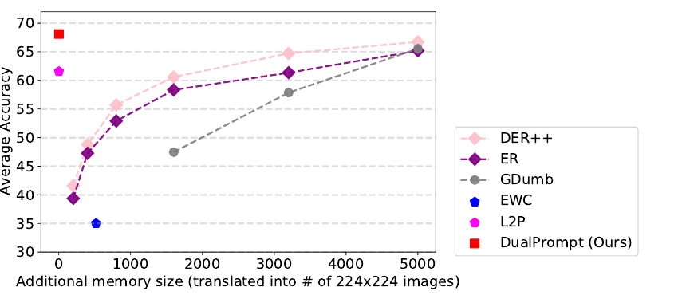
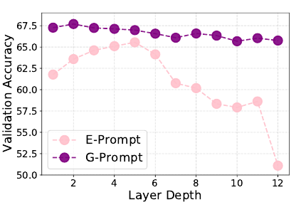
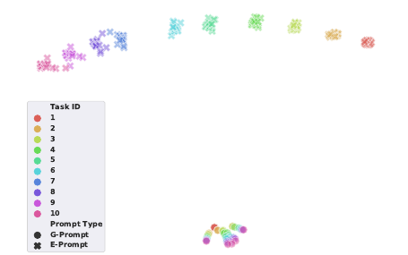

# DualPrompt: 버퍼 없이 망각을 막는 연속학습 — 두 종류의 프롬프트 이야기

> Zifeng Wang, Zizhao Zhang, Sayna Ebrahimi et al. (ECCV 2022, Google Cloud AI + Northeastern University)
> "DualPrompt: Complementary Prompting for Rehearsal-free Continual Learning"

이 글은 DualPrompt 논문을 함께 읽으며 나눈 대화를 정리한 것이다. 핵심 아이디어부터 시작해서, G-Prompt와 E-Prompt가 각각 어떤 지식을 담는지, 학습이 실제로 어떻게 진행되는지, 프롬프트를 백본의 어느 층에 어떻게 붙이는지, 그리고 실험 결과가 무엇을 말하는지 순서대로 풀어본다.

---

## 1. 어떤 문제를 푸는가

연속학습(Continual Learning, CL)의 목표는 하나의 모델이 순차적으로 도착하는 여러 태스크를 **catastrophic forgetting(치명적 망각)** 없이 학습하는 것이다. 즉 새 태스크를 배우면서 이전에 배운 태스크의 성능이 급격히 무너지지 않아야 한다.

기존 최고 성능 방법들은 대부분 과거 데이터를 저장하는 **rehearsal buffer(리허설 버퍼)** 에 의존한다. 과거 태스크의 원본 샘플 일부를 버퍼에 보관해 두었다가 새 태스크를 학습할 때 함께 재생(replay)하는 방식이다. 개념이 단순하고 여러 세팅에 잘 일반화되며 망각을 잘 억제해서, 어려운 class-incremental 세팅에서 오랫동안 SOTA로 군림해 왔다.

문제는 이 버퍼 의존성이 실용성을 크게 떨어뜨린다는 점이다. 프라이버시가 중요한 환경에서는 과거 데이터를 계속 저장할 수 없고, 메모리 예산이 빠듯한 환경에서도 버퍼를 유지하기 어렵다. 게다가 성능이 버퍼 크기에 민감해서, 버퍼가 작아지면 성능이 급격히 떨어진다. 심지어 GDumb 같은 연구는 "충분히 큰 버퍼에 그냥 지도학습만 해도 최신 CL 방법 대부분을 능가한다"고 지적하기도 했다. 그래서 **버퍼 없이도(rehearsal-free) 비슷하거나 더 높은 성능을 내는 검소한 방법**이 필요하다.

여기서 한 가지 세팅을 짚어둘 필요가 있다. 연속학습에는 테스트 시 태스크 정체성(task identity)을 아는 **task-incremental**과, 모르는 **class-incremental** 세팅이 있다. 전자는 현실에서 테스트 시점에 "이게 몇 번째 태스크인지"를 알 수 없기 때문에 지나치게 단순하다고 여겨진다. DualPrompt는 더 어려운 **class-incremental** 세팅, 즉 테스트 때 태스크 정체성을 모르는 상황을 다룬다.

위 그림이 이 논문의 동기를 한눈에 보여준다. 리허설 기반 방법들은 버퍼가 커야 겨우 DualPrompt에 근접하고, 버퍼가 작아지면 정확도가 크게 떨어진다. 반면 DualPrompt는 버퍼를 전혀 쓰지 않고도 그 위에 있다. DualPrompt가 추가로 요구하는 파라미터는 224×224 RGB 이미지 한 장의 바이트 정도에 불과하다.

---

## 2. 핵심 아이디어: 백본은 얼리고, 두 종류의 프롬프트만 배운다

DualPrompt는 버퍼 없이 학습하는 프레임워크로, 사전학습된 ViT(Vision Transformer) 백본을 **완전히 동결(frozen)** 시킨 채 아주 적은 수의 파라미터인 **프롬프트(prompt)** 만 학습시킨다. 프롬프트 기법은 원래 NLP에서 나온 것으로, 고정되거나 학습 가능한 "지시(instruction)"를 붙여 사전학습 모델이 표현을 처음부터 다시 배우는 대신 **기존 표현을 제대로 재사용하도록 지시**하는 방식이다.

DualPrompt의 이름 그대로의 핵심은, 성격이 다른 **두 종류의 상보적 프롬프트**를 쓴다는 데 있다.

- **G-Prompt (General):** 모든 태스크가 공유하는 파라미터로, **태스크 불변(task-invariant)** 지식, 즉 태스크 전반에 걸친 공통 특징을 담는다.
- **E-Prompt (Expert):** 태스크별로 따로 두는 파라미터로, **태스크 고유(task-specific)** 지식을 담는다. 각 E-Prompt에는 학습 가능한 key가 연결되어 있어서, 테스트 시 query 함수로 입력과 가장 가까운 key를 매칭해 해당 E-Prompt를 선택한다.

이 발상은 인간의 **Complementary Learning Systems(CLS)** 이론에서 나왔다. 해마(hippocampus)는 특정 경험에 대한 분리된(pattern-separated) 표현을 학습하고, 신피질(neocortex)은 과거 경험들로부터 더 일반적이고 전이 가능한 표현을 학습한다는 것이다. 이 둘의 시너지 덕분에 인간은 태스크 고유 지식을 간섭 없이 따로 배우면서도, 태스크 불변 지식을 활용해 미래 태스크를 더 잘 배운다. DualPrompt는 이 직관을, 표현 공간이 아니라 **프롬프트 공간을 명시적으로 분리하는** 방식으로 구현했다.

### 1) 선행 연구 L2P와의 차이

DualPrompt 바로 앞에 Learning to Prompt(L2P)라는 연구가 있었다. L2P는 학습 가능한 프롬프트 파라미터로 지식을 버퍼보다 훨씬 간결하게 인코딩(즉 prompt pool)해서 버퍼를 없앤 최초의 시도였다. 다만 성능은 아직 리허설 기반 방법보다 낮았다.

L2P의 한계는 **단일 prompt pool 하나**만 써서, 모든 태스크에 공통인 특징과 각 태스크에 고유한 특징을 구분하지 않았다는 점이다. 저자들은 이것이 CLS 관점에서 최적이 아니라고 본다. DualPrompt는 이를 태스크 불변(G)과 태스크 고유(E) 두 개의 분리된(disjoint) 프롬프트 공간으로 나누고, 프롬프트를 **어느 층에 어떻게 붙일지**까지 탐구해 성능을 끌어올린다. 결과적으로 DualPrompt는 L2P를 일관되게 능가한다.

---

## 3. G-Prompt와 E-Prompt는 실제로 어떻게 정의되는가

사전학습 ViT $f$가 $N$개의 연속된 MSA(multi-head self-attention) 층을 가진다고 하자. $i$번째 MSA 층의 입력 임베딩 특징을 $h^{(i)}$로 표기한다.

**G-Prompt**는 시퀀스 길이 $L_g$, 임베딩 차원 $D$를 갖는 $g \in \mathbb{R}^{L_g \times D}$로, 모든 태스크가 공유하는 파라미터다. $i$번째 MSA 층에 붙일 때 프롬프팅 함수 $f_{\text{prompt}}$로 $h^{(i)}$를 변환한다.

$$h^{(i)}_g = f_{\text{prompt}}\left(g, h^{(i)}\right)$$

**E-Prompt**는 태스크 의존적 파라미터의 집합 $E = \{e_t\}_{t=1}^{T}$이다. 여기서 $e_t \in \mathbb{R}^{L_e \times D}$이고 $T$는 총 태스크 수다. G-Prompt와 달리 각 $e_t$에는 태스크 고유의 key $k_t \in \mathbb{R}^{D}$가 짝지어져 있는데, 이 key도 학습 가능한 파라미터로 해당 태스크의 대표 특징을 포착하려 한다. $t$번째 태스크의 입력을 $j$번째 MSA 층에 붙일 때도 같은 방식이다.

$$h^{(j)}_e = f_{\text{prompt}}\left(e_t, h^{(j)}\right)$$

이 두 식이 말하는 바는 명확하다. 두 프롬프트 모두 MSA 층의 hidden feature를 프롬프팅 함수로 변환할 뿐, 백본의 가중치는 건드리지 않는다. $g$는 하나로 공유되고 $e_t$는 태스크마다 하나씩 존재한다는 점이 핵심 차이다.

### 1) E-Prompt는 태스크 수만큼 존재한다

여기서 자연스럽게 나오는 질문이 있다. E-Prompt는 태스크 수만큼 존재하고, 태스크가 추가되면 명시적으로 그 태스크에 대한 E-Prompt를 추가해서 학습하는 것인가? 그렇다. E-Prompt는 **태스크 하나당 하나씩** 존재하는 구조다. $E = \{e_1, e_2, \dots, e_T\}$이고, 각 $e_t$에는 전용 key $k_t$가 짝지어져 있다.

새 태스크 $t$가 도착하면 그 태스크 전용 $e_t$와 $k_t$를 새로 초기화해서 추가하고, 그것과 G-Prompt·분류 헤드를 함께 학습한다. 과거 태스크들의 E-Prompt는 동결된 채 그대로 유지된다. 그래서 태스크가 늘어날수록 E-Prompt 집합도 **선형적으로 하나씩 커지는** 방식이다.

두 가지를 짚어둘 필요가 있다. 첫째, 그렇기 때문에 DualPrompt는 **명확한 태스크 경계(task boundary)** 를 가정한다. "지금부터 새 태스크가 시작된다"는 신호가 학습 시점에 주어져야 그에 맞춰 새 E-Prompt를 추가할 수 있다. 논문도 학습 시 태스크 전환이 뚜렷하고 갑작스럽다는 가정을 명시한다. 둘째, 파라미터 증가량이 아주 작다. E-Prompt 하나는 $L_e \times D$ 크기의 작은 텐서라, 태스크가 늘어도 전체 추가 파라미터는 모델의 0.2~0.6% 수준에 그친다. 리허설 버퍼처럼 원본 데이터를 쌓는 것과 비교하면 훨씬 경제적이다.

### 2) MSA 층의 가중치는 학습되지 않는다

또 하나 자주 헷갈리는 지점. 프롬프트를 MSA에 붙일 때 MSA 층의 weight도 학습되는가, 아니면 프롬프트만 학습되는가? 답은 **MSA 층의 weight는 학습되지 않는다**는 것이다. 오직 G-Prompt, E-Prompt(그리고 태스크 key, 분류 헤드)만 학습된다.

핵심은 사전학습된 ViT 백본 전체가 완전히 동결된다는 점이다. 여기서 백본에는 MSA 층의 투영 행렬 $W^Q, W^K, W^V, W^O$가 전부 포함된다. 이들은 학습 내내 값이 고정된 채 그대로 쓰인다. 프롬프팅 함수가 하는 일은 **MSA 층의 입력을 바꾸는 것**이지 MSA의 가중치를 바꾸는 게 아니다. 논문도 프롬프팅 함수 적용을 "MSA 층의 입력을 수정하는 것으로 볼 수 있다"고 명시한다.

그래서 역전파로 흐르는 그래디언트가 프롬프트(그리고 헤드·key)까지만 업데이트하고 백본에서 멈춘다. 이것이 프롬프트 기반 방식이 "새 표현을 처음부터 학습"하지 않고 "이미 잘 학습된 표현을 재사용하도록 지시"한다고 표현되는 이유이자, 추가 파라미터가 모델의 0.5%대에 불과한 이유다. 만약 MSA weight까지 태스크마다 학습했다면 파라미터도 폭증하고 catastrophic forgetting도 다시 심해졌을 것이다.

---

## 4. 학습은 어떻게 진행되는가

이제 학습 과정을 단계별로 따라가 보자. 논문의 Algorithm 1을 기준으로 한다.

### 1) 준비 단계

먼저 ImageNet으로 사전학습된 ViT 백본 $f$가 있고, 이건 전 과정 동안 완전히 동결된다. 학습되는 것은 오직 프롬프트 관련 파라미터와 분류 헤드뿐이다. 초기화하는 대상은 네 가지다: 공유 G-Prompt $g$, E-Prompt 집합 $E = \{e_t\}$, 태스크 key 집합 $K = \{k_t\}$, 그리고 분류 헤드 $\phi$. 또한 프롬프트를 어느 층에 붙일지 정하는 구간 값들은 검증셋에서 미리 탐색해 고정해 둔다.

### 2) 태스크 루프 (t = 1 … T)

새 태스크 $t$가 도착하면 다음이 진행된다.

**(1) 해당 태스크의 E-Prompt·key 선택.** 학습 시에는 태스크 정체성을 알기 때문에, 매칭 과정 없이 곧바로 이 태스크 전용 $e_t$와 $k_t$를 꺼낸다(새 태스크면 새로 추가). 과거 태스크의 E-Prompt($e_1 \dots e_{t-1}$)는 이 루프에서 건드리지 않는다.

**(2) 프롬프트가 붙은 아키텍처 조립.** G-Prompt $g$는 지정된 구간의 MSA 층에, E-Prompt $e_t$는 또 다른 지정 구간의 MSA 층에 각각 부착한다. 이 두 구간은 서로 겹치지 않아도 된다. 부착 방식은 프롬프팅 함수로 정해진다. 이렇게 만들어진 임시 구조를 $f_{g, e_t}$라고 부른다.

**(3) 에폭 반복.** 태스크 $t$의 데이터에서 미니배치를 뽑아, 각 샘플 $x$를 $f_{g, e_t}$에 통과시켜 프롬프트가 반영된 특징을 얻고, 이를 헤드 $\phi$에 넣어 예측한다. 손실은 아래 목적함수로 계산한다.

**(4) 역전파 업데이트.** 이 손실로 $g, e_t, k_t, \phi$만 업데이트한다(Adam, lr 0.005, 배치 128). 백본과 다른 태스크의 E-Prompt는 그대로다.

**(5) 다음 태스크로.** 태스크 $t$가 끝나면 그 데이터는 더 이상 접근하지 않고(버퍼 없음), $t+1$로 넘어간다.

### 3) 목적함수

DualPrompt가 태스크 $t$를 학습할 때 최소화하는 목적함수는 다음과 같다.

$$\min_{g,\, e_t,\, k_t,\, \phi} \; \mathcal{L}\left(f_\phi(f_{g,e_t}(x)),\, y\right) + \lambda\, \mathcal{L}_{\text{match}}(x, k_t), \quad x \in D_t$$

- $\mathcal{L}$은 교차 엔트로피 **분류 손실**이다.
- $\mathcal{L}_{\text{match}}(x, k_t) = \gamma(q(x), k_t)$는 **매칭 손실**로, key $k_t$가 이 태스크 입력의 특징 $q(x)$와 코사인 거리상 가까워지도록 당겨준다. query 함수는 사전학습 모델 자체를 그대로 써서 $q(x) = f(x)[0]$, 즉 [class] 토큰의 특징 벡터로 정의한다. 테스트 때 올바른 E-Prompt를 골라내기 위한 사전 정렬 작업이다.
- $\lambda$는 두 손실의 균형을 맞추는 스칼라다.

이 목적함수를 보면 왜 앞서 "$g, e_t, k_t, \phi$만 학습된다"고 했는지가 분명하다. 최소화 대상 자체가 이 넷이고, 백본 $f$는 $q(x)$와 $f_{g,e_t}$ 안에서 고정된 함수로만 등장한다.

### 4) 이 설계가 망각을 막는 방식

두 종류의 파라미터가 역할을 나눠 가진다. **$e_t$는 태스크마다 격리된 전용 슬롯**이라 새 태스크를 배워도 과거 것이 덮어써지지 않는다(태스크 고유 지식 보존). 이것이 CLS의 "해마 = 분리된 표현" 역할에 대응한다. 반면 **$g$는 모든 태스크에 걸쳐 계속 학습**되며 태스크 공통의 불변 지식을 누적한다.

한 가지 짚을 부분은, G-Prompt는 계속 업데이트되므로 원리상 망각에 노출된다는 점이다. 하지만 G-Prompt가 담는 것은 특정 태스크의 세부 지식이 아니라 태스크 전반에 공통된 불변적 지식이라, 실험적으로 안정적으로 작동한다는 것이 저자들의 관찰이다(신피질 = 일반화된 표현 역할). 여기에 사전학습 백본이 이미 강한 일반 표현을 제공하므로, 프롬프트는 새 표현을 처음부터 배우는 게 아니라 기존 표현을 어떻게 재사용할지 지시하는 가벼운 역할만 맡는다.

### 5) 학습 때와 테스트 때의 비대칭

정리하면 이 구조에는 흥미로운 비대칭이 있다.

- **학습 시:** 태스크 정체성을 **알고** 있으므로 해당 태스크의 $e_t$를 직접 선택한다. $g, e_t, k_t, \phi$만 학습하고 나머지 E-Prompt는 동결한다.
- **테스트 시:** 태스크 정체성을 **모르므로** query 함수 $q(x)$로 입력과 가장 가까운 key를 찾아($t_x = \arg\min_t \gamma(q(x), k_t)$) 매칭된 E-Prompt를 골라 G-Prompt와 함께 붙여 예측한다.

학습 2단계에서 매칭 손실로 key를 정렬해 둔 것이 바로 이 테스트 시 선택의 정확도를 위한 준비였던 셈이다. "학습 때는 태스크 ID로 선택, 테스트 때는 key 매칭으로 선택"하는 이 비대칭 구조가 class-incremental 세팅을 다루는 방식이다.

---

## 5. 프롬프트를 어디에, 어떻게 붙일까

DualPrompt에서 "prompt attaching"은 **어디에(where)** 붙일지와 **어떻게(how)** 붙일지 두 가지 축으로 나뉜다. 이 부분이 L2P와 가장 크게 갈리는 지점이다.

### 1) Where: 층을 분리해서 붙인다

핵심 관찰은 "ViT의 층마다 특징 추상화 수준이 다르다"는 점이다. 어떤 층의 표현은 태스크 고유 지식에 더 민감하게 반응하고, 다른 층은 태스크 불변 지식에 더 잘 반응한다. 그래서 두 종류의 프롬프트를 **각자에게 가장 잘 맞는 층에 따로 붙이도록** 자유도를 준다.

프롬프트를 다층으로 확장하면, G-Prompt는 $g = \{g^{(l)}\}$로 $\text{start}_g \dots \text{end}_g$ 구간의 MSA 층들에, E-Prompt는 $e_t = \{e_t^{(l)}\}$로 $\text{start}_e \dots \text{end}_e$ 구간의 층들에 붙인다. 중요한 건 두 구간이 **서로 완전히 다르거나 겹치지 않아도 된다**는 것이다. 이 구간 값들은 검증셋에서 탐색해 정하며, 한 번 찾은 설정이 여러 벤치마크에서 일관되게 잘 작동했다.

이게 CLS 관점과 연결된다. 태스크 공통 지식(신피질 역할)과 태스크 고유 지식(해마 역할)을 표현 공간 안에서 물리적으로 다른 위치에 흘려보내, 서로 간섭 없이 각자의 표현과 상호작용하게 만드는 것이다.

### 2) How: 프롬프트를 MSA에 결합하는 함수

프롬프트 $p$를 실제로 어떻게 임베딩과 결합하는가 하는 함수 $f_{\text{prompt}}$인데, 이건 고수준 지시(프롬프트)가 저수준 표현과 어떻게 상호작용하는지를 직접 좌우한다. MSA 층의 입력을 query·key·value로 나눠서 $h_Q, h_K, h_V$로 볼 때, 논문은 NLP에서 온 두 방식을 비교한다.

**Prompt Tuning (Pro-T)** 는 같은 프롬프트 $p$를 $h_Q, h_K, h_V$ **모두에** 앞에 이어붙인다.

$$f^{\text{Pro-T}}_{\text{prompt}}(p, h) = \text{MSA}([p; h_Q],\, [p; h_K],\, [p; h_V])$$

이러면 출력 시퀀스 길이가 $L$에서 $L + L_p$로 늘어난다. ViT 첫 층에서 [class] 토큰을 붙이는 것과 동일한 연산이다.

**Prefix Tuning (Pre-T)** 는 $p$를 $p_K, p_V$ 둘로 쪼개서 **key와 value에만** 앞에 붙이고, query $h_Q$는 그대로 둔다.

$$f^{\text{Pre-T}}_{\text{prompt}}(p, h) = \text{MSA}(h_Q,\, [p_K; h_K],\, [p_V; h_V])$$

이 경우 출력 길이가 입력과 동일하게 유지된다. 어느 쪽이든 MSA의 가중치가 아니라 **입력**만 바뀐다는 점을 다시 확인할 수 있다.

### 3) L2P와의 세 가지 차이

attaching 설계에서 L2P와 정리해 보면 세 가지가 다르다.

첫째, **프롬프트 종류.** L2P는 태스크 공통 특징과 고유 특징을 구분하지 않는 단일 prompt pool 하나를 쓴다. DualPrompt는 태스크 불변(G)과 태스크 고유(E) 두 종류로 명시적으로 분리한다.

둘째, **붙이는 위치.** L2P를 포함한 대부분의 프롬프트 연구는 프롬프트를 첫 번째 MSA 층 하나에만(입력 임베딩에 prepend) 붙이거나, 반대로 모든 층에 똑같이 붙인다. DualPrompt는 두 종류를 서로 다른 층 구간에 분리 배치하는 유연성을 핵심 설계로 삼는다.

셋째, **결합 방식에 대한 탐구.** L2P는 Pro-T로 고정되어 있지만, DualPrompt는 $f_{\text{prompt}}$를 설정 가능한 요소로 보고 Pro-T와 Pre-T를 비교하며 어느 쪽이 연속학습에 유리한지까지 분석한다.

L2P가 "단일 풀을 입력단에 붙인다"는 단순 구조라면, DualPrompt는 "성격이 다른 두 프롬프트를, 각자에게 맞는 서로 다른 층에, 잘 설계된 결합 함수로 붙인다"로 attaching 단계를 훨씬 정교하게 만든 것이다. 이 정교함이 L2P 대비 일관된 성능 향상의 원천이라고 저자들은 본다.

---

## 6. 실험 세팅

**벤치마크.** 두 개의 class-incremental 벤치마크를 주로 쓴다.

- **Split CIFAR-100:** CIFAR-100(100클래스)을 10개 태스크로 분할(태스크당 10클래스). 이미지 분류로는 쉬운 편이지만 class-incremental에서는 심한 망각을 드러내는 표준 벤치마크다.
- **Split ImageNet-R:** 저자들이 새로 제안한 벤치마크. ImageNet-R의 200클래스를 랜덤하게 10태스크(태스크당 20클래스)로 나눈다. 학습 24,000장 / 테스트 6,000장이고, 20%를 검증셋으로 떼어 프롬프트 부착 설계 탐색에 쓴다. 카툰·그래피티·오리가미 등 스타일이 다양해 클래스 내 다양성(intra-class diversity)이 커서, 작은 버퍼로는 과거 경험을 대표하기 어렵게 만든 게 특징이다. 또 사전학습 모델의 학습셋(ImageNet)과 겹치지 않아 공정한 비교가 가능하다.

**공통 설정.** 백본은 ImageNet 사전학습 **ViT-B/16(동결)**. Adam(lr 0.005, β 0.9/0.999), 배치 128, 입력 224×224. 평가 지표는 **Average Accuracy(높을수록 좋음)** 와 **Forgetting(낮을수록 좋음)**.

**비교 대상.** 정규화 기반(EWC, LwF), 리허설 기반(ER, BiC, GDumb, DER++, Co2L), 프롬프트 기반(L2P), 아키텍처 기반(SupSup, DualNet, RPSNet, DynaER)까지 전 범주를 포함한다. 참고선으로 FT-seq(순차 파인튜닝, 하한)와 Upper-bound(모든 태스크 i.i.d. 지도학습, 상한)도 둔다. 리허설 기반은 버퍼 크기 1000과 5000 두 조건으로 비교한다.

---

## 7. 결과

### 1) 주요 결과 (Table 1)

버퍼를 전혀 쓰지 않는 DualPrompt가 모든 방법을 일관되게 능가한다. 대표 수치를 추려 보면 다음과 같다(정확도는 높을수록, forgetting은 낮을수록 좋음).

| 방법 | 버퍼 | CIFAR-100 Acc / Forget | ImageNet-R Acc / Forget |
|---|---|---|---|
| L2P | 0 | 83.86 / 7.35 | 61.57 / 9.73 |
| **DualPrompt (Ours)** | **0** | **86.51 / 5.16** | **68.13 / 4.68** |
| DER++ | 5000 | 83.94 / 14.55 | 66.73 / 20.67 |
| Co2L | 5000 | 82.49 / 17.48 | 65.90 / 23.36 |
| ER | 5000 | 82.53 / 16.46 | 65.18 / 23.31 |
| Upper-bound | — | 90.85 / — | 79.13 / — |

읽어낼 점이 몇 가지 있다. 버퍼 없는 DualPrompt가 **버퍼 5000장(CIFAR-100 학습셋의 10%, ImageNet-R의 20% 이상)을 쓰는 리허설 기반 방법들보다도 정확도가 높고** forgetting은 훨씬 낮다. 리허설 방법들은 버퍼가 5000일 때 GDumb(버퍼만으로 지도학습)와 비슷해져, 연속학습이 사실상 이득을 못 준다는 것을 보여준다. 비리허설 방법 중엔 L2P만 근접하지만, DualPrompt가 두 프롬프트의 상보 설계 덕에 **평균 정확도 3~7%p 차이로 확실히 앞선다.**

### 2) 아키텍처 기반과의 비교 (Table 2)

같은 ViT-B/16에서 DualPrompt는 상한 대비 격차(Diff)가 **4.34%p**에 불과하며, 추가 파라미터가 **1.90MB(모델의 0.55%)**, 버퍼 0이다. 가장 강한 ResNet 경쟁자 DynaER는 버퍼 2,000장과 **43.8%의 추가 파라미터**를 요구한다. 즉 훨씬 가볍고 버퍼도 없이 더 나은 성능을 낸다.

"강한 백본이면 다 되는 것 아니냐"에 대한 반박도 있다. ViT를 써도 EWC 등 일반 방법들은 여전히 큰 forgetting을 겪고, DynaER에 ResNet152(ViT와 비슷한 상한)를 붙여도 개선이 없었다. 사전학습 모델이 만능이 아니라 **제대로 활용해야** 한다는 것을 보여준다.

### 3) 어디에 붙일까 (Figure 3)

검증셋 탐색 결과 E-Prompt는 **3~5번째 층**, G-Prompt는 **1~2번째 층**이 최적이었다.

흥미롭게도 두 최적 위치가 겹치지 않고 $\text{start}_g > \text{start}_e$, 즉 **G-Prompt는 얕은 층에서 태스크 불변 지식을, E-Prompt는 더 깊은 층에서 태스크 고유 지식을** 더 잘 담는다. 이것이 위치를 분리(decouple)한 설계를 정당화한다. 두 프롬프트를 최상위 층에 붙이면 성능이 가장 나빴는데, 얕은 층에 붙여야 사전학습 모델의 더 많은 층을 조건화할 수 있기 때문으로 본다.

### 4) 어떻게 붙일까 (Table 3)

Prefix Tuning(Pre-T)이 Prompt Tuning(Pro-T)보다 두 데이터셋 모두에서 낫다.

| 프롬프팅 함수 | CIFAR-100 Acc | ImageNet-R Acc |
|---|---|---|
| Pro-T | 83.81 | 64.99 |
| **Pre-T** | **86.51** | **68.13** |

Pre-T는 시퀀스 길이가 늘지 않아 다층 부착 시 더 효율적·확장적이다. L2P는 Pro-T만 썼는데, DualPrompt는 이 선택까지 분석했다.

### 5) Ablation (Table 4)

각 구성 요소의 기여를 뜯어보면 다음과 같다(Split ImageNet-R, ML은 다층 확장).

| G-P | E-P | ML | Avg. Acc | Forgetting |
|:---:|:---:|:---:|---|---|
| | | | 27.01 | 7.57 |
| ✓ | | | 63.41 | 6.52 |
| | ✓ | | 65.10 | 5.52 |
| ✓ | ✓ | | 66.77 | 5.74 |
| ✓ | ✓ | ✓ | **68.13** | **4.68** |

냉동 백본+헤드만 쓰면 27.01%다. G-Prompt만 더하면 63.41로 크게 오르는데(불변 지식이 잘 일반화됨), E-Prompt만 쓰면 65.10으로 더 높다(지식 분리로 forgetting 완화). 둘 다 쓰면 시너지로 더 오르고, 여기에 다층 확장(ML)까지 더하면 최종 **68.13 / 4.68**로 최고다. 각 요소가 모두 기여함을 보여준다.

### 6) 시각화로 확인하는 역할 분담 (Figure 4)

t-SNE로 보면 E-Prompt들은 태스크별로 잘 **분리**되어 있고(고유 지식 학습), G-Prompt 스냅샷들은 태스크가 바뀌어도 거의 **한곳에 모여** 미세하게만 변한다(불변 지식 학습). 앞서 설계 의도로 이야기한 두 프롬프트의 역할 분담이 실제로 이뤄졌음을 시각적으로 확인해 준다.

---

## 8. 정리와 남는 질문

DualPrompt는 버퍼 없이, 아주 적은 추가 파라미터(0.5%대)로, 어려운 class-incremental 세팅에서 리허설 기반과 아키텍처 기반을 모두 능가하며 SOTA를 달성한다. 한 줄로 요약하면 "사전학습 모델을 얼려두고, 공통용(G)·전문가용(E) 두 종류의 작은 프롬프트만 학습해서 버퍼 없이 망각을 억제하는 연속학습 방법"이다.

설계의 핵심은 CLS 이론을 프롬프트 공간의 분리로 옮긴 데 있다. E-Prompt는 태스크마다 격리된 전용 슬롯으로 고유 지식을 보존하고, G-Prompt는 공유 파라미터로 불변 지식을 누적한다. 여기에 "어느 층에, 어떤 함수로 붙이는가"까지 파고들어 L2P보다 정교한 attaching을 만들어냈다.

물론 전제도 분명하다. DualPrompt는 학습 시 **명확한 태스크 경계**를 가정하며, 새 태스크마다 전용 E-Prompt를 추가하므로 태스크 수에 따라 프롬프트 집합이 선형적으로 커진다. 또 G-Prompt는 계속 업데이트되므로 원리상 망각에 노출되는데, 이것이 실험적으로 안정적이긴 하나 이론적 보장은 아니다. 프롬프팅 함수의 설계나 부착 위치의 자동 탐색도 저자들이 열어둔 후속 연구 과제다. 그럼에도, 대규모 사전학습 모델이 실무에서 널리 쓰이는 지금, DualPrompt는 프라이버시·메모리 제약이 있는 실제 환경을 위한 rehearsal-free 연속학습의 출발점이자 프롬프트 기반 연속학습의 통합 프레임워크로 제안된다.
