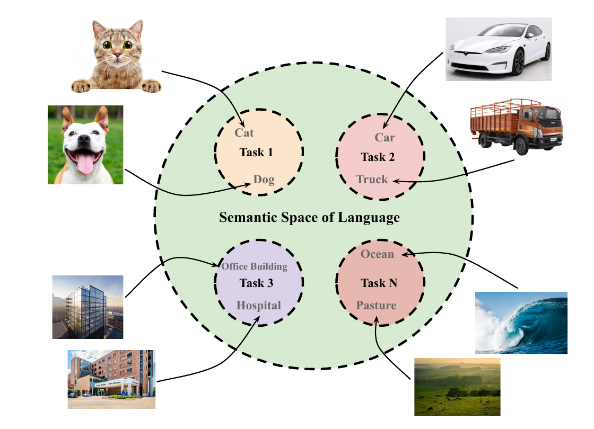
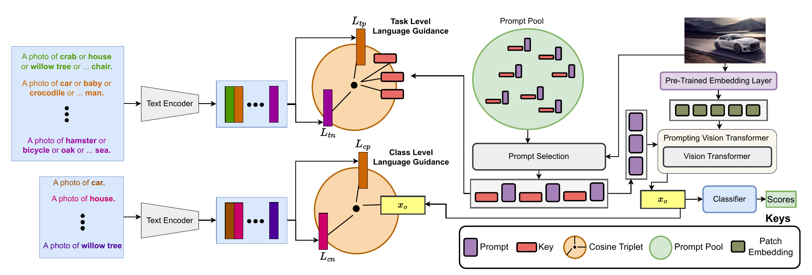

# Introducing Language Guidance in Prompt-based Continual Learning

Continual Learning에 언어 가이던스를 도입한다는 발상 자체는 단순합니다. 태스크마다 시각적 분포는 바뀌지만, 그 태스크가 무엇을 분류하려는지는 결국 클래스 이름 — 즉 언어로 표현되고, 그 언어 표현은 태스크가 바뀌어도 같은 의미 공간 안에 놓여 있다는 것입니다. 이 글은 그 아이디어가 prompt 기반 continual learning에서 구체적으로 어떤 연산으로 구현되는지, 그리고 그 실험적 근거가 얼마나 단단한지를 따라가 봅니다.

---

## 1. 문제 의식

### 1) Class-incremental continual learning

Class Incremental Continual Learning에서 모델은 서로 겹치지 않는(disjoint) 클래스들로 구성된 태스크를 순차적으로 학습합니다. 이는 일반적인 지도학습과 다른 문제인데, 데이터 분포가 계속 바뀌기 때문에 i.i.d. 가정이 성립하지 않기 때문입니다. 그 결과 들어오는 데이터에 대해 손실 함수를 최적화하는 평범한 학습 레시피를 쓰면 **catastrophic forgetting**이 발생합니다. 손실이 현재 태스크의 성능만 장려하므로, 모델이 이전에 본 클래스들을 잊어버리는 것입니다.

### 2) 기존 세 갈래와 그 한계

이 문제를 다루는 기존 접근은 크게 세 갈래로 나뉩니다.

**정규화 기반**은 각 태스크에서 중요한 파라미터를 찾아 이후 태스크에서 그 가소성을 제한합니다. 저장할 데이터가 없다는 장점이 있지만, 태스크가 복잡해져 모델이 태스크 간에 파라미터를 공유해야 하는 상황에서는 성능이 최적에 못 미칩니다.

**리허설 기반**은 이전 태스크의 데이터 일부를 버퍼에 저장해 두고 함께 학습합니다. 개념적으로 매우 단순하지만 꾸준히 SOTA 근처에 있을 만큼 경쟁력이 있습니다. 다만 버퍼가 작아지거나 클래스 수가 크게 늘면 성능이 급격히 떨어지고, **프라이버시 문제로 데이터를 저장할 수 없는 실제 환경에서는 쓸 수 없다**는 비판을 받습니다.

**아키텍처 기반**은 태스크별로 모델의 일부를 특화시킵니다. 그러나 테스트 시점에 어떤 모듈을 쓸지 정하려면 **task identity가 입력으로 필요**한 경우가 많아 현실적인 class-incremental 세팅에 맞지 않고, 학습 파라미터가 코어 모델만큼 늘어나기도 합니다.

### 3) 네 번째 갈래 — prompt 기반

최근 Learning to Prompt(L2P)가 네 번째 방향을 열었습니다. 모델 파라미터를 태스크마다 학습하는 대신, **사전학습된 vision encoder를 얼려 두고 그것을 지휘할 prompt를 학습**하는 것입니다. prompt는 짧은 학습 가능 토큰 열이므로 파라미터 효율이 매우 높고, 영리한 lookup 설계 덕분에 task identity를 입력으로 요구하지도 않습니다.

LGCL은 이 네 번째 갈래 위에 얹는 **plug-in**입니다.

---

## 2. 핵심 아이디어

*그림 1. 각 태스크는 서로 겹치지 않는 클래스 집합이지만(Task 1: Cat/Dog, Task 2: Car/Truck, ...), 이들은 모두 사전학습된 언어 인코더의 동일한 의미 공간으로 매핑될 수 있다.*

태스크마다 **시각적** 분포는 바뀌지만, 그 **레이블 공간(클래스 이름)은 모두 같은 언어 의미 공간에 매핑될 수 있다**는 것이 출발점입니다.

Continual Learning은 서로 다른 태스크에서 오는, 변화하는 데이터 분포를 학습하는 문제를 다룹니다. 그런데 이 태스크들의 시각적 데이터는 바뀌어도 태스크 정의나 분류 대상은 같은 언어의 공간 안에 놓일 수 있습니다. 언어는 세계에 대한 압축된 표현이고, 클래스 이름 같은 언어 단서를 저장하는 것은 모델 입장에서 **공짜**입니다. 현재 태스크와 이전 태스크 모두의 클래스 이름에 이미 접근할 수 있기 때문입니다.

그래서 LGCL은 frozen text encoder를 이용해 언어 표현을 **두 층위의 앵커**로 사용합니다. 하나는 prompt pool의 태스크 수준, 다른 하나는 vision encoder 출력의 클래스 수준입니다.

중요한 점 두 가지를 미리 짚어 두겠습니다.

- **추가 학습 파라미터가 0**입니다.
- **추론 시에는 언어 가이던스가 전혀 필요 없습니다.** baseline이 원래 형태 그대로 동작합니다.

---

## 3. 배경 — prompt 기반 continual learning

LGCL을 이해하려면 그것이 얹히는 토대를 먼저 봐야 합니다.

### 1) Prompt Pool

L2P는 prompt를 태스크에 명시적으로 귀속시키지 않고 **풀(pool)** 로 관리합니다.

$$P = \{P_1, P_2, \cdots, P_M\}, \quad M = \text{total \# of prompts}$$

각 prompt $P_j \in \mathbb{R}^{L_p \times E}$는 토큰 길이 $L_p$와 임베딩 크기 $E$를 갖고, **학습 가능한 키 $k_j$** 가 하나씩 붙습니다.

여기서 왜 태스크마다 prompt를 따로 두지 않는지가 중요합니다. 가장 단순한 접근은 태스크별로 prompt 토큰 한 세트씩을 학습하는 것이지만, 이러면 모델이 **task id를 입력으로 받아야** 올바른 prompt를 고를 수 있습니다. 게다가 태스크 간에 유사한 정보를 공유하는 결합 표현을 만들 수 없습니다. L2P는 대신 풀을 두고, 입력 이미지의 CLS feature를 query로 삼아 키-쿼리 lookup으로 prompt를 꺼내옵니다. **선택이 태스크가 아니라 입력 이미지에 의존**하므로 태스크 표현이 풀 안에서 공유되고 학습이 진행되며 진화합니다.

### 2) $x_o$ — 분류에 쓰이는 출력 feature

$x_o$는 Vision Transformer의 출력 feature로 분류에 사용됩니다. 정의는 baseline마다 다릅니다.

| 방법 | $x_o$ | prompt 주입 방식 |
|---|---|---|
| DualPrompt | prompt 주입 후 ViT의 **CLS feature** | prefix-tuning (MHA의 key/value에 prepend) |
| L2P | **선택된 prompt에 대응하는 토큰들의 average pooled output** | 입력에 patch embedding과 함께 concat |

이 차이는 나중에 ablation 결과를 해석할 때 다시 등장합니다.

---

## 4. LGCL의 전체 구조

*그림 2. LGCL은 언어 가이던스를 두 층위에서 주입한다. 위쪽 경로는 태스크 수준(선택된 키를 태스크의 언어 표현에 정렬), 아래쪽 경로는 클래스 수준(ViT 출력 feature를 정답 클래스의 언어 표현에 정렬)이다. 오른쪽은 기존 prompt 기반 방법의 파이프라인 그대로다.*

그림을 크게 세 덩어리로 보면 읽기 쉽습니다.

- **오른쪽**: 원래의 prompt 기반 파이프라인. 이미지 → Pre-Trained Embedding Layer → prompt pool에서 Prompt Selection → Prompting Vision Transformer → $x_o$ → Classifier → Scores
- **왼쪽 위**: 태스크 문장 → Text Encoder → Cosine Triplet ($L_{tp}$, $L_{tn}$) ← 선택된 **키**
- **왼쪽 아래**: 클래스 문장 → Text Encoder → Cosine Triplet ($L_{cp}$, $L_{cn}$) ← **$x_o$**

두 개의 주황색 원이 각각 triplet loss 연산이고, 오른쪽 파이프라인에서 왼쪽으로 되돌아가는 화살표가 LGCL이 새로 추가한 부분입니다.

---

## 5. Task Level Language Guidance

Figure 2 상단 경로의 동작을 순서대로 정리하면 이렇습니다.

### 1) 태스크 문장 생성

태스크 $t$에 속한 클래스 이름 집합 $Y^t$를 하나의 문장으로 묶습니다.

> "A photo of **crab** or **house** or **willow tree** or ... **chair**."

그림에 세 줄이 세로로 쌓여 있는 건 태스크 1, 2, 3, ... N 각각에 대한 문장입니다. 즉 **태스크 하나 = 문장 하나**이고, 이미지와 무관하게 클래스 이름만으로 만들어집니다.

### 2) Text Encoder 통과 (frozen)

각 문장을 사전학습된 CLIP text transformer에 넣어 출력 토큰의 feature를 뽑습니다.

$$L_t = \mathcal{T}(\text{“A photo of } y_1 \text{ or } \cdots \text{ or } y_n\text{”}) \in \mathbb{R}^E$$

그림에서 Text Encoder 오른쪽의 **색색 막대들**이 바로 태스크별 $L_1, L_2, \ldots, L_t$입니다. 텍스트 인코더는 학습되지 않으므로 이 벡터들은 **고정 상수**이고, 지나간 태스크의 $L$들도 그대로 보관됩니다.

### 3) 이미지 경로에서 키 선택

동시에 오른쪽 경로가 돌아갑니다. 여기가 태스크 수준 가이던스가 개입할 지점을 만들어 줍니다.

1. 입력 이미지 → Pre-Trained Embedding Layer → patch embedding
2. Vision Transformer로 forward pass → **CLS feature**를 query로 사용
3. **Prompt Selection**: query와 prompt pool 안의 각 키 $k_j$(빨간 막대)의 유사도를 계산해 top-N 선택
4. 선택 결과 $P_s = \{P_{s_1},\cdots,P_{s_N}\}$과 그에 딸린 키 $K_s = \{k_{s_1},\cdots,k_{s_N}\}$

그림에서 Prompt Selection 아래 선택된 prompt/key 묶음으로부터 **왼쪽으로 되돌아가는 화살표**가 있는데, 이게 선택된 키 $K_s$를 task-level triplet loss로 보내는 흐름입니다.

### 4) Cosine Triplet

주황 원이 triplet loss 연산입니다. 세 입력이 모입니다.

- **Anchor**: 선택된 키 $k \in K_s$ (오른쪽에서 들어오는 빨간 막대들)
- **Positive** $L_{tp}$: 현재 태스크 $t$의 언어 표현 (원 위쪽 주황 막대)
- **Negative** $L_{tn}$: **이전 태스크들의 언어 표현 중 매 스텝 랜덤 샘플링** (원 아래쪽 보라 막대)

$$S(k, L) = \frac{k \cdot L}{|k||L|}$$

$$\mathcal{L}_{task}(k, L_{tp}, L_{tn}) = 1 - S(k, L_{tp}) + S(k, L_{tn})$$

선택된 N개 키 각각에 대해 적용됩니다. 코사인 유사도를 triplet loss로 최적화함으로써, 선택된 키가 자기 태스크의 언어 표현에는 가까워지고 다른 태스크의 언어 표현에서는 멀어지도록 유도합니다. lookup 키를 태스크의 언어 feature에 정렬시키면, 키가 **언어와 같은 분포에서 온 표현**을 학습하게 되어 태스크 간 학습 과정에서 발산할 가능성이 줄어듭니다.

### 5) 그래디언트가 흐르는 곳

텍스트 인코더도, ViT도 frozen이고 $L_{tp}, L_{tn}$은 상수이므로, 이 loss의 그래디언트는 **오직 prompt pool의 learnable key** $k$로만 흘러갑니다. 그래서 추가 학습 파라미터가 0입니다. 키는 원래 L2P/DualPrompt에 이미 있던 파라미터이기 때문입니다.

또한 prompt 선택 자체(top-N argmax)는 미분 불가능한 이산 연산이라 $\mathcal{L}_{task}$가 prompt $P_s$나 ViT로 역전파되지는 않습니다. **선택된 키 벡터에서 끝납니다.**

### 6) 기하학적으로 무슨 일이 벌어지는가

정리하면 "현재 이미지가 실제로 꺼내 쓴 키들이 태스크 단위로 재배치된다"는 표현이 정확합니다. 다만 세 가지를 짚어 둘 필요가 있습니다.

**앵커는 "현재 태스크 중심"이 아니라 외부 고정점입니다.** $L_t$는 데이터에서 계산한 centroid가 아니라 frozen 텍스트 인코더가 뱉은 고정 벡터로, 학습 내내 움직이지 않습니다. 데이터 기반 중심이었다면 그것 자체가 표류하므로 앵커 역할을 못 합니다. **표류하지 않는 외부 좌표계**라는 점이 이 방법의 핵심입니다.

**붕괴(collapse) 압력과 그 반작용이 있습니다.** $L_t$는 태스크당 단 하나의 벡터입니다. 그래서 $\mathcal{L}_{task}$만 있으면 선택된 N개 키가 전부 같은 점으로 수렴합니다. 키가 다 똑같아지면 top-N lookup이 무의미해지죠. 이걸 막는 것이 baseline의 키-쿼리 매칭 손실 $\mathcal{L}_{match}$입니다. 각 키를 **서로 다른 이미지 query** 쪽으로 흩어놓기 때문입니다. 결과적으로 두 힘의 균형은 이렇게 정리됩니다.

$$\text{태스크 단위로는 뭉치고 } (\mathcal{L}_{task}), \quad \text{태스크 내부에서는 흩어진다 } (\mathcal{L}_{match})$$

**키는 태스크 소유가 아닙니다.** prompt pool은 공유 자원이라 "태스크 1의 키"라는 게 명시적으로 없습니다. 그래서 실제로 벌어지는 일은 다음과 같습니다.

- 현재 태스크에서 **선택되지 않은** 키 → $\mathcal{L}_{task}$ 미적용, 그 자리에 그대로 보존
- 예전에 태스크 1을 담당하던 키가 태스크 3에서 선택되면 → $L_3$ 쪽으로 끌려가고 $L_1$에서 밀려남 (**재할당**)

그래서 "분리"는 정적인 파티셔닝이 아니라, 학습이 진행되며 키들이 태스크별 언어 앵커 주위로 **점진적으로 정렬되어 가는 과정**에 가깝습니다. 덧붙여 negative는 매 스텝 이전 태스크 중 **하나만** 샘플링되므로, 한 번의 업데이트로 모든 과거 태스크와 분리되는 게 아니라 여러 스텝에 걸쳐 기댓값 수준에서 밀어내는 구조입니다.

---

## 6. Class Level Language Guidance

Figure 2 하단 경로입니다. 구조는 task-level과 대칭이지만, **입력 단위와 그래디언트가 도달하는 지점**이 다릅니다.

### 1) 클래스 문장 생성

학습 샘플 $(x, y)$의 **정답 레이블 $y$ 하나**에 대해 문장을 만듭니다.

> "A photo of **car**." / "A photo of **house**." / "A photo of **willow tree**"

task-level이 "클래스 n개를 or로 이어붙인 문장 1개 / 태스크"였다면, 여기는 **클래스 1개 = 문장 1개**입니다. 그림에서 아래쪽 박스에 단일 클래스 문장들이 나열된 이유가 이것입니다.

### 2) Text Encoder 통과 (frozen)

$$L_c = \mathcal{T}(\text{“A photo of } \{\text{class name}\}\text{”}) \in \mathbb{R}^E$$

Text Encoder 오른쪽 색색 막대가 클래스별 $L_c$입니다. 위쪽 경로와 **같은 frozen CLIP 인코더**를 공유하며, 클래스 이름은 현재·이전 태스크 모두 무료로 갖고 있으므로 저장 비용이 없습니다.

### 3) 이미지 경로에서 $x_o$ 생성

여기가 task-level과 결정적으로 갈리는 부분입니다. task-level은 **prompt를 고르는 단계(키)** 에 개입했지만, class-level은 **prompt를 이미 주입해서 나온 최종 출력**에 개입합니다.

1. 선택된 prompt $P_s$를 frozen ViT에 주입 → Prompting Vision Transformer
2. 그 출력에서 $x_o \in \mathbb{R}^E$ 추출

그림에서 Prompting Vision Transformer 오른쪽의 노란 $x_o$ 박스가 **두 갈래로 분기**하는 게 핵심입니다. 하나는 Classifier → Scores(분류)로 가고, 다른 하나는 왼쪽으로 되돌아가 Cosine Triplet으로 들어갑니다.

### 4) Cosine Triplet

- **Anchor**: $x_o$ (오른쪽에서 들어오는 노란 박스)
- **Positive** $L_{cp}$: 정답 클래스 $y$의 언어 표현
- **Negative** $L_{cn}$: **이전 태스크들의 클래스 중 매 스텝 랜덤 샘플링**

$$\mathcal{L}_{class}(x_o, L_{cp}, L_{cn}) = 1 - S(x_o, L_{cp}) + S(x_o, L_{cn})$$

negative가 현재 태스크의 다른 클래스가 아니라 **이전 태스크의 클래스**에서 뽑힌다는 점이 중요합니다. 현재 클래스를 이전 클래스들과 밀어내는 것이 목적이지, 현재 태스크 내부 판별(그건 CE가 담당)이 목적이 아니기 때문입니다.

이미지 출력 feature를 클래스별 언어 표현에 정렬시킴으로써, 모델이 매 태스크마다 사전학습된 언어 인코더의 **동일한 의미 공간으로 매핑**하도록 유도하는 것입니다.

### 5) 그래디언트가 흐르는 곳

ViT와 텍스트 인코더가 모두 frozen이므로, $x_o$를 통해 역전파된 그래디언트는 결국 **학습 가능한 prompt 토큰**에 도달합니다.

$$\mathcal{L}_{task} \longrightarrow \text{키 } k \qquad\qquad \mathcal{L}_{class} \longrightarrow \text{prompt } P_s$$

두 loss가 **서로 다른 파라미터를 건드린다**는 것이 이 설계의 특징입니다.

### 6) 전체 손실과 추론

$$\mathcal{L} = \mathcal{L}_{CE} + \mathcal{L}_{match} + \mathcal{L}_{task} + \mathcal{L}_{class}$$

$x_o$는 **두 가지 역할을 겸합니다**. CE는 $x_o$를 분류에 유리하게 만들고, $\mathcal{L}_{class}$는 그 $x_o$가 CLIP 의미 공간 안에 놓이도록 잡아둡니다.

두 LGCL 손실 모두 negative로 쓸 이전 태스크가 필요하므로 **첫 태스크가 학습된 이후부터 적용**됩니다. 추론 시에는 언어 가이던스가 필요 없고, $x_o$를 뽑아 linear layer로 분류하는 원래 형태 그대로입니다.

---

## 7. key와 prompt는 각각 무엇을 배우는가

"key는 task-level에서만 학습되고 prompt는 class-level에서만 학습된다"고 정리하고 싶어지지만, 정확하지 않습니다. 각 파라미터는 **두 개씩** 신호를 받습니다.

| 파라미터 | baseline 손실 | LGCL 추가 손실 |
|---|---|---|
| key $k$ | $\mathcal{L}_{match}$ — 이미지 query 쪽으로 끌어당김 | $\mathcal{L}_{task}$ — 태스크 언어 표현으로 정렬 |
| prompt $P$ | $\mathcal{L}_{CE}$ — 분류 정확도 (주 동력) | $\mathcal{L}_{class}$ — 클래스 언어 표현으로 정렬 |

특히 prompt의 주된 학습 동력은 여전히 **CE loss**입니다. $\mathcal{L}_{class}$는 거기에 얹는 정렬 항이지 단독 학습원이 아닙니다.

### 1) stability와 plasticity의 경계는 어디인가

"key = 기존 태스크 성능 유지 / prompt = 새 태스크 성능 향상"이라는 구분도 축이 어긋나 있습니다. stability(기존 유지)와 plasticity(신규 습득)의 경계는 **key/prompt 사이가 아니라, baseline 손실과 LGCL 손실 사이**에 있습니다.

$$\underbrace{\mathcal{L}_{CE} + \mathcal{L}_{match}}_{\text{plasticity — 현재 태스크 데이터에 적합}} \quad + \quad \underbrace{\mathcal{L}_{task} + \mathcal{L}_{class}}_{\text{stability — 고정 언어 공간에 고정}}$$

LGCL의 두 loss는 **둘 다 forgetting 억제용**입니다. 근거는 negative 샘플링 방식입니다. $L_{tn}$과 $L_{cn}$ 모두 **이전 태스크에서만** 뽑습니다. 즉 두 항 다 "지금 배우는 것을 과거와 구별되게 유지하라"는 제약이지, 새 태스크 성능을 직접 올리는 항이 아닙니다.

### 2) 검색(retrieval)과 내용(content)

그렇다면 key와 prompt의 실제 차이는 무엇일까요. stability/plasticity가 아니라 **검색 vs 내용**입니다.

- **key** = "이 이미지에 어떤 prompt를 꺼내올 것인가" (주소록)
- **prompt** = "꺼내온 prompt가 ViT에 무슨 지식을 주입하는가" (내용물)

여기서 forgetting도 두 가지 형태로 갈라집니다.

**검색 실패형**: 키가 새 태스크 데이터를 따라 표류하면, 옛 태스크 이미지가 들어와도 엉뚱한 prompt를 고릅니다. **prompt 안의 지식은 멀쩡한데 접근이 안 되는** 상황입니다. $\mathcal{L}_{task}$가 막는 게 이것입니다.

**내용 덮어쓰기형**: prompt pool은 태스크별로 분리되지 않고 공유되므로, 새 태스크의 CE loss가 옛 태스크 지식이 담긴 prompt를 그대로 덮어씁니다. $\mathcal{L}_{class}$가 막는 게 이것입니다.

그래서 **prompt는 "새 태스크 전담"이 아니라, 오히려 파라미터 수준의 forgetting이 실제로 발생하는 지점**입니다. 한 문장으로 정리하면 이렇습니다.

> key는 **prompt 검색 경로**를 언어 공간에 고정해 옛 태스크의 prompt를 계속 찾아낼 수 있게 하고, prompt는 CE로 새 태스크를 배우면서 $\mathcal{L}_{class}$로 그 표현이 과거 클래스들과 같은 의미 공간에 남아 있도록 제약받는다.

---

## 8. 실험 결과

실험 세팅은 ImageNet-1k로 사전학습한 ViT-B/16(frozen)을 이미지 인코더로, CLIP L/14의 text transformer를 언어 인코더로 씁니다. Split CIFAR-100(10 태스크 × 10 클래스)과 Split ImageNet-R(10 태스크 × 20 클래스)에서 평가하며, **LGCL에 대해서는 하이퍼파라미터 최적화를 전혀 하지 않았다**고 명시합니다.

### 1) 메인 결과 (Table 1)

| 방법 | 버퍼 | CIFAR-100 Acc ↑ | CIFAR-100 Forg ↓ | ImageNet-R Acc ↑ | ImageNet-R Forg ↓ |
|---|---|---|---|---|---|
| DER++ | 5000 | 83.94±0.34 | 14.55±0.73 | 66.73±0.87 | 20.67±1.24 |
| Co2L | 5000 | 82.49±0.89 | 17.48±1.80 | 65.90±0.14 | 23.36±0.71 |
| LwF | 0 | 60.69±0.63 | 27.77±2.17 | 38.54±1.23 | 52.37±0.64 |
| L2P | 0 | 83.86±0.28 | 7.35±0.38 | 61.57±0.66 | 9.73±0.47 |
| **L2P + LGCL** | 0 | 84.33±0.06 | 5.83±0.23 | 62.51±0.05 | 8.9±0.17 |
| DualPrompt | 0 | 86.51±0.33 | 5.16±0.09 | 68.13±0.49 | 4.68±0.20 |
| **DualPrompt + LGCL** | 0 | **87.23±0.21** | **5.10±0.15** | **69.46±0.04** | **4.2±0.06** |
| Upper-bound | - | 90.85±0.12 | - | 79.13±0.18 | - |

정확도는 높을수록, forgetting은 낮을수록 좋습니다. Upper-bound는 모든 태스크에 동시에 접근 가능한 완전 지도학습 성능입니다.

눈여겨볼 baseline은 **DER++** 입니다. 버퍼 5000개를 쓰는 강력한 리허설 기반 방법인데, 버퍼를 전혀 쓰지 않는 DualPrompt + LGCL이 두 데이터셋 모두에서 앞섭니다(83.94 → 87.23, 66.73 → 69.46). forgetting 지표에서는 격차가 더 큽니다.

개선폭 자체는 이렇습니다. DualPrompt 기준 CIFAR-100에서 +0.72%, ImageNet-R에서 +1.33%. L2P 기준 CIFAR-100에서 정확도 +0.47%에 forgetting −1.52%, ImageNet-R에서 정확도 +0.94%에 forgetting −0.83%.

### 2) 아키텍처 기반 방법과의 비교 (Table 2)

이 표는 서로 다른 backbone을 쓰는 방법들을 비교하기 위해, 각 backbone의 지도학습 상한과의 **차이(Diff)** 로 성능을 봅니다. 낮을수록 좋습니다.

| 방법 | Backbone | Avg. Acc ↑ | Diff ↓ | 버퍼 | 추가 파라미터 |
|---|---|---|---|---|---|
| DynaER | ResNet18 | 74.64 | 5.77 | 2000 | 19.8MB (43.8%) |
| RPSNet | ResNet18 | 68.60 | 11.81 | 2000 | 181MB (404%) |
| L2P | ViT-B/16 | 83.86±0.28 | 6.99 | 0 | 1.94MB (0.56%) |
| **L2P + LGCL** | ViT-B/16 | 84.33±0.06 | 6.52 | 0 | 1.94MB (0.56%) |
| DualPrompt | ViT-B/16 | 86.51±0.33 | 4.34 | 0 | 1.90MB (0.55%) |
| **DualPrompt + LGCL** | ViT-B/16 | **87.23±0.21** | **3.45** | 0 | 1.90MB (0.55%) |

추가 파라미터 열이 이 표의 진짜 메시지입니다. LGCL을 붙여도 **1.90MB / 0.55%로 baseline과 정확히 동일**합니다. 학습 가능한 파라미터를 하나도 추가하지 않았기 때문입니다. RPSNet이 원 모델의 404%에 달하는 파라미터를 추가하고도 Diff 11.81에 그치는 것과 대비됩니다.

---

## 9. Ablation 상세

### 1) 구성 요소 ablation (Table 3, Split ImageNet-R)

| | $\mathcal{L}_{task}$ | $\mathcal{L}_{class}$ | L2P Acc | L2P Forg | DualPrompt Acc | DualPrompt Forg |
|---|---|---|---|---|---|---|
| a) | | | 61.57 | 9.73 | 68.13 | 4.68 |
| b) | ✓ | | 61.77 | 10.03 | 69.43 | 4.26 |
| c) | | ✓ | 62.36 | 8.53 | 69.02 | 4.7 |
| d) | ✓ | ✓ | 62.51 | 4.2 ⚠️ | 69.46 | 4.2 |

**먼저 표 자체의 오류로 보이는 지점이 있습니다.** d)행 L2P의 forgetting이 4.2로 적혀 있는데, Table 1에서 L2P + LGCL의 ImageNet-R forgetting은 **8.9±0.17**입니다. 정확도는 62.51로 두 표가 일치하는데 forgetting만 어긋나죠. DualPrompt 열의 4.2가 옆 칸에 잘못 복사된 **오타로 보입니다.** 아래 해석은 Table 1의 8.9를 기준으로 합니다.

baseline 대비 정확도 증분으로 다시 정리하면 이렇습니다.

| | L2P | DualPrompt |
|---|---|---|
| $\mathcal{L}_{task}$ 단독 | +0.20 | **+1.30** |
| $\mathcal{L}_{class}$ 단독 | **+0.79** | +0.89 |
| 둘 다 | +0.94 | +1.33 |

두 가지가 눈에 띕니다.

**첫째, 지배적인 구성 요소가 baseline마다 뒤집힙니다.** L2P에서는 $\mathcal{L}_{class}$가, DualPrompt에서는 $\mathcal{L}_{task}$가 대부분의 이득을 냅니다. 논문 본문은 "class-level이 task-level보다 큰 개선을 준다"고 서술하지만, 이는 L2P에서만 성립합니다.

구조 차이로 설명해 볼 수는 있습니다. L2P의 $x_o$는 선택된 prompt 토큰의 average pooling이라 prompt와 직결되는 반면, DualPrompt는 task-specific E-prompt를 prefix-tuning으로 주입하므로 **어떤 prompt를 고르느냐**가 성능을 좌우합니다. 다만 논문이 이 해석을 제시하지는 않으니 추측입니다.

**둘째, 두 항의 결합은 사실상 가산적이지 않습니다.** DualPrompt에서 $\mathcal{L}_{task}$ 단독 69.43 → 둘 다 69.46으로 **+0.03**입니다. 보고된 표준편차가 ±0.04~0.49인 걸 감안하면 노이즈 수준입니다. L2P도 62.36 → 62.51로 +0.15입니다. 논문은 이를 "complementary"라고 결론짓지만, 수치상으로는 **각 baseline에서 한 항이 일을 거의 다 하고 나머지 한 항이 미미하게 얹히는** 구조에 가깝습니다.

또 하나, $\mathcal{L}_{task}$ 단독은 L2P에서 forgetting을 9.73 → 10.03으로 **악화**시킵니다. 키를 언어 앵커로 당기는 것 자체가 forgetting을 줄이지는 않는다는 뜻입니다.

### 2) 텍스트 인코더 ablation (Table 4, DualPrompt + LGCL, Split CIFAR-100)

| 인코더 | Avg. Acc ↑ | Forgetting ↓ |
|---|---|---|
| DualPrompt (baseline) | 86.51 | 5.16 |
| RoBERTa | 87.04 | 5.4 |
| BERT | 87.11 | **4.90** |
| CLIP | **87.23** | 5.10 |

**핵심은 세 인코더가 모두 baseline을 넘고, 서로 간 차이는 0.19에 불과하다**는 점입니다. LGCL이 인코더 선택에 robust하다는 논문의 주장은 타당합니다.

의미 있는 부분은 **BERT/RoBERTa가 언어 전용 모델**이라는 것입니다. CLIP은 이미지-캡션 쌍으로 학습돼 시각 정보가 스며든 텍스트 임베딩을 갖는데, 그런 이점이 없는 순수 언어 모델로도 거의 같은 이득이 납니다. 즉 이 방법이 작동하는 이유가 "CLIP이 vision-language 정렬을 이미 갖고 있어서"가 아니라, **"클래스 이름들 사이의 의미적 거리 구조를 가진 고정 좌표계가 있으면 된다"** 는 쪽에 가깝다는 증거입니다.

BERT가 forgetting에서는 CLIP보다 좋다는 것도 흥미로운데, 논문은 언급 없이 넘어갑니다.

### 3) 키 설계 ablation (Table 5, DualPrompt + LGCL, Split CIFAR-100)

| 키 | Avg. Acc ↑ | Forgetting ↓ |
|---|---|---|
| DualPrompt (baseline) | 86.51 | 5.16 |
| a) Frozen CLIP Keys | 86.15 | **3.93** |
| b) Learnable Keys | **87.23** | 5.10 |

앞서 이야기한 stability–plasticity 긴장이 가장 선명하게 드러나는 표입니다.

a)는 키를 아예 CLIP 텍스트 CLS 토큰으로 **고정**한 것 — $\mathcal{L}_{task}$가 지향하는 목표점에 처음부터 붙여버린 극단입니다. 결과가 갈립니다.

- **Forgetting 3.93으로 전체 최저.** 당연합니다. 키가 움직이지 않으니 표류할 수가 없습니다.
- **정확도는 86.15로 baseline(86.51)보다도 낮음.** 키가 이미지 query에 전혀 적응하지 못해 lookup 품질이 떨어집니다.

즉 **"언어 쪽으로 당기되 완전히 붙이지는 않는"** 상태가 최적이라는 것이 실험적으로 확인됩니다. $\mathcal{L}_{match}$(query 쪽으로)와 $\mathcal{L}_{task}$(언어 앵커 쪽으로)의 줄다리기가 필요하다는 뜻입니다.

### 4) 태스크별 정확도 추이 (Figure 3, 4)

10개 태스크를 진행하며 average accuracy를 플롯한 것으로, L2P와 DualPrompt 모두 LGCL 적용 시 **곡선의 하강 기울기가 완만**해집니다. 특정 시점에서만 벌어지는 게 아니라 **모든 학습 단계에 걸쳐** 격차가 유지된다는 것이 논문의 주장입니다. 정성적 관찰이고 별도 수치는 제시되지 않습니다.

---

## 10. 한계와 남은 질문

논문이 "LGCL에 대해 하이퍼파라미터 최적화를 하지 않았다"고 명시한 만큼, 검증되지 않은 설계 선택이 여럿 남습니다.

- **손실 가중치**: $\mathcal{L}_{CE} + \mathcal{L}_{task} + \mathcal{L}_{class}$를 계수 1로 단순 합산합니다. $\lambda$ 조정 실험이 없습니다.
- **프롬프트 템플릿**: "A photo of {}" 고정. CLIP 계열에서 템플릿 문구가 성능에 꽤 영향을 준다는 게 알려져 있는데 미검증입니다.
- **태스크 문장의 클래스 나열 순서**: "or"로 이어 붙인 순서가 텍스트 인코더 출력에 미치는 영향이 검증되지 않았습니다.
- **negative 샘플링 전략**: 이전 태스크에서 무작위 1개. hard negative mining이나 다중 negative와의 비교가 없습니다.
- **태스크 수 / 클래스 수 확장성**: 두 데이터셋 모두 10개 태스크로 고정입니다.

마지막 항목이 가장 아쉬운 부분입니다. LGCL의 논리 자체가 "고정된 언어 공간에 태스크들을 배치한다"는 것이므로, **태스크 수가 늘 때 그 공간이 포화되는지**가 핵심 질문인데 실험이 없습니다. 태스크가 늘어날수록 $L_t$들이 언어 공간에서 서로 붐비게 될 텐데, 그 지점의 한계가 탐색되지 않았습니다.

여기에 더해 앞서 짚은 두 가지 — Table 3 d)행 L2P forgetting 수치의 불일치, 그리고 "두 모듈이 상보적"이라는 결론이 증분 수치상으로는 잘 뒷받침되지 않는다는 점도 남습니다.

---

## 11. 마무리

LGCL의 기여를 정리하면 이렇습니다. 태스크 분포는 바뀌어도 레이블 공간은 같은 언어 공간으로 매핑될 수 있다는 관찰에서 출발해, 그 공간을 **표류하지 않는 외부 좌표계**로 삼아 continual learner를 붙들어 둡니다. 태스크 수준에서는 prompt pool의 키 lookup을 개선해 모델이 여러 태스크에 걸쳐 더 견고해지도록 하고, 클래스 수준에서는 vision transformer의 출력 feature를 클래스 언어 표현에 정렬시킵니다. **추가 학습 파라미터 없이** 두 prompt 기반 baseline의 성능을 끌어올려 SOTA를 갱신합니다.

절대 성능 향상폭은 0.5~1.3%p로 크지 않고, ablation을 뜯어보면 두 모듈의 상보성 주장도 다소 관대한 편입니다. 하지만 파라미터·메모리 추가 없이 태스크별 정확도 하락 곡선을 완만하게 만든다는 점, 그리고 무엇보다 **prompt 기반 continual learning에 언어 가이던스를 접목한 첫 시도**라는 위치가 이 논문의 주된 기여입니다. 언어 전용 인코더로도 효과가 난다는 Table 4의 결과는, 이 방향이 CLIP 같은 vision-language 모델에 의존하지 않고도 확장될 수 있음을 시사합니다.

---

**논문**: Muhammad Gul Zain Ali Khan, Muhammad Ferjad Naeem, Luc Van Gool, Didier Stricker, Federico Tombari, Muhammad Zeshan Afzal, *Introducing Language Guidance in Prompt-based Continual Learning*, ICCV 2023. [arXiv:2308.15827](https://arxiv.org/abs/2308.15827)
