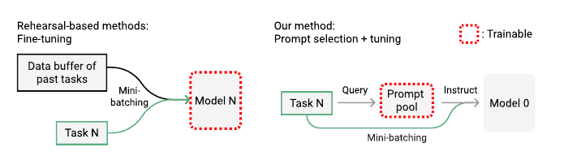
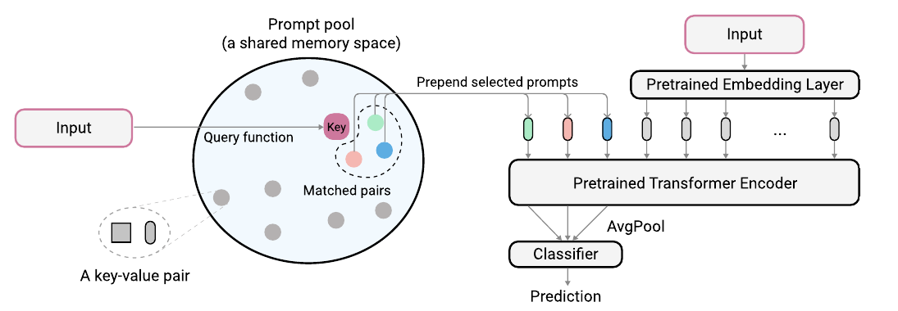
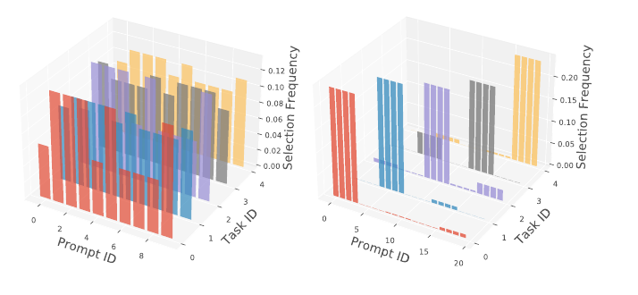

# Learning to Prompt for Continual Learning (L2P) 읽기

> [arXiv:2112.08654](https://arxiv.org/abs/2112.08654) · [코드](https://github.com/google-research/l2p)

NLP의 prompt tuning을 continual learning으로 처음 가져온 논문이다. 사전학습 모델을 완전히 얼려둔 채, 백본 대비 0.05~0.11%에 불과한 프롬프트 파라미터만 학습해서 rehearsal buffer를 쓰는 SOTA를 이긴다. 이 글은 논문의 구조를 따라가되, 특히 **query mechanism이 왜 작동하는가**와 **frozen 백본이 어디까지 버티는가**에 무게를 둔다.

---

## 1. 왜 이 논문이 나왔나

### 1) Catastrophic forgetting과 기존 두 갈래

Continual learning은 i.i.d. 가정이 깨진 상황에서 하나의 모델을 순차적으로 학습시키는 문제다. 모델은 학습 사이클의 각 국면에서 현재 데이터에만 접근할 수 있으므로, 지금 가진 데이터에 과적합하고 이전에 학습한 데이터에 대해 성능이 무너진다. 이것이 catastrophic forgetting이다.

기존 continual learning은 모델 파라미터를 순차적으로 적응시키며 이 문제와 싸웠다. 그 해법들은 두 가지 한계가 있다.

**Rehearsal 기반**은 과거 샘플 일부를 버퍼에 저장했다가 현재 데이터와 함께 재학습한다. 개념이 단순하면서도 강력해서 여러 벤치마크에서 SOTA를 차지했다. 그러나 버퍼 크기가 작아지면 성능이 급락하고, 데이터 프라이버시가 중요한 실제 시나리오에서는 아예 사용할 수 없다.

**Architecture 기반**은 태스크마다 별도 컴포넌트를 둔다. 네트워크를 확장하거나 태스크별 서브네트워크에 주목하는 방식이다. 그러나 대부분 test time에 task identity를 알아야 네트워크를 조건화할 수 있어서, task identity를 모르는 현실적인 class-incremental·task-agnostic 설정에는 적용할 수 없다. 게다가 추가 파라미터가 상당해서 때로는 전체 모델 크기에 육박한다.

### 2) 논문이 던진 두 질문

이 한계들에서 논문은 두 개의 질문을 끌어낸다.

1. Episodic memory의 형태가 과거 데이터를 버퍼링하는 것을 넘어, 더 지능적이고 간결한 시스템이 될 수 있는가?
2. Task identity를 모르는 임의의 샘플에 대해, 관련 있는 지식 컴포넌트를 자동으로 선택할 수 있는가?

첫 번째 질문의 답으로 NLP의 prompt-based learning을 가져온다. 프롬프트는 태스크별 지식을 훨씬 적은 추가 파라미터로 담아낸다. 두 번째 질문이 진짜 난제다. 태스크별로 다른 프롬프트를 학습하면 test time에 여전히 task identity가 필요하고, 반대로 모든 태스크가 하나의 프롬프트를 공유하면 catastrophic forgetting이 그대로 남는다.

L2P는 이 둘 사이를 뚫는다.

---

## 2. 핵심 아이디어 — 데이터가 아니라 '지시'를 저장한다

L2P는 사전학습된 ViT를 **완전히 얼려두고**, 대신 작은 학습 가능한 프롬프트들의 집합인 **prompt pool**만 학습한다. 지식을 "데이터를 저장"하는 게 아니라 "프롬프트 파라미터에 인코딩"하는 방식으로 저장하는, 더 간결한 episodic memory인 셈이다.



*왼쪽은 기존 rehearsal 방식 — 과거 태스크의 데이터 버퍼를 유지하며 모델 가중치 자체를 순차적으로 fine-tune한다. 오른쪽이 L2P — 백본(Model 0)은 처음 상태 그대로 얼어 있고, 태스크 데이터가 prompt pool에 query를 던져 프롬프트를 고르면 그것이 모델에 "지시(instruct)"를 준다. 빨간 점선이 학습되는 부분이다.*

논문이 강조하는 대목이 인상적이다 — 가장 큰 prompt space조차 224×224 이미지 한 장보다 작다.

프롬프트를 pool로 구성한 동기는 세 가지다. 첫째, test time에 task identity를 모르므로 태스크별 독립 프롬프트는 애초에 불가능하다. 둘째, 설령 알 수 있다 해도 유사한 태스크 간 지식 공유가 차단된다. 셋째, 모든 태스크가 단일 프롬프트를 공유하면 지식 공유는 되지만 심각한 forgetting이 남는다. 이상적으로는 **태스크가 유사할 때는 지식을 공유하고, 그렇지 않을 때는 독립적으로 유지하는** 모델을 원한다.

---

## 3. 구조와 학습 과정

### 1) 무엇이 얼어 있고 무엇이 학습되는가

| 구성요소 | 상태 |
|---|---|
| ViT 임베딩 레이어 `f_e` | **Frozen** |
| ViT 트랜스포머 인코더 `f_r` | **Frozen** |
| Query function `q(·)` (= 같은 frozen ViT) | **Frozen, 학습 파라미터 없음** |
| Prompt pool `P = {P_1..P_M}`, `P_j ∈ R^(L_p×D)` | **학습** |
| Prompt keys `K = {k_1..k_M}`, `k_j ∈ R^Dk` | **학습** |
| 분류기 `g_φ` | **학습** |

`g_φ, P, K`는 태스크 시작마다 초기화하지 않고 **맨 처음 한 번만** 초기화된다. 즉 태스크 T개를 관통해 하나의 pool과 하나의 head가 계속 갱신된다.

프롬프트 풀은 다음과 같이 정의된다.

$$\mathbf{P} = \{P_1, P_2, \cdots, P_M\}, \quad M = \text{total \# of prompts}$$

여기서 각 $P_j \in \mathbb{R}^{L_p \times D}$는 토큰 길이 $L_p$를 갖는 단일 프롬프트이고, $D$는 임베딩 차원으로 입력 임베딩 $x_e$와 같다.

### 2) 바깥 루프 — 태스크 순차 진행

```
for t = 1..T:                    # 태스크 순차 도착
  for e = 1..E_t:                # 태스크당 5 epoch (task-agnostic은 1 pass)
    for each mini-batch B:       # batch 128, Adam, lr 0.03 constant
```

각 태스크가 끝나면 그 데이터는 다시 볼 수 없다(rehearsal 버전인 L2P-R 제외).

### 3) 샘플 하나의 forward — 5단계



*학습 시에도 같은 절차를 따른다. 입력이 query function을 거쳐 prompt pool에서 key를 매칭하고, 선택된 프롬프트가 입력 토큰 앞에 붙어 얼린 트랜스포머를 통과한다. 왼쪽 아래의 "A key-value pair"가 이 구조의 핵심 단위다.*

**Step 1. Query 추출**

$$q(x) = f(x)[0, :]$$

**얼린** 사전학습 ViT에 원본 이미지를 그냥 통과시켜 `[class]` 토큰 벡터를 뽑는다. 프롬프트 없이 통과시키는 별도의 forward pass다. 논문은 $q$가 태스크에 대해 결정론적이고 학습 파라미터가 없어야 한다고 명시한다.

여기가 설계의 핵심이다. Query function이 학습되지 않으므로 **같은 이미지는 학습이 아무리 진행돼도 항상 같은 query를 낸다**. 태스크 10을 배우는 동안 태스크 1 이미지의 query가 흔들리지 않는다는 뜻 — retrieval 자체가 drift하지 않는다.

**Step 2. Top-N key 매칭**

$$K_x = \arg\min_{\{s_i\}_{i=1}^{N} \subseteq [1,M]} \sum_{i=1}^{N} \gamma(q(x), k_{s_i})$$

$\gamma$는 query와 prompt key 사이의 매칭 점수 함수로, 논문은 코사인 거리가 잘 작동한다고 보고한다. $M$개 key 중 query와 가장 가까운 $N$개를 고른다. (CIFAR-100 계열: $M=10, N=5, L_p=5$ / 5-datasets: $M=20, N=4, L_p=5$)

**Step 3. Prompt prepend**

$$x_p = [P_{s_1}; \cdots; P_{s_N}; x_e], \quad 1 \le N \le M$$

선택된 key에 매달린 프롬프트들을 임베딩 $x_e = f_e(x)$ 앞에 붙인다. `;`는 토큰 길이 차원의 concatenation이다. 토큰 시퀀스가 $N \cdot L_p$만큼 길어진다(예: 5×5=25 토큰). 프롬프트는 자유롭게 조합될 수 있으므로 시각적 특징이나 태스크 정보를 함께 인코딩할 수 있다.

**Step 4. Frozen 인코더 통과 + 분류**

$f_r(x_p)$를 계산한 뒤, **`[class]` 토큰이 아니라 앞쪽 $N \cdot L_p$개 프롬프트 위치의 출력 hidden vector들을 평균**해서 분류기에 넣는다.

$$f_r^{avg} = \text{AvgPool}(f_r(x_p)[0:N L_p, :])$$

**Step 5. Loss**

$$\min_{P, K, \phi} \; \mathcal{L}(g_\phi(f_r^{avg}(x_p)), y) + \lambda \sum_{K_x} \gamma(q(x), k_{s_i})$$

첫 항은 softmax cross-entropy, 둘째 항은 선택된 key를 대응하는 query 특징 쪽으로 끌어당기는 surrogate loss다. $\lambda = 0.5$를 모든 데이터셋에 공통 적용했고, 넓은 범위에서 민감하지 않다고 보고한다.

### 4) 두 loss 항이 각각 무엇을 학습시키는가

이 부분이 이해의 핵심이다.

**(a) Cross-entropy**는 $P$와 $\phi$를 학습시킨다. "선택된 프롬프트 조합이 이 샘플을 잘 분류하도록" 프롬프트 내용을 채운다.

**(b) Matching loss**는 **$k$만** 학습시킨다. $q(x)$는 frozen 모델 출력이라 gradient가 흐르지 않는 **고정 타겟**이다. 따라서 이 항은 "선택된 key를 해당 query 방향으로 끌어당기는" 단방향 작용만 한다. 결과적으로 비슷한 이미지가 모이는 feature 영역마다 key가 클러스터 중심처럼 자리잡는다.

왜 (b)가 필요한가 — Step 2의 $\arg\min$은 **미분 불가능**하다. 선택 행위 자체로는 gradient가 흐르지 않으므로, key를 학습시킬 경로가 따로 필요하다. (b)가 그 surrogate다.

그리고 **(a)와 (b)가 서로 다른 파라미터를 건드린다**는 점 — 즉 query 학습과 prompt 학습이 분리(decouple)된다는 점이 뒤에서 볼 ablation에서 결정적으로 확인된다.

### 5) Backward — 여기가 forgetting을 막는 지점

논문 Appendix D의 Algorithm 1을 보면 업데이트 부분이 이렇다.

```
K_B = {}, P_B = {}                    # 배치 전체에서 선택된 것만 모음
for (x,y) in B:  ...  K_B ∪= K_x ;  P_B ∪= P_x
L_B = Σ L_x
for (K,P) in zip(K_B, P_B):           # ★ 선택된 것만 업데이트
    K ← K - η ∇_K L_B
    P ← P - η ∇_P L_B
φ ← φ - η ∇_φ L_B
```

**선택되지 않은 프롬프트와 key는 gradient를 아예 받지 않는다.** 이 sparse update가 L2P가 forgetting을 억제하는 메커니즘의 실체다.

- 태스크 1에서만 쓰이던 프롬프트는 태스크 5를 학습할 때 그 프롬프트가 선택되지 않는 한 **값이 그대로 보존**된다 → task-specific 지식 보호
- 여러 태스크가 공통으로 선택하는 프롬프트는 계속 갱신되며 **공유 지식이 누적**된다 → task-invariant 지식

### 6) Diversified selection — 선택적 확장

태스크 경계를 train time에 아는 경우(대부분의 벤치마크가 그렇다), 프롬프트 사용 빈도표 $H_t = [h_1, \cdots, h_M]$를 유지한다. $h_j$는 태스크 $t-1$까지 프롬프트 $j$가 선택된 정규화 빈도다.

$$K_x = \arg\min_{\{s_i\}_{i=1}^{N} \subseteq [1,M]} \sum_{i=1}^{N} \gamma(q(x), k_{s_i}) \cdot h_{s_i}$$

자주 쓰인 프롬프트에 페널티를 곱해 새 태스크가 덜 쓰인 프롬프트를 집어가도록 유도한다. **테스트 시에는 쓰지 않고 원래 식으로 돌아간다.** 5-datasets처럼 태스크가 이질적일 때 효과적이며, 유사한 태스크에는 굳이 필요 없다.

---

## 4. Query mechanism이 작동하는 이유

L2P를 처음 읽을 때 가장 걸리는 의문이 여기 있다. 논문이 명시적으로 답하지 않는 부분이라 따로 정리해둘 가치가 있다.

### 1) 라우팅은 분류보다 훨씬 쉬운 문제다

가장 먼저 걸리는 의문은 이거다. **"얼린 ViT가 이미 이미지를 잘 구분한다면, 애초에 프롬프트가 왜 필요한가? 반대로 얼린 ViT가 못 구분한다면, 그걸로 뽑은 query는 어떻게 믿나?"**

이 역설의 답이 L2P 전체를 지탱한다. 두 과제의 난이도가 다르다.

병원 접수처를 생각해보자. 접수 간호사는 진단을 하지 않는다. "이건 정형외과 쪽 같네요" 정도의 **거친 분류**만 하고 전문의에게 넘긴다. 간호사가 뛰어난 진단의일 필요는 없다. 필요한 건 **일관성**뿐이다 — 비슷한 증상의 환자를 항상 같은 과로 보내기만 하면 된다. 실제 감별진단은 전문의(프롬프트)가 한다.

얼린 ViT의 `[class]` 토큰이 딱 접수 간호사 수준이다. "이건 손글씨 숫자류", "이건 자연 사물류" 정도는 구분하지만, CIFAR-100의 100개 클래스를 정밀하게 가르지는 못한다.

**이 주장의 증거가 실험표에 이미 있다** — FT-seq-frozen이 17.72%다. 동일한 얼린 ViT 위에 분류기만 얹으면 처참하다. 즉 이 특징 공간은 **분류에는 부족하지만 라우팅에는 충분하다.** 라우팅은 "정답이 무엇인가"가 아니라 "누구와 비슷한가"만 물으므로 요구 수준이 훨씬 낮다.

L2P는 사전학습 모델에서 **쉬운 능력만 뽑아 쓰고**, 어려운 부분은 학습 가능한 프롬프트에 맡긴다. 역할 분담이 난이도에 맞게 되어 있다.

### 2) 좌표계가 고정되면 주소가 썩지 않는다

도서관을 떠올려보자. 십진분류법이라는 좌표계가 있고, 책은 그 좌표에 꽂힌다. 좌표계 자체가 절대 바뀌지 않기 때문에 10년 전에 꽂은 책도 찾을 수 있다.

만약 사서가 매주 분류 체계를 새로 짠다면? 어제 꽂은 책은 찾겠지만 작년 책은 영영 못 찾는다. 책이 사라진 게 아니라 **주소 체계가 변한 것**이다.

Continual learning의 forgetting에도 이 성분이 있다. 백본을 계속 fine-tune하면 태스크 1 이미지의 내부 표현이 태스크 10을 배우는 동안 계속 이동한다. 지식이 지워졌다기보다 **찾아가는 길이 무너진다.**

L2P는 query function을 학습에서 완전히 배제해 이 문제를 원천 차단한다. 태스크 1의 어떤 이미지가 만들어내는 $q(x)$는 첫날과 마지막 날이 비트 단위로 동일하다. 그래서 **학습 시 그 이미지가 뽑았던 프롬프트를, 테스트 시에도 정확히 다시 뽑는다.** 재현 가능한 라우팅 — 이게 task identity가 해주던 일을 대체하는 것의 실체다.

### 3) key는 사실상 온라인 클러스터링이다

$\lambda \cdot \gamma(q(x), k)$ 항이 하는 일을 다시 보자. 선택된 key를 자신을 선택한 query 쪽으로 당긴다. 그리고 $q(x)$는 고정 타겟이라 반대 방향 힘은 없다.

이 규칙을 반복하면 무슨 일이 일어나는가 — **각 key는 자신을 뽑아준 샘플들의 중심(centroid)으로 수렴한다.** k-means의 갱신 단계와 구조가 같다. 논문이 Differentiable Neural Computer와 VQ-VAE를 언급하며 "외부 메모리를 유지하는 방법들과 설계 원리를 공유한다"고 쓴 이유가 이것이다. Key 집합은 사실상 **frozen 특징 공간 위의 codebook**이고, 프롬프트는 각 코드에 매달린 payload다.

여기서 $\arg\min$이 미분 불가능하다는 게 왜 문제가 안 되는지도 풀린다. Key는 판별을 배울 필요가 없다. **군집 중심에 앉아 있기만 하면 된다.** 그건 gradient가 selection을 통과하지 않아도 달성되는 목표다. 애초에 미분 가능성을 요구하지 않는 문제로 바꿔놓은 것이다.

### 4) 선택과 특화가 서로를 강화한다

작동이 안정적인 진짜 이유는 이 양성 피드백 루프에 있다.

> 프롬프트 j가 어떤 입력 영역에서 자주 뽑힌다 → 그 영역 데이터로만 학습된다 → 그 영역에 특화된다 → 동시에 $k_j$가 그 영역 중심으로 더 끌려간다 → 그 영역에서 더 확실히 뽑힌다

선택이 특화를 낳고, 특화가 선택을 굳힌다. 아무도 "프롬프트 3번은 MNIST 담당"이라고 지정하지 않았는데 **역할 분담이 저절로 굳어진다.**

### 5) Query는 task identity보다 오히려 나은 신호다

보통 task identity를 못 쓰는 걸 **제약**으로 여긴다. L2P를 보면 오히려 반대다.

Task ID는 사람이 붙인 거칠고 이산적인 라벨이다. "이 샘플은 태스크 3"이라는 한 비트짜리 정보. 반면 $q(x)$는 **연속적이고 인스턴스 단위**다. 같은 태스크 안에서도 이미지마다 다른 프롬프트 조합을 고를 수 있고, 다른 태스크의 비슷한 이미지끼리는 프롬프트를 나눠 쓸 수 있다.

Task ID로 라우팅하면 태스크 경계가 곧 지식 경계가 되어 **비슷한 태스크 간 전이가 원천 차단**된다. Query 라우팅은 경계를 무시하고 실제 유사도를 따라간다.

---

## 5. 실험 결과

논문은 네 가지 시나리오를 난이도 순으로 배치했다.

| 설정 | 데이터셋 | 특징 |
|---|---|---|
| Class-incremental | Split CIFAR-100 (10 tasks × 10 classes) | 태스크 간 유사도 **높음** |
| Class-incremental | 5-datasets (CIFAR-10, MNIST, F-MNIST, SVHN, notMNIST) | 태스크 간 이질성 **극심** |
| Domain-incremental | CORe50 (50 objects × 11 domains) | 클래스 고정, 입력 분포만 변화 |
| Task-agnostic | Gaussian scheduled CIFAR-100 | **태스크 경계 자체가 없음** |

중요한 선택 하나 — **task-incremental 설정을 의도적으로 제외**했다. Test time에 task identity를 주는 가장 쉬운 설정이고, 많은 SOTA가 거기서만 작동하기 때문이다. 처음부터 "실용적으로 의미 있는 설정에서만 겨루겠다"는 프레이밍이다.

### 1) Class-incremental — 핵심 결과

논문 Table 1에서 발췌했다. Average Acc는 높을수록, Forgetting은 낮을수록 좋다.

| Method | Buffer | CIFAR-100 Acc↑ | Forget↓ | 5-datasets Acc↑ | Forget↓ |
|---|---|---|---|---|---|
| FT-seq-frozen | 0 | 17.72 | 59.09 | 39.49 | 42.62 |
| FT-seq | 0 | 33.61 | 86.87 | 20.12 | 94.63 |
| EWC | 0 | 47.01 | 33.27 | 50.93 | 34.94 |
| LwF | 0 | 60.69 | 27.77 | 47.91 | 38.01 |
| **L2P (ours)** | **0** | **83.83** | **7.63** | **81.14** | **4.64** |
| ER | 10/cls · 5/cls | 67.87 | 33.33 | 80.32 | 15.69 |
| DER++ | 10/cls · 5/cls | 61.06 | 39.87 | 80.81 | 14.38 |
| Co²L | 10/cls · 5/cls | 72.15 | 28.55 | 82.25 | 17.52 |
| **L2P-R (ours)** | 10/cls · 5/cls | **84.21** | **7.72** | **85.56** | **4.22** |
| DER++ | 50/cls · 10/cls | 83.94 | 14.55 | 84.88 | 10.46 |
| Co²L | 50/cls · 10/cls | 82.49 | 17.48 | 86.05 | 12.28 |
| **L2P-R (ours)** | 50/cls · 10/cls | **86.31** | **5.83** | **88.95** | **4.92** |
| Upper-bound | — | 90.85 | — | 93.93 | — |

버퍼 0에서 가장 강한 기존 방법(LwF 60.69) 대비 **+23%p**다. 격차가 이 정도면 점진적 개선이 아니라 다른 범주의 결과다.

**여기서 반드시 짚어야 할 숫자가 FT-seq-frozen의 17.72다.** 이건 L2P와 완전히 동일한 사전학습 ViT를 얼려두고 분류기만 순차 학습한 것이다. 즉 **사전학습 백본만으로는 아무것도 해결되지 않는다.** 83.83 − 17.72 = 66%p가 프롬프트 메커니즘의 순수 기여분이다. "ViT를 써서 이긴 것 아니냐"는 반론에 대한 논문 내부의 답이다.

또 하나 — FT-seq(백본까지 fine-tune)가 86.87%라는 극단적 forgetting을 보이며 5-datasets에서는 20.12로 붕괴한다. **파라미터를 건드리는 순간 이질적 태스크에서 지식이 파괴된다**는 걸 보여준다.

버퍼 있는 SOTA와의 비교는 읽는 방식이 중요하다. **버퍼가 작아질수록 격차가 벌어진다.** 50/class에서 L2P-R은 DER++를 2.4%p 앞서지만, 10/class에서는 Co²L을 12%p 앞선다. 그리고 **버퍼 0인 L2P(83.83)가 버퍼 10/class를 쓰는 모든 방법을 이긴다.**

Forgetting 지표를 보면 더 극명하다. 버퍼를 50/class까지 늘려도 rehearsal 방법들은 14~17%대에 머무는데, L2P는 버퍼 없이 7.63%다. **rehearsal은 forgetting을 "보상"하는 것이지 "방지"하는 게 아니다.** 과거 데이터를 다시 보여주며 성능을 끌어올릴 뿐, 파라미터 덮어쓰기 자체는 계속 일어난다. L2P는 애초에 덮어쓰기가 발생하지 않는 구조다.

**Architecture-based와의 비교(Table 2)** 에서는 백본이 다르므로 절대 정확도 비교가 불공정하다. 그래서 저자들은 `Diff = upper-bound − method` 지표를 도입했다.

| Method | Backbone | Avg. Acc | Diff↓ |
|---|---|---|---|
| SupSup | ResNet18 (upper 80.41) | 28.34 | 52.07 |
| DualNet | ResNet18 | 40.14 | 40.27 |
| **L2P (ours)** | ViT-B/16 (upper 90.85) | **83.83** | **7.02** |

"각자의 백본이 i.i.d.로 낼 수 있는 최대치에 얼마나 근접했나"라는 기준에서 7.02 대 40.27로 5배 이상 차이다. 솔직히 말하면 Diff도 완벽한 정규화는 아니다. 상한이 높은 모델이 상한에 근접하기 더 쉬운지 어려운지는 자명하지 않다. 다만 저자들이 이 문제를 인지하고 최소한의 통제를 시도했다는 점은 평가할 만하다.

### 2) Domain-incremental — 격차가 좁아지는 구간

CORe50 결과(Table 3)다.

| Method | Buffer | Test Acc↑ |
|---|---|---|
| EWC | 0 | 74.82 |
| LwF | 0 | 75.45 |
| **L2P (ours)** | **0** | **78.33** |
| ER | 50/class | 80.10 |
| DER++ | 50/class | 79.70 |
| Co²L | 50/class | 79.75 |
| **L2P-R (ours)** | 50/class | **81.07** |
| Upper-bound | — | 82.15 |

여기서는 **격차가 확연히 작다**(L2P-R 81.07 대 ER 80.10, 1%p 미만). 논문도 이걸 인정하며 CORe50에서는 baseline과 upper-bound 간 격차 자체가 좁다고 선행 연구를 인용한다.

왜 그런가 — domain-incremental은 클래스 집합이 고정이고 입력 분포만 바뀐다. 즉 **분류기 head에서 발생하는 간섭이 없다.** Class-incremental의 forgetting 상당 부분은 새 클래스가 추가되며 head가 재조정되는 데서 오는데, 그 요인이 사라지면 문제 자체가 쉬워진다. L2P가 해결하는 문제가 원래 크지 않았던 것이다.

여기서 얻을 교훈은 명확하다. L2P의 강점은 "태스크 간 간섭이 심할 때" 발현된다. 간섭이 약한 설정에서는 이점이 희석된다.

### 3) Task-agnostic — 가장 흥미로운 결과

| Method | Buffer | Test Acc↑ |
|---|---|---|
| EWC (online) | 0 | 63.04 |
| **L2P (ours)** | **0** | **88.34** |
| ER | 50/class | 82.63 |
| GDumb | 50/class | 81.67 |
| DER++ | 50/class | 85.24 |
| **L2P-R (ours)** | 50/class | **88.92** |
| Upper-bound | — | 90.85 |

이 설정에서는 태스크 경계가 없어 데이터가 가우시안 스케줄로 부드럽게 섞여 들어온다. LwF, BiC, Co²L은 **태스크 경계가 있어야 distillation용 모델 스냅샷을 뜰 수 있어 아예 참가 불가**다. 대부분의 CL 방법론이 암묵적으로 경계 정보에 의존하고 있었다는 게 드러나는 지점이다.

L2P는 애초에 instance-wise 선택이라 경계 개념이 필요 없다. 그리고 결과가 역설적이다 — **가장 어렵다는 설정에서 L2P의 절대 성능(88.34)이 class-incremental(83.83)보다 높고, upper-bound와의 격차도 2.5%p로 가장 작다.**

논문의 해석은 이렇다. 부드러운 태스크 전이가 오히려 L2P가 지식을 프롬프트로 통합하는 걸 암묵적으로 돕는다. 프롬프트가 더 좋아지니 rehearsal buffer의 이득이 자연히 약화된다. 실제로 L2P → L2P-R 개선폭이 0.58%p로 모든 설정 중 가장 작다.

납득이 가는 설명이다. 급격한 전이에서는 새 태스크 초반에 key-query 매칭이 불안정해지지만, 점진적 전이에서는 프롬프트 사용 패턴도 점진적으로 이동해 각 프롬프트가 충분히 수렴할 시간을 얻는다.

대부분의 CL 방법이 태스크 경계라는 인위적 구조에 의존해 왔고, 그 구조가 사라지면 무너진다. 현실 데이터 스트림은 경계가 없다. L2P는 **가장 현실적인 설정에서 가장 잘 작동하는** 드문 방법이다.

---

## 6. Ablation study

### 1) 세 구성요소

5-datasets에서 수행했다. 가장 이질적인 데이터셋이라 각 구성요소의 역할이 가장 선명하게 드러나는 조건이다.

| 제거한 구성요소 | Average Acc↑ | Forgetting↓ |
|---|---|---|
| w/o prompt pool (단일 prompt) | 51.96 | 26.60 |
| w/o key-value pair | 58.33 | 20.45 |
| w/o diversified selection | 62.26 | 17.84 |
| **none (full L2P)** | **81.14** | **4.64** |

**① Prompt pool 제거 → 51.96 (−29.2%p, 최대 낙폭)**

모든 태스크가 하나의 공유 프롬프트를 순차적으로 덮어쓴다. 결과는 사실상 일반적인 순차 fine-tuning과 같은 실패 모드다. Forgetting이 4.64에서 26.60으로 5.7배가 된다.

**이것이 논문의 가장 중요한 negative result다.** "프롬프트를 쓰면 파라미터가 적으니 forgetting이 줄어들 것"이라는 순진한 가정을 반박한다. 프롬프트를 쓴다는 사실 자체는 아무것도 보장하지 않는다. **지식이 분리 저장되고 선택적으로 갱신되는 구조**가 본질이다.

**② Key-value pair 제거 → 58.33 (−22.8%p)**

학습 가능한 key를 없애고 **프롬프트들의 평균을 key로 사용**한 조건이다. 이러면 프롬프트가 학습으로 바뀔 때마다 key도 따라 변한다 → 매칭 기준이 학습 중 계속 흔들린다. 태스크 1에서 특정 프롬프트를 고르던 이미지가, 그 프롬프트가 태스크 3에서 갱신되면 더 이상 같은 걸 고르지 않는다. **retrieval drift**다.

앞서 강조한 "query 학습과 prompt 학습의 decoupling"이 여기서 정량적으로 검증된다. 별도 key $k_j$가 있고 그것이 오직 matching loss 항으로만 학습되기 때문에, 프롬프트 내용이 어떻게 바뀌든 매칭 기준은 안정적으로 유지된다. 도서관 비유로 돌아가면 — **책을 편집할 때마다 서가 라벨이 함께 움직이는 상황**이다. 22.8%p가 여기서 증발한다.

이건 L2P의 설계 중 가장 미묘하면서 가장 값진 통찰이다. **메모리 시스템에서 "무엇을 저장하는가"와 "어떻게 찾는가"는 분리되어야 한다.**

**③ Diversified selection 제거 → 62.26 (−18.9%p)**

빈도 페널티 없이 모든 인스턴스가 자유롭게 프롬프트를 고르게 한 조건. 5-datasets에서는 MNIST와 CIFAR-10처럼 무관한 태스크가 같은 프롬프트로 몰려 **불필요한 지식 공유**가 일어난다. 이 구성요소는 5-datasets에서만 사용된다는 점에 주의해야 한다. Split CIFAR-100처럼 태스크가 유사한 경우엔 공유가 오히려 도움이 되므로 적용하지 않는다.

### 2) Figure 3 — 세 ablation을 하나로 묶는 그림



*왼쪽이 Split CIFAR-100(가독성을 위해 앞 5개 태스크만 표시), 오른쪽이 5-datasets. 축은 프롬프트 ID × 태스크 ID × 선택 빈도다.*

왼쪽에서는 태스크들이 프롬프트를 **광범위하게 공유**한다. 오른쪽에서는 태스크별로 **뚜렷이 분리된** 프롬프트 사용이 나타난다 — 색깔 블록이 겹치지 않고 각자의 구역을 차지한다.

동일한 알고리즘이 데이터 특성에 따라 공유 정도를 스스로 조절한다. Task-invariant / task-specific 지식의 자동 분배가 실제로 일어난다는 직접 증거다. 논문의 핵심 주장 중 유일하게 시각적으로 확인 가능한 부분이라 가치가 크다.

### 3) 하이퍼파라미터 민감도

프롬프트 길이 $L_p$와 선택 크기 $N$에 대한 Split CIFAR-100 결과($M=20$ 고정)다.

| $L_p$ \ $N$ | 1 | 5 | 10 | 20 |
|---|---|---|---|---|
| 1 | 77.01 | 82.49 | 83.39 | 83.15 |
| 5 | 82.88 | **83.50** | 83.39 | 82.84 |
| 10 | 83.28 | 83.18 | 83.13 | 81.84 |
| 20 | 83.40 | 82.60 | 81.60 | 79.65 |

패턴이 명확하다. 작은 $L_p$와 작은 $N$의 조합, 그리고 큰 $L_p$와 큰 $N$의 조합 모두 나쁘고, 중간 대역이 넓게 평탄하다.

- $L_p$가 너무 작으면(=1) 항상 손해 — 프롬프트 하나가 의미 있는 지식 단위를 담기엔 용량 부족
- $L_p \times N$이 과도하면(20×20) 성능 하락 — 논문 표현으로 "knowledge underfitting"

후자의 해석이 중요하다. 프롬프트 토큰이 25개일 때와 400개일 때, 후자는 표현력이 더 큰데 왜 나쁜가? 프롬프트가 지나치게 길면 **각 프롬프트가 특정 지식 측면에 특화되지 못하고 어중간하게 학습**된다. 저자 가설도 같다 — 단일 프롬프트의 적정 용량이 공유 지식의 한 측면을 인코딩하는 데 결정적이다. 프롬프트는 용량이 아니라 **모듈성**으로 작동한다는 뜻이다.

Pool 크기 $M$에 대해서는 5-datasets가 $M$이 커질수록 뚜렷이 개선되는 반면 Split CIFAR-100은 거의 평탄하다. 이질적 태스크는 각자의 전용 프롬프트가 필요하므로 pool 용량이 병목이 되고, 유사한 태스크는 공유로 해결되므로 작은 pool로 충분하다.

넓은 평탄 영역이 존재한다는 건 튜닝 부담이 낮다는 뜻이다. $\lambda = 0.5$, lr = 0.03을 모든 데이터셋에 동일 적용한 것도 같은 맥락이다.

---

## 7. 한계 — frozen 백본은 어디까지 버티나

논문의 범위를 벗어나지만, 실무에서 이 방법을 쓸지 판단하려면 반드시 짚어야 할 질문이 있다. **사전학습 ViT가 한 번도 본 적 없는 종류의 이미지에 대해서도 잘 작동하는가?**

### 1) 라우팅은 관대하고 분류는 까다롭다

이 질문은 **두 개의 다른 질문**으로 갈라야 한다. 앞서 정리한 "라우팅 대 분류"의 비대칭이 여기서 정확히 갈림길이 된다.

Query mechanism이 요구하는 건 **의미 이해가 아니라 일관된 지문(fingerprint)** 이다. 두 MNIST "7"이 서로 가깝고 개 사진과 멀기만 하면 라우팅은 성공한다. 백본이 그게 숫자라는 걸 몰라도 상관없다.

그리고 이 조건은 대단히 약하다. 획 굵기, 색 분포, 텍스처 통계 같은 저수준·중간수준 신호는 **어떤 이미지에도 존재하고**, frozen ViT는 그걸 결정론적으로 인코딩한다. 랜덤 초기화 네트워크조차 거리 구조를 어느 정도 보존한다는 걸 생각하면, 사전학습된 백본은 훨씬 여유가 있다.

논문 안에 증거가 있다. **5-datasets는 MNIST·notMNIST·Fashion-MNIST·SVHN을 포함하고, 이들은 ImageNet-21k에 존재하지 않는 종류다.** 그런데 L2P는 81.14%를 내고, Figure 3에서 태스크별 프롬프트 선택이 깨끗하게 분리된다. 라우팅이 OOD 데이터에서 작동했다는 직접 증거다.

분류는 다르다. 프롬프트는 입력 시퀀스 앞에 토큰을 붙여 attention 패턴을 바꾼다. 이건 **"이미 계산되는 특징 중 무엇에 주목할지"를 지시하는 권한**이지, 백본이 애초에 뽑지 않는 특징을 새로 만드는 권한이 아니다. 판별에 필요한 정보가 백본 표현 안에 아예 없으면 프롬프트가 할 수 있는 게 없다.

### 2) 실측 — 격차가 크면 실제로 무너진다

후속 연구인 [Adapt before Continual Learning](https://arxiv.org/pdf/2506.03956v2)이 이 문제를 정면으로 다룬다. 이 논문은 사전학습 분포와 하류 태스크 사이 도메인 격차가 크면 얼린 백본이 변별력 있는 특징을 뽑지 못하고, 그 결과 가소성(plasticity)이 죽어 CL 성능이 나빠진다고 진단한다.

먼저 SimpleCIL(학습 없이 프로토타입만 쓰는 baseline)로 도메인 격차를 측정한다.

| 데이터셋 | CIFAR100 | CUB | VTAB | OmniBench | ObjectNet | ImageNet-R | ImageNet-A |
|---|---|---|---|---|---|---|---|
| SimpleCIL LA(%) | 81.26 | 86.73 | 84.38 | 73.15 | **53.59** | **54.55** | **49.44** |

같은 축에서 L2P를 재면 이렇다.

| L2P | CIFAR-100 (원논문) | ImageNet-R-Inc20 | ImageNet-A-Inc20 | ImageNet-A-Inc10 |
|---|---|---|---|---|
| LA(%) | 83.83 | 71.91 | 42.58 | **34.93** |

**83.83 → 34.93.** 격차가 커지면 절반 이하로 무너진다.

더 뼈아픈 건 이거다 — ImageNet-A에서 L2P(42.58)가 **아무 학습도 하지 않는 SimpleCIL(49.44)보다 낮다.** 프로토콜이 완전히 동일하진 않으니 단정은 피해야 하지만, 프롬프트 학습이 도움이 안 되는 정도를 넘어 **오히려 방해가 되는 구간**이 존재한다는 신호다. 쓸모없는 특징 위에서 프롬프트를 최적화하면 노이즈에 과적합한다.

### 3) 반전 — "얼마나 다른가"가 아니라 "무엇이 필요한가"

여기가 이 질문의 가장 흥미로운 지점이다.

직관적으로는 **MNIST가 ImageNet-A보다 훨씬 멀어 보인다.** 흑백, 28×28, 손글씨 — 자연 이미지가 아니다. ImageNet-A는 그냥 ImageNet 자연 사진이다. 그런데 결과는 정반대다(81.14% 대 34.93%).

이유는 이렇다.

- **MNIST는 도메인이 멀지만 문제가 저수준으로 쉽다.** 클래스 구분이 획 모양이라는 아주 낮은 층위 특징으로 갈린다. 백본이 "이해"하지 못해도 그 정도는 표현된다.
- **ImageNet-A는 도메인이 가깝지만 문제가 적대적으로 어렵다.** 저수준 단서가 오히려 오답을 가리키도록 선별된 샘플들이다. 정확히 백본의 **의미적 표현**이 필요한데, 바로 그 부분이 실패한다.

즉 진짜 기준은 도메인 거리가 아니라 **"판별에 필요한 정보가 백본 표현 안에 이미 존재하는가"** 다. 픽셀 분포가 아무리 낯설어도 필요한 축이 표현되어 있으면 되고, 픽셀 분포가 익숙해도 필요한 축이 없으면 안 된다.

### 4) 실무 판단법

**진단**: 새 도메인에 L2P류를 쓸지 결정할 때, 백본을 얼린 채 **nearest-prototype이나 linear probe 성능을 먼저 재보라.** 위 논문이 SimpleCIL을 도메인 격차 측정자로 쓴 게 정확히 이 방법이다. 이 값이 50% 근처로 낮으면 프롬프트 기반 CL은 기대하기 어렵다. 비용도 거의 안 든다.

**대응**은 셋 중 하나다 — CL 시작 전 백본을 대상 도메인에 한 번 적응시키기, 도메인 사전학습 백본으로 교체(의료·위성 등), 또는 PEFT로 백본 일부를 열어두기.

다만 세 번째는 **L2P의 전제를 스스로 허무는 선택**이다. 백본을 건드리는 순간 좌표계 고정이 깨지고 — 앞서 본 도서관 비유의 그 문제 — forgetting이 되살아난다. 이게 이 분야가 지금 붙들고 있는 실제 긴장이다. 안정성(얼림)과 가소성(적응)이 여기서 정면충돌한다.

### 5) 논문 자신이 밝힌 한계

저자들도 Appendix B에서 몇 가지를 명시한다. 방법이 모달리티를 가정하지는 않지만 실험은 비전에 한정됐고, **사전학습된 sequence-based 모델의 존재를 전제**하므로 ConvNet 같은 다른 아키텍처로의 일반화는 열린 문제다. 또한 task-agnostic 설정에서 쓴 Gaussian scheduled CIFAR-100이 합성 벤치마크이며 현실과 거리가 있다는 점도 인정한다.

여기에 하나 덧붙이자면 **벤치마크 오염 가능성**이 있다. ViT-B/16은 ImageNet-21k 사전학습이고 CIFAR-100의 클래스 상당수가 여기 포함된다. 사전학습 단계에서 이미 본 개념을 "continual learning"한다는 순환 문제가 남는다.

---

## 8. 정리

L2P의 기여를 세 층위로 나눠 보면 이렇다.

**첫째, forgetting을 "완화"에서 "회피"로 전환했다.** 기존 방법은 모두 파라미터 덮어쓰기가 일어난다는 전제 위에서 그 피해를 줄이려 했다 — regularization은 중요 파라미터를 붙잡고, rehearsal은 과거 데이터로 복구하고, distillation은 옛 출력을 모방한다. L2P는 선택되지 않은 프롬프트에 gradient가 흐르지 않으므로 덮어쓰기 자체가 발생하지 않는다. Forgetting 4.64~7.63%라는 숫자가 여기서 나온다. 문제 해결이 아니라 문제 재정의에 가깝다.

**둘째, episodic memory를 재해석했다.** CLS 이론에서 출발한 rehearsal은 "과거 경험을 저장했다가 재생"이다. L2P는 "경험에서 추출한 **지시(instruction)** 를 저장"한다. 46K~92K 파라미터, 백본의 0.05~0.11%다. 프라이버시 함의가 직접적이다 — 의료·금융처럼 원본 데이터 보관이 법적으로 금지된 도메인에서 rehearsal은 선택지가 아닌데, L2P는 버퍼 0에서 버퍼를 쓰는 SOTA와 대등하거나 우월하다.

**셋째, CL 연구의 패러다임 이동을 촉발했다.** 이 논문 이전 CL은 "scratch부터 순차 학습"이 기본 가정이었다. L2P는 "강력한 사전학습 모델 + 극소량 파라미터 적응"으로 프레임을 바꿨고, 이후 DualPrompt(태스크 불변 G-Prompt와 태스크 특화 E-Prompt를 명시적 분리), CODA-Prompt(hard selection의 미분 불가 문제를 attention 기반 가중합으로 대체) 등의 계열이 이어졌다. Prompt-based CL이라는 하위 분야가 여기서 시작됐다.

그리고 방법론을 넘어선 교훈이 하나 있다. Ablation ②가 주는 원리가 CL을 벗어나서도 유효하다 — **retrieval 기준과 저장 내용을 분리하라.** RAG, memory-augmented network, MoE routing 모두 같은 문제를 안고 있다. 라우터가 라우팅 대상과 함께 학습되면 학습 신호가 서로를 오염시킨다. L2P는 query function을 완전히 얼리고 key만 고정 타겟 쪽으로 당기는 방식으로 이를 해결했고, 그 효과가 22.8%p로 정량화되어 있다.

마지막으로, 이 방법이 어디서 멈추는지도 함께 기억할 만하다. **라우팅은 관대하고 분류는 까다롭다.** L2P의 query mechanism 자체는 처음 보는 종류의 이미지에도 꽤 잘 작동하지만, 그게 최종 성능을 보장하지 않는다. 병목은 라우팅이 아니라 "프롬프트가 조종할 재료가 백본에 있는가"다. 낯선 픽셀은 견디고, 낯선 개념은 못 견딘다.

---

### 참고

- Wang et al., *Learning to Prompt for Continual Learning*, CVPR 2022 — [arXiv:2112.08654](https://arxiv.org/abs/2112.08654)
- *Adapt before Continual Learning* — [arXiv:2506.03956](https://arxiv.org/pdf/2506.03956v2)
- *Continual Learning with Pre-Trained Models: A Survey*, IJCAI 2024 — [PDF](https://www.ijcai.org/proceedings/2024/0924.pdf)
