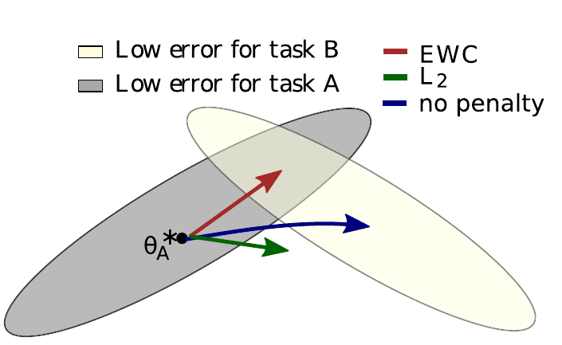
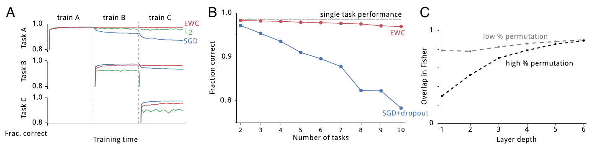
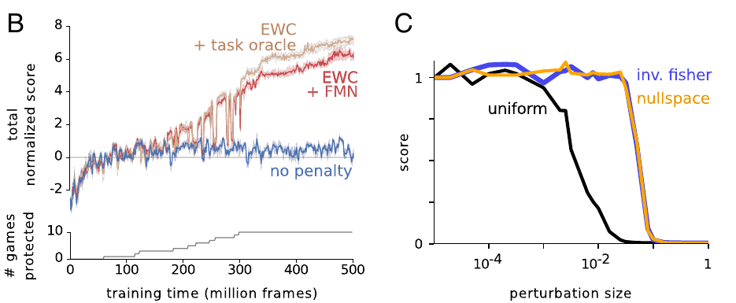

# 파국적 망각을 넘어서: EWC 논문 읽기

이 글은 EWC(Elastic Weight Consolidation) 논문을 읽으면서 특히 **"어떤 가중치가 중요한지를 어떻게 정의하고 계산하는가"** 를 집요하게 파고든 내용을 정리한 것이다. 논문의 전체 구성을 훑되, 피셔 정보 행렬이 왜 중요도가 되는지, 그걸 왜 1차 미분의 제곱으로 계산하는지, 최적점에서는 미분값이 0인데 어떻게 0이 아닌 값이 나오는지 같은 지점에 대부분의 지면을 할애했다.

---

## 1. 문제: 파국적 망각

신경망을 태스크 A → B 순차 학습시키면, B에 맞춰 가중치가 갱신되면서 A 성능이 급격히 무너진다. 이것이 **catastrophic forgetting**(파국적 망각)이다. 태스크 A에 중요했던 가중치들이 태스크 B의 목적에 맞게 덮어써지기 때문에 일어난다.

기존의 우회로는 두 가지였고 둘 다 한계가 분명했다.

- **멀티태스크 학습**: 모든 태스크의 데이터를 동시에 섞어서 학습한다. 잘 작동하지만 모든 데이터를 항상 손에 쥐고 있어야 한다.
- **리플레이 / system-level consolidation**: 과거 데이터를 저장했다가 다시 들려준다. 저장량이 태스크 수에 비례해 늘어나므로 태스크가 많아지면 확장성이 없다.

현실의 에이전트는 태스크가 언제 바뀔지 모르고, 한 번 지나간 태스크가 아주 오랫동안 다시 안 나타날 수도 있다. 그런 환경에서 **continual learning**(연속 학습)이 가능하려면 데이터를 쌓아두지 않고도 과거를 지킬 방법이 필요하다.

## 2. 착안점: 뇌는 시냅스를 굳힌다

인공신경망과 대조적으로, 사람과 동물은 연속 학습을 꽤 잘 한다. 논문이 인용하는 실험 증거는 이렇다. 쥐가 새로운 기술을 습득할 때 일부 흥분성 시냅스가 강화되고, 이는 개별 뉴런의 수상돌기 가시(dendritic spine) 부피 증가로 나타난다. 결정적으로 **이렇게 커진 가시는 이후 다른 태스크를 학습해도 유지되며**, 몇 달 뒤까지 성능이 보존되는 것을 설명한다. 반대로 이 가시들을 선택적으로 "지우면" 해당 기술을 잊어버린다.

즉 신피질의 연속 학습은 **task-specific synaptic consolidation** — 일부 시냅스의 가소성을 선택적으로 낮춰 오랜 시간 안정적으로 유지하는 방식 — 에 의존한다. EWC는 이걸 인공신경망으로 옮긴 알고리즘이다.

## 3. EWC의 핵심 아이디어



*태스크 A에서 오차가 낮은 영역(회색)과 태스크 B에서 오차가 낮은 영역(크림색). 학습이 끝난 지점 θ\*_A에서 출발해 세 가지 방식으로 B를 학습했을 때의 궤적.*

출발점은 신경망의 **과매개변수화**(overparameterization)다. 수많은 θ 조합이 같은 성능을 내기 때문에, 태스크 B의 해 θ\*_B가 이미 찾아둔 태스크 A의 해 θ\*_A **근처에 존재할 가능성이 높다**. 그렇다면 B를 학습하되 θ\*_A 주변의 "A에서 오차가 낮은 영역" 안에 머물도록 제약을 걸면 된다.

이 제약을 **2차 페널티**로 구현하기 때문에, 파라미터를 예전 해에 붙들어 매는 **스프링**으로 상상할 수 있다. 그래서 이름이 elastic(탄성)이다. 그리고 핵심은 여기다 — **이 스프링의 강성이 모든 파라미터에 대해 같아서는 안 된다.** 태스크 A의 성능에 크게 영향을 주는 파라미터일수록 세게 당겨야 한다.

위 그림의 세 화살표가 정확히 이 이야기다.

- **파란 화살표 (no penalty)**: B의 손실만 보고 경사하강. B는 잘 배우지만 A에서 배운 걸 파괴한다.
- **초록 화살표 (L₂)**: 모든 가중치를 같은 계수로 묶는다. 제약이 지나치게 획일적이라, A를 기억하는 대가로 B를 제대로 배우지 못한다.
- **빨간 화살표 (EWC)**: 각 가중치가 A에 얼마나 중요한지를 **명시적으로 계산해서** 차등 제약을 건다. A의 손실을 크게 늘리지 않으면서 B의 해에 도달한다.

## 4. "사후분포가 중요도를 담고 있다"는 말의 의미

논문에서 가장 중요한 논리적 도약은 "태스크 A의 사후분포 p(θ|D_A)가 어떤 가중치가 A에 중요한지를 담고 있다"는 부분이다. 이걸 정확히 이해하는 게 EWC 전체를 이해하는 것과 같다.

### 1) 가중치의 "값"이 중요도는 아니다

먼저 흔한 오해를 정리하자. **가중치의 값 자체는 중요도가 아니다.** 값과 중요도는 EWC에서 완전히 분리된 두 개의 역할을 한다.

- **θ\*_A (값)**: 스프링이 **어디로** 당길지 = 앵커 위치
- **F_i (피셔 정보)**: 그 스프링이 **얼마나 세게** 당길지 = 중요도

핵심은 사후분포가 **점이 아니라 분포**라는 데 있다. 태스크 A를 학습한 뒤 우리가 얻는 건 "최적값 θ\*_A 하나"가 아니라, "A의 데이터와 양립 가능한 θ들의 분포 p(θ|D_A)"다. 그리고 이 분포의 **폭(분산)** 이 곧 중요도 정보다.

- 어떤 방향 θ_i로 분포가 **좁다** → 그 값을 조금만 바꿔도 A의 데이터를 설명하지 못함 → **중요한 가중치**
- 어떤 방향 θ_j로 분포가 **넓다** → 아무 값이나 써도 A 성능이 같음 → **안 중요한 가중치**

즉 중요도는 "값이 크냐"가 아니라 **"흔들었을 때 손실이 얼마나 튀냐(곡률)"** 다. 죽은 경로에 붙은 값 100짜리 가중치는 중요도가 0이고, 병목에 있는 값 0.01짜리 가중치는 중요도가 클 수 있다.

### 2) A의 사후분포가 B의 prior가 된다

논문은 베이즈 정리에서 출발한다.

$$\log p(\theta \mid \mathcal{D}) = \log p(\mathcal{D} \mid \theta) + \log p(\theta) - \log p(\mathcal{D})$$

여기서 데이터의 로그우도 log p(D|θ)는 곧 손실함수의 음수 −L(θ)다. 이제 데이터가 태스크 A(D_A)와 태스크 B(D_B)로 나뉜다고 가정하고 정리하면:

$$\log p(\theta \mid \mathcal{D}) = \log p(\mathcal{D}_B \mid \theta) + \log p(\theta \mid \mathcal{D}_A) - \log p(\mathcal{D}_B)$$

좌변은 여전히 **전체 데이터**에 대한 사후분포인데, 우변에서 태스크 A의 원본 데이터 D_A는 **사라지고** p(θ|D_A) 항만 남는다. 그러니까 A에 대해 알아야 할 모든 것이 이 분포 하나에 압축되어 있고, B를 학습할 때는 이걸 prior로 쓰면 된다. **데이터를 저장할 필요가 없다**는 게 EWC의 실용적 핵심이다.

### 3) 라플라스 근사 — 분포를 계산 가능한 형태로

p(θ|D_A)의 진짜 형태는 계산 불가능하다. 그래서 Mackay의 **라플라스 근사**를 따라, 최빈값 θ\*_A 주변에서 2차 테일러 전개를 한다.

$$\log p(\theta \mid \mathcal{D}_A) \approx \text{const} - \tfrac{1}{2}(\theta - \theta^*_A)^\top H (\theta - \theta^*_A)$$

1차 항은 θ\*_A가 최적점이라 기울기가 0이므로 사라진다. 남는 건 곡률 행렬 H뿐이고, 이건 곧 **평균 θ\*_A, 정밀도(precision) H인 가우시안**이다. 즉 분산 ≈ H⁻¹.

H(헤시안)는 큰 모델에서 계산이 불가능하므로, 최소점 근처에서 이와 같아지는 **피셔 정보 행렬 F**로 대체하고 **대각성분만** 쓴다. 논문이 정리한 F의 세 가지 성질이 이 선택을 정당화한다.

1. 최소점 근처에서 **손실의 2차 미분과 동등**하다.
2. **1차 미분만으로 계산**할 수 있어 대형 모델에서도 부담이 없다.
3. **positive semi-definite**가 보장된다 (제곱의 평균이므로).

### 4) 최종 손실

B를 학습할 때 −log p(θ|D_A)를 페널티로 더하면 그대로 EWC의 목적함수가 된다.

$$\mathcal{L}(\theta) = \mathcal{L}_B(\theta) + \sum_i \frac{\lambda}{2} F_i \left(\theta_i - \theta^*_{A,i}\right)^2$$

- `(θᵢ − θ*_A,ᵢ)²` → 앵커 θ\*_A로부터의 변위
- `Fᵢ` → 스프링 상수(중요도)
- `λ` → 라플라스 근사가 거친 탓에 붙는, 옛 태스크와 새 태스크의 상대적 중요도를 조절하는 하이퍼파라미터

논문의 실험에서 L₂ 정규화(그림 3의 초록 곡선)가 실패한 이유가 정확히 여기에 있다. **L₂는 모든 i에 대해 F_i = 1로 두는 것과 같다.** 안 중요한 가중치까지 똑같이 묶어버리니 B를 배울 여유 용량이 남지 않는다.

태스크가 3개 이상이 되면 A와 B 각각에 대한 2차 페널티를 따로 더하거나, 2차 페널티의 합 자체가 다시 2차 페널티라는 점을 이용해 하나로 합칠 수 있다.

## 5. 피셔 정보를 실제로 계산하기

여기서부터가 구현의 실체다.

### 1) score — 무엇을 미분하는가

한 샘플 x에 대해 모델이 내놓는 건 확률분포 p(y|x, θ)다. 이걸 로그 취해 θ로 미분한 벡터를 **score**라고 부른다.

$$s(x, y; \theta) = \nabla_\theta \log p(y \mid x, \theta)$$

s의 i번째 성분은 *"θ_i를 아주 조금 늘리면 이 모델이 y라고 말할 로그확률이 얼마나 오르내리는가"* 다. 곧 파라미터 하나에 대한 **출력의 민감도**다.

피셔 정보는 이 score의 외적을 데이터에 대해 평균낸 것이고, EWC는 대각성분만 쓴다.

$$F = \mathbb{E}_x \, \mathbb{E}_{y \sim p(y|x,\theta)} \left[ s s^\top \right] \qquad \longrightarrow \qquad F_i = \mathbb{E}\left[ s_i^2 \right]$$

### 2) score는 목적함수의 미분으로 이해해도 되는가

실무적으로는 그렇다. **부호만 뒤집힌 관계**다.

$$\mathcal{L}(\theta) = -\log p(y \mid x, \theta), \qquad s = \nabla_\theta \log p = -\nabla_\theta \mathcal{L}$$

교차엔트로피 손실이 곧 음의 로그우도이기 때문이다. 그리고 F는 어차피 제곱하므로 부호가 사라진다.

$$F_i = \mathbb{E}\left[s_i^2\right] = \mathbb{E}\left[\left(\partial \mathcal{L}/\partial \theta_i\right)^2\right]$$

그래서 코드에서 `loss.backward()` 후 `p.grad.pow(2)`를 누적하는 게 그대로 성립한다. `p.grad`가 곧 −score다.

다만 "목적함수"가 정확히 무엇이냐가 중요하다. score는 **확률모델의 로그우도**에 대한 미분이므로, 학습할 때 쓰던 목적함수를 그대로 가져다 쓰면 안 되는 경우가 있다.

**(a) 우도가 아닌 항은 빼야 한다.** weight decay(L₂), 보조 손실, 그리고 특히 **이전 태스크의 EWC 페널티 자체**는 p(y|x,θ)와 무관하다. 이것들이 섞이면 F가 오염된다. F를 계산할 때는 순수 우도 항만 남긴 손실로 역전파해야 한다.

**(b) 손실이 우도로 해석되는 형태여야 한다.** 교차엔트로피는 범주분포의 음의 로그우도라 그대로 맞다. MSE도 등분산 가우시안 우도의 음의 로그우도라 상수배까지 맞다. 반면 hinge loss, 랭킹 손실 같은 건 확률모델이 아니라서 아래에서 다룰 정보행렬 등식이 성립하지 않는다.

**(c) y를 어디서 가져오느냐.** 정의상 score의 기댓값은 y를 **모델 분포에서 샘플링**해 취한다. 학습 때 쓰던 정답 레이블을 그대로 쓰면 그건 empirical Fisher이고, 그 순간 "목적함수의 기울기"와 "score"가 개념적으로 갈라진다.

정리하면: **score = (순수 우도 손실의 기울기) × (−1), 단 레이블은 모델 자신이 뽑은 것.** 걸러야 할 건 정규화 항과 레이블 출처 두 가지다.

### 3) 왜 제곱해서 누적하는가

이유가 두 가지 있다.

**(a) 부호가 상쇄되면 안 된다.** 학습이 수렴한 θ\*_A에서는 전체 데이터에 대한 평균 기울기가 **거의 0**이다. 그게 최소점의 정의니까. 하지만 개별 샘플의 기울기는 0이 아니고, 서로 다른 방향으로 팽팽하게 당기며 균형을 이루고 있을 뿐이다.

우리가 알고 싶은 건 "평균적으로 어느 쪽으로 당기나"(=0)가 아니라 **"각 샘플이 얼마나 세게 당기고 있나"** 다. 제곱이 부호를 없애 이 크기를 살린다.

여기서 실전 구현 함정이 하나 나온다.

```python
# 틀림 — 배치 평균 기울기를 제곱 (≈ 0이 나온다)
loss = criterion(model(batch_x), batch_y)
loss.backward()
fisher += p.grad.pow(2)

# 맞음 — 샘플별로 제곱한 뒤 평균
for x, y in per_sample_loader:
    ...
    fisher += p.grad.pow(2)
```

**제곱 후 평균**이지 **평균 후 제곱**이 아니다. 순서를 바꾸면 F가 통째로 0에 가까워져 페널티가 사라진다.

**(b) score의 분산이기 때문.** 실제로 score의 기댓값은 정확히 0이다.

$$\mathbb{E}_y[s] = \int p \, \nabla \log p \, dy = \int \nabla p \, dy = \nabla \int p \, dy = \nabla 1 = 0$$

평균이 0이므로 E[s²]는 곧 **score의 분산**이다. 출력이 θ_i에 민감할수록 샘플마다 score가 크게 요동치고, 분산이 크다.

### 4) 왜 1차 미분의 제곱이 2차 곡률과 같아지는가

이게 EWC를 실용적으로 만드는 핵심 트릭이다. log p를 두 번 미분하면:

$$\nabla^2 \log p = \frac{\nabla^2 p}{p} - \left(\frac{\nabla p}{p}\right)\left(\frac{\nabla p}{p}\right)^\top = \frac{\nabla^2 p}{p} - s s^\top$$

첫 항의 기댓값을 보면 E[∇²p/p] = ∫∇²p dy = ∇²∫p dy = ∇²1 = 0. 따라서

$$\mathbb{E}\left[\nabla^2 \log p\right] = -\mathbb{E}\left[s s^\top\right] = -F$$

로그우도의 헤시안이 −F이므로, 손실(=음의 로그우도)의 헤시안이 곧 **F**다. **1차 미분만 제곱해서 2차 곡률을 얻는** 셈이다. 헤시안을 직접 구성하면 파라미터 수의 제곱만큼 메모리가 필요하지만, 이 방법은 역전파 한 번이면 된다.

단, 위 유도에서 y에 대한 기댓값은 **모델 자신의 분포 p(y|x,θ)** 에 대한 것이다. 정답 레이블을 쓰는 empirical Fisher에서는 이 등식이 정확히 성립하지 않는다. 수렴이 잘 된 지점에서는 두 분포가 비슷해 실용적으로 통하지만, 그렇지 않으면 어긋난다.

### 5) 숫자로 보는 감각

두 가중치 θ₁, θ₂가 있고 샘플 4개에서 score가 이렇게 나왔다고 하자.

| 샘플 | s₁ | s₂ |
|---|---|---|
| 1 | +3.0 | +0.02 |
| 2 | −2.8 | −0.01 |
| 3 | +2.5 | +0.03 |
| 4 | −2.7 | −0.04 |

평균 기울기는 둘 다 0에 가깝다(수렴했으니까). 하지만 제곱 평균은 전혀 다르다.

- F₁ = (9.0 + 7.84 + 6.25 + 7.29)/4 ≈ **7.6**
- F₂ = (0.0004 + 0.0001 + 0.0009 + 0.0016)/4 ≈ **0.00075**

θ₁은 만 배 강한 스프링으로 묶이고, θ₂는 사실상 자유롭게 풀려 태스크 B 학습에 쓰인다. 사후분포 관점에서는 분산이 대략 1/F_i이므로 θ₁은 폭 좁은 봉우리, θ₂는 거의 평평한 분포다.

### 6) 학습 궤적은 관측하지 않는다

여기서 자연스럽게 나오는 질문 하나. p(θ|D_A)를 구하려면 학습이 진행되는 동안 θ의 변동을 계속 관측해야 할까? **아니다. 학습 궤적은 전혀 보지 않는다.** A 학습이 완전히 끝난 뒤, 최종 지점 θ\*_A **한 점에서** 계산한다.

절차는 이렇다.

1. 태스크 A를 평소처럼 끝까지 학습 → θ\*_A 확보
2. θ\*_A에 **고정**시켜 놓고 D_A를 (한 번, 또는 일부 샘플만) 다시 돌림
3. 각 샘플마다 로그우도의 기울기를 구해 **제곱해서 누적** → F_i
4. θ\*_A와 F를 저장하고 A의 데이터는 버림

```python
# A 학습 종료 후
model.eval()
fisher = {n: torch.zeros_like(p) for n, p in model.named_parameters()}

for x, _ in loader_A:                    # 전체 또는 수백~수천 샘플
    model.zero_grad()
    logits = model(x)
    y = torch.multinomial(logits.softmax(-1), 1)   # 모델 자신의 분포에서 샘플링
    F.cross_entropy(logits, y.squeeze()).backward()
    for n, p in model.named_parameters():
        fisher[n] += p.grad.pow(2)

fisher = {n: f / len(loader_A) for n, f in fisher.items()}
theta_star = {n: p.detach().clone() for n, p in model.named_parameters()}
```

저장 비용은 파라미터당 숫자 2개(θ\*_A, F_i)로 끝난다. 모델 하나 크기의 두 배면 충분하다.

**왜 궤적이 필요 없는가.** 라플라스 근사가 하는 일이 "최빈값 주변의 국소 곡률만으로 분포 전체를 대신한다"이기 때문이다. 가우시안은 평균과 정밀도 두 개로 완전히 결정되므로, θ\*_A(평균)와 그 점에서의 F(정밀도)만 알면 된다. 거기까지 어떤 경로로 왔는지는 근사의 정의상 무관하다. 바꿔 말하면 **"학습 중 θ_i가 얼마나 움직였나"가 아니라 "지금 θ_i를 흔들면 출력이 얼마나 흔들리나"** 를 묻는 것이다.

**다만 궤적을 쓰는 방법도 있다.** 같은 해에 나온 **Synaptic Intelligence**(Zenke et al., ICML 2017)는 학습이 진행되는 **동안** 각 파라미터가 손실 감소에 기여한 양을 온라인으로 누적한다.

$$\omega_i = \sum_t \left(-\frac{\partial \mathcal{L}}{\partial \theta_i}\right) \cdot \Delta\theta_i(t)$$

"이 가중치가 움직여서 손실을 실제로 얼마나 줄였는가"를 경로를 따라 적분한 것으로, 별도의 사후 계산 패스가 필요 없다는 장점이 있다. EWC와 SI는 중요도를 각각 **종점의 곡률** vs **경로상의 기여도**로 정의한다는 점에서 대비된다.

## 6. 최적점이면 미분값이 0 아닌가?

이 지점이 가장 헷갈리기 쉽다. θ\*_A가 최적값이라면 손실의 미분이 0일 텐데, 어떻게 그 미분으로 0이 아닌 F를 얻는가?

답은: **0이 되는 건 "샘플들의 평균 기울기"이고, F는 "샘플별 기울기의 제곱 평균"이다.** 서로 다른 양이다.

$$\nabla \mathcal{L}_{\text{total}}(\theta^*) = \frac{1}{N}\sum_n \nabla \mathcal{L}_n(\theta^*) \approx 0 \qquad \text{(1차 모멘트)}$$

$$F_i = \frac{1}{N}\sum_n \left(\frac{\partial \mathcal{L}_n}{\partial \theta_i}\right)^2 \gg 0 \qquad \text{(2차 모멘트)}$$

평균이 0인 분포가 분산이 0일 필요는 없다. 앞의 표에서 s₁이 +3.0, −2.8, +2.5, −2.7이었다. 합은 0에 가깝지만 제곱합은 크다. **최적점이란 개별 샘플들의 요구가 서로 상쇄되어 균형을 이룬 상태**이지, 아무도 당기지 않는 상태가 아니다. 줄다리기가 팽팽하게 멈춰 있어도 밧줄의 장력은 크다.

**더 깔끔한 관점: F는 애초에 2차 미분이다.** 앞에서 유도했듯 F = E[∇²L]이다. 그러면 질문이 자동으로 풀린다. 최소점의 정의 자체가

- 1차 미분 = 0
- 2차 미분 > 0

이고, 이 둘은 모순이 아니라 **한 세트**다. 그릇 바닥의 구슬은 알짜힘이 0이지만, 벽이 얼마나 가파른지(곡률)는 별개로 존재하고 그게 바로 우리가 재려는 값이다. "θ\*_A에서 기울기가 0인데 어떻게 중요도를 재나?"는 "바닥에서 힘이 0인데 어떻게 그릇 모양을 아나?"와 같고, 답은 "바닥이 아니라 벽의 기울어짐, 즉 곡률을 본다"이다.

**true Fisher에서는 수렴 여부와 아예 무관하다.** 정의대로 y를 모델 자신의 분포에서 뽑는 경우, score의 평균이 0인 건 수렴 때문이 아니라 **항등식**이다.

$$\mathbb{E}_{y \sim p(y|x,\theta)}\left[\nabla \log p(y|x,\theta)\right] = \int \nabla p \, dy = \nabla \int p \, dy = \nabla 1 = 0$$

θ가 최적이든 아니든, 데이터 x 하나하나에 대해 **항상** 0이다. 확률이 총합 1로 고정되어 있으니 어떤 y의 확률이 오르면 다른 y의 확률은 반드시 내려가고, 그 기울기들이 정확히 상쇄되는 것이다. 반면 **empirical Fisher**(정답 레이블 사용)에서 평균 기울기가 0에 가까운 건 순전히 "수렴했기 때문"이다. 그래서 아직 덜 수렴한 모델에 empirical Fisher를 쓰면 F에 "아직 학습이 안 끝나서 남은 기울기" 성분이 섞여 들어가 곡률 추정이 왜곡된다.

덧붙이면, 실제로는 θ\*_A가 정확한 최적값도 아니다. SGD, 고정 에폭 수, early stopping 때문에 실제 도달 지점은 안장점 근처거나 최소점에서 조금 벗어난 곳이다. 다만 EWC 입장에서 이건 문제가 안 된다. F는 어차피 제곱 항만 모으고, 앵커 θ\*_A는 "진짜 최적점"이 아니라 **"A가 잘 작동하던 그 지점"** 이면 충분하기 때문이다.

## 7. 실험

### 1) Permuted MNIST

MNIST 이미지의 픽셀을 고정된 무작위 순열로 섞어 태스크를 만든다. 각 태스크는 난이도가 동일하지만 서로 다른 해를 요구한다.



패널 A가 3절에서 본 개념도를 그대로 실험으로 옮긴 그림이다. 태스크 A → B → C로 넘어갈 때,

- **파란색 (SGD)**: B 학습을 시작하는 순간 A 성능이 급락한다. 태스크가 추가될수록 망각이 누적된다.
- **초록색 (L₂)**: A의 성능 저하는 훨씬 덜하지만, 모든 가중치를 똑같이 묶어놓은 탓에 B와 C를 제대로 배우지 못한다.
- **빨간색 (EWC)**: 옛 태스크를 유지하면서 새 태스크도 학습한다.

패널 B는 태스크 수를 늘려가며 전체 평균 성능을 본 것이다. 그래프에서 읽은 값은 다음과 같다.

| 태스크 수 | EWC | SGD + dropout |
|---:|---:|---:|
| 2 | **0.983** | 0.972 |
| 3 | **0.982** | 0.954 |
| 4 | **0.981** | 0.935 |
| 5 | **0.979** | 0.910 |
| 6 | **0.978** | 0.896 |
| 7 | **0.976** | 0.878 |
| 8 | **0.975** | 0.823 |
| 9 | **0.971** | 0.822 |
| 10 | **0.965** | 0.780 |

*Fraction correct(전체 태스크 평균 정답률), 높을수록 좋음. 논문 Fig. 3B의 플롯에서 픽셀 좌표로 읽은 근사값이다. 참고로 단일 태스크만 학습했을 때의 성능(점선)은 약 0.985.*

여기서 비교 대상인 SGD+dropout이 임의로 고른 약한 베이스라인이 아니라는 점이 중요하다. 파국적 망각을 다룬 선행 연구들이 하이퍼파라미터 탐색과 dropout 정규화로 최선을 다한 결과가 이것이고, 그마저도 순열 두 개 정도까지만 그럭저럭 통했다. EWC는 태스크가 10개로 늘어도 오차 증가가 **0.983 → 0.965로 2%p 미만**인 반면, SGD+dropout은 **0.972 → 0.780으로 19%p** 무너진다.

### 2) 표현을 나눠 쓰는가, 공유하는가

EWC가 고정된 용량에 더 많은 기능을 밀어 넣는다면, 태스크마다 네트워크의 별도 영역을 할당하는 걸까 아니면 표현을 공유하는 걸까? 논문은 두 태스크의 피셔 정보 행렬이 얼마나 겹치는지(**Fisher overlap**)로 이를 측정했다(패널 C).

- 겹침이 작다 = 두 태스크가 서로 다른 가중치에 의존한다 (분할)
- 겹침이 크다 = 가중치를 공유한다 (표현 공유)

결과는 계층 깊이에 따라 달랐다. 아주 유사한 두 태스크(가운데 8×8 픽셀만 섞음, 회색 점선)는 전 계층에서 같은 가중치에 의존한다. 반면 이질적인 두 태스크(26×26 픽셀을 섞음, 검은 점선)는 **초기 층에서 가중치를 분리해 쓴다**. 그럼에도 출력에 가까운 층은 두 태스크가 함께 재사용한다. 순열이 입력 도메인은 완전히 바꿔놓지만 출력 도메인(클래스 레이블)은 공유되기 때문이다. 단순 분할이 아니라 **필요한 곳에서만 분할하고 나머지는 공유**하는 셈이다.

### 3) Atari 2600 — 강화학습에서의 연속 학습

훨씬 까다로운 RL 도메인으로 넘어간다. DQN이 인간 수준 이상으로 플레이하는 게임 중 10개를 무작위로 골라, 순서를 섞어가며 순차적으로 학습시킨다(같은 게임으로 여러 번 돌아오는 것도 허용).



여기서 EWC를 쓰려면 "지금 어떤 게임을 하고 있는가"를 알아야 한다. 어떤 2차 제약이 활성이고 어떤 제약을 갱신할지가 거기 달려 있기 때문이다. 논문은 태스크 문맥을 은닉 마르코프 모델의 잠재변수로 두고, **FMN(forget-me-not) 프로세스** 기반의 비지도 온라인 클러스터링으로 이를 추론했다. 최근 데이터를 기존 모델 풀보다 잘 설명하는 새 생성 모델이 나타나면 추가하는 방식이다. 여기에 추론된 태스크별 짧은 리플레이 버퍼를 따로 두고, 계층마다 게임 전용 bias와 곱셈 gain을 소량 허용했다. 결과적으로 시스템은 **두 개의 시간 스케일**을 갖는다 — 짧은 쪽은 experience replay, 긴 쪽은 EWC에 의한 통합.

패널 B의 결과: 일반 경사하강(파란색)은 게임 하나 이상을 배우지 못하고, 옛 게임을 잊는 손해 때문에 인간 정규화 총점이 1을 넘지 못한다. EWC(빨간색)는 여러 게임을 동시에 유지하며 총점 6~7까지 올라간다. 참고로 태스크 레이블을 직접 알려준 경우(갈색)와 FMN으로 추론한 경우(빨간색)의 차이는 크지 않았다 — 태스크 추론 모듈이 제 역할을 했다는 뜻이다.

이전 RL 연속 학습 접근들이 네트워크에 용량을 추가하거나(Progressive Networks) 게임마다 별도 네트워크를 학습한 뒤 하나로 증류하는 방식이었던 것과 달리, EWC는 **고정된 용량의 단일 네트워크**로, 계산 오버헤드도 거의 없이 이를 해낸다.

## 8. 한계

논문 스스로 짚는 약점이 꽤 정직하다.

**(a) 개별 학습에는 못 미친다.** EWC 에이전트가 10개 게임을 순차로 배워도, 게임마다 DQN을 따로 10개 학습한 성능에는 도달하지 못한다.

**(b) 파라미터 불확실성을 과소평가한다.** 원인을 찾기 위해 저자들은 Breakout으로 학습한 에이전트의 가중치에 노이즈를 주입해봤다(위 그림 패널 C).

- **검정(uniform)**: 모든 가중치를 똑같이 흔든다 → 성능이 가장 빨리 무너진다.
- **파랑(inverse Fisher)**: (F+λI)⁻¹ 모양으로 흔든다 = EWC가 허용하는 방향 → 훨씬 견딘다. **F가 중요도 추정치로서 유효함을 검증**한다.
- **주황(nullspace)**: 피셔가 "출력이 완전히 무관하다"고 판단한 방향 → 근사가 옳다면 아무 영향이 없어야 하는데, **실제로는 inverse Fisher와 똑같이 성능이 떨어진다.**

세 번째가 문제다. 특정 파라미터가 안 중요하다고 **과신**하고 있다는 뜻이고, 그 원인은 라플라스 근사가 사후분포 분산에 대해 점추정을 쓴다는 데 있다. 특히 `s sᵀ`의 비대각 항 E[s_i s_j]를 버리는 **대각 근사**는 파라미터들이 서로 독립이라고 가정하는 것인데, 실제 신경망은 가중치들이 강하게 상관되어 있다(한 뉴런의 입력 가중치들끼리 특히). 저자들은 베이지안 신경망으로 개선할 수 있으리라 제안했고, 이후 K-FAC 같은 블록 대각 근사로 이 부분을 보강하려는 연구들이 나왔다.

**(c) 용량을 넘기면 오히려 나빠진다.** 무작위 패턴 실험(Fig. 2)에서, 관찰한 패턴 수가 네트워크 용량 n에 가까울 때는 EWC가 기억 보존 비율을 높여주지만, 용량을 초과하면 일반 경사하강보다 못하다. EWC에서 가중치는 시간이 갈수록 **더 제약되기만 할 뿐 풀리지 않기 때문**에, 표준 Hopfield 네트워크처럼 용량이 포화되면 blackout catastrophe에 취약해진다. 논문은 실제 실험 조건들이 용량에 한참 못 미치는 영역이라 이 문제를 관찰하지 않았다고 밝힌다.

**(d) 실무 스케일 이슈.** F를 샘플 수로 나눌지 합칠지에 따라 스케일이 데이터 크기만큼 차이 난다. 어차피 λ가 흡수하지만, λ를 논문 값 그대로 가져다 쓸 때 정규화 방식이 다르면 전혀 다른 결과가 나온다. λ는 태스크 수와 F 정규화 방식에 맞춰 다시 튜닝해야 하는 값이다. 태스크가 3개 이상일 때 (θ\*, F) 쌍을 태스크마다 따로 들지, 하나로 누적할지도 선택해야 한다(후자가 online EWC, Schwarz et al. 2018).

## 9. 정리

EWC를 한 문장으로 요약하면: **태스크 A의 사후분포를 라플라스 근사로 가우시안 하나로 압축해두고, 그 정밀도(=피셔 정보 대각)를 스프링 상수 삼아 태스크 B를 학습한다.**

이 논문에서 가장 배울 만한 부분은 알고리즘 자체보다 그 유도 과정이라고 생각한다. "중요한 가중치를 보호하자"는 직관에서 출발해,

1. 중요도를 **사후분포의 폭**으로 정의하고 (값이 아니라)
2. 라플라스 근사로 그 폭을 **곡률**로 바꾸고
3. 정보행렬 등식으로 곡률을 **1차 미분의 제곱**으로 바꿔서
4. 역전파 한 번으로 계산 가능하게 만든다

각 단계가 이론적 정당성과 계산 가능성 사이의 거래를 명시적으로 하고 있고, 어디서 무엇을 잃었는지(대각 근사, 점추정)까지 논문이 스스로 지목한 뒤 Fig. 4C로 그 손실을 실험적으로 측정해 보인다. 근사를 도입하고 그 근사가 어디서 깨지는지를 같은 논문 안에서 재는 태도가, 이 논문이 계속 인용되는 이유 중 하나일 것이다.

---

### 참고

- Kirkpatrick, J. et al. (2017). Overcoming catastrophic forgetting in neural networks. *PNAS* 114(13), 3521–3526.
- Zenke, F., Poole, B., & Ganguli, S. (2017). Continual Learning Through Synaptic Intelligence. *ICML*.
- Schwarz, J. et al. (2018). Progress & Compress: A scalable framework for continual learning. *ICML*.
- MacKay, D. J. C. (1992). A Practical Bayesian Framework for Backpropagation Networks. *Neural Computation*.
